# Mark Schemes — Forming & Solving Equations
**Equations, Formulae & Identities** · Edexcel IGCSE Maths A (4MA1) — 18/Higher

## Q1 — easy — 3 marks · exam-questions

### 3() — 3 marks
> *The perimeter of a shape is the sum of the lengths of its sides. For a rectangle this is length + width + length + width, or 2(length + width).*

> *Use this to form an expression for the perimeter of the rectangle.*

$\begin{gathered} P & = l + w + l + w \\ P & = 2 l + 2 w \\ = 2 ( x ) + 2 ( x + 4 ) \end{gathered}$

** **** [1]**

> *Form an equation for the perimeter of the rectangle, setting it equal to 45 cm.*

$\begin{gathered} \text{Perimeter} & = 45 \\ 2 ( x ) + 2 ( x + 4 ) & = 45 \end{gathered}$

** **** [1]**

> *Simplify by first expanding the brackets and collecting the like terms.*

$\begin{gathered} 2 x + 2 x + 8 & = 45 \\ 4 x + 8 & = 45 \end{gathered}$

> *Solve the equation to find *$x$*.*

$\begin{gathered} 4 x + 8 & = 45 \\ - 8 & = - 8 \\ 4 x & = 37 \\ \div 4 & = \div 4 \\ x & = \frac{37}{4} \end{gathered}$

$x=9.25\mathrm{cm}$**  ****[1]**

## Q2 — easy — 3 marks · exam-questions

### 4() — 3 marks
> *Write down an expression, in terms of *$x$* for 6 currant buns.*

$\begin{gathered} 1 \text{currant} \text{bun} & = x \\ 6 \text{currant} \text{buns} & = 6 \times x = 6 x \end{gathered}$

> *Write down an expression, in terms of *$y$* for 8 iced buns.*

$\begin{gathered} 1 \text{iced} \text{bun} & = y \\ 8 \text{iced} \text{buns} & = 8 \times y = 8 y \end{gathered}$

** Either correct ****[1]**

> *T **is the total of 6 currant buns and 8 iced buns.*

> *Use this to write a formula for **T** in terms of **x** and **y**.*

$\begin{gathered} T & = 6 \text{currant} \text{buns} + 8 \text{iced} \text{buns} = 6 x + 8 y \end{gathered}$

**Adding both terms ****[1]**

$T=6x+8y$**  ****[1]**

## Q3 — easy — 3 marks · exam-questions

### 9() — 3 marks
> *Write down an expression, in terms of *$x$* for the number of small packets.*

$\begin{array}{ccc}Number of \text{envelopes} & = & 5 \times x = 5 x\end{array}$

> *Write down an expression, in terms of *$y$* for the number of large packets.*

$\begin{array}{ccc}Number of \text{envelopes} & = & 20 \times y = 20 y\end{array}$

** Either correct ****[1]**

> *T **is the total number of envelopes.*

> *Use this to write a formula for **T** in terms of **x** and **y**.*

$\begin{gathered} T & = 5 x + 20 y \end{gathered}$

**Adding both terms ****[1]**

$T=5x+20y$**  ****[1]**

## Q4 — easy — 3 marks · exam-questions

### 3() — 3 marks
> *We know that angle **AOB **and angle **AOC** are equal. *

> *Use this and the expressions given in the diagram to form an equation.*

$\begin{array}{rcl} A O B & = A O C \\ 6 x - 21 & = 4 x + 31 \end{array}$

**[1]**

> *Solve the linear equation, begin by subtracting *$x$* from each side.*

$\begin{gathered} 6 x - 21 & = 4 x + 31 \\ - 4 x & = - 4 x \\ 2 x - 21 & = 31 \\ + 21 & = + 21 \\ 2 x & = 52 \\ \div 2 & = \div 2 \\ x & = \frac{52}{2} \end{gathered}$

** ****Correct method to isolate terms**** [1]**
** **$\begin{gathered} x & = 26^{\circ} \end{gathered}$** ****[1]**

## Q5 — easy — 3 marks · exam-questions

### 4() — 3 marks
> *Method 1*

> *Write down an expression for the area of each part of the square individually.*

**At least two correct ****[1]**

> *The total area of the square will be the total of these four areas added together. *

> *Form an expression for the total area of the square.*

$\mathrm{Total} \mathrm{area}=9+3x+3x+x^{2}$

> *Form an equation by setting the total area equal to 10.*

$\begin{array}{rcl} 9 + 3 x + 3 x + x^{2} & = 10 \end{array}$

**[1]**

> *Simplify.*

$\begin{gathered} x^{2} + 6 x + 9 & = 10 \end{gathered}$

> *Reach the equation given in the question by subtracting 9 from each side.*

$\begin{gathered} x^{2} + 6 x + 9 & = 10 \\ - 9 & = - 9 \\ x^{2} + 6 x & = 1 \end{gathered}$

$x^{2}+6x=1$** [1]**

> *Method 2*

> *Add the two parts together to write down an expression for the side of the square.*

$AB=AD=3+x$

> *The total area of the square will be this expression squared. Form an expression for the total area of the square.*

$Total \text{area} = ( 3 + x ) ^{2}$

** ****[1]**

> *Expand the brackets, remember to multiply each term in the first by each term in the second.*

$\begin{gathered} ( 3 + x ) ( 3 + x ) & = 9 + 3 x + 3 x + x^{2} \end{gathered}$

> *Simplify.*

$\begin{gathered} \text{Total} \text{area} & = x^{2} + 6 x + 9 \end{gathered}$

> *Form an equation by setting this equal to 10.*

$\begin{gathered} x^{2} + 6 x + 9 & = 10 \end{gathered}$

**[1]**

> *Reach the equation given in the question by subtracting 9 from each side.*

$\begin{gathered} x^{2} + 6 x + 9 & = 10 \\ - 9 & = - 9 \\ x^{2} + 6 x & = 1 \end{gathered}$

$x^{2}+6x=1$** [1]**

## Q6 — easy — 4 marks · exam-questions

### 4() — 4 marks
> *The internal angles of a triangle sum to 180°.*

$30+4x+10+x+20=180$

**adding the three angles ****[1]** 
**equating the sum of the three angles to 180 ****[1]**

> *Simplify and collect all **x** terms on one side and all constant terms on the other.*

$\begin{array}{rcl} 5 x + 60 & = 180 \\ 5 x & = 120 \end{array}$

**[1]**

> *Divide both sides by 5.*

$x=24$ **[1]**

## Q7 — easy — 4 marks · exam-questions

### 3() — 4 marks
> *The number of buttons in tin **B** in terms of **x** is;*

$4x$

> *The number of buttons in tin **C** in terms of **x** is;*

$x-7$

**for  "**$4x$**" or "**$x-7$**" ****[1]**

> *Add the number of buttons in tin **A**, tin **B** and tin **C,** in terms of **x** and equate to 137.*

$x+4x+x-7=137$

**[1]**

> *Simplify and solve.*

$\begin{gathered} 6 x - 7 & = 137 \\ 6 x & = 144 \end{gathered}$

**[1]**

> *Divide both sides by 6 to obtain the number of buttons in tin **A.*

$\begin{gathered} x = 24 \end{gathered}$

> *Finally, subtract 7 to find the number of buttons in tin C.*

$\begin{array}{rcl} 24 - 7 & = 17 \end{array}$

**Answer = 17** **[1]**

## Q8 — easy — 1 marks · exam-questions

### 1() — 1 marks
> *To find *$b$* you would first square root *$a$*, **then** add 3.*

**The first option is correct, **$b=\sqrt{a}+3$ **[1]**

> *The second option would mean *$b$* is 3 less than the square root of *$a$*.*

> *The third option would mean *$b$* is the square root of '*$a$* plus 3' (add three to *$a$* then square root).*

> *The fourth option would mean *$b$* is the square root of '3 less than *$a$*'.*

## Q9 — easy — 3 marks · exam-questions

### 19() — 3 marks
> *If we call the width *$w$* then the length is *$5w$* we can label the shape as below.*

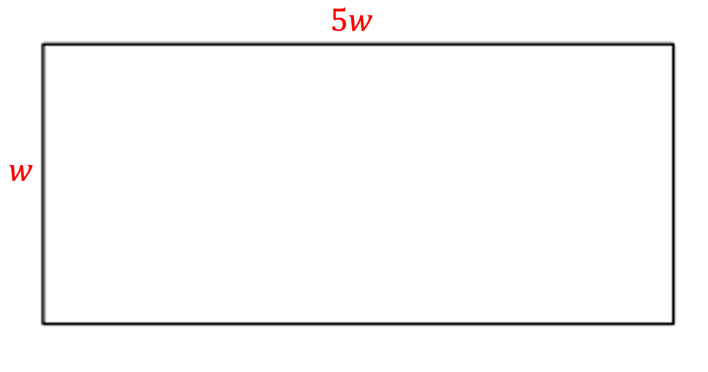

> *Area of a rectangle = length × width. Substitute 1620, '*$5w$*' and '*$w$*' into this formula.*

$1620=5w\timesw$

**[1]**

> *Simplify and start to solve by dividing both sides by 5.*

$\begin{gathered} 1620 = 5 w^{2} \\ \div 5 & = \div 5 \\ 324 = w^{2} \end{gathered}$

**[1]**

> *Square root both sides, ignoring the negative value as *$w$* is the width and must be positive.*

$\begin{gathered} \sqrt{324} & = w = 18 \end{gathered}$

**the width is 18 cm** **[1]**

## Q10 — easy — 4 marks · exam-questions

### 2((b)) — 4 marks
> *Find an expression for the total number of bars*

$y+3y+7+2y-5$

**[M1]**

> *Collect the like terms*

$6y+2$

> *Form an equation to solve*

$6y+2=56$

**[M1]**

> *Solve the equation by first subtracting *$2$* from each side*

$6y=54$

> *Divide both sides by *$6$

$y=9$

**[M1]**

> *Substitute this into the expression for the number of zinc bars*

$2\times9-5$

$18-5$

$13$

**[A1]**

## Q11 — medium — 5 marks · exam-questions

### 16() — 5 marks
> *The both start with the same number, let this be *$x$*. *

> *Write down an expression for the number Julie has after she multiplies by 5 and adds 4. *

$Julie ( J ) : 5 x + 4$

> *Write down an expression for the number Liam has after he subtracts the number **from** 10. *

$Liam ( L ) : 10 - x$

** ****Either correct ****[1]**

> *We also know that Julie's answer is now two thirds of Liam's answer. Use this to form an equation.*

$\begin{gathered} J & = \frac{2}{3} L \\ 5 x + 4 & = \frac{2}{3} ( 10 - x ) \end{gathered}$

**[1]**

> *Begin to solve the equation, remove the fraction by multiplying both sides by 3.*

$\begin{array}{rcl} 3 ( 5 x + 4 ) & = 3 ( \frac{2}{3} ( 10 - x ) ) \\ 3 ( 5 x + 4 ) & = 2 ( 10 - x ) \end{array}$

**[1]**

> *Expand the brackets on both sides.*

$\begin{gathered} 15 x + 12 & = 20 - 2 x \end{gathered}$

> *Solve the linear equation, begin by adding *$2x$* to each side.*

$\begin{gathered} 15 x + 12 & = 20 - 2 x \\ + 2 x & = + 2 x \\ 17 x + 12 & = 20 \\ - 12 & = - 12 \\ 17 x & = 8 \\ \div 17 & = \div 17 \\ x & = \frac{8}{17} \end{gathered}$

** Method to isolate terms correct**** [1]**

**They both started with the number **$\frac{8}{17}$** [1]**

## Q12 — medium — 4 marks · exam-questions

### 4() — 4 marks
> *To find the area, the length and the width of the individual tiles needs to be found.*

> *Begin by labelling each part of the pattern with the length (**l **) and the width (**w **) of each tile.*

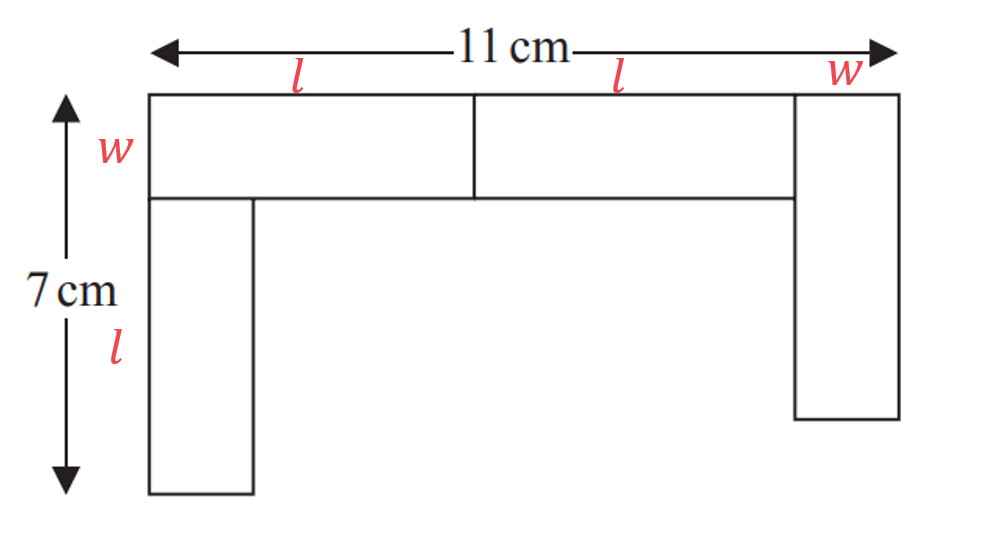

> *Use the given dimensions (7 cm and 11 cm) to form two equations in terms of **l ** and **w.*

$\begin{gathered} l + w & = 7 \\ l + l + w & = 11 \end{gathered}$

**Either correct**** [1]**

> *Simplify and number the equations.*

> $\begin{gathered} l + w & = 7 ( 1 ) \\ 2 l + w & = 11 ( 2 ) \end{gathered}$* *

> *Eliminate the **w** terms by subtracting equation (1) from equation (2). Be careful to subtract every term.*

`2 l + w = 11 bottom - ( l + w = 7 ) l = 4`

**[1]**

> *Substitute *$l=4$* into either of the two original equations**.*

$( 1 ) 4 + w = 7$

> *Solve this equation to find** w.*

$\begin{gathered} w & = 7 - 4 = 3 \end{gathered}$

> *So  **w**  =  3  and **l** = -4. Use this to find the area of one tile*

$\begin{gathered} Area_{( o n e t i l e )} & = 4 \times 3 = 12 cm^{2} \end{gathered}$

> *The total area of the pattern will be the area of 4 tiles.*

$\begin{gathered} Area_{( p a t t e r n )} & = 4 \times 12 = 48 cm^{2} \end{gathered}$

**[1]**

$48\mathrm{cm}^{2}$* ***[1]**

## Q13 — medium — 4 marks · exam-questions

### 9() — 4 marks
> *The perimeter of a shape is the sum of the lengths of its sides.*

> *Write down an expression, in terms of *$x$* for each of the lengths of the trapezium.*

$\begin{gathered} A D & = x \\ B C & = A D = x \\ A B & = 2 A D = 2 x \\ D C & = A B + 4 = 2 x + 4 \end{gathered}$

**At least AB or DC correct**** [1]**

> *Label the diagram with these expressions.*

> *Use this to form an expression for the perimeter of the trapezium.*

$\begin{gathered} P & = x + 2 x + x + ( 2 x + 4 ) \end{gathered}$

** **** [1]**

> *Form an equation for the perimeter of the trapezium, setting it equal to 38 cm.*

$\begin{gathered} \text{Perimeter} & = 38 \\ x + 2 x + 2 x + 4 & = 38 \\ 6 x + 4 & = 38 \end{gathered}$

** **** [1]**

> *Solve the equation to find *$x$*.*

$\begin{array}{rcl} 6 x + 4 & = 38 \\ - 4 & = - 4 \\ 6 x & = 34 \\ \div 6 & = \div 6 \\ x & = \frac{34}{6} = \frac{17}{3} \end{array}$

$x=5\frac{2}{3}$**  ****[1] **

**Equivalent fraction or decimal also accepted**

## Q14 — medium — 4 marks · exam-questions

### 10() — 4 marks
> *The both start with the same number of sweets, let this be *$x$*. Write down an expression for the amount of sweets they each have after Gemma gives 24 sweets to Betty.*

$Gemma ( G ) : x - 24 Betty ( B ) : x + 24$

**[1]**

> *We also know that Betty now has 5 times as many sweets as Betty, use this and the expressions for the number of their sweets to form and equation.*

$\begin{gathered} B & = 5 G \\ ( x + 24 ) & = 5 ( x - 24 ) \end{gathered}$

**[1]**

> *Begin to solve the equation by expanding the brackets on the right.*

$\begin{gathered} x + 24 & = 5 x - 120 \end{gathered}$

> *Solve the linear equation, begin by subtracting *$x$* from each side.*

$\begin{gathered} x + 24 & = 5 x - 120 \\ - x & = - x \\ 24 & = 4 x - 120 \\ + 120 & = + 120 \\ 144 & = 4 x \\ \div 4 & = \div 4 \\ \frac{144 }{4} & = x \\ x & = 36 \end{gathered}$

**[1]**

> *This shows that Gemma and Betty each started with 36 sweets.  In total, they started with 2(36) sweets.*

**72 sweets**** [1]**

## Q15 — medium — 3 marks · exam-questions

### 9() — 3 marks
*The volume of a cuboid is given by length × width × height.*

> *Write down an expression for the volume by multiplying the expressions for each together.*

$V=x\times3x\times2x=6x^{3}$

**[1]**

> *Write an **inequality** for the volume by setting this as **less than **900. *

> *The symbol for less than is <.*

$6x^{3}<900$

**[1]**

> *Begin to solve the inequality by dividing both sides by 6.*

$\begin{gathered} 6 x^{3} & < 900 \\ x^{3} & < \frac{ 900}{6} \\ x^{3} & < 150 \end{gathered}$

> *This is a non calculator paper so finding the cube root of 150 is not possible. Instead, consider the values of the cube numbers you do know.*

$\begin{gathered} 5^{3} & = 125 < 150 \Leftrightarrow x \text{must} \text{be} \text{greater} \text{than} 5 \end{gathered}$

$\begin{gathered} 6^{3} & = 216 > 150 \Leftrightarrow x \text{must} \text{be} \text{less} \text{than} 6 \end{gathered}$

> *This shows that *$x$* is between 5 and 6, and *$x$* is an integer so it can be at most 5. *

$x\leq5$ 
**Full reasoning shown**** [1]**

## Q16 — medium — 4 marks · exam-questions

### 14() — 4 marks
> *Method 1*

> *Let potatoes be **p** and carrots be **c. *

> *Use the information in the question to write two equations:*

> *3 kg of potatoes = 3**p, **4 kg of carrots = 4**c *

$3p+4c=440$

> *4 kg of potatoes = 4**p, **3 kg of carrots = 3**c *

$4p+3c=470$

> *Number the equations.*

> $\begin{gathered} 3 p + 4 c & = 440 ( 1 ) \\ 4 p + 3 c & = 470 ( 2 ) \end{gathered}$* *

**[1]**

> *This is a non calculator paper so the easiest method is to spot that adding the two equations will give and equal number of potatoes and carrots.*

> *The questions asks for the price of 1 kg of potatoes and 1 kg of carrots, so there is no need to find their individual prices.*

> *Add equation (1) to equation (2).*

`| 3 p + 4 c = 440 | | bottom + ( 4 p + 3 c = 470 ) 7 p + 7 c = 910 | |`

**[1]**

> *This gives the cost of 7 kg of potatoes and 7 kg of carrots. *

> *Find the cost of 1 kg of each by dividing by 7.*

$7 p + 7 c = 910 
7 ( p + c ) = 910 
 p + c = \frac{ 910}{7}$

**[1]**

> *This finds the total cost of 1 kg of carrots and 1 kg of potatoes.*

$p+c=130p$* ***[1]**

> *Method 2*

> *Let potatoes be **p** and carrots be **c. *

> *Use the information in the question to write two equations:*

> *3 kg of potatoes = 3**p, **4 kg of carrots = 4**c *

$3p+4c=440$

> *4 kg of potatoes = 4**p, **3 kg of carrots = 3**c *

$4p+3c=470$

> *Number the equations.*

> $\begin{gathered} 3 p + 4 c & = 440 ( 1 ) \\ 4 p + 3 c & = 470 ( 2 ) \end{gathered}$* *

**[1]**

> *Make the **p** terms equal by multiplying all parts of equation (1) by 4 and all parts of equation (2) by 3.*

> $\begin{gathered} 4 ( 1 ) 4 ( 3 p + 4 c = 440 ) \\ 3 ( 2 ) 3 ( 4 p + 3 c = 470 ) \end{gathered}$*  *

> *This gives the two new equations:*

$\begin{gathered} 12 p + 16 c & = 1760 ( 3 ) \\ 12 p + 9 c & = 1410 ( 4 ) \end{gathered}$

> *Eliminate the **p** terms by subtracting equation (4) from equation (3).*

`12 p + 16 c = 1760 bottom - ( 12 p + 9 c = 1410 ) 7 c = 350`

**[1]**

> *Solve the equation to find** c  **by dividing both sides by 7.*

$\begin{gathered} c & = \frac{350}{7} = 50 \end{gathered}$

> *Substitute *$c=50$* into either of the two original equations**.*

$\begin{gathered} ( 2 ) 3 p + 4 c & = 440 \\ 3 p + 4 ( 50 ) & = 440 \\ 3 p + 200 & = 440 \end{gathered}$

> *Solve this equation to find** p.*

$\begin{gathered} 3 p + 200 & = 440 \\ 3 p & = 240 \\ p & = \frac{240}{3} = 80 \end{gathered}$

**[1]**

> *This means that 1 kg of carrots is 50p and 1 kg of potatoes is 80p.*

> *Add them together to get the total.*

$p+c=130p$* ***[1]**

## Q17 — medium — 3 marks · exam-questions

### 11() — 3 marks
> *Method 1*

> *Angles in a quadrilateral add up to 360**o**.*

*Write down an equation adding together all four angles.*

$2x+2x+(3x-15)+(2x+24)=360$

> *You can rewrite the equation without brackets.*

$2x+2x+3x-15+2x+24=360$

**[1]**

> *Rearrange the equation so that like terms are next to each other, remember to keep the sign in front of each term the same as it was when you re-arrange. *

$2x+2x+3x+2x-15+24=360$

> *Add/subtract the like terms, being careful with negatives!*

$9x+9=360$

**[1]**

> *Solve the equation. *

> *It may be easiest to factorise the 9 out first.*

$\begin{gathered} 9 x + 9 & = 360 \\ 9 ( x + 1 ) & = 360 \\ x + 1 & = \frac{ 360}{9} \\ x + 1 & = 40 \\ x & = 39 \end{gathered}$

$x=39^{\circ}$ **[1]**

> *Method 2*

> *Opposite angles in a parallelogram are equal.*

> *Write down an equation for the two opposite angles that have **different **expressions.*

$3x-15=2x+24$

**[1]**

> *Solve the equation by first bringing the **x** terms to one side. *

> * The easiest method is to subtract the **x** term with the smallest coefficient.*

$\begin{gathered} 3 x - 15 & = 2 x + 24 \\ - 2 x & = - 2 x \\ x - 15 & = 24 \end{gathered}$

> *Add 15 to both sides.*

$\begin{gathered} x - 15 & = 24 \\ + 15 & = + 15 \\ x & = 39 \end{gathered}$

**[1]**

$x=39^{\circ}$ **[1]**

## Q18 — medium — 4 marks · exam-questions

### 10() — 4 marks
> *The perimeter of a shape is the sum of the lengths of its sides. For a rectangle this is length + width + length + width, or 2(length + width).*

> *Use this to form an expression for the perimeter of the rectangle.*

$\begin{gathered} P & = l + w + l + w \\ P & = 2 l + 2 w \\ = 2 ( 4 + 3 x ) + 2 ( x + 6 ) \end{gathered}$

** **** [1]**

> *Form an equation for the perimeter of the rectangle, setting it equal to 32 metres.*

$\begin{gathered} \text{Perimeter} & = 32 \\ 2 ( 4 + 3 x ) + 2 ( x + 6 ) & = 32 \end{gathered}$

** **** [1]**

> *Simplify by first expanding the brackets and collecting the like terms.*

$\begin{gathered} 2 ( 4 + 3 x ) + 2 ( x + 6 ) & = 32 \\ 8 + 6 x + 2 x + 12 & = 32 \\ 8 x + 20 & = 32 \end{gathered}$

> *Solve the equation to find *$x$*.*

$\begin{gathered} 8 x + 20 & = 32 \\ - 20 & = - 20 \\ 8 x & = 12 \\ \div 8 & = \div 8 \\ x & = \frac{12}{8} \end{gathered}$

**[1]**

$x=1.5$**  ****[1]**

## Q19 — medium — 3 marks · exam-questions

### 1() — 3 marks
> *Angles in a triangle add up to 180°. *

> *The right angle equals 90°, so the two algebraic expression add up to 180° - 90°.*

> *Use this to form an equation.*

$7x+5x+18=180-90$

**[1]**

> *Simplify.*

$12x+18=90$

> *Solve the equation to find *$x$*.*

$\begin{gathered} 12 x + 18 & = 90 \\ 12 x & = 90 - 18 \\ 12 x & = 72 \\ x & = \frac{72}{12} = 6 \end{gathered}$

** [1]**

> *Now substitute *$x=6$* into the expressions for each of the angles.*

$7 x = 7 ( 6 ) = 42^{\circ}
5 x + 18 = 5 ( 6 ) + 18 = 48^{\circ}$

**The smallest angle = 42°**** [1]**

## Q20 — medium — 5 marks · exam-questions

### 8() — 5 marks
> *The key to the question is to realise that because the two angles are equal, the shape is an isosceles triangle. *

> *The two longer sides given in terms of *$x$* must be equal. Hence*

$3x-5=19-x$

**[1]**

> *Now solve the equation to find *$x$*.*

$\begin{gathered} 3 x - 5 & = 19 - x \\ 4 x - 5 & = 19 \\ 4 x & = 24 \\ x & = \frac{24}{4} = 6 \end{gathered}$

** ****Part of method correct**** [1]  **
**Answer correct**** [1]**

> *Now substitute *$x=6$* into the expressions for each of the side lengths and add them together to find the perimeter.*

$\begin{gathered} P & = 3 x - 5 + 19 - x + 2 x \\ = 3 ( 6 ) - 5 + 19 - ( 6 ) + 2 ( 6 ) \end{gathered}$

**[1]**

> *Evaluate the answer for the perimeter.*

$P=38\mathrm{cm}$** [1]**

## Q21 — medium — 5 marks · exam-questions

### 5() — 5 marks
> *Let Redlands, **R**, be **x **years old and use this to write expressions for the ages of St Samuels, **S**, and Francis Long School, **F. *

$R=x\,S=2x\,F=x-7$

** Either expression for S or F correct**** [1]**

> *Find the number of students by dividing the total amount paid by the amount paid by each student. *

`table columnalign right center left columnspacing 0px end | Number of students | = 1155 / 15 = 77 | |`

**[1]**

> *The word total means 'the sum of', so add the expressions together and form an equation for the total number of students by setting this equal to 77.*

$\begin{gathered} R + S + F & = 77 \\ x + 2 x + ( x - 7 ) & = 77 \\ 4 x - 7 & = 77 \end{gathered}$

**[1]**

> *Now solve the equation to find *$x$*.*

$\begin{gathered} 4 x - 7 & = 77 \\ + 7 & = + 7 \\ 4 x & = 84 \\ \div 4 & = \div 4 \\ x & = \frac{84}{4} \\ = 21 \end{gathered}$

> $x=21$* means that there were 21 students from Redlands School.  *

> *Now substitute *$x=21$* into the expressions for **S **and **F.*

$\begin{gathered} R & = x = 21 \\ S & = 2 x = 2 ( 21 ) \\ F & = x - 7 = 21 - 7 \end{gathered}$

**Redlands: 21 students      **** **
**St Samuels: 42 students      **
** ****Francis Long: 14 students****  ****[2]**

## Q22 — medium — 3 marks · exam-questions

### 1() — 3 marks
An exterior angle of a triangle is equal to the sum of the other two interior angles of the triangle

$( 8 x + 2 ) + ( 11 x + 10 ) = 15 x + 32$

**[M1]**

Simplify the equation

*  *$\begin{gathered} 19 x + 12 & = 15 x + 32 \\ 4 x & = 20 \end{gathered}$

**[M1]**

Solve

**Final answer:** **  **$x=5$

**[M1]**

## Q23 — medium — 4 marks · exam-questions

### 6() — 4 marks
> *The key to the question is to realise that because the shape is a rectangle, the parallel sides given in terms of *$x$* must be equal. Hence*

$2x+6=5x-9$

**[1]**

> *Now solve the equation to find *$x$*.*

$\begin{gathered} 2 x + 6 & = 5 x - 9 \\ 6 & = 3 x - 9 \\ 15 & = 3 x \\ x & = 5 \end{gathered}$

**[1]**

> *Now substitute *$x=5$* into *$2x+6$* or *$5x-9$* to find the longest side length.*

$\begin{gathered} 2 ( 5 ) + 6 & = 16 \text{or} 5 ( 5 ) - 9 = 16 \end{gathered}$

**[1]**

> *Area = length × width. We have a length of 16, a width of *$y$*, and the area is 48, so*

$\begin{gathered} 16 y & = 48 \\ y & = \frac{48}{16} = 3 \end{gathered}$

$y=3$** [1]**

## Q24 — medium — 4 marks · exam-questions

### 3() — 4 marks
> *Let Ali, **A**, by **y  **years old and use this to write expressions for the ages of Bhavara, **B**, and Ceris, **C. *

$A=y\,B=2y\,C=y-3$

**[1]**

> *The word total means 'the sum of', so add the expressions together and form an equation by setting this equal to 125.*

$\begin{gathered} A + B + C & = 125 \\ y + 2 y + ( y - 3 ) & = 125 \\ 4 y - 3 & = 125 \end{gathered}$

**[1]**

> *Now solve the equation to find *$y$*.*

$\begin{gathered} 4 y - 3 & = 125 \\ + 3 & = + 3 \\ 4 y & = 128 \\ \div 4 & = \div 4 \\ y & = \frac{128}{4} \\ = 32 \end{gathered}$

**[1]**

> $y=32$* means that Ali is 32 years old.  *

> *Now substitute *$y=32$* into the expressions for **B **and **C.*

$\begin{gathered} A & = y = 32 \\ B & = 2 y = 2 ( 32 ) \\ C & = y - 3 = 32 - 3 \end{gathered}$

**Ali: 32 years       **
** ****Bhavara: 64 years    **
**  **** ****Ceris: 29 years****  ****[1]**

## Q25 — medium — 4 marks · exam-questions

### 18((a)) — 3 marks
> *The area of the net is a large rectangle with four smaller squares taken off.*

> *The area of the large rectangle, in terms of *$x$*, is;*

$x ( x + 5 )$

> *The area of each corner that is taken off is;*

$10\times10=100$

> *So the area of the net is;*

$x ( x + 5 ) - 100$

**[1]**

> *The area of the net is 1000 cm**2** so the expression above can be equated to 1000.*

$x ( x + 5 ) - 100 = 1400$

**[1]**

> *Expand the bracket and subtract 1400 from both sides.*

$\begin{gathered} x^{2} + 5 x - 100 & = 1400 \\ - 1400 & = - 1400 \\ x^{2} - 5 x - 1500 & = 0 \end{gathered}$

**[1]**

### 18((b)) — 1 marks
> *Although the solution to the quadratic equation is correct, in the context of the question, *$x$* cannot be negative as it is a length, and lengths must be positive.*

**Final answer:** **No, only **$x=35$** is correct because **$x$** cannot be negative (as it is a length).**** [1]**

**"No" must be accompanied by a valid statement to achieve the mark**

## Q26 — medium — 3 marks · exam-questions

### 12() — 3 marks
> *Angles that meet at a point add up to 360°. We can use this angle property to write an equation in *$x$*.*

$x + 2 ( 2 x + 20 ) + 5 x + 40 = 360$

**[1]**

> *Expand the bracket and then collect like terms.*

$\begin{array}{rcl} x + 4 x + 40 + 5 x + 40 & = 360 \\ 10 x + 80 & = 360 \end{array}$

> *Subtract 80 from both sides, and divide by 10.*

$\begin{array}{rcl} 10 x & = 280 \\ x = 28 \end{array}$

**[1]**

> *If **AC** is a diameter then the angle marked '*$5x+40$*' will be 180°. Substitute *$x=28$* into *$5x+40$*.*

$\begin{gathered} 5 ( 28 ) + 40 & = 180 \end{gathered}$**, yes ****AC**** is a diameter ****[1]**

**"yes" without correct working does not achieve marks**

## Q27 — medium — 4 marks · exam-questions

### 3() — 4 marks
> *Using the angle rule for co-interior angles summing to 180°, form an equation to calculate the value of *$x$

$3x+46+4x-27=180$

**[M1]**

> *Solve the equation*

$\begin{gathered} 7 x + 19 & = 180 \\ 7 x & = 161 \\ x = 23 \end{gathered}$

**[A1]**

> *Calculate the size of angle ABC*

$3 ( 23 ) + 46 = 115$

**[M1]**

> *Also calculate the size of angle BCD to see which is largest*

$180 - ( 3 \times 23 + 10 ) = 101$

> *Therefore angle ABC is the largest*

**Final answer:** **115°**

**[A1]**

## Q28 — hard — 4 marks · exam-questions

### 16() — 4 marks
> *Form an equation for the perimeter of the triangle in terms of *$x$*.*

$( x - 1 ) + ( 3 x + 1 ) + 3 x = 56$

**[1]**

> *Simplify by collecting like terms.*

$7x=56$

**[1]**

> *Divide both sides by 7.*

$x=8$

> *Substitute *$x=8$* into the expressions for the base and the perpendicular height of the triangle.*

*Base: *$3 ( 8 ) = 24$* *

*Perpendicular height: *$( 8 ) - 1 = 7$

> *Calculate the area of the triangle, using *$A=\frac{1}{2}bh$*, where *$b$*is the base *$h$* and is the perpendicular height.*

$A=\frac{1}{2}\times24\times7$

**[1]**

$84m^{2}$* ***[1]**

## Q29 — hard — 3 marks · exam-questions

### 7() — 3 marks
> *Method 1:*

> *Label the diagram with the dimensions of the triangles.*

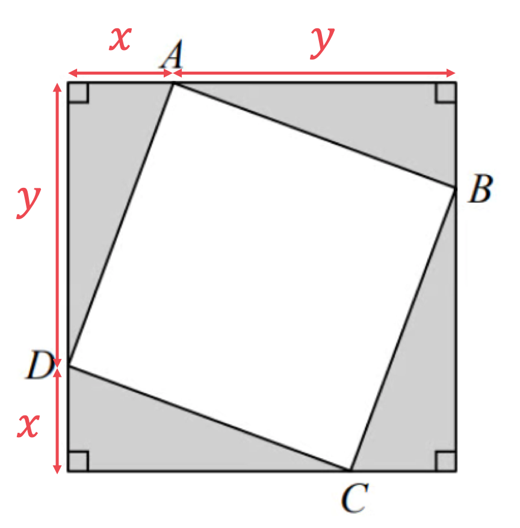

> *Calculate the length of the hypotenuse of one of the right-angled triangles using Pythagoras' theorem, *$a^{2}+b^{2}=c^{2}$*.*

> *Substitute the lengths of the edges into the formula.*

$\begin{gathered} x^{2} + y^{2} & = A D^{2} \end{gathered}$

> *Take the square root of both sides.*

$\begin{gathered} \sqrt{x^{2} + y^{2}} & = A D \end{gathered}$

**[1]**

> *Calculate the area of the square **ABCD**.*

$\begin{gathered} \text{Area} & = A D \times A B \\ = \sqrt{x^{2} + y^{2}} \times \sqrt{x^{2} + y^{2}} \end{gathered}$

**[1]**

> *Simplify.*

$x^{2}+y^{2}$ **[1]**

> *Method 2:*

> *Label the diagram with the dimensions of the triangles.*

> *Calculate area of the larger square.*

$\text{Area} = ( x + y ) ( x + y )$

**[1]**

> *Calculate the area of one of the triangles, using the formula: *$A=\frac{1}{2}bh$*.*

$\mathrm{Area}=\frac{1}{2}xy$

> *Find the area of the square **ABCD** by subtracting the area of four triangles from the area of the larger square.*

$\begin{gathered} \text{Area} & = ( x + y ) ( x + y ) - 4 \times 1 \frac{1}{2} x y \end{gathered}$

**[1]**

> *Expand brackets.*

$\mathrm{Area}=x^{2}+xy+xy+y^{2}-2xy$

> *Simplify.*

$x^{2}+y^{2}$ **[1]**

## Q30 — hard — 3 marks · exam-questions

### 7() — 3 marks
> *Let Becky (**B** ) have *$x$* marbles.*

> *Write down an expression, in terms of *$x$*, for the number of marbles that  Chris (**C **) and Dan (**D **) have.  *

$\begin{gathered} B & = x \\ C & = 2 B = 2 x \\ D & = C + 7 = 2 x + 7 \end{gathered}$

**At least**** ****C**** ****or D correct**** [1]**

> *Use this to form an expression for the total number of marbles.*

$\begin{gathered} T & = B + C + D \\ = x + 2 x + ( 2 x + 7 ) \end{gathered}$

> *The total number of marbles is 57. *

> *Form an equation for the total number of marbles, setting it equal to 57.*

$\begin{gathered} T & = 57 \\ x + 2 x + 2 x + 7 & = 57 \\ 5 x + 7 & = 57 \end{gathered}$

** **** [1]**

> *Solve the equation to find *$x$*.*

$\begin{gathered} 5 x + 7 & = 57 \\ - 7 & = - 7 \\ 5 x & = 50 \\ \div 5 & = \div 5 \\ x & = \frac{50}{5} = 10 \end{gathered}$

> *Dan can only be correct is his and Becky's marbles add up to double the number of Chris' marbles. *

> $x=10$* so Becky has 10 marbles, Chris has 2(10) = 20 marbles and Dan has 20 + 7 = 27 marbles.*

$\begin{gathered} B + D & = 10 + 27 \text{eq} 2 C \end{gathered}$

**Dan is not correct, as he and Becky would need to have 40 marbles in total.****  [1]**

## Q31 — hard — 5 marks · exam-questions

### 6() — 5 marks
> *Choose a variable for the width of the rectangle, for example, **w. **Form an expression in terms of **w**, for the length of the rectangle.*

$\begin{gathered} l & = w + 7 \end{gathered}$

**[1]**

> *Label each part of the diagram that would need to be added to form the perimeter.*

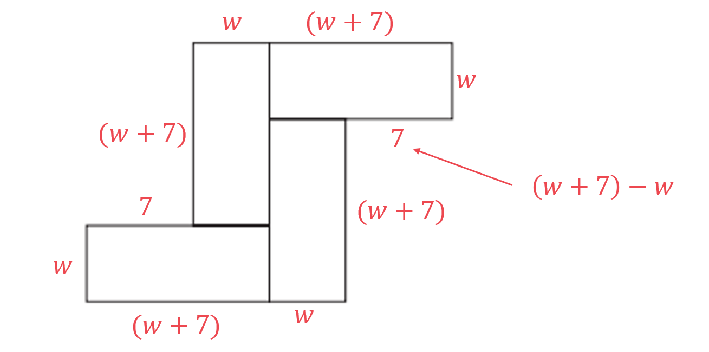

** At least 6 sides shown**** [1]**

> *Use the diagram to find an expression for the perimeter of the 8-sided shape. Make sure you add every part and do not miss any.  Starting at the top and working clockwise gives: *

$\begin{gathered} P & = w + ( w + 7 ) + w + 7 + ( w + 7 ) + w + ( w + 7 ) + w + 7 + ( w + 7 ) \end{gathered}$

**[1]**

> *Simplify by collecting the like terms.*

$\begin{gathered} P & = w + w + w + w + w + w + w + w + 7 + 7 + 7 + 7 + 7 + 7 \\ = 8 w + 42 \end{gathered}$

> *The perimeter is 70 cm, use this to form an equation.*

$\begin{gathered} 8 w + 42 & = 70 \end{gathered}$

> *Solve the equation to find **w**.*

> $\begin{gathered} 8 w + 42 & = 70 \\ - 42 & = - 42 \\ 8 w & = 28 \\ \div 8 & = \div 8 \\ w & = \frac{28}{8} = \frac{7}{2} \end{gathered}$* *

> *Substitute **w** = 3.5 into the expression for the length of one of the rectangles.*

$l=w+7=3.5+7=10.5$

**[1]**

> *So  **w**  =  3.5  and **l**  = 10.5. Use this to find the area of one rectangle*

$\begin{gathered} Area_{( o n e r e c t a n g l e )} & = 3.5 \times 10.5 = 36.75 cm^{2} \end{gathered}$

> *The total area of the 8-sided shape will be the area of 4 rectangles.*

$\begin{gathered} Area_{( s h a p e )} & = 4 \times 36.75 = 147 cm^{2} \end{gathered}$

$147\mathrm{cm}^{2}$* ***[1]**

## Q32 — hard — 5 marks · exam-questions

### 9() — 5 marks
> *Form an expression for the perimeter of the rectangle, remember that opposite sides are equal and label each of the other two sides. *

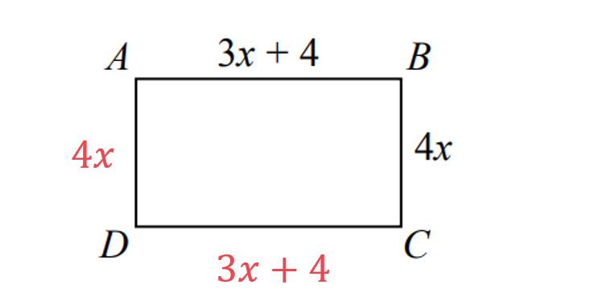

> *Use this to form an expression for the perimeter of the rectangle.*

$\begin{gathered} P_{r e c t} & = 4 x + ( 3 x + 4 ) + 4 x + ( 3 x + 4 ) \end{gathered}$

> *Form an expression for the perimeter of the trapezium by adding the expressions given for each of the sides. *

$\begin{gathered} P_{t r a p} & = 5 x + ( x - 3 ) + 5 x + ( 7 x - 3 ) \end{gathered}$

**Either expression formed **** [1]**

> *Form an equation by setting the expressions for the perimeter of the rectangle and the perimeter of the trapezium equal to each other.*

$\begin{gathered} 4 x + ( 3 x + 4 ) + 4 x + ( 3 x + 4 ) & = 5 x + ( x - 3 ) + 5 x + ( 7 x - 3 ) \end{gathered}$

** **** [1]**

> *Simplify both sides by collecting the like terms together.*

$\begin{gathered} 4 x + 3 x + 4 + 4 x + 3 x + 4 & = 5 x + x - 3 + 5 x + 7 x - 3 \\ 4 x + 3 x + 4 x + 3 x + 4 + 4 & = 5 x + x + 5 x + 7 x - 3 - 3 \\ 14 x + 8 & = 18 x - 6 \end{gathered}$

> *Solve the equation to find *$x$*, begin by subtracting the term with the smallest coefficient of *$x$*.*

$\begin{gathered} 14 x + 8 & = 18 x - 6 \\ - 14 x & = - 14 x \\ 8 & = 4 x - 6 \\ + 6 & = + 6 \\ 14 & = 4 x \\ \div 4 & = \div 4 \\ \frac{14}{4} & = x \end{gathered}$

**[1]**

> *Substitute *$x=3.5$* into the expression for the length and width of the rectangle.*

$w = 4 x = 4 ( 3.5 ) = 14
l = 3 x + 4 = 3 ( 3.5 ) + 4 = 14.5$

> *So  **w**  =  14 cm  and **l**  = 14.5 cm. *

> *Use this to find the area of the rectangle.*

$\begin{gathered} Area_{( r e c t a n g l e )} & = 14 \times 14.5 = 203 cm^{2} \end{gathered}$

**[1]**

$203\mathrm{cm}^{2}$* ***[1]**

## Q33 — hard — 5 marks · exam-questions

### 23() — 5 marks
> *Form an expression for the area of the rectangle.*

$\begin{gathered} A_{r e c t} & = \text{length} \times \text{width} = ( 3 x - 2 ) ( x - 1 ) \end{gathered}$

> *Form an expression for the area of the triangle using the formula *$A=\frac{1}{2}bh$*. *

$\begin{gathered} A_{t r i} & = 1 \frac{1}{2} ( x ) ( 2 x ) \end{gathered}$

**Both expressions formed **** [1]**

> *Form an **inequality **by setting the expression for the area of the rectangle **greater than **the expression for the area of the triangle.*

$\begin{gathered} ( 3 x - 2 ) ( x - 1 ) & > 1 \frac{1}{2} ( x ) ( 2 x ) \end{gathered}$

> *Simplify the left-hand side by expanding the double brackets and collecting the like terms together.*

$\begin{gathered} 3 x^{2} - 3 x - 2 x + 2 & > 1 \frac{1}{2} ( x ) ( 2 x ) \\ 3 x^{2} - 5 x + 2 & > 1 \frac{1}{2} ( x ) ( 2 x ) \end{gathered}$

> *Simplify the right-hand side by cancelling the 2s.*

$\begin{gathered} 3 x^{2} - 5 x + 2 & > \frac{1}{ \cancel{2} } ( x ) ( \cancel{2} x ) \\ 3 x^{2} - 5 x + 2 & > x^{2} \end{gathered}$

> *Rearrange to make this a quadratic equation equal to zero.*

$\begin{gathered} 3 x^{2} - 5 x + 2 - x^{2} & > 0 \\ 2 x^{2} - 5 x + 2 & > 0 \end{gathered}$

** **** [1]**

> *Begin to factorise by multiplying 2 by 2.*

*2 × 2 = 4*

> *Find two numbers that multiply to give 4 and add to give -5 (the middle number)*

*-1 and -4*

> *Split the middle term into -**x** and -4**x.*

$2x^{2}-x-4x+2>0$

> *Factorise fully the first pair of terms and the second pair of terms, either 2 or -2 could be factorised out of the last two terms, but the aim is to get the brackets the same so -2 should be factorised. *

$x ( 2 x - 1 ) - 2 ( 2 x - 1 ) > 0$

> *Factorise out the whole (2**x** - 1) bracket as if it were one term, leaving **x **and -2 in their own bracket.*

$( x - 2 ) ( 2 x - 1 ) > 0$

** **** [1]**

> *This means that the graph of *$y=2x^{2}-5x+2$* has roots at *$x=2$* and *$x=\frac{1}{2}$*.*

> *We are interested in the region where **y** is greater than 0, so this will be where the graph is above the **x-**axis. *

> *As the quadratic is positive, this will be in the regions above and below the roots.*

> * *$x>2\mathrm{and}x<\frac{1}{2}$

**allowing sign errors**** [1]**

> *Considering the expressions given for the length and width of the rectangle, we can find restrictions on the value of **x. **Remember that both the length and the width must be positive.*

$l = 3 x - 2 \Leftrightarrow x > \frac{ 2 }{3} ( \text{as} l > 0 )
w = x - 1 \Leftrightarrow x > 1 ( \text{as} w > 0 )$

> *As *$x>1$*, disregard *$x<\frac{1}{2}$*.*

$x>2$* ***[1]**

## Q34 — hard — 4 marks · exam-questions

### 15() — 4 marks
> *Let adult tickets be **a** and child tickets be **c. *

> *Use the information in the question to write two equations.*

> *3 adult tickets = 3**a, **1 child ticket = **c,** add these and set equal to 30. *

$3a+c=30$

> *1 adult ticket = **a, **3 child tickets = 3**c,** add these and set equal to 22. *

$a+3c=22$

**[1]**

> *Number the equations.*

> $\begin{gathered} 3 a + c & = 30 ( 1 ) \\ a + 3 c & = 22 ( 2 ) \end{gathered}$* *

> *Make the **c** terms equal by multiplying all parts of equation (1) by 3.*

> $3 ( 1 ) 3 ( 3 a + c = 30 ) 
 ( 2 ) a + 3 c = 22$*  *

> *This gives the two equation with the same coefficient of **c.*

$\begin{gathered} 9 a + 3 c & = 90 ( 3 ) \\ a + 3 c & = 22 ( 2 ) \end{gathered}$

> *Eliminate the **c** terms by subtracting equation (2) from equation (3).*

`| _ _ 9 | | _ _ a | | _ _ | | _ _ + | | _ _ 3 | | _ _ c | | _ _ | | _ = _ | | _ _ | | _ _ 90 | bottom - ( | a + 3 c | = 22 | | ) 8 a = 68`

**[1]**

> *Solve the equation to find** a  **by dividing both sides by 8.*

$\begin{gathered} a & = \frac{68}{8} = 8.5 \end{gathered}$

> *Substitute *$a=8.5$* into either of the two original equations**.*

$\begin{gathered} ( 1 ) 3 a + c & = 30 \\ 3 ( 8.5 ) + c & = 30 \\ 25.5 + c & = 30 \end{gathered}$

**[1]**

> *Solve this equation to find** c.*

$\begin{gathered} c + 25.5 & = 30 \\ c & = 30 - 25.5 \\ c & = 4.5 \end{gathered}$

> *This means that 1 adult ticket costs £8.50 and 1 child ticket costs £4.50. *

**Adult ticket = £8.50 **
**      Child ticket =  £4.50 ****[1]**

## Q35 — hard — 4 marks · exam-questions

### 11() — 4 marks
> *Let the cost of a tea be **t** and the cost of a coffee be **c. *

> *Use the information in the question to write two equations.*

> *3 teas = 3**t, **2 coffees = 2**c,** add these and set equal to 7.8 (£7.80). *

$3t+2c=7.8$

> *5 teas = 5**t, **4 coffees = 4**c,** add these and set equal to 14.2 (£14.20). *

$5t+4c=14.2$

**[1]**

> *Number the equations.*

> $\begin{gathered} 3 t + 2 c & = 7.8 ( 1 ) \\ 5 t + 4 c & = 14.2 ( 2 ) \end{gathered}$* *

> *Make the **c** terms equal by multiplying all parts of equation (1) by 2.*

$2 ( 1 ) 2 ( 3 t + 2 c = 7.8 ) 
 ( 2 ) \begin{array}{rcl} \end{array} \begin{array}{rcl} 5 \end{array} \begin{array}{rcl} t \end{array} \begin{array}{rcl} \end{array} \begin{array}{rcl} + \end{array} \begin{array}{rcl} \end{array} \begin{array}{rcl} 4 \end{array} \begin{array}{rcl} c \end{array} \begin{array}{rcl} \end{array} \begin{array}{rcl} = \end{array} \begin{array}{rcl} \end{array} \begin{array}{rcl} 14 \end{array} \begin{array}{rcl} . \end{array} \begin{array}{rcl} 2 \end{array}$*  *

> *This gives two equations with the same coefficient of **c.*

$\begin{gathered} 6 t + 4 c & = 15.6 ( 3 ) \\ 5 t + 4 c & = 14.2 ( 2 ) \end{gathered}$

> *Eliminate the **c** terms by subtracting equation (2) from equation (3).*

`| _ _ | | _ _ | | _ _ 6 | | _ _ t | | _ _ | | _ _ + | | _ _ | | _ _ 4 | | _ _ c | | _ _ | | _ = _ | | _ _ | | _ _ 15 | | _ _. | | _ _ 6 | bottom - ( | 5 t + 4 c | = 14.2 | | ) t = 1.4`

**[1]**

> *Substitute *$t=1.4$* into either of the two original equations**.*

$\begin{gathered} ( 1 ) 3 t + 2 c & = 7.8 \\ 3 ( 1.4 ) + 2 c & = 7.8 \\ 4.2 + 2 c & = 7.8 \end{gathered}$

**[1]**

> *Solve this equation to find** c.*

$\begin{gathered} 2 c & = 7.8 - 4.2 \\ 2 c & = 3.6 \\ c & = \frac{3.6}{2} = 1.8 \end{gathered}$

> *This means that 1 tea costs £1.40 and 1 coffee costs £1.80. *

**One tea = £1.40    **
**   One coffee = £1.80 ****[1]**

## Q36 — hard — 5 marks · exam-questions

### 22((a)) — 2 marks
> *Substitute the values in the diagram into the formula for the area of a trapezium. *

> *The formula is *$A = 1 \frac{1}{2} ( a + b ) h$*, where *$a$* and *$b$* are the two parallel sides and *$h$* is the perpendicular height.*

$A = 1 \frac{1}{2} \times ( ( x - 4 ) + ( x + 5 ) ) \times 2 x$

**[1]**

> *The area is given as 351 cm**2**, so set this expression equal to 351.*

$1 \frac{1}{2} \times ( ( x - 4 ) + ( x + 5 ) ) \times 2 x = 351$

> *Simplify the expression in the brackets.*

$\begin{gathered} 1 \frac{1}{2} \times ( 2 x + 1 ) \times 2 x & = 351 \end{gathered}$

> *Cancel out the 2.*

$\begin{gathered} \frac{1}{ \cancel{2} } \times ( 2 x + 1 ) \times \cancel{2} x & = 351 \\ x ( 2 x + 1 ) & = 351 \end{gathered}$

> *Expand the brackets on the right hand side.*

$\begin{gathered} 2 x^{2} + x & = 351 \end{gathered}$

> *Subtract 351 from both sides.*

$\begin{gathered} 2 x^{2} + x - 351 & = 0 \end{gathered}$

$2x^{2}+x-351=0$ **[1]**

### 22((b)) — 3 marks
> *Substitute the given values into the quadratic formula*

> *Given an equation of the form *$ax^{2}+bx+c=0$*, the quadratic formula is *$x=\frac{-b\pm\sqrt{b^{2}-4ac}}{2a}$*.*

> *Identify the values of **a, b **and **c.*

$a=2,b=1,c=-351$

> *Substitute into the quadratic formula.*

$x=\frac{-1\pm\sqrt{1^{2}-4\times2\times-351}}{2\times2}$

** [1]**

> *Simplify the right hand side.*

$x=\frac{-1\pm\sqrt{2809}}{4}$

** [1]**

> *Work out the two results by doing the calculation twice, once using the positive sign and once using the negative sign in front of the square root.*

$x=13$* or *$x=-13.5$

> *Considering the diagram in part (a), the height of the trapezium is *$2x$*, so *$x$* must be positive.*

** **$x=13$** ****[1]**

## Q37 — hard — 4 marks · exam-questions

### 7() — 4 marks
> *Split the shape up into two rectangles, use a horizontal line to split the shape so that the length of the smaller rectangle can be determined in terms of *$x$*.*

> *Find the area of each rectangle separately. *

> *Rectangle **A** has a length of 15 m and a width of 8 m.*

$\mathrm{Area}_{A}=15\times8=120$

> *Rectangle **B** has a length of *$( 15 - x )$* m and a width of 3 m.*

$Area_{B} = 3 ( 15 - x )$

**[1]**

> *Write down an expression for the total area of the floor plan by adding the two expressions together.*

$Area = 120 + 3 ( 15 - x )$

> *Write an **equation **for the area by setting the expression for the area equal to 138.*

$120 + 3 ( 15 - x ) = 138$

**[1]**

> *Expand the brackets and simplify by collecting like terms.*

$\begin{gathered} 120 + 45 - 3 x & = 138 \\ 165 - 3 x & = 138 \end{gathered}$

> *Isolate the **x** term by subtracting 165.*

$\begin{gathered} 165 - 3 x & = 138 \\ - 3 x & = - 27 \end{gathered}$

**[1]**

> *Solve the equation by dividing both sides by -3.*

$\begin{gathered} 165 - 3 x & = 138 \\ - 3 x & = - 27 \\ x & = \frac{- 27}{- 3} \end{gathered}$

$x=9$** [1]**

## Q38 — hard — 5 marks · exam-questions

### 16() — 5 marks
> *Form an expression for the perimeter of the rectangle, remember that opposite sides are equal and label each of the other two sides. *

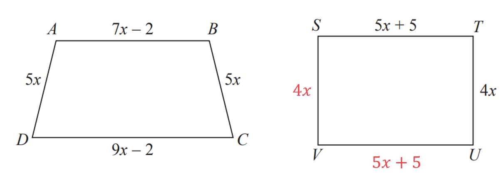

> *Use this to form an expression for the perimeter of the rectangle.*

$\begin{gathered} P_{r e c t} & = 4 x + ( 5 x + 5 ) + 4 x + ( 5 x + 5 ) \end{gathered}$

**[1]**

> *Form an expression for the perimeter of the trapezium by adding the expressions given for each of the sides. *

$\begin{gathered} P_{t r a p} & = 5 x + ( 7 x - 2 ) + 5 x + ( 9 x - 2 ) \end{gathered}$

**[1]**

> *Form an equation by setting the expressions for the perimeter of the rectangle and the perimeter of the trapezium equal to each other.*

$\begin{gathered} 4 x + ( 5 x + 5 ) + 4 x + ( 5 x + 5 ) & = 5 x + ( 7 x - 2 ) + 5 x + ( 9 x - 2 ) \end{gathered}$

** **** [1]**

> *Simplify both sides by collecting the like terms together.*

$\begin{gathered} 4 x + 5 x + 5 + 4 x + 5 x + 5 & = 5 x + 7 x - 2 + 5 x + 9 x - 2 \\ 4 x + 5 x + 4 x + 5 x + 5 + 5 & = 5 x + 7 x + 5 x + 9 x - 2 - 2 \\ 18 x + 10 & = 26 x - 4 \end{gathered}$

> *Solve the equation to find *$x$*, begin by subtracting the term with the smallest coefficient of *$x$*.*

$\begin{array}{rcl} 18 x + 10 & = 26 x - 4 \\ - 18 x & = - 18 x \\ 10 & = 8 x - 4 \\ + 4 & = + 4 \\ 14 & = 8 x \\ \div 8 & = \div 8 \\ \frac{14}{8} & = x \\ x & = \frac{7}{4} = 1.75 \end{array}$

**[1]**

> *Substitute *$x=1.75$* into the expression for the length of **ST**.*

$S T = 5 x + 5 = 5 ( 1.75 ) + 5 = 8.75 + 5$

$13.75\mathrm{cm}$* ***[1] **
**Equivalent fraction also accepted.**

## Q39 — hard — 4 marks · exam-questions

### 17() — 4 marks
> *The ratio states that the second part is double the first part*

> *Form an equation using the first ratio*

$3x+5=2x^{2}$

**[1]**

> *Rewrite as a quadratic expression equal to zero*

$2x^{2}-3x-5=0$

**[1]**

> *Find the solutions by factorising or using the quadratic formula*

$( 2 x - 5 ) ( x + 1 ) = 0$

**[1]**

> *Solve*

$x=\frac{5}{2},x=-1$

**[1]**

## Q40 — hard — 5 marks · exam-questions

### 19((a)) — 2 marks
> *Method 1*

> *If 5 more boys and 8 more girls join there will be *

$x+5$* **boys and *$y+8$* girls*

> *If there are half as many boys as girls then;*

$x + 5 = 1 \frac{1}{2} ( y + 8 )$

**[1]**

> *Multiply both sides by 2 to clear the fraction.*

$2x+10=y+8$

> *And subtract 8 from both sides.*

$2x+2=y$** [1]**

> *Method 2*

> *If 5 more boys and 8 more girls join there will be *

$x+5$* **boys and *$y+8$* girls*

> *If there are half as many boys as girls then;*

$2 ( x + 5 ) = y + 8$

**[1]**

> *Expand the bracket.*

$2x+10=y+8$

> *And subtract 8 from both sides.*

$2x+2=y$** [1]**

### 19((b)) — 3 marks
> *If 10 more boys and 1 more girls join there will be;*

*'*$x+10$*' boys and '*$y+1$*' girls*

> *The number of boys equals the number of girls.*

$x+10=y+1$

**[1]**

> *Subtract one from both sides.*

$x+9=y$

> *If we combine this with the equation given in part (a), then we have a pair of simultaneous equations.*

$y=x+9\mathrm{and}y=2x+2$

> *We can solve these by elimination or substitution. Here we will use substitution.*

$x+9=2x+2$

**[1]**

$\begin{gathered} x + 9 & = 2 x + 2 \\ - x & = - x \\ 9 = x + 2 \\ - 2 & = - 2 \\ 7 = x \end{gathered}$

> *Solve, in this case by subtracting  *$\begin{gathered} x \end{gathered}$* and then subtracting 2 from both sides.*

$x=7$** [1]**

> *Be careful! We have not fully answered the question until we have found *$\begin{array}{rcl} y \end{array}$*. Substitute *$\begin{gathered} x = 7 \end{gathered}$* into *$\begin{gathered} y = x + 9 \end{gathered}$* or *$\begin{array}{rcl} y = 2 x + 2 \end{array}$*.*

$\begin{gathered} y = 7 + 9 = 16 \text{or} y = 2 ( 7 ) + 2 = 16 \end{gathered}$

$y=16$* ***[1]**

**Perform a mental check; "7 boys and 10 more join means 17 boys; 16 girls and one more joins means 17 girls; the same number of boys and girls" **

## Q41 — hard — 4 marks · exam-questions

### 10((a)) — 2 marks
*The area of a trapezium *$= 1 \frac{1}{2} ( a + b ) h$* wh*ere $a$ and $b$ are the parallel lengths and $h$ is the height.

Theref*ore the area of the trapezium here is;*

$1 \frac{1}{2} ( b + 2 b ) h$

**[1]**

> *Simplify the expression by collecting terms inside the bracket.*

$= 1 \frac{1}{2} ( 3 b ) h = \frac{3}{2} b h$

$\frac{3}{2}bh$ **[1] **

**Other forms such as **$\frac{3bh}{2}$** or **$1.5bh$** are accepted- but not with brackets**

### 10((b)) — 2 marks
> *First write an expression for the perimeter in terms of *$b$* and *$s$*.*

$\begin{gathered} \text{perimeter} = b + 2 b + s + s \\ = 3 b + 2 s \end{gathered}$

**[1]**

> *Convert the ratio *$b:s=2:3$* to a fraction.*

$\begin{gathered} \frac{b}{s} & = \frac{ 2}{3} \end{gathered}$

> *Rearrange to find *$s$* in terms of *$b$*. We can start by "cross multiplying". *

$\begin{gathered} 3 b & = 2 s \\ 1.5 b & = s \end{gathered}$

> *Substitute *$s=1.5b$* into the expression found above for perimeter.*

$\begin{gathered} \text{perimeter} = 3 b + 2 ( 1.5 b ) \\ = 3 b + 3 b \\ = 6 b \end{gathered}$

**perimeter =**** **$6b$** [1]**

## Q42 — hard — 3 marks · exam-questions

### 8() — 3 marks
> *You could do this by trial and error, adding £4.50 and £4 to their respective totals over and over and checking each time whether the ratio has become 15 : 8. *

> *That could take a long time, however, so it's better to use a more algebraic approach.*

> *Call the number of weeks from the start "**N **". Then write a formula in terms of **N** for how much they each have after **N** weeks.*

$\mathrm{Theo}:18+4.5N\,\,\mathrm{James}:4N$

**[1]**

> *Next turn the ratio we are looking for into an equation with the expressions for James' and Theo's money. *

> *Begin solving the equation.*

$\frac{Theo}{James} = \frac{18 + 4.5 N}{4 N} = \frac{15}{8} 

8 \times ( 18 + 4.5 N ) = 15 \times 4 N

144 + 36 N = 60 N$

**[1]**

> *Finish solving the equation to find the value of **N**.*

$144=60N-36N\,\,144=24N\,\,N=144\div24=6$

**Final answer:** **6 weeks****  [1]**

## Q43 — hard — 5 marks · exam-questions

### 19() — 5 marks
> *Start by working out how many of each size cake she makes. Add up the ratio numbers to find the number of 'parts' that the 192 cakes are divided into.*

> * Then divide 192 by that sum to find the size of one part.*

$7+6+11=24\,\,192\div24=8$

**[1]**

> *So one part is 8 cakes. *

> *To find the amount of each size of cake, multiply 8 by the respective ratio numbers.*

$\mathrm{small}:8\times7=56\,\,\mathrm{medium}:8\times6=48\,\,\mathrm{large}:8\times11=88$

**[1]**

> *Call the profit for one small cake "**x** ". *

> *Then the profit for a medium cake is 2**x**, and the profit for a large cake is 3**x. *

> *Use this and the numbers of cakes from above to set up an equation equal to the total profit. *

> *Begin to solve the equation.*

$( 56 \times x ) + ( 48 \times 2 x ) + ( 88 \times 3 x ) = 532.48

56 x + 96 x + 264 x = 532.48

416 x = 532.48$

**[1] **
**The mark here is for setting up a correct equation.**

> *Finish solving the equation to find the value of **x**  (which is also the profit for one small cake).*

$x=532.48\div416=1.28$

**[1]**

**£1.28****  [1]**

## Q44 — hard — 4 marks · exam-questions

### 7() — 4 marks
> *We don't know how much money they have to start, all we know is the ratio. But because of that ratio, we can say that Sundip starts with £3**k** and Emma starts with £5**k** (where **k** is a constant).*

> *After Emma spends £450, Sundip still has £3**k** and Emma has £(5**k** - 450). Those amounts are in the ratio 2 : 3. Write that as a ratio and then rewrite the ratio as an equation with fractions.*

$3 k : ( 5 k - 450 ) = 2 : 3

 \frac{5 k - 450}{3 k} = \frac{3}{2}$

**[2] **

**1 mark for setting up an equation that will allow you to find how much money Sundip or Emma has..**
** ****1 mark for correctly using the ratio information in the equation (here that would be the 3/2 on the right hand side of the second equation).**

> *Now solve that equation for **k**.*

$2 \times ( 5 k - 450 ) = 3 \times 3 k
10 k - 900 = 9 k
10 k - 9 k = 900
k = 900$

**[1]**

> *Now just remember that Sundip's amount of money is equal to 3**k**.*

$3k=3\times900=2700$

**Sundip has £2700**** **** [1]**

**There are other methods that can be used to answer this question. **
**Any correct answer supported by fully correct working will receive full marks.**

## Q45 — hard — 5 marks · exam-questions

### 10() — 5 marks
> *Split the shape to find an expression for the area*

> *Use the opposite sides to find the missing values for the dimensions of the trapezium*

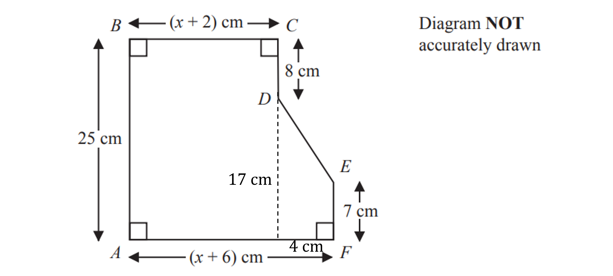

**[B1]**

> *Work out an expression for the area of the rectangle*

$( x + 2 ) \times 25 = 25 x + 50$

> *Work out the area of the trapezium*

$1 \frac{1}{2} ( 7 + 17 ) \times 4 
= 1 \frac{1}{2} \times 24 \times 4 
= 48$

**[M1]**

> *Add these together for the total area*

$25x+50+48=25x+98$

**[M1]**

> *Set this equal to the value given in the question*

$25x+98=258$

**[M1]**

> *Subtract 98 from both sides*

$25x=160$

> *Divide both sides by 25*

$x=\frac{160}{25}=6.4\mathrm{cm}$

$x=6.4\mathrm{cm}$

**[A1]**

## Q46 — very_hard — 4 marks · exam-questions

### 20() — 4 marks
> *Method 1:*

> *Calculate the area of the square **ABCD**.*

$4x\times4x=16x^{2}$

**[1]**

> *Calculate the area of the triangle **ABN, **using *$A=\frac{1}{2}bh$*, where *$b$* is the base of the triangle and *$h$* is its perpendicular height.*

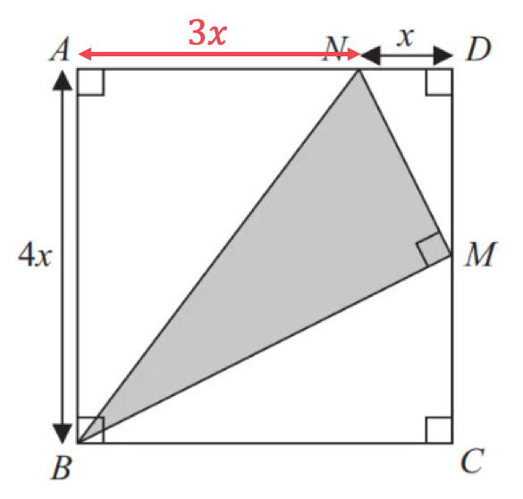

$A=\frac{1}{2}\times4x\times3x$

**[1]**

> *Simplify.*

$A=6x^{2}$

> *Calculate the area of the triangle **BMC**.*

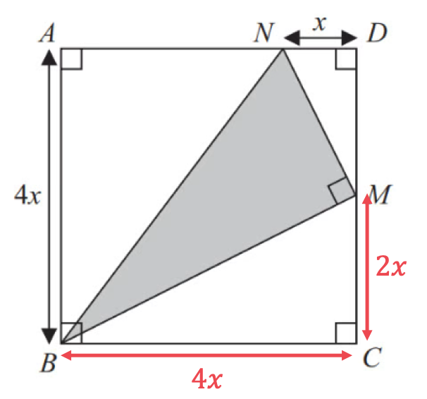

$A=\frac{1}{2}\times4x\times2x$

> *Simplify.*

$A=4x^{2}$

> *Calculate the area of the triangle **MND**.*

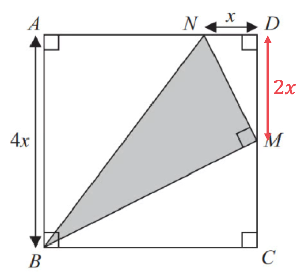

$A=\frac{1}{2}\timesx\times2x$

> *Simplify.*

$A=x^{2}$

> *Find the area of the shaded triangle **BNM** by subtracting the area of triangles **BMC **and** ABN **from the area of the square** ABCD.*

$16x^{2}-6x^{2}-4x^{2}-x^{2}$

**[1]**

> *Simplify.*

$5x^{2}$* ***[1]**

** **

> *Method 2:*

> *Calculate the length **NM** on the right-angled triangle **NDM**, using Pythagoras' theorem, *$a^{2}+b^{2}=c^{2}$*.*

> *Substitute the given values into the formula.*

> $x^{2} + ( 2 x )^{2} = N M^{2}$* *

> *Simplify.*

$\begin{array}{rcl} x^{2} + 4 x^{2} & = N M^{2} \\ 5 x^{2} & = N M^{2} \end{array}$

> *Take the square root of both sides.*

$\sqrt{5}x=NM$

**[1]**

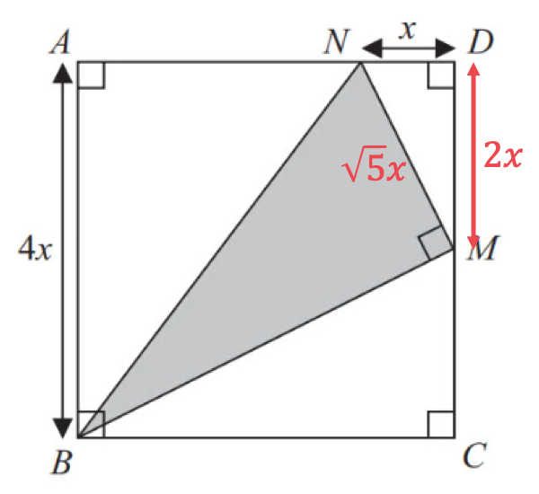

> *Calculate the length **BM** on the right-angled triangle **BMC.*

> *Substitute the given values into Pythagoras' theorem.*

> $( 2 x )^{2} + ( 4 x )^{2} = B M^{2}$* *

> *Simplify.*

$\begin{gathered} 4 x^{2} + 16 x^{2} & = B M^{2} \\ 20 x^{2} & = B M^{2} \end{gathered}$

> *Take the square root of both sides.*

$\sqrt{20}x=BM$

**[1]**

> *Simplify.*

$2\sqrt{5}x=BM$

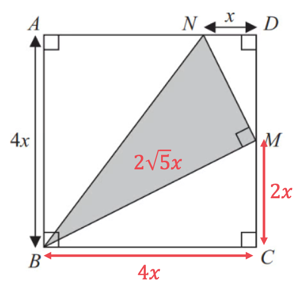

> *Calculate the area of the triangle **BNM**, using *$A=\frac{1}{2}bh$*, where *$b$* is the base of the triangle and *$h$* is its perpendicular height.*

$A=\frac{1}{2}\times2\sqrt{5}x\times\sqrt{5}x$

**[1]**

> *Simplify.*

$5x^{2}$* ***[1]**

## Q47 — very_hard — 5 marks · exam-questions

### 19() — 5 marks
> *Both triangles are right-angled triangles so use SOHCAHTOA. You know the length of the opposite (**O**) and the length of the side adjacent (**A**) to the angle. *

> *Therefore the tangent ratio can be used to write expressions for the tangent ratio for both triangles, *$\mathrm{tan}θ=\frac{O}{A}$*.*

$\mathrm{tan}e=\frac{x}{4x-1}$

$\mathrm{tan}f=\frac{6x+5}{12x+31}$

> *Use the given information, *$\mathrm{tan}e=\mathrm{tan}f$*, to write an equation in terms of *$x$*.*

$\begin{gathered} \tan e & = \tan f \\ \frac{x}{4 x - 1} & = \frac{6 x + 5}{12 x + 31} \end{gathered}$

**[1]**

> *Remove the fraction on the LHS by multiplying both sides by *$( 4 x - 1 )$*.*

$\begin{gathered} ( 4 x - 1 ) \frac{x}{4 x - 1} & = \frac{6 x + 5}{12 x + 31} ( 4 x - 1 ) \\ x & = \frac{( 6 x + 5 ) ( 4 x - 1 )}{12 x + 31} \end{gathered}$

> *Remove the fraction on the RHS by multiplying both sides by *$( 12 x + 31 )$*.*

$\begin{gathered} x ( 12 x + 31 ) & = \frac{( 6 x + 5 ) ( 4 x - 1 )}{12 x + 31} ( 12 x + 31 ) \\ x ( 12 x + 31 ) & = ( 6 x + 5 ) ( 4 x - 1 ) \end{gathered}$

**[1]**

> *Expand the brackets on both sides of the equation.*

$\begin{gathered} x ( 12 x + 31 ) & = ( 6 x + 5 ) ( 4 x - 1 ) \\ 12 x^{2} + 31 x & = 24 x^{2} - 6 x + 20 x - 5 \\ 12 x^{2} + 31 x & = 24 x^{2} + 14 x - 5 \end{gathered}$

> *Rearrange the expression to make a quadratic equation equal to 0.*

$\begin{gathered} 0 = 24 x^{2} + 14 x - 5 - ( 12 x^{2} + 31 x ) \end{gathered}$

> *Simplify.*

$\begin{gathered} 24 x^{2} + 14 x - 5 - 12 x^{2} - 31 x & = 0 \\ 12 x^{2} - 17 x - 5 & = 0 \end{gathered}$

**[1]**

> *This could be solved by factorising or using the quadratic formula, the formula may be easier.*

> *Substitute the given values into the quadratic formula*

> *Given an equation of the form *$ax^{2}+bx+c=0$*, the quadratic formula is *$x=\frac{-b\pm\sqrt{b^{2}-4ac}}{2a}$*.*

> *Identify the values of **a, b **and **c.*

$a=12,b=-17,c=-5$

> *Substitute into the quadratic formula.*

$x = \frac{- ( - 17 ) \pm \sqrt{( - 17 )^{2} - 4 \times 12 \times ( - 5 )} }{2 \times 12}$

** [1]**

> *Simplify.*

$x=\frac{17\pm\sqrt{529}}{24}$

> *Work out the two results by doing the calculation twice, once using the positive sign and once using the negative sign in front of the square root.*

$x=\frac{5}{3}$* ** or  *$x=-\frac{1}{4}$

> *Considering the diagram in part (a), the height of the first triangle is *$x$*, so *$x$* must be positive.*

** **$x=\frac{5}{3}$** ****[1]**

## Q48 — very_hard — 5 marks · exam-questions

### 25() — 5 marks
> *Form an expression for the area of triangle *$T_{1}$* using the formula for the area of a triangle if the perpendicular height is **not **known. *

> *The formula for the area of a triangle is *$A=\frac{1}{2}ab\mathrm{sin}C$*, where *$a$* and *$b$* are the two known sides and *$C$* is the included angle.*

$Area_{T_{1} } = 1 \frac{1}{2} ( x ) ( x ) \sin ( 30^{\circ} )$

**[1]**

> *Form an expression for the area of triangle *$T_{2}$* using the formula for the area of a triangle if the perpendicular height **is **known. The formula for the area of a triangle is *$A=\frac{1}{2}bh$*, where *$b$* is the base and *$h$* is the height perpendicular to the base.*

$Area_{T_{2} } = 1 \frac{1}{2} ( x - 2 ) ( x + 1 )$

**[1]**

> *Use the given information, *$\mathrm{area}T_{1}=\mathrm{area}T_{2}$*, to write an equation in terms of *$x$*.*

$\begin{gathered} 1 \frac{1}{2} ( x ) ( x ) \sin ( 30^{\circ} ) & = 1 \frac{1}{2} ( x - 2 ) ( x + 1 ) \end{gathered}$

**[1]**

> *Cancel *$\frac{1}{2}$*, which exists on both sides.*

$\begin{gathered} ( x ) ( x ) \sin ( 30^{\circ} ) & = ( x - 2 ) ( x + 1 ) \\ x^{2} \sin 30 & = ( x - 2 ) ( x + 1 ) \end{gathered}$

> *Use your knowledge of trig exact values, or your calculator, to evaluate *$\sin 30^{\circ} ( = 1 \frac{1}{2} )$*.*

$\begin{gathered} x^{2} ( 1 \frac{1}{2} ) & = ( x - 2 ) ( x + 1 ) \\ 1 \frac{1}{2} x^{2 } & = ( x - 2 ) ( x + 1 ) \end{gathered}$

> *Expand the brackets on the RHS of the equation.*

$\begin{gathered} 1 \frac{1}{2} x^{2 } & = ( x - 2 ) ( x + 1 ) \\ 1 \frac{1}{2} x^{2 } & = x^{2} + x - 2 x - 2 \\ 1 \frac{1}{2} x^{2 } & = x^{2} - x - 2 \end{gathered}$

> *REmove the fraction by multiplying both sides by 2.*

$\begin{gathered} x^{2 } & = 2 ( x^{2} - x - 2 ) \\ = 2 x^{2} - 2 x - 4 \end{gathered}$

> *Rearrange the expression to make a quadratic equation equal to 0.*

$\begin{gathered} 0 & = 2 x^{2} - 2 x - 4 - x^{2} \end{gathered}$

> *Simplify.*

$\begin{gathered} 2 x^{2} - 2 x - 4 - x^{2} & = 0 \\ x^{2} - 2 x - 4 & = 0 \end{gathered}$

**[1]**

> *The question asks for the answer to be given in the form *$a+\sqrt{b}$*, where *$a$* and *$b$* are integers. *

> *This form can be obtained by either using the quadratic formula, or by completing the square.*

> *Given an equation of the form *$ax^{2}+bx+c=0$*, the quadratic formula is *$x=\frac{-b\pm\sqrt{b^{2}-4ac}}{2a}$*.*

> *Identify the values of **a, b **and **c.*

$a=1,b=-2,c=-4$

> *Substitute into the quadratic formula.*

$x = \frac{- ( - 2 ) \pm \sqrt{( - 2 )^{2} - 4 \times 1 \times ( - 4 )} }{2 \times 1}$

> *Simplify.*

$\begin{gathered} x = \frac{2 \pm \sqrt{20}{2} \\ = \frac{2 \pm \sqrt{4} \times 5} }{2} \\ = \frac{2 \pm \sqrt{4} \sqrt{5} }{2} \\ = \frac{2 \pm 2 \sqrt{5} }{2} \end{gathered}$

> *Cancel out 2 from each term.*

$x = \begin{gathered} \end{gathered} \begin{gathered} 1 \end{gathered} \begin{gathered} \end{gathered} \begin{gathered} + \end{gathered} \begin{gathered} \end{gathered} \begin{gathered} \sqrt{5} \end{gathered}$* **  or  *$x = \begin{gathered} \end{gathered} \begin{gathered} 1 \end{gathered} \begin{gathered} - \end{gathered} \begin{gathered} \end{gathered} \begin{gathered} \sqrt{5} \end{gathered}$

> *Considering the diagram in part (a), the lengths of *$T_{1}$* are *$x$*, so *$x$* must be positive. The value *$1-\sqrt{5}$* is negative so this cannot be the length of a triangle. *

** **$x=1+\sqrt{5}$** ****[1]**

## Q49 — very_hard — 5 marks · exam-questions

### 22() — 5 marks
> *Identify the number of each counters*

| > *Red* | > *Green* | > *Total* |
|---|---|---|
| $r$ | $g$ | $r+g$ |

> *Use the probability  *$\frac{3}{7}$* to form an equation*

$\frac{g}{r+g}=\frac{3}{7}$

**[1]**

> *Identify the number of each counters*

| > *Red* | > *Green* | > *Total* |
|---|---|---|
| $r+2$ | $g+3$ | $r+g+5$ |

> *Use the probability  *$\frac{6}{13}$* to form an equation*

$\frac{g+3}{r+g+5}=\frac{6}{13}$

**[1]**

> *Rewrite both equations without the fractions*

$\begin{gathered} \frac{g}{r + g} & = \frac{3}{7} \\ 7 g & = 3 ( r + g ) \\ 7 g & = 3 r + 3 g \\ 4 g & = 3 r \end{gathered}$

$\begin{gathered} \frac{g + 3}{r + g + 5} & = \frac{6}{13} \\ 13 ( g + 3 ) & = 6 ( r + g + 5 ) \\ 13 g + 39 & = 6 r + 6 g + 30 \\ 7 g + 9 & = 6 r \end{gathered}$

**writing both without fractions [1]**

> *Double the first equation*

$\begin{gathered} 6 r & = 8 g \end{gathered}$

> *Substitute into the second equation*

$\begin{gathered} 8 g & = 7 g + 9 \\ g = 9 \end{gathered}$

**[1]**

> *Substitute *$g=9$* into the first equation to find *$r$

$\begin{gathered} 3 r & = 4 \times 9 \\ 3 r & = 36 \\ r = 12 \end{gathered}$

**9 green and 12 red ****[1]**

## Q50 — very_hard — 4 marks · exam-questions

### 14() — 4 marks
> *Let the length *$AB$* be equal to *$x$* and use the ratio to write *$AE$* in terms of *$x$

$\begin{gathered} A B & = x \\ A E & = 3 x \end{gathered}$

> *Find the area of the rectangle in terms of *$x$

$x\times3x=3x^{2}$

**[1]**

> *Use *$\frac{1}{2}ab\mathrm{sin}C$* to find the area of one triangle in terms of *$x$

$\frac{1}{2}\times24\times3x\times\mathrm{sin}30$

**[1]**

> *Use *$\mathrm{sin}30=\frac{1}{2}$* and simplify*

$\frac{1}{2}\times24\times3x\times\frac{1}{2}=18x$

> *The area of the rectangle is equal to the areas of the triangles added together*

> *Form an equation*

$\begin{gathered} 3 x^{2} & = 18 x + 18 x \\ 3 x^{2} & = 36 x \end{gathered}$

**[1]**

> $x\neq0$* so you can divide both sides by *$3x$

$x=12$

> *Use *$AE=3x$* to find the length of *$AE$

**Final answer:** $AE=36$** cm**

**[1]**

## Q51 — very_hard — 6 marks · exam-questions

### 19() — 6 marks
> *The formula for the area of a triangle is *$A=\frac{1}{2}bh$*, where *$b$* is the base and *$h$* is the height perpendicular to the base.*

$\text{Area} = 1 \frac{1}{2} ( x - 2 ) ( x )$

> *Use the given information that the area of the triangle is 2.5 cm**2** to write an equation in terms of *$x$*.*

$\begin{gathered} 1 \frac{1}{2} x ( x - 2 ) & = 2.5 \end{gathered}$

**[1]**

> *Remove the fraction by multiplying both sides by 2.*

$\begin{gathered} x ( x - 2 ) & = 5 \end{gathered}$

> *Expand the brackets on the LHS of the equation.*

$x^{2}-2x=5$

> *Rearrange the expression to make a quadratic equation equal to 0.*

$\begin{gathered} x^{2} - 2 x - 5 & = 0 \end{gathered}$

**[1]**

> *This cannot be factorised, so solve to find *$x$* by either using the quadratic formula, or by completing the square.*

> *Given an equation of the form *$ax^{2}+bx+c=0$*, the quadratic formula is *$x=\frac{-b\pm\sqrt{b^{2}-4ac}}{2a}$*.*

> *Identify the values of **a, b **and **c.*

$a=1,b=-2,c=-5$

> *Substitute into the quadratic formula.*

$x = \frac{- ( - 2 ) \pm \sqrt{( - 2 )^{2} - 4 \times 1 \times ( - 5 )} }{2 \times 1}$

> *Simplify.*

$\begin{gathered} x = \frac{2 \pm \sqrt{24} }{2} \end{gathered}$

> *Find the two possible values of *$x$*.*

$x=1+\sqrt{6}=3.44948...$* **  or  *$x = \begin{gathered} \end{gathered} \begin{gathered} 1 \end{gathered} \begin{gathered} - \end{gathered} \begin{gathered} \end{gathered} \begin{gathered} \sqrt{6} \end{gathered} = - 1.44948...$

**[1]**

> *Considering the diagram in part (a), the length of the triangle is *$x$*, so *$x$* must be positive. The value *$1-\sqrt{6}$* is negative so this cannot be the length of a triangle. *

> *Substitute *$x=1+\sqrt{6}$* into the expression given for the length and the width of the triangle.*

> $\text{length} = x = \begin{gathered} \end{gathered} \begin{gathered} 1 \end{gathered} + \begin{gathered} \end{gathered} \begin{gathered} \sqrt{6} \end{gathered}$* *

$\text{width} = x - 2 = \begin{gathered} \end{gathered} \begin{gathered} ( 1 + \sqrt{6} ) \end{gathered} - 2 = - 1 + \sqrt{6}$

> *Use Pythagoras' theorem to find the length of the hypotenuse.*

> $\begin{gathered} a^{2 } & = b^{2} + c^{2} \\ = ( 1 + \sqrt{6} )^{2} + ( 11 + \sqrt{6} )^{2} \\ = 14 \end{gathered}$* *

**[1]**

> *Square root to find the length of the hypotenuse.*

$\begin{gathered} a & = \sqrt{14} \\ = 3.741657... \end{gathered}$

> *Add the three sides of the triangle together, use either the exact values or values rounded to more than four signigifcant figures in your working.*

$\text{Perimeter} = ( 1 + \sqrt{6} ) + \begin{gathered} \end{gathered} \begin{gathered} ( - 1 + \sqrt{6} ) \end{gathered} + \sqrt{14} = 8.640636...$

**[1]**

> *Round the answer to 3 significant figures.*

** **$P=8.64\mathrm{cm}(3s.f.)$** ****[1]**
** Answers in the range 8.63 to 8.65 accepted.**

## Q52 — very_hard — 4 marks · exam-questions

### 18() — 4 marks
> *The total surface area of a hemisphere is*

$\begin{gathered} S A_{h e m i s p h e r e} & = 1 \frac{1}{2} \times 4 \mathrm{\pi } r^{2} + \mathrm{\pi } r^{2} \\ = 3 \mathrm{\pi } r^{2} \end{gathered}$

> *Now that we have used *$r$* as the radius of the hemisphere, let *$R$* be the radius of the cylinder (and let its height be *$h$*). The curved surface area of the cylinder is therefore*

$SA_{cylinder}=2πRh$

> *"The radius of the cylinder is twice the radius of the hemisphere" therefore*

$R=2r$

> *Substitute this into the formula for the curved surface area of the cylinder*

$\begin{gathered} S A_{c y l i n d e r} & = 2 \mathrm{\pi } ( 2 r ) h \\ = 4 \mathrm{\pi } r h \end{gathered}$

> *Equate the formulae for the surface areas of the hemisphere and the cylinder*

$3πr^{2}=4πrh$

**[1]**

> *Rearrange to get *$h$* in terms of *$r$

`| 3 / pi r ^2 | = 4 / pi r h | | 3 r ^ / 2 | = 4 / r h | | 3 r | = 4 h | | h = 3 / 4 r | |`

**[1]**

> *Now find the volume of the hemisphere in terms of *$r$

$\begin{gathered} v o l u m e_{h e m i s p h e r e} & = 1 \frac{1}{2} \times \frac{4}{3} \mathrm{\pi } r^{3} \\ = \frac{2}{3} \mathrm{\pi } r^{3} \end{gathered}$

> *And find the volume of the cylinder in terms of *$r$

$\begin{gathered} v o l u m e_{c y l i n d e r} & = \mathrm{\pi } R^{2} h \\ = \mathrm{\pi } ( 2 r )^{2} \times \frac{3}{4} r \\ = \mathrm{\pi } \cancel{4} r^{2} \times \frac{3}{ \cancel{4} } r \\ = 3 \mathrm{\pi } r^{3} \end{gathered}$

** correct expressions for volume of hemisphere and volume of cylinder ****[1]**

> $m$*, the scale factor for the volumes, is the volume of the cylinder divided by the volume of the hemisphere*

$\begin{gathered} m = \frac{3 \mathrm{\pi } r^{3}}{ \frac{2}{3} \mathrm{\pi } r^{3}} = \frac{3 \cancel{ \mathrm{\pi } r^{3}} }{ \frac{2}{3} \cancel{ \mathrm{\pi } r^{3}} } \\ = 3 \times \frac{3}{2} \\ = \frac{9}{2} \end{gathered}$

$m=\frac{9}{2}\mathrm{or}4.5$ **[1]**

## Q53 — very_hard — 3 marks · exam-questions

### 19((a)) — 3 marks
> *The length of **DE **and **CE** are both *$x$* so;*

$\mathrm{perimeter} \mathrm{of}ABCED=3x+2y$

> *Equate this to 100 and write *$y$* in terms of *$x$*.*

$\begin{array}{rcl} 3 x + 2 y & = 100 \\ 2 y & = 100 - 3 x \\ y = \frac{100 - 3 x}{2} \end{array}$

**[1]**

> *We can now write an expression for the area of rectangle **ABCD** in terms of *$x$* *

$\begin{gathered} \text{area} A B C D & = x y \\ = x ( \frac{100 - 3 x}{2} ) \end{gathered}$

> *Triangle **CED **is equilateral so all its internal angles are 60°. So its area is;*

$\mathrm{area}CED=\frac{1}{2}x\timesx\times\mathrm{sin}60^{\circ}$

> *It's useful to know that *$\mathrm{sin}60^{\circ}=\frac{\sqrt{3}}{2}$* (and *$\mathrm{sin}30^{\circ}=\frac{1}{2}$*) but you can also obtain the exact value of *$\mathrm{sin}60^{\circ}$* from your calculator. *

$\begin{gathered} \text{area} C E D & = 1 \frac{1}{2} x^{2} \times \frac{ \sqrt{3} }{2} \\ = \frac{ \sqrt{3} }{4} x^{2} \end{gathered}$

> *Thus *$R$*, the total area of **ABCED **in terms of *$x$*, **is;*

$\begin{gathered} R = \text{Area} A B C D + \text{Area} C E D \\ = x ( \frac{100 - 3 x}{2} ) + \frac{ \sqrt{3} }{4} x^{2} \end{gathered}$

**[1]**

> *Rewrite by factorising *$\frac{x}{4}$* out of both parts of the equation.*

$\begin{gathered} A = \frac{x}{4} ( 2 ( 100 - 3 x ) ) + \frac{x}{4} ( \sqrt{3} x ) \\ = \frac{x}{4} ( 200 - 6 x ) + \frac{x}{4} ( \sqrt{3} x ) \end{gathered}$

> *                                       (note that the *$x$* lies outside the *$\sqrt{3}$*)*

> $\frac{x}{4}$* is outside both brackets so this can be simplified into one bracket using the distributive law.*

$\begin{gathered} A = \frac{x}{4} ( 200 - 6 x + \sqrt{3} x ) \end{gathered}$

`Error converting from MathML to accessible text.`

**final line with at least one correct step in between this and penultimate method mark**** [1]**

## Q54 — very_hard — 6 marks · exam-questions

### 22() — 6 marks
> *Find the perimeter of the triangle **OAD **by first using the cosine rule, *$a^{2} = b^{2} + c^{2} - 2 b c \cos ( A )$*.*

> *Substitute the values of the sides (both 6 cm) and angle (50°) into the cosine rule formula.*

$\begin{gathered} A D^{2} & = 6^{2} + 6^{2} - ( 2 \times 6 \times 6 \times \cos 50 ) \\ A D & = \sqrt{ 6^{2} + 6^{2} - ( 2 \times 6 \times 6 \times \cos 50 )} \\ = 5.071419... \end{gathered}$

**[1]**

> *Find the perimeter of triangle **OAD.*

*Perimeter of ***OAD *** = 6 + 6 + 5.071419... = 17.071419... cm** *

**[1]**

> *Find the length of the arc **BC **using the formula for length of an arc *$=\frac{θ^{\circ}}{360^{\circ}}\times2πr$*.*

> * Find an expression for the length of the arc in terms of *$x$*, **by substituting *$θ=50$* and *$r=(6+x)$*.*

$B C = \frac{50}{360} \times 2 \times \pi \times ( x + 6 )$

**[1]**

> *Find an expression for the perimeter of the sector **OBC** in terms of *$x$*, **by adding this to 2 × the radius.*

$\begin{gathered} O B C & = ( \frac{50}{360} \times 2 \times \pi \times ( x + 6 ) ) + 2 ( x + 6 ) \\ = \frac{5}{18} ( x + 6 ) \pi + 2 ( x + 6 ) \end{gathered}$

**[1]**

> *Form an equation by setting this equal to 2 times the perimeter of triangle **OAD**. *

$\begin{gathered} \frac{5}{18} ( x + 6 ) \pi + 2 ( x + 6 ) & = 2 ( 17.071419... ) \end{gathered}$

**[1]**

> *Simplify by expanding the brackets on both sides and collecting like terms.*

$\begin{gathered} \frac{5 \pi }{18} x + \frac{5 \mathrm{\pi } }{3} + 2 x + 12 & = 34.14283... \\ 2.872664... x & = 16.90684... \end{gathered}$

> *Solve the equation.*

$\begin{gathered} x & = \frac{16.90684...}{2.872664...} = 5.885422... \end{gathered}$

> *Round to 3 significant figures.*

$x=5.89$** cm**** ****(3 s.f.)**** [1] **
**Answers in the range 5.88 to 5.89 accepted.**

## Q55 — very_hard — 6 marks · exam-questions

### 20() — 6 marks
> *If there are **n** pieces of fruit in in total and 4 of them are oranges, then there are **n** - 4 apples to start with. *

> *If there are **n** -6 apples left after two pieces of fruit are taken, then both pieces of fruit taken must have been apples. *

> *Realising this fact is probably the trickiest part of this question!*

> *With combined probabilities 'and' usually means 'multiply'. 'Takes two apples' is the same as:*

> *     'takes an apple' (*$\frac{n-4}{n}$*) AND 'then takes another apple' (*$\frac{n-5}{n-1}$*).*

> * (Note that after taking the first apple, the numbers of pieces of fruit remaining in the bowl changes.  So the numerator and denominator must change in the second probability fraction.) Because the total probability is 1/3, those algebraic fractions multiplied together must also be equal to 1/3.*

$\frac{n-4}{n}\times\frac{n-5}{n-1}=\frac{1}{3}$

**[2]**

** ****1 mark for one correct probability fraction.  1 mark for a completely correct equation.**

> *Now rearrange into a quadratic equation you can solve.*

$\frac{( n - 4 ) ( n - 5 )}{n ( n - 1 )} = 1 \frac{1}{3}

 \frac{n^{2} - 9 n + 20}{n^{2} - n} = 1 \frac{1}{3}

3 \times ( n^{2} - 9 n + 20 ) = 1 \times ( n^{2} - n )

3 n^{2} - 27 n + 60 = n^{2} - n

2 n^{2} - 26 n + 60 = 0$

**[2] **

**1 mark for eliminating all the algebraic fractions.  1 mark for fully rearranging into the final quadratic equation form.**

> *Now solve the quadratic equation. *

> *Here it's done by factorising, but you could also use the quadratic formula. *

> *With either method, it is easiest to start by dividing everything in the equation by 2. *

$n^{2} - 13 n + 30 = 0

( n - 10 ) ( n - 3 ) = 0

n = 10 \text{or} n = 3$

**[1]**

> *Both of those are answers to the quadratic equation.*

> * BUT remember that **n** is the total number of pieces of fruit in the bowl at the start.*

> * If **n** = 3, then there cannot be 4 oranges in the bowl! *

> *Therefore only **n** = 10 can be the correct answer in the context of this question.*

**n**** = 10****  [1]**

## Q56 — very_hard — 4 marks · exam-questions

### 24() — 4 marks
> *Substitute the given radii and height into the formulae for sphere and cone, and equate the two.*

$\frac{4}{3} \mathrm{\pi } ( 2 x )^{3} = 1 \frac{1}{3} \mathrm{\pi } ( 3 x )^{2} h$

**correct substitution into the sphere or the cone formula**** [1]** **correct substitution into and equating of sphere and cone, as above**** [1]**

> *Expand the brackets and simplify.*

$\frac{4}{3}π\times8x^{3}=\frac{1}{3}π\times9x^{2}h\,\frac{32}{3}πx^{3}=3πx^{2}h$

> *Multiply both sides by 3 to clear the fraction.*

$32πx^{3}=9πx^{2}h$

> *Cancel like terms on either side (or divide both sides by *$πx^{2}$*).*

`| 32 / pi x ^ / 3 | = 9 / pi / x ^2 h | | 32 x | = 9 h | |`

**[1]**

> *Multiply both sides by *$\frac{3}{32}$* to get '*$3x$*' on its own on one side, as the radius of the cone (the left side of the ratio required) is *$3x$*.*

$\begin{gathered} \frac{3}{32} \times 32 x & = \frac{3}{32} \times 9 h \\ 3 x & = \frac{27}{32} h \end{gathered}$

> *Therefore;*

$\mathrm{radius} \mathrm{of} \mathrm{cone}=\frac{27}{32}h,\,\mathrm{radius} \mathrm{of} \mathrm{cone}:\mathrm{perpendicular} \mathrm{height} \mathrm{of} \mathrm{cone}=27:32$

**27 : 32** **[1]**

**A common error is to write "32 : 27" as the final answer. Remember, if the radius of the cone is **$\frac{27}{32}\times$**the height, then the radius is smaller than the height so is the smaller part of the ratio**
