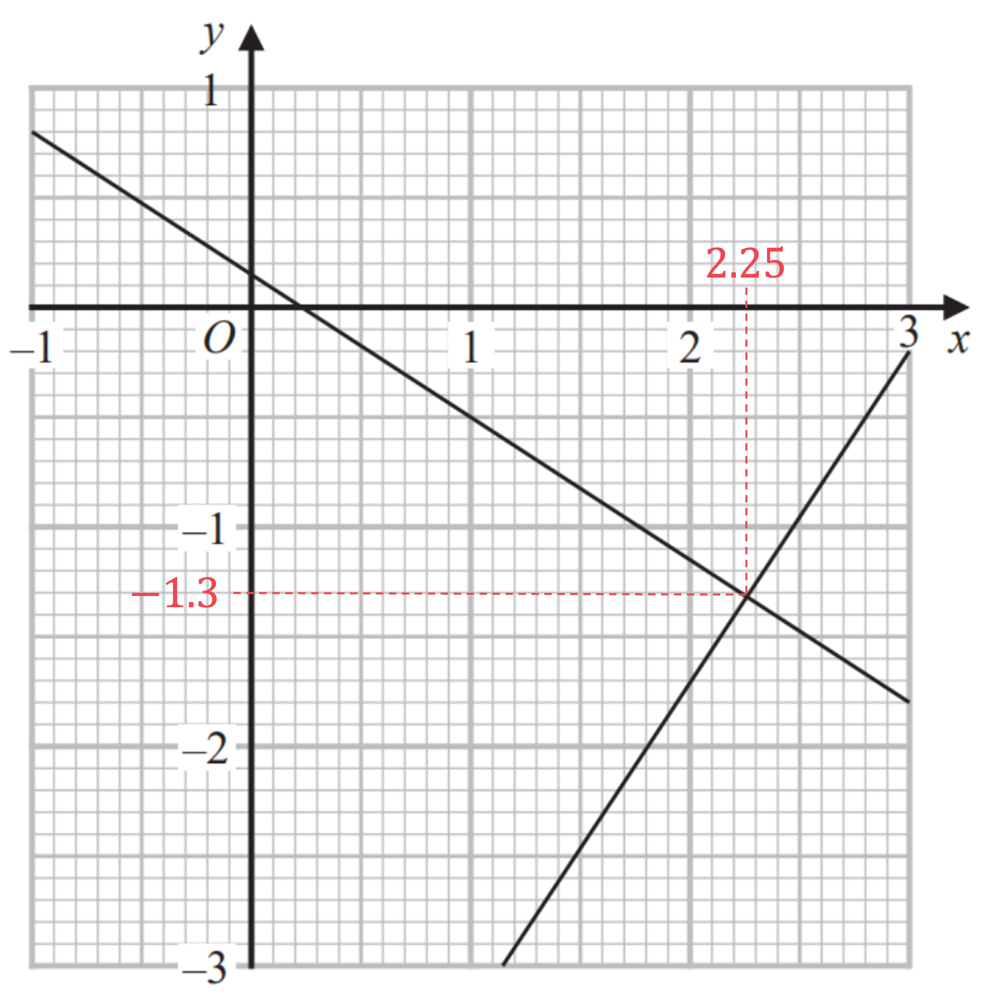
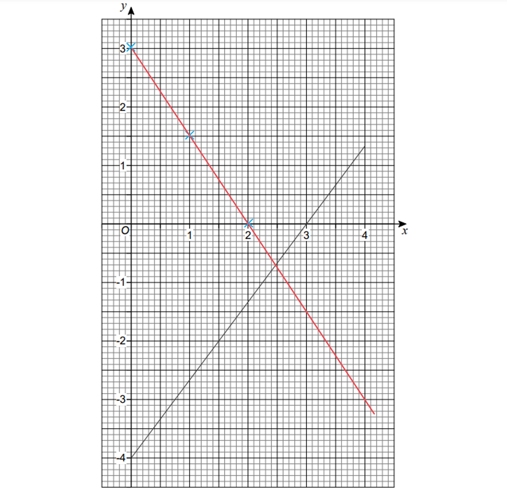
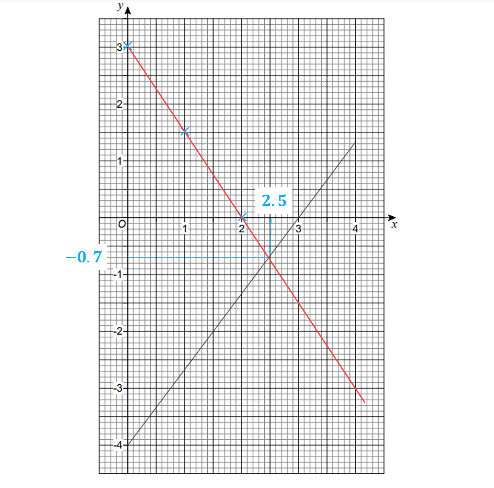
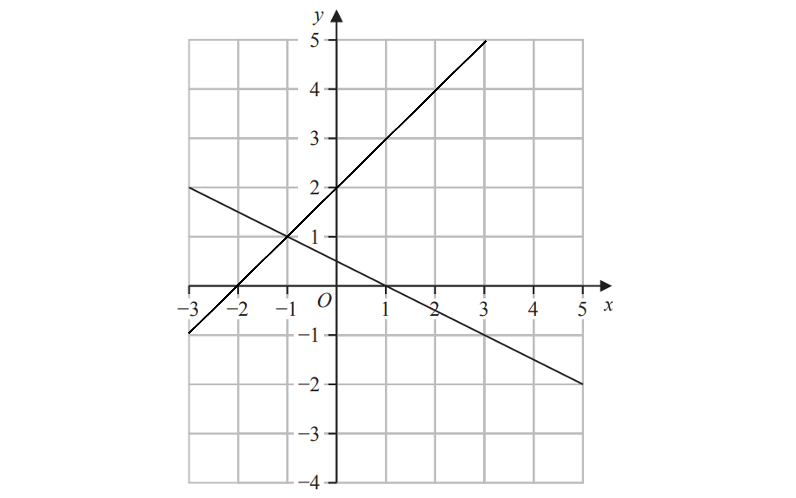
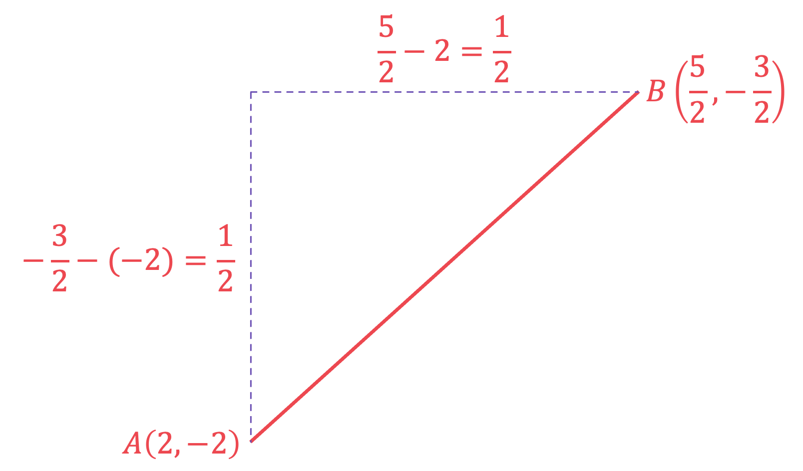

# Mark Schemes — Simultaneous Equations
**Equations, Formulae & Identities** · Edexcel IGCSE Maths A (4MA1) — 18/Higher

## Q1 — easy — 3 marks · exam-questions

### 18() — 3 marks
> *Number the equations.*

> $\begin{gathered} 4 x + y & = 25 ( 1 ) \\ x - 3 y & = 16 ( 2 ) \end{gathered}$* *

> *Make the **y** terms equal by multiplying all parts of equation (1) by 3.*

$\begin{gathered} 12 x + 3 y & = 75 ( 3 ) \\ x - 3 y & = 16 ( 2 ) \end{gathered}$

> *Eliminate the **y** terms by adding equation (3) to equation (2). Be careful to add every term. *

> *The coefficients of **y** are the same but with different signs, so add them.*

`12 x + 3 y = 75 bottom + ( x - 3 y = 16 ) 13 x = 91`

**[1]**

> *Solve the equation to find** x  **by dividing both sides by 13.*

$\begin{gathered} x & = \frac{91}{13} = 7 \end{gathered}$

> *Substitute *$x=7$* into either of the two original equations**.*

$( 1 ) 4 ( 7 ) + y = 25$

**[1]**

> *Solve this equation to find** y.*

$\begin{gathered} 4 ( 7 ) + y & = 25 \\ 28 + y & = 25 \\ y & = 25 - 28 = - 3 \end{gathered}$

> *Substitute **x** = 7  and **y** = - 3 into the other equation to check that they are correct*

$\begin{gathered} ( 2 ) x - 3 y & = 16 \\ ( 7 ) - 3 ( - 3 ) & = 16 \\ 7 + 9 & = 16 \\ 16 & = 16 \end{gathered}$

$x=7,y=-3$* ***[1]**

## Q2 — easy — 3 marks · exam-questions

### 19() — 3 marks
> *Number the equations.*

> $\begin{gathered} 2 x - y & = 13 ( 1 ) \\ x - 2 y & = 11 ( 2 ) \end{gathered}$* *

> *Make the **y** terms equal by multiplying all parts of equation (1) by 2.*

$\begin{gathered} 4 x - 2 y & = 26 ( 3 ) \\ x - 2 y & = 11 ( 2 ) \end{gathered}$

> *Eliminate the **y** terms by subtracting equation (2) from equation (3). Be careful to subtract every term. The coefficients of **y** are the same with the same signs, so subtract them.*

`4 x - 2 y = 26 bottom - ( x - 2 y = 11 ) 3 x = 15`

**[1]**

> *Solve the equation to find** x  **by dividing both sides by 3.*

$\begin{gathered} x & = \frac{15}{3} = 5 \end{gathered}$

> *Substitute *$x=5$* into either of the two original equations**.*

$( 1 ) 2 ( 5 ) - y = 13$

**[1]**

> *Solve this equation to find** y.*

$\begin{gathered} 10 - y & = 13 \\ - y & = 13 - 10 = 3 \\ y & = - 3 \end{gathered}$

> *Substitute **x** = 5 and **y** = -3 into the other equation to check that they are correct*

$\begin{gathered} ( 2 ) x - 2 y & = 11 \\ ( 5 ) - 2 ( - 3 ) & = 11 \\ 5 + 6 & = 11 \\ 11 & = 11 \end{gathered}$

$x=5,y=-3$* ***[1]**

## Q3 — easy — 3 marks · exam-questions

### 2() — 3 marks
> *Number the equations.*

> $3 x + y = - 4 ( 1 )
3 x - 4 y = 6 ( 2 )$* *

> *Eliminate the **x** terms by subtracting equation (2) from equation (1). Be careful to subtract every term. *

> *The coefficients of **x** are the same with the same signs, so subtract them.*

`3 x + y = - 4 bottom - ( 3 x - 4 y = 6 ) 5 y = - 10`

**[1]**

> *Solve the equation to find** y **by dividing both sides by 5.*

$\begin{gathered} y & = \frac{- 10}{5} = - 2 \end{gathered}$

> *Substitute *$y=-2$* into either of the two original equations**.*

$( 1 ) 3 x + ( - 2 ) = - 4$

**[1]**

> *Solve this equation to find** y.*

$\begin{gathered} 3 x - 2 & = - 4 \\ 3 x & = - 4 + 2 \\ 3 x & = - 2 \\ x = - \frac{2}{3} \end{gathered}$

> *Substitute *$x=-\frac{2}{3}$* and *$y=-2$* into the other equation to check that they are correct.*

$\begin{gathered} ( 2 ) 3 x - 4 y & = 6 \\ 3 ( - \frac{2}{3} ) - 4 ( - 2 ) & = 6 \\ - 2 + 8 & = 6 \\ 6 & = 6 \end{gathered}$

$x=-\frac{2}{3},y=-2$* ***[1]**

## Q4 — easy — 3 marks · exam-questions

### 10() — 3 marks
> *We could use the method of making the **x** terms equal (multiply second equation by 2) or by making the **y** terms equal (multiply the second equation by 5).*

> *Alternatively, as one of the equation has a single **y** term, we can rearrange it to make **y** the subject and then substitute into the other equation.*

> *Start by rearranging the second equation.*

$\begin{gathered} 2 x & = 9 + y \\ y = 2 x - 9 \end{gathered}$

> *Substitute this rearrangement into the first equation.*

$4 x + 5 ( 2 x - 9 ) = 4$

**[1]**

> *Expand and simplify to form an equation in **x**.*

$\begin{array}{rcl} 4 x + 10 x - 45 - 4 & = 0 \\ 14 x - 49 & = 0 \end{array}$

> *Solve for **x**.*

$\begin{gathered} 14 x & = 49 \\ x = \frac{49}{14} = 3.5 \end{gathered}$

*Substitute this value of **x** into either of the original equations to find **y**.*

> *(In this case it will actually be easiest to use our rearranged *$y=2x-9$*.)*

$y=2\times3.5-9=-2$

**[1]**

> *Write the final answer down, making sure **x** and **y** are the correct way round!*

$x=3.5,y=-2$ **[1]**

## Q5 — easy — 3 marks · exam-questions

### 8() — 3 marks
> *We could use the method of making the **x** terms equal (multiply second equation by 4) or by making the **y** terms equal (multiply the first equation by 2).*

> *Alternatively, as one of the equation has a single **x** term, we can rearrange it to make **x** the subject and then substitute into the other equation.*

> *Start by rearranging the second equation to isolate **x** by adding 4**y** to both sides.*

$\begin{gathered} x = 9 + 4 y \\ x = 4 y + 9 \end{gathered}$

> *Substitute this rearrangement into the first equation.*

$4 ( 4 y + 9 ) + 2 y = 9$

**[1]**

> *Expand and simplify to form an equation in **y**.*

$\begin{gathered} 16 y + 36 + 2 y - 9 & = 0 \\ 18 y + 27 & = 0 \end{gathered}$

> *Solve for **y**.*

$\begin{gathered} 18 y & = - 27 \\ y = \frac{- 27}{18} = - 1.5 \end{gathered}$

*Substitute this value of **y** into either of the original equations to find **x**.*

> *(In this case it will actually be easiest to use our rearranged *$x=4y+9$*.)*

$x=4\times-1.5+9=3$

**[1]**

> *Write the final answer down, making sure **x** and **y** are the correct way round!*

$x=3,y=-1.5$ **[1]**

## Q6 — easy — 3 marks · exam-questions

### 9() — 3 marks
> *We could use the method of making the **x** terms equal (multiply the first equation by 7) or by making the **y** terms equal (multiply the first equation by 5).*

> *Alternatively, as one of the equation has a single **x** term (and a single **y** term), we can rearrange it to make **x** (or **y**) the subject and then substitute into the other equation.*

> *Start by rearranging the first equation to isolate **x** by subtracting **y** from both sides.*

$\begin{gathered} x = 15 - y \end{gathered}$

> *Substitute this rearrangement into the second equation.*

$7 ( 15 - y ) - 5 y = 3$

**[1]**

> *Expand and simplify to form an equation in **y**.*

$\begin{gathered} 105 - 7 y - 5 y - 3 & = 0 \\ - 12 y + 102 & = 0 \end{gathered}$

> *It would be nice to have a positive **y** term to make the equation easier to solve, and we can also divide through by 6.*

> * Another way of thinking of this is dividing the equation by -6.*

$2y-17=0$

> *Solve for **y**.*

$\begin{array}{rcl} y = 8.5 \end{array}$

*Substitute this value of **y** into either of the original equations to find **x**.*

> *(In this case it will actually be easiest to use our rearranged *$x=15-y$*.)*

$x = 15 - ( 8.5 ) = 6.5$

**[1]**

> *Write the final answer down, making sure **x** and **y** are the correct way round!*

$x=6.5,y=8.5$ **[1]**

## Q7 — easy — 3 marks · exam-questions

### 9() — 3 marks
> *Number the equations.*

> $x + 2 y = - 0.5 ( 1 )
3 x - y = 16 ( 2 )$* *

> *Multiply equation (2) by 2 so both equations have the same number of **y**'s in them (don't worry about signs at this stage).*

$6 x - 2 y = 32 ( 3 )$

> *Considering equations (1) and (3) we can eliminate **y** by adding these together (signs of the **y** terms are opposite so add).*

$\begin{gathered} x + 2 y & = - 0.5 \\ 6 x - 2 y & = 32 \\ 7 x & = 31.5 \end{gathered}$

**[1]**

> *Solve this equation to find** x **by dividing both sides by 7.*

$\begin{gathered} x = \frac{31.5}{7} = \frac{9}{2} = 4.5 \end{gathered}$

> *Substitute *$x=4.5$* into either of the two original equations**.*

$( 1 ) 4.5 + 2 y = - 0.5$

**[1]**

> *Solve this equation to find** y **(subtract 4.5 from both sides and then divide by 2)**.*

$\begin{gathered} 2 y & = - 5 \\ y = - 2.5 \end{gathered}$

> *Substitute *$x=4.5$* and *$y=-2.5$* into the other original equation to check that they are correct.*

$\begin{gathered} ( 2 ) 3 x - y & = 16 \\ 3 ( 4.5 ) - ( - 2.5 ) & = 13.5 + 2.5 \\ = 16 \\ \end{gathered}$

$x=4.5,y=-2.5$* ***[1]**

## Q8 — easy — 3 marks · exam-questions

### 7() — 3 marks
> *Number the equations.*

> $3 x + 5 y = 6 ( 1 )
7 x - 5 y = - 11 ( 2 )$* *

> *Eliminate the **y** terms by adding equation (2) to equation (1) as the **y** terms have opposite signs.*

$\begin{gathered} 3 x + 5 y & = 6 \\ 7 x - 5 y & = - 11 \\ 10 x & = - 5 \end{gathered}$

**[1]**

> *Solve the equation to find** x **by dividing both sides by 10.*

$\begin{gathered} x = \frac{- 5}{10} = - 0.5 \end{gathered}$

> *Substitute *$x=-0.5$* into either of the two original equations**.*

$( 1 ) 3 ( - 0.5 ) + 5 y = 6$

> *Solve this equation to find** y.*

$\begin{gathered} - 1.5 + 5 y & = 6 \\ 5 y & = 7.5 \\ y = 1.5 \end{gathered}$

> *Substitute *$x=-0.5$* and *$y=1.5$* into the other original equation to check that they are correct.*

$\begin{gathered} ( 2 ) 7 x - 5 y & = 7 ( - 0.5 ) - 5 ( 1.5 ) \\ = - 3.5 - 7.5 \\ = - 11 \end{gathered}$

> *Be sure to get **x** and **y** the right way round for your final answer!*

> $x=-0.5,y=1.5$* *

**One mark for each**** [2]**

## Q9 — easy — 1 marks · exam-questions

### 13() — 1 marks
> *The point **P** is on *$y=-1$* so takes the form *$(... , - 1 )$* so we can immediately rule out the second and third options.*

> *Substitute *$y=-1$* into *$y=3x$* as **P **is where these two lines meet.*

$-1=3x$

> *Solve for *$x$* by dividing both sides by 3.*

$x=-\frac{1}{3}$

> *Therefore ...*

**the fourth option is correct, **$(-\frac{1}{3},-1)$** ****[1]**

## Q10 — easy — 1 marks · exam-questions

### 16() — 1 marks
> *To find the intersection of two straight lines graphs we would solve their equations simultaneously.*

$\begin{gathered} y = - 4 x \\ y = 3 \end{gathered}$

> *We can immediately see that the **y**-coordinate is 3, and all the possible answers have 3 as their **y**-coordinate.*

> *To find the **x**-coordinate we can either subtract one equation from the other to eliminate **y**, or substitute the second equation, *$y=3$*, into the first equation, *$y=-4x$* and solve for **x**.*

$3=-4x\,x=-\frac{3}{4}$

**The answer is the first option, **$(-\frac{3}{4},3)$** ****[1]**

## Q11 — easy — 3 marks · exam-questions

### 10() — 3 marks
*Spot that both equations have the same number (but different signs) of **y**'s.*

> *As the signs are different, we can add the equations to eliminate **y**.*

$2x+x=18+6$

> *Simplify and solve for **x.*

$\begin{gathered} 3 x & = 24 \\ \div 3 & = \div 3 \\ x = 8 \end{gathered}$

> *Substitute this value of **x** into either of the original equations to find **y**. We've used the second equation.*

$\begin{array}{rcl} 8 - y & = 6 \\ y = 8 - 6 \\ y = 2 \end{array}$

$x=8,y=2$* ***[1]**

## Q12 — easy — 3 marks · exam-questions

### 5() — 3 marks
> *Number the equations.*

> $7 x + 2 y = 36 ( 1 )
3 x + 2 y = 16 ( 2 )$* *

> *Eliminate the **y** terms by subtracting equation (2) from equation (1). Be careful to subtract every term. *

> *The coefficients of **y** are the same with the same signs, so subtract them.*

`7 x + 2 y = 36 bottom - ( 3 x + 2 y = 16 ) 4 x = 20`

**[1]**

> *Solve the equation to find** x  **by dividing both sides by 4.*

$\begin{gathered} x & = \frac{20}{4} = 5 \end{gathered}$

**[1]**

> *Substitute *$x=5$* into either of the two original equations**.*

$( 1 ) 7 ( 5 ) + 2 y = 36$

> *Solve this equation to find** y.*

$\begin{gathered} 35 + 2 y & = 36 \\ 2 y & = 35 - 35 \\ 2 y & = 1 \\ y & = 1 \frac{1}{2} \end{gathered}$

> *Substitute *$x=5$* and *$y=\frac{1}{2}$* into the other equation to check that they are correct.*

$\begin{gathered} ( 2 ) 3 x + 2 y & = 16 \\ 3 ( 5 ) + 2 ( 1 \frac{1}{2} ) & = 16 \\ 15 + 1 & = 16 \\ 16 & = 16 \end{gathered}$

$x=5,y=\frac{1}{2}$* ***[1]**

## Q13 — easy — 3 marks · exam-questions

### 2((c)) — 3 marks
> *Number the equations.*

> $4 x + 3 y = 5 ( 1 )
2 x + 3 y = 1 ( 2 )$* *

> *Eliminate the **y** terms by subtracting equation (2) from equation (1). Be careful to subtract every term.*

`4 x + 3 y = 5 bottom - ( 2 x + 3 y = 1 ) 2 x = 4`

**[1]**

> *Solve the equation to find** x **by dividing both sides by 2.*

$\begin{gathered} x & = \frac{4}{2} = 2 \end{gathered}$

> *Substitute *$x=2$* into either of the two original equations**.*

$( 1 ) 4 ( 2 ) + 3 y = 5$

**[1]**

> *Solve this equation to find** y.*

$\begin{gathered} 8 + 3 y & = 5 \\ 3 y & = - 3 \\ y & = - 1 \end{gathered}$

> *Substitute *$x=2$* and *$y=-1$* into the other equation to check that they are correct.*

$\begin{gathered} ( 2 ) 2 x + 3 y & = 1 \\ 2 ( 2 ) + 3 ( - 1 ) & = 1 \\ 4 - 3 & = 1 \\ 1 & = 1 \end{gathered}$

$x=2,y=-1$* ***[1]**

## Q14 — medium — 4 marks · exam-questions

### 11() — 4 marks
> *Number the equations.*

> $\begin{gathered} 2 x - 4 y & = 19 ( 1 ) \\ 3 x + 5 y & = 1 ( 2 ) \end{gathered}$* *

> *Make the **x** terms equal by multiplying all parts of equation (1) by 3 and all parts of equation (2) by 2.*

$\begin{gathered} 6 x - 12 y & = 57 ( 3 ) \\ 6 x + 10 y & = 2 ( 4 ) \end{gathered}$

> *Eliminate the **x** terms by subtracting equation (3) from equation (4). Be careful to subtract every term.*

`6 x + 10 y = 2 bottom - ( 6 x - 12 y = 57 ) 22 y = - 55`

**[1]**

> *Solve the equation to find** y  **by dividing both sides by 22.*

$\begin{array}{rcl} y = \frac{- 55}{22} = - \frac{5}{2} = - 2.5 \end{array}$

**[1]**

> *Substitute *$y=-\frac{5}{2}$* into either of the two original equations**.*

$( 1 ) 2 x - 4 ( - \frac{5}{2} ) = 19$

**[1]**

> *Solve this equation to find** x.*

$\begin{gathered} 2 x - 4 ( - \frac{5}{2} ) & = 19 \\ 2 x + 10 & = 19 \\ 2 x & = 9 \\ x & = \frac{9}{2} = 4.5 \end{gathered}$

> *Substitute **x** = 4.5  and **y** = - 2.5 into the other equation to check that they are correct*

$\begin{gathered} ( 2 ) 3 x + 5 y & = 1 \\ 3 ( 4.5 ) + 5 ( - 2.5 ) & = 1 \\ 13.5 - 12.5 & = 1 \\ 1 & = 1 \end{gathered}$

$x=\frac{9}{2},y=-\frac{5}{2}$* ***[1]**

## Q15 — medium — 4 marks · exam-questions

### 20() — 4 marks
> *Number the equations.*

> $\begin{gathered} 5 x + 2 y & = 11 ( 1 ) \\ 4 x - 3 y & = 18 ( 2 ) \end{gathered}$* *

> *Make the **y** terms equal by multiplying all parts of equation (1) by 3 and all parts of equation (2) by 2. *

> *This will give two 6**y **terms with different signs. The question could also be done by making the **x **terms equal by multiplying all parts of equation (1) by 4 and all parts of equation (2) by 5, and subtracting the equations.*

$\begin{gathered} 15 x + 6 y & = 33 ( 3 ) \\ 8 x - 6 y & = 36 ( 4 ) \end{gathered}$

> *The 6y terms have different signs, so they can be eliminated by adding equation (4) to equation (3). *

`15 x + 6 y = 33 bottom + ( 8 x - 6 y = 36 ) 23 x = 69`

**[1]**

> *Solve the equation to find** x  **by dividing both sides by 23.*

$\begin{gathered} x & = \frac{69}{23} = 3 \end{gathered}$

**[1]**

> *Substitute *$x=3$* into either of the two original equations**.*

$( 1 ) 5 ( 3 ) + 2 y = 11$

**[1]**

> *Solve this equation to find** y.*

$\begin{gathered} 15 + 2 y & = 11 \\ 2 y & = 11 - 15 \\ 2 y & = - 4 \\ y & = \frac{- 4}{2} = - 2 \end{gathered}$

> *Substitute **x** = 3  and **y** = - 2 into the other equation to check that they are correct*

$\begin{gathered} ( 2 ) 4 x - 3 y & = 18 \\ 4 ( 3 ) - 3 ( - 2 ) & = 18 \\ 12 - ( - 6 ) & = 18 \\ 18 & = 18 \end{gathered}$

$x=3,y=-2$* ***[1]**

## Q16 — medium — 4 marks · exam-questions

### 22() — 4 marks
> *Number the equations.*

> $\begin{gathered} 3 x + 2 y & = 4 ( 1 ) \\ 4 x + 5 y & = 17 ( 2 ) \end{gathered}$* *

> *Make the **x** terms equal by multiplying all parts of equation (1) by 4 and all parts of equation (2) by 3. *

> *This will give two 12**x **terms with the same signs. The question could also be done by making the **y **terms equal by multiplying all parts of equation (1) by 5 and all parts of equation (2) by 2.*

$\begin{gathered} 12 x + 8 y & = 16 ( 3 ) \\ 12 x + 15 y & = 51 ( 4 ) \end{gathered}$

> *Eliminate the **x** terms by subtracting equation (4) from equation (3). Be careful to subtract every term.*

`12 x + 8 y = 16 bottom - ( 12 x + 15 y = 51 ) - 7 y = - 35`

**[1]**

> *Solve the equation to find** y  **by dividing both sides by -7.*

$\begin{gathered} y & = \frac{- 35}{- 7} = 5 \end{gathered}$

**[1]**

> *Substitute *$y=5$* into either of the two original equations**.*

$( 1 ) 3 x + 2 ( 5 ) = 4$

**[1]**

> *Solve this equation to find** x.*

$\begin{gathered} 3 x + 10 & = 4 \\ 3 x & = 4 - 10 \\ 3 x & = - 6 \\ x & = \frac{- 6}{3} = - 2 \end{gathered}$

> *Substitute **x** = -2  and **y** = 5 into the other equation to check that they are correct*

$\begin{gathered} ( 2 ) 4 x + 5 y & = 17 \\ 4 ( - 2 ) + 5 ( 5 ) & = 17 \\ - 8 + 25 & = 17 \\ 17 & = 17 \end{gathered}$

$x=-2,y=5$* ***[1]**

## Q17 — medium — 4 marks · exam-questions

### 18() — 4 marks
> *Number the equations.*

> $\begin{gathered} 4 x + 7 y & = 1 ( 1 ) \\ 3 x + 10 y & = 15 ( 2 ) \end{gathered}$* *

> *Make the **x** terms equal by multiplying all parts of equation (1) by 3 and all parts of equation (2) by 4. *

> *This will give two 12**x **terms with the same signs. The question could also be done by making the **y **terms equal by multiplying all parts of equation (1) by 7 and all parts of equation (2) by 10.*

$\begin{gathered} 12 x + 21 y & = 3 ( 3 ) \\ 12 x + 40 y & = 60 ( 4 ) \end{gathered}$

> *Eliminate the **x** terms by subtracting equation (3) from equation (4). Be careful to subtract every term.*

`12 x + 40 y = 60 bottom - ( 12 x + 21 y = 3 ) 19 y = 57`

**[1]**

> *Solve the equation to find** y  **by dividing both sides by 19.*

$\begin{gathered} y & = \frac{57}{19} = 3 \end{gathered}$

**[1]**

> *Substitute *$y=3$* into either of the two original equations**.*

$( 1 ) 4 x + 7 ( 3 ) = 1$

**[1]**

> *Solve this equation to find** x.*

$\begin{gathered} 4 x + 21 & = 1 \\ 4 x & = 1 - 21 \\ 4 x & = - 20 \\ x & = \frac{- 20}{4} = - 5 \end{gathered}$

> *Substitute **x** = -5  and **y** = 3 into the other equation to check that they are correct*

$\begin{gathered} ( 2 ) 3 x + 10 y & = 15 \\ 3 ( - 5 ) + 10 ( 3 ) & = 15 \\ - 15 + 30 & = 15 \\ 15 & = 15 \end{gathered}$

$x=-5,y=3$* ***[1]**

## Q18 — medium — 4 marks · exam-questions

### 15() — 4 marks
> *Number the equations.*

> $\begin{gathered} 3 x + 4 y & = 5 ( 1 ) \\ 2 x - 3 y & = 9 ( 2 ) \end{gathered}$* *

> *Make the **x** terms equal by multiplying all parts of equation (1) by 2 and all parts of equation (2) by 3. *

> *This will give two 6**x **terms with the same signs. The question could also be done by making the **y **terms equal by multiplying all parts of equation (1) by 3 and all parts of equation (2) by 4.*

$\begin{gathered} 6 x + 8 y & = 10 ( 3 ) \\ 6 x - 9 y & = 27 ( 4 ) \end{gathered}$

> *Eliminate the **x** terms by subtracting equation (4) from equation (3). Be careful to subtract every term and remember that subtracting minus 9 is the same as adding it.*

`6 x + 8 y = 10 bottom - ( 6 x - 9 y = 27 ) 17 y = - 17`

**[1]**

> *Solve the equation to find** y  **by dividing both sides by 17.*

$\begin{gathered} y & = \frac{- 17}{17} = - 1 \end{gathered}$

**[1]**

> *Substitute *$y=-1$* into either of the two original equations**.*

$( 1 ) 3 x + 4 ( - 1 ) = 5$

**[1]**

> *Solve this equation to find** x.*

$\begin{gathered} 3 x - 4 & = 5 \\ 3 x & = 5 + 4 \\ 3 x & = 9 \\ x & = \frac{9}{3} = 3 \end{gathered}$

> *Substitute **x** = 3 and **y** = -1 into the other equation to check that they are correct*

$\begin{gathered} ( 2 ) 2 x - 3 y & = 9 \\ 2 ( 3 ) - 3 ( - 1 ) & = 9 \\ 6 - - 3 & = 9 \\ 9 & = 9 \end{gathered}$

$x=3,y=-1$* ***[1]**

## Q19 — medium — 2 marks · exam-questions

### 10() — 2 marks
*Find where the two straight line graphs intersect.* 
*Draw lines from the point of intersection to the **x** and **y** axes.*

> *Use a ruler to be as accurate as possible. (Even though the final answers will be estimates, we want them to be good estimates!)*

> *Read the scale carefully, especially where negative numbers are involved and make sure to get your **x** and **y** values the right way round.*

$\begin{array}{rcl} x = 2 . 25 \\ y = - 1 . 3 \end{array}$** **
**One mark for each**** [2]**

**Values of 2.2 to 2.3 inclusive are allowed for ****x****. **
**Values of -1.4 to -1.3 inclusive are allowed for ****y****.**

## Q20 — medium — 4 marks · exam-questions

### 4() — 4 marks
> *To find the area, the length and the width of the individual tiles needs to be found.*

> *Begin by labelling each part of the pattern with the length (**l **) and the width (**w **) of each tile.*

> *Use the given dimensions (7 cm and 11 cm) to form two equations in terms of **l ** and **w.*

$\begin{gathered} l + w & = 7 \\ l + l + w & = 11 \end{gathered}$

**Either correct**** [1]**

> *Simplify and number the equations.*

> $\begin{gathered} l + w & = 7 ( 1 ) \\ 2 l + w & = 11 ( 2 ) \end{gathered}$* *

> *Eliminate the **w** terms by subtracting equation (1) from equation (2).*

> * Be careful to subtract every term.*

`2 l + w = 11 bottom - ( l + w = 7 ) l = 4`

**[1]**

> *Substitute *$l=4$* into either of the two original equations**.*

$( 1 ) 4 + w = 7$

> *Solve this equation to find** w.*

$\begin{gathered} w & = 7 - 4 = 3 \end{gathered}$

> *So  **w**  =  3  and **l** = -4. Use this to find the area of one tile*

$\begin{gathered} Area_{( o n e t i l e )} & = 4 \times 3 = 12 cm^{2} \end{gathered}$

> *The total area of the pattern will be the area of 4 tiles.*

$\begin{gathered} Area_{( p a t t e r n )} & = 4 \times 12 = 48 cm^{2} \end{gathered}$

**[1]**

$48\mathrm{cm}^{2}$** ****[1]**

## Q21 — medium — 4 marks · exam-questions

### 12() — 4 marks
> *Number the equations.*

> $\begin{gathered} 2 x + 7 y & = 17 ( 1 ) \\ 5 x + 3 y & = - 1 ( 2 ) \end{gathered}$* *

> *Make the **x** terms equal by multiplying all parts of equation (1) by 5 and all parts of equation (2) by 2. *

> *This will give two 10**x **terms with the same signs. *

> *(The question could also be done by making the **y **terms equal by multiplying all parts of equation (1) by 3 and all parts of equation (2) by 7.)*

$\begin{gathered} 10 x + 35 y & = 85 ( 3 ) \\ 10 x + 6 y & = - 2 ( 4 ) \end{gathered}$

> *Eliminate the **x** terms by subtracting equation (4) from equation (3). *

> *Be careful to subtract every term and that subtracting -2 is the same as adding 2.*

$29y=87$

**[1]**

> *Solve the equation to find** y  **by dividing both sides by 29.*

$\begin{array}{rcl} y = \frac{87}{29} = 3 \end{array}$

> *Substitute *$y=3$* into either of the two original equations**.*

$( 1 ) 2 x + 7 ( 3 ) = 17$

**[1]**

> *Solve this equation to find** x.*

$\begin{gathered} 2 x + 21 & = 17 \\ 2 x & = - 4 \\ x = - 2 \end{gathered}$

> *Substitute *$x=-2$* and *$y=3$* into the other original equation to check that they are correct.*

$\begin{gathered} ( 2 ) 5 x + 3 y & = 5 ( - 2 ) + 3 ( 3 ) \\ = - 10 + 9 \\ = - 1 \end{gathered}$

> *Be sure to get **x** and **y** the right way round for the final answer!*

$x=-2,y=3$* *
**One mark for each**** [2]**

## Q22 — medium — 4 marks · exam-questions

### 1() — 4 marks
**Method 1**

Make the y values the same by multiplying the top equation by 3 and the bottom equation by 10

$\begin{gathered} 9 x + 15 y & = 36 \\ 25 x + 15 y & = 80 \end{gathered}$

Subtract the bottom equation from the top equation

$-16x=-44$

**[M1]**

Solve

$x=2.75$

**[M1]**

Find the second variable by substituting in x to the first equation

$3 ( 2.75 ) + 5 y = 12
8.25 + 5 y = 12
5 y = 3.75$

**[M1]**

$y=0.75,x=2.75$

**[A1]**

**Method 2**

Make the x values the same by multiplying the top equation by 5 and the bottom equation by 6

$15x+25y=60\,15x+9y=48$

Subtract the bottom equation from the top equation

$16y=12$

**[M1]**

$y=0.75$

**[M1]**

Find the second variable by substituting in x to the first equation

$3 x + 5 ( 0.75 ) = 12
3 x + 3.75 = 12
3 x = 8.25$

**[M1]**

$y=0.75,x=2.75$

**[A1]**

## Q23 — medium — 3 marks · exam-questions

### 8() — 3 marks
> *Number the equations.*

> $\begin{gathered} 5 a + 2 c & = 10 ( 1 ) \\ 2 a - 4 c & = 7 ( 2 ) \end{gathered}$* *

> *Make the **c** terms equal by multiplying all parts of equation (1) by 2 and leaving the second equation as it is. *

> *This will give two 4**c **terms with opposite signs.*

$\begin{gathered} 10 a + 4 c & = 20 ( 3 ) \end{gathered}$

**[1]**

> *Eliminate the **x** terms by adding equations (2) and (3). *

> *Be careful to add every term and that adding -4**c** is the same as subtracting 4**c**.*

$12a=27$

> *Solve the equation to find** a  **by dividing both sides by 12.*

$\begin{gathered} a = \frac{27}{12} = \frac{9}{4} = 2.25 \end{gathered}$

> *Substitute *$a=2.25$* into either of the two original equations**.*

$( 1 ) 5 ( 2.25 ) + 2 c = 10$

> *Solve this equation to find** c.*

$\begin{gathered} 11.25 + 2 c & = 10 \\ 2 c & = - 1.25 \\ c = - 0.625 \end{gathered}$

**[1]**

> *Substitute *$a=2.25$* and *$c=-0.625$* into the other original equation to check that they are correct.*

$\begin{gathered} ( 2 ) 2 a - 4 c & = 2 ( 2.25 ) - 4 ( - 0.625 ) \\ = 4.5 + 2.5 \\ = 7 \end{gathered}$

> *Be sure to get **a** and **c** the right way round for the final answer!*

$a=2.25,c=-0.625$** [1]**

## Q24 — medium — 4 marks · exam-questions

### 15() — 4 marks
> *Number the equations.*

> $\begin{gathered} 7 x - 2 y & = 34 ( 1 ) \\ 3 x + 5 y & = - 3 ( 2 ) \end{gathered}$* *

> *Make the **y** terms equal by multiplying all parts of equation (1) by 5 and multiplying all parts of equation (2) by 2. *

> *This will give two 10**y **terms with opposite signs.*

$\begin{gathered} 35 x - 10 y & = 170 ( 3 ) \\ 6 x + 10 y & = - 6 ( 4 ) \end{gathered}$

**[1]**

> *Eliminate the **y** terms by adding (as they have opposite signs) equations (3) and (4). *

> *Be careful to add every term and that adding -6 is the same as subtracting 6.*

$41x=164$

> *Solve the equation to find** x **by dividing both sides by 41.*

$\begin{array}{rcl} x = \frac{164}{41} = 4 \end{array}$

> *Substitute *$x=4$* into either of the two original equations**.*

$( 1 ) 7 ( 4 ) - 2 y = 34$

> *Solve this equation to find** y.*

$\begin{array}{rcl} 28 - 2 y & = 34 \\ 2 y & = - 6 \\ y = - 3 \end{array}$

**[1]**

> *Substitute *$x=4$* and *$y=-3$* into the other original equation to check that they are correct.*

$\begin{gathered} ( 2 ) 3 x + 5 y & = 3 ( 4 ) + 5 ( - 3 ) \\ = 12 - 15 \\ = - 3 \end{gathered}$

> *Be sure to get **x** and **y** the right way round for the final answer!*

$x=4,y=-3$** [1]**

## Q25 — medium — 4 marks · exam-questions

### 18() — 4 marks
> *Number the equations.*

> $\begin{gathered} 2 x + 4 y & = - 9 ( 1 ) \\ 2 y & = 4 x - 7 ( 2 ) \end{gathered}$* *

> *This can be done either by changing one equation and eliminating a variable, or by substituting equation (2) directly into equation (1).  *

> *For the substitution method, begin by multiplying equation (2) by 2 to make it equal to 4**y.*

$2 ( 2 ) 2 ( 2 y = 4 x - 7 ) 
 4 y = 8 x - 14 ( 3 )$

> *Substitute equation (3) into equation (1).*

$2 x + ( 8 x - 14 ) = - 9$

**[1]**

> *Simplify.*

$10x-14=-9$

> *Solve the equation to find** x  **by adding 14 and then dividing both sides by 10.*

$\begin{gathered} 10 x & = - 9 + 14 \\ 10 x & = 5 \\ x & = \frac{5}{10} \\ x & = 1 \frac{1}{2} \end{gathered}$

**[1]**

> *Substitute *$x=\frac{1}{2}$* into either of the two original equations**.*

$( 2 ) 2 y = 4 ( 1 \frac{1}{2} ) - 7$

**[1]**

> *Solve this equation to find** y.*

$\begin{gathered} 2 y & = 2 - 7 \\ 2 y & = - 5 \\ y & = - \frac{5}{2} \end{gathered}$

> *Substitute *$x=\frac{1}{2}$*  and *$y=-\frac{5}{2}$* into the other equation to check that they are correct*

$\begin{gathered} ( 1 ) 2 x + 4 y & = - 9 \\ 2 ( 1 \frac{1}{2} ) + 4 ( - \frac{5}{2} ) & = - 9 \\ 1 - \frac{ 20 }{2} & = - 9 \\ 1 - 10 & = - 9 \\ - 9 & = - 9 \end{gathered}$

$x=\frac{1}{2},y=-\frac{5}{2}$* ***[1]**

## Q26 — medium — 3 marks · exam-questions

### 8() — 3 marks
> *The second graph that needs to be drawn is the graph of *$3x+2y=6$*.*

> *Rearrange the equation to the form *$y=mx+c$* so that the equation can be drawn using the gradient and **y-** intercept.*

$\begin{gathered} 3 x + 2 y & = 6 \\ - 3 x & = - 3 x \\ 2 y & = - 3 x + 6 \\ \div 2 & = \div 2 \\ y & = \frac{- 3}{2} x + 3 \end{gathered}$

*The **y **intercept is at (0, 3) so plot this point. The gradient is -1.5, so from (0, 3), count 1 unit to the right and and 1.5 units down. Mark a new point at (1, 1.5).*

> *Repeat: from (1, 1.5), count 1 unit to the right and and 1.5 units down. Mark a new point at (2, 0).*

**At least two points marked correctly**** [1]**

> *Using a ruler or straight edge, draw a straight line through the three points, making sure your line extends in both directions between **x** = 0 and **x** = 4.*

**fully correct line**** [1]**

*Find where the two straight line graphs intersect.* *Draw lines from the point of intersection to the **x** and **y** axes.*

> *Use a ruler to be as accurate as possible. (Even though the final answers will be estimates, we want them to be good estimates!)*

> *Read the scale carefully, especially where negative numbers are involved and make sure to get your **x** and **y** values the right way round.*

`| x = 2 . 5 and y = - 0 . 7 | |`  **[1]**

## Q27 — medium — 4 marks · exam-questions

### 10() — 4 marks
> *Use multiplication to equate the coefficients of one of the variables in both equations*

> **[exam-tip]**
> The method used here equates the coefficients of $y$  but equating the coefficients of $x$ will also lead to the correct solution.

$\begin{gathered} 7 x + 3 y & = 20 ( \times 5 ) \\ 3 x + 5 y & = 3 ( \times 3 ) \\ \\ 35 x + 15 y & = 100 \\ 9 x + 15 y & = 9 \end{gathered}$

> *Subtract the second equation from the first equation to eliminate the 'equated' variable, in this case the '*$y$*' variable*

$35 x + 15 y = 100
- ( 9 x + 15 y = 9 )
- - - - - - -
 26 x = 91$

**[M1]**

> *Solve for one variable, in this case '*$x$*'*

$\begin{gathered} x = 91 \div 26 \\ = 3.5 \end{gathered}$

**[A1]**

> *Substitute the value into either of the equations and solve to find the second variable*

$\begin{gathered} 7 ( 3.5 ) + 3 y & = 20 \\ 24.5 + 3 y & = 20 \\ 3 y & = - 4.5 \\ y = - 1.5 \end{gathered}$

**[M1]**

> **[exam-tip]**
> It's a good idea to use the original equation you *didn't* use to find the $y$ value, to check your solution:
> 
> $\begin{gathered} 3 ( 3.5 ) + 5 ( - 1.5 ) & = 3 \\ 10.5 - 7.5 & = 3 \\ 3 = 3 ✔ \end{gathered}$

**Final answer:** $x=3.5$** and **$y=-1.5$

**[A1]**

> **[mark-scheme]**
> **M1**: This mark is awarded for a correct method to eliminate one variable (*x* or *y*) and is still awarded if there is one arithmetic error in working.
> 
> **A1**: A correct solution for one variable will gain this mark; the mark is only awarded if the first M1 mark is gained.
> 
> **M1**: A correct substitution of 'your' value of the first variable into one of the equations. This mark is only awarded if the first M1 mark is gained.
> 
> **A1**:This mark is awarded for both variables correct and is only awarded if at least one of the M1 marks is gained.

## Q28 — medium — 3 marks · exam-questions

### 9() — 3 marks
> *Multiply the second equation by 3 to make the coefficients of y the same*

$21x+9y=24$

> *Subtract the original first equation from your new second equation to eliminate y*

$21 x + 9 y = 24
- ( 2 x + 9 y = 14.5 )
- - - - - - - - - -
 19 x = 9.5$

**[M1]**

> *Solve for **x*

$x=\frac{9.5}{19}=0.5$

> *Substitute back into one of the original equations and solve to get y*

$\begin{gathered} 2 ( 0.5 ) + 9 y & = 14.5 \\ 9 y & = 13.5 \\ y = \frac{13.5}{9} \\ y = 1.5 \end{gathered}$

**[M1]**

> **[exam-tip]**
> It is a good idea to check your answers, by substituting them into the original equation you didn't use to find $y$:
> 
> $\begin{gathered} 7 ( 0.5 ) + 3 ( 1.5 ) & = 8 \\ 3.5 + 4.5 & = 8 \\ 8 = 8 ✔ \end{gathered}$

$x=0.5,y=1.5$

**[A1]**

> **[mark-scheme]**
> **A1**: Equivalent answers, e.g. $x=\frac{1}{2}$ and $y=\frac{3}{2}$, will also get the mark.

## Q29 — hard — 4 marks · exam-questions

### 17() — 4 marks
> *Number the equations.*

> $\begin{gathered} 2 x + 3 y & = \frac{2}{3} ( 1 ) \\ 3 x - 4 y & = 18 ( 2 ) \end{gathered}$* *

> *Make the **x** terms equal by multiplying all parts of equation (1) by 3 and all parts of equation (2) by 2.*

> * Choosing 3 is a good idea as it will also get rid of the fraction in equation (1), making the problem easier to deal with.*

$\begin{gathered} 6 x + 9 y & = 2 ( 3 ) \\ 6 x - 8 y & = 36 ( 4 ) \end{gathered}$

> *Eliminate the **x** terms by subtracting equation (4) from equation (3). Be careful to subtract every term and remember that subtracting minus 8 is the same as adding it.*

`6 x + 9 y = 2 bottom - ( 6 x - 8 y = 36 ) 17 y = - 34`

**[1]**

> *Solve the equation to find** y  **by dividing both sides by 17.*

$\begin{gathered} y & = \frac{- 34}{17} = - 2 \end{gathered}$

**[1]**

> *Substitute *$y=-2$* into either of the two original equations**.*

$( 2 ) 3 x - 4 ( - 2 ) = 18$

**[1]**

> *Solve this equation to find** x.*

$\begin{gathered} 3 x - - 8 & = 18 \\ 3 x + 8 & = 18 \\ 3 x & = 10 \\ x & = \frac{10}{3} \end{gathered}$

> *Substitute *$x=\frac{10}{3}$* and *$y=-2$* into the other equation to check that they are correct*

$\begin{gathered} ( 1 ) 2 x + 3 y & = \frac{2}{3} \\ 2 ( \frac{10}{3} ) + 3 ( - 2 ) & = \frac{2}{3} \\ \frac{ 20 }{3} - 6 & = \frac{2}{3} \\ \frac{ 20 }{3} - \frac{18}{3} & = \frac{2}{3} \\ \frac{2}{3} & = \frac{2}{3} \end{gathered}$

$x=\frac{10}{3},y=-2$* ***[1]**

## Q30 — hard — 5 marks · exam-questions

### 26() — 5 marks
> *Number the equations.*

> $x^{2} + y^{2} = 36 ( 1 )
x = 2 y + 6 ( 2 )$* *

> *There is one quadratic equation and one linear equation so this must be done by substitution.*

> *Equation (2) is equal to *$x$* so this can be eliminated by substituting it into the *$x$* part for equation (1). *

> *Substitute *$x=2y+6$* into equation (1).*

$( 2 y + 6 )^{2} + y^{2} = 36$

**[1]**

> *Expand the brackets, remember that a bracket squared should be treated the same as double brackets.*

$( 2 y + 6 ) ( 2 y + 6 ) + y^{2} = 36
4 y^{2 } + 6 ( 2 y ) + 6 ( 2 y ) + 6^{2} + y^{2 } = 36$

**[1]**

> *Simplify.*

$\begin{gathered} 4 y^{2 } + 12 y + 12 y + 36 + y^{2 } & = 36 \\ 5 y^{2 } + 24 y + 36 & = 36 \end{gathered}$

**[1]**

> *Rearrange to form a quadratic equation that is equal to zero.*

$\begin{gathered} 5 y^{2 } + 24 y + 36 - 36 & = 0 \\ 5 y^{2} + 24 y & = 0 \end{gathered}$

> *The question does not give a specified degree of accuracy, so this can be factorised. *

> *Take out the common factor of *$\begin{gathered} y \end{gathered}$*.*

$\begin{gathered} y ( 5 y + 24 ) & = 0 \end{gathered}$

> *Solve to find the values of *$y$*.*

> * **Let each factor be equal to 0 and solve.*

$\begin{gathered} y_{1} & = 0 \\ 5 y_{2} + 24 & = 0 \Leftrightarrow y_{2} = - \frac{24}{5} = - 4.8 \end{gathered}$

**[1]**

> *Substitute the values of *$y$* **into one of the equations (the linear equation is easier) to find the values of *$x$*.*

$x_{1} = 2 ( 0 ) + 6 = 6 x_{2} = 2 ( - \frac{24}{5} ) + 6 = - 9.6 + 6$

$x_{1}=6,y_{1}=0$**     **
**  **$x_{2}=-3.6,y_{2}=-4.8$** [1]**

## Q31 — hard — 6 marks · exam-questions

### 25() — 6 marks
> *Number the equations.*

> $\begin{gathered} x^{2} + y^{2} & = 9 ( 1 ) \\ x + y & = 2 ( 2 ) \end{gathered}$* *

> *There is one quadratic equation and one linear equation so this must be done by substitution.*

> *Rearrange equation (2) so that the subject is either *$x$* or *$y$*. *

> *In this case the subject is *$y$*.*

$\begin{gathered} y & = 2 - x ( 2 ) \end{gathered}$

> *Substitute this into equation (1) to eliminate *$y$*. *

$x^{2} + ( 2 - x )^{2} = 9$

**[1]**

> *Expand the brackets, remember that a bracket squared should be treated the same as double brackets.*

$x^{2} + ( 2 - x ) ( 2 - x ) = 9
x^{2 } + 4 - 2 x - 2 x + x^{2 } = 9$

> *Simplify.*

$\begin{gathered} x^{2 } + 4 - 4 x + x^{2 } & = 9 \\ 2 x^{2 } - 4 x + 4 & = 9 \end{gathered}$

** ****Correct expansion**** [1]**

> *Rearrange to form a quadratic equation that is equal to zero.*

$\begin{gathered} 2 x^{2 } - 4 x + 4 - 9 & = 0 \\ 2 x^{2 } - 4 x - 5 & = 0 \end{gathered}$

**[1]**

> *The question asks for answers to be given correct to 2 decimal places. This is a hint that the quadratic cannot be factorised and the quadratic formula should be used. *

> *The quadratic formula is *$x=\frac{-b\pm\sqrt{b^{2}-4ac}}{2a}$* where *$ax^{2}+bx+c=0$*. Find the values of *$a$*, *$b$* and *$c$*.*

$a=2,b=-4,c=-5$

> *Substitute into the quadratic formula.*

$x = \frac{- ( - 4 ) \pm \sqrt{( - 4 )^{2} - 4 \times 2 \times ( - 5 )} }{2 \times 2}$

**[1]**

$x = \frac{4 \pm \sqrt{16 - ( - 40 )} }{4} = \frac{4 \pm \sqrt{56} }{4}$

$x=2.870828...,x=-0.870828...$

**[1]**

> *Substitute the values of *$x$* **into one of the equations (the linear equation is easier) to find the values of *$y$*. *

> *Use more than 2 decimal places so that your answers for *$y$* are accurate.*

*       *$\begin{gathered} ( 2 ) y_{1} & = 2 - x_{1} = 2 - 2.870828... \\ y_{2} & = 2 - x_{2} = 2 - ( - 0.870828... ) \end{gathered}$

*Round your answers to **two decimal places.***             **

$x=2.87,y=-0.87$**    **
**   **** or **** **$x=-0.87,y=2.87$* *** [1]**

## Q32 — hard — 5 marks · exam-questions

### 20() — 5 marks
> *Number the equations.*

> $\begin{gathered} x^{2} + y^{2} & = 25 ( 1 ) \\ y - 3 x & = 13 ( 2 ) \end{gathered}$* *

> *There is one quadratic equation and one linear equation so this must be done by substitution.*

> *Rearrange equation (2) so that the subject is either *$x$* or *$y$*, *$y$*will be the easiest to work with here.*

$\begin{gathered} y & = 13 + 3 x ( 2 ) \end{gathered}$

> *Substitute this into equation (1) to eliminate *$y$*. *

$x^{2} + ( 13 + 3 x )^{2} = 25$

**[1]**

> *Expand the brackets, remember that a bracket squared should be treated the same as double brackets.*

$x^{2} + ( 13 + 3 x ) ( 13 + 3 x ) = 25
x^{2 } + ( 13 )^{2} + 13 ( 3 x ) + 13 ( 3 x ) + ( 3 x )^{2 } = 25$

> *Simplify.*

$\begin{gathered} x^{2 } + 169 + 39 x + 39 x + 9 x^{2 } & = 25 \\ 10 x^{2 } + 78 x + 169 & = 25 \end{gathered}$

** ****Correct expansion**** [1]**

> *Rearrange to form a quadratic equation that is equal to zero.*

$\begin{gathered} 210 x^{2 } + 78 x + 169 - 25 & = 0 \\ 10 x^{2 } + 78 x + 144 & = 0 \end{gathered}$

**[1]**

> *No degree of accuracy is asked for in the question, so the quadratic is likely to be able to be factorised.  *

> *Make the problem easier to deal with by dividing every term by 2.*

$\begin{gathered} 5 x^{2 } + 39 x + 72 & = 0 \end{gathered}$

> *We need a pair of numbers that multiply to *$ac$* which in this case is *$5\times72=360$*, and add to *$b$*, which in this case is 39.*

> *15 and 24 satisfy these conditions*

> *Rewrite the middle term using 15 and 24.*

$\begin{gathered} 5 x^{2 } + ( 15 + 24 ) x + 72 & = 0 \\ 5 x^{2 } + 15 x + 24 x + 72 & = 0 \end{gathered}$

> *Factorise the first two terms, using *$5x$* as the highest common factor, and the second two terms using 24 as the factor.*

$5 x ( x + 3 ) + 24 ( x + 3 ) = 0$

> *Note that these now have the same factor of *$( x + 3 )$* so this can be used as a common factor.*

$( 5 x + 24 ) ( x + 3 ) = 0$

**[1]**

> *Once you get to this spot it may be worth expanding the brackets to check your answer.*

> *When two numbers are multiplied and the result is zero, at least one of them must be zero, so we can say that*

$5x+24=0\mathrm{or}x+3=0$

> *Solving both of these equations to find the values for *$x$*.*

$\begin{gathered} x_{1} & = - \frac{24}{5} \\ x_{2} & = - 3 \end{gathered}$

> *Substitute the values of *$x$* **into one of the equations (the linear equation is easier) to find the values of *$y$*. *

> *Leaving the value of *$x_{1}$* as a fraction makes is easier to calculate with.*

$y_{1} = 13 + 3 ( - \frac{24}{5} ) = 13 - \frac{72}{5} = 13 - 14 \frac{2}{5} = - 1 \frac{2}{5} 
y_{2} = 13 + 3 ( - 3 ) = 13 - 9 = 4$

$x_{1}=-\frac{24}{5},y_{1}=-\frac{7}{5}$**    **
**   **$x_{2}=-3,y_{2}=4$** [****1]**

## Q33 — hard — 5 marks · exam-questions

### 20() — 5 marks
> *Number the equations.*

> $\begin{gathered} x^{2} + y^{2} & = 25 ( 1 ) \\ y - 2 x & = 5 ( 2 ) \end{gathered}$* *

> *There is one quadratic equation and one linear equation so this must be done by substitution.*

> *Rearrange equation (2) so that the subject is either *$x$* or *$y$*, *$y$*will be the easiest to work with here.*

$\begin{gathered} y & = 5 + 2 x ( 2 ) \end{gathered}$

> *Substitute this into equation (1) to eliminate *$y$*. *

$x^{2} + ( 5 + 2 x )^{2} = 25$

**[1]**

> *Expand the brackets, remember that a bracket squared should be treated the same as double brackets.*

$x^{2} + ( 5 + 2 x ) ( 5 + 2 x ) = 25
x^{2 } + ( 5 )^{2} + 5 ( 2 x ) + 5 ( 2 x ) + ( 2 x )^{2 } = 25$

> *Simplify.*

$\begin{gathered} x^{2 } + 25 + 10 x + 10 x + 4 x^{2 } & = 25 \\ 5 x^{2 } + 20 x + 25 & = 25 \end{gathered}$

** [1]**

> *Rearrange to form a quadratic equation that is equal to zero.*

$\begin{gathered} 5 x^{2 } + 20 x + 25 - 25 & = 0 \\ 5 x^{2} + 20 x & = 0 \end{gathered}$

> *The question does not give a specified degree of accuracy, so this can be factorised. Take out the common factor of *$\begin{array}{rcl} 5 x \end{array}$*.*

$\begin{gathered} 5 x ( x + 4 ) & = 0 \end{gathered}$

**[1]**

> *Solve to find the values of *$x$*. **Let each factor be equal to 0 and solve.*

$\begin{gathered} 5 x_{1} & = 0 \Leftrightarrow x_{1} = 0 \\ x_{2} + 4 & = 0 \Leftrightarrow x_{2} = - 4 \end{gathered}$

**[1]**

> *Substitute the values of *$x$* **into one of the equations (the linear equation is easier) to find the values of *$y$*.*

$y_{1} = 5 + 2 ( x_{1} ) = 5 + 2 ( 0 ) = 5
y_{2} = 5 + 2 ( x_{2} ) = 5 + 2 ( - 4 ) = 5 - 8 = - 3$

$x_{1}=0,y_{1}=5$**     **
**  **$x_{2}=-4,y_{2}=-3$** [1]**

## Q34 — hard — 4 marks · exam-questions

### 14() — 4 marks
> *Method 1*

> *Let potatoes be **p** and carrots be **c. *

> *Use the information in the question to write two equations:*

> *3 kg of potatoes = 3**p, **4 kg of carrots = 4**c *

$3p+4c=440$

> *4 kg of potatoes = 4**p, **3 kg of carrots = 3**c *

$4p+3c=470$

> *Number the equations.*

> $\begin{gathered} 3 p + 4 c & = 440 ( 1 ) \\ 4 p + 3 c & = 470 ( 2 ) \end{gathered}$* *

**[1]**

> *The easiest method is to spot that adding the two equations will give an equal number of potatoes and carrots - the question asks for the price of 1 kg of potatoes and 1 kg of carrots, so there is no need to find their individual prices.*

> *Add equation (1) to equation (2).*

`| 3 p + 4 c = 440 | | bottom + ( 4 p + 3 c = 470 ) 7 p + 7 c = 910 | |`

**[1]**

> *This gives the cost of 7 kg of potatoes and 7 kg of carrots. Find the cost of 1 kg of each by dividing by 7.*

$7 p + 7 c = 910 
7 ( p + c ) = 910 
 p + c = \frac{ 910}{7}$

**[1]**

> *This finds the total cost of 1 kg of carrots and 1 kg of potatoes.*

$p+c=130p$* ***[1]**

> *Method 2*

> *Let potatoes be **p** and carrots be **c. *

> *Use the information in the question to write two equations:*

> *3 kg of potatoes = 3**p, **4 kg of carrots = 4**c *

$3p+4c=440$

> *4 kg of potatoes = 4**p, **3 kg of carrots = 3**c *

$4p+3c=470$

> *Number the equations.*

> $\begin{gathered} 3 p + 4 c & = 440 ( 1 ) \\ 4 p + 3 c & = 470 ( 2 ) \end{gathered}$* *

**[1]**

> *Make the **p** terms equal by multiplying all parts of equation (1) by 4 and all parts of equation (2) by 3.*

$\begin{gathered} 4 ( 1 ) 4 ( 3 p + 4 c = 440 ) \\ 3 ( 2 ) 3 ( 4 p + 3 c = 470 ) \end{gathered}$*  *

> *This gives the two new equations:*

$\begin{gathered} 12 p + 16 c & = 1760 ( 3 ) \\ 12 p + 9 c & = 1410 ( 4 ) \end{gathered}$

> *Eliminate the **p** terms by subtracting equation (4) from equation (3).*

`12 p + 16 c = 1760 bottom - ( 12 p + 9 c = 1410 ) 7 c = 350`

**[1]**

> *Solve the equation to find** c  **by dividing both sides by 7.*

$\begin{gathered} c & = \frac{350}{7} = 50 \end{gathered}$

> *Substitute *$c=50$* into either of the two original equations**.*

$\begin{gathered} ( 2 ) 3 p + 4 c & = 440 \\ 3 p + 4 ( 50 ) & = 440 \\ 3 p + 200 & = 440 \end{gathered}$

> *Solve this equation to find** p.*

$\begin{gathered} 3 p + 200 & = 440 \\ 3 p & = 240 \\ p & = \frac{240}{3} = 80 \end{gathered}$

**[1]**

> *This means that 1 kg of carrots is 50p and 1 kg of potatoes is 80p.*

> *Add them together to get the total.*

$p+c=130p$* ***[1]**

## Q35 — hard — 4 marks · exam-questions

### 15() — 4 marks
> *Let adult tickets be **a** and child tickets be **c. *

> *Use the information in the question to write two equations.*

> *3 adult tickets = 3**a, **1 child ticket = **c,** add these and set equal to 30. *

$3a+c=30$

> *1 adult ticket = **a, **3 child tickets = 3**c,** add these and set equal to 22. *

$a+3c=22$

**[1]**

> *Number the equations.*

> $\begin{gathered} 3 a + c & = 30 ( 1 ) \\ a + 3 c & = 22 ( 2 ) \end{gathered}$* *

> *Make the **c** terms equal by multiplying all parts of equation (1) by 3.*

$3 ( 1 ) 3 ( 3 a + c = 30 ) 
 ( 2 ) a + 3 c = 22$*  *

> *This gives the two equation with the same coefficient of **c.*

$\begin{gathered} 9 a + 3 c & = 90 ( 3 ) \\ a + 3 c & = 22 ( 2 ) \end{gathered}$

> *Eliminate the **c** terms by subtracting equation (2) from equation (3).*

`| _ _ 9 | | _ _ a | | _ _ | | _ _ + | | _ _ 3 | | _ _ c | | _ _ | | _ = _ | | _ _ | | _ _ 90 | bottom - ( | a + 3 c | = 22 | | ) 8 a = 68`

**[1]**

> *Solve the equation to find** a  **by dividing both sides by 8.*

$\begin{gathered} a & = \frac{68}{8} = 8.5 \end{gathered}$

> *Substitute *$a=8.5$* into either of the two original equations**.*

$\begin{gathered} ( 1 ) 3 a + c & = 30 \\ 3 ( 8.5 ) + c & = 30 \\ 25.5 + c & = 30 \end{gathered}$

**[1]**

> *Solve this equation to find** c.*

$\begin{gathered} c + 25.5 & = 30 \\ c & = 30 - 25.5 \\ c & = 4.5 \end{gathered}$

> *This means that 1 adult ticket costs £8.50 and 1 child ticket costs £4.50. *

**Adult ticket = £8.50   **
**  Child ticket =  £4.50 ****[1]**

## Q36 — hard — 4 marks · exam-questions

### 11() — 4 marks
> *Let the cost of a tea be **t** and the cost of a coffee be **c. *

> *Use the information in the question to write two equations.*

> *3 teas = 3**t, **2 coffees = 2**c,** add these and set equal to 7.8 (£7.80). *

$3t+2c=7.8$

> *5 teas = 5**t, **4 coffees = 4**c,** add these and set equal to 14.2 (£14.20). *

$5t+4c=14.2$

**[1]**

> *Number the equations.*

> $\begin{gathered} 3 t + 2 c & = 7.8 ( 1 ) \\ 5 t + 4 c & = 14.2 ( 2 ) \end{gathered}$* *

> *Make the **c** terms equal by multiplying all parts of equation (1) by 2.*

$2 ( 1 ) 2 ( 3 t + 2 c = 7.8 ) 
 ( 2 ) \begin{array}{rcl} \end{array} \begin{array}{rcl} 5 \end{array} \begin{array}{rcl} t \end{array} \begin{array}{rcl} \end{array} \begin{array}{rcl} + \end{array} \begin{array}{rcl} \end{array} \begin{array}{rcl} 4 \end{array} \begin{array}{rcl} c \end{array} \begin{array}{rcl} \end{array} \begin{array}{rcl} = \end{array} \begin{array}{rcl} \end{array} \begin{array}{rcl} 14 \end{array} \begin{array}{rcl} . \end{array} \begin{array}{rcl} 2 \end{array}$*  *

> *This gives two equations with the same coefficient of **c.*

$\begin{gathered} 6 t + 4 c & = 15.6 ( 3 ) \\ 5 t + 4 c & = 14.2 ( 2 ) \end{gathered}$

> *Eliminate the **c** terms by subtracting equation (2) from equation (3).*

`| _ _ | | _ _ | | _ _ 6 | | _ _ t | | _ _ | | _ _ + | | _ _ | | _ _ 4 | | _ _ c | | _ _ | | _ = _ | | _ _ | | _ _ 15 | | _ _. | | _ _ 6 | bottom - ( | 5 t + 4 c | = 14.2 | | ) t = 1.4`

**[1]**

> *Substitute *$t=1.4$* into either of the two original equations**.*

$\begin{gathered} ( 1 ) 3 t + 2 c & = 7.8 \\ 3 ( 1.4 ) + 2 c & = 7.8 \\ 4.2 + 2 c & = 7.8 \end{gathered}$

**[1]**

> *Solve this equation to find** c.*

$\begin{gathered} 2 c & = 7.8 - 4.2 \\ 2 c & = 3.6 \\ c & = \frac{3.6}{2} = 1.8 \end{gathered}$

> *This means that 1 tea costs £1.40 and 1 coffee costs £1.80. *

**One tea = £1.40  **
**     One coffee = £1.80 ****[1]**

## Q37 — hard — 3 marks · exam-questions

### 10() — 3 marks
> *Number the equations.*

> $\begin{gathered} 3 x + 5 y & = 3.1 ( 1 ) \\ 6 x + 3 y & = 3.75 ( 2 ) \end{gathered}$* *

> *It is easiest to make the **x** terms equal by multiplying all parts of equation (1) by 2 and leaving the second equation as it is.*

$\begin{array}{rcl} 6 x + 10 y & = 6.2 ( 3 ) \end{array}$

> *Eliminate the **x** terms by subtracting equation (1) from equation (3).*

$\begin{gathered} 6 x + 10 y & = 6.2 \\ 6 x + 3 y & = 3.75 \\ 7 y & = 2.45 \end{gathered}$

**[1]**

> *Solve the equation to find** y  **by dividing both sides by 7.*

$\begin{array}{rcl} y = \frac{2.45}{7} = 0.35 \end{array}$

> *Substitute *$y=0.35$* into either of the two original equations**.*

$( 1 ) 3 x + 5 ( 0.35 ) = 3.1$

**[1]**

> *Solve this equation to find** x.*

$\begin{gathered} 3 x + 5 ( 0.35 ) & = 3.1 \\ 3 x + 1.75 & = 3.1 \\ 3 x & = 1.35 \\ x = 0.45 \end{gathered}$

> *Substitute *$x=0.45$* and *$y=0.35$* into the other original equation to check that they are correct.*

$\begin{gathered} ( 2 ) 6 x + 3 y & = 6 ( 0.45 ) + 3 ( 0.35 ) \\ = 2.7 + 1.05 \\ = 3.75 \\ \end{gathered}$

$x=0.45,y=0.35$* ***[1]**

## Q38 — hard — 5 marks · exam-questions

### 18() — 5 marks
> *The intersections of two graphs can be found by solving their equations simultaneously. *

> *Notice in this question that one of the equations is linear, the other is quadratic. *

> *The technique here is to rearrange the linear and substitute it into the quadratic.*

> *To avoid fractions, it is easiest to rearrange the linear equation into the form " **x** = ... " by subtracting 1 from both sides.*

$\begin{array}{rcl} 2 y & = x + 1 \\ 2 y - 1 & = x \end{array}$

> *Substitute this into the quadratic equation.*

$3 y^{2} + 7 y + 16 = ( 2 y - 1 )^{2} - ( 2 y - 1 )$

**[1]**

> *Expand and simplify to a quadratic equation in **y**.*

$\begin{gathered} 3 y^{2} + 7 y + 16 & = 4 y^{2} - 4 y + 1 - 2 y + 1 \\ 3 y^{2} + 7 y + 16 & = 4 y^{2} - 6 y + 2 \\ y^{2} - 13 y - 14 & = 0 \end{gathered}$

**[1]**

> *Solve this by factorising.*

$( y - 14 ) ( y + 1 ) = 0
y = 14 , y = - 1$

**[1]**

> *Substitute these into the (rearranged) linear equation to find **x**.*

$\begin{gathered} x = 2 y - 1 \\ x = 2 ( 14 ) - 1 x = 2 ( - 1 ) - 1 \\ x = 27 x = - 3 \end{gathered}$

**[1]**

> *The final answer is required as coordinates (of points **A** and **B**). Be careful to match **x** values and **y** values up correctly and make sure the **x**'s and **y**'s are the right way round!*

**The coordinates of A and B are (27, 14) and (-3, -1) ****[1]**

**In this case it doesn't matter which point is ****A**** and which is ****B****.**

## Q39 — hard — 4 marks · exam-questions

### 21() — 4 marks
> *Number the equations.*

> $\begin{gathered} 2 x + 3 y & = 5 p ( 1 ) \\ y & = 2 x + p ( 2 ) \end{gathered}$* *

> *This can be done either by changing one equation and eliminating a variable, or by substituting equation (2) directly into equation (1).  *

> *For the substitution method, begin by substituting the expression given for **y **in equation (2) into equation (1).*

$2 x + 3 ( 2 x + p ) = 5 p$

**[1]**

> *Expand the brackets and simplify.*

$\begin{gathered} 2 x + 6 x + 3 p & = 5 p \\ 8 x + 3 p & = 5 p \end{gathered}$

> *Rearrange the equation to get the** x  **terms on one side and the **p **terms on the other by subtracting 3**p **from both sides. *

$\begin{gathered} 8 x & = 5 p - 3 p \\ 8 x & = 2 p \end{gathered}$

**[1]**

> *Solve the equation to find** x  **in terms of **p**. *

$\begin{array}{rcl} x & = \frac{2 p}{8} \\ x & = \frac{ p}{4} \end{array}$

**[1]**

> *Substitute *$x=\frac{p}{4}$* into either of the two original equations**.*

$( 2 ) y = 2 ( \frac{p}{4} ) + p$

> *Simplify and solve this equation to find** y **in terms of **p.*

$\begin{gathered} y & = \frac{p}{2} + p \\ y & = \frac{ p}{2} + \frac{ 2 p}{2} \\ y & = \frac{3 p}{2} \end{gathered}$

> *If you have time in the exam, substitute *$x=\frac{p}{4}$*  and *$y=\frac{3p}{2}$* into the other equation to check that they are correct*

$\begin{gathered} ( 1 ) 2 x + 3 y & = 5 p \\ 2 ( \frac{p}{4} ) + 3 ( \frac{3 p}{2} ) & = 5 p \\ 2 ( \frac{ \cancel{p} }{4} ) + 3 ( \frac{3 \cancel{p} }{2} ) & = 5 \cancel{p} \\ 1 \frac{1}{2} + \frac{9}{2} & = 5 \\ \\ \frac{10 }{2} & = 5 \\ 5 & = 5 \end{gathered}$

$x=\frac{p}{4},y=\frac{3p}{2}$* ***[1]**

## Q40 — hard — 4 marks · exam-questions

### 20() — 4 marks
> *Continue the pattern in the sequence to find the fifth term. The **a **part is staying the same but the **b **part is increasing by 4**b **each time.*

$\begin{gathered} \text{Fifth} \text{term} : a + 10 b + 4 b + 4 b & = a + 18 b \end{gathered}$

**[1]**

> *Write an equation in terms of **a **and **b **for the 2nd term of the sequence by setting the second expression in the sequence equal to 8. *

* *$\begin{gathered} a + 6 b & = 8 \end{gathered}$

> *Find an equation in terms of **a **and **b **for the 5th term of the sequence by setting the expression found for the fifth term in the sequence equal to 44.*

* *$\begin{gathered} a + 18 b & = 44 \end{gathered}$

**Both  equations correct*** ***[1]**

> *Solve the two equations simultaneously to find the values of **a **and **b**.  *

`bottom a + 18 b = 44 ( - ) a + 6 b = 8 12 b = 36 b = 3`

**[1]**

> *Substitute **b **= 3 into one of the equations to find **a.*

$\begin{gathered} a + 6 ( 3 ) & = 8 \\ a + 18 & = 8 \\ a & = 8 - 18 \\ a & = - 10 \end{gathered}$

$a=-10.b=3$ **[1]**

## Q41 — hard — 6 marks · exam-questions

### 20() — 6 marks
> *Number the equations.*

> $\begin{gathered} x^{2} + y^{2} & = 34 ( 1 ) \\ y = x + 2 ( 2 ) \end{gathered}$* *

> *There is one quadratic equation and one linear equation so this must be done by substitution.*

> *Equation (2) already has **y** as the subject so we can substitute this into equation (1) without rearranging and this will eliminate **y**.*

$x^{2} + ( x + 2 )^{2} = 34$

**[1]**

> *Expand the brackets, remember that a bracket squared should be treated the same as double brackets.*

$x^{2} + ( x + 2 ) ( x + 2 ) = 34
x^{2 } + x^{2} + 2 x + 2 x + 4 = 34$

**[1]**

> *Simplify, including subtracting 34 from both sides so it becomes a quadratic equation that is equal to zero.*

$\begin{gathered} 2 x^{2} + 4 x - 30 & = 0 \end{gathered}$

** [1]**

> *If you spot it, there is a factor of 2 we can divide through by to make the numbers smaller and easier to work with.*

$\begin{gathered} x^{2} + 2 x - 15 & = 0 \end{gathered}$

> *The question does not give a specified degree of accuracy, so it is very likely this can be factorised. *

> *However if you cannot spot the factors you can still complete the square or use the formula.*

$\begin{array}{rcl} ( x + 5 ) ( x - 3 ) & = 0 \end{array}$

**[1]**

> *Solve to find the values of *$x$*. **Let each factor be equal to 0 and solve.*

$\begin{gathered} x_{1} + 5 & = 0 \Leftrightarrow x_{1} = - 5 \\ x_{2} - 3 & = 0 \Leftrightarrow x_{2} = 3 \end{gathered}$

**[1]**

> *Substitute the values of *$x$* **into one of the original equations (the linear equation is easier) to find the values of *$y$*.*

$y_{1}=x_{1}+2=-5+2=-3\,y_{2}=x_{2}+2=3+2=5$

$x_{1}=-5,y_{1}=-3$**  **
**     **$x_{2}=3,y_{2}=5$** [1]**

## Q42 — hard — 5 marks · exam-questions

### 8() — 5 marks
> *Let adult tickets be **a** and child tickets be **c. *

> *Use the information in the question to write two equations.*

> *For the first group of people, 5 adult tickets = 5**a, **4 child tickets = 4**c,** add these and set equal to 78. *

$5a+4c=78$

**[1]**

> *For the second group of people, 3 adult tickets = 3**a, **6 child tickets = 6**c,** add these and set equal to 63. *

$3a+6c=63$

**[1]**

> *Now solve these two equations simultaneously. *

> *Number the equations.*

> $\begin{gathered} 5 a + 4 c & = 78 ( 1 ) \\ 3 a + 6 c & = 63 ( 2 ) \end{gathered}$* *

> *Make the **c** terms equal by multiplying all parts of equation (1) by 3 and all parts of equation (2) by 2.*

$\begin{gathered} 3 ( 1 ) 3 ( 5 a + 4 c = 78 ) \\ 2 ( 2 ) 2 ( 3 a + 6 c = 63 ) \end{gathered}$

**[1] **

> *This gives the two equation with the same coefficient of **c.*

$\begin{gathered} 15 a + 12 c & = 234 ( 3 ) \\ 6 a + 12 c & = 126 ( 4 ) \end{gathered}$

> *Eliminate the **c** terms by subtracting equation (4) from equation (3).*

$\begin{gathered} 15 a + 12 c & = 234 \\ 6 a + 12 c & = 126 \\ 9 a + 12 c & = 108 \end{gathered}$

**[1]**

> *Solve the equation to find** a  **by dividing both sides by 9.*

$\begin{array}{rcl} a = \frac{108}{9} = 12 \end{array}$

> *Substitute *$a=12$* into either of the two original equations**.*

$\begin{array}{rcl} ( 1 ) 5 a + 4 c & = 78 \\ 5 ( 12 ) + 4 c & = 78 \\ 60 + 4 c & = 78 \end{array}$

> *If  you spot it you can divide every term in this question by 2 to make the numbers smaller and easier to deal with.*

$30+2c=39$

> *Solve this equation to find** c.*

$\begin{gathered} 30 + 2 c & = 39 \\ - 30 & = - 30 \\ 2 c & = 9 \\ \div 2 & = \div 2 \\ c = 4.5 \\ \end{gathered}$

> *Remember that the question is about money so non-whole number answers will need to be given to two decimal places.*

**Adult ticket ( £****a ****) = £12    **
** Child ticket ( £****c ****) = £4.50 ****[1]**

## Q43 — hard — 5 marks · exam-questions

### 20((b)) — 5 marks
*This is a vector equation.*

> *m** and **n** are scalars.*

*The 'top row' would give as an equation in **m** and **n** by considering the **x**-direction of the vector.*

> *The 'bottom row' would give us an equation in **m** and **n** by considering the **y**-direction of the vector.*

$\begin{gathered} 4 m + 5 n & = 12 \\ m + 2 n & = 6 \end{gathered}$

**One for each equation ****[2]**

> *As **m** is already isolated in the second equation, the easiest method to solve these equations simultaneously would be to rearrange the second to make **m** the subject, and then substitute that into the first equation.*

$m=6-2n$

$\therefore 4 ( 6 - 2 n ) + 5 n = 12$

**[1]**

> *Expand, simplify and solve this equation to find **n**.*

$\begin{gathered} 24 - 8 n + 5 n & = 12 \\ 24 - 3 n & = 12 \\ 3 n & = 12 \\ n = 4 \end{gathered}$

**[1]**

> *Substitute **n** = 4 into either of the original equations (second one is easiest) to find **m**.*

$\begin{gathered} m + 2 ( 4 ) & = 6 \\ m = 6 - 8 \\ m = - 2 \end{gathered}$

$\thereforem=-2,n=4$* ***[1]**

## Q44 — hard — 5 marks · exam-questions

### 21() — 5 marks
> *Substitute the expression for  *$x$* into the first equation to eliminate *$x$

$\begin{gathered} 2 ( 3 y - 1 )^{2} + 3 y^{2} & = 11 \end{gathered}$

**[M1]**

> *Expand the brackets and simplify the equation*

$\begin{gathered} 2 ( 9 y^{2} - 6 y + 1 ) + 3 y^{2} & = 11 \\ 18 y^{2} - 12 y + 2 + 3 y^{2} & = 11 \\ 21 y^{2} - 12 y + 2 & = 11 \end{gathered}$

> *Make the quadratic equal to 0 by subtracting 11 from both sides*

$21y^{2}-12y-9=0$

**[M1]**

> *Divide the equation by 3 to make it easier to solve*

$7y^{2}-4y-3=0$

> *Either factorise or use the quadratic formula to solve for **y**, showing your method clearly*

$( 7 y + 3 ) ( y - 1 ) = 0$

$y=-\frac{3}{7},y=1$

> *or*

$y = \frac{- ( - 4 ) \pm \sqrt{( - 4 )^{2} - 4 \times 7 \times ( - 3 )} }{14}$

$y=-\frac{3}{7},y=1$

**[M1]**

> *Substitute your values for **y** into the original second equation and solve to find  *$x$

*When *$y=1$

$x=3\times1-1=2$
* *

*When *$y=-\frac{3}{7}$

$x = 3 \times ( - \frac{3}{7} ) - 1 = - \frac{16}{7}$

**[M1]**

> *When writing the final answers, make sure the correct **x** and **y** solutions go together!*

$x=2,y=1\mathrm{or}x=-\frac{16}{7},y=-\frac{3}{7}$

**[A1]**

## Q45 — hard — 3 marks · exam-questions

### 14() — 3 marks
> *First rearrange the other equation to the form *$y=mx+c$

$y=x+2$

> *Plot a line with a gradient of 1 and a y-intercept of 2 on the axes*

**[M1]**

> *The solution is where the two lines cross*

$x=-1,y=1$

**[A1 A1]**

> **[mark-scheme]**
> Using an algebraic method to solve would not be accepted.

## Q46 — hard — 5 marks · exam-questions

### 21() — 5 marks
> *Rearrange the equation of the line first to make it easier to substitute*

$x=5-2y$

> *Solve the equations simultaneously by substituting the equation of the line into the equation of the curve*

$( 5 - 2 y )^{2} + 3 y^{2} = 13$

**[M1]**

> *Expand the brackets and simplify*

$25-10y-10y+4y^{2}+3y^{2}=13$

$7y^{2}-20y+25=13$

$7y^{2}-20y+12=0$

**[M1]**

> **[exam-tip]**
> A quadratic equation must be equal to 0 before it can be solved.

> *Factorise the quadratic (or use the quadratic formula) and solve*

$( 7 y - 6 ) ( y - 2 ) = 0$

$y=\frac{6}{7},y=2$

**[M1]**

> *Substitute these values into the equation of the line to get the corresponding *$x$* values*

$y = \frac{6}{7} \Leftrightarrow x = 5 - 2 ( \frac{6}{7} ) = \frac{ 23}{7}$

$y = 2 \Leftrightarrow x = 5 - 2 ( 2 ) = 1$

**[M1]**

> *Express the final answer as co-ordinates*

`( 23 / 7 , 6 / 7 ) and ( 1 , 2 )`

**[A1]**

> **[exam-tip]**
> You could have also rearranged the equation of the line to make $y$ the subject, followed the same process, and you should have ended up with the same set of co-ordinates. However, this method would have resulted in dealing with fractions.

## Q47 — very_hard — 5 marks · exam-questions

### 20() — 5 marks
> *The first equation is quadratic so rearrange the linear equation into either *$x=$* or *$y=$* form and substitute.*

$\begin{gathered} 4 y & = 7 - 3 x \\ y = \frac{7}{4} - \frac{3}{4} x \end{gathered}$

> *Substitute this into the quadratic equation.*

$x^{2} - 4 ( \frac{7}{4} - \frac{3}{4} x )^{2} = 9$

**[1]**

> *Expand and simplify.*

$\begin{array}{rcl} x^{2} - 4 ( \frac{49}{16} - \frac{42}{16} x + \frac{9}{16} x^{2} ) - 9 & = 0 \\ x^{2} - \frac{9}{4} x^{2} + \frac{42}{4} x - \frac{49}{4} - 9 & = 0 \\ - \frac{5}{4} x^{2} + \frac{42}{4} x - \frac{85}{4} & = 0 \end{array}$

**Correct expansion**** [1] **
**Forming a quadratic to solve**** [1]**

> *Multiply by -4 to remove fractions and make the **x**2** term positive.*

$5x^{2}-42x+85=0$

> *Forming a[1]This does factorise but if you don't spot it you can use the quadratic formula (or your calculator).  Then solve for **x**.*

$( 5 x - 17 ) ( x - 5 ) = 0
x = \frac{17}{5} , x = 5$

**Method of solving quadratic**** [1]**

> *Substitute these **x** values into any of the original equations (the rearranged linear equation is usually easiest) to find the **y** values.*

$y = \frac{7}{4} - \frac{3}{4} ( \frac{17}{5} ) = - \frac{16}{20} = - \frac{4}{5}$*  **and**  *$y = \frac{7}{4} - \frac{3}{4} ( 5 ) = - \frac{8}{4} = - 2$

> *Be careful to pair up the final answers correctly.*

$x=\frac{17}{5},y=-\frac{4}{5}\,x=5,y=-2$

**[1]**

## Q48 — very_hard — 5 marks · exam-questions

### 1() — 5 marks
> *Solve the simultaneous equations *$x^{2}+y^{2}=20$* and *$x-2y=10$*; as a tangent meets a circle at only one point, if there is **only one solution** then we have proved the line is a **tangent*

> *Start by rearranging *$x-2y=10$* to get *$x$* on its own*

$x=2y+10$

> *Now replace the *$x$* in *$x^{2}+y^{2}=20$* with *$2y+10$

$( 2 y + 10 )^{2} + y^{2} = 20$

**[1]**

> *Expand the brackets*

$4y^{2}+40y+100+y^{2}=20$

**[1]**

> *Collect like terms and make the right hand side equal to 0, so that the quadratic equation is in a form you are used to solving*

$5y^{2}+40y+80=0$

**[1]**

> *Before reaching for the quadratic formula, look for common factors. 5 is a common factor so divide all terms by 5*

$y^{2}+8y+16=0$

> *This factorises to *

$( y + 4 ) ( y + 4 ) = 0$ *or  *$( x + 4 )^{2} = 0$

> *Therefore the only solution is when*

$y=-4$

**[1]**

> *Write a concluding statement to show you understand; the key point is that there is **only one solution*

**Final answer:** **There is only one solution so **$x-2y=10$** is a tangent ****[1]**

## Q49 — very_hard — 11 marks · exam-questions

### 3((a)) — 1 marks
> *We have 7 terms, to find the 8th term, add the 6th and 7th terms together*

*8th term = 8 + 13 = 21*

> *To find the 9th term, add the 7th and 8th terms together*

*9th term = 13 + 21 = 34*

**21, 34  ****[1]**

### 3((b)) — 2 marks
> *Writing the sequence and missing terms as "**u**1**,  **u**2**,  3,  11,  14"*

$\begin{array}{rcl} u_{2} + 3 & = 11 \\ u_{2} & = 11 - 3 = 8 \end{array}$

> *Now replace **u**2** with 8 and repeat *

$\begin{gathered} u_{1} + 8 & = 3 \\ u_{1} & = 3 - 8 = - 5 \end{gathered}$

**−5, 8** **[2]**

**one mark each**

### 3((c)) — 8 marks
i) *By adding two previous terms to find the next term, write two equations*

$2 + d = e \textcircled{1}
d + e = 10 \textcircled{2}$

> *We now have two simultaneous equations, which we can solve by substitution or by elimination. In the solution below, we will use substitution *

> *In *`circle enclose 2`*, replace "**e**" with "2 + **d** "*

$d+2+d=10$

**[1]**

> *Collect like terms and solve*

$2d+2=10\,2d=8$

$d=4$* ***[1]**

> *Substitute the found value of **d** (or **e** depending on the method used) into one of the simultaneous equations to find the remaining variable. For example, substituting **d** = 4 into *`circle enclose 1`

$2+4=e$

$e=6$** [1]**

ii) *By adding two previous terms to find the next term, write three equations*

$- 33 + x = y \textcircled{1}
x + y = z \textcircled{2}
y + z = 18 \textcircled{3}$

> *We have three simultaneous equations, which we can solve by substitution or by elimination. In the solution below, we will use substitution *

> *In *`circle enclose 2`*, replace "**y**" with "−33 + **x**"*

$x + ( - 33 + x ) = z
2 x - 33 = z \textcircled{4}$

**[1]**

> *In *`circle enclose 3`*, replace "**y**" with "-33 + **x**" and "**z**" with "2**x** − 33". (The brackets in the line below are not necessary, they are just to make the substitutions clearer)*

$( - 33 + x ) + ( 2 x - 33 ) = 18$

**[1]**

> *Simplify and solve*

$\begin{array}{rcl} - 33 + x + 2 x - 33 & = 18 \\ 3 x - 66 & = 18 \\ 3 x & = 84 \end{array}$

$x=28$** [1]**

> *Substitute "**x** = 28" into *`circle enclose 4`* to find **z*

$\begin{gathered} 2 ( 28 ) - 33 & = z \\ 56 - 33 & = z \end{gathered}$

$z=23$** [1]**

> *Substitute "**x** = 28" into *`circle enclose 1`*  to find **y*

$-33+28=y$

$y=-5$* ***[1]**

**This question could also be solved using elimination, or using **

**substitution in a different order**

## Q50 — very_hard — 5 marks · exam-questions

### 22() — 5 marks
> *Write equations for both the first and second situation.*

*For the first situation, there are *$g$* green counters and *$( r + g )$* counters in total.*

$\therefore \mathrm{P} ( \text{green} ) = \frac{g}{r + g} = \frac{3}{7}$

**[1]**

> *For the second situation there are *$( g + 3 )$* green counters and *$( r + 2 + g + 3 )$* counters in total.*

$\therefore \mathrm{P} ( \text{green} ) = \frac{g + 3}{r + 2 + g + 3} = \frac{6}{13}$

**[1]**

> *Simplifying both of the above and we have two simultaneous equations to solve.*

$\frac{g}{r+g}=\frac{3}{7}$

> *and*

$\frac{g+3}{r+g+5}=\frac{6}{13}$

> *Multiply by denominators to remove fractions (cross-multiply) for both equations.*

$7 g = 3 ( r + g )$

> *and*

$13 ( g + 3 ) = 6 ( r + g + 5 )$

**[1]**

> *Expand and simplify.*

$\begin{gathered} 7 g & = 3 r + 3 g \\ 3 r - 4 g & = 0 \textcircled{1} \end{gathered}$

> *and*

$\begin{gathered} 13 g + 39 & = 6 r + 6 g + 30 \\ 6 r - 7 g & = 9 \textcircled{2} \end{gathered}$

> *Solve *`circle enclose 1`* and *`circle enclose 2`* simultaneously.*

$\begin{gathered} \textcircled{1} 3 r & = 4 g \\ r = \frac{4}{3} g \end{gathered}$

> *Substitute into *`circle enclose 2`*.*

$\begin{gathered} 6 ( \frac{4}{3} g ) - 7 g & = 9 \\ g = 9 \end{gathered}$

**[1]**

> *Find **r **by substituting this value of **g** back into equation** *`circle enclose 1`*.*

$r = \frac{4}{3} ( 9 ) = 12$

> *Now we can answer the question.*

**There were originally 12 red and 9 green counters in the bag**** ****[1]**

## Q51 — very_hard — 5 marks · exam-questions

### 19() — 5 marks
> *The first equation is quadratic so substitute the linear equation - that is already in *$y=$* form - into it.*

$3 x^{2} + ( 2 x - 3 )^{2} - x ( 2 x - 3 ) = 5$

**[1]**

> *Expand and simplify.*

$\begin{gathered} 3 x^{2} + 4 x^{2} - 12 x + 9 - 2 x^{2} + 3 x - 5 & = 0 \\ 5 x^{2} - 9 x + 4 & = 0 \end{gathered}$

**[1]**

> *This does factorise but if you don't spot it you can use the quadratic formula (or your calculator).  Then solve for **x**.*

$( 5 x - 4 ) ( x - 1 ) = 0
x = \frac{4}{5} = 0.8 , x = 1$

**[1]**

> *Substitute these **x** values into any of the original equations (the linear equation is usually easiest) to find the **y** values.*

$y = 2 ( 0.8 ) - 3 = - 1.4$*  **and**  *$y = 2 ( 1 ) - 3 = - 1$

**[1]**

> *Be careful to pair up the final answers correctly.*

> $x=0.8,y=-1.4\,x=1,y=-1$* *

**[1]**

## Q52 — very_hard — 5 marks · exam-questions

### 19() — 5 marks
> *The first equation is quadratic so rearrange the linear equation into x = or y = form and substitute.*

$x=1-2y$

> *Substitute this into the first (quadratic) equation.*

$( 1 - 2 y )^{2} - 9 y - ( 1 - 2 y ) = 2 y^{2} - 12$

**[1]**

> *Expand and simplify.*

$\begin{gathered} 1 - 4 y + 4 y^{2} - 9 y - 1 + 2 y - 2 y^{2} + 12 & = 0 \\ 2 y^{2} - 11 y + 12 & = 0 \end{gathered}$

**[1]**

> *This does factorise but if you don't spot it you can use the quadratic formula (or your calculator).  Then solve for **y**.*

$( 2 y - 3 ) ( y - 4 ) = 0
y = \frac{3}{2} = 1.5 , y = 4$

**[1]**

> *Substitute these **y** values into any of the original equations (the rearranged linear equation is usually easiest) to find the **x** values.*

$x = 1 - 2 ( 1.5 ) = - 2$*  **and**  *$x = 1 - 2 ( 4 ) = - 7$

**[1]**

> *Be careful to pair up the final answers correctly.*

$x=-2,y=1.5\,x=-7,y=4$* ***[1]**

## Q53 — very_hard — 6 marks · exam-questions

### 19() — 6 marks
> *To find the intersection of two graphs we solve their equations simultaneously.*

> *The second equation is quadratic so rearrange the first (linear) equation into **x =** or **y =** form and substitute.*

$x=y+3$

**[1]**

> *Substitute this into the second (quadratic) equation.*

$3 ( y + 3 )^{2} - y^{2} + ( y + 3 ) y = 9$

**[1]**

> *Expand and simplify.*

$\begin{gathered} 3 ( y^{2} + 6 y + 9 ) - y^{2} + y^{2} + 3 y - 9 & = 0 \\ 3 y^{2} + 21 y + 18 & = 0 \end{gathered}$

**[1]**

> *If you spot it, we can divide this equation by 3 to simplify the values involved.*

$y^{2}+7y+6=0$

> *Solve this by factorising, or if you can't spot the factors, use the quadratic formula (or your calculator).*

$( y + 6 ) ( y + 1 ) = 0
y = - 6 , y = - 1$

**[1]**

> *Substitute these **y** values into any of the original equations (the rearranged linear equation is usually easiest) to find the **x** values.*

$x=-6+3=-3$*  **and**  *$x=-1+3=2$

**[1]**

> *Be careful to pair up the final answers correctly but the pairs of answers form the coordinates of points **P** and **Q**. *

> *(It doesn't matter which round **P** and **Q** are.)*

$P ( - 3 , - 6 )
Q ( 2 , - 1 )$

> *The midpoint of a line between two points is given by taking the (mean) averages of the coordinates.*

*Midpoint of ***PQ*** is *$( \frac{- 3 + 2}{2} , \frac{- 6 + - 1}{2} ) = ( - 1 \frac{1}{2} , - \frac{7}{2} ) = ( - 0.5 , - 3.5 )$

**The coordinates of the midpoint of PQ are **$(-0.5,-3.5)$* ***[1]**

## Q54 — very_hard — 5 marks · exam-questions

### 17() — 5 marks
> *The second equation is quadratic so rearrange the first (linear) equation into **x** = or **y** = form and substitute. *

> *Add 6**y** to both sides of the first equation.*

$x=6y+5$

> *Substitute this into the second (quadratic) equation.*

$( 6 y + 5 ) y - 2 y^{2} = 6$

**[1]**

> *Expand and simplify.*

$\begin{array}{rcl} 6 y^{2} + 5 y - 2 y^{2} - 6 & = 0 \\ 4 y^{2} + 5 y - 6 & = 0 \end{array}$

**[1]**

> *This does factorise but if you don't spot it you can use the quadratic formula (or your calculator).  *

> *Then solve for **y**.*

$( 4 y - 3 ) ( y + 2 ) = 0
y = 0.75 , y = - 2$

** ****Method of solving quadratic equation**** [1] **
**Both y values correct**** [1]**

> *Substitute these **y** values into any of the original equations (the rearranged linear equation is usually easiest) to find the **x** values.*

$x = 6 ( 0.75 ) + 5 = 9.5$*  **and**  *$x = 6 ( - 2 ) + 5 = - 7$

> *Be careful to pair up the final answers correctly.*

**Final answer:** $x=9.5,y=0.75\,x=-7,y=-2$** **

**[1]**

**You can check both pairs of answer by substituting them into any of the original equations.**

## Q55 — very_hard — 5 marks · exam-questions

### 19() — 5 marks
> *The second equation is quadratic so we would normally look to rearrange the first (linear) equation into **x** = or **y** = form and substitute.*

> *However the linear equation is already in the form **y** = so there is no need to rearrange. *

> *So substitute this into the second (quadratic) equation.*

$x^{2} + ( 3 - 2 x )^{2} = 18$

**[1]**

> *Expand and simplify.*

$\begin{gathered} x^{2} + 9 - 12 x + 4 x^{2} - 18 & = 0 \\ 5 x^{2} - 12 x - 9 & = 0 \end{gathered}$

**[1]**

> *This does factorise but if you don't spot it you can use the quadratic formula (or your calculator).  *

> *Then solve for **y**.*

$( 5 x + 3 ) ( x - 3 ) = 0
x = - 0.6 , x = 3$

** ****Method of solving quadratic equation**** [1] **
**Both x values correct**** [1]**

> *Substitute these **x** values into any of the original equations (the linear equation is usually easiest) to find the **y** values.*

$y = 3 - 2 ( - 0.6 ) = 4.2$*  **and**  *$y = 3 - 2 ( 3 ) = - 3$

> *Be careful to pair up the final answers correctly.*

> $x=-0.6,y=4.2\,x=3,y=-3$* *

**[1]**

**You can check both pairs of answer by substituting them into any of the original equations.**

## Q56 — very_hard — 6 marks · exam-questions

### 26() — 6 marks
> *To find the intersection of two graphs we solve their equations simultaneously.*

> *The first equation is quadratic so rearrange the second (linear) equation into **x =** or **y =** form and substitute. *

> *Add **y** to both sides of the linear equation.*

$x=y-4$

> *Substitute this into the first (quadratic) equation.*

$( y - 4 )^{2} - ( y - 4 ) + y^{2} = 10$

**[1]**

> *Expand and simplify.*

$\begin{gathered} ( y^{2} - 8 y + 16 ) - y + 4 + y^{2} - 10 & = 0 \\ 2 y^{2} - 9 y + 10 & = 0 \end{gathered}$

**[1]**

> *Solve this by factorising, or if you can't spot the factors, use the quadratic formula (or your calculator).*

$( 2 y - 5 ) ( y - 2 ) = 0
y = \frac{5}{2} , y = 2$

**[1]**

> *Substitute these **y** values into any of the original equations (the rearranged linear equation is usually easiest) to find the **x** values.*

$x=\frac{5}{2}-4=-\frac{3}{2}$*  **and**  *$x=2-4=-2$

> *Be careful to pair up the final answers correctly but the pairs of answers form the coordinates of points **A** and **B.** *

> *(It doesn't matter which round **A** and **B** are.)*

$A ( 2 , - 2 )
B ( \frac{5}{2} , - \frac{3}{2} )$

**[1]**

> *The length of a line between two points is found by applying Pythagoras' theorem to the difference between the coordinates. *

> *As a formula this is " *$\sqrt{( x_{2} - x_{1} )^{2} + ( y_{2} - y_{1} )^{2}}$* ", where *$( x_{1} , y_{1} )$* and *$( x_{2} , y_{2} )$* are the coordinates of the two points. *

> *Sketching a diagram of a right-angled triangle with **AB** as the hypotenuse may help.*

*Length of ***AB*** is*

`| sqrt( ( 5 / 2 - 2 ) ^2 + ( - 3 / 2 - ( - 2 ) ) ^2 ) | = sqrt( ( 1 half ) ^2 + ( 1 half ) ^2 ) | | _ = sqrt( 1 fourth + 1 fourth ) | | _ = sqrt( 1 half ) | | _ = (1)/(sqrt( 2) | |`

**[1]**

> *To get this into the correct form we need to rationalise the denominator.  Your calculator may do this for you.*

$\frac{1}{\sqrt{2}}=\frac{1}{\sqrt{2}}\times\frac{\sqrt{2}}{\sqrt{2}}=\frac{\sqrt{2}}{2}$

**Therefore the length of ****AB**** is **$\frac{\sqrt{2}}{2}$* ***[1]**

## Q57 — very_hard — 8 marks · exam-questions

### 27((a)) — 3 marks
*To find the intersections of the two graphs we solve their equations simultaneously.*

*As one of the equations is quadratic, rearrange the linear equation into either '**x** =' or '**y** =' form and substitute into the quadratic equation.*

> *We can see that the linear equation is already in '**y** =' form.  Substituting into the quadratic gives*

$x^{2} + ( 3 x + p )^{2} = 53$

**[1]**

> *Expand and simplify to get the given result.*

$\begin{gathered} x^{2} + 9 x^{2} + 3 p x + 3 p x + p^{2} & = 53 \\ 10 x^{2} + 6 p x + p^{2} - 53 & = 0 \end{gathered}$

**Correct expansion**** [1]**

**Thus, the ****x****-coordinates of points A and B satisfy the equation **$10x^{2}+6px+p^{2}-53=0$**[1]**

### 27((b)) — 5 marks
> *The **x**-coordinate of **A**, *$x=2$*, will satisfy the equation *$10x^{2}+6px+p^{2}-53=0$* so we can use this to find the value of **p**.*

$\begin{array}{rcl} 10 ( 2 )^{2} + 6 p ( 2 ) + p^{2} - 53 & = 0 \\ 40 + 12 p + p^{2} - 53 & = 0 \\ p^{2} + 12 p - 13 & = 0 \end{array}$

> *This is a quadratic equation in **p**, and it factorises.*

$( p + 13 ) ( p - 1 ) = 0
p = - 13 , p = 1$

> *We are told that **p** is a positive integer so we can reject *$p=-13$* as a solution.*

$p=1$

**[1]**

> *This means the quadratic equation the **x**-coordinates of the intersects (points **A** and **B**) satisfy is*

$\begin{gathered} 10 x^{2} + 6 ( 1 ) x + ( 1 )^{2} - 53 & = 0 \\ 10 x^{2} + 6 x - 52 & = 0 \end{gathered}$

**[1]**

> *We can divide through by 2 to make numbers easy to deal with.*

$5x^{2}+3x-26=0$

> *We can factorise this to find the two **x**-coordinates, but we already know that one is *$x=2$*, so we already know one of the factors is *$( x - 2 )$*.*

$5 x^{2} + 3 x - 26 = ( x - 2 ) ( 5 x + 13 )$

**[1]**

> *Find the other **x**-coordinate by solving *$5x+13=0$*.*

$\begin{gathered} 5 x & = - 13 \\ x = - \frac{13}{5} = - 2.6 \end{gathered}$

**[1]**

> *Remember to find the **y**-coordinate of **B** as well ! *

> *Substitute *$x=-2.6$* into either of the original equations; the linear equation is usually easiest.*

$\begin{gathered} y = 3 x + p \\ y = 3 x + 1 \\ y = 3 ( - 2.6 ) + 1 \\ y = - 6.8 \end{gathered}$

**The coordinates of ****B**** are (-2.6, 6.8)*** ***[1]**

**Use the quadratic formula to solve**$10x^{2}+6x-52=0$** if you do not spot the factors.**

## Q58 — very_hard — 3 marks · exam-questions

### 13() — 3 marks
> *Start by turning the **x** : **y** ratio into an equation with **x** in terms of **y**.*

$\frac{x}{y}=\frac{7}{4}\,\,x=\frac{7}{4}y$

**[1]**

> *Now substitute that into the  **x** + **y** = 88  equation.*

$\frac{7}{4}y+y=88$

**[1]**

> *Now solve that equation for **y**. *

> *Then use  *$x=\frac{7}{4}y$* to find the value of **x**. *

> *And finally work out the value of **x - y**.*

$\frac{11}{4} y = 88

y = 88 \div \frac{11}{4} = 88 \times \frac{4}{11} = 4 \times \frac{88}{11} = 4 \times 8 = 32

x = \frac{7}{4} ( 32 ) = 7 \times \frac{32}{4} = 7 \times 8 = 56

x - y = 56 - 32 = 24$

**24****  [1]**

## Q59 — very_hard — 4 marks · exam-questions

### 26() — 4 marks
> *To find the intersection of two graphs we solve their equations simultaneously.*

> *The equation of the curve is a quadratic and the line is linear and both are in the form **y =** ... so **y** can be eliminated by setting the two equations equal to each other.*

> *Substitute *$y=x+2$* into the first (quadratic) equation.*

$x+2=4x^{2}+5x+3$

**[1]**

> *Rearrange to form a quadratic equation equal to zero.*

$\begin{gathered} 4 x^{2} + 5 x + 3 - x - 2 & = 0 \end{gathered}$

**[1]**

> *Simplify by collecting the like terms.*

$\begin{gathered} 4 x^{2} + 4 x + 1 & = 0 \end{gathered}$

> *This can be factorised. Use the hint on the question that there is only one solution, so you know the factors will be the same. The two brackets should be the same, with the product of the coefficient of **x **equaling 4 and the product of the constant term equaling 1. *

$( 2 x + 1 ) ( 2 x + 1 ) = 0$

**[1]**

> *Set one of the brackets equal to zero and solve to find the value of **x.*

$\begin{gathered} 2 x + 1 & = 0 \\ 2 x & = - 1 \\ x & = - 1 \frac{1}{2} \end{gathered}$

**There is only one solution at the point where **$x=-\frac{1}{2}$** ****[1]**

> *It is not necessary to find the **y **value to answer the question, as you have already shown that there is only one solution, however if you wanted to, substitute the **x** value into any of the original equations (the linear equation is usually easiest).*

> $y=x+2\,y=-\frac{1}{2}+2\,y=\frac{3}{2}$*  *

## Q60 — very_hard — 6 marks · exam-questions

### 19() — 6 marks
> *The way the question is worded, **x** and **y** can be used to represent the prices of the two phones.*

> *Start by rewriting the ratio information in algebraic form with **x** and **y**.*

$( x + 20 ) : ( y + 20 ) = 5 : 2

( x - 5 ) : ( y - 5 ) = 5 : 1$

**[1]**

> *Turn the first ratio into an equation with fractions. Then rearrange the equation to get rid of any fractions.*

$\frac{x + 20}{y + 20} = \frac{5}{2} 

2 \times ( x + 20 ) = 5 \times ( y + 20 )
2 x + 40 = 5 y + 100
2 x - 5 y = 60$

**[1] **

**This mark is for correctly changing the first ratio into an equation with fractions.**

> *Turn the second ratio into an equation with fractions. *
*Then rearrange the equation to get rid of any fractions.*

$\frac{x - 5}{y - 5} = \frac{5}{1} 

1 \times ( x - 5 ) = 5 \times ( y - 5 )
x - 5 = 5 y - 25
x - 5 y = - 20$

**[1] ****This mark is for correctly changing the second ratio into an equation with fractions.**

> *2**x** - 5**y** = 60  and  **x** - 5**y** = -20  are two simultaneous equations describing **x** and **y**. *

> *Subtract the second equation from the first one to get rid of **y**.*

$2 x - 5 y = 60
- ( x - 5 y = - 20 )
- - - - - - - - -
 x = 80$

**[2] **

**1 mark for a correct method to solve the simultaneous equations.**
** 1 mark for finding the correct value of x or y.**

> *Now use one of the simultaneous equations to find the value of **y**. *

> *Then write the ratio **x** : **y**  and simplify down to lowest terms.*

> $\begin{gathered} 2 ( 80 ) - 5 y & = 60 \\ 160 - 5 y & = 60 \\ 160 - 60 & = 5 y \\ 100 & = 5 y \\ 20 & = y \end{gathered}$* *

$x : y = 80 : 20 = ( 80 \div 20 ) : ( 20 \div 20 ) = 4 : 1$

**x**** : ****y**** = 4 : 1****  [1]**

## Q61 — very_hard — 4 marks · exam-questions

### 8() — 4 marks
> *Let "**R** " be the original number of red bricks.*

> *After the first brick is chosen there will be **t** - 1 bricks left in total. And if the first brick is red, there will be **R** -1 red bricks left. *

> *Or if the first brick is blue there will still be **R** red bricks left.*

> *This lets us set up two equations in **R** and **t** using the given probabilities.*

$\begin{gathered} \frac{R - 1}{t - 1} & = \frac{2}{3} \\ 3 \times ( R - 1 ) & = 2 \times ( t - 1 ) \\ 3 R - 3 & = 2 t - 2 \\ 2 t & = 3 R - 1 \\ \\ \frac{R}{t - 1} & = \frac{7}{10} \\ R & = \frac{7}{10} ( t - 1 ) \end{gathered}$

**[2] **

**1 mark for either original probability equation correct. **
**1 mark for simplifying both equations to get t out of the denominators.**

> *That gives a pair of simultaneous equations in **t **and **R.** *

> *Now substitute  *$\begin{gathered} R & = \frac{7}{10} ( t - 1 ) \end{gathered}$*  into  *$\begin{gathered} 2 t & = 3 R - 1 \end{gathered}$*, and solve to find the value of **t**.*

$2 t = 3 ( \frac{7}{10} ( t - 1 ) ) - 1

2 t = \frac{21}{10} ( t - 1 ) - 1

\text{now} \text{multiply} \text{both} \text{sides} \text{by} 10

20 t = 21 ( t - 1 ) - 10

20 t = 21 t - 21 - 10

20 t = 21 t - 31

31 = 21 t - 20 t

31 = t$

**[1] **

**This mark is for any correct method for trying to solve the simultaneous equations in order to find the value of t.**

**t**** = 31****  [1]**

## Q62 — very_hard — 6 marks · exam-questions

### 19() — 6 marks
> *The equations are both equal to *$y$* so eliminate *$y$* by setting the two expressions equal to each other.*

$\begin{gathered} 2 x^{2} - 7 x + 4 & = 4 x - 1 \end{gathered}$

**[1]**

> *Rearrange this into the form of a quadratic equation equal to 0.*

$\begin{gathered} 2 x^{2} - 7 x + 4 - 4 x + 1 & = 0 \end{gathered}$

> *Simplify.*

$\begin{gathered} 2 x^{2} - 11 x + 5 & = 0 \end{gathered}$

** [1]**

> *Factorise if you can, or use the quadratic formula.*

$( 2 x - 1 ) ( x - 5 ) = 0$

**Method of solving quadratic**** [1] **
**Method correct ****[1]**

> *Solve to find the values of **x**.*

$2x-1=0\Rightarrowx=\frac{1}{2}\,\mathrm{or}\,\,x-5=0\Rightarrowx=5$

**[1]**

> *Substitute these **x** values into the linear equation to find the **y** values. *

> *Be careful not to mix up which **y **value goes with which **x **value**.*

`y = 4 ( 1 half ) - 1 = 2 - 1 = 1 and y = 4 ( 5 ) - 1 = 20 - 1 = 19`

> *Be careful to pair up the final answers correctly.*

$x=\frac{1}{2},y=1\,x=5,y=19$

**All values correct and paired correctly**** [1]**

## Q63 — very_hard — 5 marks · exam-questions

### 17() — 5 marks
> *To find the intersections of two graphs we solve their equations simultaneously.*

*In this case one of the equations is quadratic so we substitute the linear equation into it.*

> *The linear equation already has **y** as its subject, so there is no rearranging necessary.*

$\therefore x^{2} + ( 2 x )^{2} = 30$

**[1]**

> *Expand, simplify and rearrange to get a quadratic equation in **x** only.*

$\begin{gathered} x^{2} + 4 x^{2} & = 30 \\ 5 x^{2} - 30 & = 0 \end{gathered}$

**[1]**

*Factorise.  You may notice you can write one of the factors as the difference of two squares.*

> *Doing this may help you from falling into the trap of forgetting to take positive and negative square roots!*

$\begin{gathered} 5 ( x^{2} - 6 ) & = 0 \\ 5 ( x + \sqrt{6} ) ( x - \sqrt{6} ) & = 0 \end{gathered}$

**[1]**

*Exact answers are required so you must use surds, which ever method you use to solve this equation.*

> *We can now write down the solutions for **x** - i.e. the **x** coordinates of the points of intersection between the line and the circle.*

$x=-\sqrt{6},x=\sqrt{6}$

**[1]**

> *Substitute these into any of the original equations (the linear one is usually easiest) to find the **y**-coordinates.*

$x=-\sqrt{6},y=2\times-\sqrt{6}=-2\sqrt{6}$

$x=\sqrt{6},y=2\times\sqrt{6}=2\sqrt{6}$

> *Make sure you write your final answers as coordinates and pair them up correctly!*

**The coordinates of the points of intersection are **$(-\sqrt{6},-2\sqrt{6})$** and **$(\sqrt{6},2\sqrt{6})$ **[1]**

## Q64 — very_hard — 6 marks · exam-questions

### 9((a)) — 5 marks
> *Let the number of times Dan drives route X per week be **x** and the number of times he drives route Y per week be **y**.*

> *Use the information in the question to write two equations in **x** and **y**.*

> *In the first week Dan drives route X three times, so **x** = 3, and route Y twice, so **y** =2**;** add these and set equal to 134. *

$3x+2y=134$

**[1]**

> *For the second week Dan drives route X twice, so **x** = 2, and route Y five times, so **y** = 5; add these and set equal to 203.*

$2x+5y=203$

**[1]**

> *Now solve these two equations simultaneously. Number the equations.*

> $\begin{gathered} 3 x + 2 y & = 134 ( 1 ) \\ 2 x + 5 y & = 203 ( 2 ) \end{gathered}$* *

> *Make the **y** terms equal by multiplying all parts of equation (1) by 5 and all parts of equation (2) by 2.*

$5 ( 1 ) 5 ( 3 x + 2 y = 134 )
2 ( 2 ) 2 ( 2 x + 5 y = 203 )$

**[1] **

> *This gives the two equation with the same coefficient of **c.*

$\begin{gathered} 15 x + 10 y & = 670 ( 3 ) \\ 4 x + 10 y & = 406 ( 4 ) \end{gathered}$

> *Eliminate the **y** terms by subtracting equation (4) from equation (3).*

$\begin{gathered} 15 x + 10 y & = 670 \\ 4 x + 10 y & = 406 \\ 11 x + 12 c & = 264 \end{gathered}$

**[1]**

> *Solve the equation to find** x  **by dividing both sides by 11.*

$\begin{array}{rcl} x = \frac{264}{11} = 24 \end{array}$

> *Substitute *$x=24$* into either of the two original equations**.*

$\begin{gathered} ( 1 ) 3 x + 2 y & = 134 \\ 3 ( 24 ) + 2 y & = 134 \\ 72 + 2 y & = 134 \end{gathered}$

> *If  you spot it you can divide every term in this question by 2 to make the numbers smaller and easier to deal with.*

$36+y=67$

> *Solve this equation to find** y.*

$\begin{gathered} 36 + y & = 67 \\ - 36 & = - 36 \\ y = 31 \\ \end{gathered}$

> *Be careful to get your final answers the correct way round!*

**route X = 24 miles **[1]** **
**route Y = 31 miles ****[1]**

### 9((b)) — 1 marks
**An assumption made in part (a) is that Dan does not drive any other routes in those weeks as that would affect the total distance driven for the weeks** **[1]**
