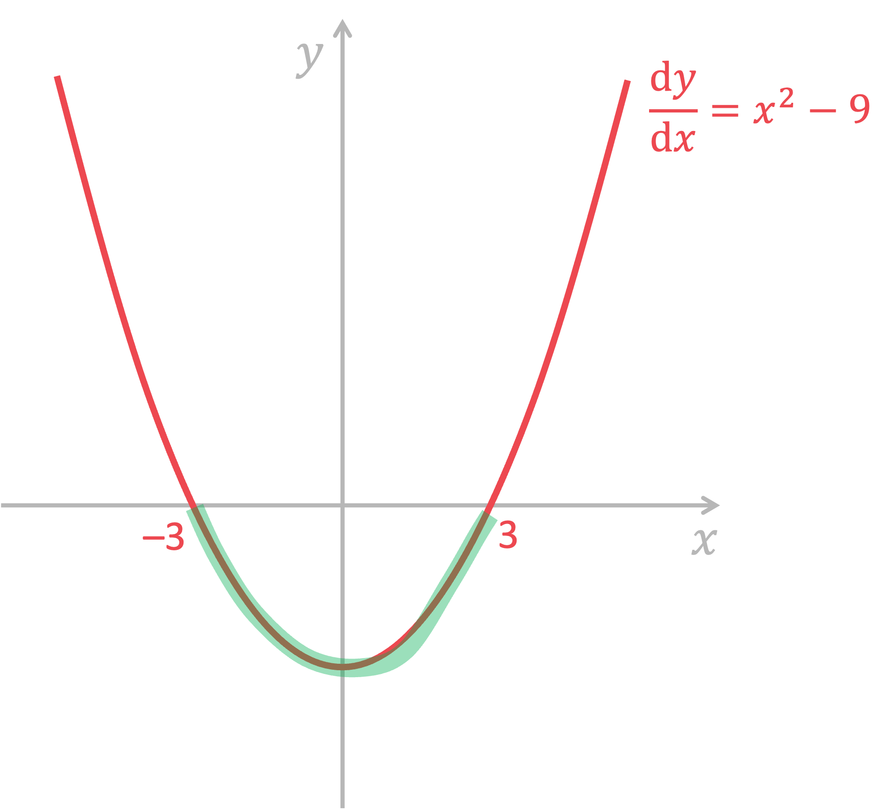
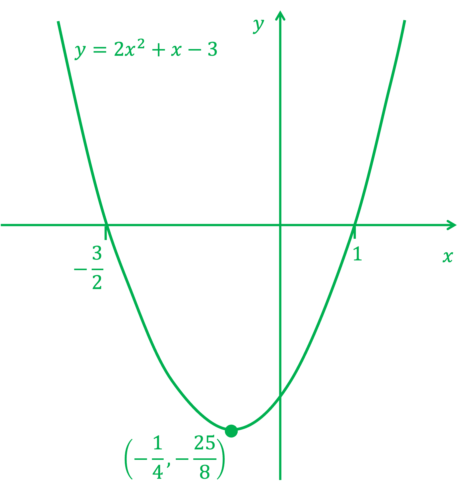
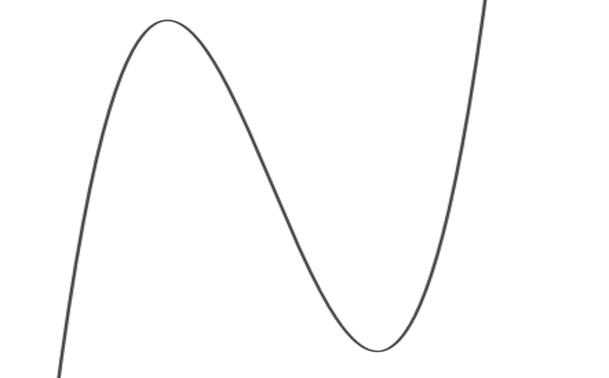
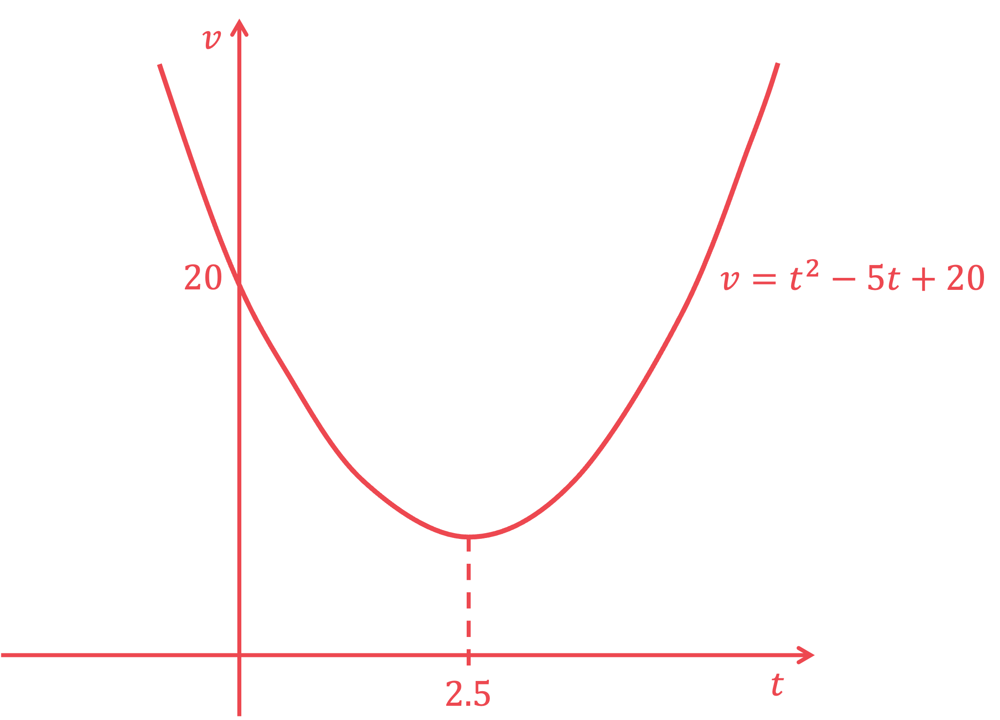
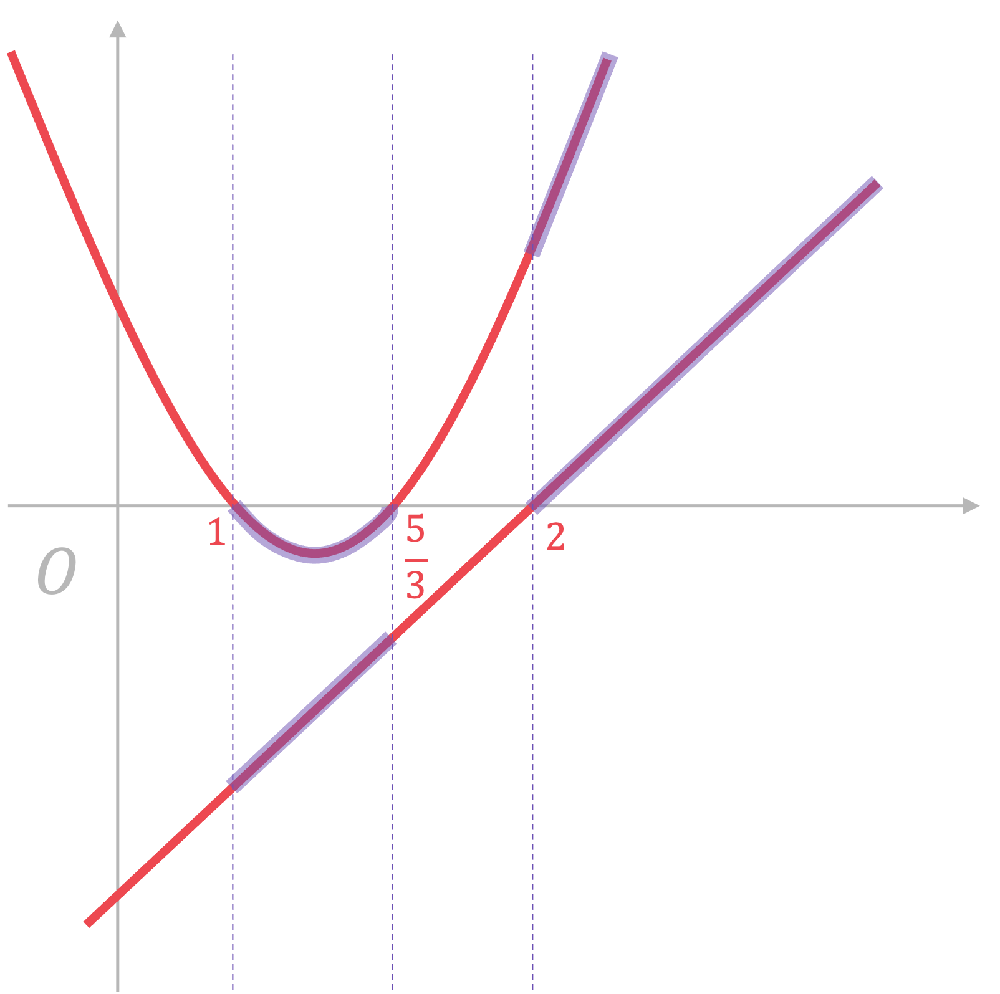

# Mark Schemes — Differentiation
**Sequences, Functions & Graphs** · Edexcel IGCSE Maths A (4MA1) — 18/Higher

## Q1 — medium — 3 marks · exam-questions

### 1() — 1 marks
> *Reduce the power by one and multiply by the original power*

$\frac{dy}{dx}=4x^{3}$* ***[1]**

### 2() — 1 marks
> *Reduce the power by one and multiply by the original power*

$\frac{d y}{d x} = ( - 3 ) \times 2 x^{- 4}$

$\frac{dy}{dx}=-6x^{-4}\mathrm{or}-\frac{6}{x^{4}}$* ***[1]**

**The question does not ask for the question in a particular form so either of the above are fine**

### 3() — 1 marks
> *Rewrite as powers using the laws of indices*

$y=4x^{-1}$

> *And differentiate*

$\frac{d y}{d x} = ( - 1 ) \times 4 x^{- 2}$

$\frac{dy}{dx}=-4x^{-2}\mathrm{or}-\frac{4}{x^{2}}$* ***[1]**

## Q2 — medium — 3 marks · exam-questions

### 1() — 1 marks
> *For each term, reduce the power by 1 and multiply by the original power*

$\frac{dy}{dx}=3\times4x^{2}+2x^{0}$

$\frac{dy}{dx}=12x^{2}+2$ **[1]**

### 2() — 1 marks
> *Reduce the power by one and multiply by the original power*

$\frac{d y}{d x} = ( - 2 ) \times - 5 x^{- 3}$

$\frac{dy}{dx}=10x^{-3}\mathrm{or}\frac{10}{x^{3}}$* ***[1]**

**Either version of the answer is accepted**

### 3() — 1 marks
> *Rewrite as powers using the laws of indices*

$y=\frac{1}{3}\times\frac{1}{x}=\frac{1}{3}x^{-1}$

> *And differentiate*

$\frac{d y}{d x} = ( - 1 ) \times 1 \frac{1}{3} x^{- 2}$

$\frac{dy}{dx}=-\frac{1}{3}x^{-2}\mathrm{or}-\frac{1}{3x^{2}}$* ***[1]**

## Q3 — medium — 5 marks · exam-questions

### 1() — 1 marks
> *For each term, reduce the power by 1 and multiply by the original power. The constant term, 4, disappears*

$\frac{dy}{dx}=3\times2x^{2}-2\times6x^{1}+3x^{0}$

> *Simplify*

$\frac{dy}{dx}=6x^{2}-12x+3$ **[1]**

### 2() — 2 marks
> *Rewrite as powers using the laws of indices*

$-\frac{5}{3x^{4}}=-\frac{5}{3}\times\frac{1}{x^{4}}=-\frac{5}{3}x^{-4}$

**[1]**

> *Reduce the power by 1 and multiply the original power*

$( - 4 ) \times ( - \frac{5}{3} x^{- 5} )$

$\frac{20}{3}x^{-5}\mathrm{or}\frac{20}{3x^{5}}$* ***[1]**

### 3() — 2 marks
> *Rewrite the last term as powers using the laws of indices*

$\frac{2}{3}x^{2}+\frac{1}{5}x-\frac{3}{2}x^{-1}$

**[1]**

> *Differentiate, taking care with fractions*

$\frac{4}{3}x+\frac{1}{5}+\frac{3}{2}x^{-2}\mathrm{or}\frac{4}{3}x+\frac{1}{5}+\frac{3}{2x^{2}}$* ***[1]**

## Q4 — medium — 4 marks · exam-questions

### 1() — 2 marks
> *For each term, reduce the power by 1 and multiply by the original power. The constant term, 11, disappears*

$\frac{dy}{dx}=2\times2x^{1}-6x^{0}$

> *Simplify*

**Final answer:** $\frac{dy}{dx}=4x-6$** **

**one term correct ****[1] **
**both terms correct ****[1]**

### 2() — 2 marks
> *Equate the derivative (which is the gradient function) found in part (a) to 6*

$4x-6=2$

**[1]**

> *Solve for x*

$\begin{gathered} 4 x & = 8 \\ x = 2 \end{gathered}$

> *The question asks for the coordinates, so the y coordinate is also needed. Substitute the found x value into the **original equation **for y*

$\begin{gathered} y = 2 ( 2 )^{2} - 6 ( 2 ) - 11 \\ = - 15 \end{gathered}$

> *Write as a coordinate point*

$(2,-15)$ **[1]**

## Q5 — medium — 7 marks · exam-questions

### 1() — 2 marks
> *For each term, reduce the power by 1 and multiply by the original power. The constant term, 9, disappears*

$\frac{dy}{dx}=3x^{2}+2\times\frac{7}{2}x^{1}-2x^{0}$

> *Simplify*

**Final answer:** $\frac{dy}{dx}=3x^{2}+7x-2$** **

**one term correct ****[1]**
** ****fully correct answer ****[1]**

### 2() — 4 marks
> *i) Substitute x = -3 into the derivative (which is the gradient function) found in part (a)*

$\begin{array}{rcl} \frac{d y}{d x} & = 3 ( - 3 )^{2} + 7 ( - 3 ) - 2 \end{array}$

**[1]**

> *And evaluate, taking care with negative numbers-put them in brackets if using a calculator*

$\begin{gathered} = 27 - 21 - 2 \\ = 4 \end{gathered}$

**gradient = 4 ****[1]**

*ii)** **Substitute x = -2/3 into the derivative (which is the gradient function) found in part (a)*

$\begin{array}{rcl} \frac{d y}{d x} & = 3 ( \frac{2}{3} )^{2} + 7 ( \frac{2}{3} ) - 2 \end{array}$

**[1]**

> *And evaluate, taking care with fractions- put them in brackets if using a calculator*

$\begin{gathered} = \frac{4}{3} + \frac{14}{3} - 2 \\ = 4 \end{gathered}$

**gradient = 4 ****[1]**

### 3() — 1 marks
> *The gradients are equal therefore*

**the**** ****tangents**** ****are parallel ****[1] **

## Q6 — medium — 6 marks · exam-questions

### 1() — 4 marks
*In kinematics, velocity is the rate of change of displacement* *Differentiate the displacement function with respect to x*

$v=\frac{ds}{dt}=18t^{2}-24t+7$

**one term correct ****[1]** 
**fully correct expression for v**** [1]**

*In kinematics, acceleration is the rate of change of velocity*** ***Differentiate the velocity function with respect to x*

**Final answer:** $a=\frac{dv}{dt}=36t-24$** **

**one term correct ****[1] **
**fully correct expression for a**** [1]**

### 2() — 2 marks
> *Equate the expression for acceleration found in part (a) to 3*

$36t-24=3$

**[1]**

> *Solve*

$\begin{array}{rcl} 36 t & = 27 \\ t = \frac{27}{36} \end{array}$

**t**** = 0.75 seconds**** [1]**

## Q7 — medium — 6 marks · exam-questions

### 17((a)) — 2 marks
> *Differentiate each term.*

$\frac{dy}{dx}=3\times5x^{2}-2x^{1}-6x^{0}$

$\frac{dy}{dx}=15x^{2}-2x-6$

**two terms correct (out of three) and no extra terms such as "4"**** [1]** 
**fully correct answer**** [1]**

### 17((b)) — 4 marks
> *The gradient is given by *$\frac{dy}{dx}$* for a given value of *$x$*. So equate *$\frac{dy}{dx}$* to 2.*

$15x^{2}-2x-6=2$

**[1]**

> *Start by subtracting 2 from both sides to leave a quadratic equal to zero.*

$15x^{2}-2x-8=0$

**[1]**

> *Solve using your preferred method; quadratic formula, completing the square or factorisation (the question doesn't ask for any rounding, which is a clue that the quadratic will factorise). Here we will use the quadratic formula as it looks like a trickier factorisation.*

$x = \frac{- ( - 2 ) \pm \sqrt{( - 2 )^{2} - 4 \times 15 \times ( - 8 )} }{2 \times 15}$

** ****correct first step to solving using any of the above methods ****[1]**

$x=\frac{2\pm\sqrt{484}}{30}$

$x=\frac{4}{5},x=-\frac{2}{3}$  **[1]**

**Both answers must be stated (as fractions or decimals) for the final mark**

## Q8 — medium — 6 marks · exam-questions

### 12((a)) — 2 marks
> *Differentiate each term.*

$\frac{dy}{dx}=3\timesx^{2}-2\times6x^{1}-15x^{0}$

$\frac{dy}{dx}=3x^{2}-12x-15$

**two terms correct**** [1]** 
**fully correct answer**** [1]**

### 12((b)) — 4 marks
> *Stationary points occur where *$\frac{dy}{dx}=0$* so equate *$\frac{dy}{dx}$* to 0.*

$3x^{2}-12x-15=0$

**[1]**

> *Divide both sides by the common factor 3 to leave a quadratic equation in the form *$x^{2}+bx+c=0$

$x^{2}-4x-5=0$

> *This is a straightforward quadratic to factorise, however you could solve using the quadratic formula or by completing the square if you wish.*

$( x - 5 ) ( x + 1 ) = 0$

** ****correct first step to solving, using any of the above methods ****[1]**

$x=5,x=-1$

**both x values ****[1]**

> *Be careful! You are asked for the coordinates, not just the **x** value- so substitute each value of **x** into the equation of the curve to find the corresponding **y** value.*

$y = ( - 1 )^{3} - 6 ( - 1 )^{2} - 15 ( - 1 ) = 8
y = ( 5 )^{3} - 6 ( 5 )^{2} - 15 ( 5 ) = - 100$

$(-1,8)\mathrm{and}(5,-100)$  **[1]**

**Both coordinate points must be stated for the final mark**

## Q9 — medium — 5 marks · exam-questions

### 15((a)) — 2 marks
> *Differentiate each term by multiplying by the power and reducing the power by one.*

$\frac{dy}{dx}=3\times\frac{1}{3}x^{2}-1\times9x^{0}$

$\frac{dy}{dx}=x^{2}-9$* ***[2] **

**one mark for each correct term**

### 15((b)) — 3 marks
> *The gradient at any value of **x** is given by *$\frac{dy}{dx}=x^{2}-9$*. So the gradient is negative where *$\frac{dy}{dx}<0$*.*

$x^{2}-9<0$

**[1]**

> *To solve a quadratic inequality, first ignore the inequality sign and solve as an equation.*

$\begin{gathered} x^{2} - 9 & = 0 \\ x^{2} & = 9 \\ x = \pm 3 \end{gathered}$

> *Now you have the two roots, sketch the graph of *$\frac{dy}{dx}$* and mark the region where *$\frac{dy}{dx}<0$*.*

$-3<x<3$ **[2] **

**1 mark for only " **$x>-3$**" or  " **$x<3$**" **

## Q10 — medium — 3 marks · exam-questions

### 7((a)) — 3 marks
> *The gradient of the curve at a point can be determined by finding the derivative of the equation of the curve, and substituting the *$x$* coordinate in.*

> *Differentiate each term separately using the formula for differentiation.*

> * *$y=ax^{n}\Rightarrow\frac{dy}{dx}=n\timesax^{n-1}$*.*

> * To differentiate *$y=-x^{2}$*, bring the 2 in front of *$x$* and reduce the power by 1. *

> *If the power if 1 then the derivative is just the coefficient of *$x$*, *$y=5x\Rightarrow\frac{dy}{dx}=5$*.*

> * **If the power is 0 then the derivative is 0, *$y=24\Rightarrow\frac{dy}{dx}=0$*.*

> *Use this to find the derivative of each term.*

$\begin{gathered} y & = 24 + 5 x - x^{2 } \\ \frac{ \mathrm{d} y}{ \mathrm{d} x} & = 0 + 5 + 2 \times ( - x^{2 - 1} ) \\ = 5 - 2 x \end{gathered}$

**  1 mark for each correct term**** [2]**

> *Find the gradient at the point where *$x=-1.5$* by substituting it into the derivative.*

$\begin{gathered} 5 - 2 ( - 1.5 ) & = 5 - ( - 3 ) \end{gathered}$

** **$\begin{gathered} 8 \end{gathered}$ **[1]**

## Q11 — medium — 4 marks · exam-questions

### 21((a)) — 2 marks
> *Formula for differentiation:*

$\begin{gathered} y = a x^{b \\ \frac{d y}{d x} & = a b x^{b} - 1} \end{gathered}$

> *To differentiate the first term, 6, remember that the derivative of any constant term is zero.*

$\begin{gathered} y & = 6 \\ \frac{d y}{d x} & = 0 \end{gathered}$

> *Differentiate the second term, *$4x$*.*

$\begin{gathered} y & = 4 x^{ \\ \frac{d y}{d x} & = ( 4 \times 1 ) x^{1} - 1} = 4 \end{gathered}$

> *Differentiate the third term, *$-x^{2}$*.*

$\begin{gathered} y & = - x^{2} \\ \frac{d y}{d x} & = ( - 1 \times 2 ) x^{2 - 1} = - x^{1} = - x \end{gathered}$

$\frac{dy}{dx}=4-2x$

**Finding either term correctly ****[1]** 
**Both terms correct ****[1]**

### 21((b)) — 2 marks
> *To find the turning point, set *$\frac{dy}{dx}$* equal to zero.*

$\begin{gathered} \frac{d y}{d x} & = 0 \\ 4 - 2 x & = 0 \end{gathered}$

**[1]**

> * Solve by subtracting 4 and dividing by -2.*

$\begin{gathered} - 2 x & = - 4 \\ x & = 2 \end{gathered}$* *

> *Find the *$y$* coordinate by substituting the value of *$x$* into the equation for the curve.*

$\begin{gathered} y^{ } & = 6 + 4 ( 2 ) - ( 2 )^{2} \\ = 6 + 8 - 4 \\ = 10 \end{gathered}$

`equation` **[1]**

## Q12 — medium — 6 marks · exam-questions

### 11((a)) — 2 marks
> *Differentiate each term by multiplying its coefficient by its power and subtracting one from the power*

$\frac{dy}{dx}=4\times3x^{3-1}+2x^{2-1}-20$

$\frac{dy}{dx}=12x^{2}+2x-20$

**[M1 A1]**

> **[mark-scheme]**
> **M1**: For at least two terms correct.
> 
> **A1**: Fully correct.

### 11((b)) — 4 marks
> *Set the expression for *$\frac{dy}{dx}$* equal to 4 and solve for **x*

$\begin{gathered} 12 x^{2} + 2 x - 20 & = 4 \end{gathered}$

**[M1]**

> *Set equal to zero by subtracting 4 from both sides*

$\begin{gathered} 12 x^{2} + 2 x - 24 & = 0 \end{gathered}$

> *Simplify the coefficients by dividing both sides by 2*

$\begin{gathered} 6 x^{2} + x - 12 & = 0 \end{gathered}$

**[M1]**

> *Factorise*

- *6 × -12 = - 72*
- *Two numbers that add to 1 and multiply to -72 are 9 and -8*
- *Write *$x$* as *$9x-8x$

$\begin{gathered} 6 x^{2} + 9 x - 8 x - 12 & = 0 \\ 3 x ( 2 x + 3 ) - 4 ( 2 x + 3 ) & = 0 \\ ( 3 x - 4 ) ( 2 x + 3 ) & = 0 \end{gathered}$

**[M1]**

> **[exam-tip]**
> You could also use the quadratic formula here.

$x=\frac{4}{3},x=-\frac{3}{2}$

**[A1]**

## Q13 — medium — 4 marks · exam-questions

### 16() — 4 marks
> *First, find the gradient function by differentiating*

> *To differentiate a power of *$x$*, bring down the power and** **reduce the power by 1*

$\frac{dy}{dx}=12x^{2}-8$

**[B1 B1]**

> *Set the gradient function equal to *$\frac{1}{3}$

$\frac{1}{3}=12x^{2}-8$

**[M1]**

> *Solve the equation by first adding *$8$* to both sides*

$\frac{25}{3}=12x^{2}$

> *Divide by 12*

$\frac{25}{36}=x^{2}$

> *Take the square root of both sides, remembering that this will produce both a positive and a negative answer*

$x=\pm\frac{5}{6}$

**[A1]**

> **[mark-scheme]**
> **B1: **For one correct term.
> 
> **B1: **Fully correct.
> 
> **M1: **For equating your derivative with the given gradient.
> 
> **A1: **Correct final answer, or equivalent.

## Q14 — hard — 8 marks · exam-questions

### 1() — 2 marks
> *y = 0 on the x-axis *

$2x^{2}+x-3=0$

**[1]**

> *Solve by factorising or using the quadratic formula. By factorising:*

$( 2 x + 3 ) ( x - 1 ) = 0
2 x + 3 = 0 , x - 1 = 0
x = - \frac{3}{2} , x = 1$

> *Write the answer as two coordinate points (where y = 0)*

$(-\frac{3}{2},0)\mathrm{and}(1,0)$ **[1]**

**Both coordinate points must be stated**

### 2() — 1 marks
> *On the y-axis, x = 0*

$x = 0 , y = 2 ( 0 )^{2} + 0 - 3 = - 3$

> *Write the answer as a coordinate point*

**(0, -3) ****[1]**

### 3() — 3 marks
> *Differentiate*

$\frac{dy}{dx}=4x+1$

> *Any turning points are when the gradient (*$\frac{dy}{dx}$*) is equal to zero*

$4x+1=0$

**[1]**

> *Solve to find the x value of the turning point (notice that it is a quadratic graph, so there should only be one turning point and this matches the fact that *$\frac{dy}{dx}=0$* is linear*

$\begin{gathered} 4 x & = - 1 \\ x = - 1 \frac{1}{4} \end{gathered}$

> *Substitute x value into the **original **equation for y*

$\begin{array}{rcl} y = 2 ( - 1 \frac{1}{4} )^{2} + ( - 1 \frac{1}{4} ) - 3 = - \frac{25}{8} \end{array}$

> *Write down the final answer as a coordinate point*

$(-\frac{1}{4},-\frac{25}{8})$ **[1]**

### 4() — 2 marks
> *A sketch does not have to be to scale but it should be neat and clearly show the points found *

> *Draw the x- and y-axes with straight lines and don't forget to label them x and y*

**correct shape curve ****[1]**
 **x-intercepts and turning point clearly labeled with values, and in correct position relative to axes ****[1]**

## Q15 — hard — 4 marks · exam-questions

### 1() — 2 marks
*In kinematics, the velocity is the rate of change of the displacement*

> *Differentiate the displacement function with respect to **t*

$v=\frac{ds}{dt}=6t^{2}-18t-60$

**one term correct ****[1]** 
**fully correct answer**** [1]**

### 2() — 2 marks
> *Equate the velocity function found in (a) to 0*

$6t^{2}-18t-60=0$

**[1]**

> *Solve for x. Start by looking for common factors; 6 is common so divide both sides of the equation by 6 before factorising*

$\begin{array}{rcl} t^{2} - 3 t - 10 & = 0 \\ ( t - 5 ) ( t + 2 ) & = 0 \end{array}$

> * *$\begin{gathered} t = 5 , \cancel{t = - 2} \end{gathered}$

> *t cannot be negative so reject t = -2 (it is best practice to acknowledge it by writing it down but cross it out to show you understand it can't be a solution)*

$t=5$ **[1]**

## Q16 — hard — 5 marks · exam-questions

### 1() — 2 marks
> *Differentiate with respect to x*

$\frac{dy}{dx}=3x^{2}-14x-5$

**one term correct**** [1]** 
**fully correct answer**** [1]**

### 2() — 2 marks
> *Any turning points are when the gradient (*$\frac{dy}{dx}$*) is equal to zero*

$3x^{2}-14x-5=0$

**[1]**

> *Use any quadratic method to solve for x (notice that it is a cubic graph, so there should be two turning points and this matches the fact that *$\frac{dy}{dx}=0$* is quadratic*

$( 3 x + 1 ) ( x - 5 ) = 0
3 x + 1 = 0 , x - 5 = 0$

> *Note that you are only asked for the x-coordinates*

$x=-\frac{1}{3},x=5$ **[1]**

### 3() — 1 marks
> *The graph is cubic (see **Types of Graph**) so has the shape;*

> *This means that the lowest (furthest left) x-coordinate will be the maximum point*

$x=-\frac{1}{3}$ **[1]**

## Q17 — hard — 8 marks · exam-questions

### 1() — 1 marks
> *A is the y-intersect. The curve intersects the y-axis when x = 0*

$x = 0 , y = 1 - 0^{3} - 6 ( 0 )^{2} - 9 ( 0 )$

> *(or just ignore/ cover up all terms with an x)*

> *Write the answer as a coordinate point*

**(0, 1) *** ***[1]**

### 2() — 5 marks
> *Differentiate with respect to x*

$\frac{dy}{dx}=-3x^{2}-12x-9$

**[1]**

> *Any turning points are when the gradient (*$\frac{dy}{dx}$*) is equal to zero*

$-3x^{2}-12x-9=0$

**[1]**

> *Use any quadratic method to solve for x. There is a common factor of -3 so start by dividing all terms by -3 *

> *(notice that it is a cubic graph, so there should be two turning points and this matches the fact that *$\frac{dy}{dx}=0$* is quadratic*

$x^{2} + 4 x + 3 = 0
( x + 3 ) ( x + 1 ) = 0
x = - 3 , x = - 1$

**[1]**

> *We need the full coordinates so substitute each x value into the original equation to find y*

$x = - 3 , y = 1 - ( - 3 )^{3} - 6 ( - 3 )^{2} - 9 ( - 3 ) = 1$

*therefore there is a point at *$( - 3 , 1 )$

$x = - 1 , y = 1 - ( - 1 )^{3} - 6 ( - 1 )^{2} - 9 ( - 1 ) = 5$

*therefore there is a point at *$( - 1 , 5 )$

> *x = -3 is further left than x = -1. We can see from the diagram that the minimum point B is the point with the smallest (furthest left) x-value, where x = -3 *

> *Likewise, C is the maximum point where x = -1*

**B is the minimum point at**** **$( - 3 , 1 )$** ****[1] **

**C is the maximum point at **$(-1,5)$** [1]**

### 3() — 2 marks
*We can see from the diagram that the gradient is negative to the left of B and to the right of A* *Therefore*

$x<-3,x>-1$

**x < -3**** [1]** 
**x > -1**** [1]**

## Q18 — hard — 7 marks · exam-questions

### 1() — 2 marks
> *Rewrite *$\frac{64}{x}$* as a negative power of x using the **laws of indices*

$y=4x+64x^{-1}+7$

> *Differentiate with respect to x*

**Final answer:** $\frac{dy}{dx}=4-64x^{-2}$** **

**one term correct ****[1]** 
**fully correct answer ****[1]**

### 2() — 3 marks
> *Any turning points are when the gradient (*$\frac{dy}{dx}$*) is equal to zero*

$4-64x^{-2}=0$

**[1]**

> *Rewrite the second term as an algebraic fraction*

$4-\frac{64}{x^{2}}=0$

> *Multiply all terms by *$x^{2}$* to clear the fractions, and solve the resulting quadratic equation. There are many ways to do this but a straightforward method is shown below*

$4x^{2}-64=0\,x^{2}-16=0\,x^{2}=16\,x=\pm4$

** ****correct x values ****[1]**

> *For both x coordinates (4 and -4), the y coordinate is needed so substitute each into the original equation in y*

$x = 4 , y = 4 ( 4 ) + \frac{64}{4} + 7 = 39
x = - 4 , y = 4 ( - 4 ) + \frac{64}{- 4} + 7 = - 25$

> *Write both coordinate answers*

`( - 4 , - 25 ) and ( 4 , 39 )` **[1]** 
**Both points must be fully correct.**

### 3() — 2 marks
> *The distance between two points *$( x_{1} , y_{1} )$* and *$( x_{2} , y_{2} )$* is *$\sqrt{( x_{1} - x_{2} )^{2} + ( y_{1} - y_{2} )^{2}}$

$d = \sqrt{( ( - 4 ) - 4 )^{2} + ( ( - 25 ) - 39 )^{2}}$

**correct use of distance between points formula ****[1]**

$=\sqrt{(-8)^{2}+(-64)^{2}}\,=\sqrt{4160}$

> *The **exact **answer is requested so give the answer in surd form, not as a rounded decimal*

$8\sqrt{65}$ **[1]**

## Q19 — hard — 7 marks · exam-questions

### 1() — 1 marks
> *Initially means when the time is zero (**t** = 0) so substitute **t** = 0 into the displacement equation*

$t = 0 , s = 1 \frac{1}{3} ( 0 )^{3} - \frac{5}{2} ( 0 )^{2} + 20 ( 0 ) - 15
 = - 15$

*(or just ignore all terms except the constant term)* *This means that the initial displacement was -15 metres from point **O*

> *Be careful, the question asks "how far" so the direction does not matter, only the distance. In other words, ignore the negative sign*

**15 metres**** ****[1]**

### 2() — 2 marks
*In kinematics, velocity ifs the rate of change of the displacement* *Differentiate the displacement function with respect to **t*

$v=\frac{ds}{dt}=t^{2}-5t+20$** [1] **

**one term correct**** [1] **
**fully correct answer**** [1]**

### 3() — 2 marks
*To find a minimum, equate the derivative of the velocity to zero and solve*

> *First, differentiate the velocity function with respect to **t*

$\frac{dv}{dt}=2t-5$

**[1]**

> *Equate to zero*

$\begin{array}{rcl} 2 t - 5 & = 0 \\ 2 t & = 5 \end{array}$

$t=2.5$** [1] **
**This means that the particle's velocity reached its minimum (and its acceleration was instantaneously 0) after 2.5 seconds**

### 4() — 2 marks
> *Method 1 *

*The particle is decelerating when its acceleration (the derivative of the velocity, which we found in part (c)), is negative* *Set the derivative of the velocity to "< 0" and solve*

$2t-5<0$

**[1]**

$\begin{gathered} 2 t & < 5 \\ t < 2.5 \end{gathered}$

**The particle is decelerating for 2.5 seconds ****[1]**

> *Method 2*

> *The velocity function, *$v=t^{2}-5t+20$*, is quadratic, so we know its shape is a u-shaped parabola. *

> *To know when its gradient is negative, we just need the **t**-value of the minimum point*

> *We already found **t**-value of the minimum point in part (b) but we could also **complete the square**, or use the knowledge that for any quadratic** *$y=ax^{2}+bx+c$*, the axis of symmetry is at *$x=\frac{-b}{2a}$

*axis of symmetry at *$t = \frac{- ( - 5 )}{2} = 2.5$

> *Now we can sketch; all we're really looking for is when the gradient is negative*

**[1]**

**The particle is decelerating for 2.5 seconds ****[1]**

## Q20 — hard — 9 marks · exam-questions

### 1() — 1 marks
> *There are only three sides to the rectangle as one is an existing wall*

$w+w+l=40$

**[1]**

> *Simplify*

$2w+l=40$

> *Rearrange to the final answer*

$l=40-2w$

### 2() — 2 marks
> *Area of a rectangle = width × length*

$A=lw$

> *Substitute *$l$* with *$40-2w$

$A = ( 40 - 2 w ) w$

**[1]**

> *Expand the brackets*

$A=40w-2w^{2}$ **[1]**

### 3() — 2 marks
> *Differentiate with respect to **w*

$\frac{dA}{dw}=40-4w$

**one correct term**** [1]**
** ****fully correct answer**** [1]**

### 4() — 2 marks
> *The maximum occurs when the rate of change of the area with respect to the width (*$\frac{dA}{dw}$*) is zero*

$40-4w=0$

**[1]**

> *Solve for **w*

$40=4w$

$w=10$ **[1]**

### 5() — 2 marks
> *In other words, find *$l$* and *$A$*when *$w=10$* Starting with *$l$*;*

$\begin{gathered} l = 40 - 2 ( 10 ) \\ = 20 \end{gathered}$

**Final answer:** **Dimensions are 10 m by 20 m ****[1]**

> *Now we can find *$A$* using either *$A=lw$* or *$A=40w-2w^{2}$

$\begin{gathered} A = 20 \times 10 \text{or} A = 40 ( 10 ) - 2 ( 10 )^{2} \\ = 200 = 200 \end{gathered}$

**Final answer:** **Area is  200 m****2**** ****[1]**

## Q21 — hard — 8 marks · exam-questions

### 15((a)) — 3 marks
> *The volume of a cuboid is length × width × height.*

$V = ( 2 x + 5 ) ( 3 - x ) ( x + 1 )$

> *Start by expanding two brackets; here we will start by expanding the first two brackets following "FOIL" (first outside inside last).*

$\begin{gathered} V = ( 6 x - 2 x^{2} + 15 - 5 x ) ( x + 1 ) \end{gathered}$

**correctly expanding two brackets**** [1]**

> *Collect like terms in the left bracket and write terms in order of the highest power.*

$\begin{gathered} V = ( - 2 x^{2} + x + 15 ) ( x + 1 ) \end{gathered}$

> *Expand the two brackets by multiplying all terms in the first bracket by all terms in the second bracket. Follow a systematic order such as the one below.*

$\begin{gathered} V = - 2 x^{3} - 2 x^{2} + x^{2} + x + 15 x + 15 \end{gathered}$

**4 out of 8 terms correct in this expansion**** [1]**

> *Collect like terms.*

$\begin{array}{cc} V = & - 2 x^{ } 3 - x^{ } 2 + 16 x + 15\end{array}$** [1] **

**Throughout this question the terms can be written in any order**

### 15((b)) — 5 marks
> *Differentiate **V** with respect to **x**.*

$\frac{dV}{dx}=16-2x-6x^{2}$

**two terms correct ****[1]**
**fully correct differentiation ****[1]**

> *Equate *$\frac{dV}{dx}$* to zero.*

$16-2x-6x^{2}=0$

**[1]**

*Solve for **x**. The question asks for the answer to 3 significant figures which is a big clue that it can't be solved by factorising- use the quadratic formula or completing the square.*

> *Either way, it is easiest to start by rewriting in the form *$ax^{2}+bx+c=0$* where *$a$* is positive, and dividing by any common factor.*

$\begin{gathered} 6 x^{2} + 2 x - 16 & = 0 \\ \div 2 & = \div 2 \\ 3 x^{2} + x - 8 & = 0 \end{gathered}$

> *Here we will use the quadratic formula to solve.*

$\begin{gathered} x = \frac{- 1 \pm \sqrt{1^{2} - 4 \times 3 \times ( - 8 )} }{2 \times 3} \end{gathered}$

**correct first step using quadratic formula or completing the square**** [1]**

$x = \frac{- 1 \pm \sqrt{97} }{6} 
x = 1.474809634... , \cancel{x = - 1.808142967...}$

> *x** cannot be *$-1.808142967...$* as this would make the height negative, so ignore or cross out this value. Round  *$1.474809634...$* to 3 significant figures as instructed.*

**Answer = 1.47 cm**** [1]**

## Q22 — hard — 5 marks · exam-questions

### 19() — 5 marks
> *Differentiate **s** to find a function for the velocity.*

$\frac{ds}{dt}=3t^{2}+10t-8$

**[1]**

> *P** is instantaneously at rest when the velocity is zero, so equate *$\frac{ds}{dt}$* to zero. *

$3t^{2}+10t-8=0$

**[1]**

> *Solve using your preferred method; quadratic formula, completing the square or factorisation (the question asks for the answer in the form of a fraction which is a big clue that the quadratic will factorise). Here we will use the quadratic formula though, as it looks like a trickier factorisation.*

$t = \frac{- 10 \pm \sqrt{10^{2} - 4 \times 3 \times ( - 8 )} }{2 \times 3}$

$\cancel{t = - 4} , t = \frac{2}{3}$

**[1]**

> *You are told in the question that *$t\geq0$* therefore discount the negative value of *$t$* by putting a line through it or ignoring it altogether. Substitute the positive value of *$t$* into the displacement formula.*

$\begin{gathered} s = ( \frac{2}{3} )^{3} + 5 ( \frac{2}{3} )^{2} - 8 ( \frac{2}{3} ) + 10 \end{gathered}$

**[1]**

> *Leave your final answer as a fraction.*

$s=\frac{194}{27}$** [1]**

**An answer as a rounded decimal will not achieve the final mark**

## Q23 — hard — 11 marks · exam-questions

### 1() — 2 marks
*There will be four rods making the front facing square *
*There will be another four rods making the back facing square The front and back squares will be connected by four more rods*

**[1]**

**The 12 rods consist of**** 8 smaller rods length **$x$** cm and 4 larger rods length **$y$** cm ****[1]**

### 2() — 2 marks
> *8 small rods (8**x**) plus 4 larger rods (4**y**) equal to 36 cm*

$8x+4y=36$

**[1]**

> *Rearrange to make **y** the subject*

$4y=36-8x$

$y=9-2x$ **[1]**

### 3() — 2 marks
> *The volume is given by*

$V=x^{2}y$

> *We need to replace **y** with the equation in **x** found in part (c)*

$V = x^{2} ( 9 - 2 x )$

**[1]**

> *Expand*

$\begin{array}{cc} V = & 9 x^{ } 2 - 2 x^{ } 3\end{array}$* ***[1]**

### 4() — 3 marks
> *Find the maximum by differentiating and equating the derivate function to zero*

> *Differentiate first*

$\frac{dV}{dx}=18x-6x^{2}$

**[1]**

> *Equate to zero*

$18x-6x^{2}=0$

**[1]**

> *And solve for **x*

$3 x - x^{2} = 0
x ( 3 - x ) = 0
 \cancel{x = 0} , x = 3$

> *Reject "x = 0" as a length cannot be 0 or negative (it is best practice to write down both algebraic solutions but cross out the one to be discarded, showing the examiner good understanding)*

$x=3$ **[1]**

### 5() — 2 marks
> *Substitute the value of **x** found in part (c) to the volume formula found in part (c)*

$V = 9 ( 3 )^{2} - 2 ( 3 )^{3}$

**[1]**

**27 cm****3**** ****[1]**

## Q24 — hard — 4 marks · exam-questions

### 18() — 4 marks
> *Differentiate the displacement function twice to get the acceleration*

$v=\frac{ds}{dt}=6t^{2}-10t+6$

**[M1]**

$a=\frac{dv}{dt}=12t-10$

**[M1]**

> *Set the expression equal to the value in the question*

$12t-10=5$

**[M1]**

> *Solve the equation*

$12t=15$

$t=\frac{15}{12}=1.25$

$1.25$

**[A1]**

## Q25 — very_hard — 8 marks · exam-questions

### 1() — 2 marks
> *When **k** = 0, *

$\begin{gathered} y = 2 x^{2} + 8 ( 0 )^{2} x - 3 \\ \therefore y & = 2 x^{2} - 3 \end{gathered}$

> *To find turning points by differentiating and equating the derivative to zero*

> *Differentiate:*

$\frac{dy}{dx}=4x$

> *Equate to zero and solve*

$\begin{array}{rcl} 4 x & = 0 \\ x = 0 \end{array}$

**[1]**

> *Find the y-coordinate by substituting x = 0 into y*

$\begin{array}{rcl} y = 2 ( 0 )^{2} - 3 \\ = - 3 \end{array}$

> *Write the answer as a coordinate point*

$(0,-3)$ **[1]**

### 2() — 4 marks
> *Differentiate. To do this, we need to understand that *$k$* is a constant therefore *$k^{2}$* is also a constant*

*when *$k\neq0,\frac{dy}{dx}=4x+8k^{2}$

**[1]**

> *To find a turning point, equate the derivative to zero and solve*

$\begin{gathered} 4 x + 8 k^{2} & = 0 \\ 4 x & = - 8 k^{2} \\ x = - 2 k^{2} \end{gathered}$

**[1]**

> *All square numbers are positive (because a negative number times a negative number is positive)*

**Since **$k\neq0$**, **$k^{2}>0$** for all values of **$k$* ***[1] **
**so **$-2k^{2}<0$** for all values of **$k$* ***[1]**

### 3() — 2 marks
> *Substitute *$x=-2k^{2}$* (from part (b)) into the equation for **y*

$y = 2 ( - 2 k^{2} )^{2} + 8 k^{2} ( - 2 k^{2} ) - 3$

**[1]**

> *Carefully expand the brackets and simplify*

$\begin{gathered} y = 2 ( 4 k^{4} ) - 16 k^{4} - 3 \\ = 8 k^{4} - 16 k^{4} - 3 \\ = - 8 k^{4} - 3 \end{gathered}$

> *Note that *$k^{4} = ( k^{2} )^{2}$* so is positive*

$k^{4}>0$** therefore **$-8k^{4}-3<0$** for all values of **$k$** and therefore the ****y****-coordinate of the turning point is negative ****[1]**** **
**Correct answer with valid reason.**

## Q26 — very_hard — 7 marks · exam-questions

### 1() — 7 marks
> *First you need to find the coordinates of the turning points, so differentiate and equate the derivative to zero*

$\frac{dy}{dx}=8x^{3}-32x$

**[1]**

$8x^{3}-32x=0$

**[1]**

> *Solve for **x*

$x^{3} - 4 x = 0
x ( x^{2} - 4 ) = 0
x = 0 , x^{2} = 4
 x = \pm 2$

**all 3 x-coordinates found ****[1]**

> *Find **P, Q** and **R **by substituting **x** = -2, **x** = 0 and **x** = 2 respectively into **y **(you could also find **Q** by examining the equation for **y **and ignoring any terms in **x**, as it is the **y**-intercept)*

$P : x = - 2 , y = 2 ( - 2 )^{4} - 16 ( - 2 )^{2} + 3 = - 29
Q : x = 0 , y = 3
R : x = 2 , y = 2 ( 2 )^{4} - 16 ( 2 )^{2} + 3 = - 29$

**all 3 y-coordinates found**** [1]**

> *Add these points to the diagram. We can see that*

*base of the triangle is 2 × 2 = 4*

*height of the triangle is 29 + 3 = 32*

**either correct base or correct height**** [1]**

> *Now find the area using area of triangle = *$\frac{1}{2}$*× base × height*

*area*$=\frac{1}{2}\times4\times32$

**[1]**

**64 (square units)** **[1]**

## Q27 — very_hard — 10 marks · exam-questions

### 1() — 4 marks
> *The volume is given by*

$V=x^{2}y$

> *We need to replace *$y$* with an equation in *$x$

> *Think about nets here. The surface area has two squares (*$2\timesx\timesx$*) and four rectangles (*$4\timesx\timesy$*). And this surface area is equal to 25 cm**2** so*

$2x^{2}+4xy=25$

**[1]**

> *Rearrange to make *$y$* the subject*

$\begin{gathered} 4 x y & = 25 - 2 x^{2} \\ y = \frac{25 - 2 x^{2}}{4 x} \end{gathered}$

**[1]**

> *Substitute this version of *$y$* into the formula for volume*

$\begin{gathered} V = x^{2} ( \frac{25 - 2 x^{2}}{4 x} ) \end{gathered}$

**[1]**

> *And expand*

$\begin{array}{rcl} V = \frac{25 x^{2} - 2 x^{4} }{4 x} \\ = \frac{25 x - 2 x^{3}}{4} \end{array}$

> *Write in the form given in the question*

$V=\frac{25}{4}x-\frac{1}{2}x^{3}$ **[1]**

### 2() — 4 marks
> *Find a maximum by differentiating and equating to zero*

> *Differentiate*

$\frac{dV}{dx}=\frac{25}{4}-\frac{3}{2}x^{2}$

**[1]**

> *Equate to zero*

$\frac{25}{4}-\frac{3}{2}x^{2}=0$

**[1]**

$\frac{25}{4}=\frac{3}{2}x^{2}\,x^{2}=\frac{25}{6}\,x=\pm\frac{5}{\sqrt{6}}$

> *Reject the negative solution as **x** is a side length*

$\cancel{x = - \frac{5}{ \sqrt{6} } } , x = \frac{5}{ \sqrt{6} }$

**[1]**

> *Rationalise the denominator*

$x=\frac{5\sqrt{6}}{\sqrt{6}\sqrt{6}}$

$x=\frac{5\sqrt{6}}{6}$ **[1]**

### 3() — 2 marks
> *Substitute the value of **x** found in (b) into the formula for **V, **taking care with brackets and powers in your calculator*

$V = \frac{25}{4} ( \frac{5 \sqrt{6} }{6} ) - 1 \frac{1}{2} ( \frac{5 \sqrt{6} }{6} )^{3}$

**[1]**

$=8.505172...$

> *Round to 3 significant figures as requested in the question*

**8.51 cm****3**** ****[1]**

## Q28 — very_hard — 5 marks · exam-questions

### 24() — 5 marks
*Velocity will change sign when the direction of motion reverses.* *To find velocity, we differentiate displacement.*

$v=\frac{dx}{dt}=12t^{2}-27$

**[1]**

> *Solve *$v=0$* to find the time when the direction of motion reverses.*

$\begin{gathered} 12 t^{2} - 27 & = 0 \\ t^{2} & = \frac{27}{12} \\ t = \frac{3}{2} \end{gathered}$

**Method to find t ****[1] **
**Correct value for t**** [1]**

> *Use your calculator to find that square root.  You need not consider the negative square root since *$t\geq0$*.*

> *To find acceleration, differentiate velocity.*

$"a"=\frac{dv}{dt}=24t$

**[1]**

> *At **A**, *$"a"=a$* and we now know that *$t=\frac{3}{2}$*, so we can set up and solve an equation for *$a$*.*

$a = 24 ( \frac{3}{2} ) = 36$

$a=36m/s^{2}$* ***[1]**

## Q29 — very_hard — 8 marks · exam-questions

### 1() — 2 marks
Differentiate each term

- Multiply the coefficient by the power
- Subtract 1 from the power

$3\times\frac{2}{3}x^{2}+2\times\frac{11}{2}x^{1}-1\times30x^{0}$

$2x^{2}+11x-30$

**[B1 B1]**

> **[mark-scheme]**
> **B1: **For at least two correct terms.
> 
> **B1: **For all correct terms.

### 2() — 4 marks
Equate the derivative to 0

$2x^{2}+11x-30=0$

**[M1]**

Factorise the quadratic using any method

- 15 and -4 are two numbers that:

  - add to 11
  - multiply to 2×-30=-60

$\begin{gathered} 2 x^{2} + 15 x - 4 x - 30 & = 0 \\ x ( 2 x + 15 ) - 2 ( 2 x + 15 ) & = 0 \\ ( x - 2 ) ( 2 x + 15 ) & = 0 \end{gathered}$

**[M1 M1]**

Solve for x

$x=2\,x=-\frac{15}{2}\,$

**[A1]**

> **[mark-scheme]**
> **M1: **For equating your quadratic to 0.
> 
> **M1: **For a correct attempt at factorising. When the brackets are expanded, at least two of the terms must be correct.
> 
> **M1: **For both brackets correct.
> 
> **A1: **For two correct x values.

### 3() — 2 marks
Substitute both x values into the original equation to find the y values, and therefore the coordinates of the stationary points

$y = \frac{2}{3} ( 2 )^{3} + \frac{11}{2} ( 2 )^{2} - 30 ( 2 ) = - \frac{98}{3}$

$y = \frac{2}{3} ( - \frac{15}{2} )^{3} + \frac{11}{2} ( - \frac{15}{2} )^{2} - 30 ( - \frac{15}{2} ) = \frac{2025}{8}$

$( 2 , - \frac{98}{3} ) , ( - \frac{15}{2} , \frac{2025}{8} )$

**[M1 A1]**

> **[mark-scheme]**
> **M1**: For substituting your x values into the equation for y.
> 
> **A1**: Correct answers. They can be given as decimals.

## Q30 — very_hard — 6 marks · exam-questions

### 23() — 6 marks
*The particles will be moving in the same direction when the velocities have the same sign.*

> *To find velocity, differentiate displacement.*

*Letting *$u$* be the velocity for ***P***,  *$u=\frac{ds}{dt}=3t^{2}-8t+5$

**[1]**

*Letting *$v$* be the velocity of ***Q***,  *$v=\frac{dx}{dt}=2t-4$

**[1]**

> *Velocity will change sign when velocity is 0, so solve *$u=0\mathrm{and}v=0$*.*

*For ***P*****,****  *$3t^{2}-8t+5=0$

**[1]**

$3 t^{2} - 8 t + 5 = 0
( 3 t - 5 ) ( t - 1 ) = 0
t = \frac{5}{3} , t = 1$

**[1]**

*For Q,  *$2t-4=0$* *$\begin{gathered} 2 t & = 4 \\ t = 2 \end{gathered}$

**[1]**

> *It is easiest to see where these are positive and negative by sketching their graphs - this can be done on the same diagram. *$u$* is a positive quadratic, so U-shaped and crossing the **x**-axis at 1 and *$\frac{5}{3}$* and 1. *

> $v$* is a straight line graph crossing the **x**-axis at 2.*

> *We can see that the graphs are both negative between *$t$* values of 1 and *$\frac{5}{3}$* and both positive for *$t$* values greater than 2. *

> *Write these as inequalities for the final answer.*

**The particles are moving in the same direction for **$1<t<\frac{5}{3}\mathrm{and}t>2$** ****[1]**

## Q31 — very_hard — 5 marks · exam-questions

### 21() — 5 marks
*At a stationary point, the gradient, *$\frac{dy}{dx}=0$*, so differentiate.* *We will first need to rewrite the term *$\frac{16}{x}$* as a power of *$x$* using the law of indices "*$\frac{1}{a}=a^{-1}$*".* $k$* is a constant so treat it like any other number.*

$y=kx^{2}+16x^{-1}\,\frac{dy}{dx}=2kx-16x^{-2}$

**One term correctly differentiated ****[1]**** **
**Both terms correctly differentiated ****[1]**

> *Solve *$\frac{dy}{dx}=0$*.*

$2kx-\frac{16}{x^{2}}=0$

**[1]**

> *Multiply through by *$x^{2}$*.*

$2kx^{3}-16=0$

> *At **A**, *$x=\frac{2}{3}$*, so substitute in and rearrange to find *$k$*.*

$\begin{gathered} 2 k ( \frac{2}{3} )^{3} & = 16 \\ \frac{8}{27} k & = 8 \\ k = \frac{8 \times 27}{8} \\ k = 27 \end{gathered}$

**[1]**

> *Now we can write *$y$* in terms of *$x$* only,*

$y=27x^{2}+\frac{16}{x}$

> *and we can use this equation with the coordinates of **A **to set up and solve an equation for *$a$*.*

$\begin{array}{cc}a = & 27 ( \frac{2}{3} ) ^{2} + \frac{16}{ ( \frac{2}{3} ) } \\ a = & 27 \times \frac{4}{9} + 16 \times \frac{3}{2} \\ a = & 12 + 24 \\ a = 36\end{array}$

$a=36$** ****[1]**

## Q32 — very_hard — 6 marks · exam-questions

### 24() — 6 marks
> *We can use the information given to form two simultaneous equations in *$a$* and *$b$*.*

> *"The point *$A$* with coordinates (2, –6) lies on *$C$*" so substitute the point into the equation to form one equation in *$a$* and *$b$*.*

$- 6 = a ( 2 )^{3} + b ( 2 )^{2} - 12 ( 2 ) + 6$

**[1]**

> *Simplify to form the first of two simultaneous equations.*

$\begin{gathered} - 6 & = 8 a + 4 b - 24 + 6 \\ 8 a + 4 b & = 12 \\ \div 4 & = \div 4 \\ 2 a + b & = 3 \end{gathered}$

> *To form the second equation in *$a$* and *$b$*, **we can use "the gradient of the curve at *$A$* is 16". Differentiate *$y$*.*

$\frac{dy}{dx}=3ax^{2}+2bx-12$

**[1]**

> *When *$x=2$*, *$\frac{dy}{dx}=16$*. Substitute these into the above.*

$16 = 3 a ( 2 )^{2} + 2 b ( 2 ) - 12$

**[1]**

> *Simplify this to form a second equation in *$a$* and *$b$*.*

$\begin{gathered} 16 = 12 a + 4 b - 12 \\ 12 a + 4 b & = 28 \\ \div 4 & = \div 4 \\ 3 a + b & = 7 \end{gathered}$

> *Set up the two simultaneous equations next to each other and solve.*

$\begin{gathered} 3 a + b & = 7 \textcircled{1} \\ 2 a + b & = 3 \textcircled{2} \\ \textcircled{1} - \textcircled{2} : a & = 4 \end{gathered}$

**[1]**

> *Substitute this into *$\textcircled{1}$* or *$\textcircled{2}$*. Choosing *$\textcircled{1}$*;*

$\begin{gathered} 3 ( 4 ) + b & = 7 \\ 12 + b & = 7 \\ b = - 5 \end{gathered}$

**[1]**

> *Now we can define curve *$C$* only in terms of *$x$* and *$y$*.*

$y=4x^{3}-5x^{2}-12x+6$

> *And we can substitute *$x=3$* to find the *$y$* coordinate.*

$\begin{gathered} y = 4 ( 3 )^{3} - 5 ( 3 )^{2} - 12 ( 3 ) + 6 \\ = 33 \end{gathered}$

$y=33$* ***[1]**

## Q33 — very_hard — 5 marks · exam-questions

### 20() — 5 marks
> *Method 1*

> *Differentiate *$s$* with respect to *$t$* to get an equation for the velocity.*

$\frac{ds}{dt}=v=3t^{2}-18t+33$

**[1]**

> *We need to find the minimum velocity, so differentiate again in order to equate *$\frac{dv}{dt}$* to zero and solve for *$t$*.*

$\frac{dv}{dt}=6t-18$

**[1]**

> *Equate *$\frac{dv}{dt}$* to zero and solve for *$t$*.*

$\begin{array}{rcl} 6 t - 18 & = 0 \\ 6 t & = 18 \\ t = 3 \end{array}$

**[1]**

> *Substitute *$t=3$* into the **velocity** equation, or *$\frac{ds}{dt}$*.*

$v = \frac{d s}{d t} = 3 ( 3 )^{2} - 18 ( 3 ) + 33$

**[1]**

> *Evaluate.*

**minimum speed = 6 m/s*** ***[1]**

**Note that speed and velocity are not always commensurate, however in this question it makes no difference to the answer (as the velocity is always positive because of its equation)**

> *Method 2*

> *Differentiate *$s$* with respect to *$t$* to get an equation for the velocity.*

$\frac{ds}{dt}=v=3t^{2}-18t+33$

**[1]**

> $v$* is quadratic so you can find the minimum point by completing the square to get *$v = a ( x + p )^{2} + q$* where *$( - p , q )$* is the turning point.*

$\begin{gathered} v = 3 ( t^{2} - 6 t ) + 33 \end{gathered}$

**attempt to complete the square ****[1]**

$\begin{gathered} = 3 [ ( t - 3 )^{2} - 9 ] + 33 \\ = 3 ( t - 3 )^{2} - 27 + 33 \\ = 3 ( t - 3 )^{2} + 6 \end{gathered}$

**completing the square**** ****correctly**** [1]**

> *Therefore;*

*minimum point of velocity equation is** *$\begin{gathered} ( 3 , 6 ) \end{gathered}$

**[1]**

**minimum speed = 6 m/s*** ***[1]**

**Note that in this question velocity and speed can be treated as the same thing, as the velocity is always positive (because its equation is a u-shaped parabola with the minimum above the ****x****-axis)**

## Q34 — very_hard — 6 marks · exam-questions

### 19((a)) — 3 marks
> *The length of **DE **and **CE** are both *$x$* so;*

$\mathrm{perimeter} \mathrm{of}ABCED=3x+2y$

> *Equate this to 100 and write *$y$* in terms of *$x$*.*

$\begin{gathered} 3 x + 2 y & = 100 \\ 2 y & = 100 - 3 x \\ y = \frac{100 - 3 x}{2} \end{gathered}$

**[1]**

> *We can now write an expression for the area of rectangle **ABCD** in terms of *$x$* *

$\begin{gathered} \text{area} A B C D & = x y \\ = x ( \frac{100 - 3 x}{2} ) \end{gathered}$

> *Triangle **CED **is equilateral so all its internal angles are 60°. So its area is;*

$\mathrm{area}CED=\frac{1}{2}x\timesx\times\mathrm{sin}60^{\circ}$

> *It's useful to know that *$\mathrm{sin}60^{\circ}=\frac{\sqrt{3}}{2}$* (and *$\mathrm{sin}30^{\circ}=\frac{1}{2}$*) but you can also obtain the exact value of *$\mathrm{sin}60^{\circ}$* from your calculator. *

$\begin{gathered} \text{area} C E D & = 1 \frac{1}{2} x^{2} \times \frac{ \sqrt{3} }{2} \\ = \frac{ \sqrt{3} }{4} x^{2} \end{gathered}$

> *Thus *$R$*, the total area of **ABCED **in terms of *$x$*, **is;*

$\begin{gathered} R = \text{Area} A B C D + \text{Area} C E D \\ = x ( \frac{100 - 3 x}{2} ) + \frac{ \sqrt{3} }{4} x^{2} \end{gathered}$

**[1]**

> *Rewrite by factorising *$\frac{x}{4}$* out of both parts of the equation.*

> $\begin{gathered} A = \frac{x}{4} ( 2 ( 100 - 3 x ) ) + \frac{x}{4} ( \sqrt{3} x ) \\ = \frac{x}{4} ( 200 - 6 x ) + \frac{x}{4} ( \sqrt{3} x ) \end{gathered}$* *

> *(note that the *$x$* lies outside the *$\sqrt{3}$*)*

> $\frac{x}{4}$* is outside both brackets so this can be simplified into one bracket using the distributive law.*

$\begin{gathered} A = \frac{x}{4} ( 200 - 6 x + \sqrt{3} x ) \end{gathered}$

`equation`** ****[1]**

**Final line with at least one correct step in between this and penultimate method mark.**

### 19((b)) — 3 marks
*i)** **We need to differentiate *$R$*. Start by expanding the outer bracket.*

$\begin{gathered} R = \frac{x}{4} \times 200 - \frac{x}{4} [ 6 - \sqrt{3} ] x \\ = 50 x - ( \frac{6 - \sqrt{3} }{4} ) x^{2} \end{gathered}$

> *Now differentiate.*

$\begin{gathered} \frac{d R }{d x} & = 50 - 2 ( \frac{6 - \sqrt{3} }{4} ) x \end{gathered}$

**[1]**

> *Simplify and equate to zero to find stationary points.*

$\begin{array}{rcl} 50 - ( \frac{6 - \sqrt{3} }{2} ) x & = 0 \end{array}$

> *Solve for **x. **(This is a linear equation so there is only one stationary point, so it must be the maximum asked for in the question.)*

$\begin{array}{rcl} 50 = ( \frac{6 - \sqrt{3} }{2} ) x \\ 100 = ( 6 - \sqrt{3} ) x \end{array}$

`x = | _ _ ( 100)/( 6 - sqrt( 3) | |` **[1]**

> *ii) The intention of this question could be made clearer by asking "Explain how you know this is the maximum value of *$R$* rather than a minimum or point of inflection".*

> *The equation *$\begin{array}{rcl} R = 50 x - ( \frac{6 - \sqrt{3} }{4} ) x^{2} \end{array}$* is a **quadratic equation** with a negative coefficient of *$x^{2}$*. Therefore it is an** n-shaped parabola** and has only one stationary point, which is a maximum.*

$R$** is a quadratic with a negative coefficient of **$x^{2}$** so it is an n-shaped parabola ****[1]**

**Any suitable statement that makes reference to the shape of the quadratic curve of **$R$**.**

**(It is also valid to answer this question using **$\frac{d^{2}R}{dx^{2}}<0$** if you have been taught about second derivatives- though this knowledge is not required for IGCSE exams.)**

## Q35 — very_hard — 6 marks · exam-questions

### 23() — 6 marks
> *Differentiate *$s$* with respect to *$t$* to get an equation for the velocity.*

$\frac{ds}{dt}=v=3t^{2}+8t-5$

**[1]**

> *Substitute *$( V , T )$* into the equation for velocity.*

$V=3T^{2}+8T-5$

**[1]**

> *Rearrange to equal zero.*

$\begin{gathered} 3 T^{2} + 8 T - 5 - V & = 0 \end{gathered}$

> *Now solve for *$T$*, treating "*$-5-V$*" as the  *$c$* in *$ax^{2}+bx+c=0$* ! This can be done by completing the square or using the quadratic formula- but the quadratic formula is recommended as the easier method in this instance.*

$T = \frac{- 8 \pm \sqrt{8^{2} - 4 \times 3 \times ( - 5 - V )} }{2 \times 3}$

**correct substitution into quadratic formula, or at least one correct step of completing the square ****[1]**

> *Evaluate.*

$\begin{gathered} T = \frac{- 8 \pm \sqrt{64 - 12 \times ( - 5 - V )} }{6} \\ = \frac{- 8 \pm \sqrt{64 + 60 + 12 V} }{6} \\ = \frac{- 8 \pm \sqrt{124 + 12 V} }{6} \end{gathered}$

**[1]**

> *Factorise the 4 from *$124+12V$* so that the surd can be simplified.*

$\begin{gathered} = \frac{- 8 \pm \sqrt{4 ( 31 + 3 V )} }{6} \\ = \frac{- 8 \pm \sqrt{4 \sqrt{31} + 3 V} }{6} \\ = \frac{- 8 \pm 2 \sqrt{31 + 3 V} }{6} \end{gathered}$

**[1]**

> *Finally, cancel down the fraction.*

`table columnalign right center left columnspacing 0px end | _ = ( - / 8 +/- / 2 sqrt( 31 + 3 V ))/(/ 6) = ( - 4 +/- sqrt( 31 + 3 V ))/( 3) | |`* ***[1]**
