# Mark Schemes — Sine, Cosine Rule & Area of Triangles
**Geometry & Trigonometry** · Edexcel IGCSE Maths A (4MA1) — 18/Higher

## Q1 — medium — 5 marks · exam-questions

### 24((a)) — 2 marks
> *The formula for the area of a triangle is *$\mathrm{Area}=\frac{1}{2}ab\mathrm{sin}C$*, where **a** and **b** are the lengths of the two sides that form angle **C**. Substitute **a** = 7, **b** = 6 and **C** = 60 into the formula.*

$\begin{gathered} \text{Area} = 1 \frac{1}{2} \times 7 \times 6 \times \sin ( 60 ) \end{gathered}$

**[1]**

> *Type into your calculator.*

$\begin{gathered} \text{Area} = \frac{21 \sqrt{3} }{2} \\ = 18.186533... \end{gathered}$

> *Round to 3 significant figures. Remember to include square units for the area.*

$\mathrm{Area}=18.2\mathrm{cm}^{2}(3\mathrm{sf})$ **[1]**

### 24((b)) — 3 marks
> *You know the lengths of two sides and the angle between them and you want to find the length of the third side. Therefore you need to use the cosine rule.*

> *The formula for the cosine rule is *$a^{2}=b^{2}+c^{2}-2bc\mathrm{cos}A$*, where **b** and **c** are the lengths of the two sides that form angle **A** and **a** is the length of the side opposite **A**. *
*Substitute **a** = **AB**, **b** = 6, **c** = 7 and **A** = 60 into the formula.*

$A B^{2} = 6^{2} + 7^{2} - 2 ( 6 ) ( 7 ) \cos ( 60 )$

**[1]**

> *Type the expression into your calculator altogether as one line. If you do it separately you need to remember the order of operations (multiplication before addition).*

$AB^{2}=43$

**[1]**

> *Take the positive square root of both sides.*

$\begin{array}{rcl} A B & = \sqrt{43} \\ = 6.557438... \end{array}$

> *Round to 3 significant figures. Remember to include units for the length.*

$AB=6.56\mathrm{cm}(3\mathrm{sf})$* ***[1]**

## Q2 — medium — 3 marks · exam-questions

### 20() — 3 marks
> *The lines on the sides **PQ** and **RQ** mean that they are equal so they are both 8 cm.*

> *You know the lengths of two sides and the angle between them and you want to find the length of the third side. Therefore you need to use the cosine rule.*

> *The formula for the cosine rule is *$a^{2}=b^{2}+c^{2}-2bc\mathrm{cos}A$*, where **b** and **c** are the lengths of the two sides that form angle **A** and **a** is the length of the side opposite **A**. *
*Substitute **a** = **PR**, **b** = 8, **c** = 8 and **A** = 140 into the formula.*

$P R^{2} = 8^{2} + 8^{2} - 2 ( 8 ) ( 8 ) \cos ( 140 )$

**[1]**

> *Type the expression into your calculator altogether as one line. If you do it separately you need to remember the order of operations (multiplication before addition).*

$PR^{2}=226.053688...$

**[1]**

> *Take the positive square root of both sides. Use the answer button or your calculator's memory function.*

$\begin{array}{rcl} P R & = \sqrt{226.053688...} \\ = 15.035081... \end{array}$

> *Round to 3 significant figures. Remember to include units for the length.*

$PR=15.0\mathrm{cm}(3\mathrm{sf})$* ***[1] **
**This can also be done using the right angled trigonometry**

## Q3 — medium — 5 marks · exam-questions

### 14((a)) — 2 marks
> *Draw a line between **E** and **G** to split the parallelogram into two identical triangles.*

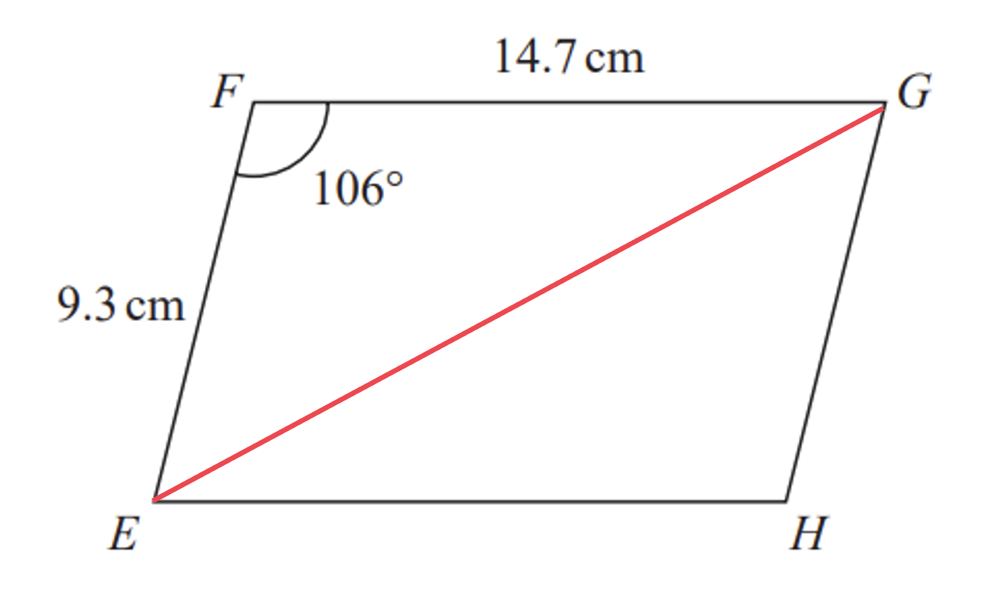

> *The formula for the area of a triangle is *$\mathrm{Area}=\frac{1}{2}ab\mathrm{sin}C$*, where **a** and **b** are the lengths of the two sides that form angle **C**. Substitute **a** = 9.3, **b** = 14.7 and **C** = 106 into the formula.*

$\begin{array}{ccc}Area of \Delta & = & 1 \text{half} \times 9.3 \times 14.7 \times \text{sin} ( 106 ) \end{array}$

> *Double this to find the area of the parallelogram.*

`| Area of Parallelogram | = 2 x 1 half x 9.3 x 14.7 x sin ( 106 ) | | _ = 9.3 x 14.7 x sin ( 106 ) | |`

**[1]**

> *Type into your calculator.*

$\begin{gathered} \text{Area} = 131.414086... \end{gathered}$

> *Round to 3 significant figures.*

**Area = 131 cm****2*** ***[1]**

### 14((b)) — 3 marks
> *You know the lengths of two sides and the angle between them and you want to find the length of the third side. Therefore you need to use the cosine rule.*

> *The formula for the cosine rule is *$a^{2}=b^{2}+c^{2}-2bc\mathrm{cos}A$*, where **b** and **c** are the lengths of the two sides that form angle **A** and **a** is the length of the side opposite **A**. *
*Substitute **a** = **EG**, **b** = 9.3, **c** = 14.7 and **A** = 106 into the formula.*

$E G^{2} = 9.3^{2} + 14.7^{2} - 2 ( 9.3 ) ( 14.7 ) \cos ( 106 )$

**[1]**

> *Type the expression into your calculator altogether as one line. If you do it separately you need to remember the order of operations (multiplication before addition).*

$EG^{2}=377.944765...$

**[1]**

> *Take the positive square root of both sides.*

$\begin{gathered} E G & = \sqrt{377.944765...} \\ = 19.440801... \end{gathered}$

> *Round to 3 significant figures.*

$EG=19.4\mathrm{cm}(3\mathrm{sf})$* ***[1]**

## Q4 — medium — 3 marks · exam-questions

### 18() — 3 marks
> *You know the lengths of two sides and the angle between them and you want to find the length of the third side. Therefore you need to use the cosine rule.*

> *The formula for the cosine rule is *$a^{2}=b^{2}+c^{2}-2bc\mathrm{cos}A$*, where **b** and **c** are the lengths of the two sides that form angle **A** and **a** is the length of the side opposite **A**. Substitute **a** = **PR**, **b** = 17.8, **c** = 26.3 and **A** = 36 into the formula.*

$P R^{2} = 17.8^{2} + 26.3^{2} - 2 ( 17.8 ) ( 26.3 ) \cos ( 36 )$

**[1]**

> *Type the expression into your calculator altogether as one line. If you do it separately you need to remember the order of operations (multiplication before addition).*

$PR^{2}=251.063568...$

**[1]**

> *Take the positive square root of both sides.*

$\begin{array}{rcl} P R & = \sqrt{251.063568...} \\ = 15.844985... \end{array}$

> *Round to 3 significant figures.*

$PR=15.8\mathrm{cm}(3\mathrm{sf})$* ***[1]**

## Q5 — medium — 3 marks · exam-questions

### 18() — 3 marks
> *Sketch the triangle. The largest angle will be opposite the longest side.*

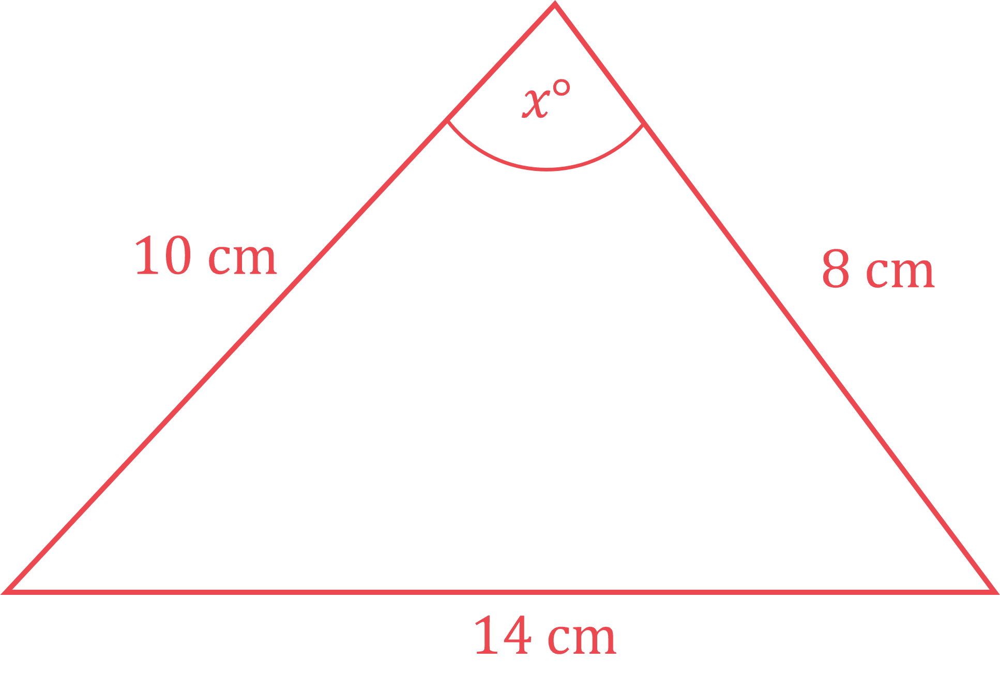

> *You know the lengths of all three sides and want to find an angle. Therefore you need to use the cosine rule.*

> *The formula for the cosine rule is *$\mathrm{cos}A=\frac{b^{2}+c^{2}-a^{2}}{2bc}$*, where **b** and **c** are the lengths of the two sides that form angle **A** and **a** is the length of the side opposite **A**. *
*Substitute **a** = 14, **b** = 10, **c** = 8 and **A** = **x** into the formula.*

$\cos x = \frac{10^{2} + 8^{2} - 14^{2}}{2 ( 10 ) ( 8 )}$

**[1]**

> *Use the inverse cos function to find the angle.*

$x = \cos ^{- 1} ( \frac{10^{2} + 8^{2} - 14^{2}}{2 ( 10 ) ( 8 )} )$

**[1]**

> *Type the expression into your calculator altogether as one line.*

$x=101.53695...$

> *Round to 1 decimal place.*

**Largest angle is 101.5° (3sf)*** ***[1]**

## Q6 — medium — 1 marks · exam-questions

### 17() — 1 marks
> *The sine rule can be written as either *$\frac{a}{\mathrm{sin}A}=\frac{b}{\mathrm{sin}B}$* or *$\frac{\mathrm{sin}A}{a}=\frac{\mathrm{sin}B}{b}$*, where **a **and **b** are lengths of two sides of the triangle and **A** and **B **are the angles opposite the sides respectively.*

> *x** cm is opposite 42° and 15 cm is opposite 104°.*

$\frac{x}{\mathrm{sin}42}=\frac{15}{\mathrm{sin}104}\mathrm{or}\frac{\mathrm{sin}42}{x}=\frac{\mathrm{sin}104}{15}$

$\frac{x}{sin42^{\circ}}=\frac{15}{sin104^{\circ}}$** [1]**

> $\frac{\mathrm{sin}x}{42}=\frac{\mathrm{sin}15}{104}\mathrm{and}\frac{\mathrm{sin}x}{34}=\frac{\mathrm{sin}15}{104}$* can be eliminated as they both contain terms where a length is after the sin rather than an angle.*

> $\frac{x}{\mathrm{sin}42}=\frac{15}{\mathrm{sin}34}$* can be eliminated as the length opposite 34° is unknown.*

## Q7 — medium — 1 marks · exam-questions

### 18((b)) — 1 marks
> *The sine rule can be written as either *$\frac{a}{\mathrm{sin}A}=\frac{b}{\mathrm{sin}B}$* or *$\frac{\mathrm{sin}A}{a}=\frac{\mathrm{sin}B}{b}$*, where **a **and **b** are lengths of two sides of the triangle and **A** and **B **are the angles opposite the sides respectively.*

> *x°**  is opposite 31 mm and 72° is opposite 54 mm.*

$\frac{\mathrm{sin}x}{31}=\frac{\mathrm{sin}72}{54}\mathrm{or}\frac{31}{\mathrm{sin}x}=\frac{54}{\mathrm{sin}72}$

**Errors are:** $x$ **and 31 should be swapped Leah has used **$x$**as a length Leah has used 31 as an angle **
**Identifying any one of the errors** **[1]**

## Q8 — medium — 3 marks · exam-questions

### 20() — 3 marks
> *You have an angle and the length of the side opposite, you also have another length so you can use the sine rule to find the angle opposite it. *
*The sine rule can be written as *$\frac{\mathrm{sin}A}{a}=\frac{\mathrm{sin}B}{b}$*, where **a **and **b** are lengths of two sides of the triangle and **A** and **B **are the angles opposite the sides respectively.*

> *Substitute **A** = **x**, **B** = 125, **a** = 6 and **b** = 14 into the formula. *

$\frac{\mathrm{sin}x}{6}=\frac{\mathrm{sin}125}{14}$

> *Multiply both sides by 6.*

$\mathrm{sin}x=\frac{\mathrm{sin}125}{14}\times6$

> *Get the angle by itself by using the inverse sin function.*

$x = \sin ^{- 1} ( \frac{\sin 125}{14} \times 6 )$

> *Type into your calculator.*

$x=20.552479...$

> *Round sensibly. The biggest degree of accuracy in the question is 3 significant figures so round your answer to 3 significant figures.*

$x=20.6\mathrm{degrees}(3\mathrm{sf})$ **[1]**

**Writing 21 or any number in the interval **$20.5\leqx\leq20.6$** is acceptable**

## Q9 — medium — 4 marks · exam-questions

### 23() — 4 marks
> *Sketch a vertical line down from point **Q** on the diagram.*

> *The angle between this vertical line and the line **PQ** will be equal to the bearing of **Q** from **P** because alternate angles in parallel lines are equal.*

$80$

> *The angle between the vertical line and the line **QR** will be the result of subtracting the bearing of **R** from **Q **from 180 because angles along a straight line add up to 180**o**.*

$180-155=25$

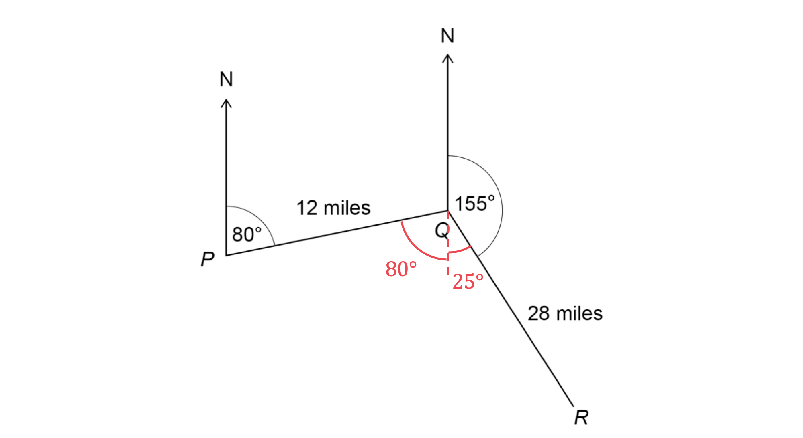

> *Join the points **P** and **R** to form a triangle **PQR**.*

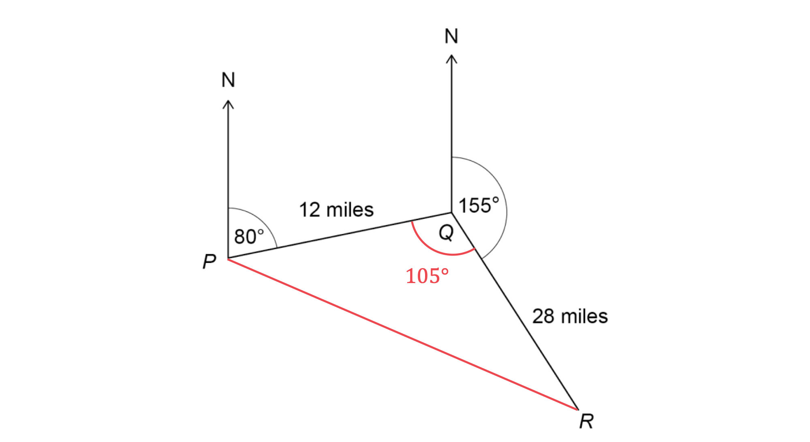

**A value of 105 seen for angle PQR**** [1]**

> *You know the length of two of the sides and the size of the angle between them so you can use the cosine rule to work out the length of the third side.*

> *Substitute the values in the diagram into the cosine rule, *$a^{2}=b^{2}+c^{2}-2bc\mathrm{cos}A$*, where *$b$* and *$c$* are the lengths of the two known sides, *$C$* is the angle between them and *$a$* is the length of the unknown side.*

$PR^{2}=12^{2}+28^{2}-2\times12\times28\times\mathrm{cos}105$

**[1]**

> *Simplify.*

$PR^{2}=1101.9263...$

> *Take the square root of both sides to find the length **PR**.*

$PR=\sqrt{1101.9263...}$

**[1]**

$PR=33.1952...$

> *The degree of accuracy for the answer is not given but it would be sensible to round your answer to 1 or 2 decimal places.*

$33.2$** ****miles ****[1]**

**Answers between 33.19 and 33.2 will be accepted An answer of 33 will also be accepted**

## Q10 — medium — 4 marks · exam-questions

### 16() — 4 marks
*You can work out the perpendicular height of the triangle **ACD** as you are given the area of the triangle and you know the length of the base.*

> *Use the formula *$Area=\frac{1}{2}\timesbase\timesheight$*.*

$\begin{gathered} 80.5 & = 1 \frac{1}{2} \times 14 \times A C \end{gathered}$

**[1]**

$\begin{gathered} 80.5 & = 7 \times A C \end{gathered}$

> *Divide both sides of the equation by 7.*

$\frac{23}{2}=AC$

**[1]**

> *Now you know the length of two sides, *$a$* and *$b$*, of the triangle **ABC** and the size of the angle in between them, *$C$*, you can use the area of a triangle formula, *$A=\frac{1}{2}ab\mathrm{sin}C$*, to calculate the area of the triangle **ABC.*

$A=\frac{1}{2}\times19\times\frac{23}{2}\times\mathrm{sin}36$

**[1]**

> *Simplify.*

$A=64.2155...$

> *Round to 3 significant figures.*

$64.2\mathrm{cm}^{2}$* ***[1]**

## Q11 — medium — 4 marks · exam-questions

### 21((a)) — 3 marks
> *If Tia and Liz walk at the same speed then whoever has the shortest distance to travel will reach the shop first.*

> *Find the distance that Tia has to walk.*

> *As you know the length of two of the sides of the triangle, *$b$* and *$c$*, and the size of the angle in between them, *$C$*, you can use the cosine rule, *$a^{2}=b^{2}+c^{2}-2bc\mathrm{cos}A$*, to find the length of the third side, *$a$*.*

$a^{2}=60^{2}+80^{2}-2\times60\times80\times\mathrm{cos}75$

**[1]**

> *Simplify.*

$a^{2}=7515.3371...$

> *Take the square root of both sides to find the value of *$a$*.*

$a=\sqrt{7515.3371...}$

**[1]**

$a=86.6910...$

> *Compare the distances that Tia and Liz have to walk to the shop.*

$86.6910>80$

**Liz will arrive at the shop first**** [1]**

**To get the answer mark, the distance that Tia will have to walk needs to be seen in the working**

### 21((b)) — 1 marks
**This will not affect the answer to part (a) as Liz will still arrive first ****[1]**

## Q12 — medium — 3 marks · exam-questions

### 22() — 3 marks
*You know the length of two of the sides of the triangle, *$b$ *and *$c$*, and the size of the angle between them, *$C$*, so you can use the cosine rule, *$a^{2}=b^{2}+c^{2}-2bc\mathrm{cos}A$*, to work out the length of the third side, *$a$*.*

$PR^{2}=6^{2}+9^{2}-2\times6\times9\times\mathrm{cos}120$

**[1]**

> *Simplify.*

$PR^{2}=171$

> *Take the square root of both sides to find the length **PR**.*

$PR=\sqrt{171}$

**[1]**

$PR=13.0766...$

> *The degree of accuracy of for the answer is not given but it is sensible to round it to the nearest 1 or 2 decimal places.*

$13.1\mathrm{cm}$* ***[1]**

**Answers between 13 and 13.1 will be accepted Answers of **$\sqrt{171}$** or **$3\sqrt{19}$** will also be accepted**

## Q13 — medium — 3 marks · exam-questions

### 20() — 3 marks
> *There are two pairs of opposite sides and angles in the diagram with only one unknown so you can use the sine rule, *$\frac{\mathrm{sin}A}{a}=\frac{\mathrm{sin}B}{b}$*, to find the size of the missing angle.*

$\frac{\mathrm{sin}y}{16}=\frac{\mathrm{sin}34}{10}$

**[1]**

> *Multiply both sides by 16.*

$\mathrm{sin}y=16\times\frac{\mathrm{sin}34}{10}$

**[1]**

> *Take *$\mathrm{sin}^{-1}$* of both sides.*

$y = \sin ^{- 1} ( 16 \times \frac{\sin 34}{10} )$

> *Put into your calculator and work out the value.*

$y=63.4710...$

> *The question states that angle *$y$* is obtuse but the current value is the acute angle.*

> *Find the obtuse angle by subtracting the acute angle from 180**o**.*

$\begin{array}{rcl} y = 180 - 63.4710... \\ = 116.5289... \end{array}$

> *The question does not state a required degree of accuracy but it would be sensible to round the answer to 1 or 2 decimal places.*

$116.5\mathrm{degrees}$* ***[1]**

**Answers between 116.5 and 116.53 will be accepted**

## Q14 — medium — 5 marks · exam-questions

### 18() — 4 marks
> *Calculate the area, **A**, of the field using the area of a triangle formula, *$A=\frac{1}{2}ab\mathrm{sin}C$*, where *$a$* and *$b$* are the lengths of two sides of the triangle and *$C$* is the angle between them.*

$A=\frac{1}{2}\times80\times100\times\mathrm{sin}30$

**[1]**

$A=2000$

**[1]**

> *Multiply the area of the field by the average mass of carrots that was harvested per square metre to find the total mass, **M**, that was harvested.*

$M=2.5\times2000$

**[1]**

$5000\mathrm{kg}$* ***[1]**

### 18((b)) — 1 marks
**Conditions for growing may have been different** **[1]**

**Other answers that will be accepted include:** **2019 may not have been an "average" year** 
**There may have been extremes in the weather** **2019 may not have harvested the same amount as in other years**

## Q15 — medium — 7 marks · exam-questions

### 17((a)) — 4 marks
> *Find the length of AC in the triangle ADC as you know the length of two of the sides and the angle between them.*

> *You can use the cosine rule, *$a^{2}=b^{2}+c^{2}-2bc\mathrm{cos}A$*, where *$b$* and *$c$* are the sides that you know, *$A$* is the angle between them and *$a$* is the side that you are trying to find.*

$\mathrm{AC}^{2}=18^{2}+14^{2}-2\times18\times14\times\mathrm{cos}46$

**Attempt to use the cosine rule ****[1] **
**Correct substitution into the cosine rule**** [1]**

$\mathrm{AC}^{2}=169.8921...$

$\mathrm{AC}=13.0342...$

> *Round to 3 significant figures.*

$\mathrm{AC}=13.0\mathrm{cm}$* ***[1]**

### 17((b)) — 3 marks
> *Calculate the angle ABC by subtracting the angles BAC and ACB from 180 as angles in a triangle add up to 180**o**.*

*Angle ABC =** *$180-78-81=21$

**[1]**

> *You now have two pairs of opposite sides and angles on triangle ABC with only one unknown.*

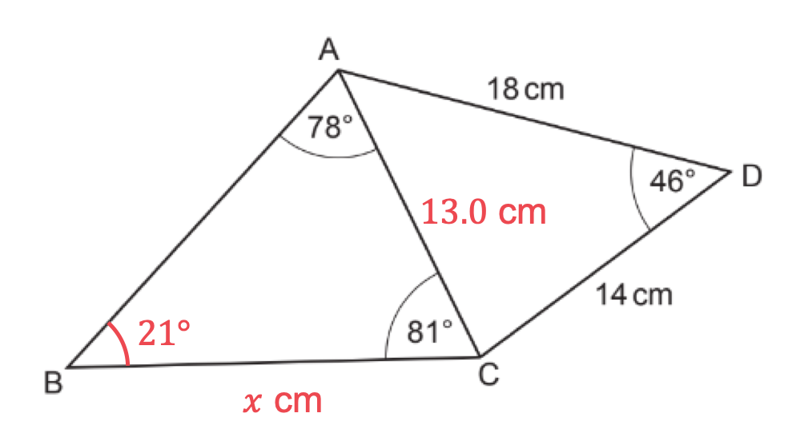

> *Use the sine rule, *$\frac{a}{\mathrm{sin}A}=\frac{b}{\mathrm{sin}B}$*, to find the length of the missing side BC.*

$\frac{x}{\mathrm{sin}78}=\frac{13}{\mathrm{sin}21}$

**[1]**

> *Multiply both sides of the equation by *$\mathrm{sin}78$*.*

$x=\mathrm{sin}78\times\frac{13}{\mathrm{sin}21}$

$x=35.4828...$

> *No specific accuracy is stated in the question but it would be sensible to round your answer to 1 or 2 decimal places.*

$35.5\mathrm{cm}$* ***[1]**

**Answers between 35.48 and 35.6 will be accepted**

## Q16 — medium — 3 marks · exam-questions

### 15((a)) — 3 marks
> *You know the lengths of two sides and the angle between them and you want to find the length of the third side. Therefore you need to use the cosine rule.*

> *The formula for the cosine rule is *$a^{2}=b^{2}+c^{2}-2bc\mathrm{cos}A$*, where **b** and **c** are the lengths of the two sides that form angle **A** and **a** is the length of the side opposite **A**. *
*Substitute **a** = **DF**, **b** = 10, **c** = 12 and **A** = 30 into the formula.*

$D F^{2} = 10^{2} + 12^{2} - 2 ( 10 ) ( 12 ) \cos ( 30 )$

**[1]**

> *Type the expression into your calculator altogether as one line. If you do it separately you need to remember the order of operations (multiplication before addition).*

$DF^{2}=36.1539...$

**[1]**

> *Take the positive square root of both sides.*

$\begin{gathered} D F & = \sqrt{36.1539...} \\ = 6.012811... \end{gathered}$

> *Round to 3 significant figures. Remember to include units for the length.*

$DF=6.01\mathrm{cm}(3s.f.)$* ***[1]**

## Q17 — medium — 4 marks · exam-questions

### 15((b)) — 4 marks
> *You know the length of one side and the angle opposite it. You also know another side so you can find the length of the side opposite that using the sine rule. *
*Note that the known angle is not in between the two known sides so you should not use the cosine rule here. *

> *The formula for the sine rule is *$\frac{\mathrm{sin}A}{a}=\frac{\mathrm{sin}B}{b}$*, where **a** and **b** are the lengths of the two sides that are opposite the angles **A **and **B **respectively.*

> *The side opposite angle ACB is not known, so we will need to find angle ABC first, let angle ABC be **x **and angle ACB be **y.*

> *Substitute **a** = **12.8**, **b** = 12.4, **A** = 63 and **B** = **x **into the formula for the sine rule.*

$\frac{\sin ( x )}{12.4} = \frac{\sin ( 63 )}{12.8}$

**[1]**

> *Multiply both sides by 12.4 and type into your calculator.*

$\begin{gathered} \sin ( x ) & = \frac{12.4 \times \sin ( 63 )}{12.8} \\ = 0.863162... \end{gathered}$

**[1]**

> *Use the inverse sin (sin**-1**) button on your calculator to find **x.*

$x = \sin ^{- 1} ( 0.863162... ) = 59.67355...$

> *Find **y **by subtracting angles ABC and BAC from 180°.*

$y=180-63-59.67355...$

**[1]**

> *Round to 1 decimal place. Remember to include units for the angle.*

$\mathrm{ACB}=57.3^{\circ}(1d.p.)$* ***[1]**

## Q18 — medium — 4 marks · exam-questions

### 17((b)) — 4 marks
> *Add everything you know to the diagram and use this to find the angle between the lines TA and TB.*

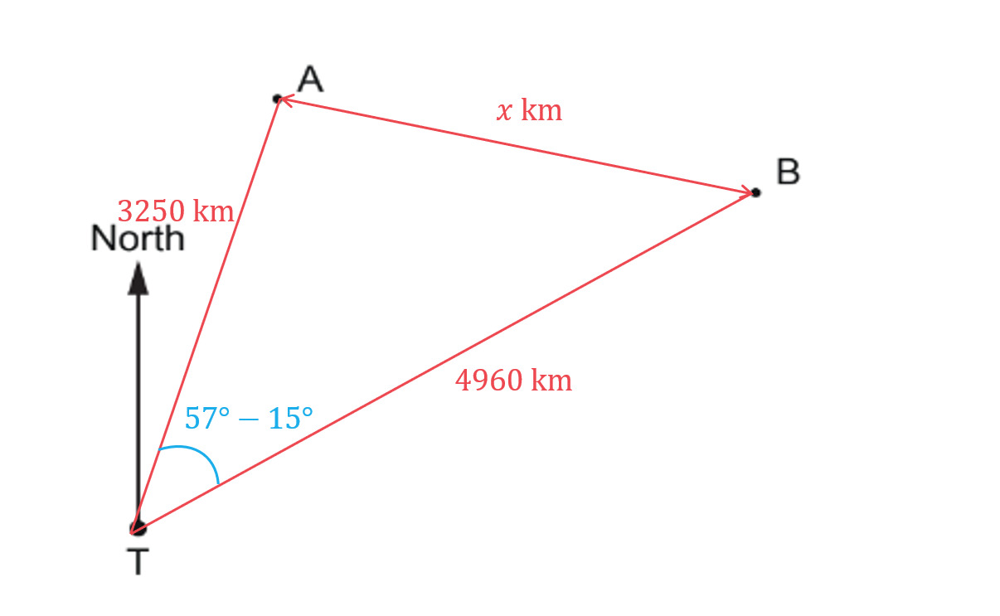

> *You know the lengths of two sides, find the angle between them.*

*Angle ATB = 57 - 15 = 42°*

**[1]**

> *You want to find the length of the third side, therefore you need to use the cosine rule.*

> *The formula for the cosine rule is *$a^{2}=b^{2}+c^{2}-2bc\mathrm{cos}A$*, where **b** and **c** are the lengths of the two sides that form angle **A** and **a** is the length of the side opposite **A**. *
*Substitute **a** = **AB**, **b** = 3250, **c** = 4960 and **A** = 42 into the formula.*

$A B^{2} = 3250^{2} + 4960^{2} - 2 ( 3250 ) ( 4960 ) \cos ( 42 )$

** **** ****[1]**

> *Type the expression into your calculator altogether as one line. If you do it separately you need to remember the order of operations (multiplication before addition).*

$AB^{2}=11205110.83$

**[1]**

> *Take the positive square root of both sides.*

$\begin{gathered} A B & = \sqrt{11205110.83} \\ = 3347.403... \end{gathered}$

> *Round to 3 or 4 significant figures, 4 is chosen here as this rounds to the nearest km. *
*Remember to include units for the length.*

$AB=3347\mathrm{km}$* ***[1] **
**Answers from 3345 to 3350 accepted as long as method is correct**

## Q19 — hard — 5 marks · exam-questions

### 17() — 5 marks
> *First look at triangle **BCD**.*

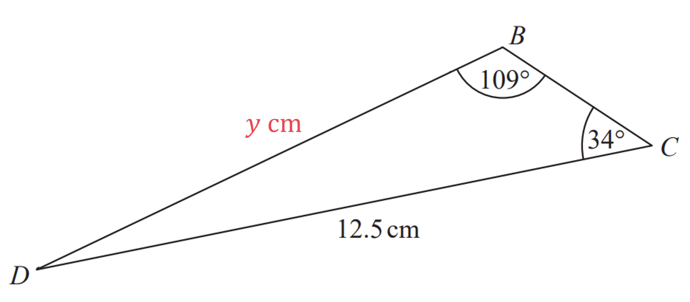

> *You know the length of one side and the angle opposite it. You also know another angle so you can find the length of the side opposite that using the sine rule.*

> *The formula for the sine rule is *$\frac{a}{\mathrm{sin}A}=\frac{b}{\mathrm{sin}B}$*, where **a** and **b** are the lengths of the two sides that are opposite the angles **A **and **B **respectively. *
*Substitute **a** = **y**, **b** = 12.5, **A** = 34 and **B** = 109 into the formula.*

$\frac{y}{\sin ( 34 )} = \frac{12.5}{\sin ( 109 )}$

**[1]**

> *Multiply both sides by sin(34) and type into your calculator.*

$\begin{gathered} y = \frac{12.5}{\sin ( 109 )} \times \sin ( 34 ) \\ = 7.392674... \end{gathered}$

**[1]**

> *Now look at triangle **ABD**.*

> *You know the lengths of two sides and the angle between them and you want to find the length of the third side. Therefore you need to use the cosine rule.*

> *The formula for the cosine rule is *$a^{2}=b^{2}+c^{2}-2bc\mathrm{cos}A$*, where **b** and **c** are the lengths of the two sides that form angle **A** and **a** is the length of the side opposite **A**. *
*Substitute **a** = **x**, **b** = 11.4, **c** = 7.392674... (using the answer button) and **A** = 86 into the formula.*

$x^{2} = 11.4^{2} + 7.392674...^{2} - 2 ( 11.4 ) ( 7.392674... ) \cos ( 86 )$

**[1]**

> *Type the expression into your calculator altogether as one line. If you do it separately you need to remember the order of operations (multiplication before addition).*

$x^{2}=172.853978...$

**[1]**

> *Take the positive square root of both sides.*

$\begin{array}{rcl} x = \sqrt{172.853978...} \\ = 13.147394... \end{array}$

> *Round to 3 significant figures. Remember to include units for the length.*

$AD=13.1\mathrm{cm}(3\mathrm{sf})$* ***[1]**

## Q20 — hard — 5 marks · exam-questions

### 24() — 5 marks
> *You can find the angle between the sides **AC** and **AB** by spotting that the three interior angles of the triangle should add up to 180°.*

$\begin{gathered} \text{Angle} B A C & = 180 - 64 - 49 \\ = 67 \end{gathered}$

> *To find the area of a triangle you need to know the lengths of two sides and the angle between them.*

> *You know the length of one side and the angle opposite it. You also know another angle so you can find the length of the side opposite that using the sine rule.*

> *The formula for the sine rule is *$\frac{a}{\mathrm{sin}A}=\frac{b}{\mathrm{sin}B}$*, where **a** and **b** are the lengths of the two sides that are opposite the angles **A **and **B **respectively. *
*Substitute **a** = **AC**, **b** = 8.7, **A** = 49 and **B** = 64 into the formula.*

$\frac{A C}{\sin ( 49 )} = \frac{8.7}{\sin ( 64 )}$

**[1]**

> *Multiply both sides by sin(49) and type into your calculator.*

$\begin{gathered} A C & = \frac{8.7}{\sin ( 64 )} \times \sin ( 49 ) \\ = 7.305314... \end{gathered}$

**Rearranging correctly**** [1] **
**Correct answer**** [1]**

> *The formula for the area of a triangle is *$\mathrm{Area}=\frac{1}{2}ab\mathrm{sin}C$*, where **a** and **b** are the lengths of the two sides that form angle **C**. Substitute **a** = 7.305314... (using the answer button), **b** = 8.7 and **C** = 67 into the formula.*

$\begin{gathered} \text{Area} = 1 \frac{1}{2} \times 7.305314... \times 8.7 \times \sin ( 67 ) \end{gathered}$

**[1]**

> *Type into your calculator.*

$\begin{array}{rcl} \text{Area} = 29.251912... \end{array}$

> *Round to 3 significant figures. Remember to include the units for the area.*

$\mathrm{Area}=29.3\mathrm{cm}^{2}(3\mathrm{sf})$ **[1]**

## Q21 — hard — 5 marks · exam-questions

### 26() — 5 marks
> *Finding the angle opposite the side **LN** will help you.*

> *You know the length of one side and the angle opposite it. You also know the length of another side so you can use the sine rule to find the angle opposite it.*

> *The formula for the sine rule is *$\frac{\mathrm{sin}A}{a}=\frac{\mathrm{sin}B}{b}$*, where **a** and **b** are the lengths of the two sides that are opposite the angles **A **and **B **respectively. *
*Substitute **a** = **12.8**, **b** = 15.7, **A** = **MLN** and **B** = 136 into the formula.*

$\frac{\sin ( M L N )}{12.8} = \frac{\sin ( 136 )}{15.7}$

**[1]**

> *Multiply both sides by 12.8 and then find the angle by using the inverse sin function.*

$\begin{gathered} \sin ( M L N ) & = \frac{\sin ( 136 )}{15.7} \times 12.8 \\ M L N & = \sin ^{- 1} ( \frac{\sin ( 136 )}{15.7} \times 12.8 ) \end{gathered}$

**[1]**

> *Type into your calculator.*

$\begin{gathered} M L N & = 34.495789... \end{gathered}$

**[1]**

> *You can find the angle between the sides **LM** and **MN** by spotting that the three interior angles of the triangle should add up to 180°. Use the answer button on your calculator.*

$\begin{gathered} \text{Angle} L M N & = 180 - 136 - 34.495789... \\ = 9.504210... \end{gathered}$

> *You now have enough information to find the side **LN** using either the sine rule or the cosine rule.*

> *Method 1 - Using the sine rule*

> *The formula for the sine rule is *$\frac{a}{\mathrm{sin}A}=\frac{b}{\mathrm{sin}B}$*, where **a** and **b** are the lengths of the two sides that are opposite the angles **A **and **B **respectively. *
*Substitute **a** = **LN**, **b** = 15.7, **A** = 9.504210... (using the answer button) and **B** = 136 into the formula.*

$\frac{L N}{\sin ( 9.504210... )} = \frac{15.7}{\sin ( 136 )}$

**[1]**

> *Multiply both sides by sin(9.504210...) and type into your calculator.*

$\begin{gathered} L N & = \frac{15.7}{\sin ( 136 )} \times \sin ( 9.504210... ) \\ = 3.731885... \end{gathered}$

> *Round to 3 significant figures. Remember to include the units for the length.*

$LN=3.73\mathrm{cm}(3\mathrm{sf})$** [1]**

> *Method 2 - Using the cosine rule*

> *The formula for the cosine rule is *$a^{2}=b^{2}+c^{2}-2bc\mathrm{cos}A$*, where **b** and **c** are the lengths of the two sides that form angle **A** and **a** is the length of the side opposite **A**. *
*Substitute **a** = **LN**, **b** = 15.7, **c** = 12.8 and **A** = 9.504210... (using the answer button) into the formula.*

$L N^{2} = 15.7^{2} + 12.8^{2} - 2 ( 15.7 ) ( 12.8 ) \cos ( 9.504210... )$

**[1]**

> *Type the expression into your calculator altogether as one line. If you do it separately you need to remember the order of operations (multiplication before addition).*

$LN^{2}=13.926966...$

> *Take the positive square root of both sides.*

$\begin{gathered} L N & = \sqrt{13.926966...} \\ = 3.731885... \end{gathered}$

> *Round to 3 significant figures. Remember to include the units for the length.*

$LN=3.73\mathrm{cm}(3\mathrm{sf})$** [1]**

## Q22 — hard — 5 marks · exam-questions

### 21() — 5 marks
> *First look at triangle **ABD**.*

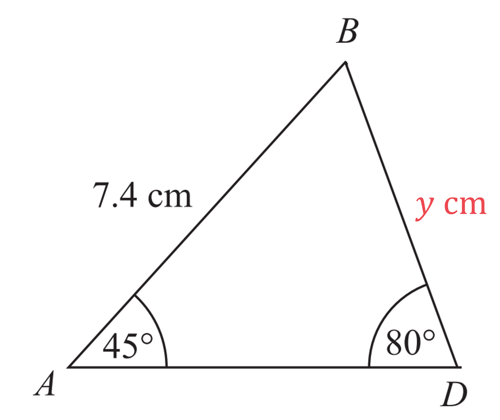

> *You know the length of one side and the angle opposite it. You also know another angle so you can find the length of the side opposite that using the sine rule.*

> *The formula for the sine rule is *$\frac{a}{\mathrm{sin}A}=\frac{b}{\mathrm{sin}B}$*, where **a** and **b** are the lengths of the two sides that are opposite the angles **A **and **B **respectively. Substitute **a** = **y**, **b** = 7.4, **A** = 45 and **B** = 80 into the formula.*

$\frac{y}{\sin ( 45 )} = \frac{7.4}{\sin ( 80 )}$

**[1]**

> *Multiply both sides by sin(45) and type into your calculator.*

$\begin{gathered} y = \frac{7.4}{\sin ( 80 )} \times \sin ( 45 ) \\ = 5.313311... \end{gathered}$

**[1]**

> *Now look at triangle **BCD**. You know the angles **BDC** and **ADB** add up to 180° so you can find the missing angle.*

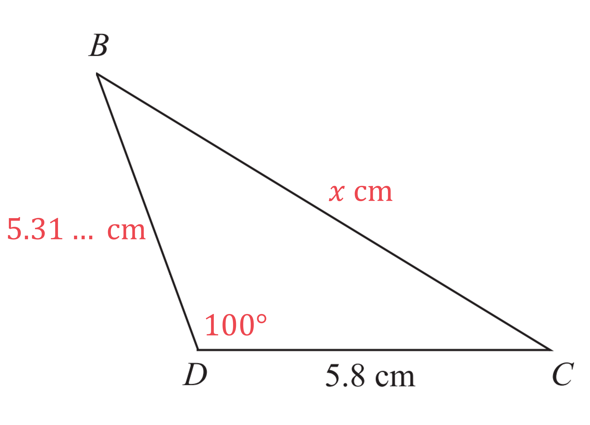

> *You know the lengths of two sides and the angle between them and you want to find the length of the third side. Therefore you need to use the cosine rule.*

> *The formula for the cosine rule is *$a^{2}=b^{2}+c^{2}-2bc\mathrm{cos}A$*, where **b** and **c** are the lengths of the two sides that form angle **A** and **a** is the length of the side opposite **A**. Substitute **a** = **x**, **b** = 5.8, **c** = 5.313311... (using the answer button) and **A** = 100 into the formula.*

$x^{2} = 5.8^{2} + 5.313311...^{2} - 2 ( 5.8 ) ( 5.313311... ) \cos ( 100 )$

**[1]**

> *Type the expression into your calculator altogether as one line. If you do it separately you need to remember the order of operations (multiplication before addition).*

$x^{2}=72.573980...$

**[1]**

> *Take the positive square root of both sides.*

$\begin{array}{rcl} x = \sqrt{72.573980...} \\ = 8.519036... \end{array}$

> *Round to 3 significant figures. Remember to include units for the length.*

$BC=8.52\mathrm{cm}(3\mathrm{sf})$** ****[1]**

## Q23 — hard — 5 marks · exam-questions

### 24() — 5 marks
> *First use the area to form an equation.*

> *The formula for the area of a triangle is *$\mathrm{Area}=\frac{1}{2}ab\mathrm{sin}C$*, where **a** and **b** are the lengths of the two sides that form angle **C**. Substitute Area = 100, **a** = **y**, **b** = 8.4 and **C** = 40 into the formula.*

$\begin{gathered} 100 = 1 \frac{1}{2} \times y \times 8.4 \times \sin ( 40 ) \end{gathered}$

**[1]**

> *Rearrange to get **y** by itself by multiplying both sides by 2 and dividing both sides by 8.4sin(40). Type into your calculator.*

$\begin{gathered} y = \frac{100 \times 2}{8.4 \times \sin ( 40 )} \\ = 37.041043... \end{gathered}$

**[1]**

> *You now know the lengths of two sides and the angle between them and you want to find the length of the third side. Therefore you need to use the cosine rule.*

> *The formula for the cosine rule is *$a^{2}=b^{2}+c^{2}-2bc\mathrm{cos}A$*, where **b** and **c** are the lengths of the two sides that form angle **A** and **a** is the length of the side opposite **A**. Substitute **a** = **x**, **b** = 8.4, **c** = 37.041043... (using the answer button) and **A** = 40 into the formula.*

$x^{2} = 8.4^{2} + 37.041043...^{2} - 2 ( 8.4 ) ( 37.041043... ) \cos ( 40 )$

**[1]**

> *Type the expression into your calculator altogether as one line. If you do it separately you need to remember the order of operations (multiplication before addition).*

$x^{2}=965.897466...$

**[1]**

> *Take the positive square root of both sides.*

$\begin{gathered} x = \sqrt{965.897466...} \\ = 31.078891... \end{gathered}$

> *Round to 3 significant figures. Remember to include units for the length.*

$AB=31.1m(3\mathrm{sf})$* ***[1]**

## Q24 — hard — 5 marks · exam-questions

### 21((a)) — 4 marks
> *Sketch the diagram and label the relevant sides and angles.*

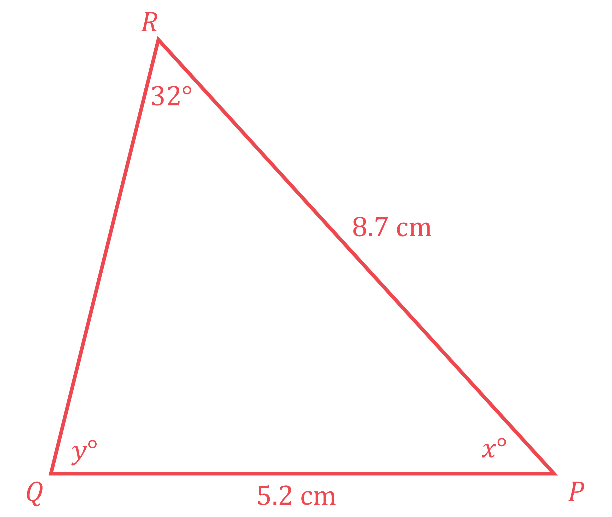

> *To find the area of a triangle formula you need to know the lengths of two sides and the angle between them. We currently do not know angle **RPQ** so work out what you can.*

> *You know the length of one side and the angle opposite it. You also know the length of another side so you can use the sine rule to find the angle opposite it.*

> *The formula for the sine rule is *$\frac{\mathrm{sin}A}{a}=\frac{\mathrm{sin}B}{b}$*, where **a** and **b** are the lengths of the two sides that are opposite the angles **A **and **B **respectively. *
*Substitute **a** = **8.7**, **b** = 5.2, **A** = **y** and **B** = 32 into the formula.*

$\frac{\sin ( y )}{8.7} = \frac{\sin ( 32 )}{5.2}$

**[1]**

> *Multiply both sides by 8.7 and then find the angle by using the inverse sin function.*

$\begin{gathered} \sin ( y ) & = \frac{\sin ( 32 )}{5.2} \times 8.7 \\ y = \sin ^{- 1} ( \frac{\sin ( 32 )}{5.2} \times 8.7 ) \end{gathered}$

**[1]**

> *Type into your calculator.*

$\begin{array}{rcl} y = 62.448531... \end{array}$

> *You can find the third angle by spotting that the three interior angles of the triangle should add up to 180°. Use the answer button on your calculator.*

$\begin{array}{rcl} x = 180 - 32 - 62.448531... \\ = 85.551468... \end{array}$

> *You now have enough information to find the area.*

> *The formula for the area of a triangle is *$\mathrm{Area}=\frac{1}{2}ab\mathrm{sin}C$*, where **a** and **b** are the lengths of the two sides that form angle **C**. Substitute **a** = 8.7, **b** = 5.2 and **C** = 85.551468... (using the answer button) into the formula.*

$\begin{gathered} \text{Area} = 1 \frac{1}{2} \times 8.7 \times 5.2 \times \sin ( 85.551468... ) \\ = 22.551855... \end{gathered}$

**[1]**

> *Round to 3 significant figures. Remember to include square units for the area.*

$\mathrm{Area}=22.6\mathrm{cm}^{2}(3\mathrm{sf})$** [1]**

### 21((b)) — 1 marks
> *When using the sine rule to find an angle, it always gives you an acute angle. Sometimes it is possible that the angle could be obtuse or acute. You can sketch the triangle to see how it would look which shows the areas would be different.*

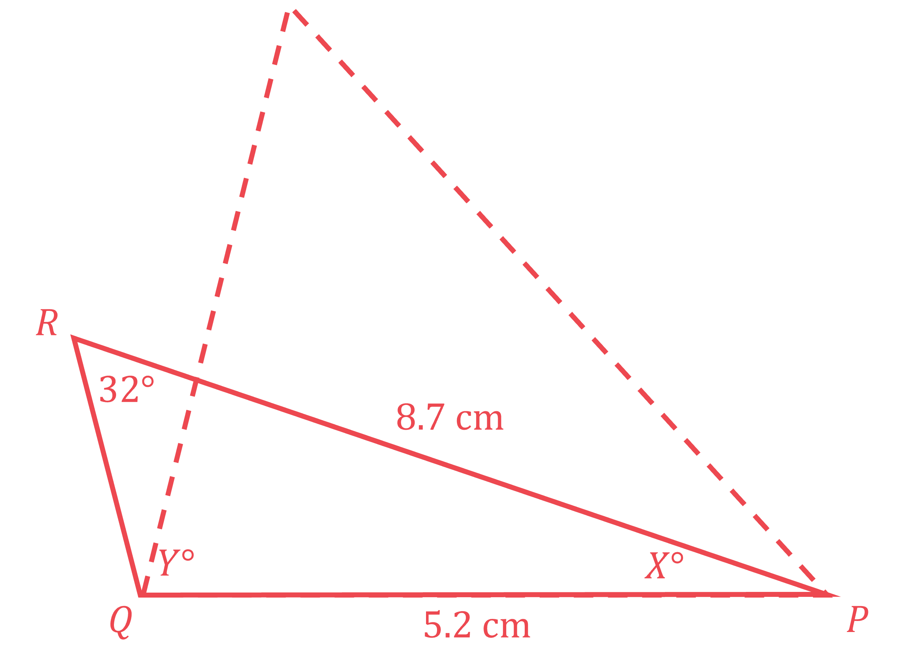

**The angle could be ****either acute or obtuse**** so there would be ****two areas**** to find** **[1]**

## Q25 — hard — 3 marks · exam-questions

### 25() — 3 marks
> *The formula for the area of a triangle is *$\mathrm{Area}=\frac{1}{2}ab\mathrm{sin}C$*, where **a** and **b** are the lengths of the two sides that form angle **C**. Substitute Area = **A**, **a** = **x**, **b** = 2**x** and **C** = 30 into the formula.*

$\begin{gathered} A = 1 \frac{1}{2} \times x \times 2 x \times \sin ( 30 ) \end{gathered}$

**[1]**

> *Use the your calculator to find that *$\sin ( 30 ) = 1 \frac{1}{2}$*.*

$\begin{gathered} A = 1 \frac{1}{2} \times x \times 2 x \times 1 \frac{1}{2} \end{gathered}$

> *Simplify the expression, cancel common factors from the numerators and denominators first.*

$\begin{gathered} A = \frac{1}{ \cancel{2} } \times x \times \cancel{2} x \times 1 \frac{1}{2} \\ A = \frac{x^{2}}{2} \end{gathered}$

**[1]**

> *Multiply both sides by 2.*

$\begin{array}{rcl} x^{2} & = 2 A \end{array}$

> *Take the positive square root of both sides.*

$x=\sqrt{2A}$ **[1]**

## Q26 — hard — 4 marks · exam-questions

### 18() — 4 marks
> *To find the area of a triangle formula you need to know the lengths of two sides and the angle between them. We currently only know one length. We can find the third angle by using the fact that the three interior angles in a triangle add up to 180°.*

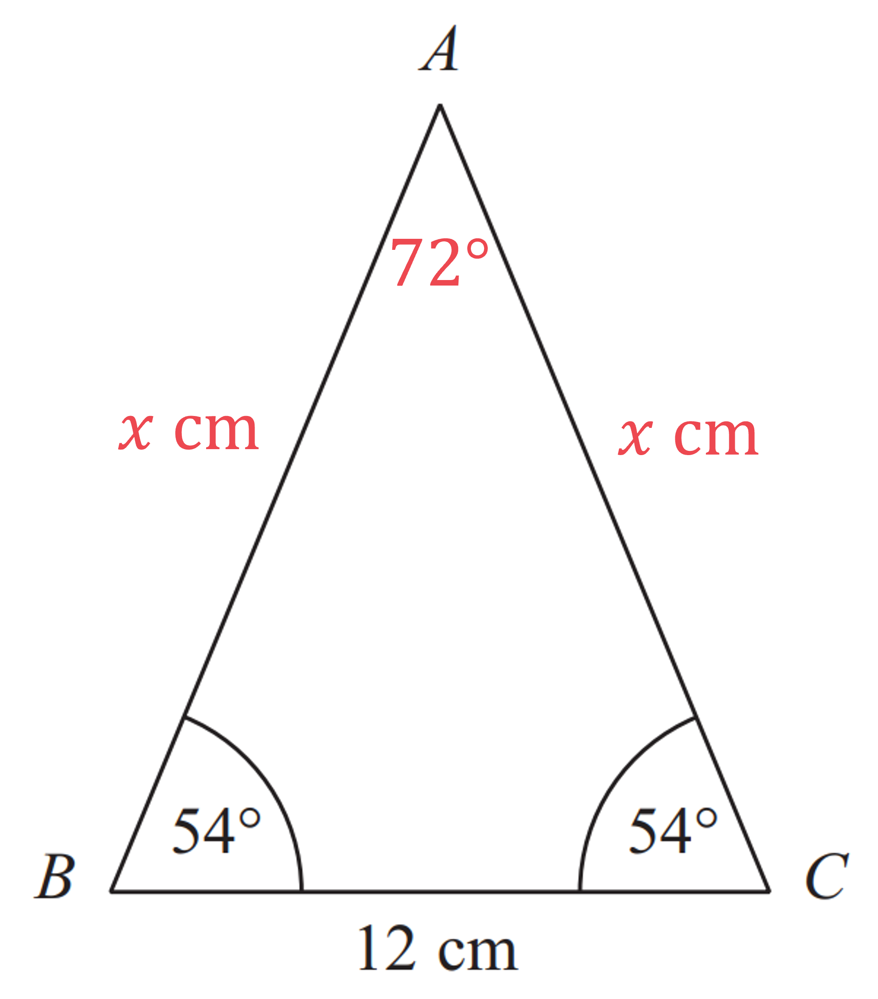

> *You know the length of one side and the angle opposite it. You also know another angle so you can find the length of the side opposite that using the sine rule.*

> *The formula for the sine rule is *$\frac{a}{\mathrm{sin}A}=\frac{b}{\mathrm{sin}B}$*, where **a** and **b** are the lengths of the two sides that are opposite the angles **A **and **B **respectively. Substitute **a** = x, **b** = 12, **A** = 54 and **B** = 72 into the formula.*

$\frac{x}{\sin ( 54 )} = \frac{12}{\sin ( 72 )}$

**[1]**

> *Multiply both sides by sin(54) and type into your calculator.*

$\begin{gathered} x = \frac{12}{\sin ( 72 )} \times \sin ( 54 ) \\ = 10.207809... \end{gathered}$

**[1]**

> *You now have enough information to find the area.*

> *The formula for the area of a triangle is *$\mathrm{Area}=\frac{1}{2}ab\mathrm{sin}C$*, where **a** and **b** are the lengths of the two sides that form angle **C**. Substitute **a** = 12, **b** = 10.207809... (using the answer button) and **C** = 54 into the formula.*

$\begin{gathered} \text{Area} = 1 \frac{1}{2} \times 12 \times 10.207809... \times \sin ( 54 ) \\ = 49.549749... \end{gathered}$

**[1]**

> *Round to 3 significant figures. Remember to include square units for the area.*

$\mathrm{Area}=49.5\mathrm{cm}^{2}(3\mathrm{sf})$** [1] **
**This can also be done using right angled trigonometry**

## Q27 — hard — 3 marks · exam-questions

### 13() — 3 marks
> *Write down the upper and lower bounds for all measurements.*

*Length ***XZ***: 15.5 cm, 16.5 cm* 
*Angle ***YXZ***: 125**o**, 135**o* 
*Angle ***XYZ***: 24.5**o**, 25.5**o*

**At least one correct bound identified ****[1]**

> *To find the length **YZ**  you need to use the sine rule, *$\frac{a}{\mathrm{sin}A}=\frac{b}{\mathrm{sin}B}$*.*

$\begin{gathered} \frac{a}{\sin ( Y X Z )} & = \frac{X Z}{\sin ( X Y Z )} \\ a = \sin ( Y X Z ) \times \frac{X Z}{\sin ( X Y Z )} \end{gathered}$

> *In order to find the upper bound for length **YZ**  you will need to use the upper bound for the length **XZ** . *
*For the angles, you want to have the largest value for sin **YXZ** (which will be using the lower bound of the angle) and the smallest value for sin **XYZ** (which will be using the upper bound of the angle).*

$\begin{gathered} a = \sin 125 \times \frac{16.5}{\sin 24.5} \end{gathered}$

**Correct substitution into sine rule**** [1]**

$\begin{array}{rcl} a = 32.5927... \end{array}$

**32.6****o**** [1]**

**Answers between 32.5 and 32.6 will be accepted **

## Q28 — hard — 6 marks · exam-questions

### 21() — 6 marks
> *Use the cosine rule, *$a^{2}=b^{2}+c^{2}-2bc\mathrm{cos}A$*, on triangle **PQS **in order to calculate the length **QS**.*

$\begin{gathered} Q S^{2} & = 8^{2} + 12^{2} - 2 \times 8 \times 12 \times \cos 120 \end{gathered}$

**[1]**

$\begin{array}{rcl} Q S^{2} & = 304 \\ Q S & = \sqrt{304} \end{array}$

**[1]**

> *Use the sine rule, *$\frac{\mathrm{sin}A}{a}=\frac{\mathrm{sin}B}{b}$*, on triangle **QRS** to calculate the angle **SRQ**.*

$\begin{gathered} \frac{\sin ( Q R S )}{ \sqrt{304} } & = \frac{\sin 27}{9} \end{gathered}$

**[1]**

$\begin{gathered} \sin ( Q R S ) & = \sqrt{304} \times \frac{\sin 27}{9} \\ Q R S & = \sin ^{- 1} ( \sqrt{304} \times \frac{\sin 27}{9} ) \end{gathered}$

**[1]**

$\begin{gathered} Q R S & = 61.5833... \end{gathered}$

**[1]**

> *Find angle **SQR **by subtracting angles **QRS** and **SRQ** from 180**o** as angles in a triangle add up to 180**o**.*

$180-27-61.5833...=91.4166...$

**91.4****o**** ****[1]**

## Q29 — hard — 5 marks · exam-questions

### 29() — 5 marks
> *You know the length of two sides of the triangle **ABC** and the angle between them, so you can use the cosine rule to find the length of the third side of the triangle.*

> *Use the cosine rule in the form *$a^{2}=b^{2}+c^{2}-2bc\mathrm{cos}A$*, where *$b$*and *$c$* are the two known sides, *$A$* is the angle between them and *$a$* is the side you are trying to find.*

> *Substitute the values from the diagram into the formula.*

$AC^{2}=8^{2}+10^{2}-2\times8\times10\times\mathrm{cos}114$

**[1]**

> *Simplify.*

$AC^{2}=229.0778...$

> *Find **AC** by taking the square root of both sides.*

$AC=\sqrt{229.0778...}$

**[1]**

$AC=15.1353...$

> *AC** is the diameter of the semi-circle.*

> *Find the radius of the semi-circle, *$r$*, by dividing the diameter by 2.*

$\begin{array}{rcl} r = \frac{15.1353...}{2} \\ = 7.5676... \end{array}$

> *Calculate the area of the semi-circle by using the area of a circle formula, *$A=πr^{2}$* and multiplying it by *$\frac{1}{2}$*.*

$\begin{array}{rcl} A_{s e m i - c i r c l e} & = 1 \frac{1}{2} \times \mathrm{\pi } \times 7.5676...^{2} \end{array}$

**[1]**

$\begin{gathered} A_{s e m i - c i r c l e} & = 89.9586... \end{gathered}$

> *Calculate the area of the triangle **ABC** using the area of a triangle formula, *$A=\frac{1}{2}ab\mathrm{sin}C$*, where *$a$* and *$b$* are the lengths of two of the sides and *$C$* is the angle between them.*

$A_{triangle}=\frac{1}{2}\times8\times10\times\mathrm{sin}114$

**[1]**

> *Simplify.*

$A_{triangle}=36.5418...$

> *Add together the areas of the triangle and the semi-circle to find the total area of the shape.*

$\begin{gathered} A_{t o t a l} & = 89.9586... + 36.5418... \\ = 126.5004... \end{gathered}$

> *The question does not ask you to round your answer to a given degree of accuracy but it would be sensible to round your answer to 1 or 2 decimal places.*

$A=126.50\mathrm{cm}^{2}$* ***[1]**

**Answers between 125.99 and 126.572 will be accepted**

## Q30 — hard — 8 marks · exam-questions

### 26((a)) — 3 marks
> *Calculate the area, **A**, of the sail using the formula *$A=\frac{1}{2}ab\mathrm{sin}C$*, where *$a$* and *$b$* are two sides of the triangle and *$C$* is the angle between them.*

$A=\frac{1}{2}\times3.8\times9.7\times\mathrm{sin}73$

**[1]**

$A=17.6246...$

> *The sail will require 3 coats of waterproofing liquid on both sides of the sail. *
*Multiply the area of one side of the sail by 6 to find the total area that needs to be covered.*

$\begin{gathered} A_{t o t a l} & = 6 \times 17.6246... \\ = 105.7481... \end{gathered}$

> *Calculate the number of bottles of waterproofing liquid that required by dividing the total area by the area that one bottle will cover.*

$\mathrm{No}.\mathrm{of}1L\mathrm{bottles}=\frac{105.7481...}{8.5}$

**[1]**

$\mathrm{No}.\mathrm{of}1L\mathrm{bottles}=12.4409...$

> *Round up to the next number of whole bottles.*

$13$* ***[1]**

### 26((b)) — 5 marks
> *You know two sides of the original triangle and the size of the angle between them so you can use the cosine rule to find the length of the third side.*

> *Use the cosine rule in the form *$a^{2}=b^{2}+c^{2}-2bc\mathrm{cos}A$*, where *$b$* and *$c$* are the two known sides, *$A$* is the angle between them and *$a$* is the side you are trying to find.*

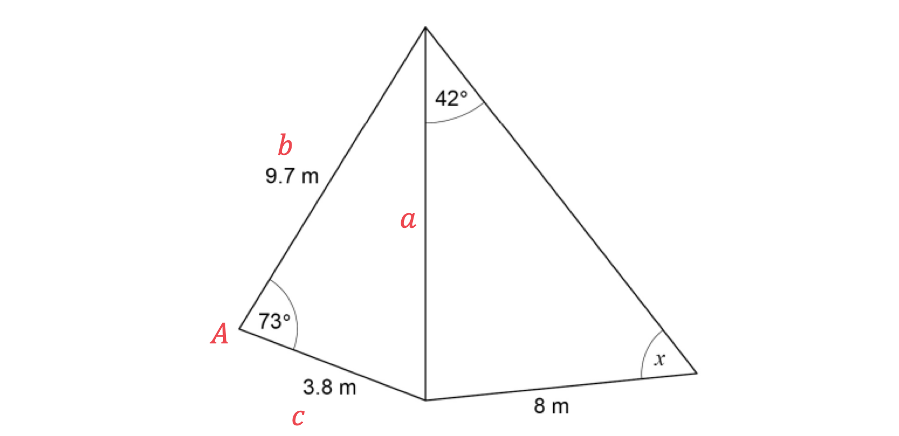

> *Substitute the values from the diagram into the formula.*

$a^{2}=9.7^{2}+3.8^{2}-2\times9.7\times3.8\times\mathrm{cos}73$

**[1]**

> *Simplify.*

$a^{2}=86.9763...$

> *Find the value of *$a$* by taking the square root of both sides.*

$a=\sqrt{86.9763...}$

**[1]**

$a=9.3261...$

> *You now have two pairs of opposite sides and angles on the second triangle with only one value you don't know, *$x$*.*

> *Use the sine rule, *$\frac{\mathrm{sin}A}{a}=\frac{\mathrm{sin}B}{b}$* to find unknown angle.*

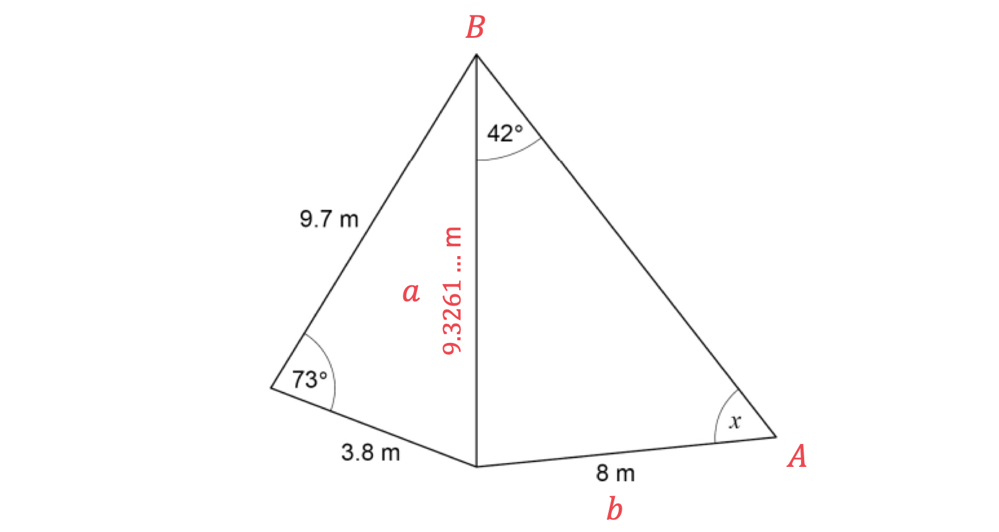

> *Substitute the values from the diagram into the formula.*

$\frac{\mathrm{sin}x}{9.3261...}=\frac{\mathrm{sin}42}{8}$

**[1]**

> *Multiply both sides by 9.3261...*

$\mathrm{sin}x=9.3261...\times\frac{\mathrm{sin}42}{8}$

> *Take *$\mathrm{sin}^{-1}$* of both sides.*

$x = \sin ^{- 1 } ( 9.3261... \times \frac{\sin 42}{8} )$

$x=51.2650...$

> *The question does not specify a degree of accuracy for your answer but it would be sensible to round it to 1 or 2 decimal places.*

$51.3$* ***[1]**

**An answer of 51 is also accepted**

## Q31 — hard — 6 marks · exam-questions

### 14() — 6 marks
> *Let angle DAE = *$θ$*, you can calculate *$θ$* as you know the lengths of all three sides of the triangle ADE.*

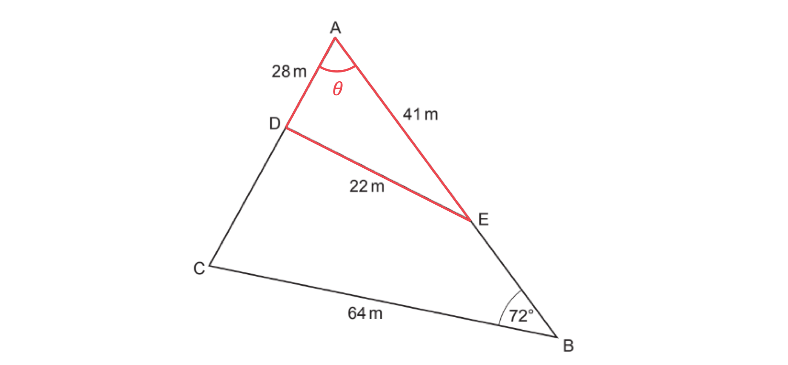

> *Use the cosine rule in the form *$\mathrm{cos}A=\frac{b^{2}+c^{2}-a^{2}}{2bc}$*, where *$a$*, *$b$* and *$c$* are the lengths of the three sides and *$A$* is the angle opposite side *$a$*.*

$\mathrm{cos}θ=\frac{28^{2}+41^{2}-22^{2}}{2\times28\times41}$

**Cosine rule seen in either form with no more than 1 error ****[1]*** ***Correct substitution into the cosine rule ****[1]*** *
**Correct substitution into the cosine rule in the form used to find the angle ****[1]**

$\mathrm{cos}θ=\frac{283}{328}$

> *Take *$\mathrm{cos}^{-1}$* of both sides.*

$\\theta = \cos ^{- 1} ( \frac{283}{328} )$

$θ=30.3670...$

> *You now have two pairs of opposite angles and sides in the larger triangle ABC, where only one of the values is unknown.*

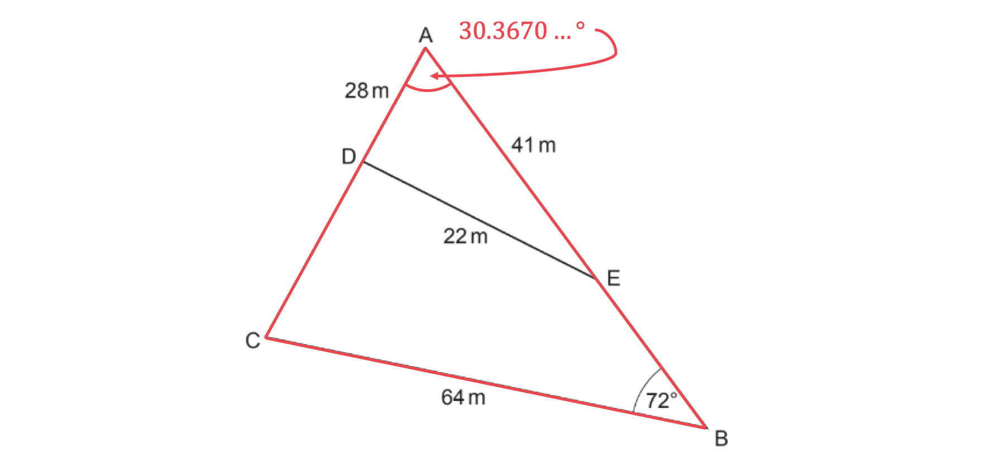

> *Work out the length of AC by substituting the values in the diagram into the sine rule, *$\frac{a}{\mathrm{sin}A}=\frac{b}{\mathrm{sin}B}$*.*

$\frac{\mathrm{AC}}{\mathrm{sin}72}=\frac{64}{\mathrm{sin}30.3670...}$

**[1]**

> *Multiply both sides by *$\mathrm{sin}72$*.*

$\mathrm{AC}=\mathrm{sin}72\times\frac{64}{\mathrm{sin}30.3670...}$

**[1]**

$\mathrm{AC}=120.4018...$

> *Find the length of DC by subtracting the length of AD from AC.*

$120.4018...-28=92.4018...$

> *The question does not ask for your answer to be given to a specific level of accuracy but it would be sensible to round your answer to 1 or 2 decimal places.*

$92.4m$* ***[1]**

**Answers between 92.28 and 92.6 will be accepted **
**Answers of 92 will also be accepted**

## Q32 — hard — 7 marks · exam-questions

### 20() — 7 marks
> *Calculate the area, **A**, of the triangle ADC using the area of a triangle formula, *$A=\frac{1}{2}\timesbase\timesheight$*.*

$\begin{gathered} A_{A D C} & = 1 \frac{1}{2} \times 12 \times 5 \end{gathered}$

**[1]**

$\begin{gathered} A_{A D C} & = 30 \end{gathered}$

> *Calculate the length AC using Pythagoras' theorem, *$c^{2}=a^{2}+b^{2}$*, on triangle ACD, where *$a$* and *$b$* are the lengths of the two shorter sides and *$c$* is the length of the hypotenuse.*

$\begin{array}{rcl} AC^{2} & = 5^{2} + 12^{2} \end{array}$

**[1]**

$\begin{array}{rcl} \text{AC} = \sqrt{5^{2} + 12^{2}} \\ \text{AC} = \sqrt{25 + 144} \\ \text{AC} = \sqrt{169} \end{array}$

**[1]**

$\begin{gathered} \text{AC} = 13 \end{gathered}$

> *You can now find the area of triangle ABC, **A**, using the formula for the area of a triangle, *$A=\frac{1}{2}ab\mathrm{sin}C$*, where *$a$* and *$b$* are two sides of the triangle and *$C$* is the angle in between them.*

$A_{ABC}=\frac{1}{2}\times3\times13\times\mathrm{sin}30$

**[1]**

> *Substitute the exact value *$\mathrm{sin}30=\frac{1}{2}$* into the equation.*

$A_{ABC}=\frac{1}{2}\times3\times13\times\frac{1}{2}$

**[1]**

> *Solve.*

$A_{ABC}=\frac{39}{4}=9.75$

> *Add the areas of both triangles together to find the total area of the land.*

$30+9.75=39.75$

**[1]**

> *Work out the total cost of the land by multiplying the total area by the cost per square kilometre.*

$10\times39.75$

$\pounds 397 . 5 \text{million}$* ***[1]**

## Q33 — hard — 5 marks · exam-questions

### 23() — 5 marks
> **[exam-tip]**
> Whenever a visual problem has been described in words, first use the information provided to make a sketch of the situation. Label any angles or distances that have been given.

> *Draw a sketch of the described problem as shown below, ensuring that bearings are labelled clockwise from North*

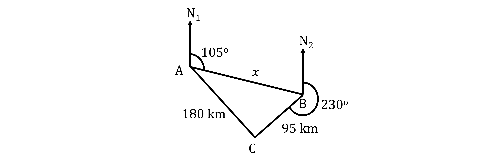

**[M1]**

> *Calculate angle **ABN**2** using the co-interior angles add up to 180**o** angle rule*

$180^{o}-105^{o}=75^{o}$

> *Calculate angle **ABC** using the angles at a point add up to 360**o** angle rule*

$360^{o}-230^{o}-75^{o}=55^{o}$

**[M1]**

> *Calculate angle **CAB**, using the sine rule, *$\frac{\mathrm{sin}A}{a}=\frac{\mathrm{sin}B}{b}=\frac{\mathrm{sin}C}{c}$*, substituting values in for angle **ABC **and side lengths **BC** and **AC*

$\begin{gathered} \frac{\sin A}{a} & = \frac{\sin B}{b} \\ \frac{\sin A}{95} & = \frac{\sin 55}{180} \\ \sin A & = \frac{\sin 55}{180} \times 95 \\ A = \sin ^{- 1} ( \frac{\sin 55}{180} \times 95 ) \\ A = 25.615... ( \text{angle} C A B ) \end{gathered}$

**[M1]**

> *Calculate angle **ACB** using the angles in a triangle add up to 180**o **angle rule*

$180-55-25.615...=99.385...$

> *Calculate the side length **AB **using the sine rule, *$\frac{a}{\mathrm{sin}A}=\frac{b}{\mathrm{sin}B}=\frac{c}{\mathrm{sin}C}$*, substituting in values for angles **ABC **and **ACB** and side length **AC*

$\begin{gathered} \frac{b}{\sin B} & = \frac{c}{\sin C} \\ \frac{180}{\sin 55} & = \frac{x}{\sin 99.385...} \\ \frac{180}{\sin 55} \times \sin 99.385 & = x \\ 216.798... & = x \end{gathered}$

**[M1]**

> *Round length of AB to 3 significant figures as stated in the question*

**Final answer:** **AB=217 km**

**[A1]**

> **[mark-scheme]**
> **M1**: This mark is awarded for showing a labelled sketch that represents the relative positions of points A, B and C *or* for showing angle *ABC* calculated as 55o.
> 
> **M1**: For substituting the values provided in the question the correctly calculated angle *ABC*=55o into the sine rule to calculate angle CAB.
> 
> **M1**: For showing a full and correct method for calculating the angle CAB. This mark is only awarded if a previous M1 mark is awarded.
> 
> **M1**: For showing a full and correct method using the sine or cosine rule to calculate the length AB. This mark is only awarded if a previous M1 mark is awarded and can be gained if you have used an incorrectly calculated value of angle *CAB*.
> 
> **A1**: This is only awarded for sight of 217 given for final length of AB showing correct solution rounded correctly to 3 significant figures.

## Q34 — hard — 5 marks · exam-questions

### 22() — 5 marks
> *Draw D onto the diagram and then draw the right-angled triangle you are using to see the angle clearly*

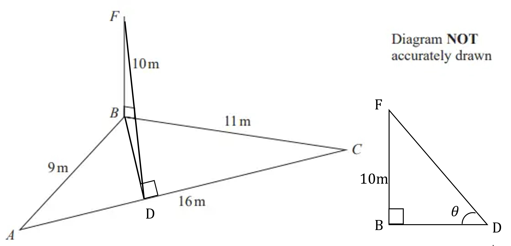

> *You need to know the length of BD or FD to be able to calculate the angle marked *$θ$* (which is the angle of elevation  of F from D)*

- *You do not have enough information to find FD*
- *So, using triangle ABC, start by calculating the angle BAC (or BCA)*
- *Then you'll be able to find the length BD using SOHCAHTOA*

> *Use the cosine rule to find angle BAC*

$a^{2}=b^{2}+c^{2}-2bc\mathrm{cos}A\,11^{2}=16^{2}+9^{2}-2\times16\times9\times\mathrm{cos}A$

**[M1]**

> *Simplify and solve that to find angle BAC (which is *$A$* in the equation)*

$\begin{gathered} 121 = 256 + 81 - 288 \cos A \\ 288 \cos A & = 256 + 81 - 121 \\ 288 \cos A & = 216 \\ \cos A & = \frac{216}{288} \end{gathered}$

$\begin{gathered} A = \cos ^{- 1} ( \frac{216}{288} ) = \cos ^{- 1} ( \frac{3}{4} ) = 41.409... \end{gathered}$

**[M1]**

> *Calculate the length of BD using the triangle ABD*

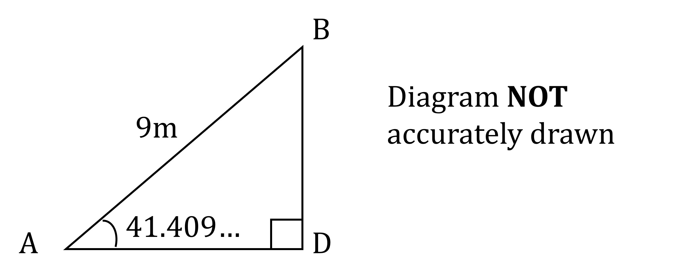

$\begin{gathered} \sin ( 41.409... ) & = \frac{B D}{9} \end{gathered}$

$\begin{gathered} B D & = 9 \sin ( 41.409... ) = 5.952... \end{gathered}$

**[M1]**

> *Now calculate the angle of elevation of F from D, which is angle BDF (this is marked as *$θ$* in the diagram near the top of this solution)*

$\begin{gathered} \tan \\theta & = \frac{10}{5.952...} \end{gathered}$

$\begin{gathered} \\theta = \tan ^{- 1} ( \frac{10}{5.952...} ) = 59.234... \end{gathered}$

**[M1]**

> *Give your answer to 1 decimal place, as required*

**Final answer:** **59.2°**

**[A1]**

> **[mark-scheme]**
> Other valid methods leading to a correct solution will also get full marks. For example, you may start by finding angle *ACB* (instead of *BAC*), and then use that to find the length of *BD*.

## Q35 — hard — 5 marks · exam-questions

### 18() — 5 marks
> *Find angle *$ABC$*, using the fact that co-interior angles sum to *$180^{\circ}$* and angles around a point sum to *$360^{\circ}$

$\text{angle} A B C = 360 - 132 - ( 180 - 54 ) = 102^{\circ}$

**[M1]**

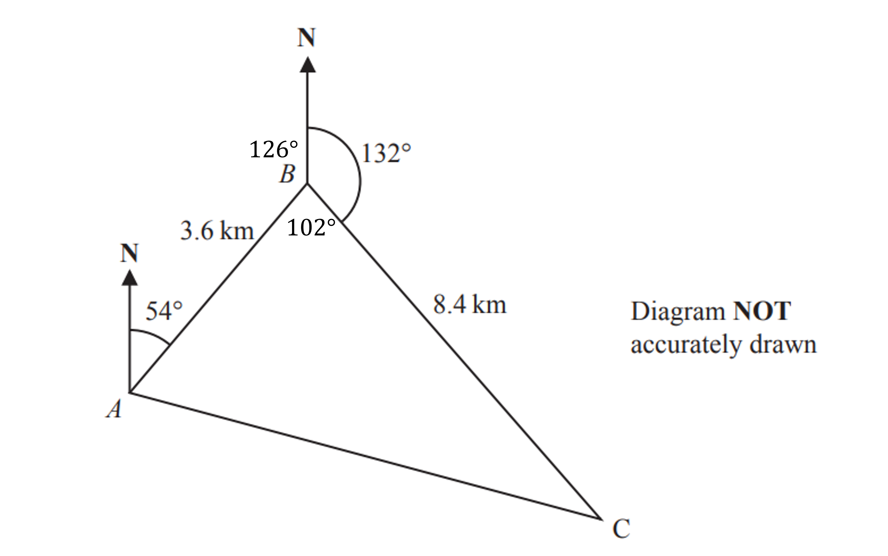

> *Use the cosine rule to find side *$AC$

$A C^{2} = 3.6^{2} + 8.4^{2} - 2 \times 3.6 \times 8.4 \times \cos ( 102 )$

**[M1]**

$AC^{2}=96.094...$

$AC=9.80...\mathrm{km}$

**[M1]**

> *Add the lengths together to find the total distance travelled*

$9.80...+3.6+8.4=21.80...\mathrm{km}$

> $\mathrm{Speed}=\frac{\mathrm{Distance}}{\mathrm{Time}}$*, therefore*

$\mathrm{Time}=\frac{21.80...}{6}=3.63...\mathrm{hours}$

**[M1]**

> *Convert the decimal portion to minutes*

$0.63...\times60=37.8\mathrm{minutes}$

> *Round to the nearest minute*

**Final answer:** **3 hours 38 minutes**

**[A1]**

## Q36 — very_hard — 5 marks · exam-questions

### 15() — 5 marks
> *The formula for the area of a triangle is *$\mathrm{Area}=\frac{1}{2}ab\mathrm{sin}C$*, where **a** and **b** are the lengths of the two sides that form angle **C**. *
*Substitute Area = *$6\sqrt{2}$*, **a** = *$( x + 3 )$*, **b** = *$( 2 x - 1 )$* and **C** = 45 into the formula.*

$\begin{gathered} 6 \sqrt{2} & = 1 \frac{1}{2} \times ( x + 3 ) \times ( 2 x - 1 ) \times \sin ( 45 ) \end{gathered}$

**Correct expression on the right hand side**** [1] **
**Forming a correct equation ****[1]**

> *Multiply both sides by 2 and divide both sides by sin(45).*

$\begin{gathered} \frac{2 \times 6 \sqrt{2} }{\sin ( 45 )} & = ( x + 3 ) ( 2 x - 1 ) \end{gathered}$

> *Type *$\begin{gathered} \frac{2 \times 6 \sqrt{2} }{\sin ( 45 )} \end{gathered}$* into your calculator to simplify that term.*

$\begin{gathered} 24 = ( x + 3 ) ( 2 x - 1 ) \end{gathered}$

> *Expand the brackets then simplify.*

$2x^{2}-x+6x-3=24\,2x^{2}+5x-3=24$

**[1]**

> *Subtract 24 from both sides to make the quadratic equal 0.*

$2x^{2}+5x-27=0$

> *As the question asks for 3 significant figures, this suggests that the quadratic does not factorise. Solve by using the quadratic formula, *$x=\frac{-b\pm\sqrt{b^{2}-4ac}}{2a}$*. Substitute **a** = 2, **b** = 5 and **c =** -27 into the formula.*

$\begin{gathered} x = \frac{- 5 \pm \sqrt{5^{2} - 4 ( 2 ) ( - 27 )} }{2 ( 2 )} \end{gathered}$

**[1]**

> *Simplify using your calculator.*

$\begin{gathered} x = \frac{- 5 + \sqrt{241} }{4} = 2.631043... \\ \text{or} \\ x = \frac{- 5 - \sqrt{241} }{4} = - 5.131043... \end{gathered}$

> *As **x** + 3 is a length then it can not be negative, so **x** > -3. Therefore reject **x** = -5.131043... *
*Round the other solution to 3 significant figures.*

$x=2.63(3sf)$* ***[1]**

## Q37 — very_hard — 5 marks · exam-questions

### 17() — 5 marks
> *First use the area to form an equation using triangle **ADC**.*

> *The formula for the area of a triangle is *$\mathrm{Area}=\frac{1}{2}ab\mathrm{sin}C$*, where **a** and **b** are the lengths of the two sides that form angle **C**. *
*Substitute Area = 56, **a** = **z**, **b** = 11 and **C** = 105 into the formula.*

$\begin{gathered} 56 = 1 \frac{1}{2} \times z \times 11 \times \sin ( 105 ) \end{gathered}$

**[1]**

> *Rearrange to get **z** by itself by multiplying both sides by 2 and dividing both sides by 11sin(105). Type into your calculator.*

$\begin{gathered} z = \frac{56 \times 2}{11 \times \sin ( 105 )} \\ = 10.540993... \end{gathered}$

**[1]**

> *You now know the lengths of two sides and the angle between them and you want to find the length of the third side. Therefore you need to use the cosine rule.*

> *The formula for the cosine rule is *$a^{2}=b^{2}+c^{2}-2bc\mathrm{cos}A$*, where **b** and **c** are the lengths of the two sides that form angle **A** and **a** is the length of the side opposite **A**. Substitute **a** = **y**, **b** = 11, **c** = 10.540993... (using the answer button) and **A** = 105 into the formula.*

$y^{2} = 11^{2} + 10.540993...^{2} - 2 ( 11 ) ( 10.540993... ) \cos ( 105 )$

**[1]**

> *Type the expression into your calculator altogether as one line. If you do it separately you need to remember the order of operations (multiplication before addition).*

$y^{2}=292.133170...$

> *Take the positive square root of both sides.*

$\begin{array}{rcl} y = \sqrt{292.133170...} \\ = 17.091903... \end{array}$

> *Now use triangle **ABC**. You know the length of a side and the angle opposite it. You also know another angle so you can use the sine rule to find the length of the side opposite it.*

> *The formula for the sine rule is *$\frac{a}{\mathrm{sin}A}=\frac{b}{\mathrm{sin}B}$*, where **a** and **b** are the lengths of the two sides that are opposite the angles **A **and **B **respectively. *
*Substitute **a** = **x**, **b** = 17.091903... (using the answer button), **A** = 48 and **B** = 118 into the formula.*

$\frac{x}{\sin ( 48 )} = \frac{17.091903...}{\sin ( 118 )}$

**[1]**

> *Multiply both sides by sin(48) and type into your calculator.*

$\begin{gathered} x = \frac{17.091903...}{\sin ( 118 )} \times \sin ( 48 ) \\ = 14.385632... \end{gathered}$

> *Round to 1 decimal place. Remember to include units for the length.*

$AB=14.4m(1\mathrm{dp})$* ***[1]**

## Q38 — very_hard — 5 marks · exam-questions

### 27() — 5 marks
> *The parallelogram is split into two identical triangles. To use the formula for the area of a triangle you need two sides and the angle between them. You do not currently have this so use triangle **ACD** to help find the required angle.*

> *You know the length of one side and the angle opposite it. You also know the length of another side so you can use the sine rule to find the angle opposite it.*

> *The formula for the sine rule is *$\frac{\mathrm{sin}A}{a}=\frac{\mathrm{sin}B}{b}$*, where **a** and **b** are the lengths of the two sides that are opposite the angles **A **and **B **respectively. *
*Substitute **a** = **9**, **b** = 11, **A** = **y** and **B** = 100 into the formula.*

$\frac{\sin ( y )}{9} = \frac{\sin ( 100 )}{11}$

**[1]**

> *Multiply both sides by 9 and then find the angle by using the inverse sin function.*

$\begin{gathered} \sin ( y ) & = \frac{\sin ( 100 )}{11} \times 9 \\ y = \sin ^{- 1} ( \frac{\sin ( 100 )}{11} \times 9 ) \end{gathered}$

**[1]**

> *Type into your calculator.*

$\begin{gathered} y = 53.682923... \end{gathered}$

> *You can find the third angle by spotting that the three interior angles of the triangle should add up to 180°. Use the answer button on your calculator.*

$\begin{gathered} x = 180 - 100 - 53.682923... \\ = 26.317076... \end{gathered}$

**[1]**

> *You now have enough information to find the area of one of the triangles.*

> *The formula for the area of a triangle is *$\mathrm{Area}=\frac{1}{2}ab\mathrm{sin}C$*, where **a** and **b** are the lengths of the two sides that form angle **C**. Substitute **a** = 9, **b** = 11 and **C** = 26.317076... (using the answer button) into the formula.*

$\begin{gathered} \text{Area} = 1 \frac{1}{2} \times 9 \times 11 \times \sin ( 26.317076... ) \\ = 21.945249... \end{gathered}$

**[1]**

> *Multiply by 2 to find the area of the parallelogram.*

$\begin{gathered} 2 \times 21.945249... & = 43.890498... \end{gathered}$

> *Round to 3 significant figures. Remember to include square units for the area.*

$\mathrm{Area}=43.9\mathrm{cm}^{2}(3\mathrm{sf})$** [1]**

## Q39 — very_hard — 6 marks · exam-questions

### 25() — 6 marks
> *First use the area to form an equation.*

> *The formula for the area of a triangle is *$\mathrm{Area}=\frac{1}{2}ab\mathrm{sin}C$*, where **a** and **b** are the lengths of the two sides that form angle **C**. *
*Substitute Area = 18, **a** = 8, **b** = 7 and **C** = **z** into the formula.*

$\begin{gathered} 18 = 1 \frac{1}{2} \times 8 \times 7 \times \sin ( z ) \end{gathered}$

**[1]**

> *Simplify the equation. Then rearrange to find the value of **z**.*

$\begin{gathered} 28 \sin ( z ) & = 18 \\ \sin ( z ) & = \frac{18}{28} \\ z = \sin ^{- 1} ( \frac{18}{28} ) \\ z = 40.005200... \end{gathered}$

**[1]**

> *You now know the lengths of two sides and the angle between them so you can find the length of the third side using the cosine rule.*

> *The formula for the cosine rule is *$a^{2}=b^{2}+c^{2}-2bc\mathrm{cos}A$*, where **b** and **c** are the lengths of the two sides that form angle **A** and **a** is the length of the side opposite **A**. Substitute **a** = **y**, **b** = 8, **c** = 8 and **A** = 40.005200... (using the answer button) into the formula.*

$y^{2} = 8^{2} + 7^{2} - 2 ( 8 ) ( 8 ) \cos ( 40.005200... )$

**[1]**

> *Type the expression into your calculator altogether as one line. If you do it separately you need to remember the order of operations (multiplication before addition).*

$y^{2}=27.209557...$

**[1]**

> *Take the positive square root of both sides.*

$\begin{gathered} y = \sqrt{27.209557...} \\ = 5.216278... \end{gathered}$

> *Now you can find the size of angle **BAC** using the formula for the triangle but this time using the sides **AB** and **AC**.*

> *Substitute Area = 18, **a** = 7, **b** = 5.216278... (using the answer button)  and **C** = **x** into the formula.*

$\begin{array}{rcl} 18 = 1 \frac{1}{2} \times 7 \times 5.216278... \times \sin ( x ) \end{array}$

**[1]**

> *Rearrange to find the value of **x**.*

$\begin{gathered} \sin ( x ) & = \frac{18 \times 2}{7 \times 5.216278...} \\ x = \sin ^{- 1} ( \frac{18 \times 2}{7 \times 5.216278...} ) \\ x = 80.375501... \end{gathered}$

> *Round to 3 significant figures. Remember to include units for the angle.*

$\mathrm{Angle}BAC=80.4^{\circ}(3\mathrm{sf})$* ***[1]**

## Q40 — very_hard — 6 marks · exam-questions

### 25() — 6 marks
> *First use the area to form an equation.*

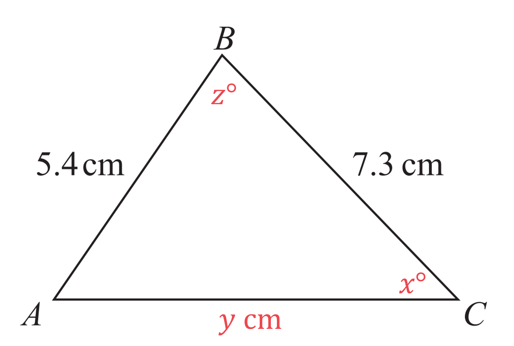

> *The formula for the area of a triangle is *$\mathrm{Area}=\frac{1}{2}ab\mathrm{sin}C$*, where **a** and **b** are the lengths of the two sides that form angle **C**. *
*Substitute Area = 19, **a** = 5.4, **b** = 7.3 and **C** = **z** into the formula.*

$\begin{gathered} 19 = 1 \frac{1}{2} \times 5.4 \times 7.3 \times \sin ( z ) \end{gathered}$

**[1]**

> *Simplify the equation. Then rearrange to find the value of **z**.*

$\begin{gathered} 19.71 \sin ( z ) & = 19 \\ \sin ( z ) & = \frac{19}{19.71} \\ z = \sin ^{- 1} ( \frac{19}{19.71} ) \\ z = 74.574619... \end{gathered}$

**[1]**

> *You now know the lengths of two sides and the angle between them so you can find the length of the third side using the cosine rule.*

> *The formula for the cosine rule is *$a^{2}=b^{2}+c^{2}-2bc\mathrm{cos}A$*, where **b** and **c** are the lengths of the two sides that form angle **A** and **a** is the length of the side opposite **A**. Substitute **a** = **y**, **b** = 5.4, **c** = 7.3 and **A** = 74.574619... (using the answer button) into the formula.*

$y^{2} = 5.4^{2} + 7.3^{2} - 2 ( 5.4 ) ( 7.3 ) \cos ( 74.574619... )$

**[1]**

> *Type the expression into your calculator altogether as one line. If you do it separately you need to remember the order of operations (multiplication before addition).*

$y^{2}=61.479887...$

**[1]**

> *Take the positive square root of both sides.*

$\begin{array}{rcl} y = \sqrt{61.479887...} \\ = 7.840911... \end{array}$

> *Now you can find the size of angle **BAC** using the formula for the triangle but this time using the sides **AB** and **AC**.*

> *Substitute Area = 19, **a** = 7.3, **b** = 7.840911... (using the answer button)  and **C** = **x** into the formula.*

$\begin{gathered} 19 = 1 \frac{1}{2} \times 7.3 \times 7.840911... \times \sin ( x ) \end{gathered}$

**[1]**

> *Rearrange to find the value of **x**.*

$\begin{gathered} \sin ( x ) & = \frac{19 \times 2}{7.3 \times 7.840911...} \\ x = \sin ^{- 1} ( \frac{19 \times 2}{7.3 \times 7.840911...} ) \\ x = 41.597000... \end{gathered}$

> *Round to 3 significant figures. Remember to include units for the angle.*

$\mathrm{Angle}ACB=41.6^{\circ}(3\mathrm{sf})$* ***[1]**

## Q41 — very_hard — 5 marks · exam-questions

### 21() — 5 marks
> *To use the formula for the area of a triangle you need two sides and the angle between them. You do not currently have this so use triangle **ACD** to find the length **CD** and the angle **ADC **as this will give you angle **CDB**.*

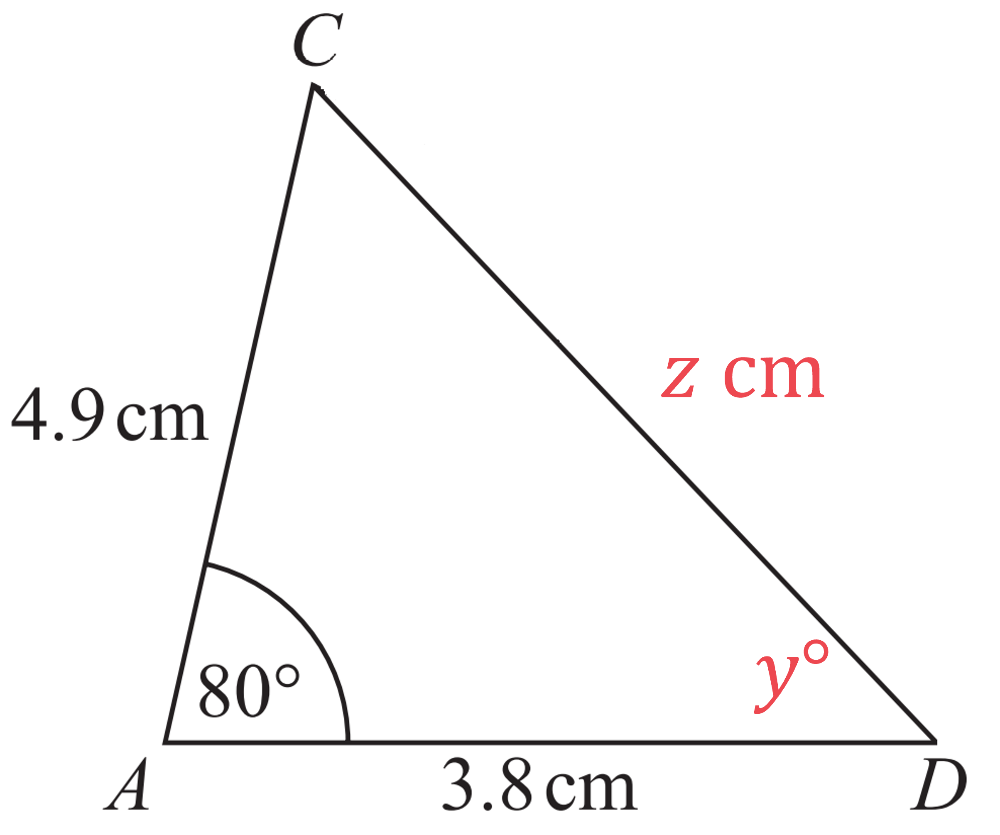

> *In triangle **ACD**, you know the lengths of two sides and the angle between them and you want to find the length of the third side. Therefore you need to use the cosine rule.*

> *The formula for the cosine rule is *$a^{2}=b^{2}+c^{2}-2bc\mathrm{cos}A$*, where **b** and **c** are the lengths of the two sides that form angle **A** and **a** is the length of the side opposite **A**. Substitute **a** = **z**, **b** = 4.9, **c** = 3.8 and **A** = 80 into the formula.*

$z^{2} = 4.9^{2} + 3.8^{2} - 2 ( 4.9 ) ( 3.8 ) \cos ( 80 )$

**[1]**

> *Type the expression into your calculator altogether as one line. If you do it separately you need to remember the order of operations (multiplication before addition).*

$z^{2}=31.983341...$

> *Take the positive square root of both sides.*

$\begin{array}{rcl} z = \sqrt{31.983341...} \\ = 5.655381... \end{array}$

> *Store this number in your calculator as you will need it later. You now know the length of one side and the angle opposite it. You also know the length of another side so you can use the sine rule to find the angle opposite it.*

> *The formula for the sine rule is *$\frac{\mathrm{sin}A}{a}=\frac{\mathrm{sin}B}{b}$*, where **a** and **b** are the lengths of the two sides that are opposite the angles **A **and **B **respectively. Substitute **a** = **4.9**, **b** = 5.655381... (using the memory function), **A** = **y** and **B** = 80 into the formula.*

$\frac{\sin ( y )}{4.9} = \frac{\sin ( 80 )}{5.655381...}$

**[1]**

> *Multiply both sides by 4.9 and then find the angle by using the inverse sin function.*

$\begin{gathered} \sin ( y ) & = \frac{\sin ( 80 )}{5.655381...} \times 4.9 \\ y = \sin ^{- 1} ( \frac{\sin ( 80 )}{5.655381...} \times 4.9 ) \end{gathered}$

> *Type into your calculator.*

$\begin{gathered} y = 58.568949... \end{gathered}$

> *You can find the angle **CDB **as angles that form a straight line add up to 180°.*

$\begin{gathered} \text{Angle} C D B & = 180 - 58.568949... \\ = 121.431051... \end{gathered}$

> *Store this in your calculator as you will need this later. You can also find angle **CBD** as the interior angles in a triangle add up to 180°. Store this number too.*

$\begin{gathered} \text{Angle} C B D & = 180 - 25 - 121.431051... \\ = 33.568949... \end{gathered}$

> *Use can now use the other version of the sine rule, *$\frac{a}{\mathrm{sin}A}=\frac{b}{\mathrm{sin}B}$* , to find the length **CD**. *
*Substitute **a** = **x**, **b** = 5.655381... , **A** = 121.431051... and **B** = 33.568949... into the formula.*

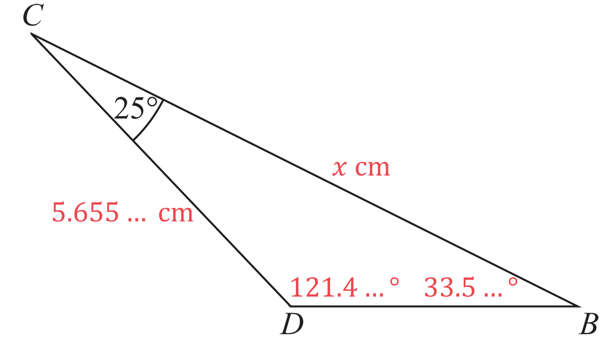

$\frac{x}{\sin ( 121.431051... )} = \frac{5.655381....}{\sin ( 33.568949... )}$

**[1]**

> *Multiply both sides by sin(121.431051...) and type into your calculator.*

$\begin{gathered} x = \frac{5.655381....}{\sin ( 33.568949... )} \times \sin ( 121.431051... ) \\ = 8.727090... \end{gathered}$

> *The formula for the area of a triangle is *$\mathrm{Area}=\frac{1}{2}ab\mathrm{sin}C$*, where **a** and **b** are the lengths of the two sides that form angle **C**. *
*Substitute **a** = 8.727090... (using the answer button), **b** = 5.655381... and **C** = 25 into the formula.*

$\begin{gathered} \text{Area} = 1 \frac{1}{2} \times 8.727090... \times 5.655381... \times \sin ( 25 ) \end{gathered}$

**[1]**

> *Type into your calculator.*

$\begin{gathered} \text{Area} = 10.429167... \end{gathered}$

> *Round to 3 significant figures. Remember to include the square units for the area.*

$\mathrm{Area}=10.4\mathrm{cm}^{2}(3\mathrm{sf})$ **[1]**

## Q42 — very_hard — 6 marks · exam-questions

### 23() — 6 marks
> *To use the formula for the area of a triangle you need two sides and the angle between them. You do not currently have this so use the information to find any missing angles and sides that you can.*

> *You know one angle and the length of the side opposite it, you also know another length so you can use the sine rule to find the angle opposite it.*

> *The formula for the sine rule is *$\frac{\mathrm{sin}A}{a}=\frac{\mathrm{sin}B}{b}$*, where **a** and **b** are the lengths of the two sides that are opposite the angles **A **and **B **respectively. Substitute **a** = 4.2, **b** = 1.6, **A** = **x** and **B** = 18 into the formula.*

$\frac{\sin ( x )}{4.2} = \frac{\sin ( 18 )}{1.6}$

**[1]**

> *Multiply both sides by 4.2 and then find the angle by using the inverse sin function.*

$\begin{gathered} \sin ( x ) & = \frac{\sin ( 18 )}{1.6} \times 4.2 \\ x = \sin ^{- 1} ( \frac{\sin ( 18 )}{1.6} \times 4.2 ) \\ = 54.210363... \end{gathered}$

**[1]**

> *Angle **PQR** is obtuse so subtract this value from 180.*

$\begin{array}{rcl} 180 - 54.210363... & = 125.789636... \end{array}$

**[1]**

> *You can find the angle **QPR **as angles that form a straight line add up to 180°.*

$\begin{gathered} \text{Angle} Q P R & = 180 - 18 - 125.789636... \\ = 36.210363... \end{gathered}$

**[1]**

> *The formula for the area of a triangle is *$\mathrm{Area}=\frac{1}{2}ab\mathrm{sin}C$*, where **a** and **b** are the lengths of the two sides that form angle **C**. Substitute **a** = 4.2, **b** = 1.6 and **C** = 36.210363... (using the answer button) into the formula.*

$\begin{gathered} \text{Area} = 1 \frac{1}{2} \times 4.2 \times 1.6 \times \sin ( 36.210363... ) \end{gathered}$

**[1]**

> *Type into your calculator.*

$\begin{gathered} \text{Area} = 1.984925... \end{gathered}$

> *Round to 3 significant figures. Remember to include the square units for the area.*

$\mathrm{Area}=1.98\mathrm{cm}^{2}(3\mathrm{sf})$ **[1]**

## Q43 — very_hard — 4 marks · exam-questions

### 22() — 4 marks
> *List out the lower and upper bounds for all of the given measurements.*

$c$*: 11.45 cm, 11.55 cm* 
$x$*: 79.5**o**, 80.5**o** * 
$y$*: 74.5**o**, 75.5**o*

**At least 1 correct bound seen ****[1]**

> *Use the sine rule, *$\frac{a}{\mathrm{sin}A}=\frac{b}{\mathrm{sin}B}$*, to find the length of *$b$*.*

$\begin{gathered} \frac{b}{\sin ( A B C )} & = \frac{c}{\sin ( y )} \\ b = \sin ( A B C ) \times \frac{c}{\sin ( y )} \end{gathered}$

> *To find the upper bound of *$b$*, the largest possible values are required for *$\sin ( A B C )$* and *$c$*, but the smallest value for *$\sin ( y )$* is required. This means using the upper bound for angle **ABC** and *$c$* but the lower bound for *$y$*.*

> *Find the upper bound of the angle **ABC** by subtracting both the lower bound values of *$x$* and *$y$* from 180**o** (angles in a triangle add up to 180**o**).*

$\begin{gathered} \text{Upper} \text{bound} : A B C & = 180 - 74.5 - 79.5 \\ = 26^{\circ} \end{gathered}$

**[1]**

> *Substitute the correct bounds into the sine rule and solve to find the length *$b$*.*

$b=\mathrm{sin}26\times\frac{11.55}{\mathrm{sin}74.5}$

** [1]**

$b=5.2542...$

> *Round to 3 significant figures.*

**5.25 cm**** [1]**

## Q44 — very_hard — 6 marks · exam-questions

### 18() — 6 marks
> *Calculate the size of angle **ADC** by subtracting the angle **ABC** from 180**o** as opposite angles in a cyclic quadrilateral add up to 180**o**.*

$\begin{gathered} \text{Angle} A D C & = 180 - 98 \\ = 82^{\circ} \end{gathered}$

**[1]**

> *Calculate the size of angle **DAC** by subtracting the angles **ADC** and **ACD** from 180**o** as angles in a triangle add up to 180**o**.*

$\begin{gathered} \text{Angle} D A C & = 180 - 82 - 35 \\ = 63^{\circ} \end{gathered}$

> *Substitute the values from triangle **ABC** into the cosine rule, *$a^{2}=b^{2}+c^{2}-2bc\mathrm{cos}A$*, and solve to find the length **AC**.*

$\begin{gathered} A C^{2} & = 8^{2} + 7.5^{2} - 2 \times 8 \times 7.5 \times \cos 98 \end{gathered}$

**[1]**

$\begin{gathered} A C^{2} & = 136.9507... \\ A C & = 11.7025... \end{gathered}$

**[1]**

> *Substitute the values from triangle **ACD** and the previously calculated angles into the sine rule, *$\frac{a}{\mathrm{sin}A}=\frac{b}{\mathrm{sin}B}$*, and solve to find the length **AD**.*

$\begin{gathered} \frac{A D}{\sin 35} & = \frac{11.7025...}{\sin 82} \\ A D & = \sin 35 \times \frac{11.7025...}{\sin 82} \end{gathered}$

**[1]**

$\begin{gathered} A D & = 6.7782... \end{gathered}$

> *Substitute the values from triangle **ACD** and the previously calculated angles into the sine rule and solve to find the length **CD**.*

$\begin{gathered} \frac{C D}{\sin 63} & = \frac{11.7025...}{\sin 82} \\ C D & = \sin 63 \times \frac{11.7025...}{\sin 82} \end{gathered}$

**[1]**

$\begin{gathered} C D & = 10.5295... \end{gathered}$

> *Add together the lengths **AB**, **BC**, **CD**, and **DA** to find the perimeter of the quadrilateral.*

$8+7.5+10.5295...+6.7782...=32.8078...$

> *Round to 1 decimal place.*

**32.8 cm**** ****[1]**

**Answers between 32.7 and 32.9 will be accepted**

## Q45 — very_hard — 5 marks · exam-questions

### 24() — 5 marks
> *Substitute the values in the diagram into the cosine rule, *$a^{2}=b^{2}+c^{2}-2bc\mathrm{cos}A$*, to find another equation relating *$x$* and *$y$*.*

$x^{2}=5^{2}+y^{2}-2\times5\timesy\times\mathrm{cos}60$

**[1]**

> *Simplify.*

$x^{2}=25+y^{2}-5y$

> *Using the given equation, *$x=y-1$*, substitute *$y-1$* for *$x$* in the equation and simplify.*

$( y - 1 )^{2} = 25 + y^{2} - 5 y$

**[1]**

> *Expand the brackets on the left hand side.*

$y^{2}-2y+1=25+y^{2}-5y$

**[1]**

> *Rearrange and simplify to find the value of *$y$*.*

$\begin{gathered} - 2 y + 1 & = 25 - 5 y \\ 3 y + 1 & = 25 \\ 3 y & = 24 \\ y = 8 \end{gathered}$

**[1]**

> *Write down an equation for the perimeter, *$k$*, in terms of *$x$* and *$y$*.*

$k=5+x+y$

> *Using the given equation, *$x=y-1$*, substitute *$y-1$* for *$x$* in the equation and simplify.*

$\begin{gathered} k = 5 + ( y - 1 ) + y \\ k = 4 + 2 y \end{gathered}$

> *Substitute *$y=8$* into the equation to find the value of *$k$*.*

$k=4+2\times8$

$k=20\mathrm{cm}$* ***[1]**

## Q46 — very_hard — 6 marks · exam-questions

### 22() — 6 marks
> *Find the interior angle of the regular octagon using: *$\text{size} of \text{interior} \text{angle} = \frac{180 ( n - 2 ) }{n}$*, where *$n$* is the number of sides of the polygon.*

$\frac{180 ( 8 - 2 )}{8} = 135^{\circ}$

**[1]**

> *Therefore angle **ABC** = 135°, and triangle **ABC **is an isosceles triangle with sides of 10cm. Mark this on the diagram.*

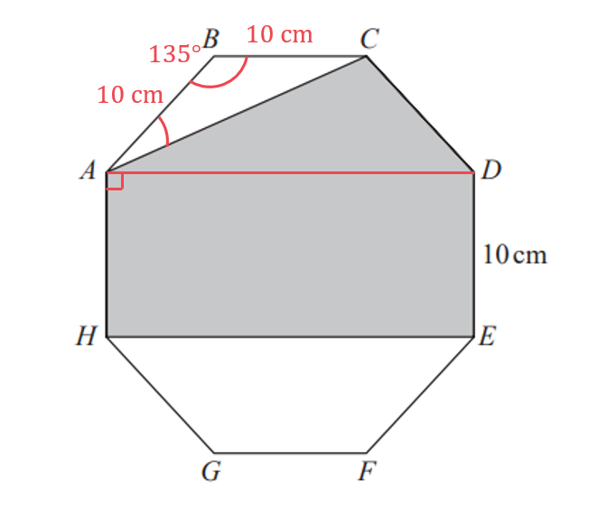

> *Triangle **ABC **is an isosceles triangle, so angle **BAC **= angle **BCA **= 1/2(180 - 135). *

*Angle ***BAC ***= Angle ***BCA ***= ** *$\frac{180-135}{2}=22.5^{\circ}$

> *Find angles **ACD **and **CAD **in triangle **ACD.*

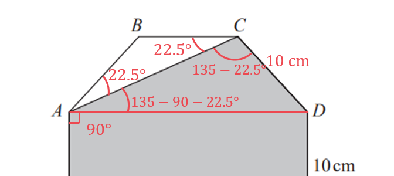

*Angle ***ACD*** = Angle ***BCD*** - Angle ***ABC*** = 135 - 22.5 = 112.5°*

*Angle ***CAD*** = Angle ***BAH ***- Angle ***DAH*** - Angle ***BAC ***= 135 - 90 - 22.5 = 22.5°*

> *To find the length of **AD, y**ou know the length of one side (**CD**) and the angle opposite it (**CAD**). You also know angle **ACD** so you can find the length of the side opposite that using the sine rule.*

> *The formula for the sine rule is *$\frac{a}{\mathrm{sin}A}=\frac{b}{\mathrm{sin}B}$*, where **a** and **b** are the lengths of the two sides that are opposite the angles **A **and **B **respectively. Substitute **a** = **AD**, **b** = 10, **A** = 112.5 and **B** = 22.5 into the formula.*

$\frac{A D}{\sin ( 112.5 )} = \frac{10}{\sin ( 22.5 )}$

**[1]**

> *Multiply both sides by sin(112.5) and type into your calculator.*

$\begin{gathered} A D & = \frac{10}{\sin ( 22.5 )} \times \sin ( 112.5 ) \\ = 24.14213... \end{gathered}$

> *Now find the area of rectangle **ADEH.*

**Area ADEH ***= 24.14213... × 10 = 241.4213... cm**2*

**[1]**

> *Now look at triangle **ACD**.*

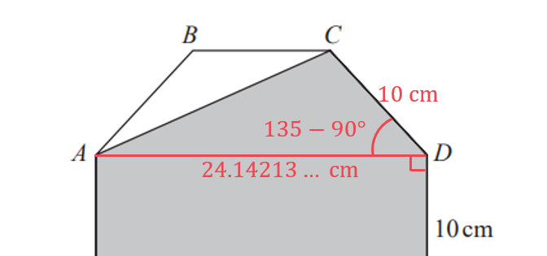

> *Find angle **ADC.*

*Angle ***ADC*** = Angle ***CDE*** - Angle ***ADE*** = 135 - 90 = 45°*

> *The formula for the area of a triangle is *$\mathrm{Area}=\frac{1}{2}ab\mathrm{sin}C$*, where **a** and **b** are the lengths of the two sides that form angle **C**. Substitute **a** = 24.14213..., **b** = 10 and **C** = 45 into the formula.*

$\begin{gathered} \text{Area} = 1 \frac{1}{2} \times 24.14213... \times 10 \times \sin ( 45 ) \end{gathered}$

**[1]**

> *Type into your calculator.*

$\begin{gathered} Area_{A C D} & = 85.35531... cm^{2} \end{gathered}$

**[1]**

> *Find the shaded area by adding the area of the rectangle to the area of the triangle.*

$\begin{gathered} \text{Area} & = 241.4213... + 85.35531... = 326.776... cm^{2} \end{gathered}$

> *Round to 3 significant figures. Remember to include the units for the area.*

$\mathrm{Area}=327\mathrm{cm}^{2}(3\mathrm{sf})$ **[1] **
**Answers from 326 - 327 accepted.**

## Q47 — very_hard — 5 marks · exam-questions

### 25() — 5 marks
> *The area of the logo is the area of the two triangles added to the area of the sector.*

> *Find the area of the triangles using the area of a triangle formula, *$A=\frac{1}{2}ab\mathrm{sin}C$*, where *$a$* and *$b$* are the two known sides and *$C$* is the included angle. The triangles are congruent, which means identical, so the calculation is the same for both of them.*

`Area _ \Delta = 1 half x ( 15 ) x ( 26 ) x sin ( 38 ) = 195 sin 38`

**[1]**

> *It is best to leave working as exact values where possible as you work through the problem so leaving it in terms of sin here will make it easier to work with later. *

> *To find the area of the sector, you will first need to find its radius. You know the lengths of two sides and the angle between them of the triangle and the radius of the sector is the side opposite the angle, so you can use the cosine rule, *$a^{2}=b^{2}+c^{2}-2bc\mathrm{cos}A$*, where **b** and **c** are the lengths of the two sides that form angle **A** and **a** is the length of the side opposite **A**.*

$r^{2} = 26^{2} + 15^{2} - 2 ( 26 ) ( 15 ) \cos ( 38 )
r = \sqrt{26^{2} + 15^{2} - 2 ( 26 ) ( 15 ) \cos ( 38 )}$

**[1]**

> *Type the expression into your calculator altogether as one line to get a value for **r.*

$\begin{gathered} r & = 16.921926... \end{gathered}$

> *Find the area of the sector** **using the formula for area of a sector *$=\frac{θ}{360^{\circ}}\timesπr^{2}$*, the angle for the sector is *$θ=108$* and use the unrounded value found for **r.** *

$Area_{s e c t o r} = \frac{108}{360} \times \pi \times ( 16.921926 )^{2} = 269.880036...$

**Correct fraction**** [1] **
**Correct method to find area**** [1]**

> *Find the area of the logo by adding 2 lots of the area of the triangle to the area of the sector**.*

*Area logo = *$2 ( 195 \sin 38 ) + 269.880036...$

**Final answer:** **Area = **$509.988...=510\mathrm{cm}^{2}(2s.f.)$** ****[1]**

## Q48 — very_hard — 6 marks · exam-questions

### 22() — 6 marks
> *Split the pentagon into triangles and calculate the angle in the centre vertex*

$360\div5=72$

> *Split that triangle down the middle to create a right-angled triangle and use it to calculate the radius of the large circle with trigonometry*

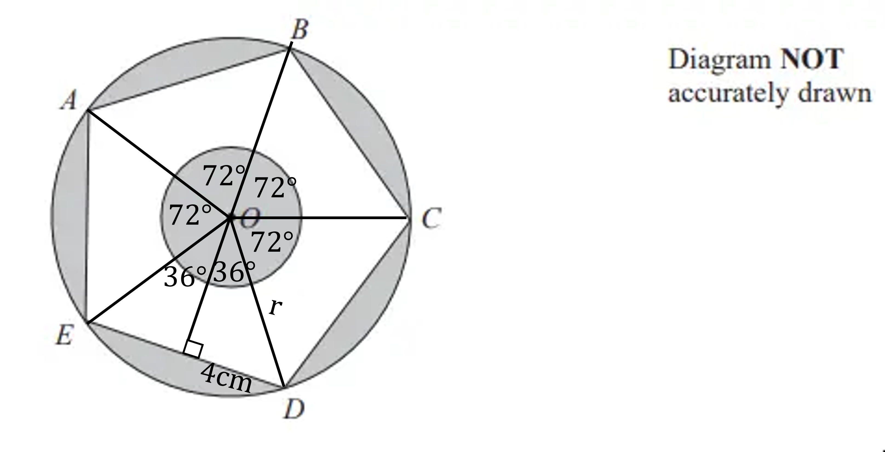

$\begin{gathered} \sin 36 & = \frac{4}{r} \\ r = \frac{4}{\sin 36} \end{gathered}$

**[M1]**

> *Calculate the area of the large circle*

$A = \pi r^{2}
A = \pi \times ( \frac{4}{\sin 36} )^{2}
A = 145.48977...$

**[M1]**

> *Calculate the area of one triangle*

$A = \frac{ 1}{2} a b \sin C
A = \frac{ 1}{2} ( \frac{4}{\sin 36} )^{2} \sin 72
A = 22.0221...$

**[M1]**

> *Form an equation using the shaded area = unshaded area*

> *Area of large circle - area of pentagon + area of small circle = area of pentagon - area of small circle*

$145.48977...-5\times22.0221...+πr^{2}=5\times22.0221...-πr^{2}$

**[M1]**

> *Rearrange and solve the equation to calculate the radius of the smaller circle*

> *Add  *$πr^{2}$* to both sides*

$145.48977...-5\times22.0221...+2πr^{2}=5\times22.0221...$

> *Subtract the area of the large circle and add the area of the pentagon to both sides*

$2πr^{2}=74.731...$

**[M1]**

> *Rearrange and solve to get r*

$\begin{gathered} r^{2} & = \frac{ 74.731...}{2 \pi } \\ r & = \sqrt{11.893...} \\ r & = 3.4487.... \end{gathered}$

> *Give your answer to 3 significant figures*

**Final answer:** **radius of small circle = 3.45 cm (3 s.f.)**

**[A1]**

> **[mark-scheme]**
> **A1**: Answers in the range 3.43-3.45 will get this final mark.
