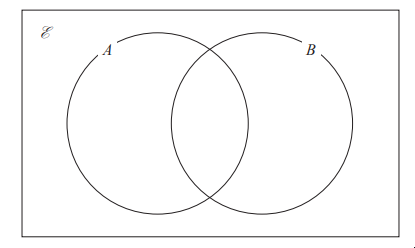
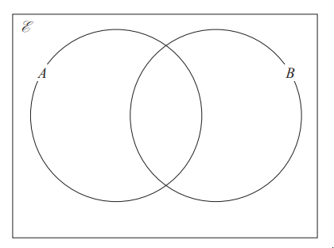

# Exam Questions — Set Notation & Venn Diagrams
**Number** · Edexcel IGCSE Maths A (Modular) (4XMAF/4XMAH) — 24/Foundation Unit 1
> Source: [https://www.savemyexams.com/igcse/maths/edexcel/a-modular/24/foundation-unit-1/topic-questions/number/set-notation-and-venn-diagrams/exam-questions/](https://www.savemyexams.com/igcse/maths/edexcel/a-modular/24/foundation-unit-1/topic-questions/number/set-notation-and-venn-diagrams/exam-questions/) · 3 questions · total 11 marks

## Q1 — easy — 5 marks · exam-questions

### 6((a)) — 3 marks — command: complete — structured — from paper Specimen paper · 4MA1/1F
`calligraphic E = { 1 , 2 , 3 , 4 , 5 , 6 , 7 , 8 , 9 , 10 , 11 , 12 }` 
$A = \{ 1 , 2 , 3 , 4 , 6 , 12 \}$
$B = \{ 2 , 3 , 5 , 7 , 11 \}$

Complete the Venn diagram to show this information.

### 6((b)) — 2 marks — command: list — structured — from paper Specimen paper · 4MA1/1F
List the members of the set

(i)  $A\capB$

(ii)  $B'$

## Q2 — medium — 3 marks · exam-questions

### 15() — 3 marks — command: complete — structured — from paper 2023 June · 4MA1/1F
`calligraphic E = { 5 , 6 , 7 , 8 , 9 , 10 , 11 , 12 , 13 , 14 , 15 , 16 , 17 , 18 , 19 , 20 }`

`A = { odd numbers } B = { multiples of 5 }`

Complete the Venn diagram for this information.

## Q3 — medium — 3 marks · exam-questions

### 15((a)) — 1 mark — command: list — structured — from paper 2023 Nov · 4MA1/1F
Here is a Venn diagram.

List the members of the set $A$

### 15((b)) — 1 mark — command: list — structured — from paper 2023 Nov · 4MA1/1F
List the members of the set $A\capB$

### 15((c)) — 1 mark — command: list — structured — from paper 2023 Nov · 4MA1/1F
List the members of the set $( A \cup B ) '$
