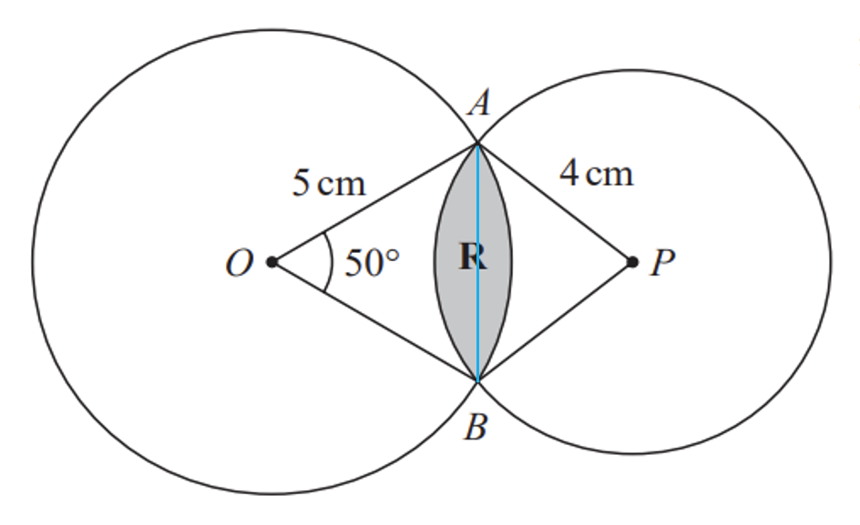
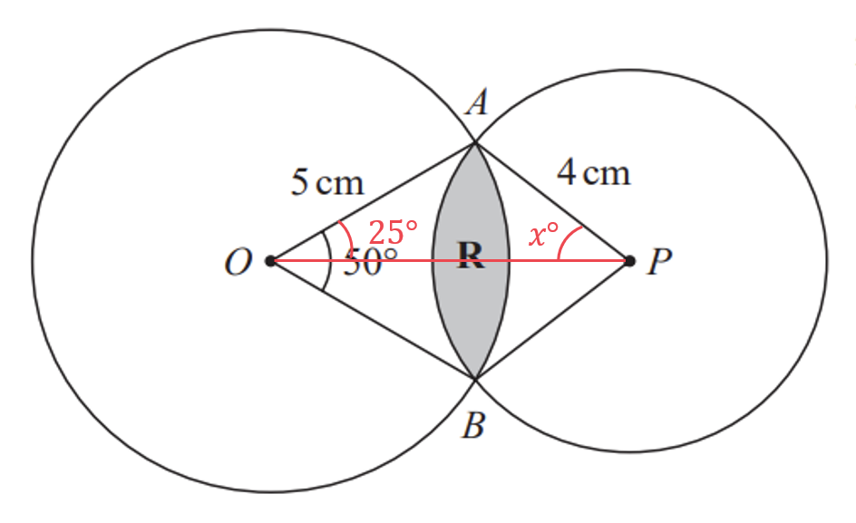
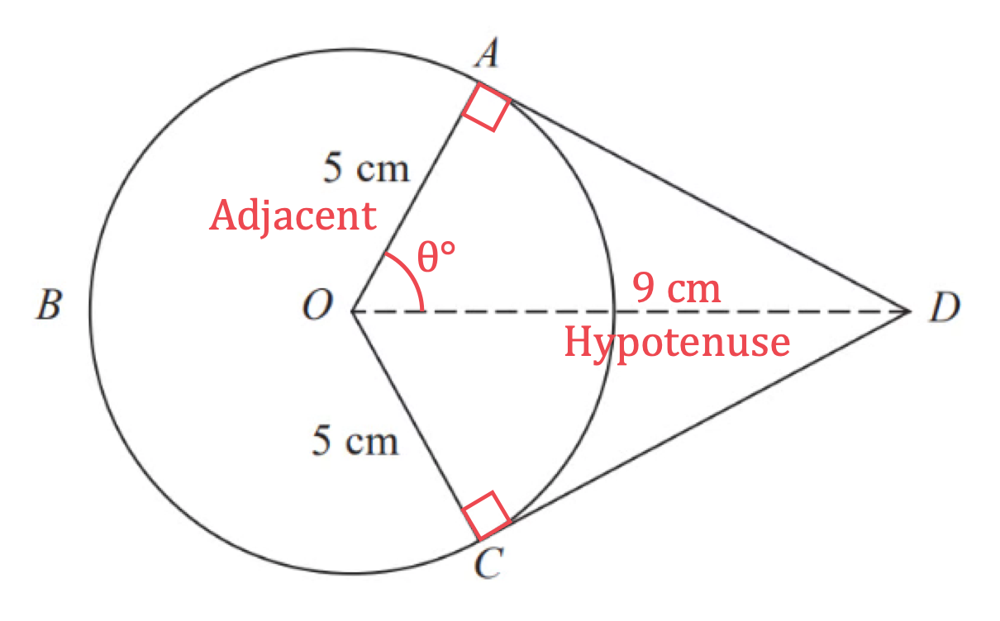
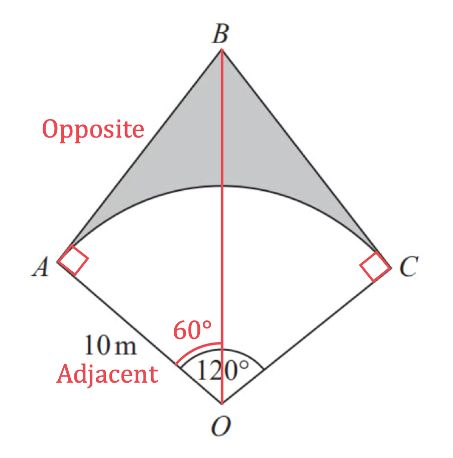
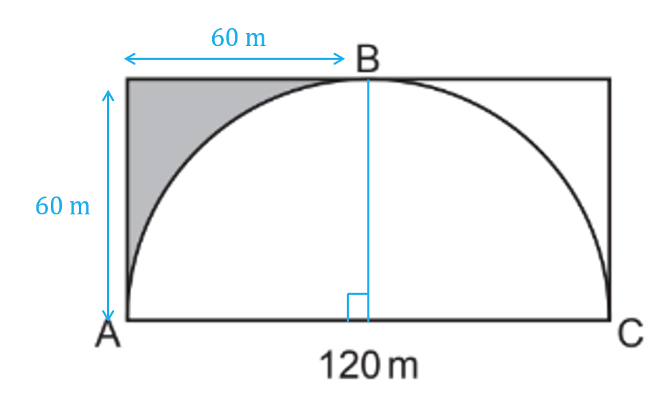
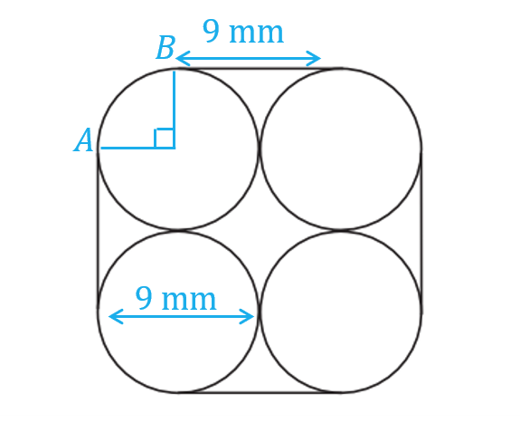
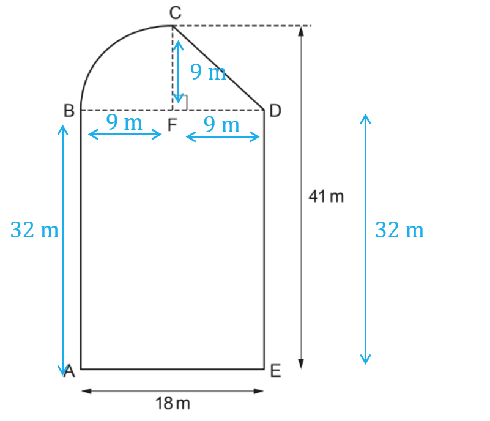
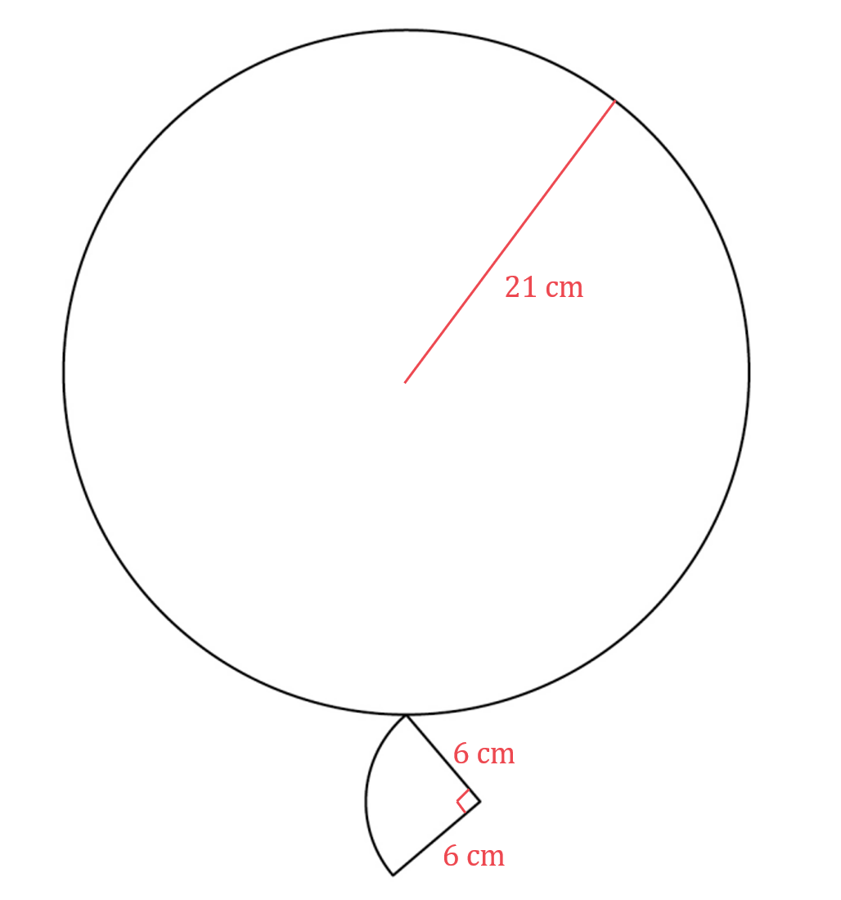

# Mark Schemes — Circles, Arcs & Sectors
**Shape, Space & Measure** · Edexcel IGCSE Maths A (Modular) (4XMAF/4XMAH) — 24/Higher Unit 1

## Q1 — very_hard — 4 marks · exam-questions

### 20() — 4 marks
> *Calculate the area of face A, using the formula for the area of a circle: *$A=πr^{2}$*, where *$r$* is the radius of the circle.*

$\begin{gathered} A = \mathrm{\pi } \times 2^{2} \\ = 4 \mathrm{\pi } cm^{2} \end{gathered}$

> *Find the relative cost of the materials for face A by multiplying the area by 2.*

$\begin{gathered} C_{A} & = 2 \times 2 \mathrm{\pi } \\ = 8 \mathrm{\pi } \end{gathered}$

**[1]**

> *Calculate the area of the metal part of face B, using the formula for the area of a sector: *$A=\frac{θ^{\circ}}{360^{\circ}}\timesπr^{2}$*, where *$θ$* is the angle of the sector.*

$\begin{gathered} A_{m e t a l} & = \frac{20}{360} \times \mathrm{\pi } \times 2^{2} \\ = \frac{2}{9} \mathrm{\pi } cm^{2} \end{gathered}$

> *Calculate the area of the plastic part of face B by subtracting the area of the metal part from the area of the whole face.*

$\begin{gathered} A_{p l a s t i c} & = 4 \mathrm{\pi } - \frac{2}{9} \mathrm{\pi } \\ = \frac{34}{9} \mathrm{\pi } cm^{2} \end{gathered}$

> *Find the relative cost of the materials for face B by multiplying the plastic area by 2 and the metal area by 3 and adding together.*

$\begin{gathered} C_{B} & = 3 \times \frac{2}{9} \mathrm{\pi } + 2 \times \frac{34}{9} \mathrm{\pi } \\ = \frac{74}{9} \mathrm{\pi } \end{gathered}$

**[1]**

> *Find a ratio for the cost of materials for face A to face B.*

$A:B\,8π:\frac{74}{9}π$

**[1]**

$8:\frac{74}{9}\,72:74$

$36:37$* ***[1]**

## Q2 — hard — 5 marks · exam-questions

### 11() — 5 marks
> *Find the radius, *$r$*, of the large semi-circle by dividing the diameter by 2.*

$\begin{gathered} r = \frac{9}{2} \\ = 4.5 \mathrm{m} \end{gathered}$

> *Calculate the arc length of the larger semi-circle, using the formula for the circumference of a circle: *$C=2πr$*, and multiplying the result by *$\frac{1}{2}$*.*

$\begin{gathered} \text{Arc} \text{length} & = 1 \frac{1}{2} \times 2 \times \mathrm{\pi } \times 4.5 \end{gathered}$

**[1]**

$\begin{gathered} \text{Arc} \text{length} & = 4.5 \mathrm{\pi } \mathrm{m} \end{gathered}$

> *Find the radius of the smaller semi-circle by dividing its diameter by 2.*

$\begin{gathered} r = \frac{5}{2} \\ = 2.5 \mathrm{m} \end{gathered}$

> *Calculate the arc length of the smaller semi-circle.*

$\begin{gathered} \text{Arc} \text{length} & = 1 \frac{1}{2} \times 2 \times \mathrm{\pi } \times 2.5 \\ = 2.5 \mathrm{\pi } \mathrm{m} \end{gathered}$

> *Work out the perimeter of the lawn by adding together the arc length of both semi-circles and the lengths of the straight edges connecting them.*

$\begin{gathered} P = 4.5 \mathrm{\pi } + 2.5 \mathrm{\pi } + 2 \end{gathered}$

**[1]**

$\begin{gathered} P = 7 \mathrm{\pi } + 4 \\ = 25.991148... \end{gathered}$

> *Work out the number of rolls that Brian needs by dividing the perimeter of his lawn by the length of edging in 1 roll.*

$\begin{gathered} \frac{25.991148...}{2.4} \\ = 10.8296... \end{gathered}$

**[1]**

*Brian needs 11 rolls*

> *Work out the cost of the 11 rolls that Brian needs.*

*9 rolls at 3 rolls for £10  2 rolls at £3.99 each*

*Total cost = 3 x 10 + 2 x 3.99*

**[1]**

*= £37.98*

> *Compare the cost with the money that Brian has.*

**Final answer:** **£37.98 > £35, Brian does not have enough money**

**Correct answer supported by working**** [1]**

## Q3 — easy — 2 marks · exam-questions

### 12() — 2 marks
> *The formula for the circumference of a circle is *$2πr=\mathrm{πd}$*. Use the *$π$* button on your calculator or "3.142"*

$π\times140=439.82297...$* *

**[1]**

> *Round the answer to 3 significant figures.*

> *The third non-zero digit is 9 and the digit following it is 8, which is 5 or more so you will need to round the 9 up. However this cannot be rounded up, so round the digit before it up instead and set the third digit to zero.*

`43 right 9. bottom 8 2297... = 440 ( 3 s. f. )`

**440 cm ****[1]**

## Q4 — very_hard — 5 marks · exam-questions

### 9() — 5 marks
> *To find the length of **AFEDC**, find the length of the hypotenuse of the right angled triangle, subtract the diameter of the semicircle and then add the arc length of the semicircle. *

> *Find the hypotenuse, *$AC$*, of the right-angled triangle **ABC** using SOHCAHTOA.*

> *You want the length of the hypotenuse and you know the length of the side that is adjacent to the angle. Therefore you can use the cosine ratio: *$cosθ=\frac{O}{H}$*.*

$\cos ( 30 ) = \frac{24}{A C}$

**[1]**

> *Rearrange to get **AC** by itself.*

$\begin{gathered} A C \cos ( 30 ) & = 24 \\ A C & = \frac{24}{ \cos ( 30 )} \\ = 16 \sqrt{3} \text{cm} \end{gathered}$

**[1]**

> *Find the diameter of the semicircle by multiplying its radius by 2.*

$\begin{gathered} d & = 3 \times 2 = 6 \text{cm} \end{gathered}$

> *Calculate the length of the arc **FED**, using the formula for the circumference of a circle: *$C=2πr$*, and dividing the result by 2.*

$\begin{gathered} \text{Arc} \text{length} & = \frac{2 \times \mathrm{\pi } \times 3}{2} = 3 \mathrm{\pi } \text{cm} \end{gathered}$

**[1]**

> *Work out the length of **AFEDC  **by subtracting the diameter of the semicircle from the length of **AC** and then adding the arc length of the semicircle on. *

$\begin{gathered} A F E D C & = 16 \sqrt{3} - 6 + 3 \mathrm{\pi } \text{cm} \\ = 31.13759... \text{cm} \end{gathered}$

**[1]**

> *Round the answer to 2 significant figures.*

> *The second non-zero digit is 1 and the digit following it is also 1, which is less than 5 so you so not need to round the 1 up. *

`3 right 1 bottom .1 3759... = 31 ( 2 s. f. )`

**31 cm ****[1] **
**Answers in the range 31 - 31.15 accepted**

## Q5 — hard — 4 marks · exam-questions

### 11() — 4 marks
> *Calculate the space available on one table for seating by finding the circumference of one table, using the formula: *$C=πd$*, where *$d$* is the diameter of the table.*

$\begin{gathered} \text{Total} & = \mathrm{\pi } \times 140 \end{gathered}$

**[1]**

$\begin{gathered} = 439.82297... \text{cm} \end{gathered}$

**Circumference between 439 - 440**** [1]**

> *Divide the space available by the space required for one person to work out how many people can be seated at each table.*

$\begin{array}{rcl} \frac{439.82287...}{60} \\ = 7.33038... \end{array}$

*7 people can be seated at each table*

> *Multiply the number of people that can be seated at each table by the number of tables to find the total number of people that can be seated.*

$\begin{gathered} 12 \times 7 \\ = 84 \end{gathered}$

**[1]**

**84 < 90****, there are ****not enough tables ****in the conference room ****[1]**

## Q6 — easy — 2 marks · exam-questions

### 4() — 2 marks
> *The formula for the circumference of a circle is *$2πr=\mathrm{πd}.$* Use the *$π$* button on your calculator or "3.142"*

$π\times9=28.275433...$* *

**[1]**

> *Round the answer to 3 significant figures. The third non-zero digit is 2 and the digit following it is 7, which is 5 or more so you will need to round the 2 up. *

`28. right 2 bottom 7 5433... = 28.3 ( 3 s. f. )`

**28.3 cm ****[1]**

## Q7 — very_hard — 6 marks · exam-questions

### 22() — 6 marks
> *Find the perimeter of the triangle **OAD **by first using the cosine rule, *$a^{2} = b^{2} + c^{2} - 2 b c \cos ( A )$*.*

> *Substitute the values of the sides (both 6 cm) and angle (50°) into the cosine rule formula.*

$\begin{gathered} A D^{2} & = 6^{2} + 6^{2} - ( 2 \times 6 \times 6 \times \cos 50 ) \\ A D & = \sqrt{ 6^{2} + 6^{2} - ( 2 \times 6 \times 6 \times \cos 50 )} \\ = 5.071419... \end{gathered}$

**[1]**

> *Find the perimeter of triangle **OAD.*

*Perimeter of ***OAD *** = 6 + 6 + 5.071419... = 17.071419... cm** *

**[1]**

> *Find the length of the arc **BC **using the formula for length of an arc *$=\frac{θ^{\circ}}{360^{\circ}}\times2πr$*. *
*Find an expression for the length of the arc in terms of *$x$*, **by substituting *$θ=50$* and *$r=(6+x)$*.*

$B C = \frac{50}{360} \times 2 \times \pi \times ( x + 6 )$

**[1]**

> *Find an expression for the perimeter of the sector **OBC** in terms of *$x$*, **by adding this to 2 × the radius.*

$\begin{gathered} O B C & = ( \frac{50}{360} \times 2 \times \pi \times ( x + 6 ) ) + 2 ( x + 6 ) \\ = \frac{5}{18} ( x + 6 ) \pi + 2 ( x + 6 ) \end{gathered}$

**[1]**

> *Form an equation by setting this equal to 2 times the perimeter of triangle **OAD**. *

$\begin{gathered} \frac{5}{18} ( x + 6 ) \pi + 2 ( x + 6 ) & = 2 ( 17.071419... ) \end{gathered}$

**[1]**

> *Simplify by expanding the brackets on both sides and collecting like terms.*

$\begin{gathered} \frac{5 \pi }{18} x + \frac{5 \mathrm{\pi } }{3} + 2 x + 12 & = 34.14283... \\ 2.872664... x & = 16.90684... \end{gathered}$

> *Solve the equation.*

$\begin{gathered} x & = \frac{16.90684...}{2.872664...} = 5.885422... \end{gathered}$

> *Round to 3 significant figures.*

$x=5.89$** cm**** ****(3 s.f.)**** [1] **
**Answers in the range 5.88 to 5.89 accepted.**

## Q8 — hard — 5 marks · exam-questions

### 17() — 5 marks
> *Work out the size of the angle **QON**.*

*Angle ***QON*** = 60**o**  ** (Triangle ***ABO*** is an equilateral triangle)*

**[1]**

> *Calculate the area of the sector **ONQ**, using the formula: *$A=\frac{θ^{\circ}}{360^{\circ}}\timesπr^{2}$*, where *$r$* is the radius and *$θ$* is the angle of the sector.*

$\begin{gathered} A = \frac{60}{360} \times \mathrm{\pi } \times 11^{2} \end{gathered}$

**[1]**

$\begin{gathered} A = \frac{121}{6} \mathrm{\pi } cm^{2} \end{gathered}$

*Calculate the area of the triangle **ABO**, using the formula:** *$A=\frac{1}{2}ab\mathrm{sin}C$*, where *$a$* and *$b$* are two sides of the triangle and *$C$* is the angle between the two sides.*

$A=\frac{1}{2}\times7\times7\times\mathrm{sin}60$

**[1]**

$A=\frac{49\sqrt{3}}{4}\mathrm{cm}^{2}$

> *Work out the area of the shaded section by subtracting the area of triangle **ABO** from the area of the sector **QON.*

$\begin{gathered} A_{s h a d e d} & = \frac{121}{6} \mathrm{\pi } - \frac{49 \sqrt{3} }{4} \\ = 42.1378... cm^{2} \end{gathered}$

> *Divide the shaded area by the total area of the sector **ONQ** and multiply by 100% to find the percentage of the total shape that is shaded.*

`| _ _ (42.1378...)/(121 / 6 pi) x 100 | |`

**[1]**

$\begin{array}{rcl} = 66.510186... \end{array}$

> *Round to 1 decimal place.*

$66 . 5 \%$* ***[1]**

## Q9 — easy — 2 marks · exam-questions

### 19() — 2 marks
> *Formula for area of a sector *$=\frac{θ}{360^{\circ}}\timesπr^{2}$*.*

> *Substitute the given values into the formula, letting *$θ=30$* and *$r=15$*.*

$\frac{30}{360}\timesπ\times15^{2}$

**[1]**

> *Use your calculator to find the answer. *

$\begin{gathered} \frac{1}{12} ( 225 ) \pi & = \frac{75}{4} \pi \\ = 58.90486... \end{gathered}$

**Area = 58.9 cm****2 ****(3 s.f.)**** [1] Answers in the range 58.8 to 58.9125 accepted**

## Q10 — very_hard — 6 marks · exam-questions

### 25() — 6 marks
> *The area of the region **R **is the area of the larger segment from circle centre **O** added to the area of the smaller segment from circle centre **P**. *

> *To find the area of the segment in circle centre **O, **subtract the area of triangle **AOB **from the area of sector **AOB.*

> *Find the area of triangle **AOB** using the area of a triangle formula, *$A=\frac{1}{2}ab\mathrm{sin}C$*, where *$a$* and *$b$* are the two known sides and *$C$* is the included angle. **OA **and **OB **are both radii so are both equal to 5 cm.*

$A r e a_{t r i a n g l e A O B} = 1 \frac{1}{2} \times ( 5 ) \times ( 5 ) \times \sin ( 50 ) = \frac{25}{2} \sin 50$

> *It is best to leave working as exact values as you work through the problem, but if you choose to round make sure you use at least 4 significant figures throughout. *

> *Find the area of the sector **AOB **using the formula for area of a sector *$=\frac{θ}{360^{\circ}}\timesπr^{2}$*.*

> *Substitute the given values into the formula, letting *$θ=50$* and *$r=5$*.*

$\frac{50}{360}\timesπ\times5^{2}=\frac{125}{36}π$

**[1]**

> *Find the area of the segment by subtracting the area of triangle **AOB **from the area of sector **AOB.*

*Area segment (circle ***O***) =*$\frac{125}{36}π-\frac{25}{2}\mathrm{sin}50$

> *To find the area of the segment in circle centre **P, **we first need to find angle **APB.*

> *Triangles **AOB **and **APB **are both isosceles triangles so the line **OP **is a line of symmetry. The sine rule can be used with triangle **AOP **to find the value of angle **APO **which can then be doubled to find angle **APB.*

> *Use the sine rule with the angles on the numerators, *$\frac{\mathrm{sin}A}{a}=\frac{\mathrm{sin}B}{b}=\frac{\mathrm{sin}C}{c}$*.*

$\frac{\sin ( A P O )}{5} = \frac{\sin ( 25 )}{4}$

**[1]**

> *Multiply both sides by 5 and use the inverse sin to find the angle **APO**.*

$\sin A P O = 5 \times \frac{\sin 25}{4} = 0.528272...
\text{angle} A P O = \sin ^{- 1} ( 0.528272... ) = 31.88883...$

**[1]**

> *Angle **APB **= 2 × angle **APO**.*

$A P B = 2 ( 31.88883... ) = 63.77766...$

> *Find the area of triangle **APB** using the area of a triangle formula, *$A=\frac{1}{2}ab\mathrm{sin}C$*.*

$A r e a_{t r i a n g l e A P B} = 1 \frac{1}{2} \times ( 4 ) \times ( 4 ) \times \sin ( 63.77766... ) = 7.176689...$

> *Find the area of the sector **APB **using the formula for area of a sector *$=\frac{θ}{360^{\circ}}\timesπr^{2}$*.*

$\frac{63.77766...}{360}\timesπ\times4^{2}=8.905041...$

**[1]**

> *Find the area of the segment by subtracting the area of triangle **APB **from the area of sector **APB.*

*Area segment (circle ***P***) = *$8.905041...-7.176689...=1.728352...$

> *Find the area of the shaded section by adding the area of the two segments together.*

*Area shaded = *$( \frac{125}{36} \pi - \frac{25}{2} \sin 50 ) + 1.728352... = 3.061104...$

**[1]**

> *Round the final answer to 3 significant figures. *

**Area = 3.06 cm****2**** ****[1] **
**Answers in the range 3 to 3.1 accepted**

## Q11 — hard — 4 marks · exam-questions

### 11() — 4 marks
> *Calculate the area of the circle, using the formula: *$A=πr^{2}$*, where *$r$* is the radius of the circle.*

$r=6\mathrm{cm}$

$A_{circle}=π\times6^{2}$

**[1]**

$A_{circle}=36π\mathrm{cm}^{2}$

> *AC** and **BD** are the diagonals of the square, as such they intersect at the centre, **O**, at right angles. This makes triangle **ABO** a right-angled triangle.*

> *Calculate the length **AB**, using Pythagoras' theorem, *$a^{2}+b^{2}=c^{2}$*.*

$\begin{gathered} 6^{2} + 6^{2} & = A B^{2} \\ 72 = A B^{2} \\ \sqrt{72} & = A B \end{gathered}$

> *Calculate the area of the square.*

$\begin{gathered} A_{s q u a r e} & = \sqrt{72} \times \sqrt{72} \end{gathered}$

**[1]**

$\begin{gathered} A_{s q u a r e} & = 72 cm^{2} \end{gathered}$

> *Subtract the area of the square from the area of the circle to find the area that is shaded in the diagram.*

$\begin{gathered} A_{s h a d e d} & = 36 \mathrm{\pi } - 72 \end{gathered}$

**[1]**

$\begin{gathered} A_{s h a d e d} & = 41.09733... cm^{2} \end{gathered}$

> *Round to 3 significant figures.*

$41.1\mathrm{cm}^{2}$* ***[1]**

**Answers between 41.04 - 41.112 will be accepted**

## Q12 — easy — 2 marks · exam-questions

### 17() — 2 marks
*The arc length of a sector (the length of the curved side) with radius *$r$* and angle *$θ$*° is *$\frac{θ}{360}\times2πr$*.* *Find the arc length by substituting *$θ=40$* and *$r=7$* into the formula.*

$\frac{40}{360}\times2π\times7=\frac{14}{9}π=4.886921...$

**[1]**

> *Round the answer to 3 significant figures.*

> *The third non-zero digit is 8 and the digit following it is 6, which is 5 or more so you will need to round the 8 up. *

`4.8 right 8 bottom 6 921... = 4.89 ( 3 s. f. )`

**4.89 cm ****[1] Answers in the range 4.8 - 4.9 accepted**

## Q13 — very_hard — 6 marks · exam-questions

### 26() — 6 marks
> *The formula for the volume of a cone, *$V=\frac{1}{3}πr^{2}h$*, is given at the beginning of the paper. *
*Use the formula with the given volume of the cone to find the value of the radius of the base circle. *
*Using the known volume of 1600 cm**3** we can write the following equation.*

$\frac{1}{3}\timesπ\timesr^{2}\times25=1600$

**[1]**

> *Divide both sides by 25 and *$\frac{1}{3}π$*.*

$\frac{1}{3}πr^{2}=\frac{1600}{25}=64$

$r^{2}=\frac{64}{\frac{π}{3}}=\frac{192}{π}=61.11549...$

> *Square root both sides.*

$r=\sqrt{61.11549...}=7.817640...$

**[1]**

> *The formula for the curved surface area of a cone, *$πrl$* , is given at the beginning of the paper.*

> *Use Pythagoras' Theorem to find the value of *$l$*, the slant height of the cone. *

> *It is a right angled triangle so you can use Pythagoras' Theorem: *$a^{2}+b^{2}=c^{2}$*, where **c** is the length of the hypotenuse (the slant height) and **a** and **b **are the height and the radius. *

$\begin{gathered} l^{2} & = 7.81764...^{2} + 25^{2} \\ l & = \sqrt{7.81764...^{2} + 25^{2}} \\ = 26.193806... \end{gathered}$

**[1]**

> *Substitute the values of *$l$* and *$r$* into the formula for the curved surface area of a cone.*

$\begin{gathered} C S A & = \pi r l = \pi ( 7.817640... ) ( 26.193806... ) = 643.313706... \end{gathered}$

**[1]**

> *The area of the sector is equal to the curved surface area of the cone. Use the formula for area of a sector *$\frac{θ}{360^{\circ}}\timesπr^{2}$*, where the radius of the sector is equal to the slant height of the cone, to find the value of the angle, *$x$*.*

$\frac{x}{360} \times \pi \times \begin{gathered} 26 \end{gathered} \begin{gathered} . \end{gathered} \begin{gathered} 193806 \end{gathered} ...^{2} = \begin{gathered} 643 \end{gathered} \begin{gathered} . \end{gathered} \begin{gathered} 313706 \end{gathered} \begin{gathered} . \end{gathered} \begin{gathered} . \end{gathered} \begin{gathered} . \end{gathered}$

**[1]**

> *Rearrange and solve to find *$x$*.*

$\begin{gathered} \frac{x}{360} & = \frac{643.313706...}{ 26.193806...^{2} \times \pi } \\ \frac{x}{360} & = 0.298452... \\ x & = 0.298452... \times 360 = 107.4430... \end{gathered}$

$x=107^{\circ}$ **[1]** 
**Rounded to 3 significant figures** **107 - 108 allowed**

## Q14 — hard — 4 marks · exam-questions

### 4() — 4 marks
> *Calculate the area of the outer circle, using the formula: *$A=πr^{2}$*, where *$r$* is the radius of the circle.*

$\begin{gathered} r = 4 + 3 + 3 = 10 \text{cm} \end{gathered}$

$A_{outer}=π\times10^{2}$

**[1]**

$A_{outer}=100π\mathrm{cm}^{2}$

> *Calculate the area of the middle circle.*

$r=4+3=7\mathrm{cm}$

$\begin{gathered} A_{m i d d l e} & = \mathrm{\pi } \times 7^{2} \\ = 49 \mathrm{\pi } cm^{2} \end{gathered}$

> *Calculate the area of the inner circle.*

$\begin{gathered} A_{i n n e r} & = \mathrm{\pi } \times 4^{2} \\ = 16 \mathrm{\pi } cm^{2} \end{gathered}$

> *Calculate the area of the shaded ring by subtracting the area of the inner circle from the area of the middle circle.*

$\begin{gathered} A_{s h a d e d} & = 49 \mathrm{\pi } - 16 \mathrm{\pi } \end{gathered}$

**[1]**

$\begin{gathered} A_{s h a d e d} & = 33 \mathrm{\pi } cm^{2} \end{gathered}$

**Correct values for area of outer circle and shaded area**** [1]**

> *Find the fraction of the shape that is shaded by dividing the area of the shaded ring by the area of the outer circle.*

$\begin{gathered} \frac{33 \mathrm{\pi } }{100 \mathrm{\pi } } & = \frac{33}{100} \end{gathered}$

$\frac{33}{100}\neq\frac{1}{3}$*, ***Daisy is not correct**** [1]**

**It is best to leave your values in terms of **$π$** throughout, but you will still get the marks if you use the value of 3 (or better) instead**

## Q15 — easy — 2 marks · exam-questions

### 16() — 2 marks
*The arc length of a sector (the length of the curved side) with radius *$r$* and angle *$θ$*° is *$\frac{θ}{360}\times2πr$*.* *Find the size of the reflex angle **AOC** by subtracting 100° from 360°.*

$\mathrm{Reflex} \mathrm{angle}AOC=360-100=260^{\circ}$

> *Find the arc length **ABC** by substituting *$θ=260$* and *$r=4$* into the formula.*

$\frac{260}{360}\times2π\times4=\frac{52}{9}π=18.15142...$

**[1]**

> *Round the answer to 3 significant figures.*

> *The third non-zero digit is 1 and the digit following it is 5, which is 5 or more so you will need to round the 1 up. *

`18. right 1 bottom 5 142... = 18.2 ( 3 s. f. )`

**18.2 cm ****[1] Answers in the range 18.1 - 18.2 accepted**

## Q16 — very_hard — 6 marks · exam-questions

### 25() — 6 marks
> *First convert the ratios for each radius into fractions of the length of **OP** and **OQ.*

**OA ***= *$\frac{3}{3+2}=\frac{3}{5}$* of ***OP***.*

**OB ***= *$\frac{3}{3+2}=\frac{3}{5}$* of ***OQ***.*

> *Write **OA,** **OB**, **OP** and **OQ** in terms of **r.** *

$\mathrm{Let}OP=OQ=r\,\mathrm{Then}OA=OB=\frac{3}{5}r$

> *Find an expression in terms of **r **for the area of the sector **OPQ **using the formula for the area of a sector *$=\frac{θ}{360^{\circ}}\timesπr^{2}$*.*

$\mathrm{Area}OPQ=\frac{45}{360}\timesπ\timesr^{2}$

> *Find an expression in terms of **r **for the area of the sector **OAB **using the formula for the area of a sector *$=\frac{θ}{360^{\circ}}\timesπr^{2}$*.*

$\text{Area} O A B = \frac{45}{360} \times \pi \times ( \frac{3}{5} r )^{2}$

** ****Either expression correct ****[1]**

> *Find an expression in terms of **r **for the area of the shaded region by subtracting the area of sector **OAB **from the area of sector **OPQ.*

$\text{Area} \text{shaded} = \frac{45}{360} \pi \times r^{2} - \frac{45}{360} \pi \times ( \frac{3}{5} r )^{2} = \frac{45}{360} \pi ( r^{2} - ( \frac{3}{5} r )^{2} )$

> *Form an equation in terms of **r **for the area of the shaded region by setting it equal to *$\frac{81}{2}π$*.*

$\frac{45}{360} \pi ( \frac{16}{25} r^{2} ) = \frac{81}{2} \pi$

**[1]**

> *Simplify and divide both sides by*$π$*.*

$\begin{gathered} \frac{2}{25} \cancel{\pi } r^{2} & = \frac{81}{2} \cancel{\pi } \\ r^{2} & = \frac{81}{2} \div \frac{2}{25} \end{gathered}$

**[1]**

> *Use your calculator to find the value of **r**. *

$\begin{array}{ccc}r & = & \sqrt{\frac{81}{2} \div \frac{2}{25}} = 22.5\end{array}$

> *Find the perimeter of the shaded section by calculating the arc length of the larger arc (**PQ**) and the smaller arc (**AB**) using the formula for the arc length of a sector: *$\mathrm{Arc} \mathrm{length}=\frac{θ^{\circ}}{360^{\circ}}\times2πr$*, where *$r$* radius of the circle and *$θ$* is the angle of the sector.*

$\begin{gathered} \text{Arc} length_{P Q} & = \frac{45}{360} \times 2 \times \mathrm{\pi } \times 22.5 \end{gathered}$

$\begin{gathered} \text{Arc} length_{A B} & = \frac{45}{360} \times 2 \times \mathrm{\pi } \times ( \frac{3}{5} \times 22.5 ) \end{gathered}$

** ****Either correct ****[1]**

> *Simplify.*

$\begin{gathered} \text{Arc} length_{P Q} & = \frac{45}{8} \pi \end{gathered}$

$\begin{gathered} \text{Arc} length_{A B} & = \frac{27}{8} \pi \end{gathered}$

> *Find **AP **and **BQ **using the differences in the radius for **OA **and **OB.*

> * *$\begin{gathered} A P & = B Q = 22.5 - \frac{3}{5} ( 22.5 ) = 9 \text{cm} \end{gathered}$

> *Calculate the perimeter of the shaded segment by adding the arc lengths together along with the lengths of the straight edges joining them. *

$\begin{gathered} P & = \frac{45}{8} \pi + \frac{27}{8} \pi + 9 + 9 \end{gathered}$

**[1]**

> *The answer should be left in terms of **π**, so simplify both parts separately.*

$\begin{gathered} P & = ( \frac{45}{8} + \frac{27}{8} ) \pi + ( 9 + 9 ) \end{gathered}$

$P=9π+18\mathrm{cm}$* ***[1]**

## Q17 — hard — 3 marks · exam-questions

### 7() — 3 marks
> *Calculate the area of the quarter circle, by using the formula for the area of a circle: *$A=πr^{2}$*, where *$r$* radius of the circle, and multiplying the result by *$\frac{1}{4}$*.*

$\begin{gathered} A_{q u a r t e r c i r c l e} & = 1 \frac{1}{4} \times \mathrm{\pi } \times 4.8^{2} \end{gathered}$

**[1]**

$\begin{gathered} A_{q u a r t e r c i r c l e} & = 5.76 \mathrm{\pi } cm^{2} \end{gathered}$

> *Calculate the area of the triangle, using the formula: *$A=\frac{1}{2}bh$*, where *$b$* is the base of the triangle and *$h$* is the perpendicular height.*

$\begin{gathered} A_{t r i a n g l e} & = 1 \frac{1}{2} \times 4.8 \times 4.8 \\ = 11.52 cm^{2} \end{gathered}$

> *Calculate the shaded segment by subtracting the area of the triangle from the area of the quarter circle.*

$\begin{gathered} A_{s h a d e d} & = 5.76 \mathrm{\pi } - 11.52 \end{gathered}$

**[1]**

$\begin{gathered} A_{s h a d e d} & = 6.57557... cm^{2} \end{gathered}$

> *Round to 3 significant figures.*

$6.58\mathrm{cm}^{2}$* ***[1]**

**Answers in the range 6.56 - 6.58 will be accepted**

## Q18 — easy — 2 marks · exam-questions

### 11() — 2 marks
> *Formula for area of a sector *$=\frac{θ}{360^{\circ}}\timesπr^{2}$*.*

> *Substitute the given values into the formula, letting *$θ=110$* and *$r=7.1$*.*

$\frac{110}{360}\timesπ\times7.1^{2}$

**[1]**

> *Use your calculator to find the answer. *

$\begin{gathered} \frac{11}{36} ( 7.1^{2} ) \pi & = 48.39012... \end{gathered}$

> *Round the answer to 1 decimal place by looking at the second digit, it is greater than 4 so round the first digit after the decimal point up. *

`| _ _ 48. bottom right 3 9 3012... | |`

**Area = 48.4 cm****2 ****(1 d.p.)**** [1] Answers in the range 48.3 to 49.2 accepted**

## Q19 — very_hard — 6 marks · exam-questions

### 19() — 6 marks
> *Find an expression in terms of **r **for the area of the sector **OAPB **using the formula for the area of a sector *$\frac{θ}{360^{\circ}}\timesπr^{2}$*.*

$\mathrm{Area}OAPB=\frac{80}{360}\timesπ\timesr^{2}=\frac{2}{9}πr^{2}$

> *Find an equation in terms of **r **by setting the area of the sector **OAPB **equal to *$\frac{25}{2}π$*.*

$\frac{2}{9}πr^{2}=\frac{25}{2}π$

**[1]**

> *Simplify and divide both sides by*$π$*.*

$\begin{gathered} \frac{2}{9} \cancel{\pi } r^{2} & = \frac{25}{2} \cancel{\pi } \\ r^{2} & = \frac{25}{2} \div \frac{2}{9} = \frac{225}{4} \end{gathered}$

> *Use your calculator to find the value of **r**. *

$\begin{array}{ccc}r & = & \sqrt{\frac{225}{4}} = 7.5\end{array}$

**[1]**

> *Find the perimeter of the shaded segment **APB **by adding the length of the line segment **AB  **to the length of the arc **APB**.*

> *Use the cosine rule with the triangle **OAB **to find the length of **AB.*

> *Cosine rule: *$a^{2}=b^{2}+c^{2}-2bc\mathrm{cos}A$*.*

> *Substitute the values into the formula.*

$AB^{2}=7.5^{2}+7.5^{2}-2(7.5)(7.5)\mathrm{cos}(80)$

**[1]**

> *Simplify the expression, type it in the calculator as one long expression. If you evaluate the expression bit by bit then remember to apply the order of operations (multiplication before subtraction).*

$AB^{2}=92.96458...\,AB=9.641814...$

> *Calculating the arc length **APB **using the formula for the arc length of a sector: *$\mathrm{Arc} \mathrm{length}=\frac{θ^{\circ}}{360^{\circ}}\times2πr$*, where *$r$* radius of the circle and *$θ$* is the angle of the sector.*

$\begin{gathered} \text{Arc} length_{A P B} & = \frac{80}{360} \times 2 \times \mathrm{\pi } \times ( 7.5 ) \end{gathered}$

** ****[1]**

> *Simplify.*

$\begin{gathered} \text{Arc} length_{A P B} & = \frac{10}{3} \pi \end{gathered}$

> *Calculate the perimeter of the shaded segment by adding the arc length to the length **AB.*

$\begin{gathered} P & = \frac{10}{3} \pi + 9.641814... \end{gathered}$

**[1]**

> *Round the answer to a suitable degree of accuracy (e.g. 3 significant figures).*

$P=20.1\mathrm{cm}$* ***[1]**

## Q20 — hard — 3 marks · exam-questions

### 22() — 3 marks
> *Calculate the arc length of the large sector **OAB**, by using the formula for the arc length of a sector: *$\mathrm{Arc} \mathrm{length}=\frac{θ^{\circ}}{360^{\circ}}\times2πr$*, where *$r$* radius of the circle and *$θ$* is the angle of the sector.*

$\begin{gathered} \text{Arc} length_{l a r g e s e c t o r} & = \frac{75}{360} \times 2 \times \mathrm{\pi } \times 10 \end{gathered}$

**[1]**

$\begin{gathered} \text{Arc} length_{l a r g e s e c t o r} & = \frac{25}{6} \mathrm{\pi } \text{cm} \end{gathered}$

> *Calculate the arc length of the smaller sector **OCD**. *

$\begin{gathered} \text{Arc} length_{s m a l l s e c t o r} & = \frac{75}{360} \times 2 \times \mathrm{\pi } \times 6 \\ = \frac{5}{2} \mathrm{\pi } \text{cm} \end{gathered}$

> *Calculate the perimeter of the shaded segment by adding the arc lengths together along with the lengths of the straight edges joining them. *

$\begin{gathered} P = \frac{25}{6} \mathrm{\pi } + \frac{5}{2} \mathrm{\pi } + 4 + 4 \end{gathered}$

**[1]**

$\begin{gathered} P = 28.943951... \text{cm} \end{gathered}$

> *Round to 3 significant figures.*

$28.9\mathrm{cm}$* ***[1]**

**Answers in the range 28.9 - 28.95 will be accepted**

## Q21 — easy — 2 marks · exam-questions

### 12() — 2 marks
*The arc length of a sector (the length of the curved side) with radius *$r$* and angle *$θ$*° is *$\frac{θ}{360}\times2πr$*.* *Find the arc length by substituting *$θ=50$* and *$r=7$* into the formula.*

$\frac{50}{360} \times 2 \mathrm{\pi } \times 7 = \frac{5}{36} ( 14 \mathrm{\pi } ) = \frac{35}{18} \mathrm{\pi } = 6.10865...$

**[1]**

> *Round the answer to one decimal place.*

> *The first digit after the decimal point is 1 and the digit following it is 0, which is less than 5 you do not need to round the 1 up. *

`6. right 1 bottom 0 865... = 6.1 ( 1 d. p. )`

**6.1 cm ****[1] Answers in the range 6.05 - 6.2 accepted**

## Q22 — very_hard — 4 marks · exam-questions

### 27() — 4 marks
> *The area of the shaded region is the area of the triangle subtracted from the area of the sector.*

> *Find the area of the triangle using the area of a triangle formula, *$A=\frac{1}{2}ab\mathrm{sin}C$*, where *$a$* and *$b$* are the two known sides and *$C$* is the included angle. The two sides** **are both radii so are both equal to 5 cm and the angle is equal to 60°.*

`Area _ \Delta = 1 half x ( 5 ) x ( 5 ) x sin ( 60 ) = 25 / 2 sin 60`

**[1]**

> *This is a non-calculator paper so leave working as exact values as you work through the problem. The exact value of sin 60° is *$\frac{\sqrt{3}}{2}$*. Use this to simplify the expression for the area of the triangle, leaving it in terms of **π.*

`Area _ \Delta = 25 / 2 ( (sqrt( 3)/(2) ) = (25 sqrt( 3)/(4)`

> *Find the area of the sector** **using the formula for area of a sector *$=\frac{θ}{360^{\circ}}\timesπr^{2}$*.*

> *Substitute the given values into the formula, letting *$θ=60$* and *$r=5$*.*

$\frac{60}{360}\timesπ\times5^{2}=\frac{1}{6}π\times25=\frac{25}{6}π$

**[1]**

> *Find the area of the segment by subtracting the area of the triangle from the area of the sector**.*

*Area segment  = *$\frac{25}{6}π-\frac{25\sqrt{3}}{4}$

**[1]**

> *Subtract the fractions by first finding the lowest common denominator, and adjusting the numerators accordingly.*

> *The lowest common denominator is 12. (LCM of 6 and 4 = 12). Set both fractions over 12, multiplying the numerator of the first by 2 and the second by 3.*

$\frac{2 ( 25 )}{12} \pi - \frac{3 ( 25 \sqrt{3} )}{12}$

> *Simplify by subtracting the numerators.*

$\frac{50π}{12}-\frac{75\sqrt{3}}{12}$

**Final answer:** $\frac{50π-75\sqrt{3}}{12}$** ****[1]**

## Q23 — hard — 5 marks · exam-questions

### 18() — 5 marks
> *Triangles **AOD **and **COD** are congruent, right-angled triangles. The angle between a tangent and a radius is always 90**o**.*

> *Use SOHCAHTOA to calculate the angle **AOD. **You know the adjacent and the hypotenuse, so use *$\mathrm{cos}θ=\frac{Adj}{Hyp}$*.*

**Recognition that AOD is a right angle**** [1]**

$\begin{gathered} \cos \\theta & = \frac{5}{9} \end{gathered}$

**[1]**

$\begin{gathered} \\theta = \cos ^{- 1} ( \frac{5}{9} ) \end{gathered}$

**[1]**

$\begin{gathered} \\theta = 56.251011...^{\circ} \end{gathered}$

> *Find the reflex angle **AOC**, by subtracting two lots of *$θ$* from 360**o**, because angles around a point add up to 360**o**.*

$\begin{gathered} \text{Reflex} \text{Angle} A O C & = 360 - 2 \times 56.251011... \\ = 247.497977...^{\circ} \end{gathered}$

> *Work out the arc length of sector **AOC**, using the formula for the arc length of a sector: *$\mathrm{Arc} \mathrm{length}=\frac{θ^{\circ}}{360^{\circ}}\times2πr$*, where *$r$* is the radius and *$θ$* is the angle of the sector.*

$\mathrm{Arc} \mathrm{length}=\frac{247.497977...}{360}\times2\timesπ\times5$

**[1]**

$\mathrm{Arc} \mathrm{length}=21.598272...$

> *Round to 3 significant figures.*

$21.6\mathrm{cm}$* ***[1]**

**Answers in the range 21.5-21.65 will be accepted**

## Q24 — easy — 3 marks · exam-questions

### 10() — 3 marks
> *The shaded area is formed by subtracting the area of the smaller semi-circle from the area of the larger semi-circle.*

> *Calculate the radius of the larger circle by dividing the diameter by 2.*

$\frac{12}{2}=6\mathrm{cm}$

> *Calculate the area of the larger semi-circle, using: *$A=\frac{1}{2}πr^{2}$*.*

$\begin{gathered} A = 1 \frac{1}{2} ( \mathrm{\pi } \times ( 6 )^{2} ) \\ = \frac{36}{2} \mathrm{\pi } cm^{2} \\ = 18 \mathrm{\pi } cm^{2} \end{gathered}$

> *The question asks for the answer as a multiple of π, so it is best to leave you working as a multiple of π.*

**[1]**

> *The radius of the smaller semi-circle is 2 cm less than the radius of the larger semi-circle.*

> *Calculate the radius of the smaller semi-circle.*

$6-2=4\mathrm{cm}$

> *Calculate the area of the smaller semi-circle, using: *$A=\frac{1}{2}πr^{2}$*.*

$\begin{gathered} A = 1 \frac{1}{2} ( \mathrm{\pi } \times ( 4 )^{2} ) \\ = \frac{16}{2} \mathrm{\pi } cm^{2} \\ = 8 \mathrm{\pi } cm^{2} \end{gathered}$

**[1]**

> *Find the area of the shaded section by subtracting the area of the smaller semi-circle from the area of the larger semi-circle.*

$\begin{gathered} A = 18 \mathrm{\pi } - 8 \mathrm{\pi } \\ = 10 \mathrm{\pi } \end{gathered}$

> *The question asks for the answer as a multiple of π, so there is no need to calculate the answer any further.*

**Area = 10π cm****2**** ****[1]**

## Q25 — very_hard — 4 marks · exam-questions

### 26() — 4 marks
> *The formula for the circumference of a circle is *$2πr=\mathrm{πd}$*. *
*Find an expression for the circumference of the circle in terms of *$r.$

$C=2πr$* *

**[1]**

> *The perimeter of the sector is equal to the arc length of the sector plus the two straight edges (both radii).*

*The arc length of a sector (the length of the curved side) with radius *$r$* and angle *$θ$*° is *$\frac{θ}{360}\times2πr$*.* 
*Find an expression for the arc length of the sector by substituting *$θ=x$* and *$r=r$* into the formula.*

$\mathrm{Arc} \mathrm{length}=\frac{x}{360}\times2π\timesr=\frac{2πrx}{360}$

**[1]**

> *Find an expression for the perimeter of the sector by adding *$2r$* for the two straight edges.*

$\mathrm{Perimeter}=\frac{2πrx}{360}+2r$

> *Form an equation by setting the expressions for the circumference of the circle equal to the perimeter of the sector.*

$2πr=\frac{2πrx}{360}+2r$

**[1]**

> *Begin to simplify by dividing both sides by 2**r.*

$\begin{gathered} \cancel{2 \pi \cancel{r} & = \frac{ \cancel{2} \pi \cancel{r} x}{360} + \cancel{2} r} \\ \pi & = \frac{\pi x}{360} + 1 \end{gathered}$

> *Rearrange to make **x **the subject. *

$\begin{gathered} \pi - 1 & = \frac{\pi x}{360} \\ 360 ( \pi - 1 ) & = \pi x \end{gathered}$

$x=\frac{360(π-1)}{π}$** ****[1] **
**Equivalent forms accepted.**

## Q26 — hard — 5 marks · exam-questions

### 20() — 5 marks
> *A tangent and a radius meet at a right angle, so triangles **OAB **and **OCB** are congruent, right-angled triangles.*

> *The line **OB** bisects the angle of the sector.*

$\begin{gathered} \text{Angle} A O B & = \frac{120}{2} \\ = 60^{\circ} \end{gathered}$

**[1]**

> *Work out the length **AB** using SOHCAHTOA. You know the adjacent and you want to find out the opposite so use *$\mathrm{tan}θ=\frac{Opp}{Adj}$*.*

$\begin{gathered} \tan 60 & = \frac{A B}{10} \\ 10 \tan 60 & = A B \end{gathered}$

**[1]**

$\begin{gathered} A B & = 10 \sqrt{3} \mathrm{m} \end{gathered}$

> *Calculate the area of the quadrilateral **ABCO** by calculating the area of the triangle **ABO** and doubling it.*

$\begin{gathered} A_{t r i a n g l e} & = 1 \frac{1}{2} \times 10 \times 10 \sqrt{3} \\ = 50 \sqrt{3} \text{cm} \end{gathered}$

**[1]**

$\begin{gathered} A_{q u a d r i l a t e r a l} & = 2 \times 50 \sqrt{3} \\ = 100 \sqrt{3} \mathrm{m}^{2} \end{gathered}$

> *Calculate that area of the sector **OAC**, using the formula: *$A=\frac{θ^{\circ}}{360^{\circ}}\timesπr^{2}$*, where *$r$* is the radius and *$θ$* is the angle of the sector.*

$\begin{gathered} A_{s e c t o r} & = \frac{120}{360} \times \mathrm{\pi } \times 10^{2} \end{gathered}$

**[1]**

$\begin{gathered} A_{s e c t o r} & = \frac{100}{3} \mathrm{\pi } \mathrm{m}^{2} \end{gathered}$

> *Find the area of the shaded section by subtracting the area of the sector **OAC** from the area of the quadrilateral **ABCO**.*

$\begin{gathered} A_{s h a d e d} & = 100 \sqrt{3} - \frac{100}{3} \mathrm{\pi } \\ = 68.485325... \end{gathered}$

> *Round to 3 significant figures.*

$68.5\mathrm{cm}^{2}$* ***[1]**

**Answers in the range 68.4 - 68.6 will be accepted**

## Q27 — easy — 1 marks · exam-questions

### 3() — 1 marks
> *The arc length of a sector (the length of the curved side) with radius *$r$* and angle *$θ$*° is *$\frac{θ}{360}\times2πr$*. A semicircle has an angle of 180° (as it is half of a full circle). Find the arc length by substituting *$θ=180$* and *$r=6$* into the formula.*

$\frac{180}{360} \times 2 \pi \times 6 = 1 \frac{1}{2} ( 12 \pi ) = 6 \pi$

**The correct answer in option 2, 6****π ****metres  ****[1]**

## Q28 — very_hard — 5 marks · exam-questions

### 9() — 5 marks
> *Find the length of one full lap by finding the perimeter of the racing circuit. *

> *The perimeter of the circuit is equal to the sum of the length of the two straight sections, the arc length of the larger semi-circle and the arc lengths of the three smaller semi circles.*

> *Find the arc length of the larger semi-circle using the formula for the circumference of a circle: *$C=2πr=πd$*, and dividing the result by 2.*

$\begin{gathered} \text{Arc} \text{length} & = \frac{\pi \times 0.9}{2} = 0.45 \pi \text{km} \end{gathered}$

**[1]**

> *The total length of the diameters of the three smaller semi-circles is equal to the length of the diameter of the one larger semi-circle, so find the diameter of the smaller semi-circle by dividing 0.9 by 3.*

$d=\frac{0.9}{3}=0.3\mathrm{km}$

> *Find the arc length of one of the smaller semi-circles, using the formula for the circumference of a circle: *$C=2πr=πd$*, and dividing the result by 2.*

$\begin{gathered} \text{Arc} \text{length} & = \frac{\pi \times 0.3}{2} = 0.15 \pi \text{km} \end{gathered}$

**[1]**

> *Work out the total length of the racing circuit by adding the arc length of the larger semicircle, the arc lengths of the three smaller semi circles and the two straight sections.*

$\begin{gathered} \text{Total} \text{length} & = 0.45 \pi + 3 ( 0.15 \pi ) + 2 ( 0.75 ) \text{km} \end{gathered}$

**[1]**

> *Calculate the total length to more than 4 significant figures (it is best to leave the full amount on your calculator for the last step).*

$\begin{array}{rcl} \text{Total} \text{length} & = 4.3274333... \text{km} \end{array}$

> *Divide the distance needed for one race by your answer for the length of the racing circuit.*

*Number of laps = *$\begin{gathered} \frac{305}{4.3274333...} \end{gathered} = 70.48057...$

**[1]**

> *Round up to the nearest whole number to find the minimum number of laps.*

**71 laps*** ***[1]**

## Q29 — hard — 5 marks · exam-questions

### 11() — 5 marks
> *Calculate the length **AC** from the right-angled triangle **ACD** using Pythagoras' theorem, *$a^{2}+b^{2}=c^{2}$*.*

$\begin{gathered} 17^{2} & = 15^{2} + A C^{2} \end{gathered}$

**[1]**

$\begin{gathered} 289 = 225 + A C^{2} \\ 64 = A C^{2} \end{gathered}$

**[1]**

$\begin{gathered} A C & = 8 \end{gathered}$

> *The diameter of the semi-circle is therefore 8 cm.*

> *Calculate the arc length of the semi-circle by using the formula for the circumference of a circle, *$C=πd$*, and multiplying it by *$\frac{1}{2}$*.*

> * *$\begin{gathered} A r c l e n g t h & = 1 \frac{1}{2} \times \mathrm{\pi } \times 8 \end{gathered}$

**[1]**

$\begin{gathered} A r c l e n g t h & = 4 \mathrm{\pi } \end{gathered}$

> *Work out the perimeter of the shaded shape by adding together the arc length of the semi-circle and the lengths of the sides **AD** and **CD**.*

$\begin{gathered} P e r i m e t e r & = 4 \mathrm{\pi } + 17 + 15 \end{gathered}$

**[1]**

$\begin{array}{rcl} P e r i m e t e r & = 44.5663... \end{array}$

> *Round to 3 significant figures.*

**44.6 cm**** [1]**

## Q30 — easy — 1 marks · exam-questions

### 5() — 1 marks
> *The formula for the circumference of a circle is *$2πr=\mathrm{πd}$*. So *$C=πd$*.*

$π=3.141592...$* *

> *The question asks for the value of the constant **k, **so you should set this equal to **π **in your answer, it is not enough to give the answer *$C=πd.$* *

$k=π$** ****[1] Answers in the range 3.14 - 3.142 accepted**

## Q31 — very_hard — 5 marks · exam-questions

### 18() — 5 marks
> *The area of all six faces will consist of two lots of the shaded area, the two (white) curved surface areas and the two unseen rectangles at the base of the tunnel. *

> *The shaded area is found by subtracting the area of the smaller semi-circle from the area of the larger semi-circle.*

> *Calculate the area of the larger semi-circle, using: *$A=\frac{1}{2}πr^{2}$*.*

$\begin{gathered} A = 1 \frac{1}{2} ( \mathrm{\pi } \times ( 10 )^{2} ) \\ = \frac{100}{2} \mathrm{\pi } cm^{2} \\ = 50 \mathrm{\pi } cm^{2} \end{gathered}$

> *The question asks for the answer as a multiple of π, so it is best to leave your working as a multiple of π.*

> *Calculate the area of the smaller semi-circle, using: *$A=\frac{1}{2}πr^{2}$*.*

$\begin{gathered} A = 1 \frac{1}{2} ( \mathrm{\pi } \times ( 7 )^{2} ) \\ = \frac{49}{2} \mathrm{\pi } cm^{2} \\ = 24.5 \mathrm{\pi } cm^{2} \end{gathered}$

> *Find the area of the shaded section by subtracting the area of the smaller semi-circle from the area of the larger semi-circle.*

$\begin{gathered} A = 50 \mathrm{\pi } - 24.5 \mathrm{\pi } \\ = 25.5 \mathrm{\pi } \end{gathered}$

**[1]**

> *The curved surface areas of the tunnel are rectangles, with the width equal to the length of the tunnel and the length equal to the arc-lengths of the semicircles.*

> *Find the arc length of the larger semicircle using the formula *$1 \frac{1}{2} ( 2 \mathrm{\pi } r )$* where **r** is the radius.*

> $\begin{gathered} \text{arc} length_{larger} & = 1 \frac{1}{2} \times 2 \times \mathrm{\pi } \times 10 = 10 \mathrm{\pi } \end{gathered}$*  *

> *Find the curved surface area of the top of the tunnel by multiplying the arc length by the length of the tunnel.*

> $\begin{gathered} CSA_{larger} & = 10 \pi \times 30 = 300 \pi \end{gathered}$*  *

> *Find the arc length of the smaller semicircle using the formula *$1 \frac{1}{2} ( 2 \mathrm{\pi } r )$* where **r** is the radius.*

> $\begin{gathered} \text{arc} length_{smaller} & = 1 \frac{1}{2} \times 2 \times \mathrm{\pi } \times 7 = 7 \mathrm{\pi } \end{gathered}$*  *

> *Find the curved surface area of the underneath of the tunnel by multiplying the arc length by the length of the tunnel.*

> $\begin{gathered} CSA_{smaller} & = 7 \pi \times 30 = 210 \pi \end{gathered}$*  *

**Either curved surface area found**** [1]**

> *Find the area of the two hidden rectangles at the base of the tunnel. They each have length 30 cm and width 3 cm.*

*Area two rectangles = 2 × 30 × 3 = 180 cm**2*

**[1]**

> *Add the areas of the two curved surface areas to the hidden rectangles and 2 times the shaded area.*

*Total area = *`equation`

**[1]**

**Area = 561****π**** + 180 cm****2**** ****[1]**

## Q32 — hard — 5 marks · exam-questions

### 12() — 5 marks
> *To find the area of the sector the angle at the centre must be known. Use the length of the arc **AB **to find the angle.*

> *The formula for the length of an arc is *$\frac{θ}{360}\times2πr$* , where **θ** is the angle at the centre and **r** is the radius.*

> *Apply this formula to the given sector with **r **= 6 cm and arc length = 5**π **cm.*

$5π=\frac{θ}{360}\times2\timesπ\times6$

**Correct expression**** [1] **
**Correct equation**** [1]**

> *Simplify the right-hand side.*

`| 5 pi | = theta / 360 x 12 x pi | | _ = theta / 30 x pi | |`

> *Cancel out **π **from both sides.*

$\begin{array}{ccc}5 & = & \frac{ \theta }{30} \end{array}$

> *Multiply both sides by 30*

$θ=5\times30=150^{\circ}$

**[1]**

> *The formula for the area of a sector is*$\frac{θ}{360^{\circ}}\timesπr^{2}$*.*

> *Substitute the values for **r **and **θ** into the formula, letting *$θ=150$* and *$r=6$*.*

$\begin{gathered} \end{gathered} \begin{gathered} \text{Area} \end{gathered} \begin{gathered} \end{gathered} \begin{gathered} = \end{gathered} \begin{gathered} \end{gathered} \frac{150}{360} \times \pi \times 6^{2}$

**[1]**

> *Evaluate the answer by simplifying where possible.*

$\begin{gathered} \text{Area} & = \frac{150}{360} \times \pi \times 36 \\ = \frac{150}{10} \pi \end{gathered}$

> *Remember to give your answer in terms of *$π$*, not as a rounded decimal!*

**Area = 15****π**** cm****2**** [1]**

**"47.1..." does not score the final mark; the answer must be given in terms of ****π**

## Q33 — easy — 2 marks · exam-questions

### 7() — 2 marks
> *The area of the quarter circle can be found by finding the area of the full circle with the same radius and dividing by 4.*

> *Calculate the area of the full circle, using: *$A=πr^{2}$*.*

$\begin{gathered} A = \mathrm{\pi } \times ( 6 )^{2} \\ = 36 \mathrm{\pi } cm^{2} \end{gathered}$

**[1]**

> *Find the area of the quarter circle by dividing the area of the full circle by 4.*

$\begin{gathered} A & = \frac{36 \mathrm{\pi } }{4} \end{gathered}$

> *Leave your answer as a multiple of π.*

**Area = 9π cm****2**** ****[1]**

## Q34 — very_hard — 5 marks · exam-questions

### 22() — 5 marks
> *Find the percentage of the area of the white sector out of the area of the whole  semi-circle.*

> *Calculate the area of the semi-circle, using: *$A=\frac{1}{2}πr^{2}$*.*

$\begin{gathered} A_{s e m i c i r c l e} & = 1 \frac{1}{2} ( \mathrm{\pi } \times ( 25 )^{2} ) \\ = \frac{625}{2} \mathrm{\pi } \end{gathered}$

**[1]**

> *It is best to leave your working as a multiple of **π** when you can.*

> *Calculate the area of the white sector, using the formula for area of a sector *$=\frac{θ}{360^{\circ}}\timesπr^{2}$*.*

$\begin{gathered} A_{s e c t o r} & = \frac{150}{360} \times \pi \times 12^{2} \\ = \frac{5}{12} \times 144 \pi \\ = 60 \pi \end{gathered}$

**Correct fraction**** [1] **
**Correct method to find area**** [1]**

> *Find the percentage of the semicircle that is white by dividing the area of the white sector by the area of the whole semicircle and multiplying by 100.*

$\begin{array}{ccc}Percentage & = & \frac{60 pi}{\frac{625}{2} pi } \times 100 \% = 19.2 \% \end{array}$

**[1]**

**No because 19.2% is less than 20%  ****[1]**

## Q35 — hard — 5 marks · exam-questions

### 6() — 5 marks
> *The rectangle encloses a semicircle so its width is equal to the radius, or half of its length. *

> *The point **B **is the midpoint of the length of the rectangle, as it is the point where the circle touches the rectangle.*

$r=\frac{120}{2}=60m$

**[1]**

> *Add this information to the diagram.*

> *The perimeter of the shaded section is the length of the arc AB** **and two times the length of the radius.*

> *Find the length of the arc AB, this is a quarter of the circumference, so it can be found by using the formula for the circumference of a circle, *$2πr=\mathrm{πd}$* and dividing by 4. Use the *$π$* button on your calculator or "3.142"*

$\mathrm{length}_{\mathrm{AB}}=\frac{π\times120}{4}=30π$* *

**Finding circumference**** [1] **
**Dividing by 4**** [1]**

> *Calculate the perimeter of the shaded segment by adding the arc length together with the width and half the length of the rectangle.*

$\begin{gathered} P & = 30 \mathrm{\pi } + 60 + 60 \\ = 214.247779... \mathrm{m} \end{gathered}$

**[1]**

> *Round the answer to 3 significant figures.*

> *The third non-zero digit is 4 and the digit following it is 2, which is less than 5 do not need to round the 4 up. *

**214 m ****[1]**

## Q36 — easy — 2 marks · exam-questions

### 2((a)) — 2 marks
> *Formula for area of a circle*$=πr^{2}$*.*

> *Substitute the given radius into the formula. The question asks for the answer as a multiple of **π **so you do not need to multiply by **π.*

*Area = *$π\times70^{2}$

**[1]**

> *Use your calculator to find the value of 70**2**, do not multiply by **π.*

**Area = 4900****π**** cm****2**** [1]**

## Q37 — very_hard — 5 marks · exam-questions

### 25() — 5 marks
> *The area of the logo is the area of the two triangles added to the area of the sector.*

> *Find the area of the triangles using the area of a triangle formula, *$A=\frac{1}{2}ab\mathrm{sin}C$*, where *$a$* and *$b$* are the two known sides and *$C$* is the included angle. The triangles are congruent, which means identical, so the calculation is the same for both of them.*

`Area _ \Delta = 1 half x ( 15 ) x ( 26 ) x sin ( 38 ) = 195 sin 38`

**[1]**

> *It is best to leave working as exact values where possible as you work through the problem so leaving it in terms of sin here will make it easier to work with later. *

> *To find the area of the sector, you will first need to find its radius. You know the lengths of two sides and the angle between them of the triangle and the radius of the sector is the side opposite the angle, so you can use the cosine rule, *$a^{2}=b^{2}+c^{2}-2bc\mathrm{cos}A$*, where **b** and **c** are the lengths of the two sides that form angle **A** and **a** is the length of the side opposite **A**.*

$r^{2} = 26^{2} + 15^{2} - 2 ( 26 ) ( 15 ) \cos ( 38 )
r = \sqrt{26^{2} + 15^{2} - 2 ( 26 ) ( 15 ) \cos ( 38 )}$

**[1]**

> *Type the expression into your calculator altogether as one line to get a value for **r.*

$\begin{gathered} r & = 16.921926... \end{gathered}$

> *Find the area of the sector** **using the formula for area of a sector *$=\frac{θ}{360^{\circ}}\timesπr^{2}$*, the angle for the sector is *$θ=108$* and use the unrounded value found for **r.** *

$A r e a_{s e c t o r} = \frac{108}{360} \times \pi \times ( 16.921926 )^{2} = 269.880036...$

**Correct fraction**** [1] **
**Correct method to find area**** [1]**

> *Find the area of the logo by adding 2 lots of the area of the triangle to the area of the sector**.*

*Area logo = *$2 ( 195 \sin 38 ) + 269.880036...$

**Final answer:** **Area = **$509.988...=510\mathrm{cm}^{2}(2s.f.)$** ****[1]**

## Q38 — hard — 4 marks · exam-questions

### 18() — 4 marks
> *The length of the elastic band is made up of four arcs that are each made up of a quarter of the full circumference of a pencil and 4 straight lines that reach from the centre of one pencil to the centre of the next one.*

> *To find the length of one arc, use the formula for the circumference of a circle, *$2πr=\mathrm{πd}$*, divided by 4. *
*It is best t leave your working in terms of *$π$* as you go. *

$AB=\frac{π\times9}{4}=\frac{9}{4}π$

**[1]**

> *There are four arcs, so the four curved corners can be found by multiplying the answer by 4.  *
*Note that this could be done in one step by noticing that the arcs formed by the four quadrants are equivalent to one full circumference of a pencil!*

*Curved sections = *$4 ( \frac{9}{4} \pi ) = 9 \pi$

**[1]**

> *The whole perimeter can be found by adding the length of the curved sections to the length of the 4 straight sections.*

*Perimeter = *$4 ( 9 ) + 9 \pi = 36 + 9 \pi$

> *Either leave the answer as an exact value or round to at least 3 significant figures.*

**36 + 9****π ****= 64.3 mm**** ****[1]**

## Q39 — medium — 3 marks · exam-questions

### 5() — 3 marks
> *To fit perfectly around the edge of the garden, the fence will be the length of the **circumference **of the circle.*

> *The formula for the circumference of a circle is *$2πr=πd.$* Use the *$π$* button on your calculator or "3.142", substituting 5 for the diameter, **d.*

$\pi \times 5 = 5 \mathrm{\pi } ( = 15.70796 ... )$* *

**[1]**

> *Using the exact answer (5π) in the next part of the problem will maintain accuracy for the final answer.*

> *The fence costs £1.80 per metre and is 5π metres long. Find the total cost by multiplying 5π metres by £1.80.*

$5 \mathrm{\pi } \times 1.8 = 9 \mathrm{\pi } = ( 28.27433... )$

**[1]**

> *To give the answer in  £, round the answer to 2 decimal places.*

> *The second decimal place (digit after the decimal point) is 7 and the digit following it is 4, which is less than 5 so you do not need to round up.*

`28. right 27 433... = 28.27 ( 2 d. p. )`

**£28.27 ****[1]**

## Q40 — very_hard — 6 marks · exam-questions

### 7() — 6 marks
> *The point Fis the midpoint of AE so the radius of the circle is equal to half of the length of **AE.*

*Radius = *$\frac{\mathrm{AE}}{2}=\frac{18}{2}=9\mathrm{cm}$

**[1]**

> *This means that the base and height of the triangle are both also 9 cm. *

> *The length DE is equal to 41 cm minus the height of the triangle.*

$\mathrm{DE}=41-9=32\mathrm{cm}$

**[1]**

> *Add the information to the diagram.*

> *Find the length of the arc BC using the formula for the arc length of a sector,*$\frac{θ}{360}\times2πr$*, where **r **is the radius and **θ **is the angle. For a quarter circle the angle is 90°. *
*Find the arc length by substituting *$θ=90$* and *$r=9$* into the formula.*

$\frac{90}{360} \times 2 \mathrm{\pi } \times 9 = 1 \frac{1}{4} ( 18 ) \mathrm{\pi } = 4.5 \mathrm{\pi }$

**[1]**

> *Find the length of the line segment CD using the Pythagoras' theorem, *$a^{2}+b^{2}=c^{2}$*, where *$a$* **and *$b$* are the two shorter sides and *$c$*is the hypotenuse. *
*Find the length of CD by substituting *$a=9$* and *$b=9$* into the formula.*

$\begin{gathered} CD^{2 } & = 9^{2} + 9^{2} = 162 \end{gathered}$

**[1]**

$\begin{gathered} \text{CD} & = \sqrt{162} \\ = 9 \sqrt{2} \end{gathered}$

**[1]**

> *Find the perimeter by adding the arc length to the four straight sides.*

* *$\begin{gathered} \text{Perimeter} & = \text{AB} + \text{BC} + \text{CD} + \text{DE} + \text{EA} \\ = 32 + 4.5 \mathrm{\pi } + 9 \sqrt{2} + 32 + 18 \\ = 108.86508... \end{gathered}$

**[1]**

> *Round the answer to 3 significant figures.*

> *The third non-zero digit is 8 and the digit following it is 8, which is 5 or more so you will need to round the 8 up. *

**Final answer:** **109 m**

## Q41 — medium — 3 marks · exam-questions

### 12() — 3 marks
> *The shaded area can be found by first finding the area of all four corners and then dividing by 4 to find the area of just one corner.*

> *To find the area of all four shaded corners subtract the area of the circle from the area of the square.*

> *The formula for the area of a circle is πr**2**. This is a non calculator paper so leave all working in terms of π as you go.*

$A r e a_{( c i r c l e )} = \pi \times 6^{2} = 36 \mathrm{\pi }$* *

**[1]**

> *Find the area of the square.*

$A r e a_{( s q u a r e )} = 12^{2} = 144$

> *The area of all four corners = Area (square) - Area (circle). Leave your answer in terms of π as you go.*

$A r e a_{( s q u a r e )} - A r e a_{( c i r c l e )} = 144 - 36 \mathrm{\pi }$

**[1]**

> *To find the area of the one shaded corner, divide this by 4.*

$A r e a_{( s h a d e d )} = \frac{144 - 36 \mathrm{\pi } }{4}$

> *Simplify by dividing 144 and 36 by 4 separately.*

$A r e a_{( s h a d e d )} = \frac{144}{4} - \frac{36}{4} \mathrm{\pi } = 36 - 9 \mathrm{\pi }$

$36-9π$** ****[1]**
** The unsimplified answer of **$\frac{144-36π}{4}$** is also accepted.**

## Q42 — very_hard — 6 marks · exam-questions

### 15() — 6 marks
> *Use the formula for the area of the sector set equal to 6**π **cm**2 **and solve to find the angle AOB. *

> *The formula for the area of a sector is *$\frac{θ}{360}\timesπr^{2}$* , where **θ** is the angle at the centre and **r** is the radius.*

> *Apply this formula to the given sector with **r **= 6 cm and area = 6**π **cm.*

$6π=\frac{θ}{360}\timesπ\times6^{2}$

**Correct expression**** [1] **
**Correct equation**** [1]**

> *Simplify the right-hand side.*

`| 6 pi | = theta / 360 x 36 x pi | | _ = theta / 10 x pi | |`

> *Cancel out **π **from both sides.*

$\begin{array}{ccc}6 & = & \frac{ \theta }{10} \end{array}$

> *Multiply both sides by 10*

$θ=6\times10=60^{\circ}$

**[1]**

> *Triangle AOX is a right-angled triangle with one know angle and one known side, so SOHCAHTOA can be used to find the missing side.  You know the length of the hypotenuse (**H**) and you want the length of the side that is opposite (**O**) the angle. Therefore you can use the sine ratio: *$\mathrm{sin}θ=\frac{O}{H}$*.*

$\sin ( 60 ) = \frac{A X}{6}$

**[1]**

> *Multiply both sides by 6 to get **AX **by itself.*

$\begin{gathered} A X & = 6 \times \sin ( 60 ) \end{gathered}$

> *The exact value of sin(60) is *$\frac{\sqrt{3}}{2}$*, substitute this in and simplify.*

$\begin{gathered} A X & = 6 \times \frac{ \sqrt{3} }{2} \end{gathered}$

**[1]**

`table columnalign right center left columnspacing 0px end | A X | = 6 x (sqrt( 3)/( 2) = 3 sqrt( 3 | |` **[1] **

## Q43 — medium — 3 marks · exam-questions

### 12() — 3 marks
> *The shaded area can be found by subtracting the area of the circle from the area of the square.*

> *Find the area of the circle, the formula for the area of a circle is πr**2**. As the side of the square is a tangent to the circle, the diameter of the circle is equal to a side of the square. Find the radius of the circle by dividing the diameter (= 10 cm) by 2.*

$r=10\div2=5\mathrm{cm}$

> *This is a non calculator paper so leave all working in terms of π as you go.*

$A r e a_{( c i r c l e )} = \pi \times 5^{2} = 25 \mathrm{\pi }$* *

**[1]**

> *Find the area of the square.*

$A r e a_{( s q u a r e )} = 10^{2} = 100$

> *The area of the shaded region = Area (square) - Area (circle). Leave your answer in terms of π as you go.*

$A r e a_{( s q u a r e )} - A r e a_{( c i r c l e )} = 100 - 25 \mathrm{\pi }$

**[1]**

> *This cannot be simplified further. It could be factorised to 25(4 - π) but this is not necessary for the answer.*

$100-25π$** ****[1]**

## Q44 — very_hard — 5 marks · exam-questions

### 8() — 5 marks
> *To find the area of the circle, the length of the radius will need to be found.*

> *BD **is a diameter so angle **BCD** is the angle in a semicircle.*

*Angle ***BCD*** = 90°* *(The angle in a semicircle is a right angle)*

> *Triangle **BCD **is a right-angled triangle, so if one more angle is found, SOHCAHTOA can be used to find the length of the diameter.*

> *Find angle **CBD**.*

*Angle ***CBD*** = Angle ***CAD***   (Angles in the same segment are equal) Angle ***CBD*** = 28°*

**Either angle BCD or angle CBD found ****[1]**

> *Triangle **BCD** is a right angled triangle with an angle so you can use trigonometry. You know the length of the side that is opposite to the angle and you want the length of the hypotenuse. Therefore you can use the sine ratio: *$\mathrm{sin}θ=\frac{O}{H}$*.*

$\sin ( 28 ) = \frac{6.4}{B D}$

**[1]**

> *Rearrange to make **BD **the subject.*

$\begin{gathered} 6.4 & = B D \times \sin ( 28 ) \\ B D & = \frac{6.4}{\sin ( 28 )} \\ = 13.632348... \end{gathered}$

**[1]**

> *The radius is equal to half of the diameter.*

$\begin{gathered} r & = \frac{13.632348...}{2} = 6.8161742... \end{gathered}$

> *You can now find the area of the circle using the formula *$A=πr^{2}$*, where **r** is the radius of the circle. Use the answer button or store the radius in your calculator's memory.*

$\begin{gathered} \text{Area} & = \pi ( 6.8161742... )^{2} \\ = 145.959123... \end{gathered}$

**[1]**

> *Round to 3 significant figures. Remember to include square units for the area.*

$\mathrm{Area}=146\mathrm{cm}^{2}(3s.f.)$* ***[1] **
**Answers in the range 145.2 to 146.2 accepted.**

## Q45 — medium — 4 marks · exam-questions

### 11() — 4 marks
> *The diameter of the cake is given in inches and the ribbon length is given in cm. Use the given ratio (1 inch = 2.54 cm) to convert the diameter of the cake into cm. *

$d_{( c m )} = 7 \times 2.54 \text{cm} = 17.78 \text{cm}$

**[1]**

> *To fit perfectly around the edge of the cake, the ribbon will be the length of the **circumference **of the circle.*

> *The formula for the circumference of a circle is *$2πr=πd.$* Use the *$π$* button on your calculator or "3.142", substituting 17.78 in for the diameter, **d.*

$C=π\times17.78=55.85751...$* *

**[1]**

> *One length of ribbon is 50 cm which is **less than **the circumference of the cake (55.857... cm).*

$55.85751...\mathrm{cm}>50\mathrm{cm}$

**[1]**

**No, one length of ribbon is not long enough to go around the cake ****[1] **
**Working must be shown for all marks.**

## Q46 — very_hard — 3 marks · exam-questions

### 12() — 3 marks
> *Let the radius of a small circle be *$x$*, then the radius of the large circle is equal to *$3x$*.*

> *Find the area of the three small circles, in terms of *$x$*.*

*Area three small circles = *$3πx^{2}$

*Find the radius of the large circle in terms of  *$x$.

*Radius large circle = *$3x$

**[1]**

*Find the area of the large circle in terms of  *$x$.

*Area large circle = *$\mathrm{\pi } ( 3 x )^{2 } = 9 \mathrm{\pi } x^{2}$

> *Find the shaded area in terms of *$x$* by subtracting the area of the 3 small circles from the area of the large circle.*

*Area shaded = *$9πx^{2}-3πx^{2}=6πx^{2}$

> *Find the fraction of the large circle that is shaded by dividing expression for the shaded area by the expression for the area of the large circle.*

*Fraction shaded = *$\frac{6πx^{2}}{9πx^{2}}$

**[1]**

> *Simplify.*

$\frac{6 \cancel{ \mathrm{\pi } x^{2}} }{9 \cancel{ \mathrm{\pi } x^{2}} } = \frac{6}{9}$

$\frac{2}{3}$* ***[1]**

## Q47 — medium — 3 marks · exam-questions

### 3((a)) — 2 marks
> *The distance from one point to the next will be the length of one eighth of the **circumference **of the circle.*

> *The formula for the circumference of a circle is *$2πr=πd.$* *
*Use the *$π$* button on your calculator or "3.142", substituting 80 for the diameter, **d.*

$C = \pi \times 80 = 80 \mathrm{\pi } ( = 251.32741 ... )$* *

**[1]**

> *Divide this by 8 to find the distance from one point to the next.*

$80 \mathrm{\pi } \div 8 = 10 \mathrm{\pi } ( = 31.415926... )$

> *Round the answer to 3 significant figures.*

**31.4 m ****[1] **
**Answers in range 31.4 to 31.5 and exact answer accepted**

### 3((b)) — 1 marks
> *The mean distance that Hasmeet walks will be the total distance around the circle (80π) divided by the number of points.*

$Mean=\frac{totaldis\mathrm{tan}ce}{numberofpoints}=\frac{80π}{8}$* *

**Final answer:** ** ****No, the mean has not changed as the total distance and the number of points are both still the same. ****[1]**

## Q48 — medium — 4 marks · exam-questions

### 12() — 4 marks
> *Use *$\frac{θ}{360}\timesπr^{2}$* to find the angle*

`| theta / 360 x pi x 7 ^2 | = 40 | theta = (40 x 360)/(pi x 7 ^2) | | _ = 93.54... | |`

**correct equation [1]**

**correct angle [1]**

> *Use *$\frac{θ}{360}\times2πr$* to find the arc length*

$\begin{gathered} \frac{93.54...}{360} \times 2 \pi \times 7 & = \frac{80}{7} \\ = 11.42... \end{gathered}$

**[1]**

> *Add the two radii*

$11.42...+7+7=25.42...$

> *Round to 3 significant figures*

**25.4 cm (3sf)** **[1]**

## Q49 — medium — 4 marks · exam-questions

### 16() — 4 marks
> *Form an equation to find the radius of the circle using the formula for length of an arc *$=\frac{θ^{\circ}}{360^{\circ}}\times2πr$*. *
*Find an expression for the length of the arc in terms of *$r$*, **by substituting *$θ=55$*.*

$\frac{55}{360}\times2\timesπ\timesr$

> *Form an equation by setting it equal to 5 cm.*

$\frac{11}{36}πr=5$

**[1]**

> *Solve the equation to find the radius of the circle.*

$\begin{gathered} \frac{11}{36} \pi r & = 5 \\ \pi r & = \frac{5 \times 36}{11} \\ r & = \frac{180}{11 \pi } \\ r & = 5.208707.... \end{gathered}$

> *Find the area of the circle using the formula for the area of a circle, *$A=πr^{2}$*.*

$\mathrm{Area}=π\times5.208707...^{2}$

**[1]**

> *Use your calculator to find the answer, using the answer button to keep accuracy. *

$\begin{gathered} \text{Area} & = 85.233391... cm^{2} \end{gathered}$

> *Round the answer to one decimal place.*

> *The first digit after the decimal point is 2 and the digit following it is 3, which is less than 5 you do not need to round the 2 up. *

`85. right 2 bottom 3 3391... = 85.2 ( 1 d. p. )`

**Area = 85.2 cm****2 ****(1 d.p.)**** [1] **
**Answers in the range 84.9 to 85.4 accepted**

## Q50 — medium — 3 marks · exam-questions

### 8() — 3 marks
> *Calculate the arc length of the smaller (inner) semi-circle by using the formula for the perimeter of a semi-circle: *$P = 1 \frac{1}{2} ( 2 \mathrm{\pi } r )$*where *$r$* is the radius of the circle.*

$\begin{gathered} \mathrm{L} e ngth_{s m a l l a r c} & = 1 \frac{1}{2} \times 2 \times \mathrm{\pi } \times 7 \end{gathered}$

**[1]**

$\begin{gathered} Length_{s m a l l a r c} & = 7 \mathrm{\pi } \text{cm} \end{gathered}$

> *The radius of the larger semi-circle is 2 cm more than the radius of the smaller semi-circle.*

> *Calculate the radius of the larger semi-circle.*

$7+2=9\mathrm{cm}$

> *Calculate the arc length of the larger (outer) semi-circle by using the formula for the perimeter of a semi-circle: *$P = 1 \frac{1}{2} ( 2 \mathrm{\pi } r )$*where *$r$* is the radius of the circle.*

$\begin{gathered} \mathrm{L} e ngth_{l a r g e a r c} & = 1 \frac{1}{2} \times 2 \times \mathrm{\pi } \times 9 \end{gathered}$

$\begin{gathered} Length_{l a r g e a r c} & = 9 \mathrm{\pi } \text{cm} \end{gathered}$

> *Calculate the perimeter of the shaded segment by adding the arc lengths together along with the lengths of the straight edges joining them (2 cm each). *

$\begin{gathered} P = 7 \mathrm{\pi } + 9 \mathrm{\pi } + 2 + 2 \end{gathered}$

**[1]**

$\begin{gathered} P = 54.26548... \text{cm} \end{gathered}$

> *Round to one decimal place.*

> *The first digit after the decimal point is 2 and the digit following it is 6, which is 5 or more you will need to round the 2 up. *

`54. right 2 bottom 6 548... = 54.3 ( 1 d. p. )`

**54.3 cm ****[1] **
**Answers in the range 54.2 - 54.3 accepted**

## Q51 — medium — 4 marks · exam-questions

### 11() — 4 marks
> *The angle of the minor sector is given, but the perimeter of the major sector is needed, so find the angle of the major sector by subtracting the smaller angle from 360°.*

$\begin{gathered} \\theta & = 360 - 40 = 320^{\circ} \end{gathered}$

**[1]**

> *Calculate the arc length of the major sector using the formula for the arc length of a sector: *$\mathrm{Arc} \mathrm{length}=\frac{θ^{\circ}}{360^{\circ}}\times2πr$*, where *$r$* radius of the circle and *$θ$* is the angle of the major sector.*

$\begin{gathered} \text{Arc} \text{length} & = \frac{320}{360} \times 2 \times \mathrm{\pi } \times 9 \end{gathered}$

**[1]**

$\begin{gathered} \text{Arc} \text{length} & = 16 \mathrm{\pi } \text{cm} \end{gathered}$

> *Calculate the perimeter of the shaded sector by adding the arc length to the lengths of the straight edges joining them, they are both radiuses so equal to 9 cm. *

$\begin{gathered} P = 16 \mathrm{\pi } + 9 + 9 \end{gathered}$

**[1]**

$\begin{gathered} P & = 68.26548... \text{cm} \end{gathered}$

> *Round to 3 significant figures.*

$68.3\mathrm{cm}$* ***[1]**

**Answers in the range 68.2 - 68.3 will be accepted**

## Q52 — medium — 3 marks · exam-questions

### 5() — 3 marks
> *Calculate the area of the semi-circle using the formula *$A=\frac{1}{2}\mathrm{πr}^{2}$*.*

$\begin{gathered} \text{Area} & = 1 \frac{1}{2} \times \mathrm{\pi } \times 7.2^{2} \\ = 25.92 \mathrm{\pi } \mathrm{m}^{2} \end{gathered}$

**[1]**

> *Work out the number of boxes of seed that Yuen needs by dividing the area of his garden by the area that each box can cover.*

$\begin{gathered} \frac{25.92 \mathrm{\pi } }{6} = 4.32 \mathrm{\pi } = 13.57... \end{gathered}$

**[1]**

*Yuen needs 14 boxes to cover the whole garden*

**13.57 > 12, Yuen does not have enough boxes **
**Correct answer supported by working**** [1]**

## Q53 — medium — 4 marks · exam-questions

### 12((b)) — 4 marks
> *The total length of the wire in the earring will be the sum of the circumference of the circle, the arc length of the quarter circle and the two straight edges on the quarter circle.*

> *Calculate the circumference of the circle using the formula *$C=2πr$*.*

$\begin{gathered} C & = 2 \pi \times ( 21 ) \\ = 42 \pi \text{mm} \end{gathered}$

**[1]**

> *The question requires the answer in a particular form so leave your working as a multiple of **π.*

> *The arc length of the quarter circle can be found by finding the circumference of the full circle with the same radius and dividing by 4. Find the arc length of the quarter circle.*

$\begin{gathered} \text{Arc} \text{length} & = \frac{2 \pi ( 6 )}{4} = \frac{12 \pi }{4} = 3 \pi \end{gathered}$

**[1]**

> *Add the two answers together and add on the straight lines (both radii of the quarter circle, so both equal to 6 cm). Leave your answer as a multiple of **π**.*

$\begin{gathered} \text{Total} \text{length} & = 42 \pi + 3 \pi + 6 + 6 \end{gathered}$

**[1]**

> *Simplify by collecting like terms.*

**Length of wire = 45****π**** + 12 mm ****[1]**

## Q54 — medium — 4 marks · exam-questions

### 9() — 4 marks
> *The unshaded area can be found by subtracting the area of the semi-circle from the area of the circle.*

> *Find the area of the circle, the formula for the area of a circle is *$πr^{2}$*.*

> *It's best to keep your working in terms of *$π$* to preserve the accuracy of your final answer.*

$A r e a_{( c i r c l e )} = \pi \times 10^{2} = 100 \pi$* *

**[1]**

> *Find the area of the shaded region (semicircle) using the formula *$\frac{1}{2}πr^{2}$*. The radius of the semicircle is half of the diameter of the semicircle.*

$A r e a_{( s e m i c i r c l e )} = 1 \frac{1}{2} \pi ( \frac{8}{2} )^{2} = 1 \frac{1}{2} \pi ( 4 )^{2} = \frac{16}{2} \pi = 8 \pi$

**[1]**

> *The area of the unshaded region = Area (circle) - Area (semicircle).*

$A r e a_{( c i r c l e )} - A r e a_{( s e m i c i r c l e )} = 100 \pi - 8 \pi = 92 \pi$

**[1]**

> *So the shaded area is 8**π **and the unshaded area is 92**π.  **Find how many times 92**π **is bigger than 8**π **by dividing 92 by 8.*

$\frac{92π}{8π}=\frac{92}{8}=11.5$

**The unshaded area is 11.5 times bigger than the shaded area ****[1]**

## Q55 — medium — 2 marks · exam-questions

### 16() — 2 marks
> *Formula for area of a sector *$=\frac{θ}{360^{\circ}}\timesπr^{2}$*.*

> *Substitute the given values into the formula for each sector. For sector** A**, let *$θ=x$* and *$r=1.5r$*.*

$\frac{x}{360} \times \pi \times ( 1.5 r )^{2}$

**[1]**

> *Simplify the expression for the area of sector A.*

$\frac{1.5^{2}r^{2}x}{360}π=\frac{r^{2}x}{160}π$

> *For sector B, let *$θ=2x$* and *$r=r$*.*

$\frac{2x}{360}\timesπ\timesr^{2}$

> *Simplify the expression for the area of sector B.*

$\frac{2r^{2}x}{360}π=\frac{r^{2}x}{180}π$

> *Compare the expressions by comparing both fractions.*

$\frac{r^{2}x}{160}π>\frac{r^{2}x}{180}π$

**A is bigger ****[1] **
**Clear working must be shown**

## Q56 — medium — 4 marks · exam-questions

### 8() — 4 marks
> *The shaded area can be found by subtracting the area of the two quarter circles from the area of the rectangle.*

> *Find the area of the rectangle by multiplying its length by its width. The width of the rectangle is equal to the radius of the quarter circles, which is equal to half of the length of the rectangle.*

$Area_{( \text{rectangle} )} = 12 \times ( \frac{12}{2} ) = 12 \times 6 = 72 cm^{2}$* *

**[1]**

> *Find the area of a circle with a radius of 6m, the formula for the area of a circle is **π**r**2**.*

$Area_{( \text{circle} )} = \pi \times 6^{2} = 36 \pi$* *

**[1]**

> *The two quarter circles are identical, so they can be added together to make one single semicircle. Find the area of the semicircle by dividing the area of the circle by 2.*

$Area_{( \text{semicircle} )} = \frac{36}{2} \pi = 18 \pi$

**[1]**

> *The area of the shaded region = Area (rectangle) - Area (semicircle).*

$Area_{open} \text{parentheses} \text{rectangle} ) - Area_{open} \text{parentheses} \text{semicircle} ) = 72 - 18 pi$

**Shaded area = 72 - 18****π ****cm****2**** ****[1] **
**Answers in the range 15.4 to 15.5 cm****2**** accepted.**

## Q57 — medium — 3 marks · exam-questions

### 12() — 3 marks
> *The circle is inscribed in the square, with the edges of its circumference touching each edge of the square. So the diameter of the circle is equal to the side of the square. *

> *Find the side of the square, *$x$* using the formula for the area of a square, *$A=x^{2}$*.*

$\begin{gathered} x^{2 } & = 64 \\ x & = \sqrt{64} = 8 \text{cm} \end{gathered}$

**[1]**

> *The formula for the area of a circle is **πr**2**. The diameter of the circle is equal to the side of the square, divide this by 2 to find the radius of the circle. *

$\mathrm{radius}=8\div2=4\mathrm{cm}$* *

> *Find the area of the circle.*

$Area_{( \text{circle} )} = \pi r^{2} = \pi ( 4 )^{2 }$

**[1]**

> *Leave your answer in terms of **π**.*

**Area = **$16π$** cm****2**** ****[1]**

## Q58 — medium — 3 marks · exam-questions

### 13() — 3 marks
> *Calculate the arc length of the large semicircle using the formula for the arc length of a sector: *$\mathrm{Arc} \mathrm{length}=\frac{θ^{\circ}}{360^{\circ}}\times2πr$*, where *$r$* radius of the circle and *$θ$* is the angle of the sector.*

$\begin{gathered} \text{Arc} length_{l a r g e s e m i c i r c l e} & = \frac{180}{360} \times 2 \times \mathrm{\pi } \times 8 \\ = 1 \frac{1}{2} \times 2 \times \mathrm{\pi } \times 8 = 8 \mathrm{\pi } \end{gathered}$

**[1]**

> *Calculate the arc length of the smaller semicircle in terms of **t**. *

$\begin{gathered} \text{Arc} length_{s m a l l s e m i c i r c l e} & = \frac{180}{360} \times 2 \times \mathrm{\pi } \times t \\ = t \mathrm{\pi } \end{gathered}$

**[1]**

> *Find the length of the straight edges by subtracting the diameter of the smaller semicircle from the diameter of the larger semicircle.*

*Diameter***large semicircle ****= ***2 × 8 = 16 cm *
*Diameter***small  semicircle ****= ***2 × ***t*** = 2***t*** cm*

*Length of straight edges = 16 - 2***t*** cm*

> *Calculate the perimeter of the shaded segment by adding the arc lengths together along with the lengths of the straight edges. *

$\begin{gathered} P & = 8 \pi + t \pi + 16 - 2 t \text{cm} \end{gathered}$* ***[1]**

## Q59 — medium — 5 marks · exam-questions

### 8() — 5 marks
> *Calculate the arc length of the large sector using the formula for the arc length of a sector: *$\mathrm{Arc} \mathrm{length}=\frac{θ^{\circ}}{360^{\circ}}\times2πr$*, where *$r$* radius of the circle and *$θ$* is the angle of the sector.*

$\begin{gathered} \text{Arc} length_{l a r g e s e c t o r} & = \frac{45}{360} \times 2 \times \mathrm{\pi } \times 6 \end{gathered}$

**Correct fraction**** [1] **
**Correct formula**** [1]**

$\begin{gathered} \text{Arc} length_{l a r g e s e c t o r} & = 1.5 \mathrm{\pi } \text{cm} \end{gathered}$

> *Find the radius of the smaller sector by subtracting 3.5 from 6 cm.*

$\begin{gathered} r_{s m a l l s e c t o r} & = 6 - 3.5 = 2.5 \text{cm} \end{gathered}$

> *Calculate the arc length of the smaller sector. *

$\begin{gathered} \text{Arc} length_{s m a l l s e c t o r} & = \frac{45}{360} \times 2 \times \mathrm{\pi } \times 2.5 \\ = 0.625 \mathrm{\pi } \text{cm} \end{gathered}$

**[1]**

> *Calculate the perimeter of the shaded segment by adding the arc lengths together along with the lengths of the straight edges joining them. *

$\begin{gathered} P & = 1.5 \mathrm{\pi } + 0.625 \mathrm{\pi } + 3.5 + 3.5 \end{gathered}$

**[1]**

$\begin{gathered} P = 13.6758843... \text{cm} \end{gathered}$

> *Round to 3 significant figures.*

$13.7\mathrm{cm}$* ***[1]**

## Q60 — medium — 3 marks · exam-questions

### 5() — 3 marks
> *The diameter of each circle is *$20\mathrm{cm}$

> *The circumference of each full circle would be*

$π\times20=62.83...$

**[M1]**

> *Divide by *$2$* to get the length of each curved part of the semicircle *

$62.83...\div2=31.41...$

> *There are three semicircles so find the total of the curved parts*

$31.41...\times3=94.24...$

> *Add on the two straight lines*

$94.24...+10+10=114.24...$

**[M1]**

> *Round to the nearest whole number*

$114$

**[A1]**

> **[mark-scheme]**
> Working is not required, so correct answer scores full marks.
