# Mark Schemes — 3D Pythagoras & Trigonometry
**Trigonometry** · Edexcel IGCSE Maths A (Modular) (4XMAF/4XMAH) — 24/Higher Unit 1

## Q1 — very_hard — 6 marks · exam-questions

### 21() — 6 marks
> *Start by marking the given information on the diagram.*

> *We cannot assume that **BC** is 6 cm as we are not told that triangle **ABC **is isosceles. Therefore we need to use trigonometry with triangle **BCE **to find** BC**.*

$\sin ( 40^{\circ} ) = \frac{B C}{13}$

**[1]**

> *Multiply both sides by 13 to find **BC.*

$B C = 13 \sin ( 40^{\circ} ) = 8.356 238 ...$

*Store this result in your calculator to preserve accuracy in future calculations.* *Use this result and "*$\frac{1}{2}absinC$*" with the area of triangle **ABC** to find angle **C.*

$1 \frac{1}{2} ( 6 ) ( 8.356 238 ... ) \sin C = 22$

**[1]**

> *Rearrange to find angle **C.*

$\begin{gathered} \sin C & = \frac{22}{1 \frac{1}{2} ( 6 ) ( 8.356 238 ... )} \\ C = \sin ^{- 1} ( \frac{22}{1 \frac{1}{2} ( 6 ) ( 8.356 238 ... )} ) \\ C = 61.352 736 ...^{\circ} \end{gathered}$

**[1]**

> *We are told that angle **C **is obtuse, so subtract this acute answer from 180° to find the obtuse angle.*

$180^{\circ}-61.352736...^{\circ}=118.647263...^{\circ}$

**[1]**

> *Finally, use the cosine rule "*$a^{2}=b^{2}+c^{2}-2bccosA$*" with triangle **ACB** (we have two sides and the included angle) to find **AB*

$A B^{2} = 6^{2} + ( 8.356 ... )^{2} - 2 ( 6 ) ( 8.356... ) c o s ( 118.647 ...^{\circ} )$

**[1]**

> *Evaluate and square root both sides to find **AB**.*

$\begin{gathered} A B & = \sqrt{6^{2} + ( 8.356 ... )^{2} - 2 ( 6 ) ( 8.356 ... ) c o s ( 118.647 ...^{\circ} )} \\ A B & = 12.405 647 ... \end{gathered}$

> *Round your answer to 1 decimal place as requested.*

**AB**** = 12.4 cm** **[1]**

## Q2 — hard — 4 marks · exam-questions

### 22() — 4 marks
> *To find the angle between a line and a plane it is helpful to draw a right angled triangle using the line that is perpendicular to the plane:*

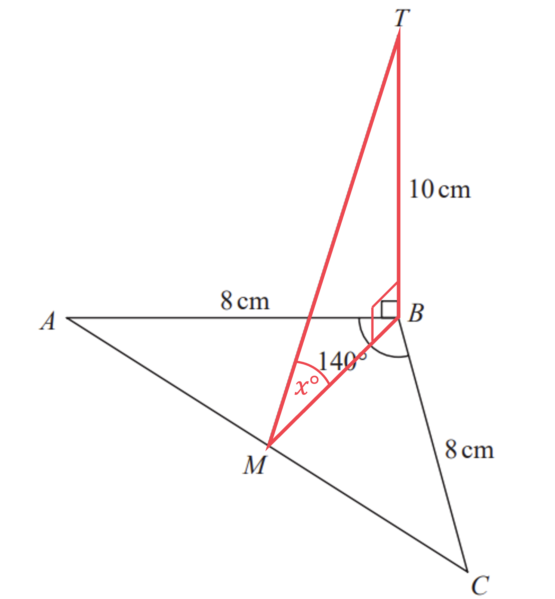

> *In order to find the required angle you will first need to find the length of the side **MB**.*

> *Triangle **ABC**  is isosceles as **AB **= **BC** = 8 cm. Therefore we can divide triangle **ABC** in two, to form two right-angle triangles. One of the right-angle triangles is shown below. Angle **ABC** is bisected so we know that angle **MBC** is 70°:*

> *Now we can find **MB** as we have an angle and a hypotenuse in a right-angle triangle. We need the adjacent side, so use the cosine ratio.*

$\cos ( 70 ) = \frac{M B}{8}$

**[1]**

> *Multiply both sides by 8*

$\begin{gathered} M B & = 8 \cos ( 70 ) \\ = 2.736161147... \end{gathered}$

**[1]**

> *It's best to store this result as an exact value on your calculator. We can mark it on the diagram:*

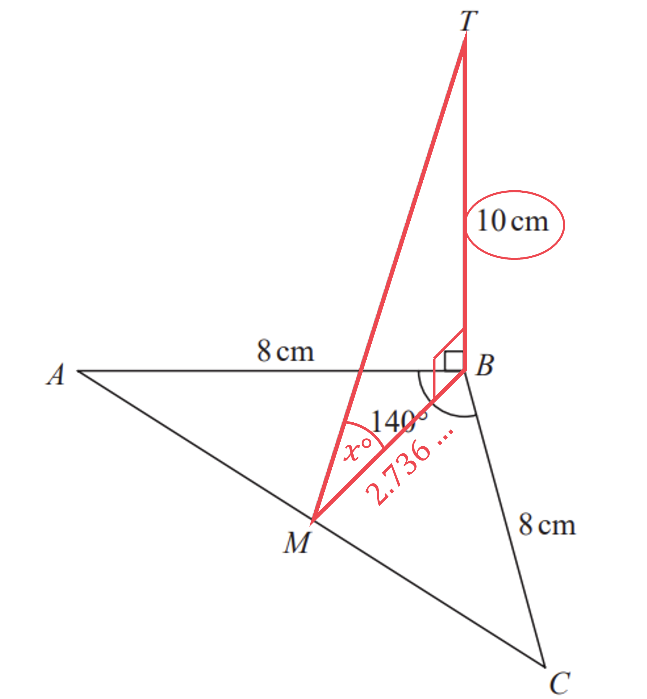

> *Now we have two known sides on a right-angle triangle; the adjacent (2.736...) and the opposite (10, circled above). Use the tangent ratio to find the required angle.*

$\begin{gathered} \tan ( x ) & = \frac{10}{2.736...} \end{gathered}$

**[1]**

> *Use the inverse tangent function ("SHIFT tan") on your calculator to find **x.*

$\begin{gathered} x = \tan ^{- 1} ( \frac{10}{2.736...} ) \end{gathered}$

> *Round your answer to 1 decimal place as requested. Remember to include the units.*

**Answer = 74.7°**  **[1]**

## Q3 — medium — 4 marks · exam-questions

### 18() — 4 marks
> *To find the angle between a line and a plane it is helpful to draw a right angled triangle using the line that is perpendicular to the plane.*

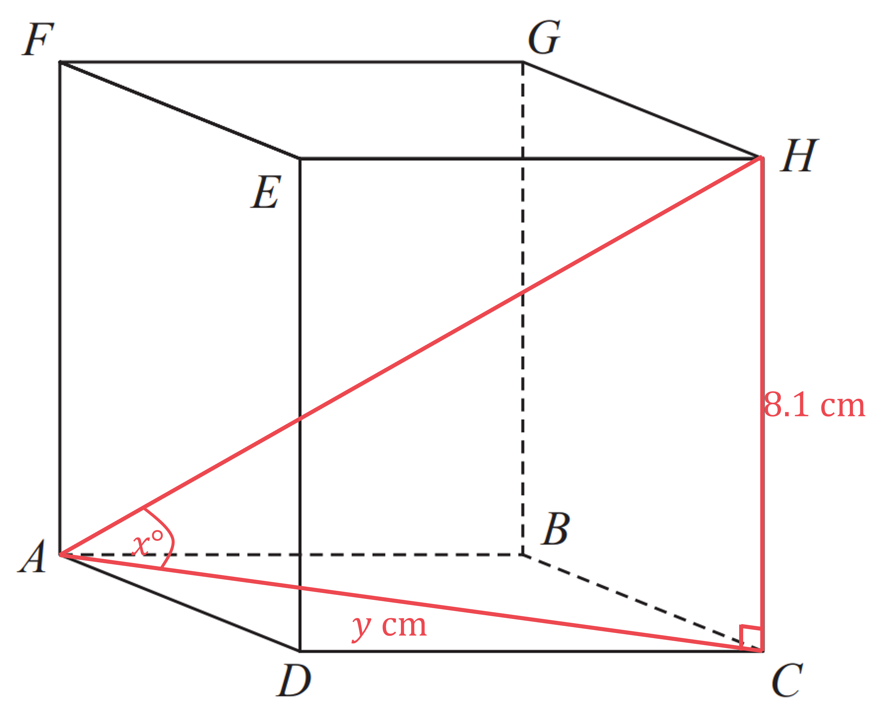

> *In order to find the required angle you will first need to find the length of the side **AC**. To do this draw a right angled triangle using the other information you are given.*

> *In the triangle **ABC** you know an angle and the length of the side opposite. You want to find the hypotenuse so use the sin ratio.*

$\sin ( 48 ) = \frac{7.3}{x}$

**[1]**

> *Multiply both sides by **x** and divide by sin(48).*

$\begin{array}{rcl} x = \frac{7.3}{\sin ( 48 )} \\ = 9.823118... \end{array}$

**[1]**

> *Now you can use the triangle **CAH**. In this triangle you want to find an angle and you know the lengths of the sides that are opposite and adjacent to the angle so use the tan ratio. Use the answer button or the exact value for the length of the side **AC**.*

$\tan ( x ) = \frac{8.1}{9.823118...}$

**[1]**

> *Find the angle by using the inverse tan function.*

$\begin{gathered} x = \tan ^{- 1} ( \frac{8.1}{9.823118...} ) \\ = 39.508492... \end{gathered}$

> *Round your answer to 1 decimal place. Remember to include the units.*

$\mathrm{Angle} \mathrm{between}AH\mathrm{and} \mathrm{the} \mathrm{plane}ABCD=39.5^{\circ}(1\mathrm{dp})$ **[1]**

## Q4 — very_hard — 3 marks · exam-questions

### 17((b)) — 3 marks
> *To identify the angle between a line and a plane it is helpful to draw a right angled triangle using **AD** and the line that is perpendicular to the plane:*

> *We have added **K **to the diagram. To find **x**, we need to obtain the length **AK **so we can consider triangle **AHK**:*

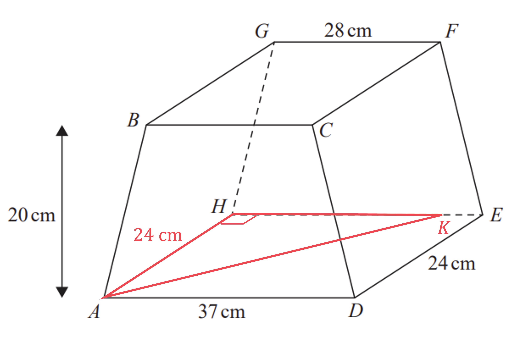

> *In right-angle triangle **AHK**, we already have length **AH** so to find **AK** we need length **HK.** We can deduce **HK** by considering trapezium **EFGH**:*

$HL=KE\mathrm{and}HL+KE=37-28\,KE=\frac{37-28}{2}=4.5\,HK=37-4.5=32.5$

> *Now we can find **AK **using Pythagoras' Theorem in triangle **AHK **(our second diagram).*

$\begin{gathered} A K & = \sqrt{A H^{2} + H K^{2}} \\ = \sqrt{24^{2} + 32.5^{2}} \\ = 40.40111385... \end{gathered}$

**[1]**

> *(This mark was hard won! But the remaining two marks are now close!)*

> *Save this result in your calculator to preserve accuracy. *
*Find **x** using triangle **AFK **(our first diagram) and the tangent ratio.*

$\tan ( x ) = \frac{20}{40.40111385...}$

**[1]**

> *Use the inverse tangent function ("SHIFT tan" on your calculator) to find the required angle.*

$\begin{gathered} x = \tan ^{- 1} ( \frac{20}{40.40111385...} ) \\ = 26.33706009... \end{gathered}$

> *Round your answer to 1 decimal place as requested. Remember to include the units.*

**Answer = **$26.3^{\circ}$ **[1]**

## Q5 — hard — 4 marks · exam-questions

### 22() — 4 marks
> *To identify the angle between a line and a plane it is helpful to draw a right angled triangle using **AD **and the line that is perpendicular to the plane:*

> *Triangle** EDF** is isosceles so **M** is the midpoint of **FE. **In order to find the required angle we need to find two lengths on triangle **AMD**. We will find **DM** and **AM** as follows.*

> *We can draw two new right-angle triangles to help us find sides **DM** and **AM **as below. Because **M **is the midpoint of **FE**, we know that **FM **= **ME **= 5cm.*

> *We can see from the diagrams that to find **DM** and **AM**, we can use Pythagoras' Theorem with two different triangles.*

$DM=\sqrt{12^{2}-5^{2}}=\sqrt{119}$

**[1]**

$AM=\sqrt{15^{2}+5^{2}}=5\sqrt{10}$

**[1]**

> *We can mark these results on our diagram:*

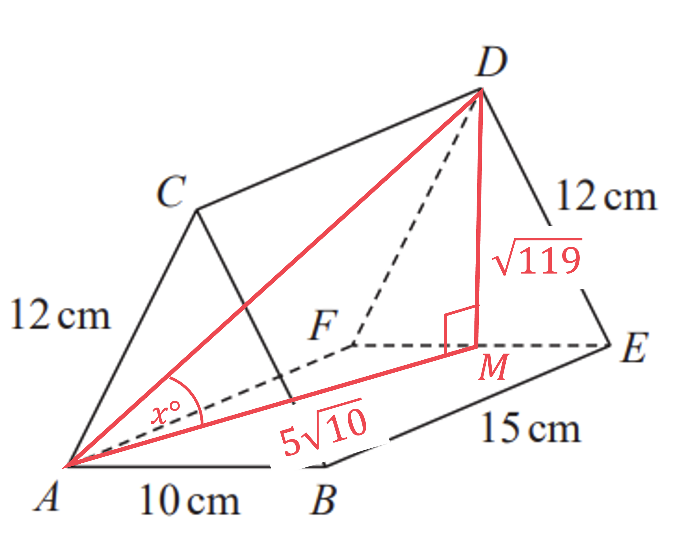

> *Now we have the opposite and adjacent side so can use the tangent ratio to find the required angle*

$\begin{gathered} \tan ( x ) & = \frac{ \sqrt{119} }{5 \sqrt{10} } \end{gathered}$

**[1]**

> *Use the inverse tangent function ("SHIFT tan" on your calculator) to find the required angle*

$\begin{array}{rcl} x = \tan ^{- 1} ( \frac{ \sqrt{119} }{5 \sqrt{10} } ) \\ = 34.60286258... \end{array}$

> *Round your answer to 3 significant figures as requested. Remember to include the units.*

**Answer = **$34.6^{\circ}$ **[1]**

## Q6 — medium — 3 marks · exam-questions

### 19() — 3 marks
> *To identify the angle between a line and a plane it is helpful to draw a right angled triangle using the line that is perpendicular to the plane:*

> *We need to find angle **x**. Notice that we have side **AE.** In order to find the required angle we first need to find the length of the side **AC**. To do this draw a right angled triangle connecting hypotenuse **AC** with sides whose lengths are known:*

> *In triangle **ABC** we can use Pythagoras' Theorem to find **AC.*

$AC=\sqrt{18^{2}+8^{2}}$

**[1]**

$=2\sqrt{97}$

> *It is best to leave this result in its exact form for accuracy. We can add this result to our diagram:*

> *Now we can use right-angle trigonometry to find the required angle.*

$\begin{gathered} \tan ( x ) & = \frac{12}{2 \sqrt{97} } \end{gathered}$

**[1]**

> *Use the inverse tangent function ("SHIFT tan" on your calculator) to find **x.*

$\begin{gathered} x = \tan ^{- 1} ( \frac{12}{2 \sqrt{97} } ) \\ = 31.35009472... \end{gathered}$

> *Round your answer to 1 decimal place as requested. Remember to include the units.*

**Answer = **$31.4^{\circ}$ **[1]**

## Q7 — very_hard — 5 marks · exam-questions

### 21() — 5 marks
> *Start by marking the information given on the diagram. We don't know any lengths but we can assign arbitray values so long as they are kept in the given ratios. *
*We can start by labeling the smallest known segments, **GM **and **MF**, as** **"1". *
*We can also mark angle **MAJ** as **y**.*

> *To find **y**, we need to find two lengths on triangle **AJM**. *

> *First, we will find **AM**.*

> *If **GM **= **MF **= 1 then **GF **= 2 so **AE **= 2.  *
*From the question**, EF** = 2 × **AE** so **EF** = **AG **= 4.*

> *Using Pythagoras' Theorem with triangle **AGM**, we can find **AM**. *

$\begin{gathered} A M & = \sqrt{1^{2} + 4^{2}} \\ = \sqrt{1 + 16} \\ = \sqrt{17} \end{gathered}$

**[1]**

> *Now we turn our attention to finding **MJ**.*

> *Add a point **N** to the line **HK** directly above **M**. Triangle **HJK** is equilateral so **NK** = 1 and **JK **= 2:*

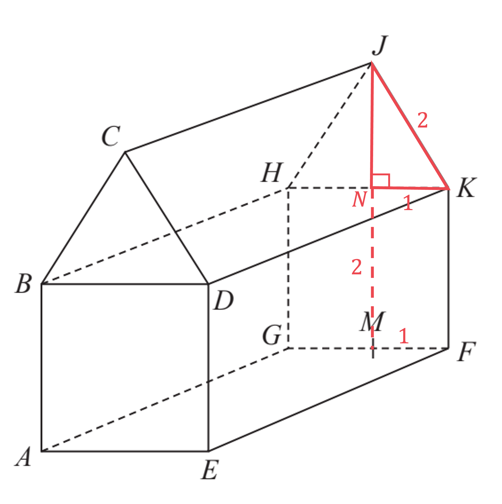

> *Using Pythagoras' Theorem with triangle **JKN, **we can find **JN*

$\begin{gathered} J N & = \sqrt{2^{2} - 1^{2}} \\ = \sqrt{4 - 1} \\ = \sqrt{3} \end{gathered}$

**[1]**

> *We add **MN** and **JN** to get **MJ.*

$\begin{gathered} M J & = \sqrt{3} + 2 \end{gathered}$

> *Mark **MJ **and **AM** on triangle **AMJ.*

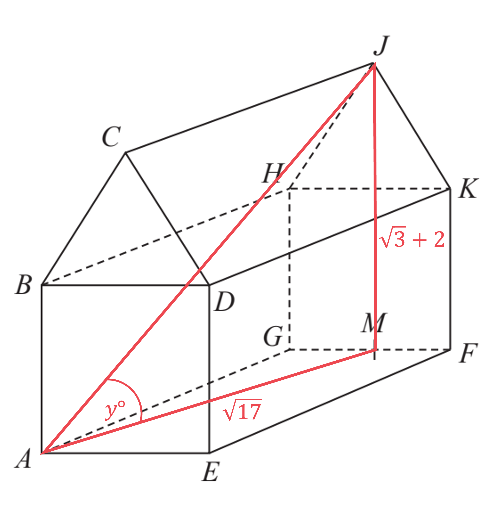

> *Now we can use trigonometry with triangle** AMJ** to find the value of tan(y), or **T**.*

$\begin{array}{rcl} T = \tan ( y ) = \frac{ \sqrt{3} + 2}{ \sqrt{17} } \end{array}$

**[1]**

> *Finally we need to rationalise the denominator*

$\begin{gathered} T = \frac{ \sqrt{17} ( \sqrt{3} + 2 )}{ \sqrt{17} \sqrt{17} } \\ = \frac{ \sqrt{51} + 2 \sqrt{17} }{17} \end{gathered}$

**[1]**

> *We are almost there! We need to write the answer in the form requested. 2 is the same as √4 so...*

$\begin{gathered} = \frac{ \sqrt{51} + \sqrt{4} \sqrt{17} }{17} \\ = \frac{ \sqrt{51} + \sqrt{68} }{17} \end{gathered}$

`T | _ = _ | | _ _ (sqrt( 51 + sqrt( 68)/( 17) | |` **[1]**

## Q8 — hard — 6 marks · exam-questions

### 21((a)) — 3 marks
> *Look at the base from above and find the length **FH** using Pythagoras' theorem on the right-angled triangle **FHE**.*

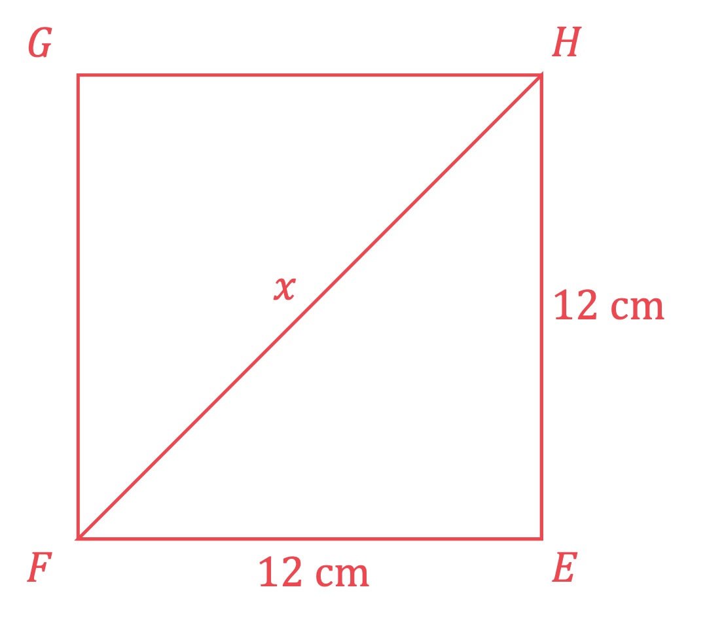

$\begin{gathered} x^{2} & = 12^{2} + 12^{2} \\ x^{2} & = 288 \\ x = \sqrt{288} \end{gathered}$

**[1]**

> *Use trigonometry on the right-angled triangle **FCH**. *

> *You know the opposite side and the adjacent side, so use *$\mathrm{tan}θ=\frac{Opp}{Adj}$*.*

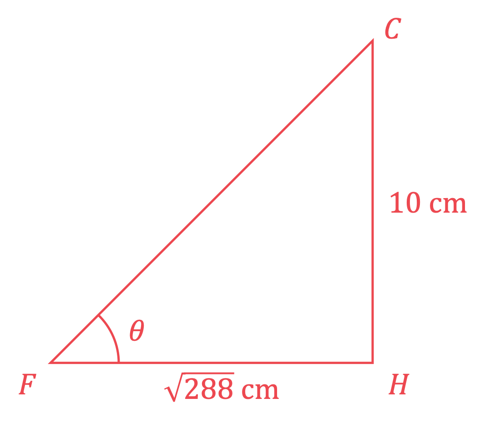

$\begin{gathered} \tan \\theta & = \frac{10}{ \sqrt{288} } \end{gathered}$

**[1]**

$\begin{gathered} \\theta = \tan ^{- 1} ( \frac{10}{ \sqrt{288} } ) \\ \\theta = 30.5089... \end{gathered}$

**30.5****o**** ****[1]**

### 21((b)) — 3 marks
> *Looking at the face **BCHG**, split the trapezium into a right-angled triangle and a rectangle.*

> *Use Pythagoras' theorem to calculate the length **BP.*

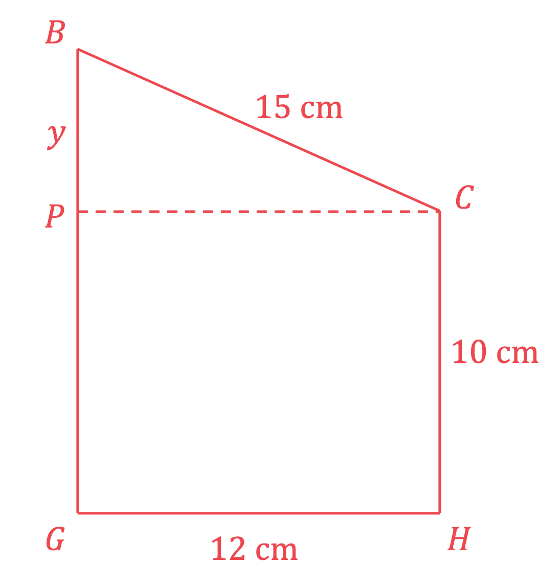

$\begin{array}{rcl} y^{2} & = 15^{2} - 12^{2} \\ y^{2} & = 81 \\ y = 9 \end{array}$

> *Add the length **BP** to the length **GP** to find the length **BG**.*

$BG=9+10=19$

**[1]**

> *Sketch the right-angled triangle **BEG**. *
*EG** = **FH** = *$\sqrt{288}$*.*

> *Use Pythagoras' theorem to calculate the length **BE**.*

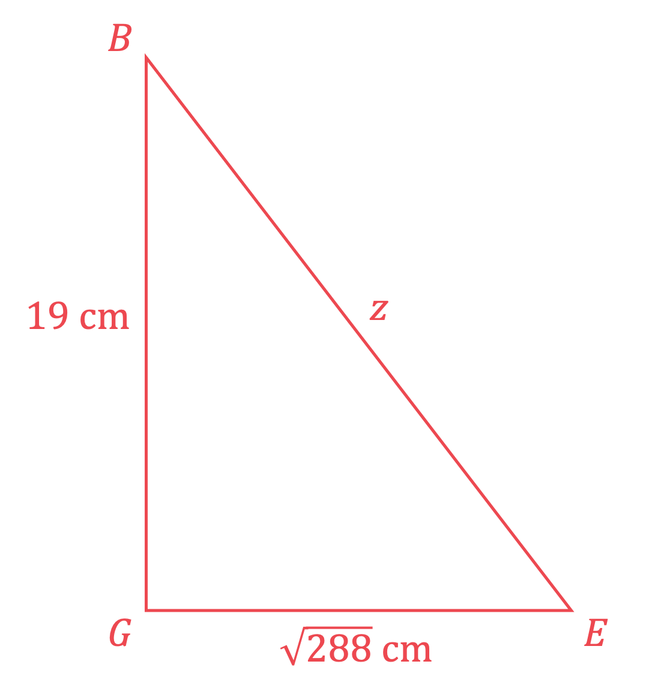

$\begin{gathered} z^{2} & = 19^{2} + ( \sqrt{288} )^{2} \\ z^{2} & = 649 \\ z = 25.4754... \end{gathered}$

**[1]**

**25.5 cm** **[1]**

**Answers between 25.4 and 25.6 will be accepted**

## Q9 — medium — 4 marks · exam-questions

### 19() — 4 marks
> *To identify the angle between a line and a plane it is helpful to draw a right angled triangle using the line that is perpendicular to the plane.*

> *We need to find angle **x**. Notice that we have side **AF.** In order to find the required angle we first need to find the length of the side **FH**. To do this draw a right angled triangle connecting hypotenuse **FH** with two sides whose lengths are known.*

> *In triangle **EFH **we can use Pythagoras' Theorem to find **FH.*

$FH=\sqrt{9^{2}+5^{2}}$

**[1]**

$=\sqrt{106}$

> *It is best to leave this result in its exact form for accuracy. We can add this result to our diagram.*

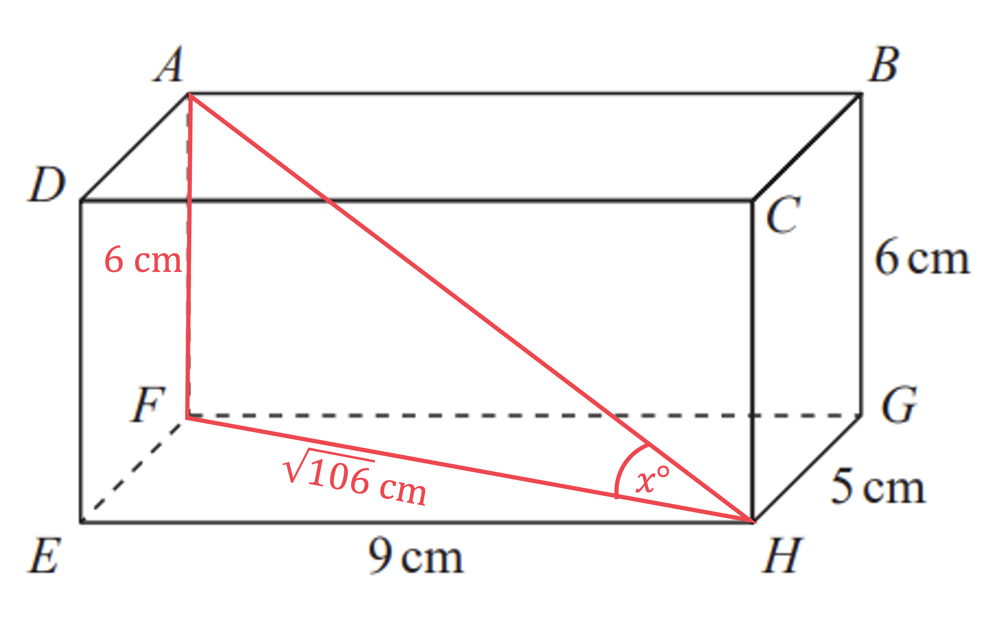

> *Now we can use right-angle trigonometry to find the required angle.*

$\begin{gathered} \tan ( x ) & = \frac{6}{ \sqrt{106} } \end{gathered}$

**[1]**

> *Use the inverse tangent function ("SHIFT tan" on your calculator) to find **x.*

$\begin{gathered} x = \tan ^{- 1} ( \frac{6}{ \sqrt{106} } ) \end{gathered}$

**[1]**

$\begin{gathered} = 30.23241412... \end{gathered}$

> *Round your answer to 3 significant figures as requested. Remember to include the units.*

**Answer = **$30.2^{\circ}$ **[1]**

## Q10 — very_hard — 7 marks · exam-questions

### 18((a)) — 4 marks
> *Draw the stick on the diagram such that it extends from a bottom corner through the diagonally opposite top corner and out of the crate.  *
*Let the length of the stick inside the crate be **x **cm, then the length of the stick outside of the crate will be 95 - **x **cm.*

> *It also may help to add the right-angled triangles that the diagonal makes with the edges onto the diagram.*

> *Use Pythagoras' theorem, *$a^{2}+b^{2}=c^{2}$*, on the right-angled triangle on the base of the crate to find length of the diagonal on the base.*

$\begin{gathered} 46^{2} + 46^{2} & = c^{2} \end{gathered}$

**[1]**

$\begin{gathered} c^{2} & = 2 ( 46^{2} ) \\ = 4232 \\ c & = \sqrt{4232} \\ = 46 \sqrt{2} \text{cm} \end{gathered}$

**[1]**

> *Use Pythagoras' theorem on the right-angled triangle made up of the diagonal at the base, the side with length 55 cm and the diagonal made by the part of the stick inside the crate, **x.*

$\begin{gathered} ( 46 \sqrt{2} )^{2} + 55^{2} & = x^{2} \\ 4232 + 3025 & = x^{2} \\ x^{2} & = 7257 \\ x & = \sqrt{7257} \text{cm} \end{gathered}$

**[1]**

> *Calculate the length of the stick that extends out of the crate by subtracting **x** from the length of the stick.*

$\begin{gathered} 95 - x & = 95 - \sqrt{7257} \\ = 95 - 85.188027... \end{gathered}$

$9.81\mathrm{cm}$* ***[1]**

### 18((b)) — 3 marks
> *To find the angle between a line and a plane it is helpful to draw a right angled triangle using the line that is perpendicular to the plane.*

> *Add the lengths that are known either from the question or found in part (a) to the diagram.*

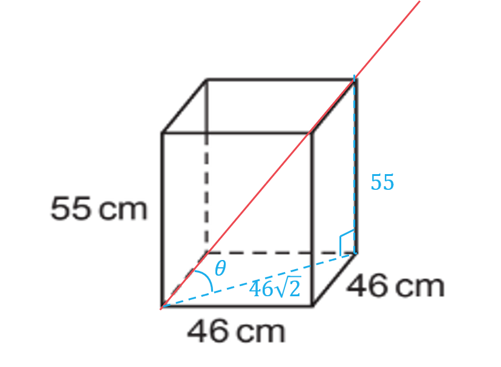

**Indicating correct angle ****[1]**

> *In the triangle you know the length of the side opposite the angle and the length of the side adjacent to the angle so use the tan ratio. Use the exact value found in part (a) for the length of the diagonal of the base.*

`tan ( theta ) = O / A = (55)/(46 sqrt( 2)`

**[1]**

> *Find the angle by using the inverse tan function.*

$\begin{gathered} \\theta & = \tan ^{- 1} ( \frac{55}{46 \sqrt{2} } ) \\ = 40.212974... \end{gathered}$

> *Round your answer to 1 decimal place. Remember to include the units.*

$\mathrm{Angle}=40.2^{\circ}(1\mathrm{dp})$ **[1]**

## Q11 — hard — 6 marks · exam-questions

### 25((a)) — 2 marks
*Triangle** BCD** is a right-angled triangle, so SOHCAHTOA can be used* 
*Use tan **x** = *$\frac{\mathrm{opp}}{\mathrm{adj}}$* * * *

$\mathrm{tan}6=\frac{CD}{500}$

**[1]**

*Multiply both sides by 500 to calculate the length **CD* * *

$500\mathrm{tan}6=CD$

**52.6 m** **[1]**

**Answers between 52.5 and 52.6 are accepted (and so is the rounded answer 53)**

### 25((b)) — 4 marks
*On the diagram, label angle **DAC** as **x**, mark on **CD **= 52.6 from part (a) and highlight triangle **DAC* * *

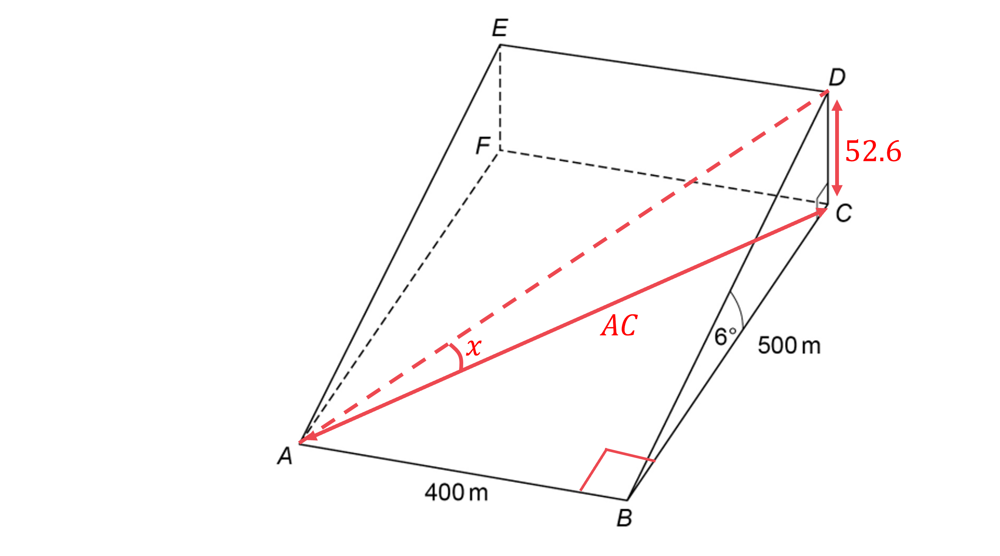

> * *

*Triangle **DAC **is right-angled at **C** so SOHCAHTOA can be used* 
*Use tan **x** = *$\frac{\mathrm{opp}}{\mathrm{adj}}$ * *

$\mathrm{tan}x=\frac{52.6}{AC}$ * *

> *Find **AC** using Pythagoras' Theorem in the rectangle **ABCF  *

$AC^{2}=500^{2}+400^{2}\,AC=\sqrt{500^{2}+400^{2}}\,AC=640.3...$

**500****2**** + 400****2**** seen**** [1]**

**AC correct ****[1]**

> *Substitute this into the expression for tan **x *

$\mathrm{tan}x=\frac{52.6}{640.3...}$

**[1]*** *

*Take inverse tan of both sides* * *

$x = \tan ^{- 1} ( \frac{52.6}{640.3...} )$

**4.7°** **[1]**

**Answers between 4.6° and 4.75° are accepted (and so is the rounded answer 5°)**

## Q12 — medium — 3 marks · exam-questions

### 19() — 3 marks
> *To find the angle between a line and a plane it is helpful to draw a right angled triangle using the line that is perpendicular to the plane:*

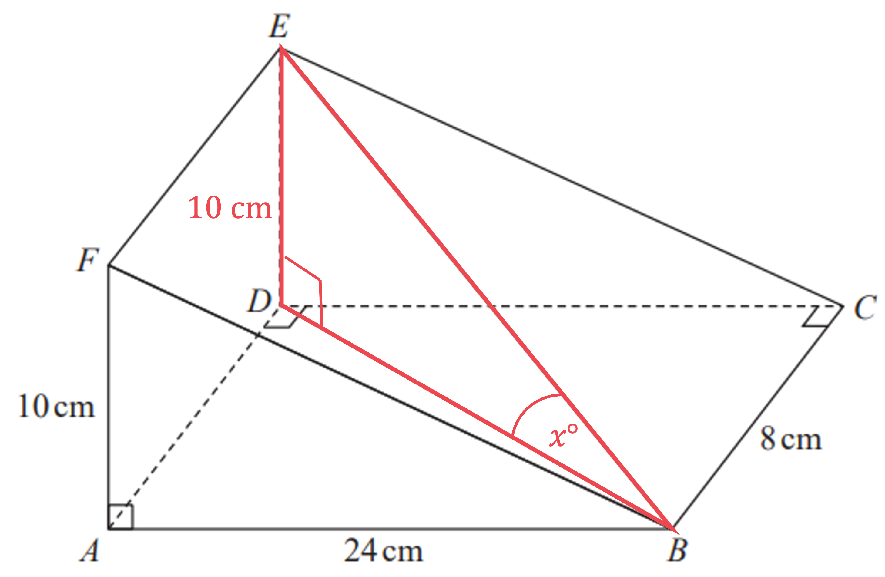

> *In order to find the required angle you will first need to find the length of the side **DB**. To do this draw a right angled triangle joining **DB** with two other known sides:*

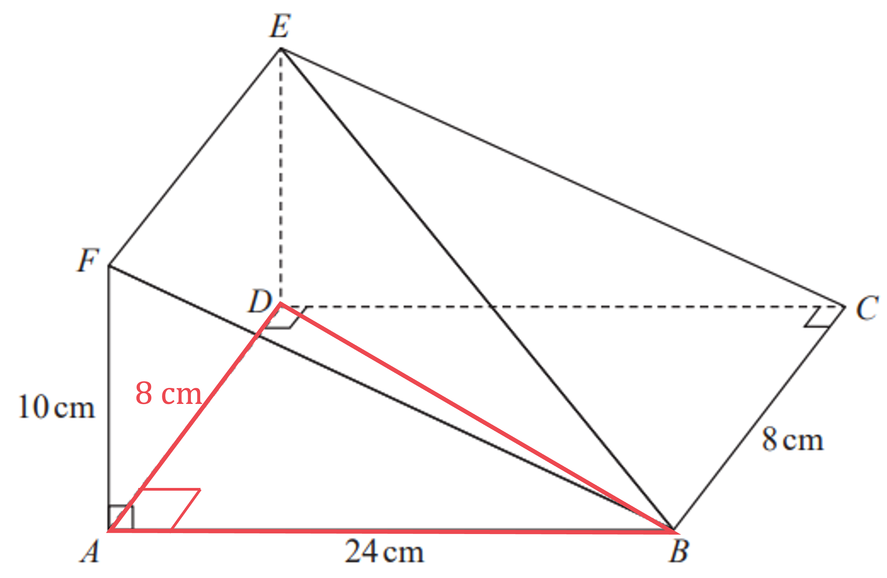

> *Now we can use Pythagoras to find **DB**.*

$\begin{gathered} D B^{2} & = 8^{2} + 24^{2} \\ D B & = \sqrt{8^{2} + 24^{2}} \\ = 8 \sqrt{10} \end{gathered}$

**[1]**

> *Mark this length on the diagram*

> *Now we know the opposite and adjacent sides in a right-angle triangle so use the tangent ratio to find the required angle*

$\tan ( x ) = \frac{10}{8 \sqrt{10} }$

**[1]**

> *Find the angle by using the inverse tan function ("SHIFT tan" on your calculator)*

$\begin{gathered} x = \tan ^{- 1} ( \frac{10}{8 \sqrt{10} } ) \\ = 21.5681294... \end{gathered}$

> *Round your answer to 1 decimal place as requested. Remember to include the units*

**Answer = **$21.6^{\circ}$ **[1]**

## Q13 — very_hard — 4 marks · exam-questions

### 21() — 4 marks
> *Drawing a diagram of the angle we are trying to find using triangle *$AMV$

> *This would be solvable using tan if we knew the length of *$AM$

> *Considering the base of the pyramid*

> *Find the length of the diagonals using Pythagoras*

$AC=\sqrt{8^{2}+8^{2}}=8\sqrt{2}$

**Finding diagonal length**** [1]**

> *Length *$AM$* is half the length of a diagonal*

$AM=4\sqrt{2}$

**Finding length that helps find angle**** [1]**

> *We can then fill this information in on the first diagram*

> *This can then be solved using the tan ratio; *$\text{tan}θ=\frac{\text{opposite}}{\text{adjacent}}$

$\begin{gathered} \text{\tan } x & = \frac{10}{4 \sqrt{2} } \\ x = \text{\tan }^{- 1} ( \frac{10}{4 \sqrt{2} } ) = 60.5037915^{\circ} \end{gathered}$

**Using tan ratio correctly**** [1]**

$60.5^{\circ}$ **[1] **
**Angles should be rounded to 1 decimal place**

## Q14 — hard — 6 marks · exam-questions

### 25() — 2 marks
*On the diagram, mark on **AE** = 17 and **AM** = 8 (as it is half of **AB** = 16)* * *

> * *

*Use Pythagoras' Theorem to find **EM**2* * *

$\begin{array}{rcl} 8^{2} + E M^{2} & = 17^{2} \\ E M^{2} & = 17^{2} - 8^{2} \end{array}$

**[1]*** *

> *Take square roots of both sides to find **EM*

$\begin{gathered} E M & = \sqrt{17^{2} - 8^{2}} \\ = \sqrt{225} \end{gathered}$

**15** **[1]**

**Square rooting must be seen for the final mark, as it is a "show that" question**

### 25((b)) — 4 marks
*Triangle **ECM** is right-angled at **M** so SOHCAHTOA can be used* *Label angle **ECM **as** x** and write **EM** as 15 on the diagram, from part (a)*

*Method 1* * *

> * *

*Find **MC** using Pythagoras' Theorem in triangle **MBC* * *

$\begin{gathered} M C^{2} & = 8^{2} + 30^{2} \\ M C & = \sqrt{8^{2} + 30^{2}} \\ M C & = 31.048... \end{gathered}$

**correct under the square root ****[1] **** correct with the square root ****[1]**

*Use tan **x** = *$\frac{\mathrm{opp}}{\mathrm{adj}}$* in triangle** ECM* * *

$\mathrm{tan}x=\frac{15}{31.048...}$

**[1]*** *

*Find inverse tan of both sides*

$x = \tan ^{- 1} ( \frac{15}{31.048...} )
x = 25.78...$

**25.8°** **[1]**

**Answers between 25.7 and 26 are accepted**

*Method 2* * *

> * *

*Find **EC** using Pythagoras' Theorem in triangle **EBC* * *

$\begin{gathered} E C^{2} & = 17^{2} + 30^{2} \\ E C & = \sqrt{17^{2} + 30^{2}} \\ E C & = 34.481... \end{gathered}$

**correct under the square root ****[1] **** **
**correct with the square root ****[1]**

*Use sin **x** = *$\frac{\mathrm{opp}}{\mathrm{hyp}}$* in triangle** ECM* * *

$\mathrm{sin}x=\frac{15}{34.481...}$

**[1]*** *

*Find inverse sin of both sides*

$x = \sin ^{- 1} ( \frac{15}{34.481...} )
x = 25.78...$

**25.8°** **[1]**

**Answers between 25.7 and 26 are accepted**

## Q15 — medium — 1 marks · exam-questions

### 16((a)) — 1 marks
*Write the side-lengths on the diagram (it is a cube so they will all be **x**)* * *

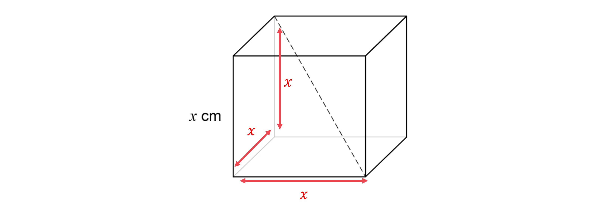

> * *

*Use the 3D Pythagoras rule, that  *$x^{2}+y^{2}+z^{2}=d^{2}$*, to find the length of the diagonal* * *

$\begin{array}{rcl} x^{2} + x^{2} + x^{2} & = d^{2} \\ 3 x^{2} & = d^{2} \end{array}$ * *

*Square root both sides*

$\begin{gathered} \sqrt{3 x^{2}} & = d \\ \sqrt{3} x & = d \end{gathered}$

$\sqrt{3}x$ **[1]**

*From the square-rooting line of working, **the second and fourth options can be eliminated** (there is no cube rooting)*

> *From the last two lines of algebra, **the third option can be eliminated** (there is no **x**3 **on the left-hand side)*

## Q16 — very_hard — 5 marks · exam-questions

### 9((b)) — 5 marks
i) *Considering a diagram may help.*

> * *

> * *

> *EH **= **FG** so the trapezium is isosceles and has a line of symmetry through the centre.  *
*Hence, **EY **=** XF **= ½(8 - 5) = 1.5 cm.*

**EX**** = 8 - ½(8 - 5) = 6.5 cm ****[1]**

ii) *Consider the diagram, **AEX** is a right-angled triangle where **AE **= 12 cm, **EX** = 6.5 cm.*

> *  *

> *Use Pythagoras'  theorem to find **AX.*

$AX^{2}=AE^{2}+EX^{2}\,AX^{2}=12^{2}+6.5^{2}$

**[1]**

> *Solve.*

$\begin{gathered} A X^{ } & = \sqrt{12^{2} + 6.5^{2}} \\ = 13.64734... \end{gathered}$

**AX **** = 13.6 cm (3 s.f.)****  [1]**

iii) *Draw the line from **A** to **G** and use it to form a right-angled triangle on the diagram.  *
*Use the perpendicular height, **h**, and the point **X** to help.*

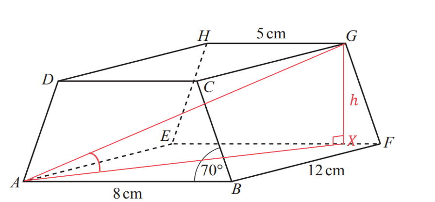

**[1]**

> *Angle **GAX  **is needed so use the triangle formed by the points **G, A **and **X**. *
*GX** = **h** = 4.121216... cm*
*AX** = 13.64735... cm.*

> *The sides opposite and adjacent to the angle are known so use the tan ratio.  *

$\begin{gathered} \tan G A X & = \frac{ G X}{A X} \\ = \frac{ 4.121216...}{13.64735} \\ = 0.301979... \end{gathered}$

> *Use the tan**-1** button to find the answer.*

$\begin{gathered} \tan G A X & = 0.301979... \\ G A X & = \tan ^{- 1} ( 0.301979... ) \end{gathered}$

**Angle ****GAX**** = 16.8°**** [1]**

## Q17 — hard — 5 marks · exam-questions

### 14() — 5 marks
> *Find the length FH on the right-angled triangle FGH.*

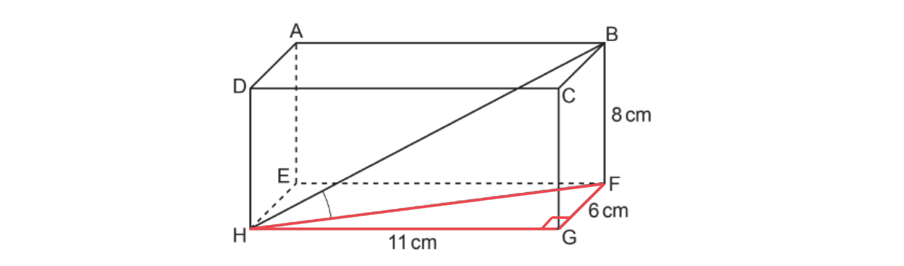

> *Use Pythagoras' theorem, *$c^{2}=a^{2}+b^{2}$*, where *$a$* and *$b$* are the two shorter sides and *$c$* is the hypotenuse.*

$\begin{gathered} F H^{2} & = 6^{2} + 11^{2} \\ F H & = \sqrt{6^{2} + 11^{2}} \end{gathered}$

**[1]**

$\begin{gathered} F H & = \sqrt{157} \end{gathered}$

**[1]**

> *Now use SOHCAHTOA on the right-angled triangle BFH to work out the size of the angle BHF.*

> *You know the lengths of both the adjacent and the opposite sides so use *$\mathrm{tan}θ=\frac{Opp}{Adj}$*.*

$\mathrm{tan}θ=\frac{8}{\sqrt{157}}$

**[1]**

> *Take *$\mathrm{tan}^{-1}$* of both sides to find the size of the angle.*

$\\theta = \tan ^{- 1} ( \frac{8}{ \sqrt{157} } )$

**[1]**

$θ=32.5569...$

> *The question does not ask you to give your answer to a specific degree of accuracy but it would be sensible to round your answer to 1 or 2 decimal places.*

$32.6^{\circ}$** [1]**

**An answer of 32.56 or 32.556... will also be accepted**

## Q18 — medium — 4 marks · exam-questions

### 18((c)) — 4 marks
> *Begin by drawing the diagonal from A to C on the base of the diagram. This forms the right-angled triangle ACD**.*

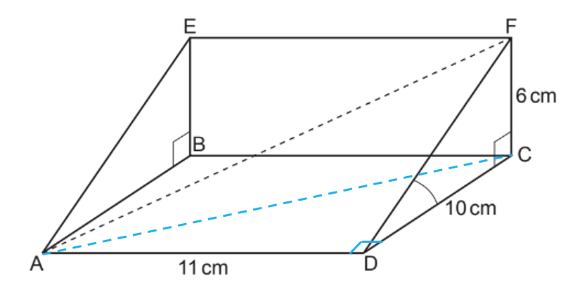

> *Use Pythagoras' theorem, *$a^{2}+b^{2}=c^{2}$*, on the right-angled triangle ACD to find the length AC.*

$\begin{gathered} A C^{2 } & = 11^{2} + 10^{2} \end{gathered}$

**[1]**

$\begin{gathered} A C^{2} & = 221 \\ A C & = \sqrt{221} \text{cm} \end{gathered}$

> *Use Pythagoras' theorem on the right-angled triangle ACF to find the length AF, make sure you use the exact value for the length AC.*

$\begin{gathered} A F^{2} & = A C^{2} + C F^{2} \\ = ( \sqrt{221} )^{2} + 6^{2} \end{gathered}$

**[1]**

$\begin{gathered} A F^{2 } & = 221 + 36 \\ A F & = \sqrt{221 + 36} \end{gathered}$

**[1]**

> *The question asks for the exact value of the length AF, so leave the answer as a surd, do not evaluate.*

$\begin{gathered} A F & = \sqrt{257} \end{gathered}$

$AF=\sqrt{257}\mathrm{cm}$* ***[1]**

## Q19 — very_hard — 4 marks · exam-questions

### 6((b)) — 4 marks
> *The longest part of the cuboid will be a diagonal from a bottom corner to the opposite top corner.  Draw this diagonal onto the diagram. *

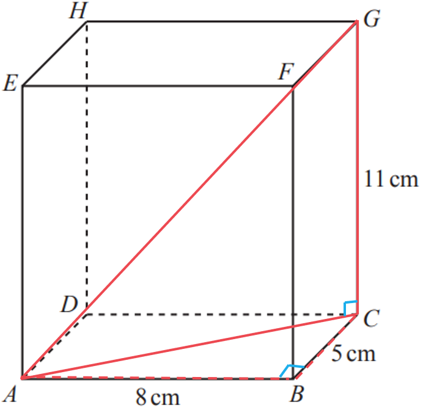

> *ACG** is a right-angled triangle. *
*ABC** is a right-angled triangle, where **AB **= 8 cm, **BC** = 5 cm.*

> *Use Pythagoras'  theorem with triangle **ABC **to find the length of **AC**.*

*  *$AC^{2}=AB^{2}+BC^{2}\,AC^{2}=8^{2}+5^{2}$

**[1]**

> *Solve**.*

$\begin{gathered} A C^{ } & = \sqrt{8^{2} + 5^{2}} \\ = \sqrt{89} \\ = 9.43398... \end{gathered}$

> *It is better to use the exact value of **AC** in the next part. *
*Use Pythagoras'  theorem with triangle **ACG **to find the length of **AG**.*

> *  *$\begin{array}{rcl} A G^{ 2 } & = A C^{ 2 } + C G^{ 2} \\ A G^{ 2 } & = ( \sqrt{89} )^{2} + 11^{2} \end{array}$

**[1]**

> *Solve**.*

$\begin{gathered} A G^{ } & = \sqrt{89 + 11^{2}} \\ = \sqrt{210} \\ = 14.4914... \end{gathered}$

**[1]**

**AG ****= 14.5 (3 s.f.****) ****cm > 13 cm so yes the pencil will fit. ****[1]**

## Q20 — hard — 6 marks · exam-questions

### 20() — 6 marks
> *Add the lines AF and FB to the diagram and indicate the angle AFB onto the diagram.*

**[1]**

> *Look at the right-angled triangle BCF, use Pythagoras' theorem, *$a^{2}+b^{2}=c^{2}$*, to calculate the length BF.*

$\begin{gathered} B F^{2} & = 25^{2} + 40^{2} \\ B F^{2} & = 625 + 1600 \end{gathered}$

**[1]**

$\begin{gathered} B F^{2} & = 2225 \\ B F & = \sqrt{2225} = 5 \sqrt{89} \end{gathered}$

**[1]**

> *Use SOHCAHTOA on the right-angled triangle ABF with the length AB = 18 cm and the exact value for the length of BF. *
*You have the length AB** **(opposite the angle) and the length BF (adjacent to the angle) so use: *$\mathrm{tan}θ=\frac{Opp}{Hyp}$*.*

> * *$\begin{gathered} \tan \\theta & = \frac{A B}{B F} \\ \tan \\theta & = \frac{18}{5 \sqrt{89} } \end{gathered}$

**[1]**

> *Use the inverse tan button (tan**-1**) on your calculator to find the value of the angle AFB (**θ**).*

$\begin{gathered} \\theta & = \tan ^{- 1} ( \frac{18}{5 \sqrt{89} } ) = 20.8868... \end{gathered}$

**[1]**

> *Round the answer to 1 decimal place.*

$\mathrm{Angle} \mathrm{AFB}=20.9^{\circ}$* ***[1]**

## Q21 — medium — 3 marks · exam-questions

### 21() — 3 marks
> *The line **PV, **the line **PT **and the angle **PVT  **form a right-angled triangle so SOHCAHTOA can be used to find the missing side **PT.*

> *Draw the sides of the triangle onto the diagram to make the right-angled triangle clearer.*

** Identifying the angle on the diagram correctly**** [1]**

> *The side opposite the angle is needed and the hypotenuse is known so use  *$\mathrm{sin}x^{\circ}=\frac{\mathrm{Opp}}{\mathrm{Hyp}}$*.*

$\mathrm{sin}43^{\circ}=\frac{PT}{17.2}$

**[1]**

> * Solve the trigonometric equation to find the side **PT.** *

$\begin{gathered} P T & = 17.2 \sin 43^{\circ} \\ = 11.7303... \end{gathered}$

**PT**** = 11.7 cm (3 s.f.)**** [1]**

## Q22 — very_hard — 3 marks · exam-questions

### 4((d)) — 3 marks
> *Length **BX** is half the length of **BD** as **X**  is at the centre of the base.*

$BX=8\div2=4$* **cm*

*Triangle** PXB** is a right angled triangle.* *The angle between **PB** and the base **ABCD** is angle **PXB**.*

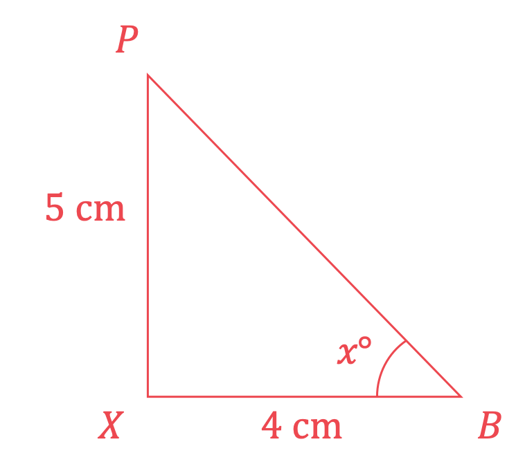

**[1]**

*Use simple trigonometry to find the angle **PXB**.* 
*You know the opposite and adjacent sides, so use the tan ratio.*

$\mathrm{tan}x=\frac{5}{4}$

**[1]**

> *Find the inverse tan of both sides.*

$x = \tan ^{- 1} ( \frac{5}{4} )$

$x=51.34019...$

$51.3^{\circ}$ **[1]**

**A value of 51.34... will be accepted.**

## Q23 — medium — 4 marks · exam-questions

### 6((c)) — 4 marks
i) *The angle **CAB **is opposite the side **BC **and adjacent to the side **AB**, so use the tan ratio.  *

$\begin{array}{rcl} \tan C A B & = \frac{B C}{A B} \\ \tan C A B & = \frac{5}{8} \end{array}$

**[1]**

> *Use the tan**-1 **button on your calculator to find the angle.*

$\begin{gathered} C A B & = \tan ^{- 1} ( \frac{5}{8} ) \\ = 32.0053... \end{gathered}$

**Angle ****CAB ****= 32.0° (1 d.p.) ****[1]**

ii) *The angle **GAC **is opposite the side **CG. **The hypotenuse is the diagonal **AG**, so use the sine ratio. Use the unrounded version of your answer for **AG **from part (b).  *

$\begin{gathered} \sin G A C & = \frac{G C}{A G} \\ \sin G A C & = \frac{11}{ \sqrt{210} } \end{gathered}$

**[1]**

> *Use the sin**-1 **button on your calculator to find the angle.  *

$\begin{gathered} G A C & = \sin ^{- 1} ( \frac{11}{ \sqrt{210} } ) \\ = 49.3824... \end{gathered}$

**Angle ****GAC ****= 49.4° (1 d.p.) ****[1]**

## Q24 — medium — 4 marks · exam-questions

### 6((b)) — 4 marks
> *The line *$AR$* and the line *$AB$* form a right-angle triangle with the line *$RB$*- which is on the plane *$BCRQ$* as shown below. The angle between the diagonal *$AR$* and the plane *$BCRQ$* is therefore the angle between *$AR$*and the line *$AB$*.*

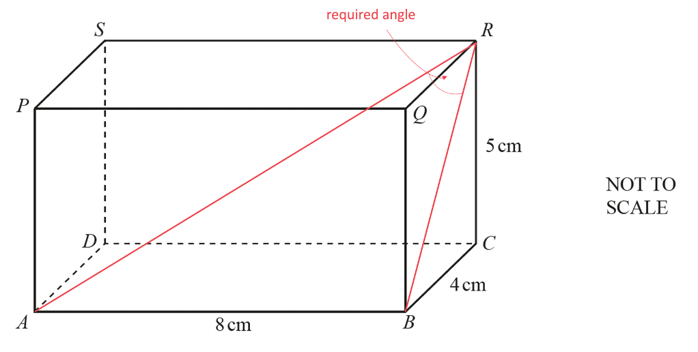

**identifying the required angle ****[1]**

> *Angle *$ABR$* is a right angle so to find angle *$ARB$* we can use the tangent ratio with *$AB=8$* and *$BR$*.*

> *To find *$BR$* we can use Pythagoras' theorem with *$CR=5$* and *$BC=4$*.*

$BR=\sqrt{4^{2}+5^{2}}$

**[1]**

> *Now we can apply the tangent ratio to find the angle. *

$\tan ( A R B ) = \frac{8}{ \sqrt{4^{2} + 5^{2}} }$

**[1]**

> *Inverse tangent on your calculator to find the angle.*

$\begin{gathered} A R B & = \tan ^{- 1} ( \frac{8}{ \sqrt{4^{2} + 5^{2}} } ) \\ = 51.32655062...^{\circ} \end{gathered}$

**51.3° ****[1] **
**Give answers in degrees to at least one decimal place**
