# Mark Schemes — Functions
**Functions, Graphs & Differentiation** · Edexcel IGCSE Maths A (Modular) (4XMAF/4XMAH) — 24/Higher Unit 2

## Q1 — very_hard — 5 marks · exam-questions

### 1() — 2 marks
*Factorise the easier quadratic in the numerator (by taking out a common factor of **x**)* * *

$\frac{x ( x + 3 )}{2 x^{2} + 5 x - 3}$

*The harder quadratic on the denominator is likely to have (**x** + 3) as a factor*

*Try factorising with (x + 3)* * *

$2 x^{2} + 5 x - 3 = ( 2 x \pm... ) ( x + 3 ) ?$ * *

> *The whole number -1 in the first bracket would multiply by +3 in the second bracket to give -3 on the left *

*Expanding this attempt shows it is correct* * *

$( 2 x - 1 ) ( x + 3 ) = 2 x^{2} + 5 x - 3$

**[1]**

*Cancel common brackets from top-and-bottom* * *

$\begin{array}{rcl} \frac{x \cancel{( x + 3 )} }{( 2 x - 1 ) \cancel{( x + 3 )} } \\ = \frac{x}{2 x - 1} \end{array}$

> *This is of the form *$\frac{x}{kx-1}$* where **k** = 2*

$\frac{x}{2x-1}$* ***where ****k**** = 2*** ***[1]**

### 2() — 3 marks
*Replace f(**x**) with **y* * *

$y=\frac{x}{2x-1}$ * *

*Without rearranging the equation, swap the **x**'s and **y**'s* * *

$x=\frac{y}{2y-1}$

**[1]**

> *We must make **y** the subject of this new equation *

*Remove fractions (by multiplying both sides by 2**y** - 1)* * *

$\begin{array}{rcl} x ( 2 y - 1 ) & = y \end{array}$

> *Expand the brackets  *

$2xy-x=y$

> *Get the **y** terms on one side (by example, by adding **x** to both sides and subtracting **y** from both sides)  *

$\begin{array}{rcl} 2 x y & = y + x \\ 2 x y - y & = x \end{array}$

**[1]**

> *Factorise out** y** from the two terms on the left  *

> $y ( 2 x - 1 ) = x$*  *

> *Get **y** on its own (by dividing both sides by 2**x** - 1)  *

> $y=\frac{x}{2x-1}$*   *

*The function on the right-hand side is the inverse function, f**-1**(**x**)* *Replace **y** with f**-1**(**x**) to write down the final answer*

$f^{-1}(x)=\frac{x}{2x-1}$* ***[1]**

** In this question, f****-1****(****x****) and f(****x****) are identical, so f(****x****) is described as "self-inverse" **

## Q2 — hard — 3 marks · exam-questions

### 17((b)) — 3 marks
> *Although this may at first appear to be a quadratic equations question, it's actually a linear equations question "in disguise"!*

> *First rewrite *$\text{fg} ( x ) = \mathrm{f} ( x )$* in terms of *$x$* using composite functions.*

$( x - 10 )^{2} + 6 = x^{2} + 6$

**[1]**

> *Expand the brackets; *$( x - 10 )^{2} = ( x - 10 ) ( x - 10 )$*.*

$x^{2}-20x+100+6=x^{2}+6$

**[1]**

> *Collect like terms on the left hand side.*

$x^{2}-20x+106=x^{2}+6$

> *Now subtract *$x^{2}$* from both sides, to reveal the linear equation!*

$\begin{gathered} x^{2} - 20 x + 106 & = x^{2} + 6 \\ - x^{2} & = - x^{2} \\ - 20 x + 106 & = 6 \end{gathered}$

> *Subtract 106 from both sides.*

$\begin{gathered} - 20 x & = - 100 \end{gathered}$

> *And divide both sides by -20.*

$\begin{gathered} x & = \frac{- 100}{- 20} = 5 \end{gathered}$

$x=5$ ** [1]**

## Q3 — medium — 3 marks · exam-questions

### 11((a)) — 1 marks
*Substitute** x** = -5 into f(**x**) (putting brackets around the negative number)*

$\mathrm{f} ( - 5 ) = \frac{2}{( - 5 )^{2}}$

> *Work out this value (either using a calculator or by using that (-5) × (-5) = 25)*

$\frac{2}{25}$ **[1]**

### 11((b)) — 2 marks
*fg(1) means f(g(1))*

*Find g(1) by substituting **x** = 1 into g(**x**)* * *

$\begin{gathered} \mathrm{g} ( 1 ) & = 4 \times 1^{3} \\ = 4 \end{gathered}$

**[1]**

*If g(1) = 4 then f(g(1)) = f(4)*

*Find f(4) by substituting **x **= 4 into f(**x**)* * *

> $\mathrm{f} ( \mathrm{g} ( 1 ) ) = f ( 4 ) = \frac{2}{4^{2}}$*  *

> *Write 4**2** as 16 (from 4 × 4) and cancel *$\frac{2}{16}$* (by dividing top-and-bottom by 2)*

$\frac{1}{8}$* ***[1]**

## Q4 — very_hard — 5 marks · exam-questions

### 22() — 5 marks
*This question involves setting up and solving simultaneous equations in **a** and **b*

*If g(3) = 20 then substitute x = 3 into g(x) and set this equal to 20* * *

$\begin{gathered} a \times 3 + b & = 20 \\ 3 a + b & = 20 \end{gathered}$

**[1]**

> *f**-1**(33) = g(1) *

*Find the inverse function, f**-1**(**x) **by first replacing f(**x**) with **y* * *

$y=5x+3$ * *

*Without rearranging the equation, swap the **x**'s and **y**'s* * *

$x=5y+3$

*Now make **y** the subject of this new equation (by subtracting 3 from both sides then dividing both sides by 5)* * *

$\begin{gathered} x - 3 & = 5 y \\ \frac{x - 3}{5} & = y \end{gathered}$ * *

*The function on the left-hand side is the inverse function, f**-1**(**x**)* *Replace **y** with f**-1**(**x**)*

$f^{-1}(x)=\frac{x-3}{5}$

**[1]**

> *Find f**-1**(33) by substituting **x** = 33 into f**-1**(**x**)  *

$\begin{gathered} \mathrm{f}^{- 1} ( 33 ) & = \frac{33 - 3}{5} \\ = \frac{30}{5} \\ = 6 \end{gathered}$

> *Find g(1) by substituting 1 into g(**x**)  *

$\mathrm{g} ( 1 ) = a + b$

**[1]**

> *f**-1**(33) = g(1) where f**-1**(33) = 6 and g(1) = **a** + **b*

> * Set 6 equal to **a** + **b**  *

$6=a+b$

**[1]**

> *Write down the two simultaneous equations for **a** and **b**  *

> $\begin{gathered} 3 a + b & = 20 \\ a + b & = 6 \end{gathered}$*  *

> *Solve to find **a** (for example, by subtracting the second equations from the first)  *

> $\begin{array}{rcl} 2 a & = 14 \\ a = \frac{14}{2} \\ a = 7 \end{array}$*  *

> *Find **b** (for example, by substituting **a** = 7 into the second equation then solving for** b**)  *

> $\begin{gathered} 7 + b & = 6 \\ b = - 1 \end{gathered}$*  *

> *Write out the two solutions together*

**a ****= 7 and ****b**** = -1*** ***[1]**

## Q5 — hard — 3 marks · exam-questions

### 18() — 3 marks
*Replace every **x** in f(**x**) with (**x** + 2) in brackets* * *

$\mathrm{f} ( x + 2 ) = 3 ( x + 2 )^{2} - 2 ( x + 2 ) - 8$

**[1]**

*Expand the brackets (**x** + 2)**2** and collect like terms* * *

$\begin{gathered} ( x + 2 )^{2} & = ( x + 2 ) ( x + 2 ) \\ = x^{2} + 2 x + 2 x + 4 \\ = x^{2} + 4 x + 4 \end{gathered}$ * *

*Replace (**x** + 2)**2** in the original expression with the result above in brackets* * *

$\mathrm{f} ( x + 2 ) = 3 ( x^{2} + 4 x + 4 ) - 2 ( x + 2 ) - 8$

**[1]**

*Expand the brackets (by multiplying all terms in the first bracket by 3 and all terms in the second bracket by -2)* * *

$\mathrm{f} ( x + 2 ) = 3 x^{2} + 12 x + 12 - 2 x - 4 - 8$

*Collect like terms* * *

$\mathrm{f} ( x + 2 ) = 3 x^{2} + 10 x$ * *

> *This is now in the form **ax**2** + **bx** where **a** = 3 and **b** = 10*

$f(x+2)=3x^{2}+10x$* ***[1]**

## Q6 — medium — 4 marks · exam-questions

### 1() — 2 marks
*Replace f(**x**) with **y* * *

$y=3x-2$ * *

*Without rearranging the equation, swap the **x**'s and **y**'s* * *

$x=3y-2$

**[1]**

*Now make **y** the subject of this new equation (by adding 2 to both sides then dividing both sides by 3)* * *

$\begin{gathered} x + 2 & = 3 y \\ \frac{x + 2}{3} & = y \end{gathered}$ * *

*The function on the left-hand side is the inverse function, f**-1**(**x**)* *Replace **y** with f**-1**(**x**) to write down the final answer*

$f^{-1}(x)=\frac{x+2}{3}$**[1]**

### 2() — 2 marks
*gf(**x**) means g(f(**x**))*

*Write the expression for f(**x**) inside g(...)* * *

$\mathrm{g} ( \mathrm{f} ( x ) ) = \mathrm{g} ( 3 x - 2 )$ * *

*Find g(3**x** - 2) by replacing the **x**'s in g(**x**) with the brackets (3**x** - 2)* * *

$g ( 3 x - 2 ) = \frac{10}{( 3 x - 2 ) + 2}$

**[1]**

*Expand the brackets and collect like terms in the denominator* * *

$\begin{array}{rcl} g ( 3 x - 2 ) & = \frac{10}{3 x - 2 + 2} \\ = \frac{10}{3 x} \end{array}$ * *

> *Write your final answer as gf(**x**) = ...*

$\mathrm{gf}(x)=\frac{10}{3x}$* ***[1]**

## Q7 — very_hard — 9 marks · exam-questions

### 1() — 1 marks
*Substitute** x** = 10 into f(**x**) *

$\mathrm{f} ( 10 ) = \sqrt{10 - 6} = \sqrt{4}$

**2** **[1]**

### 2() — 2 marks
> *The domain is the set of values that can be inputs.*

*You cannot take the square root of a negative number.*

> *The set of inputs must ensure that the expression under the square root is not negative.  *

> *The values of *$x$* that must be excluded are found by solving  *$x-6<0$*.*

$x-6<0$

**[1]**

$x<6$* ***[1]**

### 3() — 1 marks
> *The set of inputs are on the **x-**axis and the set of outputs are on the **y-**axis**.*

> *Draw a line to the graph from **x** = 2 and then along to the **y-**axis.*

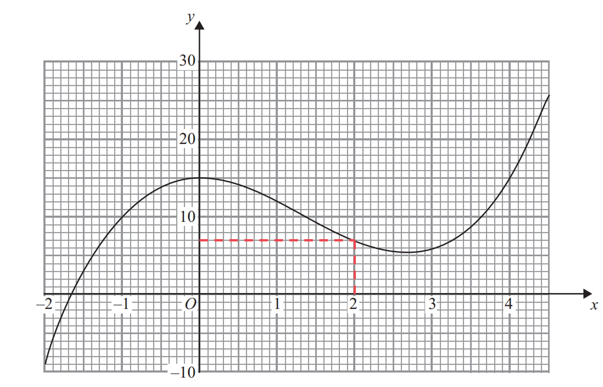

$g(2)=7$* ***[1]**

### 4() — 2 marks
> *To find the value of *$fg ( 0 )$*, put the output of *$\mathrm{g} ( 0 )$* into *$\mathrm{f} ( x )$*. *

> *Use the graph of *$\mathrm{g} ( x )$* to find the value of *$\mathrm{g} ( 0 )$*. *

> *The value of *$\mathrm{g} ( 0 )$* is the **y **value when the **x **value is 0.*

$g(0)=15$

**[1]**

> *The output of g(0) is 15. *

> *Substitute this into the expression for *$\mathrm{f} ( x )$*.*

$\begin{gathered} \mathrm{f} ( 15 ) & = \sqrt{15 - 6} \\ = \sqrt{9} \end{gathered}$

$\mathrm{fg}(0)=3$* ***[1]**

### 5() — 3 marks
> *The value of *$k$*is the output when *$x=1$* is the input.*

> *Draw a line to the graph from *$x=1$* and then along to the **y-**axis to find the value of *$k.$

> *Draw a horizontal line across the graph extending across all of *$\mathrm{g} ( x ).$

**[1]**

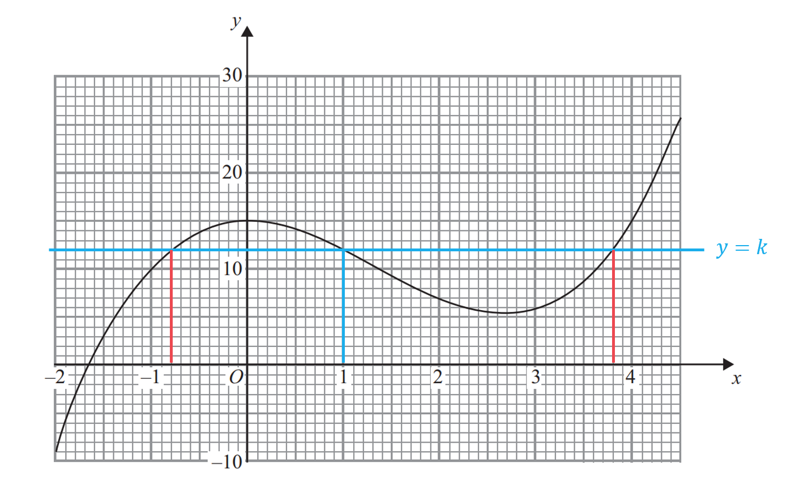

> *Read the values off the **x**- axis from the points where the graphs of *$y=k$* and *$y = \mathrm{g} ( x )$* intersect. *

**[1]**

$x=-0.8\mathrm{and}x=3.8$ **[1]**

## Q8 — hard — 6 marks · exam-questions

### 1() — 3 marks
*fg(**x**) means f(g(**x**))*

*Write the expression for g(**x**) inside f(...)* * *

$\mathrm{f} ( \mathrm{g} ( x ) ) = \mathrm{f} ( \frac{1}{x - 2} )$ * *

*Find *$\mathrm{f} ( \frac{1}{x - 2} )$* by replacing the **x**'s in f(**x**) with the brackets *$( \frac{1}{x - 2} )$ * *

$\begin{array}{rcl} \mathrm{f} ( \frac{1}{x - 2} ) & = ( \frac{1}{x - 2} ) + 3 \\ = \frac{1}{x - 2} + 3 \end{array}$

**[1]**

> *It may help to think of 3 as the fraction *$\frac{3}{1}$* *

*Find the lowest common denominator by multiplying 1 by (**x** - 2)*

*lowest common denominator is *$( x - 2 )$

*Multiply top-and-bottom of each fraction by the brackets needed to form this denominator*

$\frac{1}{x - 2} + \frac{3 ( x - 2 )}{x - 2}$

> *Write as one single fraction over the common denominator *

*Add the numerators* * *

$\frac{1 + 3 ( x - 2 )}{x - 2}$

**[1]**

*Expand the brackets in the numerator* * *

$\frac{1+3x-6}{x-2}$ * *

> *Collect "like" terms in the numerator*

$\frac{3x-5}{x-2}$ **[1]**

### 2() — 3 marks
*Replace g(**x**) with **y* * *

$y=\frac{1}{x-2}$ * *

*Without rearranging the equation, swap the **x**'s and **y**'s* * *

$x=\frac{1}{y-2}$

**[1]**

> *We must make **y** the subject of this new equation *

*Remove fractions (by multiplying both sides by **y** - 2)* * *

$\begin{gathered} x ( y - 2 ) & = 1 \end{gathered}$

> *Get (**y** - 2) on its own (by dividing both sides by** x**)  *

$y-2=\frac{1}{x}$

**[1]**

> *Get **y** on its own (by adding 2 to both sides)  *

> $y=\frac{1}{x}+2$*  *

*The function on the right-hand side is the inverse function, g**-1**(**x**)* *Replace **y** with g**-1**(**x**) to write down the final answer*

$g^{-1}(x)=\frac{1}{x}+2$* ***[1]**

$\frac{1+2x}{x}$** is also accepted**

## Q9 — medium — 3 marks · exam-questions

### 1() — 1 marks
*Substitute** x** = *$\frac{1}{2}$* into f(**x**) *

$\mathrm{f} ( 1 \frac{1}{2} ) = \frac{1}{( 1 \frac{1}{2} )^{2} + 1}$

> *Work out this value using a calculator *

$\frac{4}{5}$ **[1]**

### 2() — 2 marks
*fg(**x**) means f(g(**x**))*

*Write the expression for g(**x**) inside f(...)* * *

$\mathrm{f} ( \mathrm{g} ( x ) ) = \mathrm{f} ( \sqrt{x - 1} )$ * *

*Find *$\mathrm{f} ( \sqrt{x - 1} )$* by replacing the **x**'s in f(**x**) with the brackets *$( \sqrt{x - 1} )$ * *

$\mathrm{f} ( \sqrt{x - 1} ) = \frac{1}{( \sqrt{x - 1} )^{2} + 1}$

**[1]**

*Squaring a square-root cancels it out Collect like terms* * *

$\begin{gathered} \mathrm{f} ( \sqrt{x - 1} ) & = \frac{1}{( \sqrt{x - 1} )^{2} + 1} \\ = \frac{1}{x - 1 + 1} \\ = \frac{1}{x} \end{gathered}$ * *

> *Write your final answer as fg(**x**) = ...*

$\mathrm{fg}(x)=\frac{1}{x}$* ***[1]**

## Q10 — very_hard — 9 marks · exam-questions

### 1() — 1 marks
> *The value of *$\mathrm{f} ( 0 )$* is the **y **value when the **x **value is 0.*

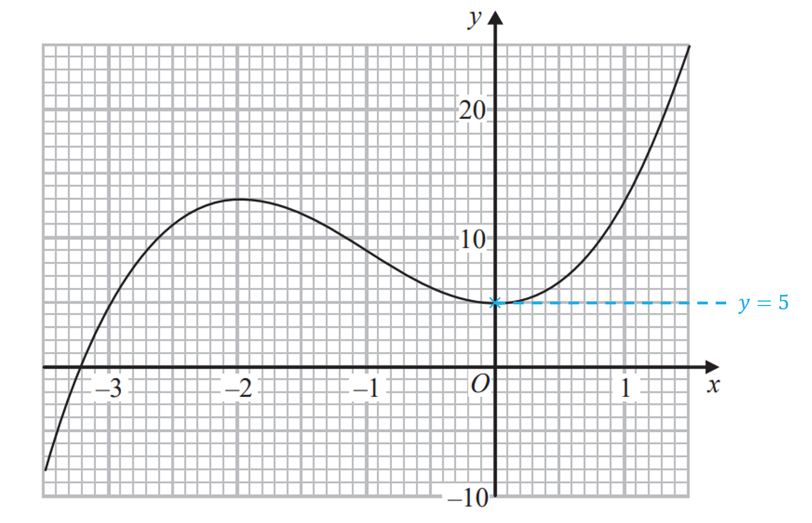

$f(0)=5$* ***[1]**

### 2() — 2 marks
> *There is more than one solution between the local minimum and the local maximum (turning points). *

> *Draw horizontal lines at the turning points on the graph. *

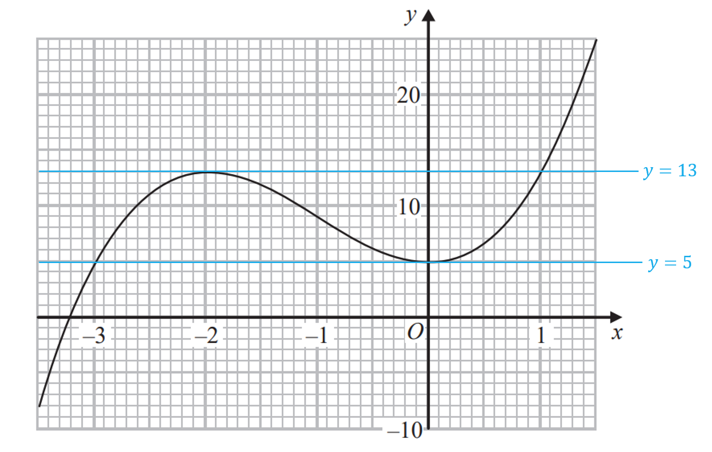

**[1]**

> *There is only one solution below the graph of *$y=5$* and above the graph of *$y=13$*.*

$k<5\mathrm{or}k>13$** [1]**

### 3() — 3 marks
> *An estimate for the gradient can be found by drawing a tangent to the graph at the point where *$x=-2.5.$

> *Draw a right-angled triangle between two coordinates on the tangent.*

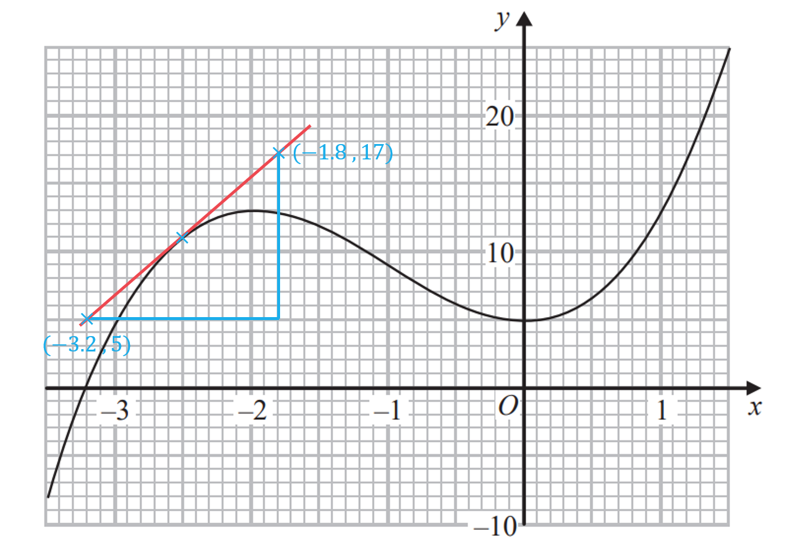

**[1]**

> *Use the two coordinates or the right-angled triangle to calculate the gradient. *

$\text{Gradient} = \frac{rise}{run} = \frac{17 - 5}{( - 1.8 ) - ( - 3.2 )}$

**[1]**

> *Use your calculator to find the answer, be careful with the negative numbers on the denominator.*

$\mathrm{Gradient}=\frac{12}{1.4}=8.57142...$

$\mathrm{Approximately}8.6$**[1]**

### 4() — 1 marks
> *The domain is the set of values that can be input into the function.*

*You cannot divide by zero.*

> *The set of inputs must ensure that the expression on the denominator is not zero.  *

> *The values of *$x$* that must be excluded are found by solving  *$2+x=0$*.*

$2+x=0$

$x\neq-2$* ***[1]**

### 5() — 2 marks
*fg(-3) means f(g(-3)).*

> *Find g(-3) by substituting **x** = -3 into g(**x**). *

$\begin{gathered} \mathrm{g} ( - 3 ) & = \frac{1}{2 + ( - 3 )} = \frac{ 1}{2 - 3} = \frac{ 1}{- 1} = - 1 \end{gathered}$

**[1]**

*If g(-3) = -1 then f(g(-3)) = f(-1).*

> *Find f(-1) by drawing a line to the graph of f(**x**) from *$x=-1$* and reading the **y** value from the graph. *

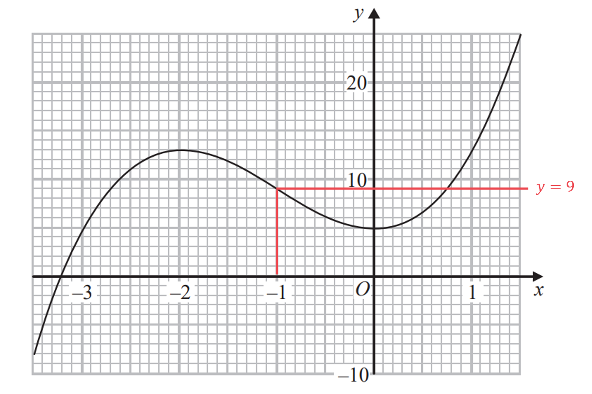

$\mathrm{fg}(-3)=9$* ***[1]**

## Q11 — hard — 4 marks · exam-questions

### 10((a)) — 2 marks
*Replace f(**x**) with **y* * *

$y=4x-1$ * *

*Without rearranging the equation, swap the **x**'s and **y**'s* * *

$x=4y-1$

**[1]**

*Now make **y** the subject of this new equation (by adding 1 to both sides then dividing both sides by 4)* * *

$\begin{gathered} x + 1 & = 4 y \\ \frac{x + 1}{4} & = y \end{gathered}$ * *

*The function on the left-hand side is the inverse function, f**-1**(**x**)* *Replace **y** with f**-1**(**x**) to write down the final answer*

$f^{-1}(x)=\frac{x+1}{4}$**[1]**

### 10((b)) — 2 marks
*fg(2) means f(g(2))*

*Find g(2) by substituting **x** = 2 into g(**x**)* * *

$\begin{gathered} \mathrm{g} ( 2 ) & = k \times 2^{2} \\ = 4 k \end{gathered}$

*If g(2) = 4**k** then f(g(2)) = f(4**k**)*

*Find f(4**k**) by replacing **x** in f(**x**) by (4**k**) in brackets* * *

$\mathrm{f} ( \mathrm{g} ( 2 ) ) = f ( 4 k ) = 4 ( 4 k ) - 1$

**[1]**

> *Form an equation for** k** (by setting the expression above equal to 12)  *

> $4 ( 4 k ) - 1 = 12$*  *

*Simplify the equation (by multiplying 4 x 4  x **k**)* * *

$16k-1=12$ * *

*Solve the equation (by adding 1 to both sides then dividing both sides by 16)*

$\begin{array}{rcl} 16 k & = 13 \\ k = \frac{13}{16} \end{array}$

$\frac{13}{16}$* ***[1]**

## Q12 — medium — 9 marks · exam-questions

### 1() — 1 marks
*Substitute** x** = 3 into f(**x**) *

$\mathrm{f} ( 3 ) = 2 \times 3 + 5$

> *Work out this value (by adding 6 and 5)*

**11** **[1]**

### 2() — 2 marks
*Replace f(**x**) with **y* * *

$y=2x+5$ * *

*Without rearranging the equation, swap the **x**'s and **y**'s* * *

$x=2y+5$

**[1]**

*Now make **y** the subject of this new equation (by subtracting 5 from both sides then dividing both sides by 2)* * *

$\begin{gathered} x - 5 & = 2 y \\ \frac{x - 5}{2} & = y \end{gathered}$ * *

*The function on the left-hand side is the inverse function, f**-1**(**x**)* *Replace **y** with f**-1**(**x**) to write down the final answer*

$f^{-1}(x)=\frac{x-5}{2}$**[1]**

### 3() — 1 marks
*Substitute** x** = -3 into g(**x**) (putting brackets around the negative number)*

$\mathrm{g} ( - 3 ) = ( - 3 )^{2} - 25$

> *Use that (-3) × (-3) = 9  *

$\mathrm{g} ( - 3 ) = 9 - 25$

**-16** **[1]**

### 4() — 5 marks
i) *gf(**x**) means g(f(**x**))* *Write the expression for f(**x**) inside g(...)* * *

$\mathrm{g} ( \mathrm{f} ( x ) ) = \mathrm{g} ( 2 x + 5 )$ * *

*Find g(2**x** + 5) by replacing the **x**'s in g(**x**) with the brackets (2**x** + 5)* * *

$\mathrm{g} ( 2 x + 5 ) = ( 2 x + 5 )^{2} - 25$

**[1]**

*Expand the brackets and collect like terms *

$\begin{gathered} ( 2 x + 5 )^{2} & = ( 2 x + 5 ) ( 2 x + 5 ) \\ = 4 x^{2} + 10 x + 10 x + 25 \\ = 4 x^{2} + 20 x + 25 \end{gathered}$

**[1]*** *

> *Substitute this result back in g(2x + 5) and cancel the 25s  *

> $\begin{array}{rcl} \mathrm{g} ( 2 x + 5 ) & = 4 x^{2} + 20 x + 25 - 25 \\ = 4 x^{2} + 20 x \end{array}$*  *

> *Write your final answer as gf(**x**) = ...*

$\mathrm{gf}(x)=4x^{2}+20x$* ***[1]**

ii) *Set the expression for gf(x) equal to zero* * *

$4x^{2}+20x=0$ * *

*Do not divide by **x **(this loses a solution)* *Factorise out 4**x**  *

$4 x ( x + 5 ) = 0$

**[1]**

*Solve 4**x** = 0 (by dividing by 4, or by seeing **x **= 0 is the solution)* * *

$\begin{gathered} 4 x & = 0 \\ x = 0 \end{gathered}$ * *

*Solve **x** + 5 = 0 (by subtracting 5 from both sides)* * *

$\begin{gathered} x + 5 & = 0 \\ x = - 5 \end{gathered}$ * *

> *Present both solutions together*

**x**** = 0 or ****x**** = -5 ****[1]**

## Q13 — very_hard — 5 marks · exam-questions

### 25((a)) — 4 marks
> *Finding the inverse of a quadratic function requires completing the square.*

> *Write the function in the form *$y=5+6x-x^{2}$*, rearrange to normal quadratic form and then swap the *$x$* and *$y.$*  *

$y=-x^{2}+6x+5\,x=-y^{2}+6y+5$

> *Rearrange **the expression to make *$y$* the subject again by first completing the square.*

> *Completing the square is easiest when dealing with a single, positive **y**2** term, so take a factor of -1.*

*This is only necessary for the **y**2** and **y** terms so leave 5 as it is.*

$- y^{2 } + 6 y + 5 = - ( y^{2} - 6 y ) + 5$

> *Complete the square for the part in brackets.*

$- ( y^{2} - 6 y ) + 5 = - [ ( y - 3 )^{2} - 9 ] + 5$

**[1]**

> *Expand and rearrange into the required completed square form.*

$\begin{gathered} - [ ( y + 3 )^{2} - 9 ] + 5 & = - ( y + 3 )^{2} + 9 + 5 \\ = 14 - ( y + 3 )^{2} \end{gathered}$

**[1]**

> *Set equal to *$x$* and rearrange to make *$y$* the subject.*

$x = 14 - ( y - 3 )^{2}$

> *Rearrange **the expression to make *$y$* the subject again.*

$\begin{gathered} x - 14 & = - ( y - 3 )^{2} \\ 14 - x & = ( y - 3 )^{2} \\ y - 3 & = \pm \sqrt{14 - x} \\ y & = 3 \pm \sqrt{14 - x} \end{gathered}$

**[1]**

*The domain of g is *`{ x colon x >= 3 }`* so this must be the range of the inverse, taking the positive square root will give *$y\geq3$*.*

> *Rewrite using the correct notation as instructed in the question.*

$g^{- 1} : x \rightarrow \text{from} \text{bar} 3 + \sqrt{ 14 - x}$ **[1]**

### 25((b)) — 1 marks
> *The domain of g**-1** is the set of values that can be input into the function.*

*You cannot square root a negative number.*

> *The set of inputs must ensure that the expression under the square root is not a negative number.  *

> *The values of *$x$* that must be excluded are found by solving  *$14-x\geq0$*.*

$\begin{array}{ccc}14 - x & \ge & 0 \\ 14 & \ge & x\end{array}$

`equation`**[1]**

## Q14 — hard — 7 marks · exam-questions

### 21((a)) — 2 marks
*Replace f(**x**) with **y* * *

$y=4x-1$ * *

*Without rearranging the equation, swap the **x**'s and **y**'s* * *

$x=3y-1$

**[1]**

*Now make **y** the subject of this new equation (by adding 1 to both sides then dividing both sides by 3)* * *

$\begin{gathered} x + 1 & = 3 y \\ \frac{x + 1}{3} & = y \end{gathered}$ * *

*The function on the left-hand side is the inverse function, f**-1**(**x**)* *Replace **y** with f**-1**(**x**) to write down the final answer*

$f^{-1}(x)=\frac{x+1}{3}$**[1]**

### 21((b)) — 5 marks
*fg(**x**) means f(g(**x**))*

*Write the expression for g(**x**) inside f(...)* * *

$\mathrm{f} ( \mathrm{g} ( x ) ) = \mathrm{f} ( x^{2} + 4 )$ * *

*Find *$\mathrm{f} ( x^{2} + 4 )$* by replacing the **x**'s in f(**x**) with the brackets *$( x^{2} + 4 )$ * *

$\begin{array}{rcl} \mathrm{f} ( \mathrm{g} ( x ) ) & = 3 ( x^{2} + 4 ) - 1 \end{array}$

**[1]**

*gf(**x**) means g(f(**x**))* *Write the expression for f(**x**) inside g(...)* * *

$\mathrm{g} ( \mathrm{f} ( x ) ) = \mathrm{g} ( 3 x - 1 )$ * *

> *Find *$\mathrm{g} ( 3 x - 1 )$* by replacing the **x**'s in g(**x**) with the brackets *$( 3 x - 1 )$*  *

$\mathrm{g} ( \mathrm{f} ( x ) ) = ( 3 x - 1 )^{2} + 4$

**[1]**

> *Set fg(**x**) equal to 2 × gf(**x**)  *

$3 ( x^{2} + 4 ) - 1 = 2 [ ( 3 x - 1 )^{2} + 4 ]$

**[1]**

> *Expand the curved brackets on either side  *

$3 x^{2} + 12 - 1 = 2 [ ( 3 x - 1 ) ( 3 x - 1 ) + 4 ]
3 x^{2} + 11 = 2 [ 9 x^{2} - 6 x + 1 + 4 ]
3 x^{2} + 11 = 2 [ 9 x^{2} - 6 x + 5 ]$

**(3x - 1)****2**** expanded correctly**** [1]**

> *Expand the square brackets (by multiplying all terms inside by 2]  *

> $3x^{2}+11=18x^{2}-12x+10$*  *

> *Make the left-hand side zero (by subtracting 3**x**2** and 11 from both sides)  *

$0=15x^{2}-12x-1$

$15x^{2}-12x-1=0$* ***[1]**

## Q15 — medium — 8 marks · exam-questions

### 1() — 1 marks
*Substitute** x** = 6 into f(**x**) *

$\mathrm{f} ( 6 ) = 1 \frac{1}{2} \times 6 + 4$

> *Work out this value (by adding 3 and 4)*

**7** **[1]**

### 2() — 2 marks
*fg(-3) means f(g(-3))*

*Find g(-3) by substituting **x** = -3 into g(**x**) (putting it in brackets as it's negative)* * *

$\begin{gathered} \mathrm{g} ( - 3 ) & = \frac{2 \times ( - 3 )}{( - 3 ) + 1} \\ \end{gathered}$

> *Work out this value (either on a calculator, or by doing -6 divided by -2)  *

$\mathrm{g} ( - 3 ) = \frac{- 6}{- 2} = 3$

**[1]**

*If g(-3) = 3 then f(g(-3)) = f(3)*

*Find f(3) by substituting **x **= 3 into f(**x**)* * *

$\begin{gathered} \mathrm{f} ( \mathrm{g} ( - 3 ) ) & = f ( 3 ) = 1 \frac{1}{2} \times 3 + 4 \\ = \frac{3}{2} + 4 \end{gathered}$

$\frac{11}{2}$* ***[1]**

**or 5.5 as a decimal**

### 3() — 2 marks
*Write down an expression for g(**a**) by substituting **x** = **a** into the expression for g(**x**)* * *

$\mathrm{g} ( a ) = \frac{2 a}{a + 1}$

> * *

*Form an equation for **a** (by setting this expression equal to -2)* * *

$\frac{2a}{a+1}=-2$

**[1]**

*Multiply both sides by** a** + 1* * *

$2 a = - 2 ( a + 1 )$ * *

*Expand the brackets and add 2**a** to both sides* * *

$2a=-2a-2\,4a=-2$ * *

*Find **a** (by dividing both sides by 4)* * *

$a=-\frac{2}{4}$

$a=-\frac{1}{2}$* ***[1]**

### 4() — 3 marks
*Replace f(**x**) with **y* * *

$y=\frac{1}{2}x+4$ * *

*Without rearranging the equation, swap the **x**'s and **y**'s* * *

$x=\frac{1}{2}y+4$

**[1]**

*Now make **y** the subject of this new equation (by subtracting 4 from both sides then multiplying both sides by 2)* * *

$\begin{gathered} x - 4 & = 1 \frac{1}{2} y \\ 2 ( x - 4 ) & = y \end{gathered}$

**attempt to rearrange for y**** [1]*** *

*The function on the left-hand side is the inverse function, f**-1**(**x**)* *Replace **y** with f**-1**(**x**) to write down the final answer*

$f^{-1}(x)=2(x-4)$ **[1]**

## Q16 — very_hard — 4 marks · exam-questions

### 23() — 4 marks
*Find the function h(**x**) by finding the composite function fg(**x**), where fg(**x**) means f(g(**x**)).*

> *Write the algebraic expression for g(**x**) inside f(...).*

$\mathrm{h} ( x ) = \mathrm{f} ( \mathrm{g} ( x ) ) = \mathrm{f} ( x^{2} - 12 x )$ * *

> *Find *$\mathrm{f} ( x^{2} - 12 x )$* by replacing the **x**'s in f(**x**) with the brackets *$( x^{2} - 12 x )$*.*

$\mathrm{h} ( x ) = \mathrm{f} ( x^{2} - 12 x ) = ( x^{2} - 12 x ) + 25 = x^{2} - 12 x + 25$

**[1]**

> *Find the inverse of h(**x**) by completing the square.*

> *Write the function in the form *$y = \mathrm{h} ( x )$* and then swap the *$x$* and *$y.$

$y=x^{2}-12x+25\,x=y^{2}-12y+25$

> *Rearrange **the expression to make *$y$* the subject again by first completing the square. *

> *The formula for completing the square for a quadratic in the form*$x^{2}+bx+c$*is*$( x + \frac{b}{2} )^{2} - ( \frac{b}{2} )^{2} + c$*.*

> *Complete the square by dividing the middle term (-12) by 2.*

$\begin{gathered} y^{2} - 12 y + 25 & = ( y - \frac{12}{2} )^{2 } - ( \frac{12}{2} )^{2} + 25 \\ = ( y - 6 )^{2} - 6^{2} + 25 \end{gathered}$

**Correct first step to complete square**** [1]**

> *Simplify.*

$\begin{gathered} ( y - 6 )^{2} - 6^{2} + 25 & = ( y - 6 )^{2} - 36 + 25 \\ = ( y - 6 )^{2} - 11 \end{gathered}$

> *Set equal to *$x$* and rearrange to make *$y$* the subject.*

$x = ( y - 6 )^{2} - 11$

> *Rearrange **the expression to make *$y$* the subject again.*

$\begin{gathered} x + 11 & = ( y - 6 )^{2} \\ y - 6 & = \pm \sqrt{x + 11} \\ y & = \pm \sqrt{x + 11} + 6 \\ y & = 6 \pm \sqrt{x + 11} \end{gathered}$

**[1]**

> *The domain of h(**x**) is *$x\leq6$* so this must be the range of the inverse, taking the negative square root will give *$y\leq6$*. *

> *Rewrite using the correct notation for an inverse function.*

$h^{-1}(x)=6-\sqrt{x+11}$ **[1]**

## Q17 — hard — 7 marks · exam-questions

### 1() — 1 marks
*Substitute** x** = 8 into f(**x**) *

$\mathrm{f} ( 8 ) = \frac{8 - 6}{2} = \frac{2}{2}$

**1** **[1]**

### 2() — 2 marks
*Replace f(**x**) with **y* * *

$y=\frac{x-6}{2}$ * *

*Without rearranging the equation, swap the **x**'s and **y**'s* * *

$x=\frac{y-6}{2}$

**[1]**

*Now make **y** the subject of this new equation (by multiplying both sides by 2 then adding 6 to both sides)* * *

$\begin{array}{rcl} 2 x & = y - 6 \\ 2 x + 6 & = y \end{array}$ * *

*The function on the left-hand side is the inverse function, f**-1**(**x**)* *Replace **y** with f**-1**(**x**) to write down the final answer*

$f^{-1}(x)=2x+6$ **[1]**

### 3() — 2 marks
*You cannot square root a negative number*

*Find the values of **x** which make **x** - 4 negative (by solving the inequality **x **- 4 < 0) * * *

$\begin{gathered} x - 4 & < 0 \\ x < 4 \end{gathered}$ * *

> *These are the "inputs" that must be excluded from any domain*

**seeing the number 4**** [1]**
** x**** < 4** **[1]**

### 4() — 2 marks
*gf(**x**) means g(f(**x**))* 
*Write the algebraic expression for f(**x**) inside g(...)* * *

$\mathrm{g} ( \mathrm{f} ( x ) ) = \mathrm{g} ( \frac{x - 6}{2} )$ * *

*Find *$\mathrm{g} ( \frac{x - 6}{2} )$* by replacing the **x**'s in g(**x**) with the brackets *$( \frac{x - 6}{2} )$ * *

$\begin{gathered} \mathrm{g} ( \frac{x - 6}{2} ) & = \sqrt{( \frac{x - 6}{2} ) - 4} \\ = \sqrt{ \frac{x - 6}{2} - 4} \end{gathered}$

**[1]**

> *By thinking of 4 as *$\frac{4}{1}$*, the part under the square root can be thought of as two fractions *

> *Subtract the two fractions (by writing both over a lowest common denominator of 2 and subtracting their numerators)  *

> * *$\begin{gathered} \sqrt{ \frac{x - 6}{2} - 4} & = \sqrt{ \frac{x - 6}{2} - \frac{4}{1} } \\ = \sqrt{ \frac{x - 6}{2} - \frac{8}{2} } \\ = \sqrt{ \frac{x - 6 - 8}{2} } \end{gathered}$*  *

** **$\begin{gathered} \sqrt{ \frac{x - 14}{2} } \end{gathered}$** [1]**

## Q18 — medium — 9 marks · exam-questions

### 1() — 1 marks
*Substitute** x** = 4 into f(**x**) *

$\mathrm{f} ( 4 ) = 2 \times 4 - 5$

**3** **[1]**

### 2() — 2 marks
*fg(-4) means f(g(-4))*

*Find g(-4) by substituting **x** = -4 into g(**x**) (putting it in brackets as it's negative)* * *

$\begin{gathered} \mathrm{g} ( - 4 ) & = ( - 4 )^{2} - 10 \\ = 16 - 10 \\ = 6 \end{gathered}$

**[1]**

*If g(-4) = 6 then f(g(-4)) = f(6)*

*Find f(6) by substituting **x **= 6 into f(**x**)* * *

$\mathrm{f} ( \mathrm{g} ( - 4 ) ) = f ( 6 ) = 2 \times 6 - 5$

**7*** ***[1]**

### 3() — 2 marks
*Replace f(**x**) with **y* * *

$y=2x+5$ * *

*Without rearranging the equation, swap the **x**'s and **y**'s* * *

$x=2y-5$

**[1]**

*Now make **y** the subject of this new equation (by adding 5 to both sides then dividing both sides by 2)* * *

$\begin{gathered} x + 5 & = 2 y \\ \frac{x + 5}{2} & = y \end{gathered}$ * *

*The function on the left-hand side is the inverse function, f**-1**(**x**)* *Replace **y** with f**-1**(**x**) to write down the final answer*

$f^{-1}(x)=\frac{x+5}{2}$**[1]**

### 4() — 4 marks
*gf(**x**) means g(f(**x**))*

*Write the expression for f(**x**) inside g(...)* * *

$\mathrm{g} ( \mathrm{f} ( x ) ) = \mathrm{g} ( 2 x - 5 )$ * *

*Find g(2**x** - 5) by replacing the **x**'s in g(**x**) with the brackets (2**x** - 5)* * *

$g ( 2 x - 5 ) = ( 2 x - 5 )^{2} - 10$

**[1]**

> *Form an equation for **x** by setting this expression equal to -1  *

> * *$( 2 x - 5 )^{2} - 10 = - 1$*  *

**[1]**

> *Method 1** *

> *Make **x** the subject *

> *Start by adding 10 to both sides  *

> $( 2 x - 5 )^{2} = 9$*  *

> *Take square roots of both sides and include a ± sign  *

$2x-5=\pm\sqrt{9}\,2x-5=\pm3$

**[1]**

> *Solve 2**x** - 5 = 3 and 2**x** - 5 = -3 separately (by adding 5 to both sides and dividing both sides by 2)  *

$2x-5=3\,2x=8\,x=4$* **and**   *$2x-5=-3\,2x=2\,x=1$

**x**** = 1 or ****x**** = 4*** ***[1]**

> *Method 2** *

> *Form a quadratic equation in **x** *

> *Start by expanding (2**x** - 5)2  *

> $\begin{gathered} ( 2 x - 5 )^{2} & = ( 2 x - 5 ) ( 2 x - 5 ) \\ = 4 x^{2} - 10 x - 10 x + 25 \\ = 4 x^{2} - 20 x + 25 \end{gathered}$*  *

> *Write the result back in the equation  *

$\begin{gathered} 4 x^{2} - 20 x + 25 - 10 & = - 1 \\ 4 x^{2} - 20 x + 15 & = - 1 \end{gathered}$

**[1]**

> *Make the right-hand side zero (by adding 1 to both sides)  *

> $4x^{2}-20x+16=0$*  *

> *Divide both sides by 4  *

> $x^{2}-5x+4=0$*  *

> *Factorise the quadratic expression (for example, by finding two numbers that multiply to give 4 and add to give -5)  *

> $( x - 4 ) ( x - 1 ) = 0$*  *

> *Solve the first bracket equal to zero (by adding 4 to both sides)  *

> $\begin{array}{rcl} x - 4 & = 0 \\ x = 4 \end{array}$*  *

> *Solve the second bracket equal to zero (by adding 1 to both sides)  *

$\begin{gathered} x - 1 & = 0 \\ x = 1 \end{gathered}$

**x**** = 1 or ****x**** = 4*** ***[1]**

## Q19 — very_hard — 6 marks · exam-questions

### 24((a)) — 2 marks
> *To find the value of *$fg ( 2 )$*, put the output of *$\mathrm{g} ( 2 )$* into *$\mathrm{f} ( x )$*. *

> *Find the value of *$\mathrm{g} ( 2 )$* by substituting 2 into *$\mathrm{g} ( x )$*.*

$\mathrm{g} ( 2 ) = 7 ( 2 ) - 6 = 14 - 6 = 8$

**[1]**

> *The output of *$\mathrm{g} ( 2 )$* is 8. *

> *Substitute this into the expression for *$\mathrm{f} ( x )$*.*

$\begin{gathered} \mathrm{f} ( 8 ) & = 5 ( 8 )^{2} - 10 ( 8 ) + 7 \\ = 5 \times 64 - 80 + 7 \\ = 320 - 80 + 7 \end{gathered}$

$\mathrm{fg}(8)=247$* ***[1]**

### 24((b)) — 4 marks
> *Finding the inverse of a quadratic function requires completing the square.*

> *Write the function in the form *$y = \mathrm{f} ( x )$* and then swap the *$x$* and *$y.$

$y=5x^{2}-10x+7\,x=5y^{2}-10y+7$

> *Rearrange **the expression to make *$y$* the subject again by first completing the square.*

> *To complete the square, first factorise 5 from the first two terms, then complete the square on the terms inside the brackets.*

$\begin{gathered} x & = 5 y^{2} - 10 y + 7 = 5 ( y^{2} - 2 y ) + 7 \end{gathered}$

** [1]**

> *Complete the square on the terms inside the brackets.*

$\begin{gathered} x & = 5 [ ( y - 1 )^{2} - 1^{2} ] + 7 \\ = 5 ( y - 1 )^{2} - 5 ( 1^{2} ) + 7 \\ = 5 ( y - 1 )^{2} - 5 + 7 \\ = 5 ( y - 1 )^{2} + 2 \end{gathered}$

**Correct first step to complete square**** [1]**

> *Rearrange to make *$y$* the subject by first dividing by 5.*

$\begin{gathered} x - 2 & = 5 ( y - 1 )^{2} \\ \frac{x - 2}{5} & = ( y - 1 )^{2} \end{gathered}$

**[1]**

> *Take the square root of both sides, remember a square root could be positive or negative.*

$\begin{gathered} y - 1 & = \pm \sqrt{ \frac{x - 2}{5} } \\ y & = 1 \pm \sqrt{ \frac{x - 2}{5} } \end{gathered}$

> *The domain of f(x) is *$x\geq1$* so this must be the range of the inverse, taking the positive square root will give *$y\geq1$*. *

> *Rewrite using the correct notation for an inverse function.*

$f^{-1}(x)=1+\sqrt{\frac{x-2}{5}}$ **[1]**

## Q20 — hard — 5 marks · exam-questions

### 1() — 1 marks
*An input must never result in dividing by zero*

*Find the inputs that cause the function to divide by 0 (by solving the denominators equal to 0)* * *

$\begin{gathered} x + 1 & = 0 \\ x = - 1 \end{gathered}$*   **and**    *$\begin{array}{rcl} x - 2 & = 0 \\ x = 2 \end{array}$

> * *

> *The inputs **x** = -1 and x = 2 must be excluded from the domain State one of these values*

**either**** x**** = -1 ****or**** ****x**** = 2 ** **[1]**

### 2() — 1 marks
*Substitute** x** = 0 into f(**x**)*

$\begin{array}{rcl} \mathrm{f} ( 0 ) & = \frac{3}{0 + 1} + \frac{1}{0 - 2} \\ = \frac{3}{1} - 1 \frac{1}{2} \end{array}$

> *Work out this value *

**2.5** **[1]**

### 3() — 3 marks
*Set the algebraic expression for f(**x**) equal to zero* * *

$\frac{3}{x+1}+\frac{1}{x-2}=0$

**[1]*** *

*This equation must be solved to find **x*

*For example, multiply both sides by (**x** + 1)(**x** - 2) and cancel common brackets* * *

$\begin{gathered} \cancel{( x + 1 )} ( x - 2 ) \times \frac{3}{ \cancel{( x + 1 )} } + ( x + 1 ) \cancel{( x - 2 )} \times \frac{1}{ \cancel{( x - 2 )} } & = ( x + 1 ) ( x - 2 ) \times 0 \\ 3 ( x - 2 ) + ( x + 1 ) & = 0 \end{gathered}$

**[1]*** *

*Expand and simplify* * *

$\begin{array}{rcl} 3 x - 6 + x + 1 & = 0 \\ 4 x - 5 & = 0 \end{array}$ * *

*Solve to find **x*

$\begin{array}{rcl} 4 x & = 5 \\ x = \frac{5}{4} \end{array}$

$\frac{5}{4}$** [1]**

## Q21 — medium — 5 marks · exam-questions

### 9((a)) — 1 marks
*Substitute** x** = 10 into f(**x**) *

$\mathrm{f} ( 3 ) = 2 \times 3 + 5$

**18** **[1]**

### 9((b)) — 2 marks
*Replace g(**x**) with **y* * *

$y=\frac{x}{5}+1$ * *

*Without rearranging the equation, swap the **x**'s and **y**'s* * *

$x=\frac{y}{5}+1$

**[1]**

*Now make **y** the subject of this new equation (by subtracting 1 from both sides then multiplying both sides by 5)* * *

> $\begin{gathered} x - 1 & = \frac{y}{5} \\ 5 ( x - 1 ) & = y \end{gathered}$*  *

*The function on the left-hand side is the inverse function, g**-1**(**x**)* *Replace **y** with g**-1**(**x**) to write down the final answer*

$g^{-1}(x)=5(x-1)$ **[1]**

### 9((c)) — 2 marks
*ff(**x**) means f(f(**x**))*

*Write the expression for f(**x**) inside f(...)* * *

$\mathrm{f} ( \mathrm{f} ( x ) ) = \mathrm{f} ( 3 ( x - 4 ) )$ * *

> *At this point it helps to write 3(**x** - 4) as 3**x** - 12 (by expanding the brackets)  *

> $\mathrm{f} ( \mathrm{f} ( x ) ) = \mathrm{f} ( 3 x - 12 )$*  *

*Find f(3**x** - 12) by replacing the **x**'s in f(**x**) with the brackets (3**x** - 12)* * *

$\mathrm{f} ( 3 x - 12 ) = 3 ( ( 3 x - 12 ) - 4 )$

**[1]**

> *Expand the inner brackets and collect like terms  *

$\begin{array}{rcl} \mathrm{f} ( 3 x - 12 ) & = 3 ( 3 x - 12 - 4 ) \\ = 3 ( 3 x - 16 ) \end{array}$ * *

> *Expand these last brackets (by multiplying all terms inside by 3)*

$\mathrm{ff}(x)=9x-48$* ***[1]**

## Q22 — very_hard — 5 marks · exam-questions

### 21() — 5 marks
*Find the function h(**x**) by finding the composite function fg(**x**), where fg(**x**) means f(g(**x**)).*

> *Write the algebraic expression for g(**x**) inside f(...).*

$\mathrm{h} ( x ) = \mathrm{f} ( \mathrm{g} ( x ) ) = \mathrm{f} ( x + 3 )$ * *

> *Find *$\mathrm{f} ( x + 3 )$* by replacing the **x**'s in f(**x**) with the brackets *$( x + 3 )$*.*

$\begin{gathered} \mathrm{h} ( x ) & = \mathrm{f} ( x + 3 ) \\ = ( x + 3 )^{2} - 2 ( x + 3 ) \\ = x^{2} + 6 x + 9 - 2 x - 6 \\ = x^{2} + 4 x + 3 \end{gathered}$

**substituting x + 3 into f(x) ****[1]**

**correct simplified expression**** [1]**

> *Finding the inverse of h(**x**) will require completing the square*

> *First, write the function in the form *$y = \mathrm{h} ( x )$* and then swap the** x** and **y*

$y=x^{2}+4x+3\,x=y^{2}+4y+3$

> *Rearrange** **the expression to make *$y$* the subject again by completing the square *

> *The formula for completing the square for a quadratic in the form*$x^{2}+bx+c$*is*$( x + \frac{b}{2} )^{2} - ( \frac{b}{2} )^{2} + c$*.*

> *Completing the square requires dividing the middle term, 4, by 2*

$\begin{gathered} y^{2} + 4 y + 3 & = ( y + \frac{ 4}{2} )^{2 } - ( \frac{4}{2} )^{2} + 3 \\ = ( y + 2 )^{2} - 2^{2} + 3 \end{gathered}$

**[1]**

> *Simplify*

$\begin{gathered} ( y + 2 )^{2} - 2^{2} + 3 & = ( y + 2 )^{2} - 4 + 3 \\ = ( y + 2 )^{2} - 1 \end{gathered}$

> *Set equal to *$x$* and rearrange to make *$y$* the subject*

$x = ( y + 2 )^{2} - 1$

> *Rearrange** **the expression to make *$y$* the subject again*

$\begin{gathered} x + 1 & = ( y + 2 )^{2} \\ y + 2 & = \pm \sqrt{x + 1} \\ y & = \pm \sqrt{x + 1} - 2 \\ y & = - 2 \pm \sqrt{x + 1} \end{gathered}$

**[1]**

> *The domain of h(**x**) is *$x\geq-2$* so this must be the range of the inverse, taking the positive square root will give *$y\geq-2$* *

> *Rewrite using the correct notation for an inverse function*

$h^{-1}(x)=-2+\sqrt{x+1}$ **[1]**

## Q23 — hard — 3 marks · exam-questions

### 1() — 1 marks
*The input, 0, is the **x**-coordinate of the point on the graph*

*Draw a line up from **x** = 0 on the **x**-axis to the curve to find the** y**-coordinate (the output)*

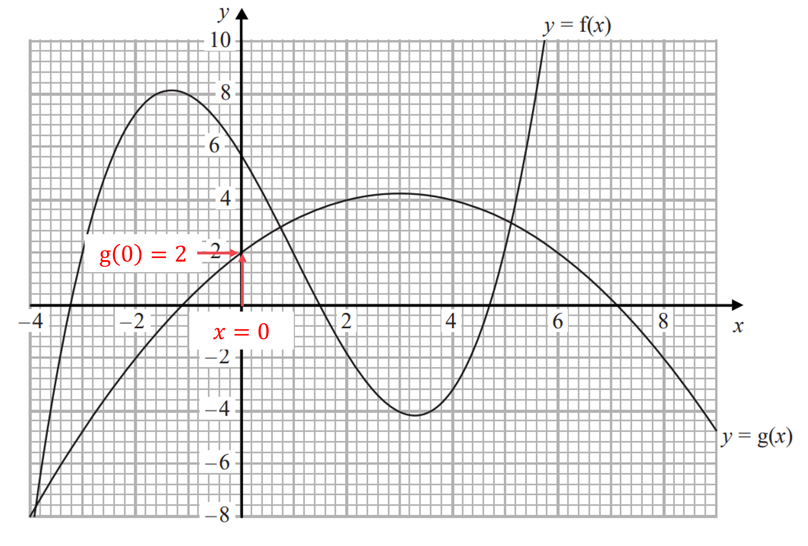

*g(0) = 2*

**g(0) = 2** **[1]**

### 2() — 2 marks
*gf(-1) means g(f(-1))*

*Find f(-1) by drawing a line from **x** = -1 on the **x**-axis up to the curve **y** = f(**x**) and reading off the **y**-coordinate* * *

*f(-1) = 8*

**[1]*** *

*g(f(-1)) is the same as g(8)*

*Find g(8) by drawing a line from **x** = 8 on the **x**-axis down to the curve **y** = g(**x**) and reading off the **y**-coordinate*

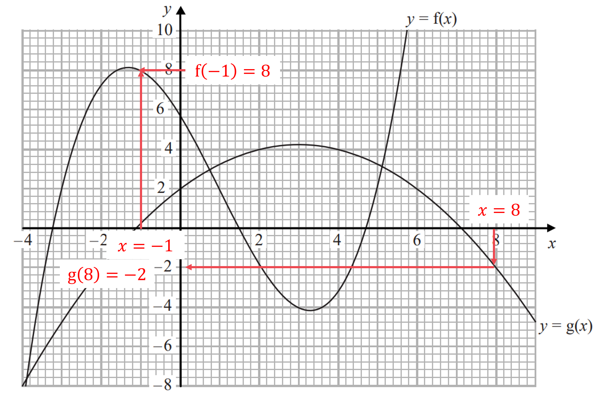

*g(8) = -2*

**gf(-1) = -2** **[1]**

## Q24 — medium — 7 marks · exam-questions

### 1() — 1 marks
*Substitute** x** = 1 into f(**x**)*

$\mathrm{f} ( 1 ) = \frac{3}{4 + 1}$

> *Work out this value *

$\frac{3}{5}$ **[1]**

### 2() — 1 marks
*Inputting a value must never result in dividing by zero* *Find the input that causes the function to divide by 0 (by solving the denominator equal to 0)* * *

$\begin{array}{rcl} 4 + x & = 0 \\ x = - 4 \end{array}$

> * *

> *The input **x** = -4 must be excluded from any domain*

**x**** = -4** **[1]**

### 3() — 1 marks
*If g(**a**) = 7, the input is **a** and the output is 7* *Find g(**a**) by substituting **x** = **a** into g(**x**)* * *

$\mathrm{g} ( a ) = 5 + a$ * *

*Set 5 + **a** equal to 7 and solve for **a*

$\begin{gathered} 5 + a & = 7 \\ a = 7 - 5 \end{gathered}$

**a**** = 2** **[1]**

### 4() — 2 marks
*fg(1) means f(g(1))* *Find g(1) by substituting **x** = 1 into g(**x**)* * *

$\begin{gathered} g ( 1 ) & = 5 + 1 \\ = 6 \end{gathered}$

**[1]**

*If g(1) = 6 then f(g(1)) means f(6)* *Find f(6) by substituting **x **= 6 into f(**x**)* * *

$\begin{array}{rcl} \mathrm{f} ( \mathrm{g} ( 1 ) ) & = f ( 6 ) = \frac{3}{4 + 6} \end{array}$

$\frac{3}{10}$* ***[1]**

**or 0.3 as a decimal**

### 5() — 2 marks
*fg(**x**) means f(g(**x**))* *Write the algebraic expression for g(**x**) inside f(...)* * *

$\mathrm{f} ( \mathrm{g} ( x ) ) = \mathrm{f} ( 5 + x )$ * *

*Find *$\mathrm{f} ( 5 + x )$* by replacing the **x**'s in f(**x**) with the brackets *$( 5 + x )$ * *

$\mathrm{f} ( x + 5 ) = \frac{3}{4 + ( 5 + x )}$

**[1]**

*Simplify the denominator* * *

$\begin{gathered} \mathrm{f} ( x + 5 ) & = \frac{3}{4 + 5 + x} \\ = \frac{3}{9 + x} \end{gathered}$ * *

> *Write your final answer as fg(**x**) = ...*

$\mathrm{fg}(x)=\frac{3}{9+x}$* ***[1]**

## Q25 — very_hard — 7 marks · exam-questions

### 27((a)) — 2 marks
> *Rearrange the quadratic expression into the order **ax**2** + **bx** + **c**  *

*-***x***2** + 6***x*** + 5**  *

*Completing the square is easiest when dealing with a single positive **x**2** term, so take out a factor of -1*

> *This is only necessary for the x**2** and **x** terms so leave 5 as it is  *

$- x^{2 } + 6 x + 5 = - ( x^{2} - 6 x ) + 5$

> *Complete the square for the part in brackets  *

$- ( x^{2} - 6 x ) + 5 = - [ ( x - 3 )^{2} - 9 ] + 5$

**[1]**

> *Expand and rearrange into the required completed square form.*

$\begin{gathered} - [ ( x - 3 )^{2} - 9 ] + 5 & = - ( x - 3 )^{2} + 9 + 5 \\ = 14 - ( x - 3 )^{2} \end{gathered}$

> *This is in the form **p** - (**x** - **q**)**2** where **p** = 14 and **q** = 3*

$14-(x-3)^{2}$* ***[1]**

### 27((b)) — 5 marks
> *Use the result in part (a) to rewrite *$\mathrm{f} ( x ) = 5 + 6 x - x^{2}$*  *

$\mathrm{f} ( x ) = 14 - ( x - 3 )^{2}$

> *To find the inverse function, first write f(x) as** y**  *

> $y = 14 - ( x - 3 )^{2}$*  *

> *Then, without rearranging, swap the **x** and **y **around  *

$x = 14 - ( y - 3 )^{2}$

> *Rearrange** **the expression to make *$y$* the subject again*

$\begin{gathered} x - 14 & = - ( y - 3 )^{2} \\ 14 - x & = ( y - 3 )^{2} \\ y - 3 & = \pm \sqrt{14 - x} \\ y & = 3 \pm \sqrt{14 - x} \end{gathered}$

**first two lines of working**** [1]**

**last two lines of working**** [1]**

> *The domain of g is *$x\leq3$* so this must be the range of the inverse, taking the negative square root will give *$y\leq3$*. *

> *Replace **y** with f**-1**(**x**)  *

$\mathrm{f}^{- 1} ( x ) = 3 - \sqrt{14 - x}$

**[1]**

> *To ensure  f**-1**(**x**) is always positive, set the inverse function above to be > 0 and solve the inequality  *

$3-\sqrt{14-x}>0\,3>\sqrt{14-x}\,9>14-x\,x>14-9\,x>5$

**method for solving the inequality ****[1]**

> *So x > 5 gives f**-1**(**x**) > 0 *

> *But the *$\sqrt{14-x}$* part in f**-1**(**x**) will become the square-root of a negative if **x** becomes too big (problems arise if **x**  > 14)  *

**5 < x ≤ 14** **[1]**

## Q26 — hard — 7 marks · exam-questions

### 1() — 1 marks
*An input must never result in dividing by zero* 
*Find the input that cause the functions to divide by 0 (by setting the denominators equal to 0)* * *

> $\begin{array}{rcl} x = 0 \end{array}$*    *

> *The input **x** = 0 must be excluded from the domain*

**x**** = 0 ** **[1]**

### 2() — 3 marks
*gf(**a**) means g(f(**a**))* 
*Find f(**a**) by substituting **x** = **a** into f(**x**)* * *

$\mathrm{f} ( a ) = \frac{2}{a}$ * *

*g(f(**a**)) is the same as *$\mathrm{g} ( \frac{2}{a} )$ 
*Substitute *$x=\frac{2}{a}$* into *$\mathrm{g} ( x )$ * *

$\mathrm{g} ( \frac{2}{a} ) = \frac{\frac{2}{a} + 1}{\frac{2}{a}}$

**[1]**

*Set the expression above equal to 3 * * *

$\frac{\frac{2}{a}+1}{\frac{2}{a}}=3$ * *

*This equation must be solved for **a*

*For example, multiply both sides by *$\frac{2}{a}$ * *

$\begin{gathered} \frac{2}{a} + 1 & = 3 \times \frac{2}{a} \\ \frac{2}{a} + 1 & = \frac{6}{a} \end{gathered}$

**[1]**

*Multiply both sides by **a* * *

$\begin{gathered} a ( \frac{2}{a} + 1 ) & = \cancel{a} \times \frac{6}{ \cancel{a} } \\ 2 + a & = 6 \end{gathered}$ * *

*Solve to find **a*

$a=6-2$

**a**** = 4** **[1]**

### 3() — 3 marks
*Replace g(**x**) with **y* * *

$y=\frac{x+1}{x}$ * *

*Without rearranging the equation, swap the **x**'s and **y**'s* * *

$x=\frac{y+1}{y}$

> *We must make **y** the subject of this new equation *

*Remove fractions (by multiplying both sides by **y**)* * *

$\begin{gathered} x y & = y + 1 \end{gathered}$

**[1]**

> *Get all the **y** terms on one side (for example, by subtracting **y** from both sides)  *

> $xy-y=1$*  *

> *Factorise **y** out of the two terms on the left  *

$y ( x - 1 ) = 1$

**[1]*** *

> *Get **y** on its own (by dividing both sides by **x** - 1)  *

$y=\frac{1}{x-1}$

*The function on the right-hand side is the inverse function, g**-1**(**x**)* *Replace **y** with g**-1**(**x**) to write down the final answer*

$g^{-1}(x)=\frac{1}{x-1}$* ***[1]**

## Q27 — medium — 4 marks · exam-questions

### 17((c)) — 1 marks
> *The domain is all the values which can be input into a function. Inputting a value must never result in dividing by zero *

> *The input **x** = 0 must be excluded from the domain so that the denominator of the fraction is not zero.*

**x**** = 0** **[1]**

### 17((d)) — 3 marks
> *Replace h(**x**) with **y **and then swap the **x's** and **y's.*

> $y=\frac{2x-4}{x}$* *

$x=\frac{2y-4}{y}$

> *Rearrange the equation to make **y** the subject, begin by multiplying both sides by **y.*

$xy=2y-4$

**[1]**

> *Collect the **y** terms onto one side of the equation and the other terms to the other side.*

$\begin{gathered} x y - 2 y & = - 4 \end{gathered}$

> *To make **y** the subject, it will need to be factorised.*

> $\begin{gathered} y ( x - 2 ) & = - 4 \end{gathered}$* *

**[1]**

> *Divide by (**x** - 2) to make **y** the subject.*

> $\begin{gathered} y & = \frac{- 4}{x - 2} \end{gathered}$* *

*The function on the left-hand side is the inverse function, h**-1**(**x**)* *Replace **y** with h**-1**(**x**) to write down the final answer.*

$h^{-1}(x)=\frac{4}{2-x}$ **[1] **

**The equivalent fraction **$\frac{-4}{x-2}$**is also accepted.**

## Q28 — very_hard — 5 marks · exam-questions

### 23((a)) — 1 marks
> *The range of an inverse function is the same set of values as the domain of the original function*

**g****-1****(****x****) ≥ -3 ****[1]**

**y****  ≥ -3 is also accepted, but ****x**** ≥ -3 is not (****x**** is only for domains)**

### 23((b)) — 4 marks
> *Finding the inverse of g(**x**) will require completing the square*

> *First, write the function in the form *$y = \mathrm{g} ( x )$* and then swap the **x** and **y*

$y=x^{2}+6x\,x=y^{2}+6y$

> *Rearrange** **the expression to make *$y$* the subject again by completing the square *

> *The formula for completing the square for a quadratic in the form*$x^{2}+bx+c$*is*$( x + \frac{b}{2} )^{2} - ( \frac{b}{2} )^{2} + c$*.*

> *Completing the square requires dividing the middle term, 6, by 2*

$\begin{gathered} y^{2} + 6 y & = ( y + \frac{ 6}{2} )^{2 } - ( \frac{6}{2} )^{2} \\ = ( y + 3 )^{2} - 3^{2} \end{gathered}$

**[1]**

> *Simplify*

$\begin{gathered} ( y + 3 )^{2} - 3^{2} & = ( y + 3 )^{2} - 9 \end{gathered}$**  **

> *Set equal to *$x$* and rearrange to make *$y$* the subject*

$x = ( y + 3 )^{2} - 9$

> *Rearrange** **the expression to make *$y$* the subject again*

$\begin{gathered} x + 9 & = ( y + 3 )^{2} \\ y + 3 & = \pm \sqrt{x + 9} \\ y & = \pm \sqrt{x + 9} - 3 \\ y & = - 3 \pm \sqrt{x + 9} \end{gathered}$

**first line of working correct**** [1]**

**second line of working correct**** [1]**

> *The domain of g(**x**) is *$x\geq-3$* so this must be the range of the inverse, taking the positive square root will give *$y\geq-3$* *

> *Rewrite using the notation asked for in the question*

$g^{-1}:x\rightarrow-3+\sqrt{x+9}$ **[1]**

## Q29 — hard — 5 marks · exam-questions

### 1() — 2 marks
> *It helps to rewrite these functions back in the form f(**x**) and g(**x**)*

$\mathrm{f} ( x ) = 2 x^{2} + 1 \mathrm{g} ( x ) = \frac{2 x}{x - 1}$

*gf : **x** is the same as gf(**x**) which means g(f(**x**))*

*Write the algebraic expression for f(**x**) inside g(...)* * *

$\mathrm{g} ( \mathrm{f} ( x ) ) = \mathrm{g} ( 2 x^{2} + 1 )$ * *

*Find *$\mathrm{g} ( 2 x^{2} + 1 )$* by replacing the **x**'s in g(**x**) with the brackets *$( 2 x^{2} + 1 )$ * *

$\mathrm{g} ( 2 x^{2} + 1 ) = \frac{2 ( 2 x^{2} + 1 )}{( 2 x^{2} + 1 ) - 1}$

**[1]**

*Expand the brackets in the numerator and simplify the denominator* * *

$\begin{array}{rcl} \text{fg} ( 2 x^{2} + 1 ) & = \frac{4 x^{2} + 2}{2 x^{2}} \end{array}$* *

> *The top and bottom have a factor of 2 which can be cancelled  *

> * *$\begin{gathered} \frac{4 x^{2} + 2}{2 x^{2}} & = \frac{ \cancel{2} ( 2 x^{2} + 1 )}{ \cancel{2} x^{2}} \\ = \frac{2 x^{2} + 1}{x^{2}} \end{gathered}$

> *Write your final answer as gf : **x**  →  ...*

$\mathrm{gf}:x\rightarrow\frac{2x^{2}+1}{x^{2}}$* ***[1]**

### 2() — 3 marks
*Replace g(**x**) with **y* * *

$y=\frac{2x}{x-1}$ * *

*Without rearranging the equation, swap the **x**'s and **y**'s* * *

$x=\frac{2y}{y-1}$

> *We must make **y** the subject of this new equation *

*Remove fractions (by multiplying both sides by **y** - 1)* * *

$\begin{gathered} x ( y - 1 ) & = 2 y \end{gathered}$

**[1]**

> *Expand the brackets  *

$xy-x=2y$

> *Get the **y** terms on one side (for example, by subtracting 2**y** and adding **x** to both sides)  *

> $\begin{gathered} x y - x - 2 y & = 0 \\ x y - 2 y & = x \end{gathered}$*  *

> *Factorise **y** out of the two terms on the left  *

$y ( x - 2 ) = x$

**[1]**

> *Get **y** on its own (by dividing both sides by **x** - 2)  *

> $y=\frac{x}{x-2}$*  *

*The function on the right-hand side is the inverse function, g**-1**(**x**)* *Replace **y** with g**-1**(**x**) to write down the final answer*

$g^{-1}(x)=\frac{x}{x-2}$* ***[1]**

## Q30 — medium — 4 marks · exam-questions

### 17((a)) — 1 marks
*Substitute **x** = 1 into f(**x**)*

$\begin{array}{rcl} \mathrm{f} ( 1 ) & = ( 1 - 4 )^{2} \\ = ( - 3 )^{2} \\ = 9 \end{array}$

**9** **[1]**

### 17((b)) — 1 marks
*The range is the set of all possible outputs* 
$( x - 4 )^{2}$* will always be the square of a value, so no negative outputs can arise (**x** = 4 gives an output of 0)*

**f(x) ≥ 0** **[1]**

**y ≥ 0 or f ≥ 0 are also accepted (but not x ≥ 0 as x is for domains)**

### 17((c)) — 2 marks
*fg(2) means f(g(2))*

*Find g(2) by substituting **x** = 2 into g(**x**) * * *

$\begin{array}{rcl} \mathrm{g} ( 2 ) & = \frac{4}{2 + 3} \\ = \frac{4}{5} \end{array}$

**[1]**

*If g(2) = *$\frac{4}{5}$* then *$\mathrm{f} ( \mathrm{g} ( 2 ) ) = \mathrm{f} ( \frac{4}{5} )$

*Find *$\mathrm{f} ( \frac{4}{5} )$* by substituting *$x=\frac{4}{5}$* into f(**x**)* * *

$\begin{gathered} \mathrm{f} ( \frac{4}{5} ) & = ( \frac{4}{5} - 4 )^{2} \\ = ( - \frac{16}{5} )^{2} \\ = \frac{256}{25} \end{gathered}$

> $\frac{256}{25}$* [1]*

**or 10.24 as a decimal**

## Q31 — very_hard — 6 marks · exam-questions

### 26((a)) — 3 marks
*Method 1*

*Find the inverse function, f**-1**(**x) **by first replacing f(**x**) with **y* * *

$y=\frac{\sqrt{x^{2}+k^{2}}}{x}$ * *

*Without rearranging the equation, swap the **x**'s and **y**'s* * *

$x=\frac{\sqrt{y^{2}+k^{2}}}{y}$

*Now make **y** the subject of this new equation (for example, by squaring both sides then multiplying both sides by y**2**)* * *

$\begin{array}{rcl} x^{2} & = \frac{y^{2} + k^{2}}{y^{2}} \\ x^{2} y^{2} & = y^{2} + k^{2} \\ x^{2} y^{2} - y^{2} & = k^{2} \\ y^{2} ( x^{2} - 1 ) & = k^{2} \\ y^{2} & = \frac{k^{2}}{x^{2} - 1} \end{array}$

**[1]**

> *Square-root both sides  *

> $y=\pm\sqrt{\frac{k^{2}}{x^{2}-1}}$*   *

*The sign on the right-hand side must be chosen to give us f**-1**(**x**) The domain of f(**x**) is all positive values (**x** > 0) so the range of f**-1**(**x**) must be all positive values (take the positive square root)*

$\mathrm{f}^{- 1} ( x ) = \sqrt{ \frac{k^{2}}{x^{2} - 1} }$

*Create the equation* *f**-1**(**x**) = **k **by substituting **x** = **p** into f**-1**(**x**) and setting it equal to **k**  *

$\sqrt{\frac{k^{2}}{p^{2}-1}}=k$

**[1]**

> *Solve this equation for **p** (make **p** the subject)  *

$\begin{gathered} \frac{k^{2}}{p^{2} - 1} & = k^{2} \\ \cancel{k^{2}} & = \cancel{k^{2}} ( p^{2} - 1 ) \\ 1 = p^{2} - 1 \\ 2 = p^{2} \\ \pm \sqrt{2} & = p \end{gathered}$

> * *

> *p** is an input of the inverse function, which makes it an output of the original function, and all outputs are positive in this question (the domain of f is **x** > 0 which makes *$\frac{\sqrt{x^{2}+k^{2}}}{x}$* positive) **p** must therefore be positive, so choose the positive square root*

$p=\sqrt{2}$* ***[1]**

*Method 2*** **

*Apply the function f to both sides of the equation f**-1**(**p**) = **k* * *

$ff^{- 1} ( p ) = \mathrm{f} ( k )$ * *

> *The input **p **on the left first goes through the function f**-1**, but then has this immediately "undone" by going through the function f *

*The f and the f**-1** cancel each other out (they are inverses of each other)* * *

$p = \mathrm{f} ( k )$

**[1]*** *

*Find f(**k**) by substituting **x** = **k** into f(**x**)*

$p=\frac{\sqrt{k^{2}+k^{2}}}{k}$

**[1]**

*Simplify the right-hand side*

$p = \frac{ \sqrt{2 k^{2}} }{k} 
p = \frac{ \sqrt{2} \cancel{k} }{ \cancel{k} }$

$p=\sqrt{2}$ **[1]**

### 26((b)) — 3 marks
*gf(**a**) means g(f(**a**))*

*Find f(**a**) by substituting **x** = **a** into f(**x**)* * *

> $\mathrm{f} ( a ) = \frac{ \sqrt{a^{2} + k^{2}} }{a}$*  *

*Now substitute *$x=\frac{\sqrt{a^{2}+k^{2}}}{a}$* into g(**x**) and simplify* * *

$\begin{array}{rcl} \text{gf} ( a ) & = ( \frac{ \sqrt{a^{2} + k^{2}} }{a} )^{2} \\ = \frac{a^{2} + k^{2}}{a^{2}} \end{array}$

**[1]**

*Set this equal to **k** and solve to find **a** (make **a** the subject)* * *

$\begin{array}{rcl} \frac{a^{2} + k^{2}}{a^{2}} & = k \\ a^{2} + k^{2} & = k a^{2} \\ k^{2} & = k a^{2} - a^{2} \end{array}$

**[1]**

*Factorise out **a**2** on the right-hand side to continue* * *

$\begin{gathered} k^{2} & = a^{2} ( k - 1 ) \\ \frac{k^{2}}{k - 1} & = a^{2} \\ \pm \sqrt{ \frac{k^{2}}{k - 1} } & = a \end{gathered}$ * *

*k** > 1 so the denominator *$\sqrt{k-1}$* never square roots a negative number, and the numerator can be simplified using *$\sqrt{k^{2}}=k$ * *

$\pm\frac{k}{\sqrt{k-1}}=a$

> * *

> *The first line required substituting **a** into f(**x**), but only positive values can be substituted into f(**x**) as the domain is **x** > 0, so **a** must be a positive value (choose the positive square root)*

$a=\frac{k}{\sqrt{k-1}}$* ***[1]**

$\sqrt{\frac{k^{2}}{k-1}}$** is also accepted**

## Q32 — hard — 3 marks · exam-questions

### 28((b)) — 3 marks
*Method 1*

*Find g**-1**(**x**) by first replacing g(**x**) with **y* * *

$y=3x+7$ * *

*Without rearranging the equation, swap the **x**'s and **y**'s* * *

$x=3y+7$

*Now make **y** the subject of this new equation* * *

$\begin{gathered} x - 7 & = 3 y \\ \frac{x - 7}{3} & = y \end{gathered}$

**x - 7 = 3y ****[1]**

*The function on the left-hand side is the inverse function, g**-1**(**x**)* *Replace **y** with g**-1**(**x**)  *

$\mathrm{g}^{- 1} ( x ) = \frac{x - 7}{3}$

**[1]**

> *Set this expression equal to 2**x**  *

> $\frac{x-7}{3}=2x$*  *

> *Solve this equation to find **x**  *

$\begin{gathered} x - 7 & = 6 x \\ - 7 & = 5 x \\ - \frac{7}{5} & = x \end{gathered}$

**x**** = -1.4*** ***[1]**

*Method 2*** **

*g**-1**(**x**) = 2**x** means putting an input of **x** into the inverse function gives an output of 2**x*** **

*This means putting an input of 2**x** into the original function must give an output of **x***  **

$\mathrm{g} ( 2 x ) = x$**  **

> *Work out an expression for g(2**x**) on the left by replacing all **x**'s in g(**x**) with 2**x**  *

$3\times2x+7=x$

**[1]**

*Solve this equation to find **x***  **

$\begin{array}{rcl} 6 x + 7 & = x \\ 5 x & = - 7 \\ x = - \frac{7}{5} \end{array}$

**6x + 7 = x seen ****[1]**

**x**** = -1.4*** ***[1]**

## Q33 — hard — 7 marks · exam-questions

### 1() — 1 marks
*Substitute **x** = 1 into g(**x**)*

$\begin{gathered} \mathrm{g} ( 1 ) & = \frac{1}{2 \times 1 - 5} \\ = \frac{1}{2 - 5} \end{gathered}$

$-\frac{1}{3}$ **[1]**

### 2() — 1 marks
*Inputting a value must never result in dividing by zero*

*Find the input that causes the function to divide by 0 (by solving the denominator equal to 0)* * *

$\begin{gathered} 2 x - 5 & = 0 \\ 2 x & = 5 \\ x = \frac{5}{2} \end{gathered}$

> * *

> *This value must be excluded from any domain*

$x=\frac{5}{2}$ **[1]**

### 3() — 2 marks
*gh(**x**) means g(h(**x**))*

*Write the algebraic expression for h(**x**) inside g(...)* * *

$\mathrm{g} ( \mathrm{h} ( x ) ) = \mathrm{g} ( x + 4 )$ * *

*Find *$\mathrm{g} ( x + 4 )$* by replacing the **x**'s in g(**x**) with the brackets *$( x + 4 )$ * *

$\mathrm{g} ( x + 4 ) = \frac{( x + 4 )}{2 ( x + 4 ) - 5}$

**[1]**

*Expand the brackets and collect like terms* * *

$\begin{gathered} \mathrm{g} ( x + 4 ) & = \frac{x + 4}{2 x + 8 - 5} \\ = \frac{x + 4}{2 x + 3} \end{gathered}$ * *

> *Write your final answer as gh(**x**) = ...*

$\mathrm{gh}(x)=\frac{x+4}{2x+3}$* ***[1]**

### 4() — 3 marks
*Replace g(**x**) with **y* * *

$y=\frac{x}{2x-5}$ * *

*Without rearranging the equation, swap the **x**'s and **y**'s* * *

$x=\frac{y}{2y-5}$

> *We must make **y** the subject of this new equation *

*Remove fractions (by multiplying both sides by 2**y** - 5)* * *

$\begin{gathered} x ( 2 y - 5 ) & = y \end{gathered}$

**[1]**

> *Expand the brackets  *

$2xy-5x=y$

> *Get the **y** terms on one side (for example, by subtracting **y** and adding 5**x** to both sides)  *

> $\begin{gathered} 2 x y - 5 x - y & = 0 \\ 2 x y - y & = 5 x \end{gathered}$*  *

> *Factorise **y** out of the two terms on the left  *

$y ( 2 x - 1 ) = 5 x$

**[1]**

> *Get **y** on its own (by dividing both sides by 2**x** - 1)  *

> $y=\frac{5x}{2x-1}$*  *

*The function on the right-hand side is the inverse function, g**-1**(**x**)* *Replace **y** with g**-1**(**x**) to write down the final answer*

$g^{-1}(x)=\frac{5x}{2x-1}$* ***[1]**

## Q34 — medium — 1 marks · exam-questions

### 19() — 1 marks
*Either do the "inverse" method (**y** = 3**x **etc), or realise that the inverse of "multiplying by 3" is "dividing by 3"*

$x\div3$

**the**** fourth**** option is therefore correct,** $\frac{x}{3}$ **[1]**

> *The first option assumes you made the **mistake** that f**-1**(**x**) means -f(**x**) *

> *The second option assumes you made the **mistake** that "dividing by 3" means *$\frac{3}{x}$

> *The third option assumes you made the **mistake** that  f**-1**(**x**) means *$\frac{1}{ \mathrm{f} ( x )}$* (from negative indices)*

## Q35 — very_hard — 4 marks · exam-questions

### 30() — 4 marks
> *Find *$\mathrm{f}^{- 1} ( x )$* by setting *$\mathrm{f} ( x )$* equal to *$y$*, swapping the variables and rearranging to make *$y$* the subject.*

$\begin{gathered} y & = 1 \frac{1}{2} x \\ x & = 1 \frac{1}{2} y \\ y & = 2 x \\ \mathrm{f}^{- 1 } ( x ) & = 2 x \end{gathered}$

**[1]**

> $gf ( x )$* means *$\mathrm{g} ( \mathrm{f} ( x ) )$*. *

> *Find *$gf ( x )$* by substituting *$\mathrm{f} ( x )$* into *$g ( x ).$*  *

$\text{gf} ( x ) = \mathrm{g} ( 1 \frac{1}{2} x ) = ( 1 \frac{1}{2} x ) - ( 1 \frac{1}{2} x )^{2}$

**[1]**

> *Set *$gf ( x )$* equal to*$\mathrm{f}^{- 1} ( x )$*.  *

$( 1 \frac{1}{2} x ) - ( 1 \frac{1}{2} x )^{2} = 2 x$

> *Simplify.  *

$\frac{1}{2}x-\frac{1}{4}x^{2}=2x$

> *Remove the fractions by multiplying every term through by 4.  *

$2x-x^{2}=8x$

> *Form a quadratic equation by bringing all terms to one side.  Adding *$x^{2}$* and subtracting *$2x$* from both sides gives the quadratic in is simplest form.*

$x^{2}+6x=0$

> *Factorise.*

$x ( x + 6 ) = 0$

**[1]**

> *Solve.*

> *Remember that *$x=0$* is one solution. *

$x=0\mathrm{and}x=-6$* ***[1]**

## Q36 — hard — 6 marks · exam-questions

### 1() — 1 marks
*Substitute **x** = 11 into f(**x**)*

$\begin{gathered} \mathrm{f} ( 11 ) & = \frac{2 \times 11}{11 - 1} \\ = \frac{22}{10} \end{gathered}$

$\frac{11}{5}$ **[1]**

**2.2 is also accepted**

### 2() — 1 marks
*Inputting a value must never result in dividing by zero*

*Find the input that causes the function to divide by 0 (by solving the denominator equal to 0)* * *

$\begin{array}{rcl} x - 1 & = 0 \\ x = 1 \end{array}$

> * *

> *The value **x** = 1 must be excluded from any domain*

$x=1$ **[1]**

### 3() — 3 marks
*Replace f(**x**) with **y* * *

$y=\frac{2x}{x-1}$ * *

*Without rearranging the equation, swap the **x**'s and **y**'s* * *

> $x=\frac{2y}{y-1}$*   *

> *You must make **y** the subject of this new equation *

*Remove fractions (by multiplying both sides by **y** - 1)* * *

$\begin{array}{rcl} x ( y - 1 ) & = 2 y \end{array}$

**[1]**

> *Expand the brackets  *

$xy-x=2y$

> *Get the **y** terms on one side (for example, by subtracting 2**y** and adding **x** to both sides)  *

> $\begin{gathered} x y - x - 2 y & = 0 \\ x y - 2 y & = x \end{gathered}$*  *

> *Factorise **y** out of the two terms on the left  *

$y ( x - 2 ) = x$

**[1]**

> *Get **y** on its own (by dividing both sides by **x** - 2)  *

> $y=\frac{x}{x-2}$*  *

*The function on the right-hand side is the inverse function, f**-1**(**x**)* *Replace **y** with f**-1**(**x**) to write down the final answer*

$f^{-1}(x)=\frac{x}{x-2}$* ***[1]**

### 4() — 1 marks
*It is hard to find the outputs of f(**x**) (the range) without a sketch of y = f(**x**)*

> *Instead, use the rule that "the outputs of f(**x**)" are the same as "the inputs of f**-1**(**x**)"*

$\mathrm{f}^{- 1} ( x ) = \frac{x}{x - 2}$ * *

*The possible inputs of f**-1**(**x**) are any values of **x** that do not end up dividing by zero*

*Solve the denominator equal to zero to see which values are not allowed* * *

$\begin{gathered} x - 2 & = 0 \\ x = 2 \end{gathered}$ * *

> *Excluding 2 from the inputs of f**-1**(**x**)  means excluding 2 from the outputs of f(**x**)*

**2** **[1]**

## Q37 — hard — 3 marks · exam-questions

### 8() — 3 marks
> *Begin by letting the unknowns in the two boxes be **x **and **y.*

> *Fill in the information you know about the inputs and outputs.*

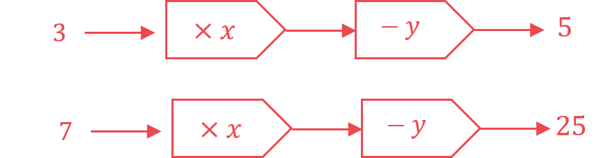

> *Use the information to form equations.*

> *Number the equations so that they are easier to solve.*

> $3 x - y = 5 ( 1 )
7 x - y = 25 ( 2 )$* *

**[1]**

> *Eliminate the **y** terms by subtracting equation (1) from equation (2). *

> *Be careful to subtract every term. *

> *The coefficients of **y** are the same with the same signs, so subtract them.*

`7 x - y = 25 bottom - ( 3 x - y = 5 ) 4 x = 20`

**[1]**

> *Solve the equation to find** x **by dividing both sides by 4.*

$\begin{gathered} x & = \frac{20}{4} = 5 \end{gathered}$

> *Substitute *$x=5$*  into either of the two original equations**.*

$( 1 ) 3 ( 5 ) - y = 5$

> *Solve this equation to find** y.*

$\begin{gathered} 15 - y & = 5 \\ y & = 10 \end{gathered}$

> *Substitute *$x=5$* and *$y=10$* into the other equation to check that they are correct.*

$\begin{gathered} ( 2 ) 7 x - y & = 25 \\ 7 ( 5 ) - 10 & = 25 \\ 35 - 10 & = 25 \\ 25 & = 25 \end{gathered}$

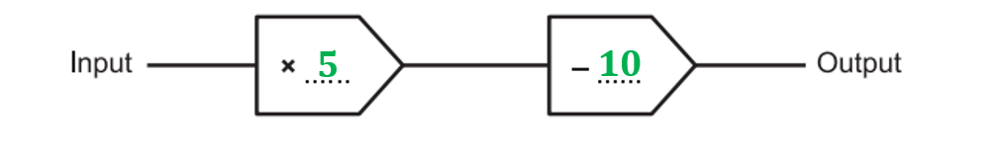

**[1]**

> * *

## Q38 — medium — 5 marks · exam-questions

### 8((a)) — 2 marks
> *Reverse the order and operations to find the inverse function, letting **x **be the input. Notice the change in direction of the arrows.*

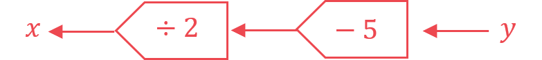

**[1]**

> *So the inverse operations are 'subtract 5' and then 'divide by 2'.*

> *Carry out both operations on 11.*

$\frac{11-5}{2}=\frac{6}{2}=3$

> *Carry out both operations on 3.*

$\frac{3-5}{2}=\frac{-2}{2}=-1$

**The first input was **$-1$** ****[1]**

### 8((a)) — 3 marks
> *Let **x **be both the **input **and the **output **of the function.  *

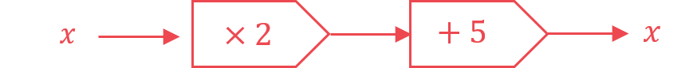

> *Write as an algebraic equation using **x **as the input and output.*

$x=2x+5$

** Correct expression ****[1] **** **
**Setting expression equal to x ****[1]**

> *Subtract **x **from both sides.*

$0=x+5$

> *Solve by subtracting 5** **from both sides.*

$-5=x$

** **$-5$** ****[1]**

## Q39 — very_hard — 5 marks · exam-questions

### 27() — 5 marks
> *Find *$\mathrm{f}^{- 1} ( 3 )$* by setting *$\mathrm{f} ( x )$* equal to 3. (This is the easiest way to find the inverse of an input without finding the inverse function first).*

$\begin{gathered} \frac{2 x}{5} - 1 & = 3 \end{gathered}$

**[1]**

> *Solve to find the value of *$x$*, this will be the input of *$\mathrm{f} ( x )$* that gives the output of 3, which is the same as the output of *$\mathrm{f}^{- 1} ( x )$* when the input is 3. *

$\begin{gathered} \frac{2 x}{5} & = 4 \\ 2 x & = 20 \\ x & = 10 \end{gathered}$

** Method to solve correct**** [1]**** **

**Answer correct**** [1]**

> *Find *$\mathrm{f} ( - 0.5 )$* by replacing the *$x$* **values in *$\mathrm{f} ( x )$* with -0.5 and simplifying.  *

$\mathrm{f} ( - 0.5 ) = \frac{ 2 ( - 0.5 )}{5} - 1 = \frac{- 1}{5} - 1 = - 0.2 - 1 = - 1.2$

**[1]**

> *Add *$\mathrm{f} ( - 0.5 )$* to *$\mathrm{f}^{- 1} ( 3 )$*.  *

$\mathrm{f}^{- 1} ( 3 ) + \mathrm{f} ( - 0.5 ) = 10 + ( - 1.2 )$

$f^{-1}(3)+f(-0.5)=8.8$* ***[1]**

## Q40 — hard — 7 marks · exam-questions

### 1() — 1 marks
*Substitute **x** = 0.5 into f(**x**)*

$\begin{gathered} \mathrm{f} ( 0.5 ) & = \frac{0.5}{3 \times 0.5 + 1} \\ = \frac{0.5}{2.5} \end{gathered}$

$\frac{1}{5}$ **[1]**

**0.2 is also accepted**

### 2() — 2 marks
*ff(-1) means f(f(-1))*

*Find f(-1) but substituting **x** = -1 into f(**x**) (putting brackets around the negative value)* * *

$\begin{gathered} \mathrm{f} ( - 1 ) & = \frac{( - 1 )}{3 ( - 1 ) + 1} \\ = \frac{- 1}{- 3 + 1} \\ = \frac{- 1}{- 2} \\ = 1 \frac{1}{2} \end{gathered}$

**[1]**

*f(f(-1)) is the same as *$\mathrm{f} ( 1 \frac{1}{2} )$ *Find *$\mathrm{f} ( 1 \frac{1}{2} )$* but substituting *$x=\frac{1}{2}$* into f(**x**)* * *

$\mathrm{f} ( 1 \frac{1}{2} ) = \frac{1 \frac{1}{2}}{3 \times 1 \frac{1}{2} + 1}$ * *

> *Work out this value (for example, using a calculator)*

$\frac{1}{5}$* ***[1]**

**0.2 is accepted**

### 3() — 1 marks
*Inputting a value must never result in dividing by zero*

*Find the input that causes the function to divide by 0 (by solving the denominator equal to 0)* * *

$\begin{array}{rcl} 3 x + 1 & = 0 \\ 3 x & = - 1 \\ x = - 1 \frac{1}{3} \end{array}$

> * *

> *This value must be excluded from any domain*

$x=-\frac{1}{3}$ **[1]**

### 4() — 3 marks
*Replace f(**x**) with **y* * *

$y=\frac{x}{3x+1}$ * *

*Without rearranging the equation, swap the **x**'s and **y**'s* * *

$x=\frac{y}{3y+1}$

*We must make **y** the subject of this new equation Remove fractions (by multiplying both sides by 3**y** + 1)* * *

$\begin{array}{rcl} x ( 3 y + 1 ) & = y \end{array}$

**[1]**

> *Expand the brackets  *

$3xy+x=y$

> *Get the **y** terms on one side (for example, by subtracting 3**xy** from both sides)  *

> $\begin{gathered} x = y - 3 x y \end{gathered}$*  *

> *Factorise **y** out of the two terms on the right  *

$x = y ( 1 - 3 x )$

**[1]**

> *Get **y** on its own (by dividing both sides by 1 - 3**x**)  *

> $\frac{x}{1-3x}=y$*  *

*The function on the right-hand side is the inverse function, f**-1**(**x**)* *Replace **y** with f**-1**(**x**) to write down the final answer*

$f^{-1}(x)=\frac{x}{1-3x}$* ***[1]**

## Q41 — hard — 3 marks · exam-questions

### 24((a)) — 3 marks
*Method 1*

*Find f(4) by substituting **x** = 4 into f(**x**)* * *

$\begin{gathered} \mathrm{f} ( 4 ) & = c \times 4 + d \\ = 4 c + d \end{gathered}$ * *

*Set this expression equal to 7* * *

$4c+d=7$ * *

*Find f(10) by substituting **x** = 10 into f(**x**)* * *

$\begin{gathered} \mathrm{f} ( 10 ) & = c \times 10 + d \\ = 10 c + d \end{gathered}$ * *

*Set this expression equal to 22* * *

$10c+d=22$ * *

*You now have two simultaneous equations* * *

$\begin{gathered} 10 c + d & = 22 \\ 4 c + d & = 7 \end{gathered}$

**[1]**

*Solve these simultaneous equations, for example by eliminating the **d**'s first (by subtracting the equations)* * *

$6c=15\,c=\frac{15}{6}\,c=\frac{5}{2}$

**[1]**

*Substitute this value back into either equation to find** d* * *

$\begin{gathered} 4 \times \frac{5}{2} + d & = 7 \\ 10 + d & = 7 \\ d = - 3 \end{gathered}$

**c**** = 2.5 and ****d**** = -3*** ***[1]**

**It is also possible to eliminate ****c**** first**

> *Method 2*

*f(**x**) = **cx** + **d** looks like "**y** = **mx** + **c**"* *f(x) represents a straight line through (4, 7) and (10, 22) with gradient **c** and y-intercept **d* *Work out the gradient, **c* * *

$\frac{22-7}{10-4}=2.5$

**correct value**** [1]**

**recognising that this is "c"**** [1]**

*Work out the y-intercept of this line, **d**, for example using f(4) = 7* * *

$\begin{array}{rcl} \mathrm{f} ( x ) & = 2.5 x + d \\ \mathrm{f} ( 4 ) & = 2.5 \times 4 + d \\ 7 = 2.5 \times 4 + d \\ 7 = 10 + d \\ - 3 & = d \end{array}$

**c**** = 2.5 and ****d**** = -3*** ***[1]**

## Q42 — medium — 1 marks · exam-questions

### 24((b)) — 1 marks
*hg(x) means h(g(**x**))*

*To find this composite function, replace all **x**'s in h(**x**) with 2**x*

$\text{hg} ( x ) = \frac{2 x - 1}{2}$

**The ****second**** option is therefore correct, **$\frac{2x-1}{2}$ **[1]**

> *The third option assumes you made the** mistake** that h(2**x**) means 2**x** × h(**x**)*

> *The fourth option assumes you made the** mistake** that h(2**x**) means 2 × h(**x**)*

## Q43 — hard — 4 marks · exam-questions

### 17((a)) — 1 marks
> *What value would make the denominator zero?*

$2x-5=0$

> *Solve the equation*

$x=\frac{5}{2}\mathrm{or}2.5$

**[B1]**

### 17((b)) — 3 marks
> *Substitute the function h into the function g*

$\text{gh} ( x ) = \frac{11}{2 ( x^{2} + 4 ) - 5}$

**[M1]**

> *Set this equal to 1 and solve the equation*

$\begin{gathered} \frac{11}{2 ( x^{2} + 4 ) - 5} & = 1 \\ \end{gathered}$

> *Simplify the denominator and multiply both sides by it*

$\begin{gathered} \frac{11}{2 x^{2} + 3} & = 1 \\ 11 & = 2 x^{2} + 3 \end{gathered}$

> *Subtract 11 to get a quadratic equal to zero and solve*

$\begin{gathered} 0 & = 2 x^{2} + 3 - 11 \\ 0 & = 2 x^{2} - 8 \\ 8 = 2 x^{2} \end{gathered}$

**[M1]**

$\begin{gathered} 4 = x^{2} \end{gathered}$

$\begin{gathered} x = \pm 2 \end{gathered}$

> *Due to the domain of h(*$x$*) being *$x\geq0$*, *$x$*must be positive*

**Final answer:** **x**** = 2**

**[A1]**

## Q44 — very_hard — 3 marks · exam-questions

### 28((a)) — 3 marks
*To find f(2**x**), replace the **x**'s in f(**x**) with 2**x* * *

$\mathrm{f} ( 2 x ) = 5 - 2 x$

**[1]*** *

*To find g(**x** - 1), replace the **x**'s in g(**x**) with (**x** - 1) in brackets* * *

$\mathrm{g} ( x - 1 ) = 3 ( x - 1 ) + 7$

**[1]*** *

*Add the two results above* * *

$\mathrm{f} ( 2 x ) + \mathrm{g} ( x - 1 ) = 5 - 2 x + 3 ( x - 1 ) + 7$ * *

*Expand and simplified the right-hand side* * *

$\begin{gathered} \mathrm{f} ( 2 x ) + \mathrm{g} ( x - 1 ) & = 5 - 2 x + 3 x - 3 + 7 \\ = 9 + x \end{gathered}$

**9 + ****x**** ****[1]**

## Q45 — hard — 3 marks · exam-questions

### 22() — 3 marks
> *Finding the inverse of a quadratic function requires completing the square.*

> *Write the function in the form *$y=x^{2}-8x+5$* and then swap the *$x$* and *$y.$*  *

$y=x^{2}-8x+5\,x=y^{2}-8y+5$

> *Rearrange **the expression to make *$y$* the subject again by first completing the square.  *

> *The formula for completing the square for a quadratic in the form*$x^{2}+bx+c$*is*$( x + \frac{b}{2} )^{2} - ( \frac{b}{2} )^{2} + c$*.*

> *Complete the square by dividing the middle term (-8) by 2.*

$\begin{gathered} y^{2} - 8 y + 5 & = ( y - \frac{8}{2} )^{2 } - ( \frac{8}{2} )^{2} + 5 \\ = ( y - 4 )^{2} - 4^{2} + 5 \end{gathered}$

**Correct first step to complete square**** [1]**

> *Simplify.*

$\begin{gathered} ( y - 4 )^{2} - 4^{2} + 5 & = ( y - 4 )^{2} - 16 + 5 \\ = ( y - 4 )^{2} - 11 \end{gathered}$

> *Set equal to *$x$* and rearrange to make *$y$* the subject.*

$x = ( y - 4 )^{2} - 11$

> *Rearrange **the expression to make *$y$* the subject again.*

$\begin{gathered} x + 11 & = ( y - 4 )^{2} \\ y - 4 & = \pm \sqrt{x + 11} \\ y & = \pm \sqrt{x + 11} + 4 \\ y & = 4 \pm \sqrt{x + 11} \end{gathered}$

**[1]**

> *The domain of f(x) is *$x\leq4$* so this must be the range of the inverse, taking the negative square root will give *$y\leq4$*. *
*Rewrite using the correct notation for an inverse function.*

$f^{-1}(x)=4-\sqrt{x+11}$ **[1]**

## Q46 — hard — 7 marks · exam-questions

### 19((a)) — 1 marks
> *An input cannot cause the function to divide by zero*

> *Set the denominator equal to zero and solve to find out which value of *$x$* must be excluded*

$2x-9=0$

$2x=9$

$x=\frac{9}{2}$

$x=4.5$

**[B1]**

### 19((b)) — 2 marks
> *Work out *$\mathrm{g} ( 4 )$* by substituting 4 into the function for *$g$

$\mathrm{g} ( 4 ) = \frac{ 5}{2 ( 4 ) - 9} = \frac{5}{8 - 9} = \frac{5}{- 1} = - 5$

**[M1]**

> *Substitute this value into the function for *$f$

$\mathrm{f} ( - 5 ) = 5 ( - 5 ) + 7 = - 25 + 7 = - 18$

$fg ( 4 ) = - 18$

**[A1]**

### 19((c)) — 4 marks
> *To find an inverse function, first set it equal to *$y$* and then rearrange to make *$x$* the subject*

$y=3x^{2}-12x+8$

> *To make *$x$* the subject, write it in the form *$a ( x - p )^{2} + q$* so that *$x$* will only appear once*

$y = 3 ( x^{2} - 4 x ) + 8$

**[M1]**

$y = 3 [ ( x - 2 )^{2} - 4 ] + 8
y = 3 ( x - 2 )^{2} - 12 + 8
y = 3 ( x - 2 )^{2} - 4$

**[M1]**

> *Now use the reverse order of operations to make *$x$* the subject*

$y + 4 = 3 ( x - 2 )^{2}$

$\frac{y + 4}{3} = ( x - 2 )^{2}$

**[M1]**

$\pm\sqrt{\frac{y+4}{3}}=x-2$

$2\pm\sqrt{\frac{y+4}{3}}=x$

> *Swap the *$x$* and the *$y$

$y=2\pm\sqrt{\frac{x+4}{3}}$

> **[exam-tip]**
> The domain of the original function tells us the range of the inverse function. $y>2$ so ignore the minus.

$\mathrm{h}^{- 1} ( x ) = 2 + \sqrt{ \frac{x + 4}{3} }$

**[A1]**

## Q47 — very_hard — 2 marks · exam-questions

### 27((a)) — 2 marks
*The inverse of cube-rooting is cubing*

$\mathrm{h}^{- 1} ( x ) = x^{3}$

[1]

*A sketch of the graph **y **= **x**3** is needed*

*Work out a table of values from **x** = -2 to 2 in step sizes of, say, 1*

| ****x**** | *-2* | *-1* | *0* | *1* | *2* |
|---|---|---|---|---|---|
| ****y**** | *-8* | *-1* | *0* | *1* | *8* |

*Plot the graph on the axes given*

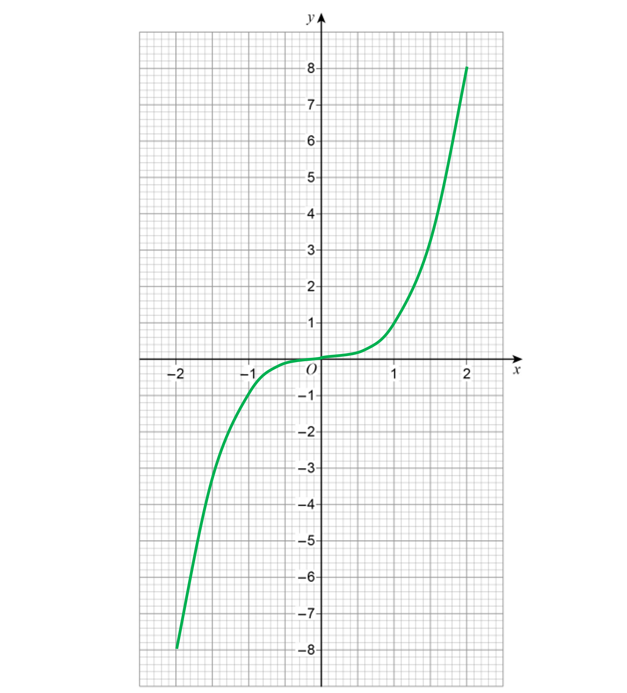

**[1]**

**The curve must go through the points with an accuracy of ±1 small square**

## Q48 — hard — 4 marks · exam-questions

### 23() — 4 marks
> *It helps to rewrite these functions back in the form f(**x**) and g(**x**)*

$\mathrm{f} ( x ) = 1 + \frac{1}{x} \mathrm{g} ( x ) = \frac{x + 1}{2}$

*fg is the same as fg(**x**) which means f(g(**x**))*

*Write the algebraic expression for g(**x**) inside f(...)* * *

$\mathrm{h} ( x ) = \mathrm{f} ( \frac{x + 1}{2} )$ * *

*Find *$\mathrm{f} ( \frac{x + 1}{2} )$* by replacing the **x**'s in g(**x**) with the brackets *$( \frac{x + 1}{2} )$ * *

$\mathrm{h} ( x ) = 1 + \frac{1}{( \frac{x + 1}{2} )}$

**[1]**

*The algebraic fraction can be simplified by either multiplying top-and-bottom by 2 or using that *$1\div\frac{x+1}{2}=1\times\frac{2}{x+1}$ * *

$\begin{array}{rcl} \mathrm{h} ( x ) & = 1 + \frac{2}{x + 1} \end{array}$* *

*To find the inverse function h**-1**(**x**), first replace h(**x**) with **y* * *

$y=1+\frac{2}{x+1}$ * *

*Without rearranging the equation, swap the **x**'s and **y**'s* * *

$x=1+\frac{2}{y+1}$

**[1]**

> *You must make **y** the subject of this new equation (there are many ways to do this) *

> *For example, subtract 1 from both sides  *

$x-1=\frac{2}{y+1}$

*It may help to think of the left-hand side as a fraction* * *

$\frac{x-1}{1}=\frac{2}{y+1}$ *  *

*Multiply both sides by **y** + 1 and divide both sides by **x** - 1*

$y+1=\frac{2}{x-1}$

**[1]**

> *Get **y** on its own (by subtracting 1 from both sides)  *

> $y=\frac{2}{x-1}-1$*  *

*The function on the right-hand side is the inverse function, h**-1**(**x**)* *Replace **y** with h**-1**x **: → to write down the final answer in the form asked for by the question*

$h^{-1}:x\rightarrow\frac{2}{x-1}-1$* ***[1]**

$\frac{3-x}{x-1}$** or **$\frac{x-3}{1-x}$** or **$-1-\frac{2}{1-x}$**are also accepted**

## Q49 — very_hard — 2 marks · exam-questions

### 27((b)) — 2 marks
> *Write the composite function *$y = \text{fg} ( x )$*.*

$y = \sin ( x + 90 )$

> $y = \sin ( x + 90 )$* is a translation of *$y=\mathrm{sin}x$* by 90° **left**.*

> *Start by lightly sketching the graph of *$y=\mathrm{sin}x$*. *

> *It should pass through (0, 0), (90, 1), (180, 0), (270, -1) and (360, 0). *

> *Translate these key points 90 left (you can ignore (0, 0) as it will be off the grid). You will need to complete an extra point at (360, 1) by continuing the pattern of the curve.*

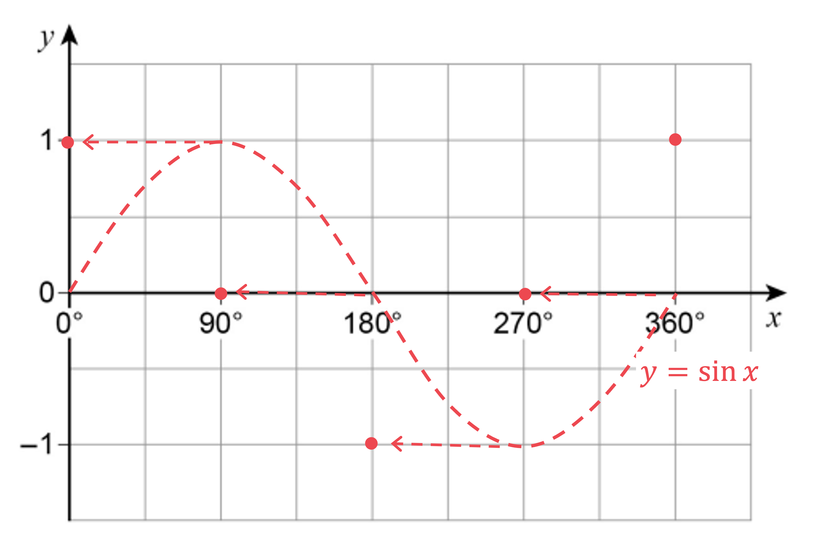

> *Join the points with a smooth curve. It should pass through (0, 1), (90, 0), (180, -1), (270, 0) and (360, 1).*

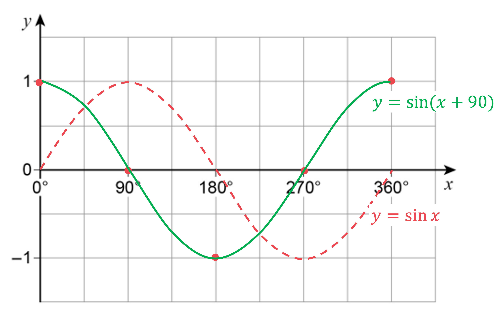

**smooth curve through at least 4 of the points below, or straight lines joining all of the points below ****[1]**

**smooth curve through all of (0, 1), (90, 0), (180, -1), (270, 0) and (360, 1) ****[1]**

**It is best practice to label the curves with their equations. This also makes it clear to the examiner which is your final answer**

## Q50 — hard — 4 marks · exam-questions

### 28() — 4 marks
> *Find *$\mathrm{f}^{- 1} ( 55 )$* by setting f(**x**) equal to 55.*

$\begin{gathered} 2 x - 3 & = 55 \end{gathered}$

**[1]**

> *Solve to find the value of *$x$*, this will be the input of f(**x**) that gives the output of 55, which is the same as the output of the inverse of f(**x**) when the input is 55. *

$\begin{gathered} 2 x & = 55 + 3 \\ x & = \frac{55 + 3}{2} \\ x & = 29 \end{gathered}$

**[1]*** *

> $fg ( 4 )$* means *$\mathrm{f} ( \mathrm{g} ( 4 ) )$*. *

> *Find *$fg ( 4 )$* by replacing the **x**'s in g(**x**) with 4 and then substituting this into f(**x**).  *

$\mathrm{f} ( \mathrm{g} ( 4 ) ) = \mathrm{f} ( 4^{2} ) = \mathrm{f} ( 16 ) = 2 \times 16 - 3 = 29$

**[1]**

> *Set fg(4) equal to f**-1**(55).  *

$29=29$

$\frac{55+3}{2}=2\times16-3$* ***[1]**

** Working must be shown, finding the answer 29 alone will score no marks.**

## Q51 — very_hard — 4 marks · exam-questions

### 19() — 4 marks
*Let the input be **x*

*Write an expression for the output of **A* * *

$x^{2}+6$

**[1]**

*Write an expression for the output of **B* * *

$( x - 3 )^{2}$ * *

*Set the output of **A** to be less than the output of **B** (using an inequality sign)* * *

$x^{2} + 6 < ( x - 3 )^{2}$ * *

*Expand the brackets on the right-hand side* * *

$x^{2} + 6 < ( x - 3 ) ( x - 3 )
x^{2} + 6 < x^{2} - 6 x + 9$

**brackets expanded correctly ****[1]**

*Simplify and solve the inequality* * *

$\begin{gathered} \cancel{x^{2}} + 6 & < \cancel{x^{2}} - 6 x + 9 \\ 6 < - 6 x + 9 \\ 6 x & < 9 - 6 \\ 6 x & < 3 \\ x < \frac{3}{6} \end{gathered}$

**6x < 3**** [1]**

$x<\frac{1}{2}$* ***[1]**

## Q52 — hard — 2 marks · exam-questions

### 30() — 2 marks
> $fg ( x )$* means *$\mathrm{f} ( \mathrm{g} ( x ) )$*.*

> * Find *$fg ( x )$* by substituting *$\mathrm{g} ( x )$* into *$\mathrm{f} ( x ).$*  *

$\text{fg} ( x ) = \mathrm{f} ( 6 x^{2} + 3 ) = \frac{( 6 x^{2} + 3 )}{3} + 4$

**[1]**

> *Factorise the numerator of the fraction and simplify. *

$\frac{ \cancel{3} ( 2 x^{2} + 1 )}{ \cancel{3} } + 4 = 2 x^{2} + 1 + 4$

> *Simplify.*

$\mathrm{fg}(x)=2x^{2}+5$* ***[1]**

## Q53 — very_hard — 3 marks · exam-questions

### 25() — 3 marks
> *You need to form the composite function fg(**x**) from f(**x**) = 2**x** + **c** and g(**x**) = **cx** + 5*

*fg(**x**) is f(g(**x**)), so replace all **x**'s in f(**x**) with (**cx** + 5) in brackets* * *

$\text{fg} ( x ) = 2 ( c x + 5 ) + c$

**[1]**

*Expand the right-hand side* * *

$\text{fg} ( x ) = 2 c x + 10 + c$ * *

*This expression needs to be identical to fg(**x**) = 6**x** + **d*

*For this to be true, the 2**c** in front of the **x** must equal 6 and the 10 + **c** must equal **d* * *

$2c=6$* and** *$10+c=d$

**for 2c = 6 ****[1]**

*Solve the first equation to find **c** and substitute it into the second equation to find **d*

$c=3$ *so* $10+3=d$

**d**** = 13** **[1]**

## Q54 — hard — 2 marks · exam-questions

### 17() — 2 marks
*You need to compare the values of f(10) and 2 × f(5)*

*Find f(10) by substituting **x **= 10 into f(**x**)* * *

$\begin{gathered} \mathrm{f} ( 10 ) & = 3 \times 10^{2} - 4 \times 10 + 8 \\ = 3 \times 100 - 40 + 8 \\ = 300 - 40 + 8 \\ = 268 \end{gathered}$

**[1]**

*Find f(5) by substituting **x** = 5 into f(**x**)* * *

$\begin{gathered} \mathrm{f} ( 5 ) & = 3 \times 5^{2} - 4 \times 5 + 8 \\ = 3 \times 25 - 20 + 8 \\ = 75 - 20 + 8 \\ = 63 \end{gathered}$ * *

*Find 2 × f(5) by multiplying the result by 2* * *

$2 \times \mathrm{f} ( 5 ) = 2 \times 63 = 126$ * *

> *Jenny is not correct, as the value of f(10) is not equal to the value of 2 × f(5)*

**No, Jenny is not correct**** [1]**

**268 and 126 must be seen in your working to award the final mark**

## Q55 — hard — 3 marks · exam-questions

### 26() — 3 marks
*gh(**x**) means g(h(**x**))*

*Replace the **x**'s in g(**x**) with **x**3* * *

$\text{gh} ( x ) = 16 - x^{3}$

**[1]**

*Set this expression equal to 24 and solve to find **x* * *

$\begin{gathered} 16 - x^{3} & = 24 \\ 16 = 24 + x^{3} \\ 16 - 24 & = x^{3} \\ - 8 & = x^{3} \end{gathered}$

**[1]**

*Take the cube-root of both sides (you can cube-root a negative number)*

$\begin{gathered} \sqrt[3]{- 8} & = x \\ - 2 & = x \end{gathered}$

**x**** = -2 ****[1]**

## Q56 — hard — 3 marks · exam-questions

### 26() — 3 marks
> *fg(**x**) is f(g(**x**))*

*To find this function, replace all **x**'s in f(**x**) with (**x**2** - 2) and simplify* * *

$\begin{gathered} \text{fg} ( x ) & = \frac{( x^{2} - 2 )}{( x^{2} - 2 ) + 2} \\ = \frac{x^{2} - 2}{x^{2} - 2 + 2} \\ = \frac{x^{2} - 2}{x^{2}} \end{gathered}$

**[1]**

*Split the algebraic fraction up into two separate fractions* * *

$\text{fg} ( x ) = \frac{x^{2}}{x^{2}} - \frac{2}{x^{2}}$

**[1]**

*Simplify the first fraction by cancelling **x**2** from top-and-bottom* * *

$\begin{gathered} \text{fg} ( x ) & = \frac{ \cancel{x^{2}} }{ \cancel{x^{2}} } - \frac{2}{x^{2}} \\ = 1 - \frac{2}{x^{2}} \end{gathered}$ * *

*The final answer must be in the form **a** + **bx**n** **where **a**, **b** and **c** are integers (not necessarily positive integers)*

*Write *$\frac{2}{x^{2}}$* in the form **bx**n** using negative indices*

$\frac{2}{x^{2}}=2\times\frac{1}{x^{2}}=2\timesx^{-2}=2x^{-2}$

$\mathrm{fg}(x)=1-2x^{-2}$ **[1]**

**a**** = 1, ****b**** = -2, ****n**** = -2**

## Q57 — hard — 4 marks · exam-questions

### 26() — 4 marks
*Replace f(**x**) with **y* * *

$y=\frac{2x+3}{x-4}$ * *

*Without rearranging the equation, swap the **x**'s and **y**'s* * *

$x=\frac{2y+3}{y-4}$

*Now make **y** the subject of this new equation (start by multiplying both sides by **y **- 4)* * *

$\begin{gathered} x ( y - 4 ) & = 2 y + 3 \end{gathered}$

**[1]**

> *Expand the brackets  *

$xy-4x=2y+3$

**[1]**

> *Collect the **y**-terms on one side  *

> $xy-2y=4x+3$*  *

> *Factorise out the **y** on the left-hand side  *

$y ( x - 2 ) = 4 x + 3$

**[1]**

> *Make **y** the subject by dividing both sides by **x** - 2  *

> $y=\frac{4x+3}{x-2}$*  *

*The function on the right-hand side is the inverse function, f**-1**(**x**)* *Replace **y** with f**-1**(**x**) to write down the final answer*

$f^{-1}(x)=\frac{4x+3}{x-2}$**[1]**

$\frac{-4x-3}{2-x}$** is also accepted**
