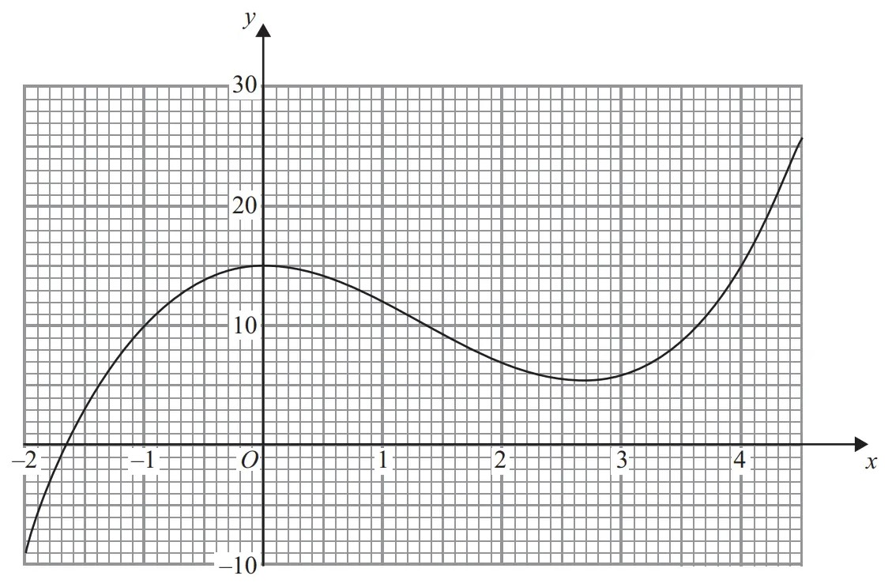
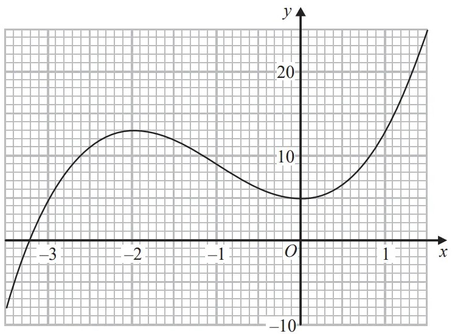
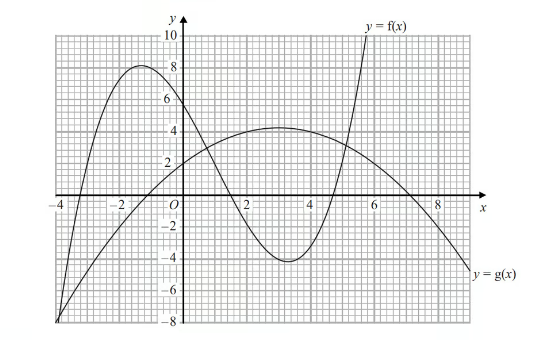
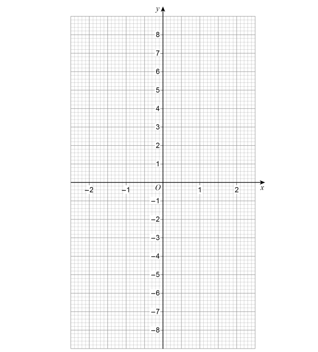
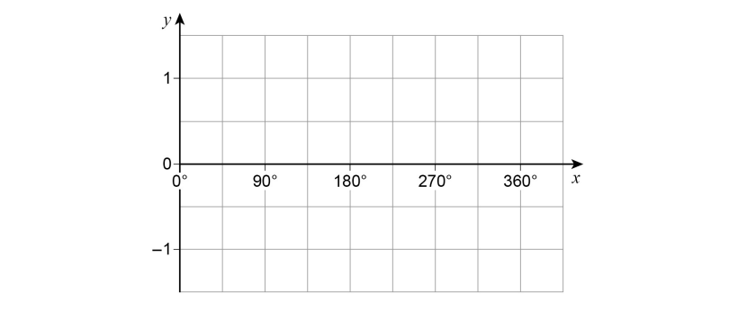
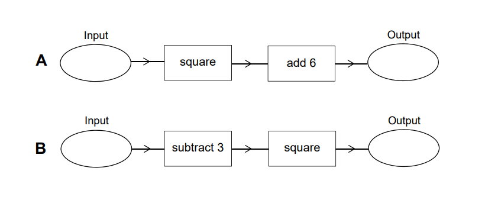

# Exam Questions — Functions
**Functions, Graphs & Differentiation** · Edexcel IGCSE Maths A (Modular) (4XMAF/4XMAH) — 24/Higher Unit 2
> Source: [https://www.savemyexams.com/igcse/maths/edexcel/a-modular/24/higher-unit-2/topic-questions/functions-graphs-and-differentiation/functions/exam-questions/](https://www.savemyexams.com/igcse/maths/edexcel/a-modular/24/higher-unit-2/topic-questions/functions-graphs-and-differentiation/functions/exam-questions/) · 57 questions · total 267 marks

## Q1 — very_hard — 5 marks · exam-questions

### 1() — 2 marks — command: show — structured
Show that $\frac{x^{2}+3x}{2x^{2}+5x-3}$ can be written as  $\frac{x}{kx-1}$

State the value of $k$.

### 2() — 3 marks — command: show — structured
$f(x)=\frac{x}{2x-1}$

Find the inverse function $f^{-1}$  in the form $\mathrm{f}^{- 1} ( x ) = .......$

Show your working clearly.

## Q2 — hard — 3 marks · exam-questions

### 17((b)) — 3 marks — command: show — structured — from paper Jan 2021 · 4MA1/2HR
The functions $f$and $g$ are defined as

$\begin{gathered} \mathrm{f} ( x ) & = x^{2} + 6 \\ \mathrm{g} ( x ) & = x - 10 \end{gathered}$

Solve the equation $\mathrm{fg}(x)=f(x)$

Show clear algebraic working.

## Q3 — medium — 3 marks · exam-questions

### 11((a)) — 1 mark — command: find — structured — from paper 2018	June · 1MA1/2H
$f$ and $g$ are functions such that

`f ( x ) = 2 / x ^2 and g ( x ) = 4 x ^3`

Find $f(-5)$

### 11((b)) — 2 marks — command: find — structured — from paper 2018	June · 1MA1/2H
Find $fg ( 1 )$

## Q4 — very_hard — 5 marks · exam-questions

### 22() — 5 marks — command: find — structured — from paper 2017 Nov · 1MA1/2H
The functions $f$ and $g$ are such that

$f(x)=5x+3g(x)=ax+b$ where $a$ and $b$ are constants.

$g(3)=20\mathrm{and}f^{-1}(33)=g(1)$

Find the value of $a$ and the value of $b$.

## Q5 — hard — 3 marks · exam-questions

### 18() — 3 marks — command: express — structured — from paper 2015	Spec1 · 1MA1/2H
$f(x)=3x^{2}---2x---8$

Express $f(x+2)$ in the form $ax^{2}+bx$

## Q6 — medium — 4 marks · exam-questions

### 1() — 2 marks — command: express — structured
$\mathrm{f} ( x ) = 3 x - 2
 \mathrm{g} ( x ) = \frac{ 10}{x + 2}$

Express the inverse function $f^{-1}$ in the form $\mathrm{f}^{- 1} ( x ) = ...$

### 2() — 2 marks — command: simplify — structured
Find $\mathrm{gf}(x)$ 
Simplify your answer.

## Q7 — very_hard — 9 marks · exam-questions

### 1() — 1 mark — command: find — structured
$\mathrm{f} ( x ) = \sqrt{x - 6}$

Find f(10)

### 2() — 2 marks — command: state — structured
State which values of $x$ must be excluded from a domain of f

### 3() — 1 mark — command: find — structured — from paper PRE 2017
The diagram shows part of the graph of $y = \mathrm{g} ( x )$

Find $\mathrm{g} ( 2 )$

### 4() — 2 marks — command: find — structured
Find $fg ( 0 )$

### 5() — 3 marks — command: find — structured
One of the solutions of $\mathrm{g} ( x ) = k$, where $k$ is a number, is $x=1$

Find the other solutions 
Give your answers correct to 1 decimal place

## Q8 — hard — 6 marks · exam-questions

### 1() — 3 marks — command: find — structured
The functions $f$ and $g$ are such that $f(x)=x+3$     and       $\mathrm{g} ( x ) = \frac{1}{x - 2}$

Find $\mathrm{fg}(x)$ 
Give your answer as a single algebraic fraction expressed as simply as possible.

### 2() — 3 marks — command: express — structured
Express the inverse function $g^{-1}$ in the form $\mathrm{g}^{- 1} ( x ) = ...$

## Q9 — medium — 3 marks · exam-questions

### 1() — 1 mark — command: find — structured
f is a function such that

$\mathrm{f} ( x ) = \frac{1}{x^{2} + 1}$

Find $\mathrm{f} ( 1 \frac{1}{2} )$

### 2() — 2 marks — command: find — structured
$g$ is a function such that

$\mathrm{g} ( x ) = \sqrt{x - 1} x greater-than \text{or} \text{slanted} \text{equal} \text{to} 1$

Find $\mathrm{f} g ( x )$

Give your answer as simply as possible.

## Q10 — very_hard — 9 marks · exam-questions

### 1() — 1 mark — command: find — structured
The diagram shows the graph of $y=f(x)$  for  `negative 3.5 less-than or slanted equal to x less-than or slanted equal to 1.5`

Use the graph of $\mathrm{f} ( x )$ to find the value of $\mathrm{f} ( 0 )$.

### 2() — 2 marks — command: which — structured
For which values of $k$ does the equation $\mathrm{f} ( x ) = k$ have only one solution?

### 3() — 3 marks — command: find — structured
Find an estimate for the gradient of the curve at the point where $x$ = −2.5

### 4() — 1 mark — command: state — structured
$\mathrm{g} ( x ) = \frac{1}{2 + x}$

State which value of $x$ must be excluded from any domain of $g$

### 5() — 2 marks — command: find — structured
Find fg(-3)

## Q11 — hard — 4 marks · exam-questions

### 10((a)) — 2 marks — command: find — structured — from paper 2015	Sample · 1MA1/3H
The function $f$ is such that

$f(x)=4x---1$

Find $f^{-1}(x)$

### 10((b)) — 2 marks — command: work_out — structured — from paper 2015	Sample · 1MA1/3H
The function $g$ is such that

$g(x)=kx^{2}$ where $k$ is a constant.

Given that $\mathrm{fg}(2)=12$

work out the value of $k$

## Q12 — medium — 9 marks · exam-questions

### 1() — 1 mark — command: find — structured
$f$is the function $f(x)=2x+5$

Find $f(3)$

### 2() — 2 marks — command: express — structured
Express the inverse function $f^{-1}$ in the form $\mathrm{f}^{- 1} ( x )$ =

### 3() — 1 mark — command: find — structured
$g$ is the function $g(x)=x^{2}---25$

Find $g(---3)$

### 4() — 5 marks — command: multiple — structured — from paper PRE 2017
(i) Find $\mathrm{gf}(x)$ Give your answer as simply as possible.

[3]

(ii) Solve $\mathrm{gf}(x)=0$

[2]

## Q13 — very_hard — 5 marks · exam-questions

### 25((a)) — 4 marks — command: express — structured — from paper Jan 2022 · 4MA1/2H
The function $g$ is defined as

$g : x \rightarrow \text{from} \text{bar} 5 + 6 x - x^{2}$       with domain `{ x colon x greater-than or slanted equal to 3 }`

Express the inverse function g−1 in the form $g^{- 1} : x \rightarrow \text{from} \text{bar} ...$

$g^{- 1} : x \rightarrow \text{from} \text{bar}$...................................................

### 25((b)) — 1 mark — command: state — structured — from paper Jan 2022 · 4MA1/2H
State the domain of  $g^{-1}$

## Q14 — hard — 7 marks · exam-questions

### 21((a)) — 2 marks — command: find — structured — from paper June 2019 · 1MA1/1H
The functions $f$ and $g$ are such that

`f ( x ) = 3 x - 1 and g ( x ) = x ^2 + 4`

Find $f^{-1}(x)$

### 21((b)) — 5 marks — command: show — structured — from paper June 2019 · 1MA1/1H
Given that $\mathrm{fg}(x)=2\mathrm{gf}(x)$,

show that $15x^{2}-12x---1=0$

## Q15 — medium — 8 marks · exam-questions

### 1() — 1 mark — command: work_out — structured
The functions $f$ and $g$ are defined as

$\mathrm{f} ( x ) = 1 \frac{1}{2} x + 4
 \mathrm{g} ( x ) = \frac{2 x}{x + 1}$

Work out $f(6)$

### 2() — 2 marks — command: work_out — structured
Work out  $\mathrm{fg}(---3)$

### 3() — 2 marks — command: work_out — structured
$g(a)=-2$

Work out the value of $a$.

### 4() — 3 marks — command: express — structured
Express the inverse function $f^{-1}$ in the form $f^{-1}(x)$ = ...

## Q16 — very_hard — 4 marks · exam-questions

### 23() — 4 marks — command: express — structured — from paper Jan 2022 · 4MA1/2HR
The functions $f$ and $g$ are such that

$f(x)=x+25g(x)=x^{2}--12x$

The function $h$ is such that $h(x)=\mathrm{fg}(x)$

The domain of $h$ is `{ x colon x less-than or slanted equal to 6 }`

Express the inverse function $h^{--1}$ in the form $h^{--1}(x)=...$

$h^{--1}(x)=.....................$

## Q17 — hard — 7 marks · exam-questions

### 1() — 1 mark — command: find — structured
The function f is defined as

$f(x)=\frac{x-6}{2}$

Find f (8)

### 2() — 2 marks — command: express — structured
Express the inverse function $f^{-1}$in the form $\mathrm{f}^{- 1} ( x )$ = ......

### 3() — 2 marks — command: which — structured
The function $g$ is defined as

$g(x)=\sqrt{x-4}$

Which values of $x$ cannot be included in a domain of $g$?

### 4() — 2 marks — command: express — structured
Express the function $\mathrm{gf}$ in the form $gf ( x )$= .......

Give your answer as simply as possible.

## Q18 — medium — 9 marks · exam-questions

### 1() — 1 mark — command: find — structured
f is the function such that  f(*x*) = 2*x* - 5

g is the function such that g(*x*) = *x*2 - 10

Find f (4)

### 2() — 2 marks — command: find — structured
Find fg(-4)

### 3() — 2 marks — command: express — structured
Express the inverse function f-1 in the form f-1 (*x*) = ...

### 4() — 4 marks — command: solve — structured
Solve gf (*x*) = -1

## Q19 — very_hard — 6 marks · exam-questions

### 24((a)) — 2 marks — command: find — structured — from paper June 2021 · 4MA1/1H
The functions $f$ and $g$ are defined as

$\begin{gathered} \mathrm{f} ( x ) & = 5 x^{2} - 10 x + 7 \text{where} x greater-than \text{or} \text{slanted} \text{equal} \text{to} 1 \\ \mathrm{g} ( x ) & = 7 x - 6 \end{gathered}$

Find $\mathrm{fg}(2)$

### 24((b)) — 4 marks — command: express — structured — from paper June 2021 · 4MA1/1H
Express the inverse function $f^{-1}$ in the form  $f^{-1}(x)=...$

$f^{-1}(x)=$...............................

## Q20 — hard — 5 marks · exam-questions

### 1() — 1 mark — command: state — structured
$\mathrm{f} ( x ) = \frac{3}{x + 1} + \frac{1}{x - 2}$

State one value of $x$ which cannot be included in any domain of f.

### 2() — 1 mark — command: find — structured
Find the value of f(0)

### 3() — 3 marks — command: show — structured
Find the value of $x$ for which $\mathrm{f} ( x ) = 0$

Show clear algebraic working.

## Q21 — medium — 5 marks · exam-questions

### 9((a)) — 1 mark — command: find — structured — from paper 2015	Spec2 · 1MA1/2H
The functions $f$ and $g$ are such that

$f(x)=3(x---4)\mathrm{and}g(x)=\frac{x}{5}+1$

Find the value of $\mathrm{f} ( 10 )$

### 9((b)) — 2 marks — command: find — structured — from paper 2015	Spec2 · 1MA1/2H
Find  $\mathrm{g}^{- 1} ( x )$

### 9((c)) — 2 marks — command: show — structured — from paper 2015	Spec2 · 1MA1/2H
Show that $\mathrm{ff}(x)=9x---48$

## Q22 — very_hard — 5 marks · exam-questions

### 21() — 5 marks — command: express — structured — from paper Jan 2020 · 4MA1/1H
The functions $f$ and $g$are such that

$f(x)=x^{2}-2xg(x)=x+3$

The function $h$ is such that $\mathrm{h} ( x ) = \text{fg} ( x ) \text{for} x greater-than \text{or} \text{slanted} \text{equal} \text{to} - 2$

Express the inverse function $h^{-1}(x)$ in the form $h^{-1}(x)$ = .........

$h^{-1}(x)$ = ................

## Q23 — hard — 3 marks · exam-questions

### 1() — 1 mark — command: find — structured
The diagram shows parts of the graphs of $y = \mathrm{f} ( x )$and $y = g ( x )$.

Find g(0)

### 2() — 2 marks — command: find — structured
Find $g$f(–1)

## Q24 — medium — 7 marks · exam-questions

### 1() — 1 mark — command: find — structured
The function f is defined as f($x$) = $\frac{3}{4+x}$

Find the value of f(1)

### 2() — 1 mark — command: state — structured
State which value of $x$ must be excluded from any domain of f.

### 3() — 1 mark — command: find — structured
The function $g$ is defined as $g(x)$ = 5 + $x$

Given that $g(a)$ = 7, find the value of $a$.

### 4() — 2 marks — command: calculate — structured
Calculate $fg$(1)

### 5() — 2 marks — command: simplify — structured
Find $fg ( x )$ Simplify your answer.

## Q25 — very_hard — 7 marks · exam-questions

### 27((a)) — 2 marks — command: express — structured — from paper Nov 2020 · 4MA1/2H
The function$f$ is such that $f(x)=5+6x--x^{2}$      for $x \text{less} - \text{than} or \text{slanted} \text{equal} to 3$

Express $5+6x--x^{2}$ in the form $p--(x--q)^{2}$ where $p$ and $q$ are constants.

### 27((b)) — 5 marks — command: find — structured — from paper Nov 2020 · 4MA1/2H
Using your answer to part (a), find the range of values of $x$ for which $f^{-1}(x)$ is positive.

## Q26 — hard — 7 marks · exam-questions

### 1() — 1 mark — command: state — structured
$f(x)=\frac{2}{x}$

$\mathrm{g} ( x ) = \frac{x + 1}{x}$

State which value of $x$cannot be included in the domain of f or $g$.

### 2() — 3 marks — command: solve — structured
Solve $gf ( a ) = 3$

### 3() — 3 marks — command: express — structured
Express the inverse function $g^{-1}$ in the form $\mathrm{g}^{- 1} ( x )$

## Q27 — medium — 4 marks · exam-questions

### 17((c)) — 1 mark — command: state — structured — from paper Jan 2021 · 4MA1/2HR
The function $h$ is defined as

$\mathrm{h} ( x ) = \frac{2 x - 4}{x}$

State the value of $x$ that cannot be included in the domain of h

### 17((d)) — 3 marks — command: express — structured — from paper Jan 2021 · 4MA1/2HR
Express the inverse function h–1 in the form $h^{--1}(x)=...$

$h^{--1}(x)=$....................

## Q28 — very_hard — 5 marks · exam-questions

### 23((a)) — 1 mark — command: write — structured — from paper Jan 2019 · 4MA1/1H
$g$ is the function with domain $x \text{greater} - \text{than} or \text{slanted} \text{equal} to - 3$ such that $g(x)=x^{2}+6x$

Write down the range of $g^{-1}$

### 23((b)) — 4 marks — command: express — structured — from paper Jan 2019 · 4MA1/1H
Express the inverse function $g^{-1}$ in the form `g ^ - 1 colon x -> from bar horizontal ellipsis`

$g^{- 1} : x \rightarrow \text{from} \text{bar}$

## Q29 — hard — 5 marks · exam-questions

### 1() — 2 marks — command: express — structured
f:$x$ → 2$x^{2}$$+$1  $g$:$x$→ $\frac{2x}{x-1}$ where $x$≠ 1

Express the composite function gf in the form $g$f:$x$ → .....

Give your answer as simply as possible.

### 2() — 3 marks — command: express — structured
Express the inverse function $g^{-1}$in the form $\mathrm{g}^{- 1} ∶ x$→ ......

## Q30 — medium — 4 marks · exam-questions

### 17((a)) — 1 mark — command: find — structured — from paper Jan 2020 · 4MA1/1HR
The function $f$ is such that $f(x)=(x-4)^{2}$ for all values of $x$.

Find $f(1)$

### 17((b)) — 1 mark — command: state — structured — from paper Jan 2020 · 4MA1/1HR
State the range of the function $f$

### 17((c)) — 2 marks — command: work_out — structured — from paper Jan 2020 · 4MA1/1HR
The function $g$ is such that $\mathrm{g} ( x ) = \frac{4}{x + 3} x \text{eq} - 3$

Work out $\mathrm{fg}(2)$

## Q31 — very_hard — 6 marks · exam-questions

### 26((a)) — 3 marks — command: find — structured — from paper Jan 2019 · 4MA1/1HR
The function f is defined as $f(x)=\frac{\sqrt{x^{2}+k^{2}}}{x}$ for $x>0$ and where $k$ is a positive number.

Find the value of $p$ for which $f^{-1}(p)=k$

$p=$

### 26((b)) — 3 marks — command: find — structured — from paper Jan 2019 · 4MA1/1HR
The function $g$ is defined as $g(x)=x^{2}\mathrm{for}x>0$

Given that $\mathrm{gf}(a)=k\mathrm{for}k>1$ find an expression for $a$ in terms of $k$.

$a=$

## Q32 — hard — 3 marks · exam-questions

### 28((b)) — 3 marks — command: solve — structured — from paper June 2018 · 8300/2H
$\mathrm{g} ( x ) = 3 x + 7$

Solve  $g^{--1}(x)=2x$

$x$ = ....................

## Q33 — hard — 7 marks · exam-questions

### 1() — 1 mark — command: find — structured
The functions $g$ and h are defined as

$\mathrm{g} ( x ) = \frac{x}{2 x - 5}$

$\mathrm{h} ( x ) = x + 4$

Find the value of $g$(1)

### 2() — 1 mark — command: state — structured
State which value of $x$ must be excluded from any domain of $g$

### 3() — 2 marks — command: simplify — structured
Find $gh ( x )$

Simplify your answer

### 4() — 3 marks — command: express — structured
Express the inverse function $g^{-1}$ in the form $\mathrm{g}^{- 1} ( x )$ = .....

## Q34 — medium — 1 marks · exam-questions

### 19() — 1 mark — command: circle — structured — from paper Specimen 2015 · 8300/2H
$f(x)=3x$

Circle the expression for$f^{-1}(x)$

| $-3x$ | $\frac{3}{x}$ | $\frac{1}{3x}$ | $\frac{x}{3}$ |
|---|---|---|---|

## Q35 — very_hard — 4 marks · exam-questions

### 30() — 4 marks — command: solve — structured — from paper Nov 2020 · 8300/3H
$\mathrm{f} ( x ) = 1 \frac{1}{2} x$      $\mathrm{g} ( x ) = x - x^{2}$

Solve  $f^{--1}(x)=\mathrm{gf}(x)$

## Q36 — hard — 6 marks · exam-questions

### 1() — 1 mark — command: find — structured
$f(x)=\frac{2x}{x-1}$

Find the value of $\mathrm{f} ( 11 )$

### 2() — 1 mark — command: state — structured
State which value of $x$must be excluded from any domain of f

### 3() — 3 marks — command: find — structured
Find $\mathrm{f}^{- 1} ( x )$

### 4() — 1 mark — command: state — structured
State the value which cannot be in any range of f

## Q37 — hard — 3 marks · exam-questions

### 8() — 3 marks — command: fill — structured — from paper Specimen 2015 · J560/04
A function machine is shown below.

If the Input is 3, the Output is 5.

If the Input is 7, the Output is 25.

Use this information to fill in the two boxes.

## Q38 — medium — 5 marks · exam-questions

### 8((a)) — 2 marks — command: work_out — structured — from paper Specimen 2015 · J560/04
A function is represented by the following function machine.

A number is input into the machine. 
The output is used as a new input. 
The second output is 11.

Work out the number that was the** first input**.

### 8((a)) — 3 marks — command: work_out — structured — from paper Specimen 2015 · J560/04
A number is input into the machine. 
The output given is the same number.

Work out the number.

## Q39 — very_hard — 5 marks · exam-questions

### 27() — 5 marks — command: work_out — structured — from paper June 2019 · 8300/2H
$\mathrm{f} ( x ) = \frac{2 x}{5} - 1$

Work out the value of  $f^{--1}(3)+f(--0.5)$

## Q40 — hard — 7 marks · exam-questions

### 1() — 1 mark — command: find — structured
f is the function such that

$\mathrm{f} ( x ) = \frac{x}{3 x + 1}$

Find f(0.5)

### 2() — 2 marks — command: find — structured
Find ff(−1)

### 3() — 1 mark — command: find — structured
Find the value of $x$ that cannot be included in any domain of f

### 4() — 3 marks — command: show — structured
Express the inverse function $f^{-1}$ in the form $\mathrm{f}^{- 1} ( x )$= ......

Show clear algebraic working.

## Q41 — hard — 3 marks · exam-questions

### 24((a)) — 3 marks — command: work_out — structured — from paper Nov 2021 · 8300/1H
$\begin{array}{rcl} \mathrm{f} ( x ) & = c x + d \\ \mathrm{f} ( 4 ) & = 7 \\ \mathrm{f} ( 10 ) & = 22 \end{array}$

Work out the values of $c$ and $d$.

$c=$.........................

$d=$.........................

## Q42 — medium — 1 marks · exam-questions

### 24((b)) — 1 mark — command: circle — structured — from paper Nov 2021 · 8300/1H
$\mathrm{g} ( x ) = 2 x$ and  $\mathrm{h} ( x ) = \frac{x - 1}{2}$

Circle the expression for $\mathrm{hg}(x)$

| $\frac{2x^{2}-x}{2}$ | $\frac{2x-1}{2}$ | $x^{2}-x$ | $x-1$ |
|---|---|---|---|

## Q43 — hard — 4 marks · exam-questions

### 17((a)) — 1 mark — command: what — structured — from paper 2023 June · 4MA1/1H
The functions $g$ and $h$ are such that

$\mathrm{g} ( x ) = \frac{11}{2 x - 5}$

$\mathrm{h} ( x ) = x^{2} + 4 x greater-than \text{or} \text{slanted} \text{equal} \text{to} 0$

What value of $x$ must be excluded from any domain of $g$?

### 17((b)) — 3 marks — command: solve — structured — from paper 2023 June · 4MA1/1H
Solve $\mathrm{gh}(x)=1$

## Q44 — very_hard — 3 marks · exam-questions

### 28((a)) — 3 marks — command: simplify — structured — from paper June 2018 · 8300/2H
$\mathrm{f} ( x ) = 5 - x$  and     $\mathrm{g} ( x ) = 3 x + 7$

Simplify $f(2x)+g(x--1)$

## Q45 — hard — 3 marks · exam-questions

### 22() — 3 marks — command: express — structured — from paper Jan 2021 · 4MA1/1H
The function f is such that $f(x)=x^{2}--8x+5$ where $x \text{less} - \text{than} or \text{slanted} \text{equal} to 4$ Express the inverse function $f^{-1}$ in the form $f^{--1}(x)=...$

$f^{--1}(x)=................$

## Q46 — hard — 7 marks · exam-questions

### 19((a)) — 1 mark — command: state — structured — from paper 2023 Nov · 4MA1/2H
The functions $f$ and $g$ are such that

$\mathrm{f} : x \rightarrow \text{from} \text{bar} 5 x + 7
 \mathrm{g} : x \rightarrow \text{from} \text{bar} \frac{5}{2 x - 9}$

State which value of $x$ cannot be included in any domain of $g$

### 19((b)) — 2 marks — command: find — structured — from paper 2023 Nov · 4MA1-2H
Find $\mathrm{fg}(4)$

### 19((c)) — 4 marks — command: express — structured — from paper 2023 Nov · 4MA1-2H
The function $h$ is such that

$\mathrm{h} : x \rightarrow \text{from} \text{bar} 3 x^{2} - 12 x + 8$ where $x>2$

Express the inverse function $h^{-1}$ in the form $\mathrm{h}^{- 1} : x \rightarrow \text{from} bar....$

## Q47 — very_hard — 2 marks · exam-questions

### 27((a)) — 2 marks — command: draw — structured — from paper June 2017 · 8300/2H
$\mathrm{h} ( x ) = \sqrt[3]{x}$   for all values of $x$

On the grid, draw the graph of the inverse function $y = \mathrm{h}^{- 1} ( x )$  for  `negative 2 less-than or slanted equal to x less-than or slanted equal to 2`

## Q48 — hard — 4 marks · exam-questions

### 23() — 4 marks — command: express — structured — from paper June 2018 · 4MA1/1HR
Two functions, $f$ and $g$ are defined as

$\mathrm{f} : x \rightarrow \text{from} \text{bar} 1 + \frac{1}{x} \text{for} x > 0
 \mathrm{g} : x \rightarrow \text{from} \text{bar} \frac{x + 1}{2} \text{for} x > 0$

Given that $h=\mathrm{fg}$ 
express the inverse function $h^{-1}$ in the form $\mathrm{h}^{- 1} : x \rightarrow \text{from} \text{bar} ...$

$\mathrm{h}^{- 1} : x \rightarrow \text{from} \text{bar}$.....................

## Q49 — very_hard — 2 marks · exam-questions

### 27((b)) — 2 marks — command: draw — structured — from paper June 2017 · 8300/2H
For all values of $x$

$f(x)=\mathrm{sin}x\,g(x)=x+90$

On the grid, draw the graph of the composite function  $y = \text{fg} ( x )$  for  $0 ^{\circ} \text{less} - \text{than} or \text{slanted} \text{equal} to x \text{less} - \text{than} or \text{slanted} \text{equal} to 360 ^{\circ}$

## Q50 — hard — 4 marks · exam-questions

### 28() — 4 marks — command: show — structured — from paper Nov 2019 · 8300/3H
$\mathrm{f} ( x ) = 2 x - 3$ and $\mathrm{g} ( x ) = x^{2}$

Show that  $\mathrm{f}^{- 1} ( 55 ) = \mathrm{f} g ( 4 )$

## Q51 — very_hard — 4 marks · exam-questions

### 19() — 4 marks — command: work_out — structured — from paper Specimen 2015 · 8300/3H
Here are two function machines, **A** and **B**.

Both machines have the same input.

Work out the range of input values for which

the output of **A** is **less** than the output of **B**.

## Q52 — hard — 2 marks · exam-questions

### 30() — 2 marks — command: work_out — structured — from paper Nov 2017 · 8300/3H
$f(x)=\frac{x}{3}+4$  for all values of $x$.

$g(x)=6x^{2}+3$ for all values of $x$.

Work out $\mathrm{fg}(x)$.

Give your answer in the form $ax^{2}+b$   where $a$ and $b$ are integers.

## Q53 — very_hard — 3 marks · exam-questions

### 25() — 3 marks — command: work_out — structured — from paper Specimen 2015 · 8300/1H
$f(x)=2x+c$

$g(x)=cx+5$

$fg(x)=6x+d$

$c$ and $d$ are constants.

Work out the value of $d$.

## Q54 — hard — 2 marks · exam-questions

### 17() — 2 marks — command: show — structured — from paper Nov 2019 · 8300/3H
$f(x)=3x^{2}--4x+8$ for all values of $x$

Jenny says,

“f(10) must equal 2 × f(5), because 10 is 2 × 5”

Is Jenny correct? Show working to support your answer.

## Q55 — hard — 3 marks · exam-questions

### 26() — 3 marks — command: solve — structured — from paper June 2019 · 8300/3H
$g(x)=16--xh(x)=x^{3}$

Solve    $gh ( x ) = 24$

## Q56 — hard — 3 marks · exam-questions

### 26() — 3 marks — command: work_out — structured — from paper Nov 2018 · 8300/2H
$f(x)=\frac{x}{x+2}g(x)=x^{2}--2$

Work out $\mathrm{fg}(x)$

Give your answer in the form    $a+bx^{n}$    where $a,b$ and $n$ are integers.

## Q57 — hard — 4 marks · exam-questions

### 26() — 4 marks — command: work_out — structured — from paper Nov 2018 · 8300/3H
$f(x)=\frac{2x+3}{x-4}$

Work out $f^{--1}(x)$
