# Mark Schemes — Similarity & Geometrical Proof
**Geometry** · Edexcel IGCSE Maths A (Modular) (4XMAF/4XMAH) — 24/Higher Unit 2

## Q1 — very_hard — 5 marks · exam-questions

### 20() — 5 marks
> *To prove that **ST  **is equal to** UT ** you will need to **prove **that the triangle **STU **is **isosceles**. This can be done by finding the angles. *

> *PQRST **is a regular pentagon, so the angle **TSU** is the exterior angle of a regular pentagon. Exterior angles in any polygon add up to 360°. A regular pentagon has 5 equal exterior angles.*

> * *$T \hat{S} U = \frac{360}{5} = 72^{\circ}$

**[1]**

> *To find the size of angle **SUT**, you will need to consider circle theorems.*

> *Begin by joining the point **O** to the points **T** and **R,** marking all the radiuses of the circle as equal lengths on the diagram.*

> *TP** and **TR **are also tangents to the circle, so by the circle theorem 'A tangent always meets a radius at 90°', angles **ORQ **and **OTP **are both 90°. *

$O \hat{R} Q = O \hat{T} P = 90^{\circ}$* **(angle between tangent and radius)*

**[1]**

> *Mark these onto the diagram.*

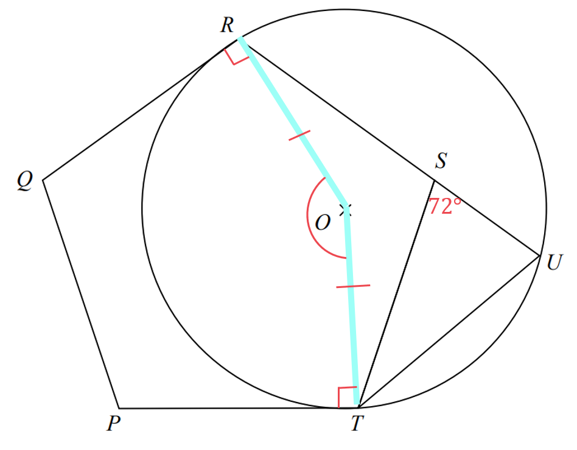

> *The sum of the interior angles in any polygon can be found using the formula 180°(n - 2). A regular pentagon has 5 equal interior angles, therefore these can be found using the formula *$\frac{180 ( 5 - 2 )}{5}$*.*

> * *$T \hat{P} Q = P \hat{Q} R = \frac{3 ( 180 )}{5} = 108^{\circ}$

> *Add these angles to the diagram.*

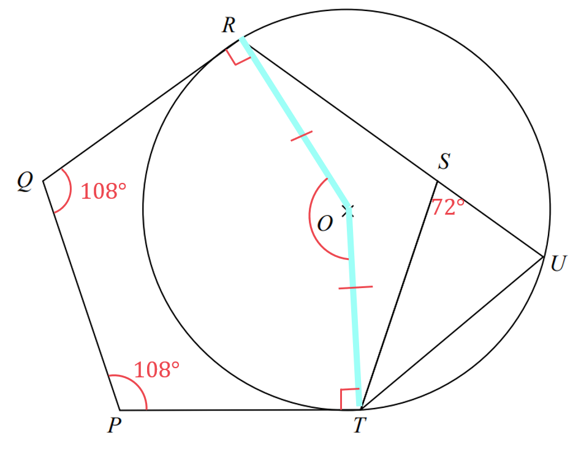

> *PQROT  **is a pentagon, so the angle **ROT**  can be found by subtracting the other four angles from the sun of the angles in a pentagon.*

> *The sum of the interior angles in any polygon can be found using the formula 180°(n - 2).*

$R \hat{O} T + O \hat{T} P + T \hat{P} Q + P \hat{Q} R + Q \hat{R} O = 180 ( 5 - 2 )^{\circ} = 540^{\circ}$

> *Substitute in the angles you know to find angle **ROT**.*

$\begin{gathered} R \hat{O} T + 90^{\circ} + 90^{\circ} + 108^{\circ} + 108^{\circ} & = 540^{\circ} \\ R \hat{O} T + 396^{\circ} & = 540^{\circ} \\ R \hat{O} T & = 144^{\circ} \end{gathered}$

**[1]**

> *By the circle theorem, the angle at the centre is twice the angle at the circumference, angle **ROT **is twice angle **RUT.*

$R \hat{O} T = 2 ( R \hat{U} T ) = 2 ( S \hat{U} T )$

$S \hat{U} T = \frac{R \hat{O} T}{2} = \frac{144}{2} = 72^{\circ}$

**[1]**

> *This proves that angle **TSU **is equal to angle **SUT **and so triangle **STU **is isosceles.*

**Therefore ****ST ****= ****UT **
**All reasons given clearly [1]**

## Q2 — hard — 3 marks · exam-questions

### 15() — 3 marks
> *Similar triangles have three equal angles. *
*Use circle theorems to identify any corresponding angles that are equal between triangles **ABE**  and **DCE**.*

> *The same segment circle theorem states that angles at the circumference subtended by the same arc are equal.*

> *Vertically opposite angles at a point are equal.*

> *The statement that if three corresponding angles between two triangles are equal then the two triangles are similar must be made.*

**Angle ****ABE****  = angle ****DCA****  as they are angles in the same segment. **
**Angle ****BAE****  = angle ****CDE****  as they are angles in the same segment. Angle ****AEB****  = angle ****DEC****  as they are vertically opposite angles. **** **
**A****t least one of the three statements given, with reason ****[1]  **
**A****t least two of the three statements given, with reasons ****[1]**** All three angles are the same so the triangles are similar.***** ***** ****All three statements and explanation of similar triangles ****[1]**

## Q3 — medium — 3 marks · exam-questions

### 21() — 3 marks
> *The triangles are similar so there will exist a value of **k **such that  *$\begin{gathered} A D & = k A E \end{gathered}$* and *$\begin{gathered} C D & = k B E \end{gathered}$*. *
*k **is known as the scale factor.*

> *It may help to draw the two triangles out separately next to each other.*

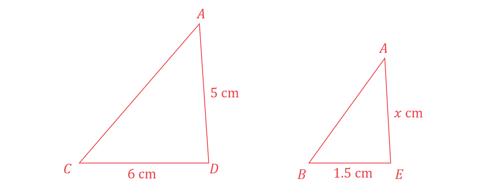

> *Form an equation using the two known sides of the triangle.*

$\begin{gathered} C D & = k B E \end{gathered}$

> *Substitute the values of *$CD$* and *$BE$* into the equation and solve to find *$k$*.*

$\begin{gathered} 6 & = 1.5 k \\ k & = \frac{6}{1.5} = 4 \end{gathered}$

**[1]**

> *Substitute into *$\begin{gathered} A D & = k A E \end{gathered}$*.*

$\begin{gathered} A D & = k A E \\ 5 & = ( 4 ) A E \end{gathered}$

> *Solve to find *$AE$*.*

$\begin{gathered} 5 & = 4 A E \\ A E & = \frac{5}{4} = 1.25 \end{gathered}$

> $ED=AD-AE$*. Substitute the values of*$AD$* and*$AE$* in.*

$\begin{gathered} E D & = A D - A E = 5 - 1.25 \end{gathered}$

**[1]**

$ED=3.75$** cm**** ****[1]**

## Q4 — easy — 4 marks · exam-questions

### 17((a)) — 2 marks
> *As the two shapes are mathematically similar, there will exist a value of *
*k **such that *$\begin{gathered} L P & = k A D \end{gathered}$* and *$\begin{gathered} P N & = k C D \end{gathered}$*. *
$k$* **is known as the scale factor.*

> *Form an equation using the two known sides of the triangle.*

$\begin{gathered} P N & = k C D \\ 9 & = 6 k \end{gathered}$

> *Solve to find *$k$*.*

$\begin{gathered} k & = \frac{9}{6} = \frac{3}{2} \end{gathered}$

**[1]**

> *Substitute into *$\begin{gathered} L P & = k A D \end{gathered}$*.*

$\begin{array}{rcl} L P & = \frac{3}{2} A D = \frac{3}{2} ( 5 ) = \frac{15}{2} \end{array}$

$LP=7.5$** cm**** ****[1]**

### 17((b)) — 2 marks
> *From part (a) the scale factor to enlarge any side from the smaller shape to the bigger one is *$k=1.5$*.*

> *Substitute this into *$\begin{gathered} M N & = k B C \end{gathered}$*.*

$\begin{gathered} M N & = 1.5 B C \\ 12 & = 1.5 B C \end{gathered}$

> *Solve to find *$BC$*.*

$\begin{gathered} B C & = \frac{12}{1.5} = 8 \end{gathered}$

**[1]**

$BC=8$** cm**** ****[1]**

## Q5 — very_hard — 5 marks · exam-questions

### 22() — 5 marks
> *The triangles are similar so all the corresponding angles will be equal. The question does **not **state that the two lines **BE **and **CD **are parallel, so you cannot assume this. *

> *It may help to draw the two triangles out separately next to each other.*

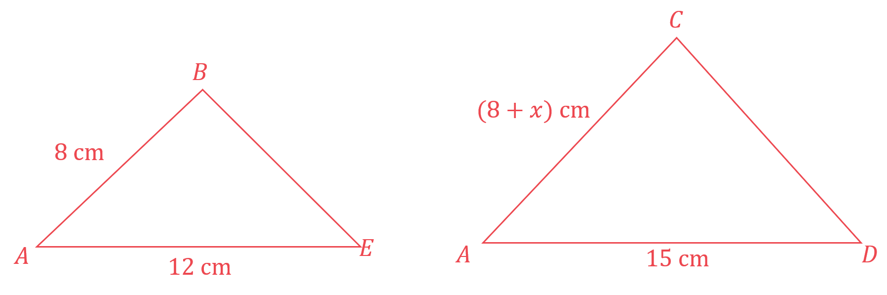

> *The angles **BAE **and **CAD** are the same angle so they are equal.*

> *If the lines **BE **and **CD **are parallel, then the angle **ABE **= angle **ACD **then there will exist a value of **k **such that  *$\begin{gathered} A C & = k A B \end{gathered}$*, *$\begin{gathered} C D & = k B E \end{gathered}$* and *$\begin{gathered} A D & = k A E \end{gathered}$*. **k **is known as the scale factor.*

> *Form an equation using the two sides **AE **and **AD**.*

$\begin{gathered} A D & = k A E \end{gathered}$

> *Substitute the values of *$AE$* and *$AD$* into the equation and solve to find *$k$*.*

$\begin{gathered} 15 & = 12 k \\ k & = \frac{15}{12} = 1.25 \end{gathered}$

**[1]**

> *Substitute into *$\begin{gathered} A C & = k A B \end{gathered}$*.*

$\begin{gathered} A C & = k A B \\ 8 + x & = ( 1.25 ) ( 8 ) \end{gathered}$

> *Solve to find *$x$*.*

$\begin{gathered} 8 + x & = 10 \\ x & = 10 - 8 \\ x & = 2 \end{gathered}$

**[1]**

> *If the lines **BE **and **CD **are **not **parallel, then it **may **instead be that angle **ABE **= angle **ADC.  **Drawing the triangles this way up instead will help.*

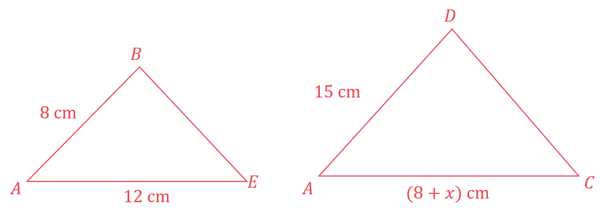

> *In this case, there will exist a value of **k **such that  *$\begin{gathered} A C & = k A E \end{gathered}$*, *$\begin{gathered} C D & = k B E \end{gathered}$* and *$\begin{gathered} A D & = k A B \end{gathered}$*. **k **is known as the scale factor.*

> *Form an equation using the two sides **AB **and **AD**.*

$\begin{gathered} A D & = k A B \end{gathered}$

> *Substitute the values of **AB** and **AD** into the equation and solve to find *$k$*.*

$\begin{gathered} 15 & = 8 k \\ k & = \frac{15}{8} \end{gathered}$

> *Substitute into *$\begin{gathered} A C & = k A E \end{gathered}$*.*

$\begin{gathered} A C & = k A E \\ 8 + x & = ( \frac{15}{8} ) ( 12 ) \end{gathered}$

**[1]**

> *Solve to find *$x$*.*

$\begin{gathered} x + 8 & = \frac{45}{2} \\ x & = \frac{45}{2} - 8 \\ = \frac{ 29}{2} \end{gathered}$

** [1]**

$x=2$** cm, assuming that angle ****ABE  ****= angle ****ACD **
**or  **$x=14.5$** cm, assuming that angle ****ABE  ****= angle ****ADC**** **
**Both assumptions given ****[1]**

## Q6 — hard — 3 marks · exam-questions

### 20() — 3 marks
> *The piece of card is mathematically similar to the photo so there will exist a scale factor which can be used to find the length of one of the shapes, given the length of the other.*

> *Let the scale factor be **k**.*

> *Form an equation using the two known sides, these are the width of the photo and the width of the card.*

$\begin{gathered} W i d t h ( c a r d ) & = k W i d t h ( p h o t o ) \\ 15 & = 10 k \end{gathered}$

> *Solve to find *$k$*.*

$\begin{gathered} 10 k & = 15 \\ k & = \frac{15}{10} = 1.5 \end{gathered}$

**[1]**

> *Form an equation for the length of the photo and the length of the card.*

$\begin{gathered} L e n g t h ( c a r d ) & = k L e n g t h ( p h o t o ) \\ l & = 16 k \end{gathered}$

> *Substitute *$k=1.5$* to find the length of the card.*

$\begin{gathered} l & = 16 ( 1.5 ) \\ l & = 24 \end{gathered}$

**[1]**

> *This is the length of the card after *$x$* cm has been cut from the original length of 30 cm.*

$\begin{gathered} x & = 30 - l \\ x & = 30 - 24 \end{gathered}$

$x=6$** cm**** ****[1]**

## Q7 — medium — 4 marks · exam-questions

### 5((a)) — 2 marks
> *All of the corresponding angles in the triangles **AEC **and **BDC **are the same, as angle **BCD** is in both triangles, and the other angles are corresponding angles on parallel lines. *

*Triangles ***AEC ***and ***BDC ***are similar*

> *The triangles are similar so there will exist a value of **k **such that  *$\begin{gathered} A E & = k B D \end{gathered}$*, *$\begin{gathered} C D & = k C E \end{gathered}$* and *$\begin{gathered} B C & = k A C \end{gathered}$*. *
*k **is known as the scale factor.*

> *It may help to draw the two triangles out separately next to each other.*

> *Form an equation using the two known sides of the triangle.*

$\begin{gathered} C E & = k C D \end{gathered}$

> *Substitute the values of *$CE$* and *$CD$* into the equation and solve to find *$k$*.*

$\begin{gathered} 8.1 & = 5.4 k \\ k & = \frac{8.1}{5.4} = \frac{3}{2} \end{gathered}$

**[1]**

> *Substitute into *$\begin{gathered} A E & = k B D \end{gathered}$*.*

$\begin{gathered} A E & = k B D \\ x & = ( \frac{3}{2} ) ( 2.6 ) \end{gathered}$

$AE=3.9$** cm**** ****[1]**

### 5((b)) — 2 marks
> *Add the new information to the diagram.*

> *Find *$\begin{array}{rcl} B C \end{array}$* by substituting *$\begin{gathered} k & = \frac{3}{2} \end{gathered}$* into *$\begin{gathered} A C & = k B C \end{gathered}$*.*

$\begin{gathered} A C & = k B C \\ 6.15 & = ( \frac{3}{2} ) B C \end{gathered}$

> *Solve to find *$B C ( = y )$*.*

$\begin{gathered} 6.15 & = \frac{ 3 y}{2} \\ y & = \frac{2 ( 6.15 )}{3} = 4.1 \end{gathered}$

**[1]**

> $AB=AC-BC$*. Substitute the values of*$AC$* and*$BC$* in.*

$\begin{gathered} A B & = A C - B C = 6.15 - 4.1 \end{gathered}$

$AB=2.05$** cm ****[1]**

## Q8 — easy — 3 marks · exam-questions

### 14() — 3 marks
> *The key here is to spot that the two triangles are similar.*

> *Similar triangles have three equal angles so look at the angles.*

> *Both triangles have a right angle and share the angle **ABD**, this means that the third angle in the triangles must also be equal.*

> *It may help to draw the two triangles out separately next to each other.*

> *As the triangles are similar, there will exist a value of **k **such that*
* *$\begin{gathered} A B & = k B D \end{gathered}$* and *$\begin{gathered} B C & = k A B \end{gathered}$*. *
$k$* **is known as the scale factor.*

> *Form an equation using the two known sides of the triangle.*

$\begin{gathered} A B & = k B D \\ 13 & = 5 k \end{gathered}$

**[1]**

> *Solve to find *$k$*.*

$\begin{gathered} k & = \frac{13}{5} \end{gathered}$

> *Substitute into *$\begin{gathered} B C & = k A B \end{gathered}$*.*

$\begin{gathered} B C & = \frac{13}{5} ( 13 ) = \frac{169}{5} \end{gathered}$

**[1]**

$BC=33.8$** cm**** ****[1]**

## Q9 — very_hard — 5 marks · exam-questions

### 23() — 5 marks
> *We have two similar triangles; a small triangle formed by the horizontal strut and the portion of step ladder above it, and a large triangle formed by the whole step ladder with the ground.*

> *We can label the height and the slant height of the small triangle as **H **and **L** respectively. On the diagram below, **h** is divided in the ratio 2 : 1 (because "the strut is one third of the way up the ladder");*

> *If **H** is the vertical height of the small triangle formed by the horizontal strut and the ladder above it, then **H** : **h** is in the ratio 2 : 3, or  *$H=\frac{2}{3}h$*.*

> *Therefore the scale factor, **k**, between the big triangle and the small triangle is *

$k=\frac{2}{3}$

> *From this we can calculate **L**, the slant height of the small triangle.*

$L=141\times\frac{2}{3}=94\mathrm{cm}$

**[1]**

> *We can form a right-angle triangle in the small triangle, where the base is half of the 48 cm strut length:*

**connecting 94 and 24 in a right-angle triangle**** [1]**

> *We can find **H** using Pythagoras' Theorem*

$\begin{gathered} H = \sqrt{94^{2} - 24^{2}} \\ = 90.88455214... \end{gathered}$

**[1]**

> *It is best to store this value in your calculator- but if you round it, round to at least 4 significant figures to preserve accuracy,*

> *We can connect this value for **H** with **h** using the scale factor.*

$\begin{array}{rcl} 90.88455214... & = \frac{2}{3} h \end{array}$

> *Divide both sides by *$\frac{2}{3}$* to find **h**.*

$\begin{gathered} h = 90.88455214... \div \frac{2}{3} \end{gathered}$

**[1]**

$\begin{gathered} = 136.3268132... \end{gathered}$

> *As no level of accuracy is specified in the question, round your answer to a sensible level of accuracy- as a general rule, at least 3 significant figures but here we will use 1 decimal place.*

**Answer = 136.3 cm (1 d.p.)**** ****[1]**

## Q10 — hard — 3 marks · exam-questions

### 13() — 3 marks
> *The two rectangles are mathematically similar so there will exist a scale factor which can be used to find the length of one of the rectangles, given the length of the other.*

> *Let the scale factor be **k**.*

> *It will help to draw the two rectangles out side by side, with the length and the width of each in the same direction.*

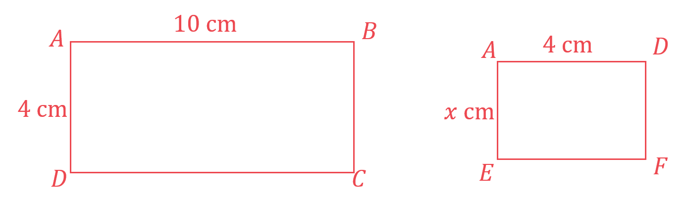

> *Form an equation using the two known sides, these are the two lengths (longer sides).*

$\begin{gathered} L e n g t h ( A B C D ) & = k ( L e n g t h ( A D E F ) ) \\ 10 & = 4 k \end{gathered}$

> *Solve to find *$k$*.*

$\begin{gathered} 4 k & = 10 \\ k & = \frac{10}{4} \end{gathered}$

**[1]**

> *Form an equation for the width of the two rectangles.*

$\begin{gathered} W i d t h ( A B C D ) & = k ( W i d t h ( A D E F ) ) \\ 4 & = k x \end{gathered}$

> *Substitute *$k=\frac{10}{4}$* to find the width of the smaller rectangle*

$\begin{gathered} 4 & = \frac{10}{4} x \\ 10 x & = 16 \\ x & = \frac{16}{10} = 1.6 \end{gathered}$

> *Find the area of rectangle **DAEF.*

$\begin{gathered} A r e a & = l e n g t h \times w i d t h \\ = 4 \times 1.6 \end{gathered}$

**[1]**

**Area = 6.4 cm****2**** ****[1]**

## Q11 — medium — 3 marks · exam-questions

### 7() — 3 marks
> *The height of model **A** and the height of model **B** are corresponding lengths in similar shapes so find **k, **the scale factor, using**  *$\begin{array}{rcl} k = \frac{second \text{corresponding} length}{first \text{corresponding} length} \end{array}$

> *Method 1*

> *The height of model **B** is smaller than the height of model **A**. **To go from the big shape to the small shape, put the small length on top in the fraction so that **k** will be smaller than 1*

$\begin{gathered} k & = \frac{height B}{height A} = \frac{147}{187} \end{gathered}$

**[1]**

> *Find the height of model **B** by multiplying the height of model **A** by **k **(notice that **k** < 1 so multiplying by **k** will make the length smaller)*

$\begin{gathered} \text{height} B & = k [ \text{height} A ] = \frac{147}{187} \times 90 \end{gathered}$

**[1]**

$\begin{gathered} = 70.7486631... \end{gathered}$

> *This answer is already in centimetres but give the final answer to the nearest centimetre as requested in the question*

**71 cm**** ****[1]**

> *Method 2*

> *Finding **k **using**  *$\begin{array}{rcl} k = \frac{second \text{corresponding} length}{first \text{corresponding} length} \end{array}$*, if you put the larger length on top of the fraction then;*

$\begin{gathered} k & = \frac{height A}{height B} = \frac{187}{147} \end{gathered}$

> *Notice that **k** > 1 so multiplying by **k** will make the length bigger- but in going from the height of model **A** to the height of model of **B**, we want to go from a longer length to a smaller length. So divide by **k **instead*

$\begin{gathered} \text{height} B & = \text{height} A \div k = 90 \div \frac{187}{147} \end{gathered}$

**[1]**

$\begin{gathered} = 70.7486631... \end{gathered}$

> *This answer is already in centimetres but give the final answer to the nearest centimetre as requested in the question*

**71 cm ****[1]**

## Q12 — easy — 3 marks · exam-questions

### 3((a)) — 2 marks
> *QR** and **BC** are corresponding lengths in similar shapes so find **k, **the scale factor, using**  *$\begin{array}{rcl} k = \frac{second \text{corresponding} length}{first \text{corresponding} length} \end{array}$

> *Method 1*

> *BC** is smaller than **QR. **To go from the big shape to the small shape, put the small length on top in the fraction so that **k** will be smaller than 1*

$\begin{array}{rcl} k & = \frac{A B}{P Q} = \frac{4}{12} = 1 \frac{1}{3} \end{array}$

**[1]**

> *Find **BC** by multiplying **QR** by **k **(notice that **k** < 1 so multiplying by **k** will make the length smaller)*

$\begin{gathered} B C & = k Q R = 1 \frac{1}{3} \times 16.5 \end{gathered}$

$BC=5.5$** cm**** ****[1]**

> *Method 2 *
*Finding **k** using *$\begin{gathered} k = \frac{second \text{corresponding} length}{first \text{corresponding} length} , \end{gathered}$* if you put the larger length on top in the fraction then;*

$\begin{gathered} k & = \frac{P Q}{A B} = \frac{12}{4} = 3 \end{gathered}$

**[1]**

> *Notice that **k** > 1 so multiplying by **k** will make the length bigger- but in going from **QR **to **BC, **we want to go from a longer length to a smaller length. So divide by **k** instead*

$\begin{gathered} B C & = Q R \div k \\ = 16.5 \div 3 \end{gathered}$

$BC=5.5$** cm**** ****[1]**

### 3((b)) — 1 marks
> *From part (a) we know that [a small corresponding side] =  *$\begin{gathered} 1 \frac{1}{3} \times \end{gathered}$*[a large corresponding side]*

> *y is a larger side. Inversing the above, we know that [a large corresponding side = 3 × [a small corresponding side]*

$\begin{gathered} P R & = 3 \times A C \end{gathered}$

> *Replacing **AC** with **x** and **PR** with **y**,*

$\begin{gathered} y & = 3 x \end{gathered}$

> *The question asks for an expression so only the "3**x**" is needed*

$3x$** ****[1]**

## Q13 — very_hard — 5 marks · exam-questions

### 13() — 5 marks
> $AD$* is a diameter so the radius is half of *$AD$* Angle *$ACD$* is 90° because it is the angle in a semi-circle*

> *Therefore *$AD$* is the hypotenuse of right-angle triangle *$ACD$*. We can use Pythagoras' theorem to find *$AD$* but we need to find *$AC$* first*

> *Triangle *$ABE$* and triangle *$ACD$* are similar, and the scale factor is:*

$\frac{\mathrm{equivalent} \mathrm{longer} \mathrm{side}}{\mathrm{equivalent} \mathrm{shorter} \mathrm{side}}=\frac{CD}{BE}=\frac{18}{13.5}$

**[1]**

> *Multiplying the length of *$AB$* by the scale factor gives *$AC$

$AC=21\times\frac{18}{13.5}=28$

**[1]**

> *Now we can use Pythagoras' theorem *$a^{2}+b^{2}=c^{2}$

$28^{2}+18^{2}=AD^{2}$

**[1]**

> *Rearrange to get *$AD$

$\begin{gathered} A D & = \sqrt{28^{2} + 18^{2}} \\ = 33.28663395 \end{gathered}$

**[1]**

> *The radius is half of *$AD$

$\begin{gathered} r = ( 33.28663395... ) \div 2 \\ = 16.64331698... \end{gathered}$

> *Round the answer to at least 3 significant figures*

**16.6 cm**** ****[1]**

## Q14 — hard — 5 marks · exam-questions

### 15((a)) — 2 marks
> *Calculate the area of the trapezium **QRST**, using the formula: *$A = 1 \frac{1}{2} ( a + b ) h$*, where *$a$* and *$b$* are the lengths of the parallel lines and *$h$* is the perpendicular height.*

$\begin{gathered} A = 1 \frac{1}{2} ( 4 + 12 ) \times 10 \end{gathered}$

**[1]**

$80\mathrm{cm}^{2}$ **[1]**

### 15((b)) — 3 marks
> *Triangles **PRS**  and **PQT**  are similar.*

> *Compare the length of **RS** and **QT**  to find the length scale factor (LSF).*

$LSF=\frac{12}{4}=3$

**[1]**

> *Divide the length **PS** by the LSF to find the length **PT**.*

*Let ***PT*** =*$x$*, so ***PS*** = *$x+10$

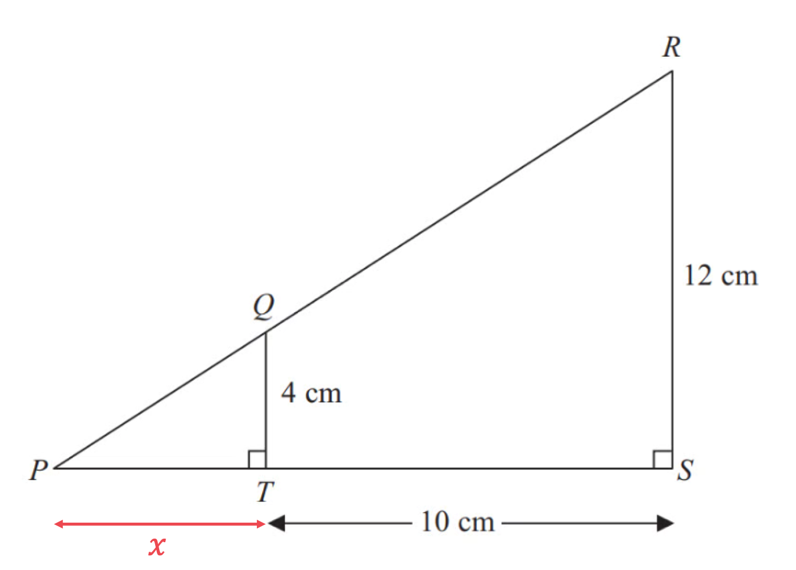

$\frac{( x + 10 )}{3} = x$

**[1]**

> *Multiply both sides by 3.*

$x+10=3x$

> *Subtract 10 from both sides.*

$10=2x$

> *Divide both sides by 2.*

$5=x$

**5 cm**** ****[1]**

## Q15 — medium — 2 marks · exam-questions

### 18() — 2 marks
> *This is an example of **intersecting chord theorem** therefore *$PD\timesPC=PB\timesPA$

$PD\times8=6\times9$

**[1]**

> *Find **PD** by dividing both sides by 8*

$PD=\frac{6\times9}{8}$

**PD**** = 6.75 cm**** ****[1]**

## Q16 — easy — 4 marks · exam-questions

### 4((a)) — 2 marks
> *AB **and** DE** are corresponding lengths in similar shapes so we need to find **k, **the scale factor, using**  *$\begin{array}{rcl} k = \frac{second \text{corresponding} length}{first \text{corresponding} length} \end{array}$

> *Method 1*

> *AB i**s larger than** DE. **To go from the small shape to the big shape, put the big length on top of the fraction so that **k** will be bigger than 1*

$\begin{gathered} k & = \frac{A C}{D F} = \frac{45}{20} = \frac{ 9}{4} \end{gathered}$

**[1]**

> *Find **AB** by multiplying **DE** by **k **(notice that **k**  > 1 so multiplying by **k** will make the length bigger as required)*

$\begin{gathered} A B & = k D E = \frac{9}{4} \times 36 \end{gathered}$

**AB ****= 81 cm**** ****[1]**

> *Method 2 *

> *Finding **k** using *$\begin{array}{rcl} k = \frac{second \text{corresponding} length}{first \text{corresponding} length} , \end{array}$* if you put the smaller length on top in the fraction then;*

$\begin{gathered} k & = \frac{D F}{A C} = \frac{20}{45} = \frac{4}{9} \end{gathered}$

**[1]**

> *Notice that **k** < 1 so multiplying by **k** will make the length smaller- but in going from **DE **to **AB**, we want to go from a smaller length to a larger length. So divide by **k** instead*

$\begin{gathered} A B & = D E \div k \\ = 36 \div \frac{4}{9} \end{gathered}$

**AB ****= 81 cm ****[1]**

### 4((b)) — 2 marks
> *BC ** and **EF** are corresponding lengths in similar shapes so use the value of **k **your found in part (a) with **BC** = 54 to find **EF*

> *Method 1*

> *If your **k** was *$\begin{array}{rcl} \frac{4}{9} \end{array}$* then **k** < 1 and multiplying **BC** by **k** will make the length smaller as required*

$\begin{gathered} E F & = k B C = \frac{4}{9} \times 54 \end{gathered}$

**EF ****= 24 cm ****[1]**

> *Method 2*

> *If your **k** was *$\begin{gathered} \frac{9}{4} \end{gathered}$* then **k** > 1 and multiplying **BC** by **k** will make the length larger, not smaller as required. So divide by **k** instead*

$\begin{gathered} E F & = B C \div k = 54 \div \frac{9}{4} \end{gathered}$

**EF ****= 24 cm ****[1]**

## Q17 — very_hard — 5 marks · exam-questions

### 8((c)) — 3 marks
> *Similar triangles have three equal angles. Use circle theorems to identify any corresponding angles that are equal between triangles **ADX**  and **BCX**.*

> *The same segment circle theorem states that angles at the circumference subtended by the same arc are equal.*

> *Vertically opposite angles at a point are equal.*

> *The statement that if three corresponding angles between two triangles are equal then the two triangles are similar must be made.*

**Angle ****ADX****  = angle ****BCX****  as they are subtended from the same arc. **
**Angle ****DAX****  = angle ****CBX****  as they are subtended from the same arc. Angle ****AXD****  = angle ****BXC****  as they are vertically opposite angles.**** **
** A****t least two of the three statements given, with reasons ****[2]**** **
**All three angles are the same so the triangles are similar.***** ***** ****Explanation of similar triangles ****[1]**

### 8((c)) — 2 marks
> *The two triangles are similar so there will exist a value of **k **such that each side of triangle **ADX** = **k**  **× each side of triangle **BCX. *

> *It may help to draw the triangles side by side and consider their corresponding sides.*

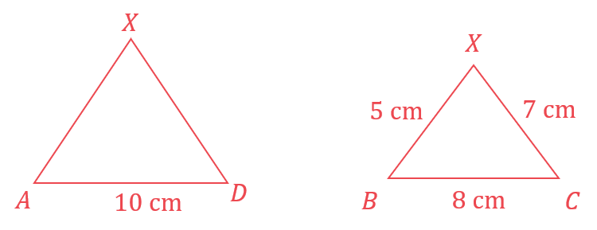

> *Form an equation using two corresponding sides that are known.*

$\begin{gathered} A D & = k B C \\ 10 & = k \times 8 \end{gathered}$

> *Solve to find *$k$*.*

$\begin{gathered} k & = \frac{ 10 }{8} = 1.25 \end{gathered}$

*Form an equation using the side that you want, this value of *$\begin{gathered} k \end{gathered}$ *and a corresponding side that is known.  *

$\begin{gathered} D X & = k C X \\ D X & = 1.25 \times 7 \end{gathered}$** **

**Correct method ****[1]**
** **$DX=8.75$** cm**** ****[1]**

## Q18 — hard — 3 marks · exam-questions

### 19() — 3 marks
> *"**PTQ** is the diameter", so **TP **and **TQ** are two parts of the diameter. We know **TQ **and we can find **TP** using the **intersecting chord theorem,** *$TP\timesTQ=TR\timesTS$

$TP\times3=12\times4$

> *Find **TP** by dividing both sides by 3*

$\begin{array}{rcl} T P & = \frac{12 \times 4}{3} = 16 \end{array}$

**[1]**

*Now find the diameter by adding* *TP **and **TQ*

*diameter =*** TP ***+ ***TQ ***= 16 + 3 = 19*

> *Finally, find the radius by dividing the diameter by 2*

*radius = 19 ÷ 2*

*** *****[1]**

**radius = 9.5 cm****  [1]**

## Q19 — medium — 1 marks · exam-questions

### 22() — 1 marks
> *QR **and **PR **are corresponding sides in triangles **QRS **and **PRT** respectively. Connecting all three pairs of corresponding sides in this way we would have;*

$\frac{\mathrm{smaller} \mathrm{corresponding} \mathrm{side}}{\mathrm{larger} \mathrm{corresponding} \mathrm{side}}=\frac{QR}{PR}=\frac{SR}{TR}=\frac{QS}{PT}$

> $\frac{SR}{TR}$* is not given as an option but *$\frac{QS}{PT}$* is.*

**The top right option is correct, **$\frac{QS}{PT}$ **[1]**

> *The top left option, *$\frac{RS}{ST}$*, is incorrect as **ST** is not a complete side in the larger similar triangle.*

> *The bottom two options, *$\frac{PT}{QS}$* and *$\frac{RT}{RS}$*are not correct as they both represent *$\frac{\mathrm{larger} \mathrm{corresponding} \mathrm{side}}{\mathrm{smaller} \mathrm{corresponding} \mathrm{side}}$*- but the given ratio was *$\frac{\mathrm{smaller}}{\mathrm{larger}}$*.*

## Q20 — easy — 2 marks · exam-questions

### 6((b)) — 2 marks
> *The radius of **A** and the radius of **B** are corresponding lengths in similar shapes so find **k, **the scale factor, using**  *$\begin{array}{rcl} k = \frac{second \text{corresponding} length}{first \text{corresponding} length} \end{array}$

> *Method 1*

> *The radius of **B** is smaller than the radius of **A**. **To go from the big shape to the small shape, put the small length on top in the fraction so that **k** will be smaller than 1*

$\begin{gathered} k & = \frac{height B}{height A} = \frac{0.6}{1.6} = \frac{3}{8} \end{gathered}$

**[1]**

> *Find radius of **B** by multiplying the radius of **A** by **k **(notice that **k** < 1 so multiplying by **k** will make the length smaller)*

$\begin{gathered} \text{radius} B & = k [ \text{radius} A ] = \frac{3}{8} \times 0.56 \end{gathered}$

**0.21 m**** ****[1]**

> *Method 2*

> *Finding **k **using**  *$\begin{array}{rcl} k = \frac{second \text{corresponding} length}{first \text{corresponding} length} \end{array}$*, if you put the larger length on top of the fraction then;*

$\begin{gathered} k & = \frac{height A}{height B} = \frac{1.6}{0.6} = \frac{8}{3} \end{gathered}$

> *Notice that **k** > 1 so multiplying by **k** will make the length bigger- but in going from the radius of **A** to the radius of **B**, we want to go from a longer length to a smaller length. So divide by **k **instead*

$\begin{gathered} \text{radius} B & = \text{radius} A \div k = 0.56 \div \frac{3}{8} \end{gathered}$

**0.21 m ****[1]**

## Q21 — very_hard — 6 marks · exam-questions

### 10((b)) — 2 marks
> *Find the volume of the cone by substituting *$r=10$* and *$h=36$* into the formula *

$\frac{1}{3}\timesπ\times10^{2}\times36$

**[1]**

> *Work out the value on your calculator, giving your answer to 3 significant figures*

**3770 cm****3** **[1]**

### 10((b)) — 4 marks
> *Find the volume of the smaller cone by halving the volume of the bigger cone in part (b)(i) *

$\frac{1}{2}\times3770=1885$* cm**3*

**[1]**

*Method 1* 
*The ratio of radii (lengths) is 1 : 2 so the ratio of volumes is 1**3** : 2**3* *Split this volume up into the ratio 1 : 8 (by finding *$\frac{1}{9}$* of it and *$\frac{8}{9}$* of it*

> $\frac{1}{9}\times1885:\frac{8}{9}\times1885\,$* *

*The volume of the smaller sphere is *$\frac{1}{9}\times1885$ 
*Form an equation in *$r$* by setting the sphere volume formula equal to *$\frac{1}{9}\times1885$ * *

$\frac{4}{3}πr^{3}=\frac{1}{9}\times1885$

**[2]**

> *Get *$r^{3}$* on its own (by dividing both sides by *$\frac{4}{3}π$

> $r^{3}=\frac{\frac{1}{9}\times1885}{\frac{4}{3}π}\,$* *

> *Find *$r$* (by cube-rooting both sides*

`r = cbrt( (1 / 9 x 1885)/(4 / 3 pi) )`

**3.68 cm*** ***[1]**

*Method 2* 
*The ratio of radii is 1: 2 so write the smaller sphere radius as *$r$* and the bigger sphere radius as *$2r$ 
*Form an equation in *$r$* (the sum of the volumes of the two spheres equals *$1885$*)* * *

$\frac{4}{3} \mathrm{\pi } r^{3} + \frac{4}{3} \mathrm{\pi } ( 2 r )^{3} = 1885$

**[1]**

*Collect like terms, using *$( 2 r )^{3} = 8 r^{3}$ * *

$\frac{4}{3}πr^{3}+\frac{4}{3}π\times8r^{3}=1885\,\frac{36}{3}πr^{3}=1885\,12πr^{3}=1885$ * *

*Find *$r$* (by dividing both sides by *$12π$* then cube-rooting)*

$r = \sqrt[3]{ \frac{1885}{12 \mathrm{\pi } } }$

**[1]** 
**3.68 cm ****[1]**

## Q22 — hard — 3 marks · exam-questions

### 19() — 3 marks
> *Write down an expression for the angles around the point at which the triangle and the trapezium connect.*

$a+65+c+115=360$  *(Angles around a point are equal to 360**o**)*

**[1]**

> *Simplify.*

$a+c=180$

**[1]**

> *Write down an expression for angles *$b$*and *$c$*.*

$b+c=180$*  **(Co-interior angles sum to 180**o** )*

> *Equate the two angle expressions as both are equal to 180.*

$a+c=b+c$

> *Subtract *$c$* from both sides.*

$a=b$

**Both correct reasons given*** ***[1]**

## Q23 — medium — 3 marks · exam-questions

### 21() — 3 marks
> *Find an expression for angle **BAC**.*

*Angle ***BAC*** = Angle ***CBQ*** = *$x$** ***(Alternate segment theorem)*

**[1]**

> *Find an expression for angle **ABC**.*

*Angle ***ABC*** = Angle ***CBQ ***= *$x$* (Because ***BC***  bisects angle ***ABQ***)*

**[1]**

> *Identify the type of triangle that triangle **ABC** is based on its properties.*

**Angle ****BAC**** = Angle ****ABC**** , so triangle ****ABC****  is an isosceles triangle, therefore AC=BC ****[1]**

## Q24 — easy — 4 marks · exam-questions

### 6((a)) — 2 marks
> *Find the length scale factor by dividing the length **DE**  on the larger triangle by the corresponding length **AB**  on the smaller triangle.*

$\mathrm{length} \mathrm{scale} \mathrm{factor}=\frac{15}{6}=2.5$

**[1]**

> *Work out the length **DF**  on the larger triangle by multiplying the corresponding length **AC** on the smaller triangle by the length scale factor.*

$4.2\times2.5$

**10.5 cm**** ****[1]**

### 6((b)) — 2 marks
> *Find the length of **BC  **on the smaller triangle by dividing the corresponding length **EF**  on the larger triangle by the length scale factor.*

$19.5\div\frac{5}{2}$

**[1]**

**7.8 cm**** [1]**

## Q25 — hard — 5 marks · exam-questions

### 12() — 5 marks
> *Calculate the length of side QS on triangle QRS. *
*Use Pythagoras' theorem, *$c^{2}=a^{2}+b^{2}$*, where *$a$* and *$b$* are the lengths of the two shorter sides and *$c$* is the length of the hypotenuse.*

$\begin{gathered} Q S^{2} & = 4^{2} + 8^{2} \end{gathered}$

**[1]**

$QS=\sqrt{4^{2}+8^{2}}$

**[1]**

$\begin{gathered} Q S & = \sqrt{80 \\ Q S & = \sqrt{16} \times 5} \\ Q S & = 4 \sqrt{5} \end{gathered}$

> *Now that you know the length QS you can use Pythagoras' theorem again to calculate the length QP on triangle PQS.*

$\begin{array}{rcl} 10^{2} & = Q P^{2} + ( 4 \sqrt{5 )^{2} \\ 10^{2} - ( 4 \sqrt{5} )^{2} & = Q P^{2} \\ \sqrt{10}^{2} - ( 4 \sqrt{5} )^{2}} & = Q P \\ \sqrt{100 - 80} & = Q P \\ \sqrt{20} & = Q P \\ 2 \sqrt{5} & = Q P \end{array}$

> *Compare the ratios of the lengths of two pairs of corresponding sides.*

$\begin{gathered} \frac{Q R}{Q P} & = \frac{R S}{Q S} \\ \frac{4}{2 \sqrt{5} } & = \frac{8}{4 \sqrt{5} } \end{gathered}$

> *Cancel common factors in each fraction.*

$\frac{2}{\sqrt{5}}=\frac{2}{\sqrt{5}}$

**[1]**

> *These two pairs of corresponding sides have the same ratio, compare this ratio to the third pair of corresponding sides.*

$\begin{gathered} \frac{Q R}{Q P} & = \frac{Q S}{P S} \\ \frac{2}{ \sqrt{5} } & = \frac{4 \sqrt{5} }{10} \end{gathered}$

> *Simplify the fraction on the right hand side.*

$\frac{2}{\sqrt{5}}=\frac{2\sqrt{5}}{5}$

> *Rationalise the denominator of the first fraction by multiplying by *$\frac{\sqrt{5}}{\sqrt{5}}$*.*

$\frac{2\sqrt{5}}{\sqrt{5}\sqrt{5}}=\frac{2\sqrt{5}}{5}$

> *Simplify.*

$\frac{2\sqrt{5}}{5}=\frac{2\sqrt{5}}{5}$

**[1]**

**Triangles QRS and PQS are similar because they have three pairs of corresponding sides with the same ratio ****[1]**

## Q26 — medium — 5 marks · exam-questions

### 9((a)) — 2 marks
**Angle DCE = **$a^{\circ}$** because it is ****corresponding to angle BAC ****[1]**

### 9((b)) — 3 marks
> *Look for other angles that you can find using the parallel lines.*

*Angle BCD = *$b^{\circ}$* because it is alternate to angle ABC*

**Correctly identifying**** ****b****° [1]*** *
**Correct reason**** [1]**

> *Look at the angles at point C that form a straight line. They are the same three angles as the interior angles in the triangle.*

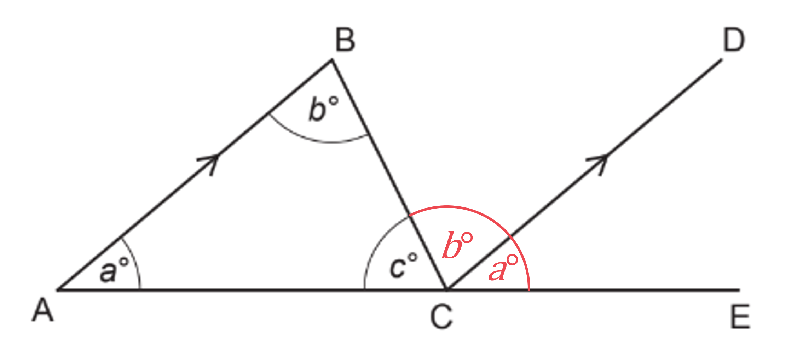

$a^{\circ}+b^{\circ}+c^{\circ}=180^{\circ}$* because angles that form a straight line add up to 180°*

**Therefore the angles in a triangle add up to 180° **** [1]**

## Q27 — easy — 2 marks · exam-questions

### 4((a)) — 2 marks
> *Find the length scale factor by dividing the length **EF**  on the larger triangle by the corresponding length **BC** on the smaller triangle.*

$\frac{40}{16}=2.5$

> *Work out the length of **DE**  on the larger triangle by multiplying the length of the corresponding length **AB** on the smaller triangle by the length scale factor.*

$12\times2.5$

**[1]**

**30 cm**** ****[1]**

## Q28 — hard — 2 marks · exam-questions

### 25((a)) — 2 marks
> *Add the information given in the question to the diagram as below*

> *We know that triangle *$APQ$* is similar to triangle *$ABC$* , because *`angle A P Q equals angle A B C`* (corresponding angles)*`angle A Q P equals angle A C B`* (corresponding angles) and *`angle P A Q equals angle B A C`* (shared angle), therefore*

$\frac{AP}{AB}=\frac{PQ}{BC}$

> *Replace the sides with the known lengths*

$\frac{AP}{9}=\frac{8}{10}$

**[1]**

> *Multiply both sides by 9 to solve for *$AP$

$AP=\frac{8}{10}\times9=7.2$

> *Subtract *$AP$* from *$AB$

$PB=9-7.2=1.8$

$1.8$** ****cm [****1]**

## Q29 — medium — 3 marks · exam-questions

### 14() — 3 marks
*The two triangles will be be similar if they have the same corresponding angles.* *Show that this is the case using angle facts in parallel lines.*

*Angle BAE = Angle EDC  (alternate angles)*

*Angle ABE = Angle ECD  (alternate angles)*

*Angle AEB = Angle CED (vertically opposite angles)*

**1 pair of angles with a correct statement ****[1]** 
**2 pairs of angles with correct statements**** [1]**

**Final answer:** **Triangle ABE and triangle CDE are similar as corresponding angles are equal**** [1]**

**The answer mark can be awarded only if no incorrect statements are seen**

## Q30 — easy — 2 marks · exam-questions

### 9() — 2 marks
> *We are told that the triangles are similar so use corresponding lengths to calculate the scale factor, **k. *$k=\frac{\mathrm{second} \mathrm{corresponding} \mathrm{length}}{\mathrm{first} \mathrm{corresponding} \mathrm{length}}$*. Taking the left triangle as the first one, and the right triangle as the second, *

$k=\frac{16}{20}=\frac{4}{5}$

**[1]**

> *Notice that **k** < 1 so multiplying by **k** will make a length smaller. Going from the first triangle to the second, the lengths get smaller (20 cm to 16 cm). So to get **a**, **multiply** 12 cm by **k**.*

$\begin{gathered} a = 12 \times \frac{4}{5} \\ = \frac{48}{5} \end{gathered}$

**Answer = **$\frac{48}{5}$**or **$9.6$** cm ****[1] **
**Always check to see whether you should be making a length bigger or smaller and whether your answer matches this**

## Q31 — medium — 5 marks · exam-questions

### 9((a)) — 3 marks
> *Method 1:*

> *Two similar triangles are formed, one between the girl and the ruler and the other between the girl and the tree.*

> * *

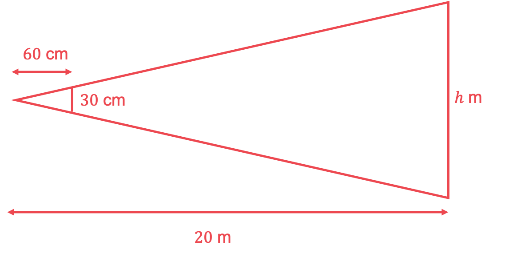

> *Find the ratio between the height of the ruler and its distance from the girl.*

$\frac{30}{60}=0.5$

**[1]**

> *The ratio of the height of the tree and its distance from the girl must be the same so compare the two values.*

$\frac{h}{20}=0.5$

> *Multiply the distance of the tree from the girl by the scale factor of 0.5 to find the height of the tree. *

$h=0.5\times20$

**[1]**

**10 m ****[1]**

> * *

> *Method 2:*

> *Two similar triangles are formed, one between the girl and the ruler and the other between the girl and the tree.*

> *Convert the distance between the girl and the tree from metres to centimetres by multiplying the distance by 100 and sketch a labelled diagram.*

$20\times100=2000$

> * *

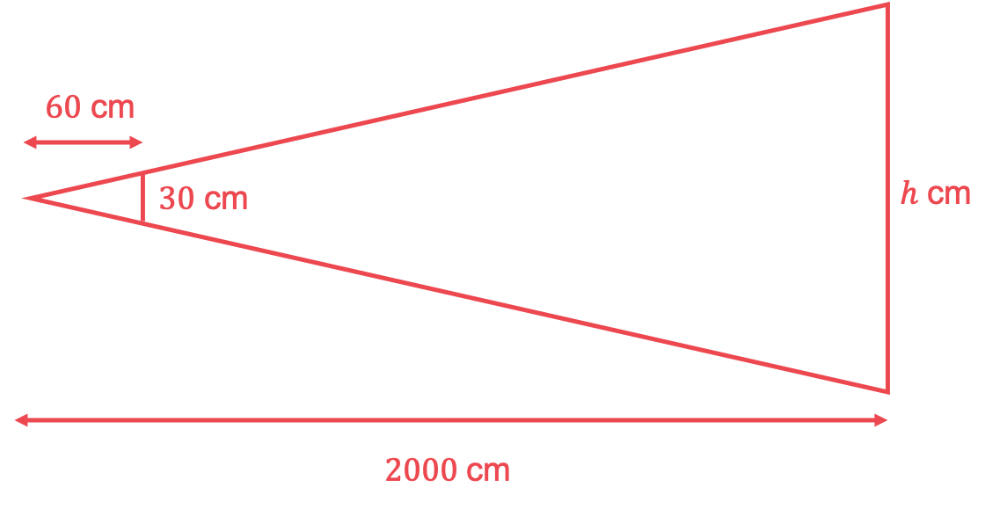

> *Compare the horizontal distance between the tree and the girl to find the length scale factor.*

$\frac{2000}{60}=\frac{100}{3}$

**[1]**

> *Multiply the length of the ruler by the length scale factor to find the height of the tree.*

$30\times\frac{100}{3}=1000$

**[1]**

> *Convert the height of the tree from centimetres to metres by dividing by 100.*

$\frac{1000}{100}$

**10 m ****[1]**

### 9((b)) — 2 marks
> *Give any two valid reasons.*

**She would have to stand a very long distance from the building**** [1]**

**Final answer:** **The estimate is likely to be inaccurate due to the scale factors at the distances involved**** [1]**

## Q32 — easy — 1 marks · exam-questions

### 1() — 1 marks
> *The triangles are similar as in both triangles the angles are 90°, *$x$*°** **and** *$( 90 - x )$*°, so we have AAA. *
*The scale factor is *$k=\frac{\mathrm{second} \mathrm{corresponding} \mathrm{length}}{\mathrm{first} \mathrm{corresponding} \mathrm{length}}$*. Taking the left triangle as the first one, and the right triangle as the second, *

$k=\frac{15}{10}=\frac{3}{2}\mathrm{or}1.5$

> *So the lengths in the triangle on the right are 1.5 times as big as the lengths in the triangle on the left. So *$y$* is 1.5 times bigger than 6 cm*

$\begin{gathered} y = 6 \times 1.5 \\ = 9 \end{gathered}$

**The third option is correct, 9 cm ****[1]**

> *The first option is greater than 6 but not in the correct scale factor because *$\frac{15}{10}\neq\frac{7.5}{6}$

> *The second option is greater than 6 but not in the correct scale factor because *$\frac{15}{10}\neq\frac{11}{6}$

> *The fourth option, 4, is smaller than its corresponding length, 6. But we can clearly see that *$y$* should be greater than 6.*

## Q33 — medium — 2 marks · exam-questions

### 8((a)) — 2 marks
> *Alternate angles in parallel lines are equal*

*The triangles are similar and reflected* * *

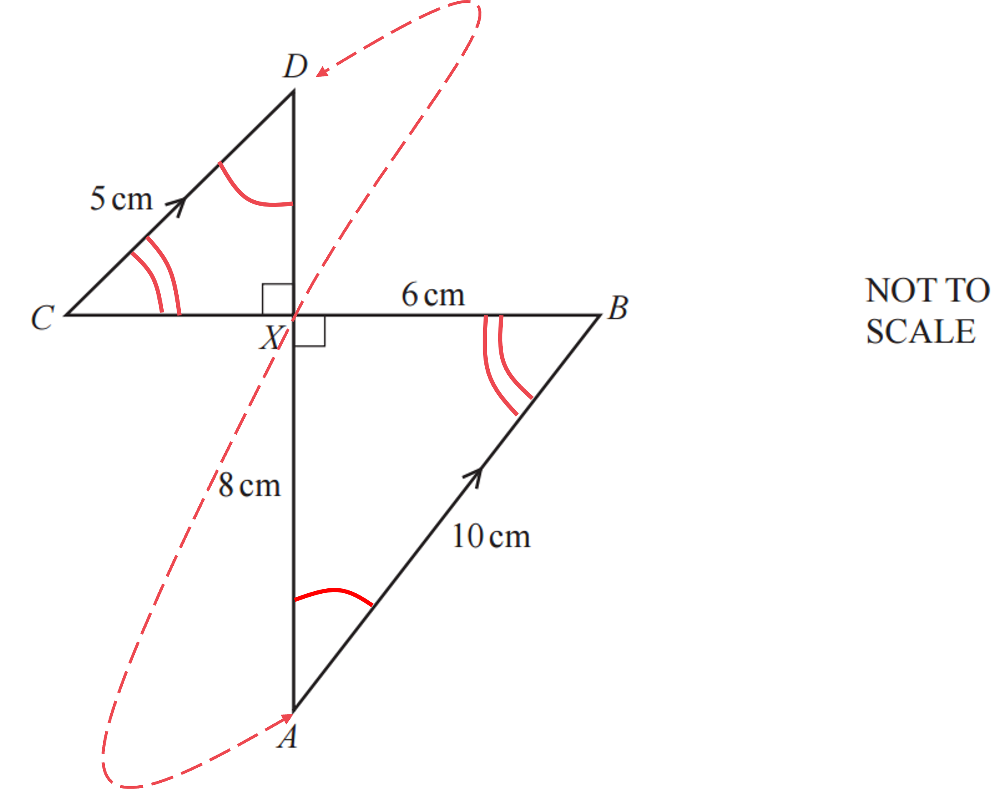

*Find the scale factor of enlargement (by dividing side **AB** by its corresponding side **CD**)* * *

*scale factor = *$\frac{10}{5}$* = 2* * *

*Find the corresponding side to **DX** (looking at the reflection)* * *

**DX*** corresponds to*** AX**

**[1]**

*AX** is a factor of 2 larger than **DX* *Find **DX** (by halving **AX**)*

**DX ***= *$\frac{8}{2}$* *

**4 cm**** [1]**

## Q34 — easy — 2 marks · exam-questions

### 12() — 2 marks
> *The triangles are similar so there will exist a value of **k **such that  *$\begin{gathered} P Q & = k A B \end{gathered}$* and *$\begin{array}{rcl} P R & = k A C \end{array}$*.*

> *Form an equation using the two known sides of the triangle.*

$\begin{gathered} P R & = k A C \end{gathered}$

> *Substitute the values of *$PR$* and *$AC$* into the equation and solve to find *$k$*.*

$\begin{gathered} 21.7 & = 12.4 k \\ k & = \frac{21.7}{12.4} = 1.75 \end{gathered}$

**[1]**

> *Substitute into *$\begin{gathered} P Q & = k A B \end{gathered}$*.*

$\begin{gathered} P Q & = k A B \\ P Q & = ( 1.75 ) ( 5.2 ) \end{gathered}$

$PQ=9.1$** cm**** ****[1]**
