# Mark Schemes — Volume & Surface Area
**Geometry** · Edexcel IGCSE Maths A (Modular) (4XMAF/4XMAH) — 24/Higher Unit 2

## Q1 — very_hard — 5 marks · exam-questions

### 23() — 5 marks
> *Calculate the volume of grain that is poured into the container in the first 5 hours, by adding together the volume of the cone *$( V = 1 \frac{1}{3} \mathrm{\pi } r^{2} h )$* and the volume of a cylinder, *$( V = \mathrm{\pi } r^{2} h )$*, of height 2m.*

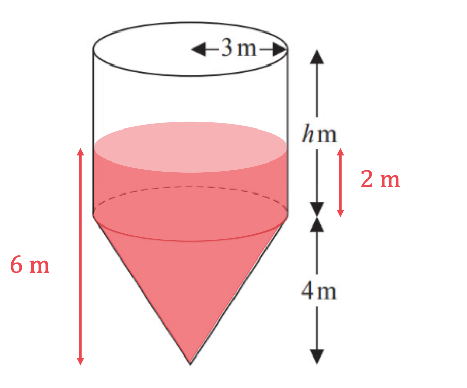

$\begin{gathered} V = 1 \frac{1}{3} \mathrm{\pi } ( 3 )^{2} ( 4 ) + \mathrm{\pi } ( 3 )^{2} ( 2 ) \end{gathered}$

**For correct substitution into the volume formula for either the cone or the cylinder ****[1]**

$\begin{gathered} V = 1 \frac{1}{3} \mathrm{\pi } \times 36 + \mathrm{\pi } \times 18 \\ = 12 \mathrm{\pi } + 18 \mathrm{\pi } \end{gathered}$

**[1]**

$\begin{gathered} V = 30 \mathrm{\pi } \mathrm{m}^{3} \end{gathered}$

> *Calculate the rate of flow of the grain by dividing the volume of grain by the time taken to pour it.*

$\begin{gathered} \frac{30 \mathrm{\pi } }{5} \\ = 6 \mathrm{\pi } \mathrm{m}^{3} \mathrm{h}^{- 1} \end{gathered}$

> *Calculate the volume of grain that will be poured in 4 hours by multiplying the rate of flow of the grain by 4.*

$\begin{gathered} 6 \mathrm{\pi } \times 4 \\ = 24 \mathrm{\pi } \mathrm{m}^{3} \end{gathered}$

**[1]**

> *The grain poured in the last 4 hours will just fill the remainder of the cylinder, so calculate the height of the remainder of the cylinder that is filled by substituting the volume into the formula for the volume of a cylinder.*

$\begin{gathered} 24 \mathrm{\pi } & = \mathrm{\pi } ( 3 )^{2} h \end{gathered}$

**[1]**

$\begin{gathered} 24 \mathrm{\pi } & = 9 \mathrm{\pi } h \\ \frac{24}{9} & = h \\ h = \frac{8}{3} \mathrm{m} \end{gathered}$

> *Work out the value of *$h$* by adding together the height of the cylindrical parts from the two volumes.*

$\begin{gathered} h = 2 + \frac{8}{3} \end{gathered}$

$\frac{14}{3}m$* ***[1]**

**Leave your working in terms of **$π$** throughout, in a non-calculator paper question it will frequently cancel out.**

## Q2 — hard — 3 marks · exam-questions

### 25() — 3 marks
> *If the cylinder is melted down and reformed into a sphere, then the cylinder and sphere will have the same volume.*

> *Calculate the volume of the cylinder, using the formula: *$V=πr^{2}h$*, where *$r$* is the radius of the cylinder and *$h$*is its height.  *

> *Leave your answer in terms of *$π$*.*

$V = \mathrm{\pi } \times ( 2 x )^{2} \times 9 x$

**[1]**

$\begin{gathered} V = \mathrm{\pi } \times 4 x^{2} \times 9 x \\ = 36 \mathrm{\pi } x^{3} cm^{3} \end{gathered}$

> *Using the formula for the volume of a sphere: *$V=\frac{4}{3}πr^{3}$*, where *$r$* is the radius of the sphere, substitute the calculated value for the volume and rearrange to find an expression for the radius of the sphere.*

$36πx^{3}=\frac{4}{3}π\timesr^{3}\,$

**[1]**

> *Divide both sides by *$π$*.*

$36x^{3}=\frac{4}{3}r^{3}$

> *Divide both sides by 4.*

$9x^{3}=\frac{1}{3}r^{3}$

> *Multiply both sides by 3.*

$27x^{3}=r^{3}$

> *Take the cube root of both sides.*

$3x=r$

$3x$* ***[1]**

**Final answer:** **Any algebraic expression equivalent to **$3x$** will be accepted**

## Q3 — medium — 5 marks · exam-questions

### 11() — 5 marks
> *Convert the depth that the gravel will be from centimetres into metres by dividing he length by 100 to make sure that your units are consistent in your working.*

$d=\frac{6}{100}=0.06m$

> *Calculate the volume of the space in the driveway that is to be filled with gravel, using the formula: *$V=l\timesw\timesd$*, where *$l$* is the length of the cuboid *$w$* is the width and *$d$* is the depth.*

$\begin{gathered} V = 11 \times 4 \times 0.06 \\ = 2.64 \mathrm{m}^{3} \end{gathered}$

**[1]**

> *Work out the number of bags of gravel that will be needed by dividing the volume that needs to be filled with gravel by the volume of gravel in each bag.*

$\frac{2.64}{0.4}=6.6$

**[1]**

*Martin needs 7 bags of gravel*

> *Find the normal cost of the gravel that Martin needs by multiplying the number of bags that he requires by the price of each bag.*

$\begin{gathered} 7 \times 38 \\ = \pounds 266 \end{gathered}$

**[1]**

> *If Martin gets a discount of 30%, then he needs to pay 100% - 30% = 70% of the normal cost.*

> *Calculate 70% of the normal cost by converting the percentage to a decimal and multiplying it by the normal cost.*

$\begin{gathered} 0.7 \times 266 \end{gathered}$

**[1]**

$\begin{gathered} \pounds 186 . 20 \end{gathered}$* ***[1]**

## Q4 — easy — 3 marks · exam-questions

### 9() — 3 marks
> *Split the front face into two separate rectangles.*

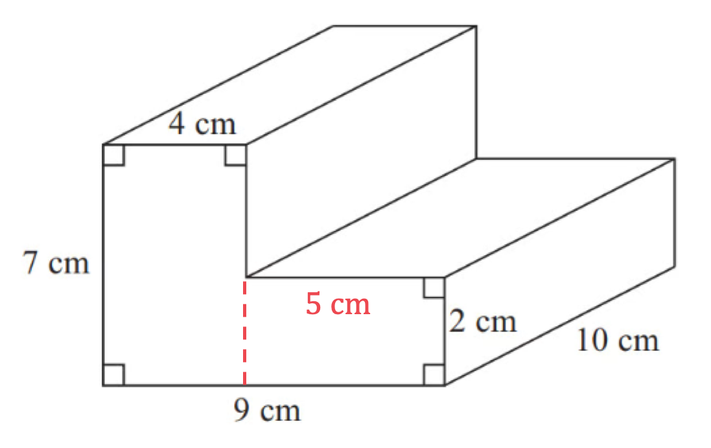

> *Calculate the area of each of the rectangles and add together to find the total area of the cross-sectional area.*

$\begin{gathered} A = 4 \times 7 + 5 \times 2 \end{gathered}$

**[1]**

$\begin{gathered} A = 28 + 10 \\ = 38 cm^{2} \end{gathered}$

> *Multiply the cross-sectional area by the length of the prism to calculate the volume of the object.*

$V=38\times10$

**[1]**

$380\mathrm{cm}^{3}$* ***[1]**

## Q5 — very_hard — 5 marks · exam-questions

### 27() — 5 marks
> *Calculate the surface area of the sphere, using the formula: *$A=4πr^{2}$*.*

$\begin{gathered} A_{s p h} & = 4 \mathrm{\pi } ( 6 )^{2} \\ = 144 \mathrm{\pi } cm^{2} \end{gathered}$

**[1]**

> *Double the surface area of the sphere to work out the surface area of the cylinder.*

$A_{cyl}=144π\times2=288π\mathrm{cm}^{2}$

**[1]**

> *Using the formula for the surface area of a cylinder *$( A = 2 \mathrm{\pi } r^{2} + 2 \mathrm{\pi } r h )$*, calculate the height of the cylinder.*

$\begin{gathered} 288 \mathrm{\pi } & = 2 \mathrm{\pi } ( 3 )^{2} + 2 \mathrm{\pi } ( 3 ) h \\ 288 \mathrm{\pi } & = 18 \mathrm{\pi } + 6 \mathrm{\pi } h \\ 270 \mathrm{\pi } & = 6 \mathrm{\pi } h \\ \frac{270}{6} & = h \\ h = 45 \text{cm} \end{gathered}$

**[1]**

> *Calculate the volume of the sphere, using the formula: *$V=\frac{4}{3}πr^{3}$*.*

$\begin{gathered} V_{s p h} & = \frac{4}{3} \mathrm{\pi } ( 6 )^{3} \\ = 288 \mathrm{\pi } cm^{3} \end{gathered}$

> *Calculate the volume of the cylinder, using the formula: *$V=πr^{2}h$*.*

$\begin{gathered} V_{c y l} & = \mathrm{\pi } ( 3 )^{2} ( 45 ) \\ = 405 \mathrm{\pi } cm^{3} \end{gathered}$

**Correct expression for the volume of the sphere and the cylinder**** [1]**

> *Find the ratio of the volume of the sphere to the volume of the cylinder.*

$\begin{gathered} 288 \mathrm{\pi } : 405 \mathrm{\pi } \end{gathered}$

> *Simplify.*

$\begin{gathered} 288 : 405 \end{gathered}$

$32:45$* ***[1]**

## Q6 — hard — 4 marks · exam-questions

### 22() — 4 marks
> *Find the radius of the large cone, given that the radius is half of the diameter.*

$\begin{gathered} r = \frac{30}{2} \\ = 15 \text{cm} \end{gathered}$

**[1]**

> *Calculate the volume of the large cone, using the formula: *$V=\frac{1}{3}πr^{2}h$*, where *$r$* is the radius of the cone and *$h$* is the perpendicular height.*

$\begin{gathered} V_{L} & = 1 \frac{1}{3} \times \mathrm{\pi } \times 15^{2} \times 40 \end{gathered}$

**[1]**

$\begin{gathered} V_{L} & = 3000 \mathrm{\pi } cm^{3} \end{gathered}$

> *The large and small cones are similar objects.*

> *Work out the length scale factor (LSF) by dividing the height of the large cone by the height of the small cone.*

$\mathrm{LSF}=\frac{40}{20}=2$

> *Divide the radius of the large cone by the LSF to work out the radius of the small cone.*

$\begin{gathered} r = \frac{15}{2} \\ = 7.5 \text{cm} \end{gathered}$

> *Calculate the volume of the small cone.*

$V_{S}=\frac{1}{3}\timesπ\times7.5^{2}\times20$

$V_{S}=375π\mathrm{cm}^{3}$

> *Work out the volume of the frustum by subtracting the volume of the small cone from the volume of the large cone.*

$\begin{gathered} V = 3000 \mathrm{\pi } - 375 \mathrm{\pi } \end{gathered}$

**[1]**

$\begin{gathered} V = 2625 \mathrm{\pi } \\ = 8246.68071... cm^{3} \end{gathered}$

> *Round to 3 significant figures.*

$8250\mathrm{cm}^{3}$* ***[1]**

## Q7 — medium — 4 marks · exam-questions

### 9() — 4 marks
> *Calculate the volume of the container, using the formula: *$V=l\timesw\timesh$*, where *$l$* is the length of the cuboid *$w$* is the width and *$h$* is the height.*

$\begin{gathered} V = 50 \times 40 \times 30 \end{gathered}$

**[1]**

$\begin{gathered} V = 5 \times 4 \times 3 \times 1000 \\ = 60 000 cm^{3} \end{gathered}$

> *Find the total number of bottles of oil required to fill the container by dividing the volume of the container by the amount of oil in each bottle.*

$\frac{60000}{3000}$

**[1]**

*Sally needs 20 bottles of oil*

> *Find the cost of filling the container with oil by multiplying the cost per bottle of oil by the number of bottles required.*

$\begin{gathered} 3.5 \times 20 \end{gathered}$

**[1]**

`£ 70`

**Sally ****can not fill up the container**** with oil completely because ****it will cost £70**** ****and she only has £60 ****available ****[1]**

## Q8 — easy — 4 marks · exam-questions

### 3() — 4 marks
> *Calculate the area of the triangular cross-sectional area, using the formula: *$A=\frac{1}{2}bh$*, where *$b$* is the length of the base and *$h$* is the perpendicular height.*

$\begin{gathered} A = 1 \frac{1}{2} \times 3 \times 4 \end{gathered}$

**[1]**

$\begin{gathered} A = 6 cm^{2} \end{gathered}$

> *Calculate the volume of the prism by multiplying the cross-sectional area by the length of the object.*

$V=6\times20$

**[1]**

$120\mathrm{cm}^{3}$

**120**** [1] **
**cm****3**** [1]**

## Q9 — very_hard — 5 marks · exam-questions

### 16() — 5 marks
> *The volume of the swimming pool can be calculated by finding the cross-sectional area and multiplying it by the width of the pool as it is a prism.*

> *Split the cross-sectional area into a rectangle and a trapezium.*

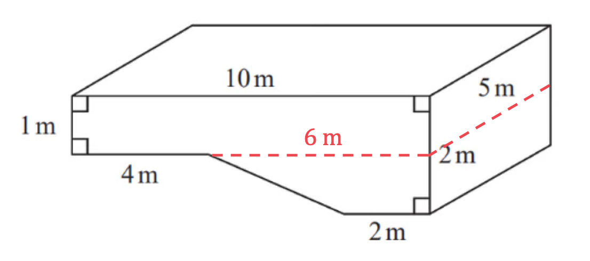

> *Calculate the area of the rectangle, *$( A = l \times w )$*, and the area of the trapezium, *$( A = 1 \frac{1}{2} ( a + b ) h )$*, then add them together to work out the cross-sectional area.*

$\begin{gathered} A = 1 \times 10 + 1 \frac{1}{2} ( 6 + 2 ) \times 1 \end{gathered}$

**Correct method to split up the cross-section and find the area of one part**** [1] **

**Correct complete method to find the total area of the cross-section**** [1]**

$\begin{gathered} A = 14 \mathrm{m}^{2} \end{gathered}$

> *Work out the volume of the swimming pool by multiplying the cross-sectional area by the width.*

$\begin{gathered} V_{P o o l} & = 14 \times 5 \end{gathered}$

**[1]**

$\begin{gathered} V_{P o o l} & = 70 \mathrm{m}^{3} \end{gathered}$

> *Convert the volume of water from the three tankers from litres to m**3** by dividing the total number of litres by 1000.*

$\begin{gathered} V_{W a t e r} & = \frac{20000 \times 3}{1000} \\ = 60 \mathrm{m}^{3} \end{gathered}$

> *Subtract the volume of the water from the volume of the swimming pool to find out the the volume that will not be filled with water.*

$\begin{gathered} V_{E m p t y} & = 70 - 60 \\ = 10 \mathrm{m}^{3} \end{gathered}$

> *Assuming that the part of the swimming pool that is not filled by water is a cuboid, with length 10 m and width 5 m, calculate the height of the cuboid.*

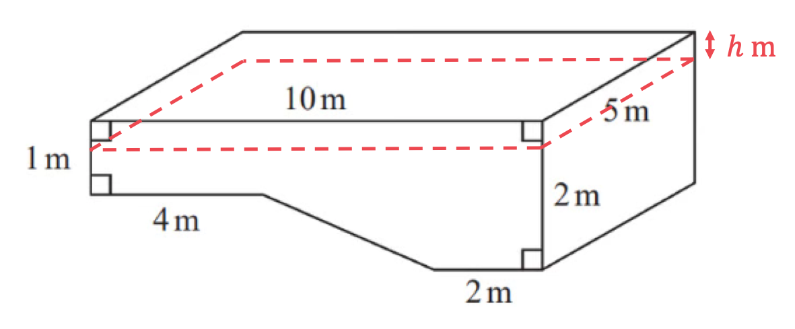

$\begin{gathered} 10 = 10 \times 5 \times h \end{gathered}$

**[1]**

$\begin{gathered} 10 = 50 h \\ h = 0.2 \mathrm{m} \end{gathered}$

**Sam is incorrect****, the surface of the water will be ****20 cm**** below the top of the pool ****[1]**

## Q10 — hard — 4 marks · exam-questions

### 22() — 4 marks
*Split the cross-section up into three rectangles by drawing in two horizontal lines. *

> *Work out the height of the bottom rectangle by subtracting the height of the top rectangle from the total height of the object.*

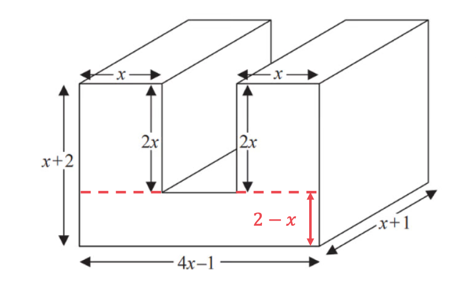

$\begin{array}{rcl} ( x + 2 ) - 2 x \\ = x + 2 - 2 x \\ = 2 - x \end{array}$

**[1]**

> *Find the area of each of the three triangles in terms of *$x$* and add together to find an expression for the total area of the cross-section.*

$A = ( x \times 2 x ) + ( x \times 2 x ) + ( 4 x - 1 ) ( 2 - x )$

**Correct expression for one area from the cross-section ****[1]**

> *Expand the brackets.*

$A=2x^{2}+2x^{2}+8x-4x^{2}-2+x$

> *Simplify by collecting like terms.*

$A=9x-2$

> *Find an expression for the volume of the prism by multiplying the area of the cross-section by the length of the prism.*

$V = ( 9 x - 2 ) ( x + 1 )$

**[1]**

> *Expand the brackets.*

$V=9x^{2}+9x-2x-2$

> *Simplify by collecting like terms.*

$V=9x^{2}+7x-2$* ***[1]**

## Q11 — medium — 3 marks · exam-questions

### 12() — 3 marks
> *Calculate the volume of orange juice that is in the carton, using the formula for the volume of a cuboid: *$V=l\timesw\timesd$* where *$l$* is the length of the cuboid *$w$* is the width and *$d$* is the depth.*

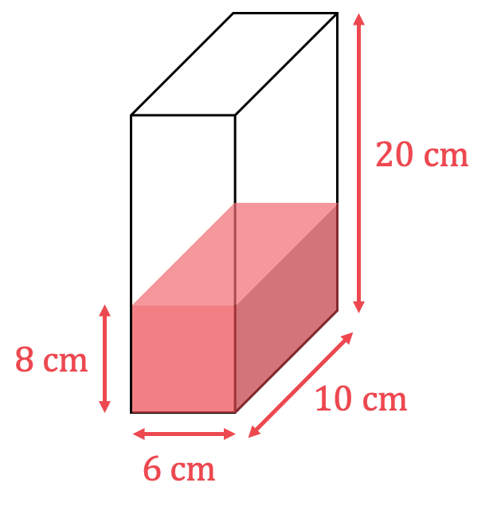

$\begin{gathered} V = 10 \times 6 \times 8 \end{gathered}$

**[1]**

$\begin{gathered} V = 480 cm^{3} \end{gathered}$

> *Sketch a diagram with the container turned over onto its shaded face.*

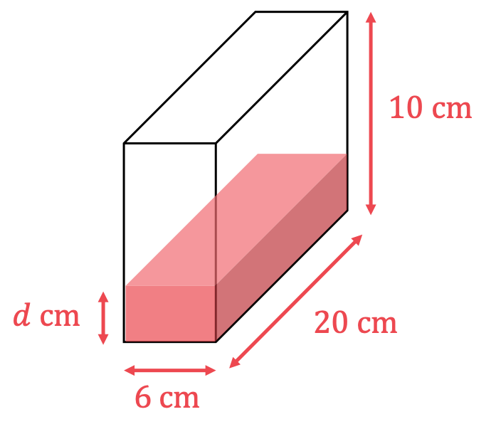

> *Substitute the volume of the juice and the known lengths into the formula for the volume of a cuboid and solve to find the new depth of the juice.*

$\begin{gathered} 480 = 20 \times 6 \times d \\ 480 = 120 d \\ \frac{480}{120} & = d \end{gathered}$

**[1]**

$4\mathrm{cm}$* ***[1]**

## Q12 — easy — 3 marks · exam-questions

### 1() — 3 marks
> *Calculate the volume of the prism by mutliplying the cross-sectional area by the length.*

$V=30\times25$

**[1]**

$750\mathrm{cm}^{3}$

**750**** [1] **
**cm****3**** ****[1]**

## Q13 — very_hard — 5 marks · exam-questions

### 22() — 5 marks
> *Find the radius of the large cone, given that the radius is half of the diameter.*

$\begin{gathered} r = \frac{12}{2} \\ = 6 \text{cm} \end{gathered}$

> *Calculate the volume of the large cone, using the formula: *$V=\frac{1}{3}πr^{2}h$*, where *$r$* is the radius of the cone and *$h$* is the perpendicular height.*

$\begin{gathered} V_{L} & = 1 \frac{1}{3} \times \mathrm{\pi } \times 6^{2} \times 15 \end{gathered}$

**[1]**

$\begin{gathered} V_{L} & = 180 \mathrm{\pi } cm^{3} \end{gathered}$

> *Work out the height of the small cone by subtracting the height of the frustum from the height of the large cone.*

$h=15-10=5\mathrm{cm}$

> *The large and small cones are similar objects. *
*Work out the length scale factor (LSF) by dividing the height of the large cone by the height of the small cone.*

$\mathrm{LSF}=\frac{15}{5}=3$

> *Divide the radius of the large cone by the LSF to work out the radius of the small cone.*

$\begin{gathered} r = \frac{6}{3} \\ = 2 \text{cm} \end{gathered}$

**[1]**

> *Calculate the volume of the small cone.*

$V_{S}=\frac{1}{3}\timesπ\times2^{2}\times5$

$V_{S}=\frac{20}{3}π\mathrm{cm}^{3}$

> *Work out the volume of the frustum by subtracting the volume of the small cone from the volume of the large cone.*

$\begin{gathered} V = 180 \mathrm{\pi } - \frac{20}{3} \mathrm{\pi } \end{gathered}$

**[1]**

$\begin{gathered} V = \frac{520}{3} \mathrm{\pi } cm^{3} \end{gathered}$

> *Calculate the mass of the frustum by multiplying the density of the glass by the volume of the frustum, *$( M a s s = D e n s i t y \times V o l u m e )$*.*

$M=2.5\times\frac{520}{3}π$

**[1]**

$M=1361.35681...g$

> *The dimensions of the object and the density are given to an accuracy of 2 significant figures, so this would be a suitable accuracy to round the final answer to.*

$1400g$* ***[1]**

**Answers rounded to 1400, 1360 or 1361 will be accepted**

## Q14 — hard — 5 marks · exam-questions

### 19() — 5 marks
> *Multiply the volume of the quarter sphere by 4 to find the volume of a whole sphere in terms of *$π$*.*

$\begin{gathered} 4 \times 576 \mathrm{\pi } \\ = 2304 \mathrm{\pi } cm^{3} \end{gathered}$

**[1]**

> *Substitute the volume into the formula for the volume of a sphere: *$V=\frac{4}{3}πr^{3}$*.*

$2304π=\frac{4}{3}πr^{3}$

> *Divide both sides by *$\frac{4}{3}π$*. *

$1728=r^{3}$

> *Find the cube root of both sides.*

$r=12\mathrm{cm}$

**[1]**

> *Substitute the radius of the sphere into the formula for the surface area of a sphere: *$A=4πr^{2}$*.*

$\begin{gathered} A_{s p h e r e} & = 4 \times \mathrm{\pi } \times 12^{2} \\ = 576 \mathrm{\pi } cm^{2} \end{gathered}$

> *Divide by 4 to find the curved surface area of the quarter sphere.*

$A_{quartersphere}=144π\mathrm{cm}^{2}$

**[1]**

> *The two flat faces are semi-circles so are equivalent to the area of one circle with the same radius. *

> *Calculate the area of the circle using the formula: *$A=πr^{2}$*.*

$\begin{gathered} A_{c i r c l e} & = \mathrm{\pi } \times 12^{2} \\ = 144 \mathrm{\pi } cm^{2} \end{gathered}$

> *Add together the curved surface area of the quarter circle and the area of the circle to find the total surface area of the quarter sphere.*

$\begin{gathered} A_{t o t a l} & = 144 \mathrm{\pi } + 144 \mathrm{\pi } \end{gathered}$

**[1]**

$\begin{gathered} A_{t o t a l} & = 288 \mathrm{\pi } \\ = 904.778684... cm^{2} \end{gathered}$

> *Round to 3 significant figures.*

$905\mathrm{cm}^{2}$* ***[1]**

**Final answer:** **Answers in the range 904.7 - 905 will be accepted**

## Q15 — medium — 3 marks · exam-questions

### 9() — 3 marks
> *Split the cross-sectional area into two rectangles, calculate the individual areas and add together to find the total area of the cross-section.*

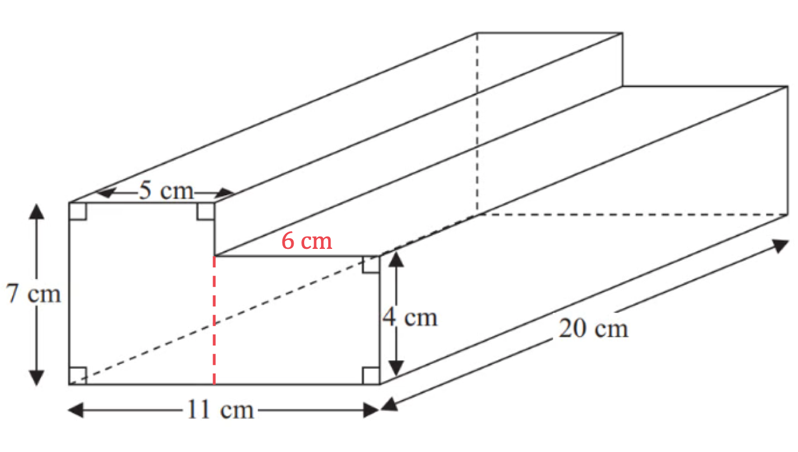

$A=5\times7+6\times4$

**[1]**

$A=59\mathrm{cm}^{2}$

> *Multiply the area of the cross-section by the length to work out the volume of the prism.*

$V=59\times20$

**[1]**

$1180\mathrm{cm}^{3}$** [1]**

## Q16 — easy — 3 marks · exam-questions

### 1() — 3 marks
> *A cuboid is made up from 3 pairs of opposite, identical faces. Calculate the area of each of face and add them together to find the total surface area of the cuboid.*

*Top/bottom: *$6\times1.5=9$

**[1]**

*Front/back: *$6\times1.5=9$

*Side: *$1.5\times1.5=2.25$

> *Add together each of the faces and multiply by two to take into account that for each face, the opposite face has the same area.*

*Total area = *$2 \times ( 9 + 9 + 2.25 )$

**[1]**

$40.5\mathrm{cm}^{2}$* ***[1]**

## Q17 — very_hard — 5 marks · exam-questions

### 17() — 5 marks
> *Calculate the length of the slant height of the cone by applying Pythagoras' theorem, *$a^{2}+b^{2}=c^{2}$*, to the right-angled triangle involving the slant height, the radius and the perpendicular height of the cone.*

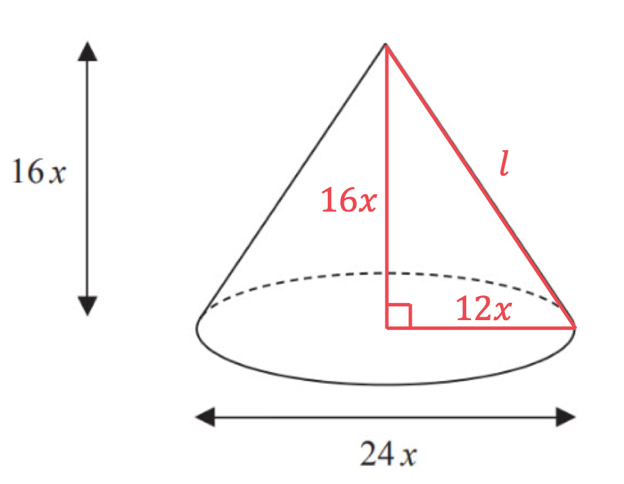

$\begin{gathered} ( 16 x )^{2} + ( 12 x )^{2} & = l^{2} \\ 256 x^{2} + 144 x^{2} & = l^{2} \\ 400 x^{2} & = l^{2} \\ l = 20 x \end{gathered}$

**[1]**

> *Substitute the value of the surface area of the cone along with the algebraic expressions for the slant height and the radius into the formula for the surface area of the cone.*

$2160π=π\times12x\times20x$

**[1]**

> *Solve to find the value of *$x$*.*

$\begin{gathered} 2160 \mathrm{\pi } & = 240 \mathrm{\pi } x^{2} \\ 2160 = 240 x^{2} \\ 9 = x^{2} \\ x = 3 \end{gathered}$

**[1]**

> *Substitute the relevant values into the formula for the volume of a cone, *$V=\frac{1}{3}πr^{2}h$*.*

$V = 1 \frac{1}{3} \times ( 12 \times 3 )^{2} \times ( 16 \times 3 )$

**[1]**

> *Solve to find the volume.*

$V=20736π\mathrm{cm}^{3}$

> *Write down the value of **V.*

$20736$** [1]*** *

## Q18 — hard — 5 marks · exam-questions

### 16() — 5 marks
> *Let **O** be the centre of the base directly below the vertex **V** of the pyramid and II be the midpoint of **AB**. *
*Look at the right-angled triangle **AMO**, use Pythagoras' theorem, *$a^{2}+b^{2}=c^{2}$*, to calculate the length **AO**.*

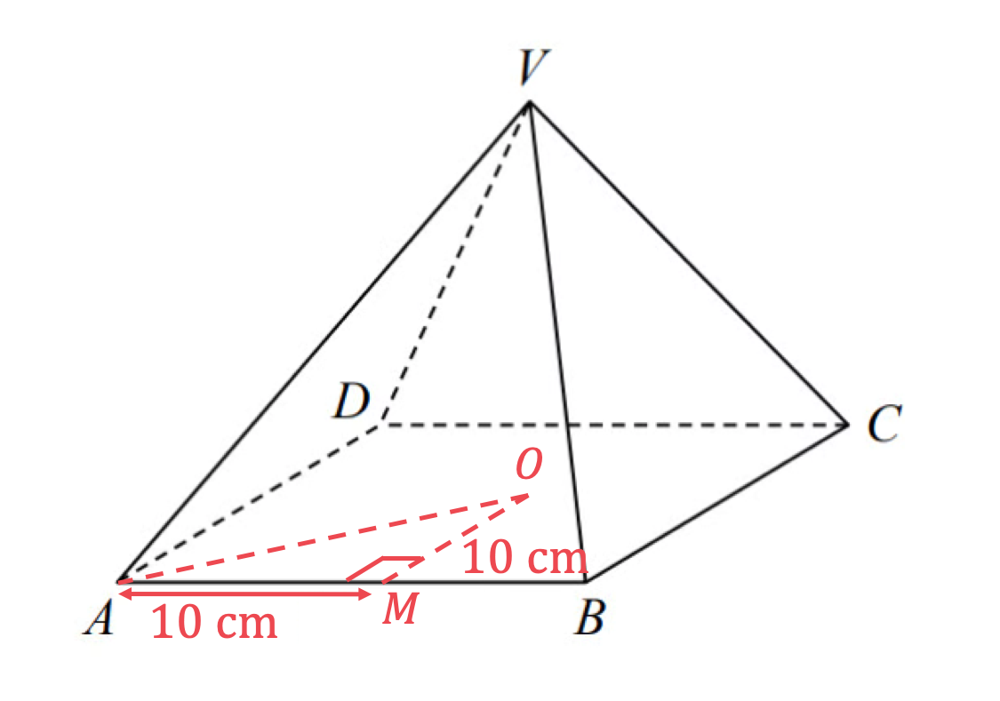

$\begin{gathered} A O^{2} & = 10^{2} + 10^{2} \\ A O^{2} & = 200 \\ A O & = 10 \sqrt{2} \end{gathered}$

**[1]**

> *Use SOHCAHTOA on the right-angled triangle **AOB **to calculate the perpendicular height. *

> *You have the length **AO **(adjacent) and you want to know the height (opposite) so use: *$\mathrm{tan}θ=\frac{Opp}{Adj}$*.*

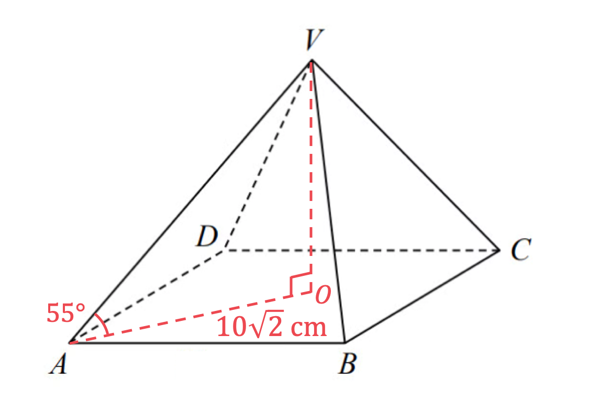

> * *$\begin{gathered} \tan 55 & = \frac{V O}{10 \sqrt{2} } \\ 10 \sqrt{2} \times \tan 55 & = V O \end{gathered}$

**[1]**

$\begin{gathered} V O & = 20.19706... \text{cm} \end{gathered}$

> *Work out the perpendicular height of one of the triangular faces by using Pythagoras' theorem on the right-angled triangle **VOM**.*

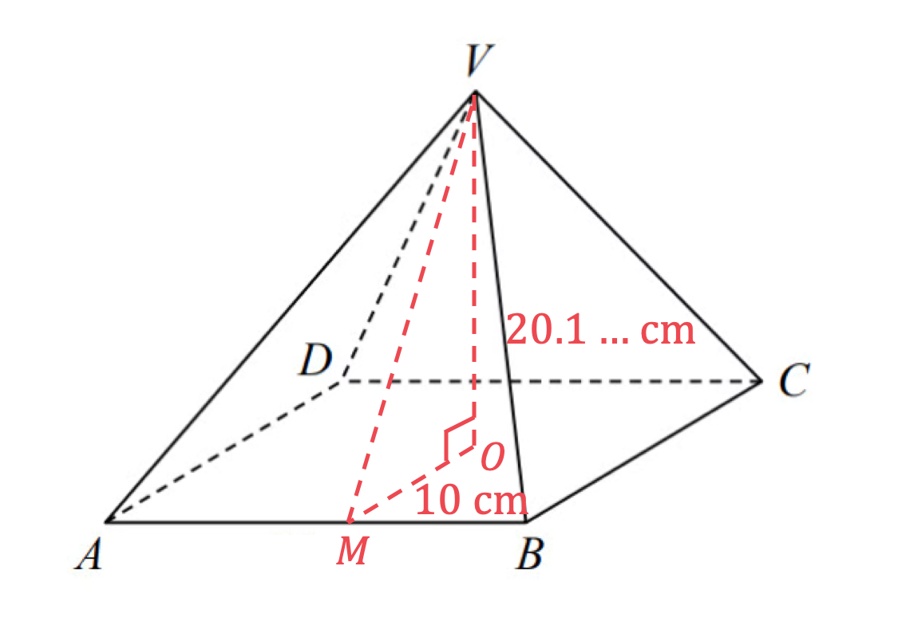

$\begin{gathered} 10^{2} + ( 20.1... )^{2} & = V M^{2} \\ 507.921345... & = V M^{2} \\ V M & = 22.537110... \text{cm} \end{gathered}$

**[1]**

*Calculate the area of one of the triangular faces, using the formula*: $A=\frac{1}{2}bh$*, where *$b$* is the base of the triangle and *$h$* is the perpendicular height.*

$\begin{gathered} A_{t r i a n g l e} & = 1 \frac{1}{2} \times 20 \times 22.5... \end{gathered}$

**[1]**

$\begin{gathered} A_{t r i a n g l e} & = 225.371104... cm^{2 } \end{gathered}$

> *Calculate the total surface area by adding together the area of the square base and four of the triangular faces.*

$\begin{gathered} A_{t o t a l} & = 20 \times 20 + 4 \times 225.371104... \\ = 1301.48441... cm^{2} \end{gathered}$

> *Round to 2 significant figures.*

$1300\mathrm{cm}^{2}$* ***[1]**

**Answers between 1300 and 1302 will be accepted**

## Q19 — medium — 3 marks · exam-questions

### 24() — 3 marks
> *Calculate the volume of the tin of pet food, using the formula for the volume of a cylinder: *$V=πr^{2}h$*, where *$r$* is the radius and *$h$* is the height.*

> * It is a good idea to leave the answer in terms of *$π$* so that you won't have any rounding errors.*

$V=π\times6.5^{2}\times11.5$

**[1]**

$V=485.875π\mathrm{cm}^{3}$

> *Substitute the calculated volume and the known dimensions of the new tin into the formula for the volume of a cylinder to calculate the height of the new tin.*

$485.875π=π\times5.8^{2}\timesh$

> *Divide both sides by *$π$*.*

$485.875=5.8^{2}\timesh$

> *Divide both sides by 5.8**2**.*

$14.443370...=h$

**[1]**

> *Round to 1 decimal place.*

$14.4\mathrm{cm}$* ***[1]**

## Q20 — easy — 3 marks · exam-questions

### 5((a)) — 3 marks
*The volume of a cuboid is *$V=l\timesw\timesh$* where **l, w **and **h** are the lengths of the three perpendicular sides.*

> *Substitute **V** = 270, **l** = 12, **w** = 5  and **h** = **x **into the formula and solve for **x**.*

$\begin{gathered} 270 = 12 \times 5 \times x \\ 270 = 60 x \\ \frac{270}{60} & = x \\ 4.5 & = x \end{gathered}$

**[1]*** *

*The formula for the the volume of a cylinder is *$V=πr^{2}h$* where **r** is the length of the radius and **h** is the height.*

> *Substitute **r** = 4.5 and **h** = 2(4.5) = 9 into the formula.*

> $\begin{gathered} V = \mathrm{\pi } \times 4.5^{2} \times 9 \\ = \frac{729}{4} \mathrm{\pi } \\ = 572.555261... \end{gathered}$*  *

**[1]*** *

> *Round to the nearest whole number.*

**Volume is 573 cm****3**** (nearest whole number)**** [1]**

## Q21 — very_hard — 5 marks · exam-questions

### 23() — 5 marks
> *Work out the volume of the large cone*

$V=\frac{1}{3}\timesπ\times6^{2}\times15\,V=180π$

**[M1]**

> *The ratio of the height of the small cone to the radius of the small cone will be the same as the ratio of the height of the large cone to the radius of the large cone*

$x:h=6:15$

> *Form a formula for *$x$* and *$h$

$\begin{gathered} 6 h & = 15 x \\ h & = \frac{ 15 x}{6} \\ = \frac{ 5 x}{2} \end{gathered}$

**[M1]**

> *Work out an expression for the volume of the small cone*

$V=\frac{1}{3}\timesπ\timesx^{2}\timesh\,V=\frac{1}{3}\timesπ\timesx^{2}\times\frac{5}{2}x\,V=\frac{5}{6}πx^{3}$

**[M1]**

> *The volume of the frustum is the volume of the large cone subtract the volume of the small cone*

$\frac{4212}{25}π=180π-\frac{5}{6}πx^{3}$

> *Divide through by *$π$

$\frac{4212}{25}=180-\frac{5}{6}x^{3}$

**[M1]**

> *Rearrange*

$\begin{gathered} \frac{5}{6} x^{3} & = 180 - \frac{4212}{25} \\ = \frac{ 288}{25} \end{gathered}$

> *Divide both sides by *$\frac{5}{6}$

$x^{3}=\frac{1728}{125}$

> *Take the cube root of both sides*

$x=\frac{12}{5}$

$x=\frac{12}{5}$

**[A1]**

## Q22 — very_hard — 5 marks · exam-questions

### 11() — 5 marks
> *Find an expression for the volume of the hemisphere in terms of *$x$*, by substituting the expression for the radius, *$r$*, into the formula for the volume of a sphere, *$V=\frac{4}{3}πr^{3}$*, and multiplying the result by *$\frac{1}{2}$*.*

$\begin{gathered} V_{h e m i s p h e r e} & = 1 \frac{1}{2} \times \frac{4}{3} \times \mathrm{\pi } \times x^{3} \end{gathered}$

**[1]**

$\begin{gathered} V_{h e m i s p h e r e} & = \frac{2}{3} \mathrm{\pi } x^{3} \end{gathered}$

> *Write down the perpendicular height, *$h$*, of the cone.*

$\begin{gathered} h = 5 x - x \\ = 4 x \end{gathered}$

> *Find an expression for the volume of the cone in terms of *$x$*, using the formula for the volume of a cone: *$V=\frac{1}{3}πr^{2}h$*.*

$V_{cone}=\frac{1}{3}\timesπ\timesx^{2}\times4x$

> *Calculate the total volume of the solid by adding together the volume of the hemisphere and the cone.*

$\begin{gathered} V_{t o t a l} & = \frac{2}{3} \mathrm{\pi } x^{3} + \frac{4}{3} \mathrm{\pi } x^{3} \end{gathered}$

**[1]**

$\begin{array}{rcl} V_{t o t a l} & = 2 \mathrm{\pi } x^{3} cm^{3} \end{array}$

*Find an expression for the volume of the cylinder, using the formula for the volume of a cylinder: *$V=πr^{2}h$.

$V_{c y l i n d e r} = \mathrm{\pi } \times ( 2 x )^{2} \times h$

**[1]**

$V_{cylinder}=4x^{2}πh$

> *The cylinder has the same volume as the solid, so make the two volumes equal and rearrange to find an expression for the perpendicular height in terms of *$x$*. *

$\begin{gathered} 2 \mathrm{\pi } x^{3} & = 4 x^{2} \mathrm{\pi } h \end{gathered}$

**[1]**

$\begin{gathered} 2 x^{3} & = 4 x^{2} h \\ 1 \frac{1}{2} x^{3} & = x^{2} h \end{gathered}$

$h=\frac{1}{2}x$* ***[1]**

## Q23 — hard — 4 marks · exam-questions

### 18() — 4 marks
> *Multiply the given value for the volume of the hemisphere by 2 to give the volume of a sphere with the same radius.*

$\begin{gathered} \frac{250}{3} \mathrm{\pi } \times 2 \\ = \frac{500}{3} \mathrm{\pi } cm^{3} \end{gathered}$

> *Substitute the volume of the sphere into the formula: *$V=\frac{4}{3}πr^{3}$*.*

$\frac{500}{3}π=\frac{4}{3}π\timesr^{3}$

**[1]**

> *Divide both sides by *$π$*.*

$\frac{500}{3}=\frac{4}{3}\timesr^{3}$

> *Multiply both sides by 3.*

$500=4\timesr^{3}$

> *Divide both sides by 4.*

$125=r^{3}$

> *Take the cube root of both sides.*

$r=5\mathrm{cm}$

> *The surface area of the hemisphere is made up of the curved surface of half a sphere and the area of a circle with the same radius.*

> *Calculate the area of the curved surface of half a sphere by substituting the radius into the formula: *$A=4πr^{2}$* and multiplying the result by *$\frac{1}{2}$*.*

$A_{curved}=\frac{1}{2}\times4\timesπ\times5^{2}$

**[1]**

$A_{curved}=50π\mathrm{cm}^{2}$

> *Calculate the area of the flat circular face, using the formula: *$A=πr^{2}$*.*

$\begin{gathered} A_{c i r c l e} & = \mathrm{\pi } \times 5^{2} \\ = 25 \mathrm{\pi } cm^{2} \end{gathered}$

> *Add the curved and flat areas together to find the total surface area of the hemisphere.*

$\begin{gathered} A_{t o t a l} & = 50 \mathrm{\pi } + 25 \mathrm{\pi } \end{gathered}$

**[1]**

`| _ _ 75 pi cm ^ 2 | |`** [1]**

## Q24 — medium — 3 marks · exam-questions

### 25() — 3 marks
> *Work out the perpendicular height of the cone by subtracting the radius of the hemisphere from the total height of the object.*

$\begin{gathered} h = 14 - 4 \\ = 10 \text{cm} \end{gathered}$

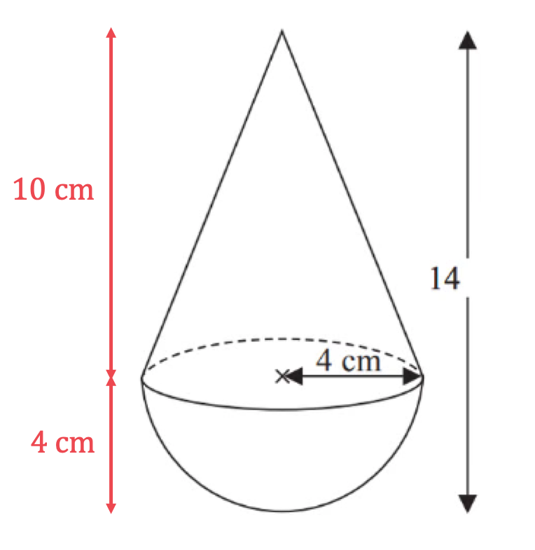

> *Calculate the volume of the sphere, using the formula: *$V=\frac{4}{3}πr^{3}$*, where *$r$* is the radius, and divide the result by 2 to calculate the volume of the hemisphere.*

> *It is a good idea to keep your answer in terms of *$π$* to avoid rounding errors.*

$V_{Hemisphere}=\frac{1}{2}\times\frac{4}{3}π\times4^{3}$

**[1]**

$V_{Hemisphere}=\frac{128}{3}π$

> *Calculate the volume of the cone, using the formula: *$V=\frac{1}{3}πr^{2}h$*, where *$r$* is the radius and *$h$* is the perpendicular height.*

$V_{Cone}=\frac{1}{3}\timesπ\times4^{2}\times10$

**[1]**

$V_{Cone}=\frac{160}{3}π$

> *Find the total volume of the solid by adding together the volume of the hemisphere and the volume of the cone.*

$V_{Solid}=\frac{128}{3}π+\frac{160}{3}π$

$\begin{gathered} V_{S o l i d} & = 96 \mathrm{\pi } \\ = 301.59289... \end{gathered}$

> *Round to 3 significant figures.*

$302\mathrm{cm}^{3}$* ***[1]**

**Answers between the values of 301 to 302 will be accepted. Answer of **$96π$** and **$\frac{288}{3}π$** will also be accepted.**

## Q25 — easy — 2 marks · exam-questions

### 4() — 2 marks
*The formula for the the volume of a cylinder is *$V=πr^{2}h$* where **r** is the length of the radius and **h** is the height. The radius is half of the diameter.*

> *Substitute **r** = 14 ÷ 2 = 7 and **h** = 20 into the formula.*

> $\begin{gathered} V = \mathrm{\pi } \times 7^{2} \times 20 \\ = 980 \mathrm{\pi } \\ = 3078.76080... \end{gathered}$*  *

**[1]**

> *Round to 3 significant figures.*

**Volume is 3080 cm****3**** (3sf)**** ****[1] **

## Q26 — very_hard — 4 marks · exam-questions

### 16() — 4 marks
> *First sketch a diagram of a side view of the cones and frustum. We will let the height of the frustum be *$f$*, the height of the small cone be *$H$* and the radius of the small cone be *$R$

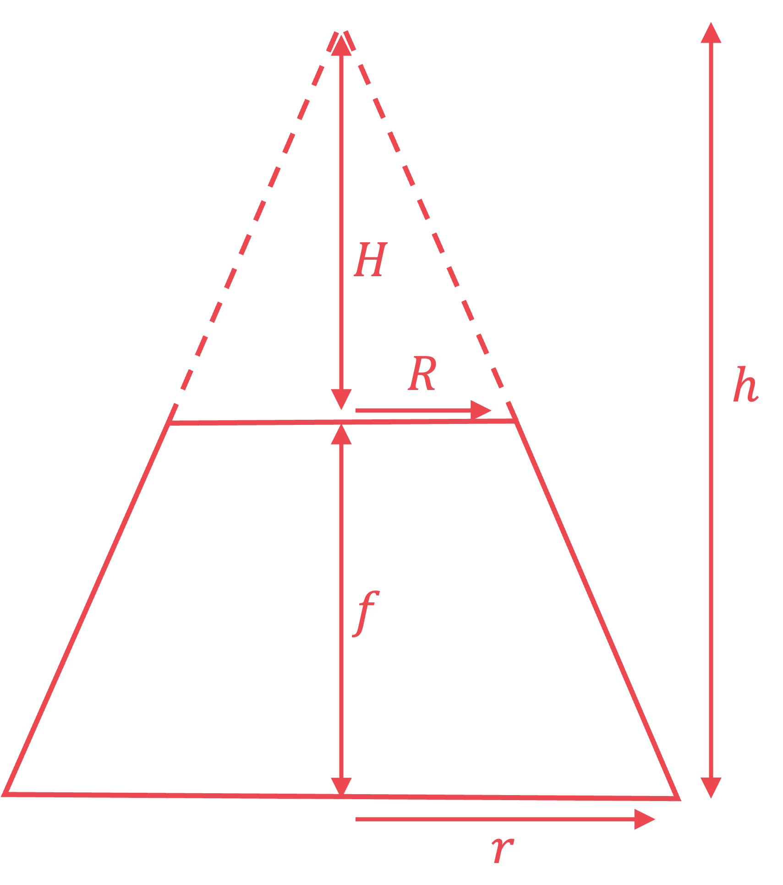

> *We need *$f$* and we can see that *$f=h-H$*. So we need *$H$* in terms of *$h$

> *If *$\frac{98}{125}$* represents the fraction of the large cone that the frustum occupies, then the fraction of the large cone that the small cone occupies is *

$1-\frac{98}{125}=\frac{27}{125}$

**[1]**

> *This *$\frac{27}{125}$* is effectively the scale factor of the small cone to the large cone*

> *Therefore if we cube root *$\frac{27}{125}$*, we have the length scale factor of the small cone to the large cone*

$\sqrt[3]{\frac{27}{125}} = \frac{3}{5}$

**[1]**

> *Therefore *

$H=\frac{3}{5}h$

> *And*

$\begin{gathered} f = h - H \\ = h - \frac{3}{5} h \end{gathered}$

**[1]**

**The height of the frustum is **`| _ _ 2 / 5 h | |`** ****[1]**

## Q27 — hard — 4 marks · exam-questions

### 12() — 4 marks
> *Use Pythagoras' theorem, *$a^{2}+b^{2}=c^{2}$*, on the right-angled triangle **ABF** to find the length **BF**.*

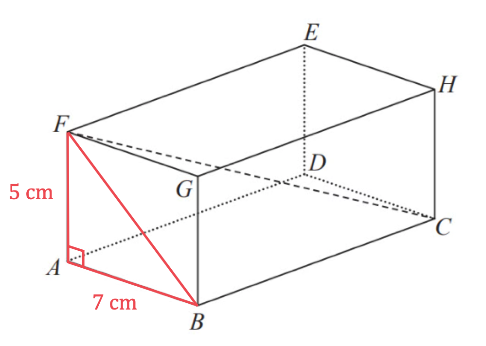

$\begin{array}{rcl} 5^{2} + 7^{2} & = B F^{2} \end{array}$

**[1]**

$\begin{gathered} 74 = B F^{2} \\ B F & = \sqrt{74} \text{cm} \end{gathered}$

> *Use Pythagoras' theorem on the right-angled triangle **BCF** to find the length **BC**.*

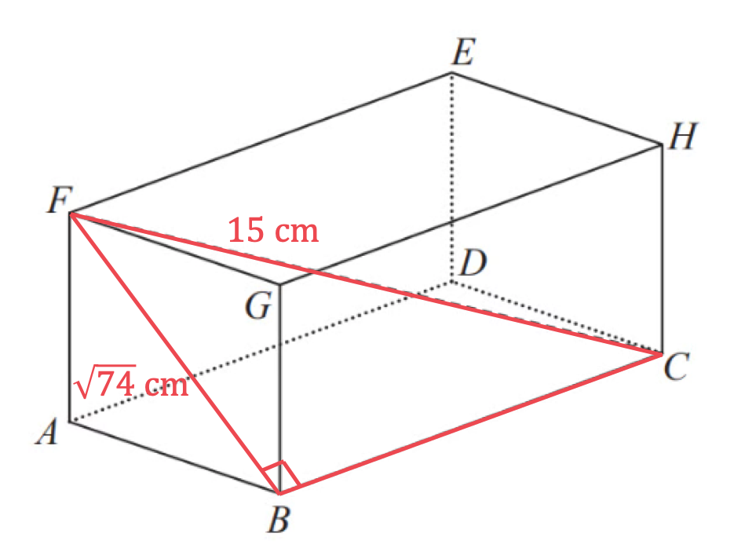

$\begin{gathered} ( \sqrt{74} )^{2} + B C^{2} & = 15^{2} \\ 74 + B C^{2} & = 225 \\ B C^{2} & = 151 \\ B C & = \sqrt{151} \text{cm} \end{gathered}$

**[1]**

> *Calculate the volume of the cuboid, using the formula: *$V=l\timesw\timesh$*, where *$l$* is the length, *$w$* is the width and *$h$* is the height of the cuboid.*

$\begin{gathered} V = \sqrt{151} \times 7 \times 5 \end{gathered}$

**[1]**

$\begin{gathered} V = 430.087200... \end{gathered}$

$430\mathrm{cm}^{3}$** ****[1]**

**Answers between 430 and 430.1 will be accepted**

## Q28 — medium — 3 marks · exam-questions

### 5() — 3 marks
> *Calculate the volume of the cheese, using the formula: *$V=l\timesw\timesh$*, where *$l$* is the length of the cuboid, *$w$*is the width and *$h$* is the height.*

$\begin{gathered} V = 15 \times 10 \times 2 \end{gathered}$

**[1]**

$\begin{gathered} V = 300 cm^{3} \end{gathered}$

> *Substitute the resultant volume and the known dimensions of the new cheese into the formula for the volume of a cuboid and solve to find the length of the new cheese.*

$300=x\times5\times5$

> *Simplify.*

$300=25x$

> *Divide both sides by 25.*

$\frac{300}{25}=x$

**[1]**

$12\mathrm{cm}$* ***[1]**

## Q29 — easy — 2 marks · exam-questions

### 6((a)) — 2 marks
> *The the curved surface area of a cylinder is the part of the cylinder that when unrolled would be a rectangle, with the width equal to the height of the cylinder and the length equal to the circumference of the base circle of the cylinder.*

> *Find the circumference of the base of the cylinder using the formula *$C=2πr$* where **r** is the radius.*

> $\begin{gathered} \text{circumference} & = 2 \mathrm{\pi } \times 0.56 \end{gathered}$*  *

> *Find the curved surface area of the cylinder by multiplying the circumference with the height.*

> $\begin{gathered} C S A & = 2 \mathrm{\pi } \times 0.56 \times 1.6 \end{gathered}$*  *

**[1]**

> *Round to 3 significant figures.*

**CSA is 5.63 m****2**** (3sf)*** ***[1] **

## Q30 — very_hard — 6 marks · exam-questions

### 26() — 6 marks
> *The formula for the volume of a cone, *$V=\frac{1}{3}πr^{2}h$*, is given at the beginning of the paper. Use the formula with the given volume of the cone to find the value of the radius of the base circle. *

> *Using the known volume of 1600 cm**3** we can write the following equation.*

$\frac{1}{3}\timesπ\timesr^{2}\times25=1600$

**[1]**

> *Divide both sides by 25 and *$\frac{1}{3}π$*.*

$\frac{1}{3}πr^{2}=\frac{1600}{25}=64$

$r^{2}=\frac{64}{\frac{π}{3}}=\frac{192}{π}=61.11549...$

> *Square root both sides.*

$r=\sqrt{61.11549...}=7.817640...$

**[1]**

> *The formula for the curved surface area of a cone, *$πrl$* , is given at the beginning of the paper.*

> *Use Pythagoras' Theorem to find the value of *$l$*, the slant height of the cone. *

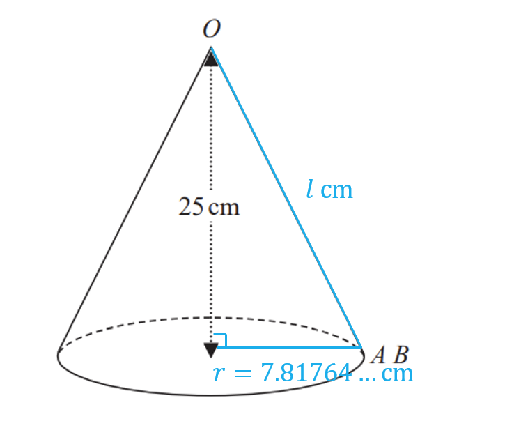

> *It is a right angled triangle so you can use Pythagoras' Theorem: *$a^{2}+b^{2}=c^{2}$*, where **c** is the length of the hypotenuse (the slant height) and **a** and **b **are the height and the radius. *

$\begin{gathered} l^{2} & = 7.81764...^{2} + 25^{2} \\ l & = \sqrt{7.81764...^{2} + 25^{2}} \\ = 26.193806... \end{gathered}$

**[1]**

> *Substitute the values of *$l$* and *$r$* into the formula for the curved surface area of a cone.*

$\begin{gathered} C S A & = \pi r l = \pi ( 7.817640... ) ( 26.193806... ) = 643.313706... \end{gathered}$

**[1]**

> *The area of the sector is equal to the curved surface area of the cone. Use the formula for area of a sector *$\frac{θ}{360^{\circ}}\timesπr^{2}$*, where the radius of the sector is equal to the slant height of the cone, to find the value of the angle, *$x$*.*

$\frac{x}{360} \times \pi \times \begin{gathered} 26 \end{gathered} \begin{gathered} . \end{gathered} \begin{gathered} 193806 \end{gathered} ...^{2} = \begin{gathered} 643 \end{gathered} \begin{gathered} . \end{gathered} \begin{gathered} 313706 \end{gathered} \begin{gathered} . \end{gathered} \begin{gathered} . \end{gathered} \begin{gathered} . \end{gathered}$

**[1]**

> *Rearrange and solve to find *$x$*.*

$\begin{gathered} \frac{x}{360} & = \frac{643.313706...}{ 26.193806...^{2} \times \pi } \\ \frac{x}{360} & = 0.298452... \\ x & = 0.298452... \times 360 = 107.4430... \end{gathered}$

$x=107^{\circ}$ **[1]**

**Rounded to 3 significant figures 107 - 108 allowed**

## Q31 — hard — 5 marks · exam-questions

### 19() — 5 marks
> *Substitute the value given for the volume of the cone into the formula for the volume of a cone: *$V=\frac{1}{3}πr^{2}h$*, where *$r$* is the radius of the cone and *$h$* is the perpendicular height.*

$270π=\frac{1}{3}\timesπ\timesr^{2}\times10$

**[1]**

> *Solve to find the radius.*

$\begin{gathered} 270 \mathrm{\pi } & = \frac{10}{3} \mathrm{\pi } r^{2} \\ 270 = \frac{10}{3} r^{2} \\ 27 = 1 \frac{1}{3} r^{2} \\ 81 = r^{2} \\ r = 9 \text{cm} \end{gathered}$

**[1]**

> *Calculate the volume of the volume of the hemisphere by substituting the value for the radius into the formula for the volume of a sphere and multiplying the result by *$\frac{1}{2}$*.*

$\begin{gathered} V = 1 \frac{1}{2} \times \frac{4}{3} \times \mathrm{\pi } \times 9^{3} \end{gathered}$

**[1]**

$\begin{gathered} V = \frac{2}{3} \times \mathrm{\pi } \times 729 \\ = 2 \times \mathrm{\pi } \times 243 \\ = 486 \mathrm{\pi } cm^{3} \end{gathered}$

> *Add the volume of the hemisphere to the volume of the cone to find the total volume of the shape.*

$V_{total}=270π+486π$

**[1]**

$756π\mathrm{cm}^{3}$* ***[1]**

## Q32 — medium — 4 marks · exam-questions

### 21() — 4 marks
> *Find the radius, *$r$*, of the sphere by halving the diameter.*

$r=\frac{40}{2}=20\mathrm{cm}$

> *If there are twelve hemispherical hanging baskets, the volume of these would be equivalent to six spheres of the same radius. Calculate the volume of six spheres of radius 20 cm, using the formula: *$V=\frac{4}{3}πr^{3}$*.*

$\begin{gathered} V = 6 \times \frac{4}{3} \times \mathrm{\pi } \times 20^{3} \end{gathered}$

**[1]**

$\begin{gathered} V = 64 000 \mathrm{\pi } \\ = 201061.929... cm^{3} \end{gathered}$

> *Convert the amount of compost in one bag from litres to cm**3**.*

*1 litre = 1 000 cm**3*

*50 litres = 50 000 cm**3*

**[1]**

> *Work out the total amount of compost that Anne has in cm**3**.*

$4\times50000=200000\mathrm{cm}^{3}$

**[1]**

**No, Anne does not have enough compost as she needs 201 062 cm****3**** but only has 200 000 cm****3**** ****[1]**

## Q33 — easy — 5 marks · exam-questions

### 10() — 5 marks
> *Calculate the area of the triangular cross-sectional area, using the formula: *$A=\frac{1}{2}bh$*, where *$b$* is the length of the base and *$h$* is the perpendicular height, which in this case we do not know.*

> *However the cross-sectional area is a right-angled triangle so we can use Pythagoras' theorem to find the height, **h**. *
*A diagram will help.*

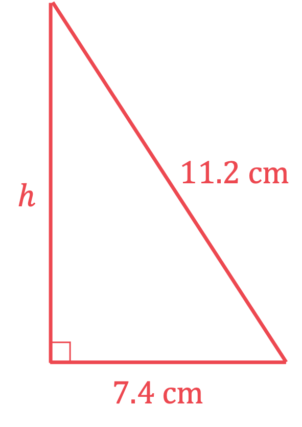

> *Apply Pythagoras' theorem ("*$a^{2}=b^{2}+c^{2}$*", where **a** is the hypotenuse).*

$\begin{gathered} 11.2^{2} & = h^{2} + 7.4^{2} \\ h^{2} & = 11.2^{2} - 7.4^{2} \\ h = \sqrt{70.68} \\ h = 8.407 139 ... \end{gathered}$

**First step to finding h ****[1] **
**Complete method for finding h**** [1]**

> *Do not round, use the ANS or memory features of your calculator to store the exact value of **h**. *

> *Now we can find the cross-sectional area using the area of a triangle formula.*

$\begin{gathered} A = 1 \frac{1}{2} \times 7.4 \times 8.4007 139 ... \end{gathered}$

**[1]**

$\begin{gathered} A = 31.106 417 ... cm^{2} \end{gathered}$

> *Again, do not round!  Only do so for the final answer. *

> *Calculate the volume of the prism by multiplying the cross-sectional area by the length of the object.*

$V=15\times31.106417...\,V=466.596260...$

**[1]**

> *Round this to three significant figures for the final answer.*

$V=467\mathrm{cm}^{3}$ **[1]**

## Q34 — very_hard — 5 marks · exam-questions

### 17() — 5 marks
> *Find the volume of S by adding together the volume of a cylinder ("*$V=πr^{2}h$*") and the volume of the hemisphere (half the volume of a sphere so "*$V=\frac{1}{2}\times\frac{4}{3}πr^{3}$*").*

$V = \mathrm{\pi } ( x )^{2} ( 20 - 4 x ) + 1 \frac{1}{2} ( \frac{4}{3} \mathrm{\pi } ( x )^{3} )$

**[1]**

> *Equate this to the given expression for the volume of S, and simplify to make things easier.*

$\begin{gathered} 1 \frac{1}{3} \mathrm{\pi } y & = \mathrm{\pi } ( x )^{2} ( 20 - 4 x ) + 1 \frac{1}{2} ( \frac{4}{3} \mathrm{\pi } ( x )^{3} ) \end{gathered}$

**[1]**

`table columnalign right center left columnspacing 0px end | 1 third pi y | = 20 pi x ^2 - 4 pi x ^3 + 2 / 3 pi x ^3 | | 1 third pi y | = 20 pi x ^2 - 10 / 3 pi x ^3 | | pi y | = 60 pi x ^2 - 10 pi x ^3 | | / pi y | = 10 / pi x ^2 ( 6 - x ) | | y = 10 x ^2 ( 6 - x ) | |`

**[1]**

> *To find the maximum value of y we need to use differentiation.*

$\begin{gathered} y = 60 x^{2} - 10 x^{3} \\ \frac{ \mathrm{d} y}{ \mathrm{d} x} & = 120 x - 30 x^{2} \\ \frac{ \mathrm{d} y}{ \mathrm{d} x} & = 30 x ( 4 - x ) \end{gathered}$

> *At a maximum value, *$\frac{dy}{dx}=0$*.*

$30 x ( 4 - x ) = 0
 \cancel{x = 0} , x = 4$

**[1]**

> *Reject *$x=0$* as a solution since the radius of the hemisphere and cylinder cannot be zero! *

> *So *$x=4$* (we can assume) is the **x** value at the maximum for **y**. Substitute this into our equation for **y** in terms of **x**.*

$\begin{gathered} y = 10 \times 4^{2} \times ( 6 - 4 ) \\ y = 10 \times 16 \times 2 \\ y = 320 \end{gathered}$

**Therefore the maximum value of ****y**** is 320*** ***[1]**

## Q35 — hard — 6 marks · exam-questions

### 8((a)) — 5 marks
> *Calculate the area of the cross-section of the tank, using the formula for the area of a trapezium: *$A = 1 \frac{1}{2} ( a + b ) h$*, where *$a$* and *$b$* are the lengths of the parallel sides and *$h$* is the perpendicular height.*

$\begin{gathered} A = 1 \frac{1}{2} \times ( 3 + 1.4 ) \times 2.4 \end{gathered}$

**[1]**

$\begin{gathered} A = 5.28 \mathrm{m}^{2} \end{gathered}$

> *Calculate the volume of the tank by multiplying the cross-sectional area by the length of the tank.*

$\begin{gathered} V = 5.28 \times 2.5 \\ = 13.2 \mathrm{m}^{3} \end{gathered}$

**[1]**

> *Divide the given percentage by 100 and multiply it by the volume to calculate the volume of oil required to fill the tank up to 85% capacity.*

$\begin{gathered} V_{85 \%} & = \frac{85}{100} \times 13.2 \\ = 11.22 \mathrm{m}^{3} \end{gathered}$

**[1]**

> *Convert the volume of oil required in m**3** to litres by multiplying the volume in m**3** by 1000.*

*1000 litres = 1 m**3*

$\begin{gathered} V_{85 \%} & = 11.22 \times 1000 \\ = 11220 \text{litres} \end{gathered}$

> *Work out the volume of oil required to fill the tank up to 85% after the initial 300 litres by subtracting 300 from the 85% volume.*

$\begin{array}{rcl} V_{r e m a i n i n g} & = 11220 - 300 \\ = 10920 \end{array}$

> *Calculate the time taken, in minutes, for the remaining oil to flow into the tank by dividing the volume by 300.*

$\frac{10920}{300}$

**[1]**

$36.4\mathrm{minutes}$ **[1]**

### 8((b)) — 1 marks
**Final answer:** **If the average rate of flow was ****faster****, it would take ****less tim****e and if the average rate of flow was ****slower****, it would take ****more time****.**

**[1]**

## Q36 — medium — 3 marks · exam-questions

### 23() — 3 marks
> *The total surface area of the hemisphere comprises the curved surface area of half of a sphere and the circle bottom face.*

> *Calculate the curved surface area, using the formula *$A=4πr^{2}$*, where *$r$* is the radius, and dividing the result by 2.*

$\begin{gathered} A = 1 \frac{1}{2} \times 4 \times \mathrm{\pi } \times 5^{2} \end{gathered}$

**[1]**

$\begin{gathered} A = 2 \times \mathrm{\pi } \times 25 \\ = 50 \mathrm{\pi } cm^{2} \end{gathered}$

> *Calculate the area of the bottom circular face, using the formula: *$A=πr^{2}$*.*

$\begin{gathered} A = \mathrm{\pi } \times 5^{2} \end{gathered}$

**[1]**

$\begin{gathered} A = 25 \mathrm{\pi } cm^{2} \end{gathered}$

> *Add the two areas together to find the total surface area of the hemisphere.*

$A_{Total}=50π+25π$

$75π\mathrm{cm}^{2}$* ***[1]**

**Final answer:** **If the value of 3.14 has been used in place of **$π$**, a final answer of 235.5 will be accepted**

## Q37 — easy — 1 marks · exam-questions

### 2() — 1 marks
> *The volume of a cylinder with radius *$r$* and height *$h$* is *$πr^{2}h$*.*

$\begin{gathered} V = \mathrm{\pi } \times 5^{2} \times 8 \\ = 200 \mathrm{\pi } \end{gathered}$

**The third option, **$200π$**, is therefore correct**** ****[1]**

## Q38 — very_hard — 4 marks · exam-questions

### 17((a)) — 4 marks
*To find the total surface area we need to find the area of the individual 2D shapes that make up the prism.* 
*There are two congruent (identical) trapeziums.*
*Two congruent rectangles making up the 'sloping' sides (left and right as we look at the diagram).*
*A rectangle for the 'top' and a different rectangle for the base.*

*It may help to draw a net of the prism.  It does not need to be accurate.* 
*We do not know the length of the sloping side so we shall call that **x** for now.*

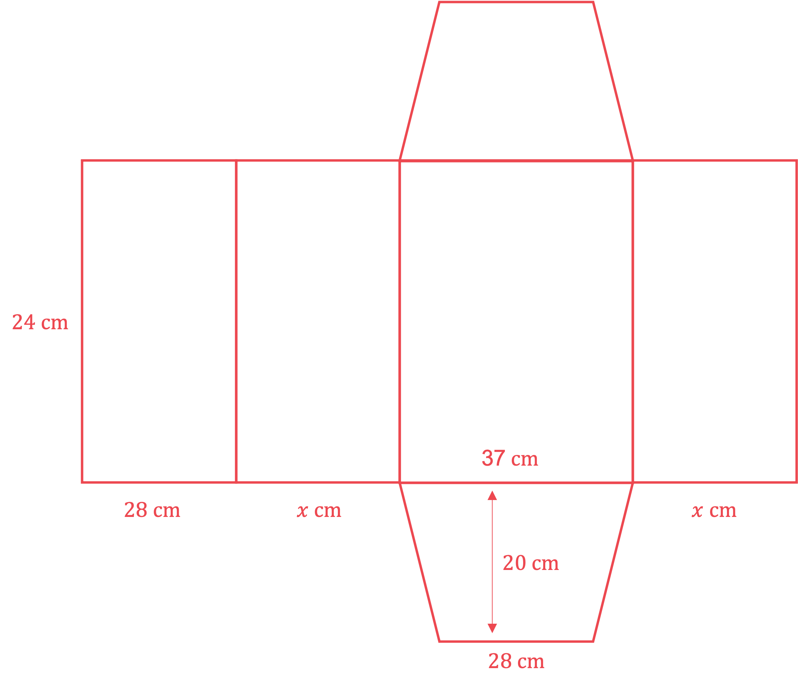

> *So using the standard formulae for the area of trapeziums and rectangles we can write down a formula for the total surface area, **S** say, of the prism.*

$\begin{gathered} S = 2 \times ( 1 \frac{1}{2} \times 20 \times ( 37 + 28 ) ) + 2 \times ( 24 \times x ) + ( 24 \times 28 ) + ( 24 \times 37 ) \\ S = 1300 + 48 x + 672 + 888 \\ S = 2860 + 48 x \end{gathered}$

**Method for area of a trapezium ****[1]** 
**Method for total surface area ****[1]**

*To find the value of **x** we can use Pythagoras' theorem ("*$a^{2}=b^{2}+c^{2}$*") on the 'triangular' part of the prism **ABCD**.*

> *We also need the base of this triangle - as the trapezium is isosceles this is found by*

$\frac{37-28}{2}=4.5$

> *Sketching a diagram can help.*

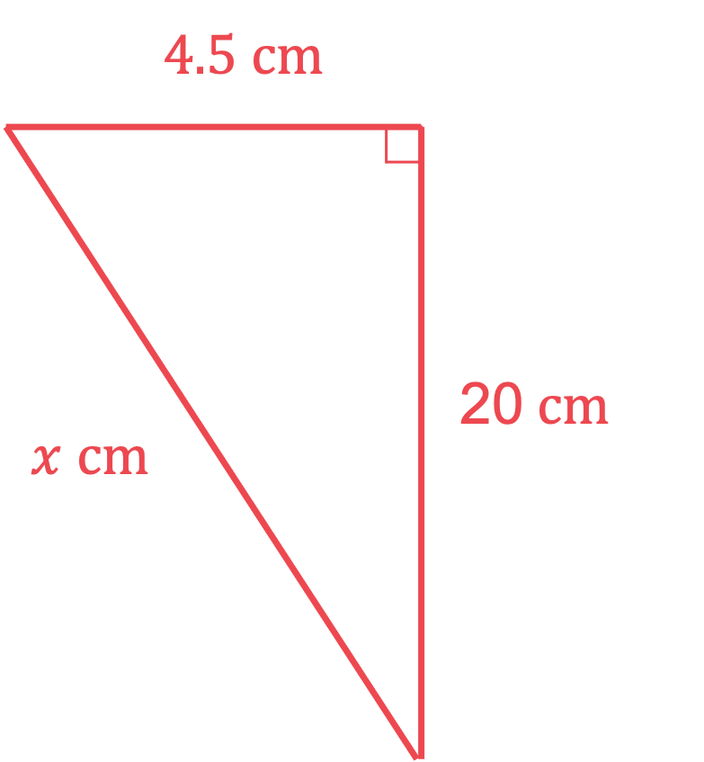

$\begin{gathered} \therefore x^{2} & = 20^{2} + 4.5^{2} \\ x^{2} & = 420.25 \\ x = 20.5 \end{gathered}$

**[1]**

> *Now we can complete our calculation to find the total surface area of the prism.*

$\begin{gathered} S = 2860 + 48 x \\ S = 2860 + 48 \times 20.5 \\ S = 3844 \end{gathered}$

**The total surface area of the prism is 3844 cm****3** **[1]**

## Q39 — hard — 6 marks · exam-questions

### 13((a)) — 5 marks
> *Split the cross-section of the swimming pool into a rectangle and a triangle.*

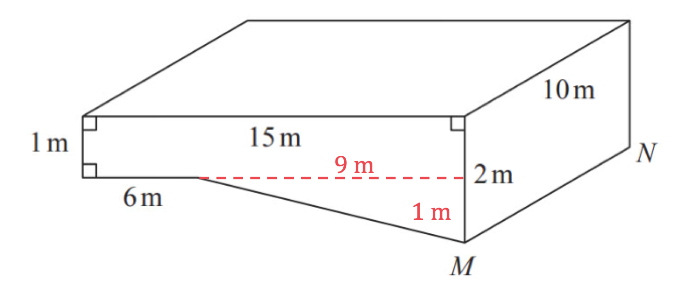

> *Calculate the area of the triangle, using the formula: *$A=\frac{1}{2}bh$*, where *$b$* is the base of the triangle and *$h$* is the perpendicular height.*

$\begin{gathered} A = 1 \frac{1}{2} \times 1 \times 9 \\ = 4.5 \mathrm{m}^{2} \end{gathered}$

**[1]**

> *Calculate the total area of the cross-section by adding together the area of the triangle and the rectangle.*

$\begin{gathered} A = 1 \times 15 + 4.5 \\ = 19.5 \mathrm{m}^{2} \end{gathered}$

**[1]**

> *Calculate the volume of the prism by multiplying the cross-sectional area by the length of the prism.*

$\begin{gathered} V = 19.5 \times 10 \\ = 195 \mathrm{m}^{3} \end{gathered}$

**[1]**

> *Convert the volume of the swimming from m**3** into litres by multiplying by 1000.*

$\begin{gathered} 195 \times 1000 \\ = 195 000 \text{litres} \end{gathered}$

> *Divide the volume, in litres, by 50 to work out how many minutes it will take for the water to fill the swimming pool.*

$\begin{gathered} \frac{195 000}{50} \\ = 3900 \text{minutes} \end{gathered}$

**[1]**

> *Convert the time to hours by dividing by 60.*

$\begin{gathered} \frac{3900}{60} \end{gathered}$

$65\mathrm{hours}$ **[1]**

### 13((b)) — 1 marks
> *Because of the triangular prism shape of the pool at the bottom, the pool will fill up quickly at first but then the rate will slow down. *

> *As the top section is a cuboid, the rate will be constant when it reaches this section.*

**C ****[1]**

## Q40 — medium — 5 marks · exam-questions

### 20() — 5 marks
> *The formula for the surface area of a sphere is *$4πr^{2}$

> *Divide this by 2 and set it equal to 32*$π$

$\frac{4πr^{2}}{2}=32π$

**[1]**

> *Solve to find the radius*

$\begin{gathered} 2 \cancel{\pi } r^{2} & = 32 \cancel{\pi } \\ 2 r^{2} & = 32 \\ r^{2} & = 16 \\ r = 4 \end{gathered}$

**[1]**

> *Use *$2πrh$* to find the curved surface area of the cylinder*

$2π\times4\times10=80π$

**[1]**

> *Use *$πr^{2}$* to find the area of the circle at the bottom*

$π\times4^{2}=16π$

> *Add the areas together*

$32π+80π+16π=128π$

**[1]**

**128**$π$** cm****2**** [1]**

## Q41 — easy — 2 marks · exam-questions

### 13() — 2 marks
> *Ashraf is assuming that the boxes will fit perfectly into the crate with no space leftover, however the length 50 cm does not go perfectly into 1.2 m, so there would be a gap leftover. *

> *The 1.2 m dimension can only fit 2 boxes, so we would have to consider this as a 1 m space, with the 0.2 m space leftover.*

`| volume of crate | = 2.5 x 2 x 1 | | _ = 5 m ^ 3 | | volume of one box | = 0.5 x 0.5 x 0.5 | | _ = 0.125 m ^3 | | number of boxes | = 5 / 0.125 | | _ = 40 | |`

**Ashraf's method does not work as 50 cm does not go into 1.2 m**** [1]**** **

**Ashraf's claim is wrong as only 40 boxes can fit in the crate**** [1]**

## Q42 — very_hard — 5 marks · exam-questions

### 9() — 5 marks
> *The relationship between density, mass and volume is given by the following formula.*

$\mathrm{Density}=\frac{\mathrm{Mass}}{\mathrm{Volume}}$

> *You may remember it as a triangle.*

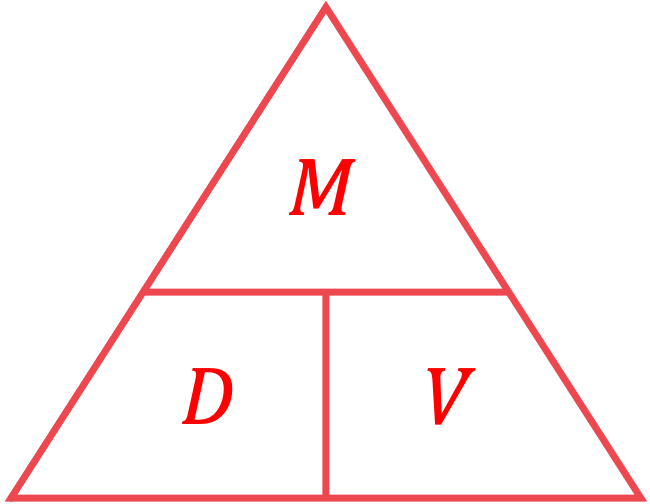

> *We know the mass of the statue and the density of gold, the material it is made from, so we can use the formula to calculate the volume of the statue. *

> *However we need to be careful as there is a mixture of units.  Change the mass from kg to g using 1 kg = 1000 g.*

$M=5.73\times1000=5730g$

> *Now we can find the volume of the statue. (You can use the 'cover up method' to deduce how to rearrange the formula.)*

$\begin{gathered} 19.32 & = \frac{5730}{V} \\ V = \frac{5730}{19.32} \\ V = 296.583 850 ... \end{gathered}$

**Correct use of density formula**** [1]**

**Complete method to find the volume of the statue**** [1]**

> *Do not round this value but use the ANS button or memory features of your calculator to work with the exact value later.*

> *Find the volume of one gold block using the volume of a cuboid formula ("*$V=lwd$*").*

$V_{block}=8\times2\times1.5\,V_{block}=24$

**[1]**

> *To find the number of blocks needed divide the volume of the statue by the volume of one block.*

$\frac{296.583850...}{24}=12.357660...$

**[1]**

> *As the question asks for the least number of blocks we will need to round **up** to the next whole number.*

**The least number of blocks Pablo melted down in order to make the statue is 13** **[1]**

## Q43 — hard — 6 marks · exam-questions

### 17() — 6 marks
> *Calculate the area of the trapezoidal cross-section, using the formula: *$A = 1 \frac{1}{2} ( a + b ) h$*, where *$a$* and *$b$* are the parallel edges and *$h$* is the perpendicular height of the trapezium.*

$\begin{gathered} A = 1 \frac{1}{2} \times ( 1.3 + 0.5 ) \times 2 \\ = 1.8 \mathrm{m}^{2} \end{gathered}$

> *Calculate the volume of the pond by multiplying the trapezoidal cross-sectional area by the length of the prism.*

$\begin{gathered} V = 1.8 \times 1 \\ = 1.8 \mathrm{m}^{3} \end{gathered}$

**[1]**

> *The first part of the water that is drained is from a cuboidal section of the pond. *

> *Calculate the volume of water pumped out in the first 30 minutes.*

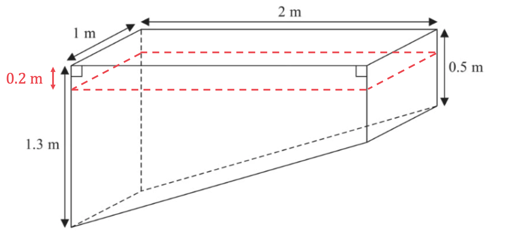

$\begin{array}{rcl} V = 0.2 \times 1 \times 2 \\ = 0.4 \mathrm{m}^{3} \end{array}$

**[1]**

> *Calculate the flow rate in m**3** per hour, by dividing the volume pumped out by the time taken to do it in hours.*

$\begin{gathered} \text{Flow} \text{rate} & = \frac{ 0.4}{0.5} \\ = 0.8 \mathrm{m}^{3} \div \mathrm{h} \end{gathered}$

**[1]**

> *Calculate the volume of the water still to be pumped out by subtracting the volume of water that has already been pumped out from the total volume of the pond.*

$\begin{gathered} V_{r e m a i n i n g} & = 1.8 - 0.4 \\ = 1.4 \mathrm{m}^{3} \end{gathered}$

**[1]**

> *Calculate the time it will take to pump the remaining water out by dividing the volume of the remaining water by the flow rate.*

$\begin{gathered} T = \frac{1.4}{0.8} \end{gathered}$

**[1]**

$\begin{array}{rcl} T = \frac{14}{8} \\ = 1.75 \end{array}$

> *Convert to hours and minutes.*

$1\mathrm{hour}45\mathrm{minutes}$* ***[1]**

## Q44 — medium — 5 marks · exam-questions

### 5() — 5 marks
> *Calculate the amount of sand that Sally will need by calculating the volume of the sand pit, using the formula: *$V=l\timesw\timesh$*, where *$l$* is the length, *$w$* is the width and *$h$* is the height.*

$\begin{gathered} V = 100 \times 60 \times 40 \\ = 240 000 cm^{3} \end{gathered}$

**[1]**

> *Convert the amount of sand in one bag from litres to cm**3** by multiplying the numbers of litres in each bag by 1000.*

*1 litre = 1 000 cm**3 **8 litres = 8 000 cm**3*

**[1]**

> *Work out the number of bags required to fill the sand pit by dividing the volume of the sand pit by the volume of sand in each bag.*

$\frac{240000}{8000}$

**[1]**

*30 bags of sand are required*

> *Multiply the cost of each bag of sand by the number of bags required to work out the total cost of filling up the sand pit.*

$\begin{gathered} 2.5 \times 30 \end{gathered}$

**[1]**

$\begin{gathered} = 2.5 \times 3 \times 10 \\ = 7.5 \times 10 \\ = \pounds 75 \end{gathered}$

**Sally is wrong, it will cost £75 for the sand, which is more than £70**** ****[1]**

## Q45 — easy — 2 marks · exam-questions

### 16((b)) — 2 marks
> *The volume of a cylinder with radius *$r$* and height *$h$* is *$πr^{2}h$*.*

> *Substitute the radius and the volume in to form an equation in terms of *$h.$

$\begin{gathered} V = \mathrm{\pi } \times r^{2} \times h \\ 3.8 & = \mathrm{\pi } \times 0.5^{2} \times h \\ 3.8 & = 0.25 \mathrm{\pi } h \end{gathered}$

**[1]**

> *Solve the equation to find the value of *$h.$

$\begin{gathered} 0.25 \mathrm{\pi } h & = 3.8 \\ h & = \frac{3.8}{0.25 \mathrm{\pi } } \\ = 4.838310... \end{gathered}$

> *Round the answer to 3 significant figures.*

** **$h=4.84m$** ****[1]**

## Q46 — very_hard — 5 marks · exam-questions

### 18() — 5 marks
> *The area of all six faces will consist of two lots of the shaded area, the two (white) curved surface areas and the two unseen rectangles at the base of the tunnel. *

> *The shaded area is found by subtracting the area of the smaller semi-circle from the area of the larger semi-circle.*

> *Calculate the area of the larger semi-circle, using: *$A=\frac{1}{2}πr^{2}$*.*

$\begin{gathered} A = 1 \frac{1}{2} ( \mathrm{\pi } \times ( 10 )^{2} ) \\ = \frac{100}{2} \mathrm{\pi } cm^{2} \\ = 50 \mathrm{\pi } cm^{2} \end{gathered}$

> *The question asks for the answer as a multiple of π, so it is best to leave your working as a multiple of π.*

> *Calculate the area of the smaller semi-circle, using: *$A=\frac{1}{2}πr^{2}$*.*

$\begin{gathered} A = 1 \frac{1}{2} ( \mathrm{\pi } \times ( 7 )^{2} ) \\ = \frac{49}{2} \mathrm{\pi } cm^{2} \\ = 24.5 \mathrm{\pi } cm^{2} \end{gathered}$

> *Find the area of the shaded section by subtracting the area of the smaller semi-circle from the area of the larger semi-circle.*

$\begin{gathered} A = 50 \mathrm{\pi } - 24.5 \mathrm{\pi } \\ = 25.5 \mathrm{\pi } \end{gathered}$

**[1]**

> *The curved surface areas of the tunnel are rectangles, with the width equal to the length of the tunnel and the length equal to the arc-lengths of the semicircles.*

> *Find the arc length of the larger semicircle using the formula *$1 \frac{1}{2} ( 2 \mathrm{\pi } r )$* where **r** is the radius.*

> $\begin{gathered} \text{arc} length_{larger} & = 1 \frac{1}{2} \times 2 \times \mathrm{\pi } \times 10 = 10 \mathrm{\pi } \end{gathered}$*  *

> *Find the curved surface area of the top of the tunnel by multiplying the arc length by the length of the tunnel.*

> $\begin{gathered} CSA_{larger} & = 10 \pi \times 30 = 300 \pi \end{gathered}$*  *

> *Find the arc length of the smaller semicircle using the formula *$1 \frac{1}{2} ( 2 \mathrm{\pi } r )$* where **r** is the radius.*

> $\begin{gathered} \text{arc} length_{smaller} & = 1 \frac{1}{2} \times 2 \times \mathrm{\pi } \times 7 = 7 \mathrm{\pi } \end{gathered}$*  *

> *Find the curved surface area of the underneath of the tunnel by multiplying the arc length by the length of the tunnel.*

> $\begin{gathered} CSA_{smaller} & = 7 \pi \times 30 = 210 \pi \end{gathered}$*  *

**Either curved surface area found**** [1]**

> *Find the area of the two hidden rectangles at the base of the tunnel. They each have length 30 cm and width 3 cm.*

*Area two rectangles = 2 × 30 × 3 = 180 cm**2*

**[1]**

> *Add the areas of the two curved surface areas to the hidden rectangles and 2 times the shaded area.*

*Total area = *`equation`

**[1]**

**Area = 561****π**** + 180 cm****2**** ****[1]**

## Q47 — hard — 4 marks · exam-questions

### 6() — 4 marks
> *Find the volume of the cuboid by multiplying the length by the width by the height.*

$\begin{gathered} V & = 6 \times 8 \times 15 = 720 cm^{3} \end{gathered}$

**[1]**

> *Find the side length of the cube (*$x$*) by setting its volume equal to the volume of the cuboid.*
*The volume of a cube is just the side length, cubed.*

$x^{3}=720$

> *Solve to find the side length.*

$\begin{gathered} x & = \sqrt[3]{720} = 8.9628094... \text{cm} \end{gathered}$

**[1]**

> *The surface area of a cube is the sum of the area of the 6 identical square faces. *
*Find the surface area of the cube by squaring the side length to find the area of one face and then multiplying it by 6.*

> *Use either the exact value or the answer button or memory function on your calculator.*

*Surface area  *$\begin{gathered} = 6 x^{2} = 6 ( \sqrt[3]{720} )^{2} = 481.991724... \end{gathered}$

**[1]**

> *Round your answer to 3 significant figures, the third non-zero digit is a 1 and the digit following it is greater than 5, so round the 1 up.*

**Surface area = 482 cm****2**** ****[1]**

## Q48 — medium — 4 marks · exam-questions

### 15() — 4 marks
> *Find the radius*

$r=6\div2=3$

> *Find the volume of the cone*

$\frac{1}{3}π\times3^{2}\times10=30π$

> *Find the volume of the hemisphere*

$\frac{1}{2}\times\frac{4}{3}π\times3^{3}=18π$

**correct method to find at least one volume [1]**

**at least one volume correct [1]**

> *Add together*

$30π+18π=48π$

**[1]**

$k=48$ **[1]**

## Q49 — easy — 1 marks · exam-questions

### 6((a)) — 1 marks
> *The volume of a prism is the area of the cross section multiplied by the length. *

> *Choose any point from the graph and show that its coordinates multiplied together are equal to 24.*

> *Choose coordinates that are easy to read and work with.*

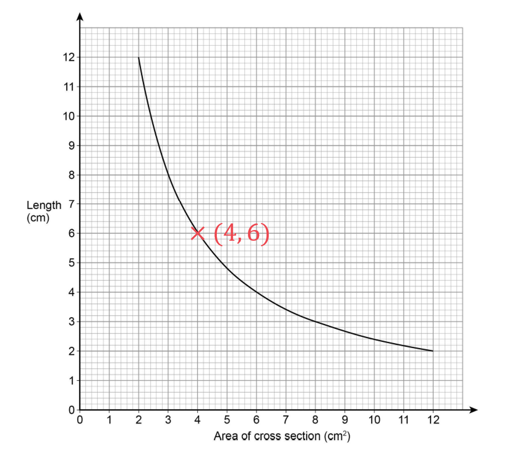

> *For example, choosing the coordinate (4,6) on the graph. *

*Area of cross-section = 4 cm**2 ** *
*Length = 6 cm *
*Volume = 4 × 6 cm**3 *

**Coordinate (4, 6) gives volume = 4 × 6 = 24 cm****3**** ****[1]**

## Q50 — very_hard — 4 marks · exam-questions

### 23() — 4 marks
> *To find the volume of the prism, the length **CF **needs to be known.*
*If **M **is the midpoint of **CF, **then **CF** = 2**CM.** *

> *ACM** is a right-angled triangle. *
*ABC** is a right-angled triangle, where **AB **= 5 cm, **BC** = 12 cm.*

> *Use Pythagoras'  theorem with triangle **ABC **to find the length of **AC**.*

*  *$AC^{2}=AB^{2}+BC^{2}\,AC^{2}=5^{2}+12^{2}$

**[1]**

> *Solve**.*

$\begin{gathered} A C^{ } & = \sqrt{5^{2} + 12^{2}} \\ = \sqrt{169} \\ = 13 \end{gathered}$

> *Use Pythagoras'  theorem with triangle **ACM **to find the length of **CM**.*

**  **$\begin{gathered} A M^{ 2 } & = A C^{ 2 } + C M^{ 2} \\ 16^{ 2 } & = 13^{2} + C M^{2} \end{gathered}$

**[1]**

> *Rearrange and solve to find **CM.*

`| C M ^2 ^ | = 16 ^2 - 13 ^2 | | C M | = sqrt( 16 ^2 - 13 ^2 ) | | _ = sqrt( 87 | |`

> *It is better to use the exact value of **CM** in the next part.*

> *Find the length of the prism by multiplying **CM **by 2.*

**  **$\begin{gathered} C F & = 2 C M = 2 \sqrt{87} \end{gathered}$

> *Find the volume of the prism by multiplying the area of the cross-section (triangle **ABC**) by the length of the prism (**CF**). The area of a right-angled triangle can be found multiplying the base by the height and dividing by 2. *

$\begin{gathered} Volume^{ } & = 1 \frac{1}{2} ( 5 ) ( 12 ) \times 2 \sqrt{87} = 559.6427... cm^{3} \end{gathered}$

**[1]**

> *Round the answer to a sensible degree of accuracy, for example 3 significant figures.*

**Volume = 560 cm****3**** **** ****[1]**

## Q51 — hard — 5 marks · exam-questions

### 14() — 5 marks
> *Method 1*

> *Draw a diagram showing a cube with dimensions of *$x$* **cm. Add the longest diagonal to the diagram and give this a length of 25 cm. *

> *It also may help to add the right-angled triangles that the diagonal makes with the edges onto the diagram.*

> *Use Pythagoras' theorem for 3D shapes, *$x^{2}+y^{2}+z^{2}=d^{2}$*, to find an expression for the square of the length of the longest diagonal in terms of *$x.$

$\begin{gathered} x^{2} + x^{2} + x^{2} & = 3 x^{2} \end{gathered}$

**[1]**

> *Form an equation by setting *$3x^{2}$* equal to the square of the longest diagonal, 25 cm.*

$\begin{array}{rcl} 3 x^{2} & = 25^{2} \\ 3 x^{2} & = 625 \end{array}$

**[1]**

> *At this point you can solve the equation to find *$\begin{gathered} x \end{gathered}$*, however it is not necessary as the surface area of a cube is 6 multiplied by the area of one of the squares, so the surface area of the cube = *$\begin{array}{rcl} 6 x^{2} \end{array}$*.*

$\begin{gathered} \text{SA} & = 6 x^{2} = 2 ( 3 x^{2} ) = 2 ( 625 ) \end{gathered}$

**Correct formula for surface area**** [1] **

**equating to 2 × 25****2**** ****[1]**

**Surface Area =**$1250\mathrm{cm}^{2}$* ***[1]**

> *Method 2*

> *Draw a diagram showing a cube with dimensions of *$x$* **cm.  Add the longest diagonal to the diagram and give this a length of 25 cm. *

> *It also may help to add the right-angled triangles that the diagonal makes with the edges onto the diagram.*

> *Use Pythagoras' theorem, *$a^{2}+b^{2}=c^{2}$*, on the right-angled triangle on the base of the crate to find length of the diagonal on the base in terms of *$x.$

$\begin{gathered} x^{2} + x^{2} & = 2 x^{2} \end{gathered}$

**[1]**

$\begin{gathered} c^{2} & = 2 x^{2} \\ c & = \sqrt{2 x^{2}} \\ = x \sqrt{2} \text{cm} \end{gathered}$

> *Add this to the diagram.*

> *Use Pythagoras' theorem on the right-angled triangle made up of the diagonal at the base, the side with length *$x$* cm and the longest diagonal, 25 cm.*

$\begin{gathered} ( x \sqrt{2} )^{2} + x^{2} & = 25^{2} \\ 2 x^{2} + x^{2} & = 25^{2} \\ 3 x^{2} & = 625 \end{gathered}$

**[1]**

> *Solve the equation to find *$\begin{gathered} x \end{gathered}$*.*

`| x ^2 | = 625 / 3 | | x | = sqrt( 625 / 3 ) = (25)/(sqrt( 3) | |`

**[1]**

> *Find the area of one face of the cube.*

$\begin{gathered} \text{Area} & = x^{2} = ( \frac{25}{ \sqrt{3} } )^{2} = \frac{625}{3} \end{gathered}$

> *The surface area of a cube is 6 multiplied by the area of one of the squares, so the surface area of the cube = *$\begin{gathered} 6 x^{2} \end{gathered}$*.*

$\begin{gathered} \text{SA} & = 6 x^{2} = 6 ( \frac{625}{3} ) \end{gathered}$

** [1]**

**Surface Area =**$1250\mathrm{cm}^{2}$* ***[1]**

## Q52 — medium — 4 marks · exam-questions

### 4() — 4 marks
> *Find the total volume of the container*

$30\times6\times19=3420$

**[1]**

> *Multiply this by *$\frac{2}{3}$

$\frac{2}{3}\times3420=2280$

**[1]**

> *Divide by 275*

$2280\div275=8.29...$

**[1]**

> *This means 8 cups can be filled completely*

**8 cups** **[1]**

## Q53 — easy — 2 marks · exam-questions

### 22() — 2 marks
> *A cube has 6 identical square faces, so its surface area is 6 × the area of one face. *

> *For a cube of side *$x$* cm, the surface area is *$6x^{2}$* cm.*

$6x^{2}=150$

> *So Steph needs to start by dividing by 6. *

$x^{2}=25$

> *Square root the answer.*

$x=5$

> *Divide the answer by 2 to find the length of the side of the smaller cube.*

$\frac{1}{2}x=2.5$

> *Cube the answer by 2 to find the volume of the smaller cube.*

$2.5^{3}=15.625$

**Steph's order of working is incorrect**** [1]**
**She should divide by 6 first, square root, halve the answer and then cube it**** [1]**

## Q54 — very_hard — 4 marks · exam-questions

### 9() — 4 marks
> *Find the volume of the cuboid by multiplying the length by the width by the height.*

$\begin{gathered} V & = 1 \times 0.5 \times 0.2 = 0.1 \mathrm{m}^{3} \end{gathered}$

> *The density is given in g/cm**3**, so convert the volume into cm before finding the mass of the marble.*

$\begin{gathered} V & = 0.1 \times 100^{3} cm^{3} \\ = 100 000 cm^{3} \end{gathered}$

**[1]**

> *Calculate the mass of the cuboid by multiplying the volume of the cuboid by its density *$( M a s s = D e n s i t y \times V o l u m e )$*.*

$M=100000\times2.7=270000g$

**[1]**

> *Convert the mass back into kg by multiplying it by 1000 (1000 grams = 1 kg).*

$\begin{gathered} M & = 270 000 \div 1000 \\ = 270 \text{kg} \end{gathered}$

**[1]**

** ****Yes, because 270 kg is less than 300 kg ****[1]**

## Q55 — hard — 4 marks · exam-questions

### 18() — 4 marks
> *The height is three times the radius, which means that *$h$* can be rewritten in terms of *$r$*.*

$h=3r$

*The formula for the volume of a cone is *$\frac{1}{3}πr^{2}h$*.* *Find the volume of the cone, using *$3r$* in place of *$h$*.*

$\mathrm{volume}=\frac{1}{3}\timesπ\timesr^{2}\times3r$

**Forming expression in terms of only **$r$** or only **$h$** [1]**

> *Form an equation by setting the expression found for the volume equal to 2100.*

$\frac{1}{3}\timesπ\timesr^{2}\times3r=2100$

**Forming equation in terms of only **$r$** or only **$h$** [1]**

> *Simplify and divide both sides by π.*

$\begin{gathered} 1 \frac{1}{3} \times 3 r^{3} \times \pi & = 2100 \\ \pi r^{3 } & = 2100 \\ r^{3} & = \frac{2100}{\pi } \end{gathered}$

> *Find the cube-root of both sides.*

$r = \sqrt[3]{\frac{2100}{pi} }$

**[1]**

> *Round the answer to 3 significant figures.*

$r = \sqrt[3]{\frac{2100}{pi} } = 8.7435904...$

**r ****= 8.74 cm** **[1]**

## Q56 — medium — 5 marks · exam-questions

### 6() — 5 marks
> *Find the area of the circle*

$π\times0.8^{2}=0.64π$

**[1]**

> *Find the curved surface area using *$2πrh$

$2π\times0.8\times1.8=2.88π$

**[1]**

> *Find the total surface area*

$2\times0.64π+2.88π=4.16π$

> *Multiply this by 3*

$3\times4.16π=12.48π=39.20...$

**[1]**

> *Find the area that 7 tins can paint*

$7\times5=35$

**[1]**

> *Explain your answer*

**Final answer:** **Jeremy does not have enough paint**

**He needs to cover 39.2 cm****2**** but has only got enough for 35 cm****2** **[1]**

## Q57 — easy — 2 marks · exam-questions

### 18() — 2 marks
> *Calculate the area of the triangular cross-sectional area, using the formula: *$A=\frac{1}{2}bh$*, where *$b$* is the length of the base and *$h$* is the perpendicular height.*

$\begin{gathered} A = 1 \frac{1}{2} \times 10 \times 6 \end{gathered}$

$\begin{gathered} A = 30 cm^{2} \end{gathered}$

> *Calculate the volume of the prism by multiplying the cross-sectional area by the length of the object.*

$V=30\times11$

**[1] **

$330\mathrm{cm}^{3}$ **[1]**

## Q58 — very_hard — 4 marks · exam-questions

### 9() — 4 marks
> *Find the volume of the ball when it is full of air. *
*Substitute the value given for the radius into the formula for the volume of a sphere : *$V=\frac{4}{3}πr^{3}$*, where *$r$* is the radius of the sphere.*

$V=\frac{4}{3}\timesπ\times15^{3}=4500π$

**[1]**

> *Subtract the initial volume of the ball (5000 cm**3**) from the full volume to find the amount of air that is pumped into the ball.  *

$\begin{gathered} 4500 \pi - 5000 & = 9137.1669 cm^{3} \end{gathered}$

**[1]**

> *The air is pumped in at a rate of 160 cm**3 **per second, so divide the amount of air that is pumped in by the rate to find the number of seconds taken to fill the ball.*

$\begin{gathered} 9137.1669 \div 160 & = 57.107293... \text{seconds} \end{gathered}$

**[1]**

> *1 minute = 60 seconds, and 57.1 < 60 so yes, it takes less than one minute.*

**Yes, because **$57.1<60$** seconds ****[1]**

## Q59 — hard — 5 marks · exam-questions

### 6() — 5 marks
> *Use the formula *$πr^{2}h$* to find the volume of the **cylinder**, which has known dimensions and can be found.*

$V=π\times12^{2}\times30=4320π\mathrm{cm}^{3}$

**Correct method**** [1]**
**Correct answer ****[1]**

> *The volume of the sphere is the same as the volume of the cylinder so substitute your answer into the formula for the volume of a sphere, *$V=\frac{4}{3}πr^{3}$*.*

$4320π=\frac{4}{3}π\timesr^{3}$

**[1]**

> *Divide both sides by *$π$*.*

$4320=\frac{4}{3}\timesr^{3}$

> *Multiply both sides by 3.*

$12960=4\timesr^{3}$

> *Divide both sides by 4.*

$3240=r^{3}$

**[1]**

> *Take the cube root of both sides.*

$r = \sqrt[3]{3240} = 14.79727... \text{cm}$

> *Round your answer to 3 significant figures.*

$r=14.8\mathrm{cm}$** [1] **

**Answers in the range 14.79 to 14.8 accepted**

## Q60 — medium — 3 marks · exam-questions

### 7() — 3 marks
*Let **M** be the midpoint of **BC**, so that **ABM** forms a right-angled triangle.*

> *Use Pythagoras' theorem, *$a^{2}+b^{2}=c^{2}$* to find the perpendicular height of the front face.*

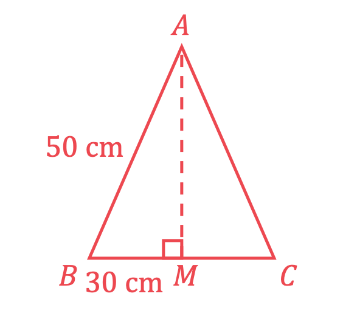

$\begin{gathered} A M^{2} + 30^{2} & = 50^{2} \\ A M^{2} & = 50^{2} - 30^{2} \\ A M^{2} & = 2500 - 900 \\ A M^{2} & = 1600 \\ A M & = 40 \text{cm} \end{gathered}$

> *Calculate the area of the front triangular face, using the formula: *$A=\frac{1}{2}bh$*.*

$\begin{gathered} A = 1 \frac{1}{2} \times 60 \times 40 \\ = 1200 cm^{2} \end{gathered}$

> *Calculate the area of the rectangular face **ARPC**.*

$\begin{gathered} A = 50 \times 80 \\ = 4000 cm^{2} \end{gathered}$

**Correct method to calculate at least two different faces**** [1]**

> *Calculate the area of the rectangular base **BCPQ**.*

$\begin{gathered} A = 60 \times 80 \\ = 4800 cm^{2} \end{gathered}$

> *Find the total surface area by adding together the base, two of the rectangular side faces and two of the triangular faces.*

$\begin{gathered} A_{t o t a l} & = 4800 + 2 \times 4000 + 2 \times 1200 \\ = 4800 + 8000 + 2400 \end{gathered}$

**Adding at least four correct areas**** [1]**

$15200\mathrm{cm}^{2}$* ***[1]**

## Q61 — easy — 3 marks · exam-questions

### 15() — 3 marks
> *A cone is made up of its curved surface area and the flat circular base. *

> *Find the area of the circular base using the formula for the area of a circle, *$A=πr^{2}$*, and the radius 5 cm.*

$\begin{gathered} A_{b a s e } & = \mathrm{\pi } \times 5^{2} \\ = 25 \mathrm{\pi } cm^{2} \end{gathered}$

> *Find the curved surface area using the formula given in the question, a slant height of 12 cm and the radius 5 cm.*

$\begin{gathered} C S A & = \mathrm{\pi } \times 5 \times 12 \\ = 60 \mathrm{\pi } cm^{2} \end{gathered}$

**Either area found correctly ****[1]**

> *Add together the curved surface area and the area of the circle to find the total surface area of the cone.*

$\begin{array}{rcl} A_{t o t a l} & = 25 \mathrm{\pi } + 60 \mathrm{\pi } \end{array}$

**[1]**

$\begin{gathered} A_{t o t a l} & = 85 \mathrm{\pi } \\ = 267.03537... cm^{2} \end{gathered}$

> *Leave as an exact value in terms of π (best) or round to 3 significant figures.*

$85π\mathrm{cm}^{2}(=267\mathrm{cm}^{2})$* ***[1]**

## Q62 — hard — 4 marks · exam-questions

### 18() — 4 marks
> **[exam-tip]**
> Working in terms of $π$ for this question helps to keep the values calculated exact until the final solution is given.

> *Calculate the volume of the cylinder using the formula *$πr^{2}h$

$π\times6^{2}\times10=360π$

**[M1]**

> *Calculate the volume of the hemisphere, using the formula of a sphere *$\frac{4}{3}πr^{3}$* and dividing it by 2*

$( \frac{4}{3} \times \pi \times 6^{3} ) \div 2 = 144 \mathrm{\pi }$

> *Calculate the total volume of the shape*

$360π+144π=504π$

**[M1]**

> *Calculate the volume of water, which is half of the total volume of the shape*

$504π\div2=252π$

> *Calculate the depth of water by dividing the volume of water by the area of the cross section of the cylinder (the cross section is  a circle, *$πr^{2}$*)*

$\frac{252π}{π\times6^{2}}=7$

**[M1]**

$t=7$

**[A1]**

## Q63 — very_hard — 3 marks · exam-questions

### 21() — 3 marks
> *Find an expression for the slant height of each of the cones in terms of the radius.*

> *Let the radius be *$r$*, then the slant height of one cone is *$2r$* and the other cone is *$3r.$* Adding this to the diagram may help.*

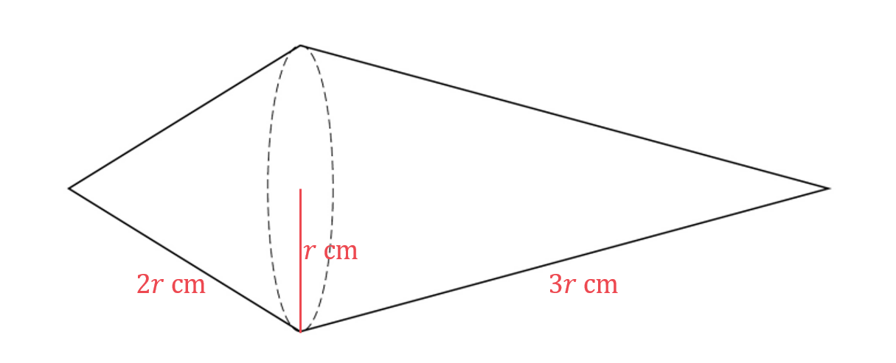

> *The total surface area of the solid shape is made up of the two curved surface areas of each cone added together.  Substitute the radius and slant height for each into the given formula for the curved surface area, *$πrl$*.*

$\begin{gathered} CSA_{smaller cone} & = \pi \times r \times 2 r = 2 r^{2} \pi \end{gathered}$

$\begin{gathered} CSA_{bigger cone} & = \pi \times r \times 3 r = 3 r^{2} \pi \end{gathered}$

**Either expression correct ****[1]**

> *Add the two curved surface areas together to form an expression for the total surface area of the shape.*

$\begin{gathered} 2 \pi r^{2} + 3 \pi r^{2} & = 5 \pi r^{2} \end{gathered}$

> *Form an equation by setting this expression equal to the value given for the total surface area of the shape.*

$5πr^{2}=57.8π$

**[1]**

> *Solve by first dividing both sides by **π.*

$\begin{gathered} 5 r^{2} & = 57.8 \end{gathered}$

> *Divide both sides by 5.*

$\begin{gathered} r^{2} & = \frac{57.8}{5} = 11.56 \end{gathered}$

> *Square root both sides.*

$\begin{gathered} r & = \sqrt{11.56} = 3.4 \end{gathered}$

$r=3.4\mathrm{cm}$* ***[1]**

## Q64 — easy — 4 marks · exam-questions

### 2((a)) — 2 marks
> *Formula for area of a circle*$=πr^{2}$*.*

> *Substitute the given radius into the formula. The question asks for the answer as a multiple of **π **so you do not need to multiply by **π.*

*Area = *$π\times70^{2}$

**[1]**

> *Use your calculator to find the value of 70**2**, do not multiply by **π.*

**Area = 4900****π**** cm****2**** [1]**

### 2((b)) — 2 marks
> *Method 1*

> *The tabletop can be modeled as a prism with the area found in part (a) as its cross-section and its thickness will be the height of the prism, *$h$*. *

> *Substitute the volume and the area found in part (a) into the formula for the volume of a prism: *$V = ( \text{area} \text{cross} - \text{section} ) h$*.*

$17150π=4900πh$

**[1]**

> *Divide both sides by 4900π.*

$\begin{gathered} h & = \frac{17150 \mathrm{\pi } }{4900 \mathrm{\pi } } \end{gathered}$

> *Type into your calculator to find the answer.*

$\mathrm{Thickness}=3.5\mathrm{cm}$* ***[1]**

> *Method 2*

> *The tabletop can be modeled as a cylinder, with radius 70 cm and its thickness will be the height of the cylinder, *$h$*. *

> *Substitute the volume and radius into the formula for the volume of a cylinder: *$V=πr^{2}h$*.*

$17 150 \mathrm{\pi } = \mathrm{\pi } ( 70 )^{2} h$

**[1]**

> *Divide both sides by *$π$*. *

$17 150 = ( 70 )^{2} h$

> *Use your calculator to find the value of 70**2**.*

$17150=4900h$

> *Divide both sides by 4900.*

$\begin{gathered} h & = \frac{17150}{4900} \end{gathered}$

> *Type into your calculator to find the answer.*

$\mathrm{Thickness}=3.5\mathrm{cm}$* ***[1]**

## Q65 — hard — 5 marks · exam-questions

### 20() — 5 marks
> *Using the variable, **h**, for height allows the radius to be expressed as 2**h** as shown below:*

> *Substitute the known values and variables  into the formula for the volume of a cone, *$\frac{1}{3}πr^{2}h$* to form an equation*

$1 \frac{1}{3} \times \pi \times ( 2 h )^{2} \times h = 562.5 \pi$

**[M1]**

> *Simplify terms on the left side of the equation*

$\begin{gathered} 1 \frac{1}{3} \times \pi \times 4 h^{2} \times h & = 562.5 \pi \\ 1 \frac{1}{3} \times \pi \times 4 h^{3} & = 562.5 \pi \\ \frac{4}{3} \pi h^{3} & = 562.5 \pi \end{gathered}$

**[M1]**

> *Divide through by *$π$

$\begin{gathered} \frac{4}{3} h^{3} & = 562.5 \end{gathered}$

> *Continue to solve the equation for *$h$

$\begin{gathered} 4 h^{3} & = 3 \times 562.5 \\ h^{3} & = \frac{1687.5}{4} \\ h = \sqrt[3]{421.875} \\ h = 7.5 \end{gathered}$

**[M1]**

> *Since *$h=7.5$* then *$2h=15$* which is the length of the radius of the cone*

> *Substitute these values into Pythagoras' theorem (*$a^{2}+b^{2}=c^{2}$*) to calculate the length of the sloping edge of the cone, *$l$

$\begin{gathered} 7.5^{2} + 15^{2} & = l^{2} \\ 56.25 + 225 & = l^{2} \\ 281.25 & = l^{2} \\ \sqrt{281.25} & = l \\ l = 16.770... \end{gathered}$

**[M1]**

> *Substitute values into the formula for the curved surface area of a cone, *$πrl$

$π\times15\times\sqrt{281.25}=790.291...$

> *Round to 3 significant figures as stated in the question*

**Final answer:** **790**

**[A1]**

> **[mark-scheme]**
> The final mark is awarded for answers in the range 786.5 to 791.7

## Q66 — very_hard — 5 marks · exam-questions

### 14() — 5 marks
> *The height of the cylinder is *$6r-5r=r$*. Find an expression for the volume of the cylinder in terms of *$r$*, by substituting the expression for the radius, *$r$*, and the height, *$r$*, into the formula for the volume of a cylinder, *$V=πr^{2}h$*.*

$\begin{gathered} \mathrm{V}_{cylinder} & = \pi \times r^{2} \times r = \pi r^{3} \end{gathered}$

**[1]**

> *Find an expression for the volume of the cone in terms of *$r$*, by substituting the expression for the radius, *$r$*, and the height, *$5r$*, into the formula for the volume of a cone, *$V=\frac{1}{3}πr^{2}h$*.*

$\begin{gathered} \mathrm{V}_{cone} & = 1 \frac{1}{3} \times \pi \times r^{2} \times 5 r = \frac{5}{3} \pi r^{3} \end{gathered}$

> *Find an expression for the total volume of the decoration in terms of *$r$*, by adding the expression for the volume of the cone to the expression for the volume of the cylinder. *

$\begin{gathered} \mathrm{V} & = \pi r^{3} + \frac{5}{3} \pi r^{3} \end{gathered}$

**[1]**

> *Simplify.*

$\begin{gathered} \mathrm{V} & = \frac{8}{3} \pi r^{3} \end{gathered}$

> *Form an equation for the total volume of the decoration by setting this expression equal to 225 cm**3**. *

$\begin{gathered} \frac{8}{3} \pi r^{3} & = 225 \end{gathered}$

**[1]**

> *Solve the equation by multiplying by 3 and dividing by 8.  *

$\begin{gathered} \pi r^{3} & = \frac{225 \times 3}{8} = \frac{675}{8} \end{gathered}$

> *Divide both sides by **π**.*

$\begin{gathered} r^{3} & = \frac{675}{8 \pi } \end{gathered}$

> *Take the cube root of both sides.*

`| r | = sqrt index 3 of (675)/(8 pi) ) | |`

**[1]**

$\begin{gathered} r & = 2.99470906.... \end{gathered}$

> *Round the final answer to 3 significant figures.*

$r=2.99\mathrm{cm}$* ***[1]**

## Q67 — easy — 4 marks · exam-questions

### 9() — 4 marks
> *Calculate the volume of the cylinder using volume of a cylinder = *$πr^{2}h$*.*

$\begin{gathered} V_{c y l i n d e r} & = \mathrm{\pi } \times 4^{2} \times 10 \\ = 160 \mathrm{\pi } \end{gathered}$

**[1]**

> *Calculate the volume of the hemisphere using volume of a sphere = *$\frac{4}{3}πr^{3}$*.*

$\begin{gathered} V_{h e m i s p h e r e} & = 1 \frac{1}{2} \times \frac{4}{3} \mathrm{\pi } \times 6^{3} \end{gathered}$

**[1]**

> *Evaluate using your calculator*

$\begin{gathered} = 144 \mathrm{\pi } \end{gathered}$

**[1]**

> *160π is clearly bigger than 144π so*

**The cylinder has the greater volume** **[1]**

## Q68 — very_hard — 5 marks · exam-questions

### 14() — 5 marks
> *Use the formula *$πr^{2}h$* to find the volume of the **cylinder**, which has known dimensions*

$π\times2^{2}\times9=36π\mathrm{cm}^{3}$

**[1]**

> *The ratio of *$r:h$* is 1:4, which means that *$h$* is 4 times bigger than *$r$

$h=4r$

$h=4r$** ****or**** **$r=\frac{1}{4}h$** [1]**

*The formula for the volume of a cone is *$\frac{1}{3}πr^{2}h$ *Find the volume of the cone, using *$4r$* in place of *$h$ *Also recall that the cone has the same volume as the cylinder, 36π cm**3*

$\frac{1}{3}\timesπ\timesr^{2}\times4r=36π$

**Forming equation in terms of only **$r$** or only **$h$** ****[1]**

> *Simplify and divide both sides by π*

$\frac{1}{3}\times4r^{3}=36$

> *Multiply both sides by 3*

$4r^{3}=108$

**Method for solving the equation**** [1]**

> *Divide both sides by 4*

$r^{3}=27$

> *Find the cube-root of both sides*

$r = \sqrt[3]{27} = 3$

**3 cm** **[1]**

## Q69 — very_hard — 4 marks · exam-questions

### 13() — 4 marks
> *The best method is to begin by rearranging the formula for the volume of a sphere, *$v=\frac{4}{3}πr^{3}$*, to make *$r$* the subject.*

$v=\frac{4}{3}πr^{3}$

> *Divide both sides by *$\frac{4}{3}π$*. *

$\frac{v}{\frac{4}{3}π}=r^{3}$

> *Simplify the left-hand side.*

$\begin{gathered} v \div \frac{4 \mathrm{\pi } }{3} & = r^{3} \\ v \times \frac{3}{4 \mathrm{\pi } } & = r^{3} \\ r^{3} & = \frac{ 3 v}{4 \mathrm{\pi } } \end{gathered}$

> *Take the cube root of both sides.*

$\begin{gathered} r & = \sqrt[3]{ \frac{ 3 v}{4 \mathrm{\pi } } } \end{gathered}$

**[1]**

> *Substitute the volume of Earth into the formula found for the radius.*

$\begin{gathered} r_{E} & = \sqrt[3]{ \frac{ 3 ( 1.08 \times 10^{12} ) }{4 \pi } } \end{gathered}$

> *Type directly into your calculator using the cube root, fraction and **π** button.*

$\begin{gathered} \mathrm{r}_{E} & = \sqrt[3]{ \frac{ 3 ( 1.08 \times 10^{12} ) }{4 \mathrm{\pi } } } = 6364.7065... \end{gathered}$

**[1]**

> *Substitute the volume of Jupiter into the formula found for the radius.*

$\begin{gathered} r_{J} & = \sqrt[3]{ \frac{ 3 ( 1.43 \times 10^{15} ) }{4 \pi } } \end{gathered}$

> *Type directly into your calculator using the cube root, fraction and **π** button.*

$\begin{gathered} r_{J} & = \sqrt[3]{ \frac{ 3 ( 1.43 \times 10^{15} ) }{4 \pi } } = 69890.1237... \end{gathered}$

**[1]**

> *Find how many times bigger the radius of Jupiter is than the radius of Earth by dividing the radius of Jupiter by the radius of Earth. *

$\begin{gathered} \frac{r_{J} }{r_{E} } \end{gathered} \begin{gathered} = \end{gathered} \begin{gathered} \end{gathered} \begin{gathered} \frac{69890.1237...}{6364.7065...} \end{gathered} \begin{gathered} \end{gathered} \begin{gathered} = \end{gathered} \begin{gathered} \end{gathered} \begin{gathered} 10 \end{gathered} \begin{gathered} . \end{gathered} \begin{gathered} 98 \end{gathered} \begin{gathered} . \end{gathered} \begin{gathered} . \end{gathered} \begin{gathered} . \end{gathered}$

> *Rounding to 3 significant figures here gives 11.0, so an answer of 11 is acceptable.*

$11$* ***[1]**

## Q70 — very_hard — 5 marks · exam-questions

### 23() — 5 marks
> *Find the length of a side of the smaller square by calculating the scale factor between the small pyramid and the large pyramid*

$45\div15=3$

> *Length of the side of the smaller square:*

*39 ÷ 3 = 13 cm*

> *Calculate the area of the two squares*

$39^{2}+13^{2}=1690$

**[M1]**

> *Calculate the perpendicular height of one of the triangular faces of the large pyramid using Pythagoras' theorem*

$\begin{gathered} 45^{2} + ( 39 \div 2 )^{2} & = h^{2} \\ \sqrt{45^{2} + 19.5^{2}} & = h \\ 49.0433... & = h \end{gathered}$

**[M1]**

> *The perpendicular height of the sloping faces of the frustum is 2/3 of this height*

> *Calculate the area of one of the trapezium faces*

$A = \frac{ 1}{2} ( a + b ) h
A = \frac{ 1}{2} ( 13 + 39 ) \times ( \frac{2}{3} \times 49.0433... )
A = 850.0847...$

**[M1]**

> *Calculate the total area*

*4 × 850.0847... + 1690 = 5090.3388...*

**[M1]**

> *Round to the nearest whole number*

**Final answer:** **5090 cm****2**

**[A1]**

> **[mark-scheme]**
> **A1**: Answers in the range 5090-5091 will get this final mark.
