# Mark Schemes — Vectors
**Vectors & Transformation Geometry** · Edexcel IGCSE Maths A (Modular) (4XMAF/4XMAH) — 24/Higher Unit 2

## Q1 — very_hard — 6 marks · exam-questions

### 24((a)) — 3 marks
> *Find the vector *$\overset{\rightarrow}{AB}$* by finding a path starting at **A** and ending at **B** using known vectors.*

$\overset{\rightarrow}{AB}=\overset{\rightarrow}{AO}+\overset{\rightarrow}{OB}$

> *Use the property that reversing the direction of the vector is the same as multiplying it by -1.*

$\begin{gathered} \vec{AO} & = - \vec{OA} \\ \vec{AB} & = - \vec{OA} + \vec{OB} \\ \vec{AB} & = \vec{OB} - \vec{OA} \end{gathered}$

> *Use the given vectors.*

`| A B -vec | = bottom b - bottom a | |`

*Use the ratio to write **AN **as a fraction of **AB**.* *AN** : **NB**  = 2 : 1 therefore **AN** is *$\frac{2}{2+1}$* of the length **AB**.*

$\overset{\rightarrow}{AN}=\frac{2}{3}\times\overset{\rightarrow}{AB}$

> *Use the vector for *$\overset{\rightarrow}{AB}.$

`| A N -vec | = 2 / 3 x ( bottom b - bottom a ) | | _ = 2 / 3 bottom b - 2 / 3 bottom a | |`

**[1]**

> *Find a path starting at **O** and ending at **N**.*

$\overset{\rightarrow}{ON}=\overset{\rightarrow}{OA}+\overset{\rightarrow}{AN}$

**[1]**

> *Substitute the expressions for the vectors.*

`| O N -vec | = bottom a + 2 / 3 bottom b - 2 / 3 bottom a | | _ = bottom a - 2 / 3 bottom a + 2 / 3 bottom b | |`

> *Simplify.*

`| O N -vec | = 1 / 3 bottom a + 2 / 3 bottom b | |`* ***[1]**

**It is acceptable to write in factorised form:*** *`| O N -vec | = 1 third ( bottom a + 2 bottom b ) | |`

### 24((b)) — 3 marks
> *To show that three points form a straight line you need to choose two pairs of points and show that the two vectors between these points are parallel. As there are three points, the two vectors will share a common point and therefore form a straight line.*

> *Find the vector *$\overset{\rightarrow}{OD}$* by finding a path between **O** and **D**.*

$\overset{\rightarrow}{OD}=\overset{\rightarrow}{OA}+\overset{\rightarrow}{AC}+\overset{\rightarrow}{CD}$

> *AC** is parallel to **OB** therefore *$\overset{\rightarrow}{AC}=\overset{\rightarrow}{CD}=\overset{\rightarrow}{OB}=b$*.*

`| O D -vec | = bottom a + bottom b + bottom b | | _ = bottom a + 2 bottom b | |`

**[1]**

> *Two vectors are parallel if one is a scalar multiple of the other.*

`| O N -vec | = 1 third ( bottom a + 2 bottom b ) = 1 third O D -vec | | _ _ therefore O N & O D are parallel | |`

**[1]**

**OND**** is a straight line as ****ON**** and ****OD**** are parallel lines that have a ****common point ****O ****[1]**

## Q2 — hard — 5 marks · exam-questions

### 28((a)) — 1 marks
> *Find a path starting at **P** and ending at **B** using known vectors.*

$\overset{\rightarrow}{PB}=\overset{\rightarrow}{PN}+\overset{\rightarrow}{NA}+\overset{\rightarrow}{AB}$

> *Use the property that reversing the direction of the vector is the same as multiplying it by -1.*

`| P B -vec | = - N P -vec - A N -vec + A B -vec | | _ = - bottom b - 2 bottom b + bottom a | |`

> *Simplify.*

`P B with rightwards harpoon with barb upwards on top = bottom a - 3 bottom b` **[1]**

### 28((b)) — 4 marks
> *To show that three points form a straight line you need to choose two pairs of points and show that the two vectors between these points are parallel. As there are three points, the two vectors will share a common point and therefore form a straight line.*

> *Find the vector *$\overset{\rightarrow}{NM}$* by finding a path between **N** and **M**.*

$\overset{\rightarrow}{NM}=\overset{\rightarrow}{NP}+\overset{\rightarrow}{PM}$

> *M** is the midpoint of **PB** therefore *$\overset{\rightarrow}{PM}=\frac{1}{2}\times\overset{\rightarrow}{PB}.$

`| N M -vec | = N P -vec + 1 half x P B -vec | | _ = bottom b + 1 half ( bottom a - 3 bottom b ) | | _ = bottom b + 1 half bottom a - 3 / 2 bottom b | | _ = 1 half bottom a - 1 half bottom b | | _ = 1 half ( bottom a - bottom b ) | |`

**[1]**

> *Find the vector *$\overset{\rightarrow}{MC}$* by finding a path between **M** and **C**.*

$\overset{\rightarrow}{MC}=\overset{\rightarrow}{MB}+\overset{\rightarrow}{BC}$

*M** is the midpoint of **PB** therefore *`M B -vec = 1 half x P B -vec = 1 half bottom a - 3 / 2 bottom b`*.* *B** is the midpoint of AC therefore *`A B -vec = B C -vec = bottom a`*.*

`| M C -vec | = 1 half bottom a - 3 / 2 bottom b + bottom a | | _ = 3 / 2 bottom a - 3 / 2 bottom b | | _ = 3 / 2 ( bottom a - bottom b ) | |`

**[1]**

> *Two vectors are parallel if one of them is a scalar multiple of the other.*

`| M C -vec | = 3 / 2 ( bottom a - bottom b ) = 3 x 1 half ( bottom a - bottom b ) = 3 N M -vec | | _ _ therefore M C & N M are parallel | |`

**[1]**

**NMC**** is a straight line as ****NM**** and ****MC**** are ****parallel**** lines that join at the ****common point ****M**** ****[1]**

## Q3 — medium — 3 marks · exam-questions

### 10((a)) — 1 marks
> *-2**a** is double the length but the direction is reversed. *
*Draw a line goes down 4 squares and left 2 squares. Include an arrow that points down the line.*

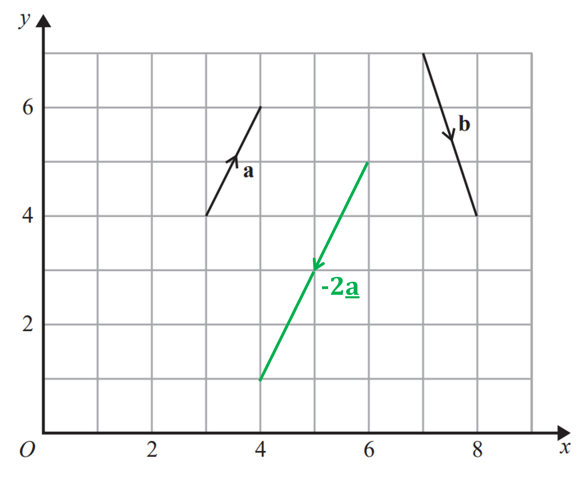

*  ***[1] **
**The vector can be drawn anywhere on the grid**

### 10((b)) — 2 marks
> *Method 1*

*Write a and b as column vectors.* 
*a goes 1 to the right and 2 up.* 
*b goes 1 to the right and 3 down.*

`bottom a = ( | 1 | 2 | ) bottom b = ( | 1 | - 3 | | )`

> *Substitute the column vectors into the expression.*

`| bottom a + 2 bottom b | = ( | 1 | 2 | ) + 2 x ( | 1 | - 3 | | ) | |`

**[1]**

`table columnalign right center left columnspacing 0px end | bottom a + 2 bottom b | = ( | 1 | 2 | ) + ( | 2 | - 6 | | ) | | _ = ( | 1 + 2 | | 2 - 6 | | ) | |`

`bottom a + 2 bottom b = stretchy ( | 3 | - 4 | | stretchy )` **[1]**

> *Method 2*

> *Draw the resultant vector on the grid. Draw the vector** b** starting at the end of vector **a**. Draw another vector **b** starting at the end of the previous vector **b**.*

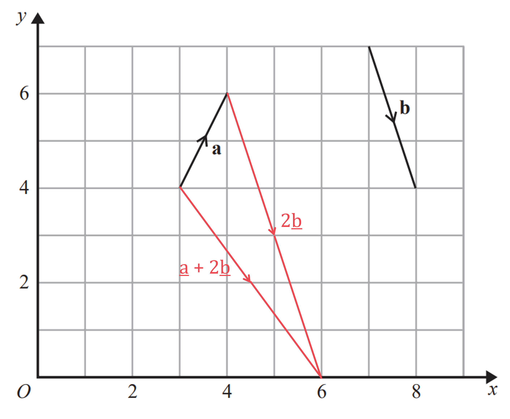

**[1]**

> *Write the resultant vector (from start of **a** to the end of the second **b**) as a column vector. It goes 3 to the right and 4 down,.*

`bottom a + 2 bottom b = stretchy ( | 3 | - 4 | | stretchy )` **[1]**

## Q4 — very_hard — 4 marks · exam-questions

### 27() — 4 marks
> *Find the vector *$\overset{\rightarrow}{AB}$* by finding a path from **A** to **B**.*

`| A B -vec | = - O A -vec + O B -vec | | _ = - ( 2 bottom a + bottom b ) + 3 bottom a + 2 bottom b | | _ = - 2 bottom a + 3 bottom a - bottom b + 2 bottom b | | _ = bottom a + bottom b | |`

**[1]**

> *AB** : **BC** = 2 : 5 therefore **AB** is *$\frac{2}{2+5}$* of the length of **AC**.*

$\overset{\rightarrow}{AB}=\frac{2}{7}\times\overset{\rightarrow}{AC}$

> *Rearrange to find *$\overset{\rightarrow}{AC}$*.*

`| A C -vec | = 7 / 2 x A B -vec | | _ = 7 / 2 ( bottom a + bottom b ) | | _ = 7 / 2 bottom a + 7 / 2 bottom b | |`

**[1]**

> *Find the vector *$\overset{\rightarrow}{OC}$* by finding a path from **O** to **C**.*

`| O C -vec | = O A -vec + A C -vec | | _ = 2 bottom a + bottom b + 7 / 2 bottom a + 7 / 2 bottom b | |`

**[1]**

> *Simplify.*

`O C -vec = 11 / 2 bottom a + 9 / 2 bottom b` **[1]**

**It is acceptable to write in factorised form: **`O C -vec = 1 half ( 11 bottom a + 9 bottom b )`

## Q5 — hard — 6 marks · exam-questions

### 23((a)) — 2 marks
(i) *Find a path from **O** to **T** using known vectors.*

$\overset{\rightarrow}{OT}=\overset{\rightarrow}{OP}+\overset{\rightarrow}{PT}$

`O T -vec = bottom a + bottom b` **[1]**

(ii) *Find a path from **P** to **R** using known vectors.*

$\overset{\rightarrow}{PR}=\overset{\rightarrow}{PO}+\overset{\rightarrow}{OR}$

> *Use the property that reversing the direction of the vector is the same as multiplying it by -1.*

$\begin{gathered} \vec{PR} & = - \vec{OP} + \vec{OR} \end{gathered}$

`P R -vec = - bottom a + 3 bottom b`* ***[1] **
**It is also acceptable to write: **`P R -vec = 3 bottom b - bottom a`

### 23((b)) — 2 marks
*Use the ratio to write **PS** as a fraction of **PR**.* *PS** : **SR**  = 1 : 3 therefore **PS** is *$\frac{1}{1+3}$* of the length **PR**.*

$\overset{\rightarrow}{PS}=\frac{1}{4}\times\overset{\rightarrow}{PR}$

> *Use the vector for *$\overset{\rightarrow}{PR}.$

`| P S -vec | = 1 fourth x ( 3 bottom b - bottom a ) | | _ = 3 / 4 bottom b - 1 fourth bottom a | |`

> *Find a path starting at **O** and ending at **S**.*

$\overset{\rightarrow}{OS}=\overset{\rightarrow}{OP}+\overset{\rightarrow}{PS}$

**[1]**

> *Substitute the expressions for the vectors.*

`| O S -vec | = bottom a + 3 / 4 bottom b - 1 fourth bottom a | | _ = bottom a - 1 fourth bottom a + 3 / 4 bottom b | |`

> *Simplify.*

`| O S -vec | = 3 / 4 bottom a + 3 / 4 bottom b | |` **[1]**

**Factorising is acceptable:** `| O P -vec | = 3 / 4 ( bottom a + bottom b ) | |`

### 23((c)) — 2 marks
> *Compare the vectors *`O T -vec = bottom a + bottom b`* and *`O S -vec = 3 / 4 ( bottom a + bottom b ).`

$\overset{\rightarrow}{OS}=\frac{3}{4}\overset{\rightarrow}{OT}$

> *If one vector is a scalar multiple of another then the two vectors are parallel.*

**OT*** and ***OS*** are parallel with a common point ***O***, therefore ***OST*** is a straight line*

**[1]**

**S**** lies on the line ****OT**** and ****OS**** : ****ST**** = 3 : 1 ****[1]**

## Q6 — medium — 4 marks · exam-questions

### 26((a)) — 1 marks
> *Find a path starting at **A** and ending at **B** using known vectors.*

$\overset{\rightarrow}{AB}=\overset{\rightarrow}{AO}+\overset{\rightarrow}{OB}$

> *Use the property that reversing the direction of the vector is the same as multiplying it by -1.*

$\begin{gathered} \vec{AO} & = - \vec{OA} \\ \vec{AB} & = - \vec{OA} + \vec{OB} \\ \vec{AB} & = \vec{OB} - \vec{OA} \end{gathered}$

> *Use the given vectors.*

`A B with rightwards harpoon with barb upwards on top = bottom b - bottom a` **[1]**

### 26((b)) — 3 marks
*Use the ratio to write **AP** as a fraction of **AB**.*
 *AP** : **PB**  = 3 : 1 therefore **AP** is *$\frac{3}{3+1}$* of the length **AB**.*

$\overset{\rightarrow}{AP}=\frac{3}{4}\times\overset{\rightarrow}{AB}$

> *Use the vector for *$\overset{\rightarrow}{AB}.$

`| A P -vec | = 3 / 4 x ( bottom b - bottom a ) | | _ = 3 / 4 bottom b - 3 / 4 bottom a | |`

**[1]**

> *Find a path starting at **O** and ending at **P**.*

$\overset{\rightarrow}{OP}=\overset{\rightarrow}{OA}+\overset{\rightarrow}{AP}$

**[1]**

> *Substitute the expressions for the vectors.*

`table columnalign right center left columnspacing 0px end | O P -vec | = bottom a + 3 / 4 bottom b - 3 / 4 bottom a | | _ = bottom a - 3 / 4 bottom a + 3 / 4 bottom b | |`

> *Simplify.*

`| O P -vec | = 1 / 4 bottom a + 3 / 4 bottom b | |` **[1]**

**Factorising is acceptable:** `table columnalign right center left columnspacing 0px end | O P -vec | = 1 fourth ( bottom a + 3 bottom b ) | |`

## Q7 — very_hard — 5 marks · exam-questions

### 20() — 5 marks
> *To show that three points form a straight line you need to choose two pairs of points and show that the two vectors between these points are parallel. As there are three points, the two vectors will share a common point and therefore form a straight line.*

> *Find the vector *$\overset{\rightarrow}{DA}$* by finding a path between **D** and **A**.*

$\overset{\rightarrow}{DA}=\overset{\rightarrow}{DC}+\overset{\rightarrow}{CB}+\overset{\rightarrow}{BA}$

> *B** is the midpoint of **AC **therefore *$\overset{\rightarrow}{CB}=\overset{\rightarrow}{BA}=a$*.*

`| D A -vec | = 2 bottom b + bottom a + bottom a | | _ = 2 bottom a + 2 bottom b | |`

**[1]**

> *Find the vector *$\overset{\rightarrow}{EB}$* by finding a path between **E** and **B**.*

`| E B -vec | = E D -vec + D C -vec + C B -vec | | _ = bottom b + 2 bottom b + bottom a | | _ = bottom a + 3 bottom b | |`

> *M** is the midpoint of **BE** therefore *$\overset{\rightarrow}{MB}=\frac{1}{2}\times\overset{\rightarrow}{EB}$*.*

`| M B -vec | = 1 half ( bottom a + 3 bottom b ) | | _ = 1 half bottom a + 3 / 2 bottom b | |`

**[1]**

> *Find the vector *$\overset{\rightarrow}{MA}$* by finding a path between **M** and **A**.*

`| M A -vec | = M B -vec + B A -vec | | _ = 1 half bottom a + 3 / 2 bottom b + bottom a | | _ = 3 / 2 bottom a + 3 / 2 bottom b | |`

**[1]**

> *Two vectors are parallel if they are scalar multiples of a common vector.*

`| D A -vec | = 2 ( bottom a + bottom b ) & M A -vec = 3 / 2 ( bottom a + bottom b ) | | _ _ therefore D A & M A are parallel | |`

**[1]**

**AMD**** is a straight line as ****DA**** and ****MA**** are ****parallel**** lines that have a ****common point**** ****A**** ****[1]**

## Q8 — hard — 4 marks · exam-questions

### 23() — 4 marks
> *Two vectors are parallel if one is scalar multiple of the other.*

> *Find the vector *$\overset{\rightarrow}{AB}$* by finding a path from **A** to **B**.*

$\overset{\rightarrow}{AB}=\overset{\rightarrow}{AO}+\overset{\rightarrow}{OB}$

> *Use the property that reversing the direction of the vector is the same as multiplying it by -1.*

$\begin{gathered} \vec{AO} & = - \vec{OA} \\ \vec{AB} & = - \vec{OA} + \vec{OB} \\ \vec{AB} & = \vec{OB} - \vec{OA} \end{gathered}$

> *Use the given vectors.*

`| A B -vec | = 2 bottom b - 5 bottom a | |`

**[1]**

*Use the ratio to write **AT** as a fraction of **AB**.* *AT** : **TB**  = 5 : 1 therefore **AT** is *$\frac{5}{5+1}$* of the length **AB**.*

$\overset{\rightarrow}{AT}=\frac{5}{6}\times\overset{\rightarrow}{AB}$

> *Use the vector for *$\overset{\rightarrow}{AB}.$

`| A T -vec | = 5 / 6 x ( 2 bottom b - 5 bottom a ) | | _ = 5 / 3 bottom b - 25 / 6 bottom a | |`

> *Find a path starting at **O** and ending at **T**.*

$\overset{\rightarrow}{OT}=\overset{\rightarrow}{OA}+\overset{\rightarrow}{AT}$

**[1]**

> *Substitute the expressions for the vectors.*

`| O T -vec | = 5 bottom a + 5 / 3 bottom b - 25 / 6 bottom a | | _ = 5 bottom a - 25 / 6 bottom a + 5 / 3 bottom b | |`

**[1]**

> *Simplify.*

`| O T -vec | = 5 / 6 bottom a + 5 / 3 bottom b | |`

> *Factorise out the *$\frac{5}{6}$*. It will help to write *$\frac{5}{3}$* as *$\frac{10}{6}$*.*

`| O T -vec | = 5 / 6 bottom a + 10 / 6 bottom b | | _ = 5 / 6 ( bottom a + 2 bottom b ) | |`

`O T -vec = 5 / 6 stretchy ( bottom a + 2 bottom b stretchy )`** ****therefore ****OT**** is parallel to **`bottom a + 2 bottom b`** ****[1]**

## Q9 — medium — 4 marks · exam-questions

### 27((a)) — 1 marks
> *Find a path starting at **S** and ending at **Q** using known vectors.*

$\overset{\rightarrow}{SQ}=\overset{\rightarrow}{SP}+\overset{\rightarrow}{PQ}$

> *Use the property that reversing the direction of the vector is the same as multiplying it by -1.*

$\begin{gathered} \vec{SP} & = - \vec{PS} \\ \vec{SQ} & = - \vec{PS} + \vec{PQ} \\ \vec{SQ} & = \vec{PQ} - \vec{PS} \end{gathered}$

> *Use the given vectors.*

`S Q with rightwards harpoon with barb upwards on top = bottom a - bottom b` **[1]**

### 27((b)) — 3 marks
*Use the ratio to write **NQ** as a fraction of **SQ**.* 
*SN** : **NQ**  = 3 : 2 therefore **NQ** is *$\frac{2}{3+2}$* of the length **SQ**.*

$\overset{\rightarrow}{NQ}=\frac{2}{5}\times\overset{\rightarrow}{SQ}$

> *Use the vector for *$\overset{\rightarrow}{SQ}.$

`| N Q -vec | = 2 / 5 x ( bottom a - bottom b ) | | _ = 2 / 5 bottom a - 2 / 5 bottom b | |`

**[1]**

> *Find a path starting at **N** and ending at **R**.*

$\overset{\rightarrow}{NR}=\overset{\rightarrow}{NQ}+\overset{\rightarrow}{QR}$

**[1]**

> *QR** is parallel and equal in length to **PS** therefore *$\overset{\rightarrow}{QR}=\overset{\rightarrow}{PS}=b.$* Substitute the expressions for the vectors.*

`| N R -vec | = 2 / 5 bottom a - 2 / 5 bottom b + bottom b | |`

> *Simplify.*

`| N R -vec | = 2 / 5 bottom a - 2 / 5 bottom b + bottom 5 / 5 b | |`

`| N R -vec | = 2 / 5 bottom a + 3 / 5 bottom b | |` **[1]**

**Factorising is acceptable:** `| N R -vec | = 1 fifth ( 2 bottom a + 3 bottom b ) | |`

## Q10 — very_hard — 4 marks · exam-questions

### 19() — 4 marks
> *Draw a diagram to help visualise the problem.*

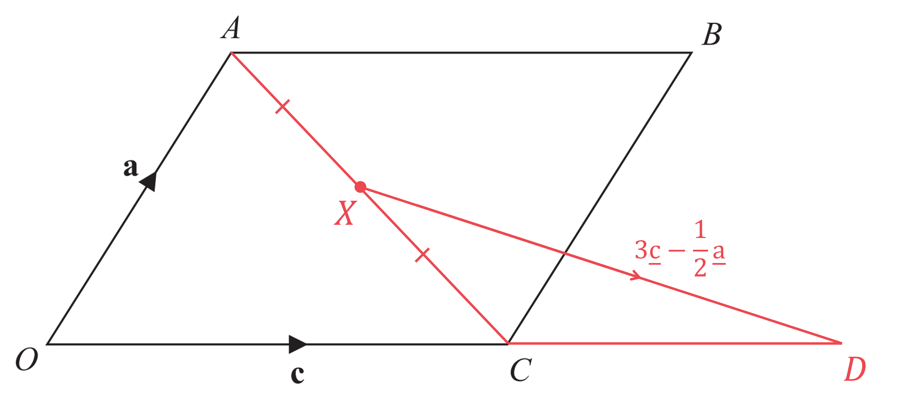

> *Find the vector *$\overset{\rightarrow}{CA}$* by finding a path starting at **C** and ending at **A** using known vectors.*

`| C A -vec | = C O -vec + O A -vec | | _ = - bottom c + bottom a | | _ = bottom a - bottom c | |`

**[1]**

> *X** is the midpoint of **AC** therefore *$\overset{\rightarrow}{CX}=\frac{1}{2}\times\overset{\rightarrow}{CA}$*.*

`| C X -vec | = 1 half ( bottom a - bottom c ) | | _ = 1 half bottom a - 1 half bottom c | |`

> *Find the vector *$\overset{\rightarrow}{CD}$* by finding a path starting at **C** and ending at **D** using known vectors.*

`| C D -vec | = C X -vec + X D -vec | | _ = 1 half bottom a - 1 half bottom c + 3 bottom c - 1 half bottom a | | _ = 5 / 2 bottom c | |`

**[1]**

> *Compare the vectors *$\overset{\rightarrow}{OC}$* and *$\overset{\rightarrow}{CD}$* and use the ratio given in the question to form an equation.*

`O C -vec = bottom c & C D -vec = 5 / 2 bottom c therefore O C colon C D = 1 colon 5 / 2 therefore k colon 1 = 1 colon 5 / 2`

**[1]**

> *The ratio in the question has a 1 in the second place. Therefore multiply both parts by 2 and divide both parts by 5 for the second ratio.*

$k:1=\frac{2}{5}:1$

> *You can now compare the ratios to write down the value of **k**.*

$\begin{array}{cc} k = & \frac{2}{ } 5\end{array}$ **[1]**

**It is acceptable to write as a decimal: **$k=0.4$

## Q11 — hard — 6 marks · exam-questions

### 24((a)) — 2 marks
> *Method 1*

> *The position vector of the midpoint of the line **AB** is found using the formula *$1 \frac{1}{2} ( \vec{OA} + \vec{OB} )$*.*

`O M -vec = 1 half ( 6 bottom a + 6 bottom b )`

**[1]**

> *Simplify.*

`O M -vec = 3 bottom a + 3 bottom b` **[1]**

> *Method 2*

> *Find a path starting at **A** and ending at **B** using known vectors.*

$\overset{\rightarrow}{AB}=\overset{\rightarrow}{AO}+\overset{\rightarrow}{OB}$

> *Use the property that reversing the direction of the vector is the same as multiplying it by -1.*

$\begin{gathered} \vec{AO} & = - \vec{OA} \\ \vec{AB} & = - \vec{OA} + \vec{OB} \\ \vec{AB} & = \vec{OB} - \vec{OA} \end{gathered}$

> *Use the given vectors.*

`| A B -vec | = 6 bottom b - 6 bottom a | |`

**[1]**

> *M** is the midpoint of **AB** therefore *$\overset{\rightarrow}{AM}=\frac{1}{2}\times\overset{\rightarrow}{AB}$*.*

`| A M -vec | = 1 half x ( 6 bottom b - 6 bottom a ) | | _ = 3 bottom b - 3 bottom a | |`

> *Find a path from **O** to **M**.*

`| O M -vec | = O A -vec + A M -vec | | _ = 6 bottom a + 3 bottom b - 3 bottom a | |`

> *Simplify.*

** **`O M -vec = 3 bottom a + 3 bottom b`** [1]**

### 24((b)) — 4 marks
> *To show that three points form a straight line you need to choose two pairs of points and show that the two vectors between these points are parallel. As there are three points, the two vectors will share a common point and therefore form a straight line.*

> *Find the vector *$\overset{\rightarrow}{AN}$* by finding a path between **A** and **N**.*

$\overset{\rightarrow}{AN}=\overset{\rightarrow}{AO}+\overset{\rightarrow}{ON}$

> *N** is the midpoint of **OB** therefore *$\overset{\rightarrow}{ON}=\frac{1}{2}\times\overset{\rightarrow}{OB}.$* Reversing the direction of a vector is the same as multiplying the vector by -1, therefore *$\overset{\rightarrow}{AO}=-\overset{\rightarrow}{OA}.$

`| A N -vec | = - O A -vec + 1 half x O B -vec | | _ = - 6 bottom a + 1 half x 6 bottom b | | _ = - 6 bottom a + 3 bottom b | | _ = 3 ( - 2 bottom a + bottom b ) | |`

**[1]**

> *Find the vector *$\overset{\rightarrow}{AG}$* by finding a path between **A** and **G**.*

$\overset{\rightarrow}{AG}=\overset{\rightarrow}{AO}+\overset{\rightarrow}{OG}$

> *G** splits **OM **in the ratio 2:1 therefore **OG** is *$\frac{2}{2+1}$* of the length **OM**.*

`| O G -vec | = 2 / 3 x O M -vec | | _ = 2 / 3 ( 3 bottom a + 3 bottom b ) | | _ = 2 bottom a + 2 bottom b | |`

**[1]**

> *Substitute in to the find vector *$\overset{\rightarrow}{AG}$*.*

`table columnalign right center left columnspacing 0px end | A G -vec | = - O A -vec + O G -vec | | _ = - 6 bottom a + 2 bottom a + 2 bottom b | | _ = - 4 bottom a + 2 bottom b | | _ = 2 ( - 2 bottom a + bottom b ) | |`

**[1]**

> *Two vectors are parallel if they are both scalar multiples of a common vector.*

`| A N -vec | = 3 ( - 2 bottom a + bottom b ) & | _ _ A G -vec | | | _ = _ | | _ _ 2 | | _ _ ( - 2 bottom a + bottom b ) | | | _ _ | | _ _ | | | _ _ therefore A N & A G are parallel | |`

**AGN**** is a straight line as ****AN**** and ****AG**** are ****parallel**** lines that have a ****common point**** ****A**** ****[1]**

## Q12 — medium — 3 marks · exam-questions

### 24() — 3 marks
> *Two vectors are parallel if one is scalar multiple of the other.*

> *Find the vector *$\overset{\rightarrow}{MN}$* by finding a path from **M** to **N**.*

$\overset{\rightarrow}{MN}=\overset{\rightarrow}{MO}+\overset{\rightarrow}{ON}$

**[1]**

> *Use the property that reversing the direction of the vector is the same as multiplying it by -1.*

$\begin{gathered} \vec{MO} & = - \vec{OM} \\ \vec{MN} & = - \vec{OM} + \vec{ON} \\ \vec{MN} & = \vec{ON} - \vec{OM} \end{gathered}$

> *Use the given vectors.*

`| M N -vec | = bottom n - bottom m | |`

> *Find the vector *$\overset{\rightarrow}{AB}$* by finding a path from **A** to **B**.*

$\overset{\rightarrow}{AB}=\overset{\rightarrow}{AO}+\overset{\rightarrow}{OB}\,\overset{\rightarrow}{AB}=-\overset{\rightarrow}{OA}+\overset{\rightarrow}{OB}\,\overset{\rightarrow}{AB}=\overset{\rightarrow}{OB}-\overset{\rightarrow}{OA}$

> *M and N are midpoints therefore *$\overset{\rightarrow}{OA}=2\overset{\rightarrow}{OM}$* and *$\overset{\rightarrow}{OB}=2\overset{\rightarrow}{ON}$*.*

`| A B -vec | = 2 O N -vec - 2 O M -vec | | _ = 2 bottom n - 2 bottom m | |`

**[1]**

> *Factorise.*

`| A B -vec | = 2 ( bottom n - bottom m ) | |`

$\overset{\rightarrow}{AB}=2\overset{\rightarrow}{MN}$* ***therefore ****AB**** is parallel to ****MN ****[1]**

## Q13 — very_hard — 5 marks · exam-questions

### 21() — 5 marks
> *Vectors between any two points on a line must be parallel to each other. Find any two of the vectors: *$\overset{\rightarrow}{MP},\overset{\rightarrow}{MN},\overset{\rightarrow}{PN}$*.*

> *Find the vector *$\overset{\rightarrow}{MN}$* by finding a path between **M** and **N**.*

$\overset{\rightarrow}{MN}=\overset{\rightarrow}{MO}+\overset{\rightarrow}{OA}+\overset{\rightarrow}{AN}$

> *M** is the midpoint of **OB** therefore *$\overset{\rightarrow}{OM}=\frac{1}{2}\times\overset{\rightarrow}{OB}=\frac{1}{2}b$*. **AN** = 2**OA** therefore *$\overset{\rightarrow}{AN}=2\times\overset{\rightarrow}{OA}=2a$*.*

`| M N -vec | = - 1 half bottom b + bottom a + 2 bottom a | | _ = 3 bottom a - 1 half bottom b | |`

**[1]**

> *Find the vector *$\overset{\rightarrow}{AB}$* by finding a path between **A** and **B**.*

`| A B -vec | = A O -vec + O B -vec | | _ = - bottom a + bottom b | | _ = bottom b - bottom a | |`

**[1]**

> *Find the vector *$\overset{\rightarrow}{AP}$* using *$\overset{\rightarrow}{AP}=k\overset{\rightarrow}{AB}$

`| A P -vec | = k ( bottom b - bottom a ) | | _ = k bottom b - k bottom a | |`

> *Find the vector *$\overset{\rightarrow}{PN}$* by finding a path between **P** and **N**.*

`| P N -vec | = P A -vec + A N -vec | | _ = - ( k bottom b - k bottom a ) + 2 bottom a | | _ = - k bottom b + k bottom a + 2 bottom a | | _ = ( k + 2 ) bottom a - k bottom b | |`

**[1]**

> *Two vectors are parallel if one is a scalar multiple of the other. **PN** and **MN **are part of the same line so are parallel therefore their vectors are scalar multiples. Multiply one vector by a constant (call it **q**) and make it equal to the other vector.*

`| P N -vec | = q x M N -vec | | _ _ therefore ( k + 2 ) bottom a - k bottom b = q ( 3 bottom a - 1 half bottom b ) | |`

> *The coefficients of **a** for both vectors must be equal. Also the coefficients for **b** for both vectors must be equal. Form two equations.*

$\textcircled{1} k + 2 = 3 q 
\textcircled{2} - k = - 1 \frac{1}{2} q$

**[1]**

> *Multiply both sides of the second equation by -6 so that the coefficient of **q** is the same for both equations.*

$\textcircled{1} k + 2 = 3 q 
\textcircled{2} 6 k = 3 q$

> *As the right hand sides of both equations are equal, the left hand sides must also be equal. Form an equation and solve it to find **k**.*

$\begin{array}{rcl} k + 2 & = 6 k \\ 2 = 5 k \\ \frac{2}{5} & = k \end{array}$

$k=\frac{2}{5}$** ****[1]**

**It is acceptable to write the answer as a decimal: **$k=0.4$

## Q14 — hard — 5 marks · exam-questions

### 22() — 5 marks
> *Find a path starting at **A** and ending at **B** using known vectors.*

$\overset{\rightarrow}{AB}=\overset{\rightarrow}{AC}+\overset{\rightarrow}{CB}$

> *Use the property that reversing the direction of the vector is the same as multiplying it by -1.*

$\begin{gathered} \vec{AC} & = - \vec{CA} \\ \vec{AB} & = - \vec{CA} + \vec{CB} \\ \vec{AB} & = \vec{CB} - \vec{CA} \end{gathered}$

> *Use the given vectors.*

`A B with rightwards harpoon with barb upwards on top = 6 bottom b - 3 bottom a`

**[1]**

*Use the ratio to write **AX** as a fraction of **AB**.* *AX** : **XB**  = 1 : 2 therefore **AX** is *$\frac{1}{1+2}$* of the length **AB**.*

$\overset{\rightarrow}{AX}=\frac{1}{3}\times\overset{\rightarrow}{AB}$

**[1]**

> *Use the vector for *$\overset{\rightarrow}{AB}.$

`| A X -vec | = 1 third x ( 6 bottom b - 3 bottom a ) | | _ = 2 bottom b - bottom a | |`

> *Find the vector *$\overset{\rightarrow}{CX}$* by finding a path starting at **C** and ending at **X**.*

$\overset{\rightarrow}{CX}=\overset{\rightarrow}{CA}+\overset{\rightarrow}{AX}$

> *Substitute the expressions for the vectors.*

`| C X -vec | = bottom 3 a + 2 bottom b - bottom a | | _ = 2 bottom a + 2 bottom b | |`

**[1]**

> *Find the vector *$\overset{\rightarrow}{CY}$* by finding a path from **C** to **Y**.*

`| C Y -vec | = C B -vec + B Y -vec | | _ = 6 bottom b + 5 bottom a - bottom b | | _ = 5 bottom b + 5 bottom a | |`

**[1]**

`Error converting from MathML to accessible text.`** [****1]**

## Q15 — medium — 5 marks · exam-questions

### 26((a)) — 1 marks
> *Find a path starting at **A** and ending at **B** using known vectors.*

$\overset{\rightarrow}{AB}=\overset{\rightarrow}{AO}+\overset{\rightarrow}{OB}$

> *Use the property that reversing the direction of the vector is the same as multiplying it by -1.*

$\begin{gathered} \vec{AO} & = - \vec{OA} \\ \vec{AB} & = - \vec{OA} + \vec{OB} \\ \vec{AB} & = \vec{OB} - \vec{OA} \end{gathered}$

> *Use the given vectors.*

`A B with rightwards harpoon with barb upwards on top = 6 bottom b - 3 bottom a` **[1]**

### 26((b)) — 4 marks
*Use the ratio to write **AX** as a fraction of **AB**.* *AX** : **XB**  = 1 : 2 therefore **AX** is *$\frac{1}{1+2}$* of the length **AB**.*

$\overset{\rightarrow}{AX}=\frac{1}{3}\times\overset{\rightarrow}{AB}$

**[1]**

> *Use the vector for *$\overset{\rightarrow}{AB}.$

`| A X -vec | = 1 third x ( 6 bottom b - 3 bottom a ) | | _ = 2 bottom b - bottom a | |`

> *Find the vector *$\overset{\rightarrow}{OX}$* by finding a path starting at **O** and ending at **X**.*

$\overset{\rightarrow}{OX}=\overset{\rightarrow}{OA}+\overset{\rightarrow}{AX}$

> *Substitute the expressions for the vectors.*

`| O X -vec | = bottom 3 a + 2 bottom b - bottom a | | _ = 2 bottom a + 2 bottom b | |`

**[1]**

> *Find the vector *$\overset{\rightarrow}{OY}$* by finding a path from **O** to **Y**.*

`| O Y -vec | = O B -vec + B Y -vec | | _ = 6 bottom b + 5 bottom a - bottom b | | _ = 5 bottom b + 5 bottom a | |`

**[1]**

`equation` **[1]**

## Q16 — very_hard — 5 marks · exam-questions

### 18() — 5 marks
> *Vectors between any two points on a line must be parallel to each other. Find any two of the vectors: *$\overset{\rightarrow}{MN},\overset{\rightarrow}{MC},\overset{\rightarrow}{NC}$*.*

> *Find the vector *$\overset{\rightarrow}{AB}$* by finding a path between **A** and **B**.*

`| A B -vec | = A O -vec + O B -vec | | _ = - 6 bottom a + 6 bottom b | | _ = 6 bottom b - 6 bottom a | |`

**[1]**

> *Find the vector *$\overset{\rightarrow}{MC}$* by finding a path between **M** and **C**.*

$\begin{gathered} \vec{MC} & = \vec{MA} + \vec{AB} + \vec{BC} \end{gathered}$

> *M** is the midpoint of **OA** therefore *$\overset{\rightarrow}{MA}=\frac{1}{2}\times\overset{\rightarrow}{OA}$*.*

`M A -vec = 1 half x 6 bottom a = 3 bottom a`

**[1]**

> *B** is the midpoint of **AC** therefore *$\overset{\rightarrow}{AB}=\overset{\rightarrow}{BC}=6b-6a$*.*

`| M C -vec | = 3 bottom a + ( 6 bottom b - 6 bottom a ) + ( 6 bottom b - 6 bottom a ) | | _ = 12 bottom b - 9 bottom a | |`

> *Find the vector *$\overset{\rightarrow}{MN}$* by finding a path between **M** and **N**.*

`| M N -vec | = M O -vec + O N -vec | | _ = - 3 bottom a + k bottom b | | _ = k bottom b - 3 bottom a | |`

**[1]**

> *Two vectors are parallel if one is a scalar multiple of the other. **MC** and **MN** are on the same straight line so must be scalar multiples. Multiply one vector by a constant (call it **q**) and make it equal to the other vector.*

`| M C -vec | = q x M N -vec | | therefore 12 bottom b - 9 bottom a | = q ( k bottom b - 3 bottom a ) | |`

> *The coefficients of **a** for both vectors must be equal. Also the coefficients for **b** for both vectors must be equal. Form two equations.*

$\textcircled{1} 12 = q k 
\textcircled{2} - 9 = - 3 q$

**[1]**

> *Solve the second equation to find **q**.*

$q=3$

> *Substitute the value of **q** into the first equation to find **k**.*

$\begin{gathered} 12 = 3 k \\ \frac{12}{3} & = k \end{gathered}$

$k=4$** ****[1]**

## Q17 — hard — 4 marks · exam-questions

### 20() — 4 marks
> *Find the vector *$\overset{\rightarrow}{AB}$* by finding a path starting at **A** and ending at **B** using known vectors.*

$\overset{\rightarrow}{AB}=\overset{\rightarrow}{AO}+\overset{\rightarrow}{OB}$

> *Use the property that reversing the direction of the vector is the same as multiplying it by -1.*

$\begin{gathered} \vec{AO} & = - \vec{OA} \\ \vec{AB} & = - \vec{OA} + \vec{OB} \\ \vec{AB} & = \vec{OB} - \vec{OA} \end{gathered}$

> *Use the given vectors.*

`table columnalign right center left columnspacing 0px end | A B -vec | = 2 bottom b - 2 bottom a | |`

**[1]**

*Use the ratio to write **AP **as a fraction of **AB**.* *AP** : **PB**  = 5 : 3 therefore **AP** is *$\frac{5}{5+3}$* of the length **AB**.*

$\overset{\rightarrow}{AP}=\frac{5}{8}\times\overset{\rightarrow}{AB}$

> *Use the vector for *$\overset{\rightarrow}{AB}.$

`| A P -vec | = 5 / 8 x ( 2 bottom b - 2 bottom a ) | | _ = 5 / 4 bottom b - 5 / 4 bottom a | |`

**[1]**

> *Find a path starting at **O** and ending at **P**.*

$\overset{\rightarrow}{OP}=\overset{\rightarrow}{OA}+\overset{\rightarrow}{AP}$

**[1]**

> *Substitute the expressions for the vectors.*

`| O P -vec | = 2 bottom a + 5 / 4 bottom b - 5 / 4 bottom a | | _ = 2 bottom a - 5 / 4 bottom a + 5 / 4 bottom b | |`

> *Simplify.*

`| O P -vec | = 3 / 4 bottom a + 5 / 4 bottom b | |`

> *Factorise out the *$\frac{1}{4}.$

`| O P -vec | = 1 fourth ( 3 bottom a + 5 bottom b ) | |`

$\begin{array}{cc} k = & \frac{1}{ } 4\end{array}$ **[1]**

## Q18 — medium — 2 marks · exam-questions

### 13() — 2 marks
*The vector *$\overset{\rightarrow}{AC}$* means move from **A** to **C* *This is the same as moving from **A** to** B** to** C* * *

$\overset{\rightarrow}{AC}=\overset{\rightarrow}{AB}+\overset{\rightarrow}{BC}$ * *

*The vector *$\overset{\rightarrow}{BC}$* is the negative of vector *$\overset{\rightarrow}{CB}$ * *

$\overset{\rightarrow}{AC}=\overset{\rightarrow}{AB}-\overset{\rightarrow}{CB}$ * *

*Substitute the vectors from the question into the line above*

$\begin{gathered} \vec{AC} & = ( \begin{gathered} 5 \\ 3 \end{gathered} ) - ( \begin{gathered} - 2 \\ 4 \end{gathered} ) \\ = ( \begin{gathered} 5 + 2 \\ 3 - 4 \end{gathered} ) \end{gathered}$

**[1]**

`equation` **[1]**

## Q19 — very_hard — 6 marks · exam-questions

### 20((a)) — 2 marks
> *Find the vector *$\overset{\rightarrow}{FE}$* by finding a path starting at **F** and ending at **E** using known vectors.*

`| F E -vec | = F C -vec + C D -vec + D E -vec | | _ = ( bottom a - bottom b ) + bottom a + bottom b | |`

**[1]**

> *Simplify.*

`| F E -vec | = 2 bottom a | |`* ***[1]**

### 20((b)) — 4 marks
> *Vectors between any two points on a line must be parallel to each other. Find any two of the vectors: *$\overset{\rightarrow}{CE},\overset{\rightarrow}{CX},\overset{\rightarrow}{XE}$*.*

> *Find the vector *$\overset{\rightarrow}{CE}$* by finding a path between **C** and **E**.*

`| C E -vec | = C D -vec + D E -vec | | _ = bottom a + bottom b | |`

**[1]**

> *Find the vector *$\overset{\rightarrow}{FM}$* by finding a path between **F** and **M**.*

$\begin{gathered} \vec{FM} & = \vec{FE} + \vec{EM} \end{gathered}$

> *M** is the midpoint of **DE** therefore *$\overset{\rightarrow}{EM}=\frac{1}{2}\times\overset{\rightarrow}{ED}=\frac{1}{2}\times-\overset{\rightarrow}{DE}$*.*

`F M -vec = 2 bottom a - 1 half bottom b`

*Use the ratio to write **XM** as a fraction of **FM**.* *FX** : **XM**  = **n** : 1 therefore **XM** is *$\frac{1}{n+1}$* of the length **FM**.*

`| X M -vec | = (1)/(n + 1) x F M -vec | | _ = (1)/(n + 1) ( 2 bottom a - 1 half bottom b ) | | _ = (2)/(n + 1) bottom a - (1)/(2 ( n + 1 )) bottom b | |`

> *Find the vector *$\overset{\rightarrow}{XE}$* by finding a path between **X** and **E**.*

`| X E -vec | = X M -vec + M E -vec | | _ = ( (2)/(n + 1) bottom a - (1)/(2 ( n + 1 )) bottom b ) + 1 half bottom b | | _ = (2)/(n + 1) bottom a + ( 1 half - (1)/(2 ( n + 1 )) ) bottom b | |`

> *Add the fractions by writing each as an equivalent fraction with a common denominator.*

`| X E -vec | = (2)/(n + 1) bottom a + ( (n + 1)/(2 ( n + 1 )) - (1)/(2 ( n + 1 )) ) bottom b | | _ = (2)/(n + 1) bottom a + (n + 1 - 1)/(2 ( n + 1 )) bottom b | | _ = (2)/(n + 1) bottom a + (n)/(2 ( n + 1 )) bottom b | |`

**[1]**

> *Two vectors are parallel if one is a scalar multiple of the other. **CE** and **XE** are on the same straight line so must be scalar multiples. Multiply one vector by a constant (call it **q**) and make it equal to the other vector.*

`X E -vec = q x C E -vec therefore (2)/(n + 1) bottom a + (n)/(2 ( n + 1 )) bottom b = q ( bottom a + bottom b )`

> *The coefficients of **a** for both vectors must be equal. Also the coefficients for **b** for both vectors must be equal. Form two equations.*

$\textcircled{1} \frac{2}{n + 1} = q
\textcircled{2} \frac{n}{2 ( n + 1 )} = q$

**[1]**

> *As the right hand sides of both equations are equal, the left hand sides must also be equal. Form an equation and solve it to find **n**.*

$\frac{2}{n + 1} = \frac{n}{2 ( n + 1 )}$

> *Multiply the numerator and denominator of the first fraction by 2 so that the denominators are the same for both fractions. Once the denominators are it, then the numerators must be equal.*

$\begin{array}{rcl} \frac{4}{ \cancel{2 ( n + 1 )} } & = \frac{n}{ \cancel{2 ( n + 1 )} } \\ 4 = n \end{array}$

$n=4$** ****[1]**

## Q20 — hard — 3 marks · exam-questions

### 23() — 3 marks
*Find *$\overset{\rightarrow}{PM}$*, for example by going from **P** to **A** to** B **to **M* *It is useful to use that *$\overset{\rightarrow}{BC}=-4a+2b$ * *

$\begin{gathered} \vec{PM} & = \vec{PA} + \vec{AB} + \vec{BM} \\ = ( - \vec{AP} ) + \vec{AB} + 1 \frac{1}{2} \vec{BC} \\ = - ( \frac{3}{2} a + \frac{3}{4} b ) + 4 a + 1 \frac{1}{2} ( - 4 a + 2 b ) \end{gathered}$

**[1]**

*Expand and collect like terms* * *

$\begin{gathered} \vec{PM} & = - \frac{3}{2} a - \frac{3}{4} b + 4 a - 2 a + b \\ = 1 \frac{1}{2} a + 1 \frac{1}{4} b \end{gathered}$ * *

*AP** = *$\vert \begin{gathered} \vec{AP} \end{gathered} \vert$* and **PM** = *$\vert \begin{gathered} \vec{PM} \end{gathered} \vert$*, as **AP** and **PM** are both lengths* *Find **AP** : **PM  *

$\left| \frac{3}{2} a + \frac{3}{4} b \right| : \left| 1 \frac{1}{2} a + 1 \frac{1}{4} b \right|$

**[1]**

*Factorise out a 3 on the left-hand side and cancel the common factor on both sides* * *

$\begin{gathered} 3 \cancel{ \left| 1 \frac{1}{2} a + 1 \frac{1}{4} b \right| } : \cancel{ \left| 1 \frac{1}{2} a + 1 \frac{1}{4} b \right| } & = 3 : 1 \end{gathered}$

**3 : 1*** ***[1]**

## Q21 — medium — 1 marks · exam-questions

### 14() — 1 marks
*(i) **Go from **A** to **O** to **B*

$\begin{gathered} \vec{AB} & = \vec{AO} + \vec{OB} \\ = - \vec{OA} + \vec{OB} \end{gathered}$

$\overset{\rightarrow}{AB}=-a+b$ **[1]**

*(ii) **Go from **K** to **J** to **I* *K** to **J** is double **A** to **B**, found in part (i)* *J** to **I** is double **O** to **B*

$\begin{gathered} \vec{KI} & = \vec{KJ} + \vec{JI} \\ = 2 \vec{AB} + 2 \vec{OB} \\ = 2 ( - a + b ) + 2 b \end{gathered}$

**[1]**

*Expand and simplify*

$\overset{\rightarrow}{KI}=-2a+2b+2b$

$\overset{\rightarrow}{KI}=-2a+4b$ **[1]**

*(iii) **Go from **L** to** F** to **E** to **D* *L** to** F** and **E** to **D** are both the same as **A** to **B**, found in part (i)* *F** to **E** is the negative of **O** to **A  *

$\begin{gathered} \vec{LD} & = \vec{LF} + \vec{FE} + \vec{ED} \\ = \vec{AB} - \vec{OA} + \vec{AB} \\ = ( - a + b ) - a + ( - a + b ) \end{gathered}$

**[1]**

*Expand and simplify* * *

$\overset{\rightarrow}{LD}=-a+b-a-a+b$

$\overset{\rightarrow}{LD}=-3a+2b$* ***[1]**

**There are many other possible paths that lead to the same answer, such as ****L**** to ****F**** to ****O**** to ****D**

## Q22 — very_hard — 5 marks · exam-questions

### 22() — 5 marks
*Think of *$\overset{\rightarrow}{OP}$* in two different ways (one using **MA** and another using **ON**)* *First, go from **O** to **M  *

$\overset{\rightarrow}{OM}=\frac{1}{3}\overset{\rightarrow}{OB}=\frac{1}{3}\times6b=2b$**  **

*You would next go from **M** to **P,** but this distance is unknown* $\overset{\rightarrow}{MP}$* is some smaller "amount" of the vector *$\overset{\rightarrow}{MA}$*(parallel vectors) so write *$\overset{\rightarrow}{MP}=k\overset{\rightarrow}{MA}$*(where **k** is a scalar multiple that you need to find later)* * *

$\vec{MP} = k \vec{MA} = k ( - 2 b + 8 a )$

*Write down this total journey as one vector, *$\overset{\rightarrow}{OP}$ * *

$\vec{OP} = \vec{OM} + \vec{MP} = 2 b + k ( - 2 b + 8 a )$

**[1]**

*Now find **O** to **P** using a different method / journey* 
$\overset{\rightarrow}{OP}$* is some smaller "amount" of the vector *$\overset{\rightarrow}{ON}$* (parallel vectors) so write *
$\overset{\rightarrow}{OP}=l\overset{\rightarrow}{ON}$* (where **l** is a scalar multiple, different to **k **used previously)* 
*Find *$\overset{\rightarrow}{ON}$* by going from **O** to** A** then half of **A** to **B* * *

> $\begin{gathered} \vec{ON} & = \vec{OA} + 1 \frac{1}{2} \vec{AB} \\ = 8 a + 1 \frac{1}{2} ( - 8 a + 6 b ) \\ = 4 a + 3 b \end{gathered}$* *

**[1]**

*Write down *$\overset{\rightarrow}{OP}$* (using *$\overset{\rightarrow}{OP}=l\overset{\rightarrow}{ON}$*from above)* * *

$\vec{OP} = l ( 4 a + 3 b )$

**[1]**

*Compare the previous version of *$\overset{\rightarrow}{OP}$* to this version of *$\overset{\rightarrow}{OP}$ * *

$2 b + k ( - 2 b + 8 a )$*  **and ** *$l ( 4 a + 3 b )$ * *

*Expand the expressions and collect the **a**'s and **b**'s* * *

$8 k a + ( 2 - 2 k ) b$*  **and  *$4la+3lb$ * *

*Both expressions represent the same journey, *$\overset{\rightarrow}{OP}$*, so the amount of **a**'s and **b**'s must be equal* 
*Form two equations by setting the amount of **a**'s equal and the amount of **b**'s equal*

$8k=4l$* ** and ** *$2-2k=3l$

**[1]**

*Solve these equations simultaneously, for example by substituting *$2k=l$* into the second equation* * *

`| 2 - l | = 3 l | | 2 = 4 l | | 1 half | = l and k = 1 fourth | |`

> * *

*Finally, find *$\overset{\rightarrow}{OP}$* by substituting either **l** or **k** into its expression for *$\overset{\rightarrow}{OP}$ * *

$\overset{\rightarrow}{OP}=4\times\frac{1}{2}a+3\times\frac{1}{2}b$

$\overset{\rightarrow}{OP}=2a+\frac{3}{2}b$* ***[1]**

## Q23 — hard — 3 marks · exam-questions

### 25() — 3 marks
*To prove something is a trapezium, prove that it has two parallel sides* 
*Draw a diagram to show **O**, **A**, **B**, **a** and **b*

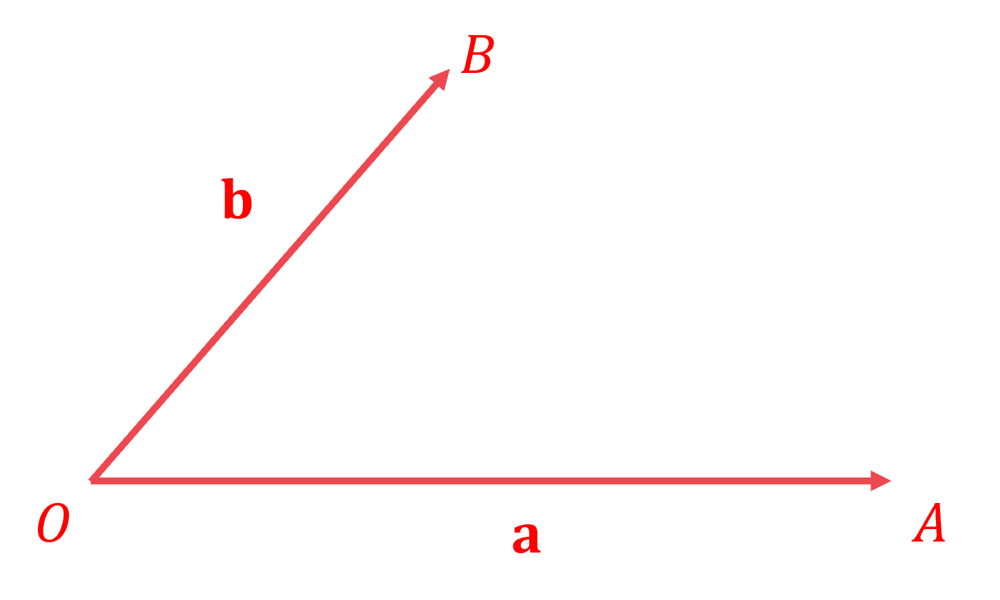

> *Draw **C** and **D** on to the diagram (a third of the way along **OA** and **OB**)** *
*Draw on trapezium **ABDC*

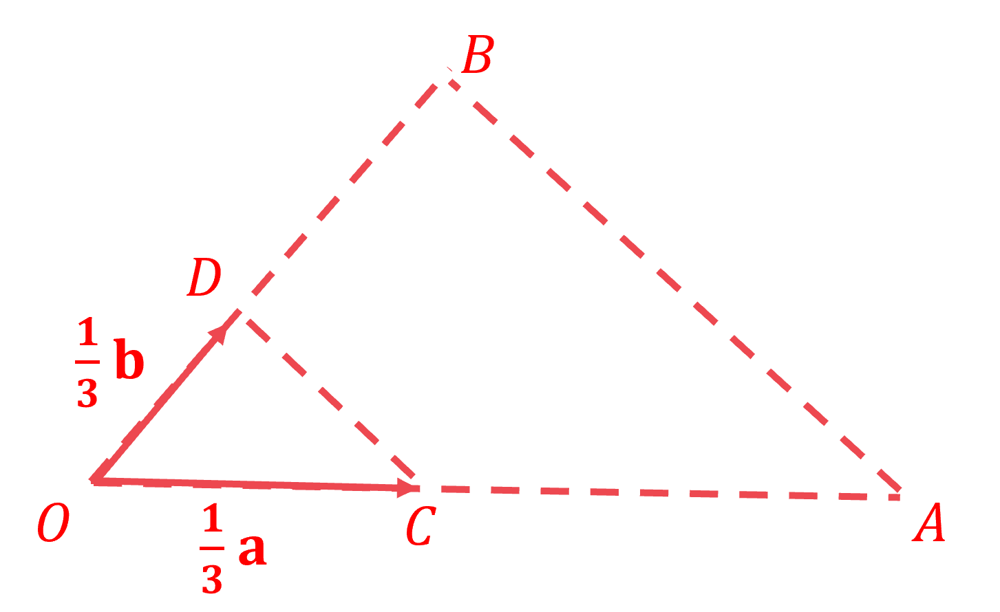

*Two vectors are parallel if one vector is a scalar multiple of another,** **p** = k**q* 
*Prove that sides **BA** and **DC** are parallel*

$\overset{\rightarrow}{BA}=-b+a$

**[1]**

$\overset{\rightarrow}{DC}=-\frac{1}{3}b+\frac{1}{3}a$

**[1]**

$\overset{\rightarrow}{DC}=\frac{1}{3}\overset{\rightarrow}{BA}$

> *Write a conclusion that mentions the words "parallel" and "trapezium"*

**DC**** and ****BA**** are parallel so ****ABDC ****is a trapezium**** ****[1]**

## Q24 — medium — 4 marks · exam-questions

### 25() — 4 marks
> *For example, go from **E** to **D** to **C** to **X ** *

$\overset{\rightarrow}{EX}=\overset{\rightarrow}{ED}+\overset{\rightarrow}{DC}+\overset{\rightarrow}{CX}$

**[1]**

*E** to **D** is the same as **A** to** B* * *

$\overset{\rightarrow}{ED}=\overset{\rightarrow}{AB}=a$ * *

*D** to** C** can be formed using **a** followed by the negative of **b**, as shown in the image below* * *

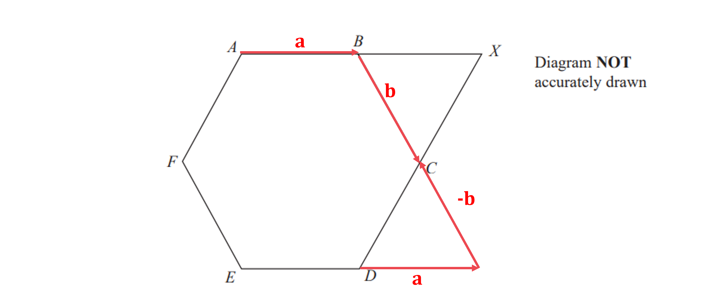

> * *

$\vec{DC} = a + ( - b )$

**[1]**

*C** to **X** is the same as **D** to **C* * *

$\begin{gathered} \vec{EX} & = \vec{ED} + \vec{DC} + \vec{CX} \\ = a + a + ( - b ) + a + ( - b ) \end{gathered}$

$\overset{\rightarrow}{EX}=3a-2b$* ***[1]**

## Q25 — very_hard — 5 marks · exam-questions

### 24() — 5 marks
*Think of *$\overset{\rightarrow}{ON}$* in two different ways (one using **MZ** and another using **OY**)* *First, go from **O** to **M  *

> $\overset{\rightarrow}{OM}=\frac{1}{2}\overset{\rightarrow}{OX}=\frac{1}{2}a$*  *

*You would next go from **M** to **N,** but this distance is unknown* 
$\overset{\rightarrow}{MN}$* is some smaller "amount" of the vector *$\overset{\rightarrow}{MZ}$*(parallel vectors) so write *
$\overset{\rightarrow}{MN}=k\overset{\rightarrow}{MZ}$*(where **k** is a scalar multiple that you can find later)* * *

$\vec{MN} = k \vec{MZ} = k ( - 1 \frac{1}{2} a + 3 b )$

**[1]**

*Write down this total journey as one vector, *$\overset{\rightarrow}{ON}$ * *

$\vec{ON} = \vec{OM} + \vec{MN} = 1 \frac{1}{2} a + k ( - 1 \frac{1}{2} a + 3 b )$

**[1]**

*Now find **O** to **N** using a different method / journey* 
$\overset{\rightarrow}{ON}$* is **λ** "amounts" of the vector *$\overset{\rightarrow}{OY}$* (parallel vectors) so write *$\overset{\rightarrow}{OP}=λ\overset{\rightarrow}{ON}$* *
*(where** λ** is a scalar multiple, different to **k **used previously)* * *

$\vec{ON} = \\lambda \vec{OY} = \\lambda ( a + b )$

**[1]**

*Compare the previous version of *$\overset{\rightarrow}{ON}$* to this version of *$\overset{\rightarrow}{ON}$ * *

$1 \frac{1}{2} a + k ( - 1 \frac{1}{2} a + 3 b )$*  **and ** *$\\lambda ( a + b )$ * *

*Expand the expressions and collect the **a**'s and **b**'s* * *

$( 1 \frac{1}{2} - 1 \frac{1}{2} k ) a + 3 k b$*  **and  *$λa+λb$ * *

*Both expressions represent the same journey, *$\overset{\rightarrow}{ON}$*, so the amount of **a**'s and **b**'s must be equal* 
*Form two equations by setting the amount of **a**'s equal and the amount of **b**'s equal*

$\frac{1}{2}-\frac{1}{2}k=λ$* ** and ** *$3k=λ$

**[1]**

*Solve these equations simultaneously, for example by substituting *$3k=λ$* into the first equation* * *

`table columnalign right center left columnspacing 0px end | 1 half - 1 half k | = 3 k | | 1 - k | = 6 k | | 1 = 7 k | | 1 / 7 | = k and lambda = 3 / 7 | |`

$λ=\frac{3}{7}$* ***[1]**

## Q26 — hard — 5 marks · exam-questions

### 17((a)) — 3 marks
*Draw the components of vectors *$\overset{\rightarrow}{AB}$* and *$\overset{\rightarrow}{AC}$* on to a diagram* *Also, draw on the coordinates of **B:** (5, 8)* * *

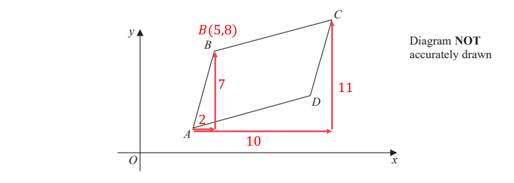

> * *

*Use **B**'s coordinates to work out the coordinates of **A** (by moving backwards from **B** to **A**)* * *

**A***(5 - 2, 8 - 7) = ***A***(3, 1)*

**[1]**

*Use **A**'s coordinates to work out **C**'s coordinates (by moving from **A** to **C**)*

**C***(3 + 10, 1 + 11)*

**[1]**

**(13, 12)**** [1]**

### 17((b)) — 2 marks
*If** ABE** is a straight line, then the vectors *$\overset{\rightarrow}{AE}$* and *$\overset{\rightarrow}{AB}$* must be parallel*
 *Find *$\overset{\rightarrow}{AE}$* by moving from **A**(3, 1) in part (a) to **E**(63, 211)* * *

$\vec{AE} = ( \begin{gathered} 63 - 3 \\ 211 - 1 \end{gathered} ) = ( \begin{gathered} 60 \\ 210 \end{gathered} )$

**[1]**

*Parallel vectors are scalar multiples of each other, *$\overset{\rightarrow}{AE}=k\overset{\rightarrow}{AB}$ *Prove that *$\overset{\rightarrow}{AE}$* is a scalar multiple of *$\overset{\rightarrow}{AB}$

$\vec{AE} = ( \begin{gathered} 60 \\ 210 \end{gathered} ) = 30 \times ( \begin{gathered} 2 \\ 7 \end{gathered} ) = 30 \vec{AB}$

$\overset{\rightarrow}{AE}=30\overset{\rightarrow}{AB}$** so ****ABE**** is a straight line ****[1]**

**This question can also be done by showing **$\overset{\rightarrow}{BE}=29\overset{\rightarrow}{AB}$

## Q27 — medium — 3 marks · exam-questions

### 14() — 3 marks
*The vector *$\overset{\rightarrow}{AC}$* means move from **A** to **C* *This is the same as moving from **A** to** B** to** C* * *

$\overset{\rightarrow}{AC}=\overset{\rightarrow}{AB}+\overset{\rightarrow}{BC}$ * *

*The vector *$\overset{\rightarrow}{BC}$* is the negative of vector *$\overset{\rightarrow}{CB}$ * *

$\overset{\rightarrow}{AC}=\overset{\rightarrow}{AB}-\overset{\rightarrow}{CB}$ * *

*Substitute the vectors from the question into the line above*

$\begin{gathered} \vec{AC} & = ( \begin{gathered} 6 \\ - 9 \end{gathered} ) - ( \begin{gathered} 1 \\ 3 \end{gathered} ) \\ = ( \begin{gathered} 6 - 1 \\ - 9 - 3 \end{gathered} ) \\ = ( \begin{gathered} 5 \\ - 12 \end{gathered} ) \end{gathered}$

**[1]**

*The magnitude (length) of a vector is given by *$\left| ( \begin{gathered} x \\ y \end{gathered} ) \right| = \sqrt{x^{2} + y^{2}}$**  **

$\begin{gathered} \left| \vec{AC} \right| & = \sqrt{5^{2} + ( - 12 )^{2}} \\ = \sqrt{25 + 144} \\ = \sqrt{169} \end{gathered}$

**13**** [1]**

## Q28 — very_hard — 5 marks · exam-questions

### 26() — 5 marks
*Think of *$\overset{\rightarrow}{OP}$* in two different ways (one using **AB** and another using **OC**)* *First, go from **O** to **A  *

> $\overset{\rightarrow}{OA}=2a$*  *

*You would next go from **A** to **P,** but this distance is unknown* $\overset{\rightarrow}{AP}$* is some smaller "amount" of the vector *$\overset{\rightarrow}{AB}$*(parallel vectors) so write *$\overset{\rightarrow}{AP}=k\overset{\rightarrow}{AB}$*(where **k** is a scalar multiple that you need to find later)* * *

$\vec{AP} = k \vec{AB} = k ( - 2 a + 5 b )$

*Write down this total journey as one vector, *$\overset{\rightarrow}{OP}$ * *

$\vec{OP} = \vec{OA} + \vec{AP} = 2 a + k ( - 2 a + 5 b )$

**[1]**

*Now find **O** to **P** using a different method / journey* 
$\overset{\rightarrow}{OP}$* is some smaller "amount" of the vector *$\overset{\rightarrow}{OC}$* (parallel vectors) so write*
* *$\overset{\rightarrow}{OP}=l\overset{\rightarrow}{OC}$* (where **l** is a scalar multiple, different to **k **used previously)* 
*Find *$\overset{\rightarrow}{OC}$* by going from **O** to** A** then **A** to **B* * *

> $\begin{gathered} \vec{OC} & = \vec{OA} + \vec{AC} \\ = 2 a + 3 b \end{gathered}$* *

*Write down *$\overset{\rightarrow}{OP}$* (using *$\overset{\rightarrow}{OP}=l\overset{\rightarrow}{OC}$*from above)* * *

$\vec{OP} = l ( 2 a + 3 b )$

**[1]**

*Compare the previous version of *$\overset{\rightarrow}{OP}$* to this version of *$\overset{\rightarrow}{OP}$ * *

$2 a + k ( - 2 a + 5 b )$*  **and ** *$l ( 2 a + 3 b )$ * *

*Expand the expressions and collect the **a**'s and **b**'s* * *

$( 2 - 2 k ) a + 5 k b$*  **and  *$2la+3lb$ * *

*Both expressions represent the same journey, *$\overset{\rightarrow}{OP}$*, so the amount of **a**'s and **b**'s must be equal* 
*Form two equations by setting the amount of **a**'s equal and the amount of **b**'s equal*

$2-2k=2l$* ** and ** *$5k=3l$

**[1]**

*Solve these equations simultaneously, for example substituting *$k=\frac{3}{5}l$* into the first equation* * *

`| 2 - 6 / 5 l | = 2 l | | 10 - 6 l | = 10 l | | 10 = 16 l | | 5 / 8 | = l and k = 3 / 5 x 5 / 8 = 3 / 8 | |`

**[1]*** *

*Finally, find *$\overset{\rightarrow}{OP}$* by substituting either **l** or **k** into its expression for *$\overset{\rightarrow}{OP}$ * *

$\overset{\rightarrow}{OP}=2\times\frac{5}{8}a+3\times\frac{5}{8}b$

$\overset{\rightarrow}{OP}=\frac{5}{4}a+\frac{15}{8}b$* ***[1]**

## Q29 — hard — 5 marks · exam-questions

### 19((a)) — 3 marks
*(i) **For example, go from **B** to **A** to **C** to **D*

$\begin{gathered} \vec{BD} & = \vec{BA} + \vec{AC} + \vec{CD} \\ = - p + q + q \end{gathered}$

$\overset{\rightarrow}{BD}=-p+2q$ **[1]**

*(ii) **For example, go from **M** to **B** to **N* 
*Start with **M** to **B**, which is a quarter of the vector **p *

$\overset{\rightarrow}{MB}=\frac{1}{4}p$

*B **to **N** is half of **B** to **C** (where **B** to **C** can be thought of as **B** to **A** to **C**)* * *

> $\vec{BN} = 1 \frac{1}{2} ( - p + q )$* *

*Add together the two results above* * *

$\vec{MN} = 1 \frac{1}{4} p + 1 \frac{1}{2} ( - p + q )$

**[1]**

*Expand and collect like terms*

$\overset{\rightarrow}{MN}=\frac{1}{4}p-\frac{1}{2}p+\frac{1}{2}q$

$\overset{\rightarrow}{MN}=-\frac{1}{4}p+\frac{1}{2}q$ **[1]**

### 19((b)) — 2 marks
*Two vectors, **a** and **b**, are parallel if they are scalar multiples of each other, **a** = **k**b* 
*Show that *$\overset{\rightarrow}{MN}$* and *$\overset{\rightarrow}{BD}$* are parallel*

$\begin{gathered} \vec{MN} & = - 1 \frac{1}{4} p + 1 \frac{1}{2} q \\ = 1 \frac{1}{4} ( - p + 2 q ) \\ = 1 \frac{1}{4} \vec{BD} \end{gathered}$

> *MN** and **BD** are parallel and **MN** is a quarter of **BD*

**MN ****is parallel to**** BD**** ****[1]**** **
**MN**** is a quarter of the length of ****BD**** ****[1]**

**The second fact can also be written as "****BD**** is four times the length of ****MN****"**

## Q30 — medium — 4 marks · exam-questions

### 7() — 2 marks
*The column vector *$( \begin{gathered} a \\ b \end{gathered} )$* represents **a** units to the right and **b** units up* *Vector **a** shown is 4 units to the right and 2 units down (-2 up)*

**one component correct**** [1]**

$a = ( \begin{gathered} 4 \\ - 2 \end{gathered} )$ **[1]**

### 7((b)) — 2 marks
*The column vector *$( \begin{gathered} a \\ b \end{gathered} )$* represents **a** units to the right and **b** units up* *Vector 4**b** shown is 4 units to the right and 9 units up  *

> $4 b = ( \begin{gathered} 4 \\ 9 \end{gathered} )$*  *

> *To find **b**, divide each component by 4  *

$b = ( \begin{gathered} \frac{4}{4} \\ \frac{9}{4} \end{gathered} )$

**one component correct**** [1]**

`equation` **[1]**

**any equivalent fraction or 2.25 are accepted**

## Q31 — hard — 5 marks · exam-questions

### 22((a)) — 2 marks
(i)

> *Vector *$\overset{\rightarrow}{OC}$* can be found by travelling from **O** to **B** to **C*

$\overset{\rightarrow}{OC}=\overset{\rightarrow}{OB}+\overset{\rightarrow}{BC}$

$\overset{\rightarrow}{OC}=4b+2a-2b=2b+2a$

$2b+2a$

**[B1]**

(ii)

> *Vector *$\overset{\rightarrow}{AB}$* can be found by travelling from **A** to **O** to **B*

$\overset{\rightarrow}{AB}=\overset{\rightarrow}{AO}+\overset{\rightarrow}{OB}$

$\overset{\rightarrow}{AB}=-3a+4b$

$-3a+4b$

**[B1]**

### 22((b)) — 3 marks
> **[exam-tip]**
> Find two different ways to express the vector $\overset{\rightarrow}{AP}$. The first way would be to travel via point *O* and part way along the vector $\overset{\rightarrow}{OC}$. The distance travelled along $\overset{\rightarrow}{OC}$ is unknown, so use a letter as a scalar multiple to be found.

> *Find one expression for *$\overset{\rightarrow}{AP}$

$\vec{AP} = - 3 a + x ( 2 a + 2 b )
 \vec{AP} = - 3 a + 2 x a + 2 x b$

> *P** is also partway along the vector *$\overset{\rightarrow}{AB}$* so there it will also be a scalar multiple of the vector for *$\overset{\rightarrow}{AB}$

$\vec{AP} = y ( - 3 a + 4 b )
 \vec{AP} = - 3 y a + 4 y b$

**[M1]**

> *The coefficients of *$a$* must be equal and the coefficients of *$b$* must be equal because they are representing the same "pathway". *

> *Equate the coefficients of *$a$

$-3+2x=-3y$

> *Equate the coefficients of *$b$

$2x=4y$

**[M1]**

> *These can be thought of as simultaneous equations*

> *Substitute the second equation into the first *

$-3+4y=-3y$

> *Simplify and solve*

$7y=3\,y=\frac{3}{7}$

> *This means that *

$\overset{\rightarrow}{AP}=\frac{3}{7}\overset{\rightarrow}{AB}\,\overset{\rightarrow}{PB}=\frac{4}{7}\overset{\rightarrow}{AB}$

> *Therefore*

$\overset{\rightarrow}{AP}:\overset{\rightarrow}{PB}\,\frac{3}{7}:\frac{4}{7}$

> *Simplify*

$3:4$

**[A1]**

## Q32 — very_hard — 6 marks · exam-questions

### 27((a)) — 2 marks
*D** to **X** is **D** to **H** to **X* * *

$\overset{\rightarrow}{DX}=\overset{\rightarrow}{DH}+\overset{\rightarrow}{HX}$ * *

*H** to **X** is a quarter of **H** to **E* *First, find **H** to **E** (by going **H** to **D** to **E**)* * *

$\overset{\rightarrow}{HE}=-b+a$

**[1]**

*Now, find **H** to **X** (a quarter of **H** to **E**)* * *

$\vec{HX} = 1 \frac{1}{4} \vec{HE} = 1 \frac{1}{4} ( - b + a )$ * *

*Substitute this, and *$\overset{\rightarrow}{DH}=b$*, into the expression for *$\overset{\rightarrow}{DX}$* above* * *

$\begin{gathered} \vec{DX} & = \vec{DH} + \vec{HX} \\ = b + 1 \frac{1}{4} ( a - b ) \end{gathered}$ * *

*Expand and simplify*

$\begin{gathered} \vec{DX} & = b + 1 \frac{1}{4} ( a - b ) \\ = b + 1 \frac{1}{4} a - 1 \frac{1}{4} b \end{gathered}$

`| D X -vec | = 1 / 4 a + 3 / 4 b | |`** [1]**

### 27((b)) — 4 marks
*To show** DXF** is a straight line using vectors, find *$\overset{\rightarrow}{DX}$* and *$\overset{\rightarrow}{DF}$* and show that they are parallel* 
*Find **D** to **F** by going** D** to **E** to **F* * *

$\overset{\rightarrow}{DF}=\overset{\rightarrow}{DE}+\overset{\rightarrow}{EF}$ * *

> *D** to **E** is **a** and **E** to** F** is a quarter of **E** to **G  *

> $\begin{gathered} \vec{DF} & = \vec{DE} + \vec{EF} \\ = a + 1 \frac{1}{4} \vec{EG} \end{gathered}$*  *

*Find **E** to **G** (by going **E** to **D** to **H** to **G**)* * *

$\begin{gathered} \vec{EG} & = - a + b + 8 b \\ = - a + 9 b \end{gathered}$

**[1]**

*Substitute this result into the expression for *$\overset{\rightarrow}{DF}$*, expand and simplify* * *

$\begin{gathered} \vec{DF} & = a + 1 \frac{1}{4} ( - a + 9 b ) \\ = a - 1 \frac{1}{4} a + \frac{9}{4} b \\ = \frac{3}{4} a + \frac{9}{4} b \end{gathered}$

**correct unsimplified**** [1]**

**correct simplified**** [1]**

*Two vectors are parallel is one can be written as a scalar multiple of the other, **p** = **k**q* 
*Show that *$\overset{\rightarrow}{DX}$* and *$\overset{\rightarrow}{DF}$* are parallel (by finding a constant **k** such that *$\overset{\rightarrow}{DF}=k\overset{\rightarrow}{DX}$*)* * *

$\begin{gathered} \vec{DF} & = \frac{3}{4} a + \frac{9}{4} b \\ = 3 ( 1 \frac{1}{4} a + \frac{3}{4} b ) \\ = 3 \vec{DX} \end{gathered}$ * *

$\overset{\rightarrow}{DF}=3\overset{\rightarrow}{DX}$** so ****DF**** and ****DX**** are parallel and share a common point (****D****) so ****DXF**** is a straight line*** ***[1]**

**This question could also be done by showing ****DX**** and ****XF**** are parallel and share a common point (X)**

## Q33 — hard — 3 marks · exam-questions

### 23() — 3 marks
$\overset{\rightarrow}{JM}$* is half of *$\overset{\rightarrow}{JK}$*as **M** is the midpoint* * *

$\overset{\rightarrow}{JM}=\frac{1}{2}\overset{\rightarrow}{JK}$ * *

$\overset{\rightarrow}{JK}$* is **J** to **N** to **L** to **K* * *

$\overset{\rightarrow}{JK}=\overset{\rightarrow}{JN}+\overset{\rightarrow}{NL}+\overset{\rightarrow}{LK}$ * *

*L** to **K** is the negative of **K** to **L* * *

$\begin{gathered} \vec{JK} & = \vec{JN} + \vec{NL} + ( - \vec{KL} ) \\ = \vec{JN} + \vec{NL} - 7 a \end{gathered}$

*JN** : **NL** is 3 : 2 which is equivalent to 6 : 4* *If *$\overset{\rightarrow}{NL}$* = 4**b**, then *$\overset{\rightarrow}{JN}$* = 6**b* * *

$\begin{gathered} \vec{JK} & = \vec{JN} + \vec{NL} - 7 a \\ = 6 b + 4 b - 7 a \\ = 10 b - 7 a \end{gathered}$

**seeing **$\overset{\rightarrow}{JN}=6b$** [1]** 
**all correct**** [1]**

*Substitute this result into *$\overset{\rightarrow}{JM}$* and expand*

$\vec{JM} = 1 \frac{1}{2} \vec{JK} 
= 1 \frac{1}{2} ( 10 b - 7 a )
= 5 b - 3.5 a$

$\overset{\rightarrow}{JM}=5b-3.5a$ **[1]**

$5b-\frac{7}{2}a$** is also accepted**

## Q34 — medium — 3 marks · exam-questions

### 9((b)) — 3 marks
*The vector *$a = ( \begin{gathered} 3 \\ - 1 \end{gathered} )$* represents 3 units to the right and 1 unit down, which is the bottom-left line of the triangle* *Draw a vector arrow pointing in this direction and label it **a*

*The vector *$2 b = 2 ( \begin{gathered} 1 \\ 3 \end{gathered} ) = ( \begin{gathered} 2 \\ 6 \end{gathered} )$* represents 2 units to the right and 6 units up, which is the bottom-right line of the triangle* *Draw a vector arrow pointing in this direction and label it 2**b*

> *The vector **a** + 2**b** joins the beginning of **a** to the end of 2**b** (draw this on, label it and include the vector arrow)  *

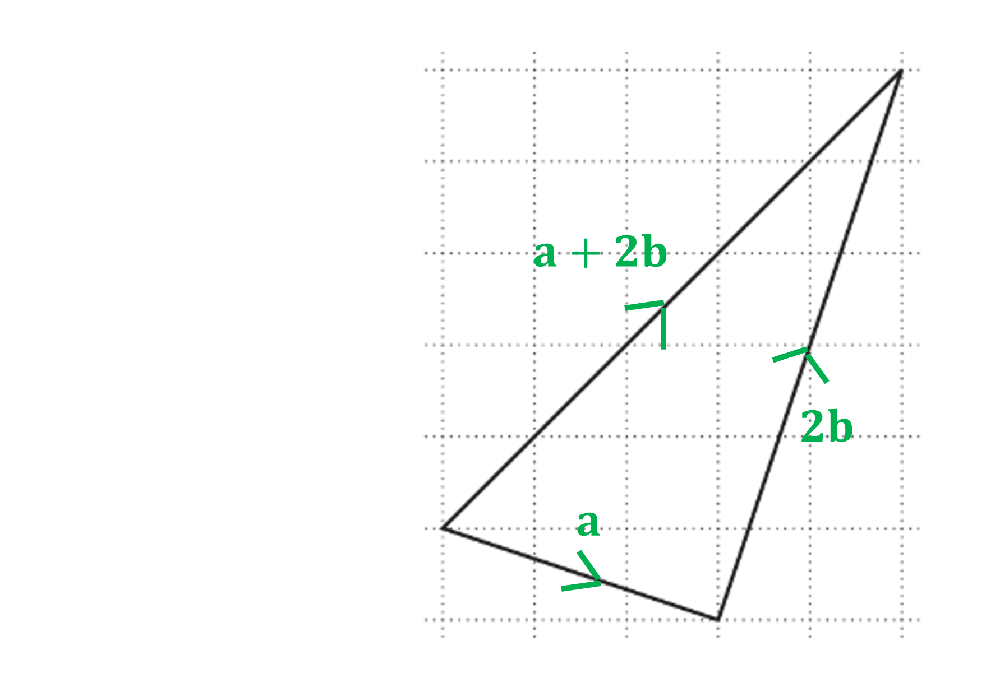

**correct vector arrows on ****a**** and 2****b**** ****[1] **
**correct labels on ****a**** and 2****b**** [1] **
**correct label and arrow on ****a**** + 2****b**** [1]**

## Q35 — very_hard — 3 marks · exam-questions

### 27() — 3 marks
*Two vectors, **p** and **q**, are parallel if they are scalar multiples of each other (**p** = **k**q** where **k** is a constant)* 
*Find vector *$\overset{\rightarrow}{PQ}$* in terms of **a**, **b** and** c **(by going from **P** to **S **to **R** to **Q**)* * *

$\overset{\rightarrow}{PQ}=a+b+c$

**[1]**

*Write the vector *$\overset{\rightarrow}{XY}$* as a journey from **X** to **S** to **R** to **Q* * *

$\overset{\rightarrow}{XY}=\overset{\rightarrow}{XS}+\overset{\rightarrow}{SR}+\overset{\rightarrow}{RY}$ * *

$\overset{\rightarrow}{XS}$* is two-thirds of *$\overset{\rightarrow}{PS}$*, *$\overset{\rightarrow}{SR}=b$* and *$\overset{\rightarrow}{RY}$* is two-thirds of *$\overset{\rightarrow}{RQ}$ * *

$\begin{gathered} \vec{XY} & = \vec{XS} + \vec{SR} + \vec{RY} \\ = \frac{2}{3} \vec{PS} + b + \frac{2}{3} \vec{RQ} \\ = \frac{2}{3} a + b + \frac{2}{3} c \end{gathered}$

**[1]**

*Factorise out *$\frac{2}{3}$* to see if *$\overset{\rightarrow}{XY}$* can be written as a scalar multiple of *$\overset{\rightarrow}{PQ}=a+b+c$ * *

$\begin{gathered} \vec{XY} & = \frac{2}{3} ( a + \frac{3}{2} b + c ) \\ \text{eq} \frac{2}{3} \vec{PQ} \end{gathered}$

**No they are not parallel as **$\overset{\rightarrow}{XY}$** is not a scalar multiple of **$\overset{\rightarrow}{PQ}$* ***[1]**

**The factorisation step is not compulsory, but answers must reference ****XY**** not being a multiple of ****PQ**** **

## Q36 — hard — 1 marks · exam-questions

### 23() — 1 marks
*It helps to find *$\overset{\rightarrow}{QR}$*first*
* *$\overset{\rightarrow}{PQ}$* and *$\overset{\rightarrow}{QR}$* are parallel and in the same direction (so must have the same sign)* 
*PQ** : **QR** = 3 : 1  = *$1:\frac{1}{3}$

$\overset{\rightarrow}{PQ}:\overset{\rightarrow}{QR}=a:\frac{1}{3}a$

> $\overset{\rightarrow}{QR}=\frac{1}{3}a$* *
*This helps to find *$\overset{\rightarrow}{RQ}$*, as it is the negative of *$\overset{\rightarrow}{QR}$* (opposite directions)*

> $\overset{\rightarrow}{RQ}=-\overset{\rightarrow}{QR}=-\frac{1}{3}a$*  *

> *The** third option** is correct*

$\overset{\rightarrow}{RQ}=-\frac{1}{3}a$ **[1]**

## Q37 — medium — 3 marks · exam-questions

### 20((a)) — 3 marks
> *Any multiple of *$( \begin{gathered} 2 \\ 1 \end{gathered} )$* is parallel to *$( \begin{gathered} 2 \\ 1 \end{gathered} )$*, *

$( \begin{gathered} 4 \\ 2 \end{gathered} ) , ( \begin{gathered} 6 \\ 3 \end{gathered} ) , ( \begin{gathered} 8 \\ 4 \end{gathered} ) , ...$

**any multiple of**** **$( \begin{gathered} 2 \\ 1 \end{gathered} )$** ****seen**** [1]**

*Find a vector, **b**, such that *$b + ( \begin{gathered} 5 \\ 2 \end{gathered} )$* is a multiple of *$( \begin{gathered} 2 \\ 1 \end{gathered} )$

$( \begin{gathered} 1 \\ 1 \end{gathered} ) + ( \begin{gathered} 5 \\ 2 \end{gathered} ) = ( \begin{gathered} 6 \\ 3 \end{gathered} )$* which is a multiple of* $( \begin{gathered} 2 \\ 1 \end{gathered} )$

*Find another vector, **b**, that gives a different multiple*

$( \begin{gathered} 3 \\ 2 \end{gathered} ) + ( \begin{gathered} 5 \\ 2 \end{gathered} ) = ( \begin{gathered} 8 \\ 4 \end{gathered} )$ *which is a multiple of *$( \begin{gathered} 2 \\ 1 \end{gathered} )$*  *

$\text{begin} \text{style} ( \begin{gathered} 1 \\ 1 \end{gathered} )$** ****and**** **$( \begin{gathered} 3 \\ 2 \end{gathered} )$* ***[2]**

**any two that work, for example **$( \begin{gathered} 5 \\ 3 \end{gathered} ) , ( \begin{gathered} - 1 \\ 0 \end{gathered} ) , ( \begin{gathered} - 3 \\ - 1 \end{gathered} ) , ( \begin{gathered} - 7 \\ - 3 \end{gathered} ) , ( \begin{gathered} - 9 \\ - 4 \end{gathered} ) , ( \begin{gathered} - 11 \\ - 5 \end{gathered} ) , ( \begin{gathered} - 13 \\ - 6 \end{gathered} ) , ( \begin{gathered} - 15 \\ - 7 \end{gathered} )$

## Q38 — very_hard — 3 marks · exam-questions

### 26() — 3 marks
*If **BCDE** is a parallelogram, then the vector *$\overset{\rightarrow}{BC}$* must be equal and parallel to *$\overset{\rightarrow}{ED}$ 
*Find *$\overset{\rightarrow}{BC}$* by going from **B** to **A** to **E** to **C* * *

$\begin{gathered} \vec{BC} & = \vec{BA} + \vec{AE} + \vec{EC} \\ = a + 2 b + ( b - 2 a ) \end{gathered}$

**[1]**

*Expand and simplify* * *

$\begin{gathered} \vec{BC} & = a + 2 b + b - 2 a \\ = - a + 3 b \end{gathered}$

**[1]**

*Find *$\overset{\rightarrow}{ED}$* by making *$\overset{\rightarrow}{DE}$* negative* * *

$\begin{gathered} \vec{ED} & = - \vec{DE} \\ = - ( a - 3 b ) \\ = - a + 3 b \end{gathered}$

$\overset{\rightarrow}{BC}=\overset{\rightarrow}{ED}$** so ****BC**** and ****ED**** are parallel and equal in length, making ****BCDE**** a parallelogram**** [1]**

**This question can also be done by showing **$\overset{\rightarrow}{BE}=\overset{\rightarrow}{CD}$

## Q39 — hard — 4 marks · exam-questions

### 11((a)) — 2 marks
*Add the top rows and add the bottom rows*

$( \begin{gathered} 6 \\ - 10 \end{gathered} ) + ( \begin{gathered} - 1 \\ 2 \end{gathered} ) + ( \begin{gathered} - 4 \\ 7 \end{gathered} )
= ( \begin{gathered} 6 - 1 - 4 \\ - 10 + 2 + 7 \end{gathered} )$

**top or bottom correct ****[1]**

> *Give your final answer as a vector*

$( \begin{gathered} 1 \\ - 1 \end{gathered} )$ **[1]**

### 11((b)) — 2 marks
> *To show two vectors, **p** and **q**, are parallel, show that **p** is a scalar multiple of **q**, i.e. **p** = **k**q *
*Work out **a** + 2**c*

$\begin{gathered} a + 2 c & = ( \begin{gathered} 6 \\ - 10 \end{gathered} ) + 2 ( \begin{gathered} - 4 \\ 7 \end{gathered} ) \\ = ( \begin{gathered} 6 \\ - 10 \end{gathered} ) + ( \begin{gathered} - 8 \\ 14 \end{gathered} ) \\ = ( \begin{gathered} 6 - 8 \\ - 10 + 14 \end{gathered} ) \\ = ( \begin{gathered} - 2 \\ 4 \end{gathered} ) \end{gathered}$

**[1]**

*Show that **a** + 2**c** is a multiple of** b**, for example by factorising out a 2 from top-and-bottom*

$\begin{gathered} a + 2 c & = ( \begin{gathered} - 2 \\ 4 \end{gathered} ) = 2 ( \begin{gathered} - 1 \\ 2 \end{gathered} ) = 2 b \end{gathered}$

**a + 2c = 2b, so a + 2c is a scalar multiple of b, which makes a + 2c and b parallel**** [1]**

## Q40 — medium — 1 marks · exam-questions

### 2() — 1 marks
*The vector *$( \begin{gathered} a \\ b \end{gathered} )$* means **a** units to the right and **b** units up*

*The arrow moves 3 units right, and 2 units down*

**The**** third ****option****, **$( \begin{gathered} 3 \\ - 2 \end{gathered} )$** ****is therefore correct** **[1]**

> *The first option would mean 3 units right, and 2 units upwards*

> *The second option would mean 3 units left and 2 units upwards*

> *The fourth option would mean 3 units left and 2 units down*

## Q41 — very_hard — 4 marks · exam-questions

### 20() — 4 marks
*Find 2**m** by multiplying each component in **m** by 2* * *

$\begin{gathered} 2 m & = 2 ( \begin{gathered} 2 \\ k \end{gathered} ) \\ = ( \begin{gathered} 4 \\ 2 k \end{gathered} ) \end{gathered}$

**[1]**

*Find 2**m** + **n** by adding the components* * *

`table columnalign right center left columnspacing 0px end | 2 m + n | = ( | 4 | 2 k | | ) + ( | 3 | 11 | ) | | _ = ( | 7 | 2 k + 11 | | ) | |`

**[1]**

*This vector needs to be parallel to *$( \begin{gathered} 1 \\ - 1 \end{gathered} )$ * *

*Method 1* 
*The vector *$( \begin{gathered} 1 \\ - 1 \end{gathered} )$* means 1 step to the right then 1 step down* 
*The vector *$( \begin{gathered} 7 \\ 2 k + 11 \end{gathered} )$* means 7 steps to the right then (2**k** + 11) steps up* 
*Make these directions match, by forcing (2k + 11) to represents 7 steps down* * *

$2k+11=-7$

**[1]**

> *Solve this equation to find **k  *

$2k=-18\,k=-9$

**k ****= -9*** ***[1]**

*Method 2* 
*Two vectors, **p **and **q**, are parallel if they are scalar multiples, **p** = **b**q**  *

> $( \begin{gathered} 7 \\ 2 k + 11 \end{gathered} ) = b ( \begin{gathered} 1 \\ - 1 \end{gathered} ) = ( \begin{gathered} b \\ - b \end{gathered} )$*  *

> *Read off two simultaneous equations  *

$7=b$*  and ** *$2k+11=-b$*  *

> *Substitute the first equation into the second equation  *

$2k+11=-7$

**[1]**

> *Solve this equation to find **k  *

$2k=-18\,k=-9$

**k ****= -9*** ***[1]**

## Q42 — hard — 3 marks · exam-questions

### 23() — 3 marks
*To show** BCD** is a straight line using vectors, find *$\overset{\rightarrow}{BC}$* and *$\overset{\rightarrow}{BD}$* and show that they are parallel* 
*Find **B** to **C** by going from **B** to **A** to **C* * *

$\overset{\rightarrow}{BC}=\overset{\rightarrow}{BA}+\overset{\rightarrow}{AC}$* *

> *A** to **C** is the negative of **C** to **A**  *

$\begin{gathered} \vec{BC} & = \vec{BA} + \vec{AC} \\ = \vec{BA} - \vec{CA} \\ = ( 5 a - 2 b ) - ( 3 a + b ) \end{gathered}$

> *Expand and simplify*

$\begin{gathered} \vec{BC} & = ( 5 a - 2 b ) - ( 3 a + b ) \\ = 5 a - 2 b - 3 a - b \\ = 2 a - 3 b \end{gathered}$

**[1]*** *

*Find **B** to **D** by going from **B** to **A** to **D* * *

$\vec{BD} = \vec{BA} + \vec{AD} 
= ( 5 a - 2 b ) + ( 3 a - 9 b )$* *

> *Expand and simplify*

$\begin{gathered} \vec{BD} & = ( 5 a - 2 b ) + ( 3 a - 9 b ) \\ = 5 a - 2 b + 3 a - 9 b \\ = 8 a - 11 b \end{gathered}$

**[1]*** *

$\begin{gathered} \vec{BD} & = 8 a - 11 b \end{gathered}$* and *$\begin{gathered} \vec{BC} & = 2 a - 3 b \end{gathered}$* Two vectors, **p** and **q**, are parallel is one can be written as a scalar multiple of the other, **p** = **k**q* $\overset{\rightarrow}{BD}$* and *$\overset{\rightarrow}{BC}$* cannot be written in the form *$\overset{\rightarrow}{BD}=k\overset{\rightarrow}{BC}$*, for example* * *

$\begin{gathered} 4 \vec{BC} & = 4 ( 2 a - 3 b ) = 8 a - 12 b \text{eq} \vec{BD} \end{gathered}$ * *

**No, **`| _ _ B C -vec | |`** is not a scalar multiple of **`| _ _ B D -vec | |`** ****[1]**

**This question could also be done by showing **$\overset{\rightarrow}{BC}$** ****is not a scalar multiple of **$\overset{\rightarrow}{CD}$

## Q43 — medium — 1 marks · exam-questions

### 17() — 1 marks
> *Work out **a** - 3**b **as follows*

`table columnalign right center left columnspacing 0px end | a - 3 b | = ( | - 3 | | 2 | ) - 3 ( | 1 | - 5 | | ) | | _ = ( | - 3 | | 2 | ) - ( | 3 | - 15 | | ) | | _ = ( | - 3 - 3 | | 2 - - 15 | | ) | | _ = ( | - 6 | | 17 | ) | |`

**The ****first**** option is therefore correct, **$( \begin{gathered} - 6 \\ 17 \end{gathered} )$** [1]**

## Q44 — very_hard — 5 marks · exam-questions

### 15() — 5 marks
*OCD is a straight line if *$\overset{\rightarrow}{\mathrm{OC}}$* and *$\overset{\rightarrow}{\mathrm{OD}}$* are parallel* 
*To find *$\overset{\rightarrow}{\mathrm{OC}}$*, you can go from O to A to C* 
*To help with this journey, find *$\overset{\rightarrow}{\mathrm{AB}}$* first, by going from A to O to B* * *

$\overset{\rightarrow}{\mathrm{AB}}=-3a+3b$

**[1]**

*A to C is two-thirds of A to B* 
*Find *$\overset{\rightarrow}{\mathrm{OC}}$* * * *

$\begin{gathered} O \vec{C} & = O \vec{A} + A \vec{C} \\ = O \vec{A} + \frac{2}{3} A \vec{B} \\ = 3 a + \frac{ 2 }{3} ( - 3 a + 3 b ) \end{gathered}$

**[1]**

*Expand and simplify* * *

$\begin{gathered} O \vec{C} & = 3 a - 2 a + 2 b \\ = a + 2 b \end{gathered}$

**[1]**

*Find *$\begin{gathered} O \vec{D} \end{gathered}$* by going from O to B to D* * *

$\begin{gathered} O \vec{D} & = O \vec{B} + B \vec{D} \\ = 3 b + ( 2 a + b ) \end{gathered}$

**[1]**

*Expand and simplify* * *

$\begin{gathered} O \vec{D} & = 3 b + 2 a + b \\ = 4 b + 2 a \end{gathered}$ * *

*Two vectors, **p** and **q**, are parallel if they are scalar multiples of each other, **p** = **k**q* 
*Show that *$\begin{gathered} O \vec{D} \end{gathered}$* is a scalar multiple of *$\begin{array}{rcl} O \vec{B} \end{array}$* (by factorising out a 2)* * *

$\begin{gathered} O \vec{D} & = 2 ( 2 b + a ) = 2 O \vec{C} \end{gathered}$ * *

$\begin{array}{rcl} O \vec{D} & = 2 O \vec{C} \end{array}$* ***so OD and OC are ****parallel**** and share a common point, O, so**** OCD is a straight line*** ***[1]**

## Q45 — hard — 5 marks · exam-questions

### 20((b)) — 5 marks
*This is a vector equation.* 
*m** and **n** are scalars.*

*The 'top row' would give as an equation in **m** and **n** by considering the **x**-direction of the vector.* 
*The 'bottom row' would give us an equation in **m** and **n** by considering the **y**-direction of the vector.*

$\begin{array}{rcl} 4 m + 5 n & = 12 \\ m + 2 n & = 6 \end{array}$

**One for each equation ****[2]**

> *As **m** is already isolated in the second equation, the easiest method to solve these equations simultaneously would be to rearrange the second to make **m** the subject, and then substitute that into the first equation.*

$m=6-2n$

$\therefore 4 ( 6 - 2 n ) + 5 n = 12$

**[1]**

> *Expand, simplify and solve this equation to find **n**.*

$\begin{gathered} 24 - 8 n + 5 n & = 12 \\ 24 - 3 n & = 12 \\ 3 n & = 12 \\ n = 4 \end{gathered}$

**[1]**

> *Substitute **n** = 4 into either of the original equations (second one is easiest) to find **m**.*

$\begin{array}{rcl} m + 2 ( 4 ) & = 6 \\ m = 6 - 8 \\ m = - 2 \end{array}$

$\thereforem=-2,n=4$** ****[1]**

## Q46 — medium — 3 marks · exam-questions

### 11((a)) — 2 marks
*Calculate 2**a** and **a** + **b* * *

$2 a = 2 ( \begin{gathered} 2 \\ 1 \end{gathered} ) = ( \begin{gathered} 4 \\ 2 \end{gathered} )$*  **and  *$a + b = ( \begin{gathered} 2 \\ 1 \end{gathered} ) + ( \begin{gathered} - 2 \\ 1 \end{gathered} ) = ( \begin{gathered} 0 \\ 2 \end{gathered} )$ * *

*Draw these two vectors* * *

*2****a**** is 4 units right and 2 units up*
***a**** + ****b**** is 0 units right and 2 units up* * *

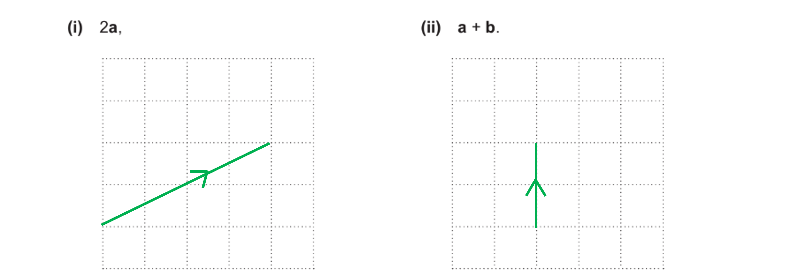

**each correct with direction arrows**** [2]**

### 11((b)) — 1 marks
*Vector **a** goes 4 units to the right and 2 units up whereas vector **b** goes 2 units to the left and 1 unit up*

**they are in different directions** **[1]**

## Q47 — very_hard — 3 marks · exam-questions

### 16((c)) — 3 marks
*Two vectors, **p** and **q**, are parallel if they are scalar multiples of each other, **p** = **k**q* 
*You need to show that *$\overset{\rightarrow}{\mathrm{EF}}$* is a scalar multiple of *$\overset{\rightarrow}{\mathrm{AG}}$
*To find *$\overset{\rightarrow}{\mathrm{EF}}$*, go from E to B to F (and use that E to B is a quarter of A to B)  *

> $E \vec{F} = E \vec{B} + B \vec{F} 
= 1 \frac{1}{4} A \vec{B} + 1 \frac{1}{2} B \vec{C} 
= 1 \frac{1}{4} ( b - a ) + 1 \frac{1}{2} b$*  *

> *Expand and simplify  *

$\begin{gathered} E \vec{F} & = 1 \frac{1}{4} b - 1 \frac{1}{4} a + 1 \frac{1}{2} b \\ = - 1 \frac{1}{4} a + \frac{3}{4} b \end{gathered}$

**[1]**

> *To find *$\overset{\rightarrow}{\mathrm{AG}}$* go from A to D to G  *

> $\begin{gathered} A \vec{G} & = A \vec{D} + D \vec{G} \\ = A \vec{D} + 1 \frac{1}{2} A \vec{B} \\ = b + 1 \frac{1}{2} ( b - a ) \end{gathered}$*  *

> *Expand and simplify  *

$\begin{gathered} A \vec{G} & = b + 1 \frac{1}{2} b - 1 \frac{1}{2} a \\ = - 1 \frac{1}{2} a + \frac{3}{2} b \end{gathered}$

**[1]**

> *Show that *$\overset{\rightarrow}{\mathrm{EF}}$*  is a scalar multiple of *$\overset{\rightarrow}{\mathrm{AG}}$* (by factorising out a half)  *

$\begin{gathered} E \vec{F} & = 1 \frac{1}{2} ( - 1 \frac{1}{2} a + \frac{3}{2} b ) = 1 \frac{1}{2} A \vec{G} \end{gathered}$

`| _ _ EF -vec | | = 1 / 2 | _ _ A G -vec | |`** so **$\begin{gathered} E \vec{F} \end{gathered}$** and **$\begin{gathered} A \vec{G} \end{gathered}$** are parallel ****[1]**

## Q48 — hard — 3 marks · exam-questions

### 10() — 3 marks
*The vector **a** + 2**b** is the same as **a** + **b** + **b* 
*Draw the vectors **a**, followed by **b**, followed by **b** again on the grid as shown (vectors must have arrows and labels)*

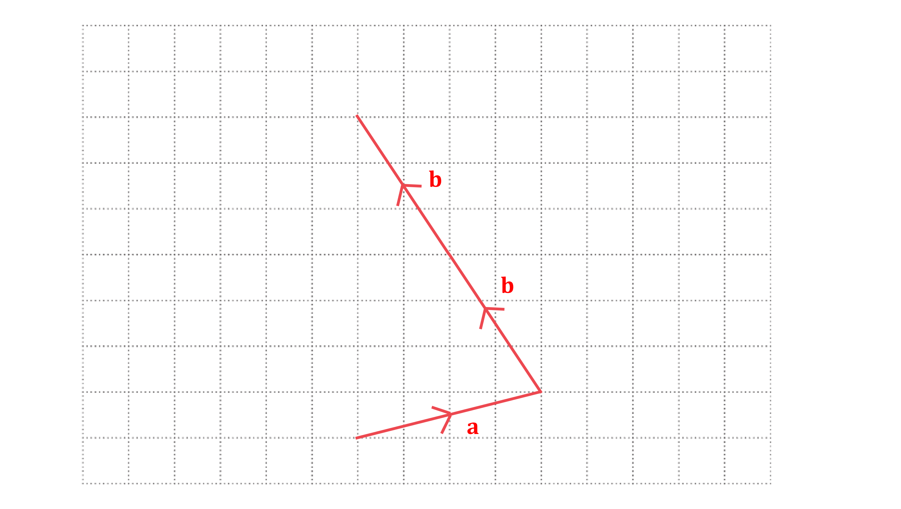

* The vector **a** + 2**b** connects the start to the finish, which in this case goes vertically upwards* 
*Draw this vector on and measure its lengths by counting squares*

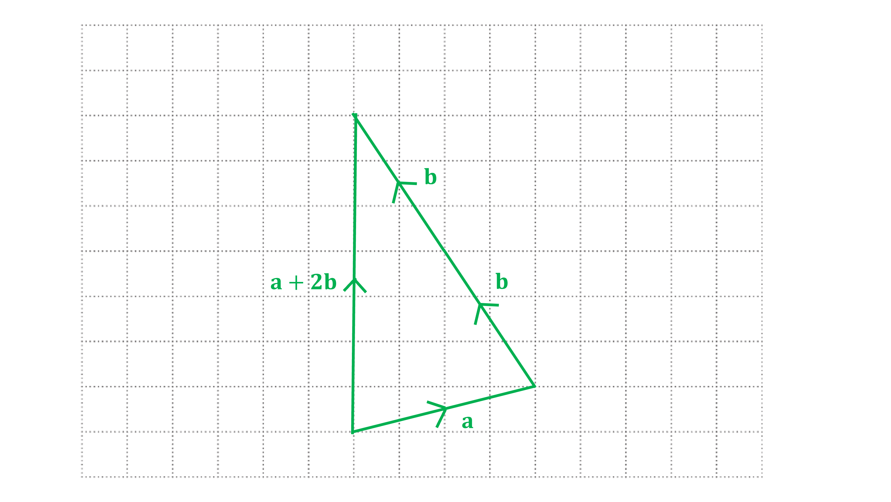

**Final answer:** **The length of a + 2b is 7 cm**

**2****b**** drawn correctly**** [1]** 
**2****b**** correctly connected to ****a**** [1]** 
**fully correct triangle drawn with ****a**** + 2****b**** labelled and with correct vector arrow**** [1]**

## Q49 — medium — 3 marks · exam-questions

### 1((b)) — 3 marks
*Geometrically, **c** is 3 lots of **a* 
*d** is **a** followed by **b* 
*e** is **a** followed by the reverse direction of **b** (which is -**b**)*

**c = 3a ****[1]** 
**d = a + b ****[1]** 
**e = a - b ****[1]**

## Q50 — hard — 2 marks · exam-questions

### 11((c)) — 2 marks
*Find **a** - **b** by subtracting components* * *

$a - b = ( \begin{gathered} 2 \\ 1 \end{gathered} ) - ( \begin{gathered} - 2 \\ 1 \end{gathered} ) = ( \begin{gathered} 4 \\ 0 \end{gathered} )$ * *

*Substitute **a** - **b** and **c** into **k**(**a** - **b**) = **c* * *

$k ( \begin{gathered} 4 \\ 0 \end{gathered} ) = ( \begin{gathered} - 12 \\ 0 \end{gathered} )$

**[1]**

*Multiply the components on the left by **k* * *

$( \begin{gathered} 4 k \\ 0 \end{gathered} ) = ( \begin{gathered} - 12 \\ 0 \end{gathered} )$ * *

*Read off the equation from the top components and solve it*

$\begin{gathered} 4 k & = - 12 \\ k = - \frac{12}{4} \end{gathered}$

**k**** = -3**** ****[1]**

## Q51 — hard — 5 marks · exam-questions

### 18() — 5 marks
*Two vectors, **p** and **q**, are parallel if they are scalar multiples of each other, **p** = **k**q* 
*You need to show that *$\overset{\rightarrow}{\mathrm{PQ}}$* is a scalar multiple of *$\overset{\rightarrow}{\mathrm{SR}}$ 
*To find *$\overset{\rightarrow}{\mathrm{PQ}}$* you can go from P to X to Q  *

$\begin{gathered} P \vec{Q} & = P \vec{X} + X \vec{Q} \\ = a + b \end{gathered}$

**[1]**

> *To find *$\overset{\rightarrow}{\mathrm{SR}}$* you can go from S to Z to R*
* It helps to find *$\overset{\rightarrow}{\mathrm{ZY}}$* first, by going from Z to S to O to P to X to Q to Y  *

$\begin{gathered} Z \vec{Y} & = Z \vec{S} + S \vec{O} + O \vec{P} + P \vec{X} + X \vec{Q} + Q \vec{Y} \\ = - c - c + a + a + b + b \\ = - 2 c + 2 a + 2 b \end{gathered}$

**[1]**

*Now use this to help find *$\overset{\rightarrow}{\mathrm{SR}}$

$\begin{gathered} S \vec{R} & = S \vec{Z} + Z \vec{R} \\ = S \vec{Z} + 1 \frac{1}{2} Z \vec{Y} \\ = c + 1 \frac{1}{2} ( - 2 c + 2 a + 2 b ) \end{gathered}$

**[1]**

*Expand and simplify*

$\begin{gathered} S \vec{R} & = c - c + a + b \\ = a + b \end{gathered}$

**[1]**

> *The vector *$\overset{\rightarrow}{\mathrm{PQ}}$* is identical to *$\overset{\rightarrow}{\mathrm{SR}}$* so they must be parallel*

$\begin{gathered} P \vec{Q} & = S \vec{R} \end{gathered}$** so PQ and SR are ****parallel ****[1]**

## Q52 — hard — 5 marks · exam-questions

### 19((a)) — 3 marks
> **[exam-tip]**
> Label vectors onto the diagram provided as you work through the question.

(i)

> *Given that C is the midpoint of **AD,** it is true that:*

$\overset{\rightarrow}{AC}=\overset{\rightarrow}{CD}$

> *Find a route for *$\overset{\rightarrow}{BD}$* using the diagram and given vectors*

$\overset{\rightarrow}{BD}=\overset{\rightarrow}{BA}+\overset{\rightarrow}{AC}+\overset{\rightarrow}{CD}\,\overset{\rightarrow}{BD}=-p+q+q$

> *Simplify by collecting terms*

$\overset{\rightarrow}{BD}=2q-p$

**[B1]**

(ii)

> *Find a route for *$\overset{\rightarrow}{MN}$* using the diagram*

$\overset{\rightarrow}{MN}=\overset{\rightarrow}{MB}+\overset{\rightarrow}{BN}$

> *Work out *$\overset{\rightarrow}{MB}$*, using AM : MB=3 : 1 to state:*

$\overset{\rightarrow}{MB}=\frac{1}{4}\overset{\rightarrow}{AB}$

> *Express  *$\overset{\rightarrow}{MB}$* in terms of p and q*

$\overset{\rightarrow}{MB}=\frac{1}{4}p$

**[M1]**

> *Work out *$\overset{\rightarrow}{BN}$*, using** N** is the midpoint of **BC** to state:*

$\vec{BN} = 1 \frac{1}{2} \vec{BC} 
 \vec{BN} = 1 \frac{1}{2} ( \vec{BA} + \vec{AC} )$

> *Express *$\overset{\rightarrow}{BN}$* in terms of** p **and q*

$\begin{gathered} \vec{BN} & = 1 \frac{1}{2} ( - p + q ) \end{gathered}$

> *Use the calculated vectors to work out *$\overset{\rightarrow}{MN}$* in terms of p and q and simplify*

$\begin{gathered} \vec{MN} & = \vec{MB} + \vec{BM} \\ = 1 \frac{1}{4} p + 1 \frac{1}{2} ( - p + q ) \\ = 1 \frac{1}{4} p - 1 \frac{1}{2} p + 1 \frac{1}{2} q \\ = - 1 \frac{1}{4} p + 1 \frac{1}{2} q \end{gathered}$

**[A1]**

$\overset{\rightarrow}{MN}=\frac{1}{2}q-\frac{1}{4}p$

### 19((b)) — 2 marks
> **[exam-tip]**
> The geometric facts most typically related to vector questions will require you to show that two vectors are either parallel, where one vector is a multiple of the other, or co-linear, where the vectors are parallel and share a common point.

> *Compare the vectors in terms of **p** and **q **for *$\overset{\rightarrow}{MN}$* and *$\overset{\rightarrow}{BD}$* to determine if one is a multiple of the other*

$\overset{\rightarrow}{BD}=2q-p$* *

$\overset{\rightarrow}{MN}=\frac{1}{2}q-\frac{1}{4}p$

> *Multiplying *$\overset{\rightarrow}{MN}$* by 4 gives *$\overset{\rightarrow}{BD}$*, therefore the vectors are parallel*

$4 ( 1 \frac{1}{2} q - 1 \frac{1}{4} p ) = 2 q - p$* *

**Final answer:** **Therefore **$\overset{\rightarrow}{BD}=4\overset{\rightarrow}{MN}$** and **$\overset{\rightarrow}{BD}$** is parallel to **$\overset{\rightarrow}{MN}$

**[B1]**

**Final answer:** **As **$\overset{\rightarrow}{BD}=4\overset{\rightarrow}{MN}$** then the magnitude of **$\overset{\rightarrow}{BD}$** is four times greater than **$\overset{\rightarrow}{MN}$

**[B1]**

## Q53 — hard — 5 marks · exam-questions

### 19((a)) — 1 marks
> *Consider the pathway to get from A to N*

$\overset{\rightarrow}{AN}=\overset{\rightarrow}{AO}+\overset{\rightarrow}{OB}$

$\overset{\rightarrow}{AN}=-2a+b$

**[B1]**

### 19((b)) — 4 marks
> *Calculate the vector  *$\overset{\rightarrow}{OP}$* in two different ways  using x and y as the unknown scalars*

> *Path through A*

$\vec{OP} = \vec{OA} + \vec{AP} 
 \vec{OP} = \vec{OA} + x \vec{AN} 
 \vec{OP} = 2 a + x ( - 2 a + b )$

**[M1]**

> *Path  through M*

$\vec{OP} = \vec{OM} + \vec{MP} 
 \vec{OP} = \vec{OM} + y \vec{MB} 
 \vec{OP} = a + y ( - a + 6 b )$

**[M1]**

> *Put the two vectors for  *$\overset{\rightarrow}{OP}$* equal to each other*

$a + y ( - a + 6 b ) = 2 a + x ( - 2 a + b )$

> *Rewrite it to see the coefficients of **a** and **b*

$( 1 - y ) a + 6 y b = ( 2 - 2 x ) a + x b$

> *Equate coefficients to create simultaneous equations*

$a:1-y=2-2x\,b:6y=x$

**[M1]**

> *Solve simultaneously by substituting the second equation into the first*

$\begin{gathered} 1 - y & = 2 - 2 ( 6 y ) \\ 1 - y & = 2 - 12 y \\ 11 y & = 1 \\ y & = \frac{ 1}{11} \end{gathered}$

$\begin{gathered} x = 6 ( \frac{1}{11} ) = \frac{6}{11} \end{gathered}$

> *As **x** is the fraction of  *$\overset{\rightarrow}{AN}$* that gives  *$\overset{\rightarrow}{AP}$* , that means *$\overset{\rightarrow}{AP}$* is *$\frac{6}{11}$* of *$\overset{\rightarrow}{AN}$* *

> *That tells you the ratio of *$AP:PN$

$AP:PN=6:5$

**[A1]**
