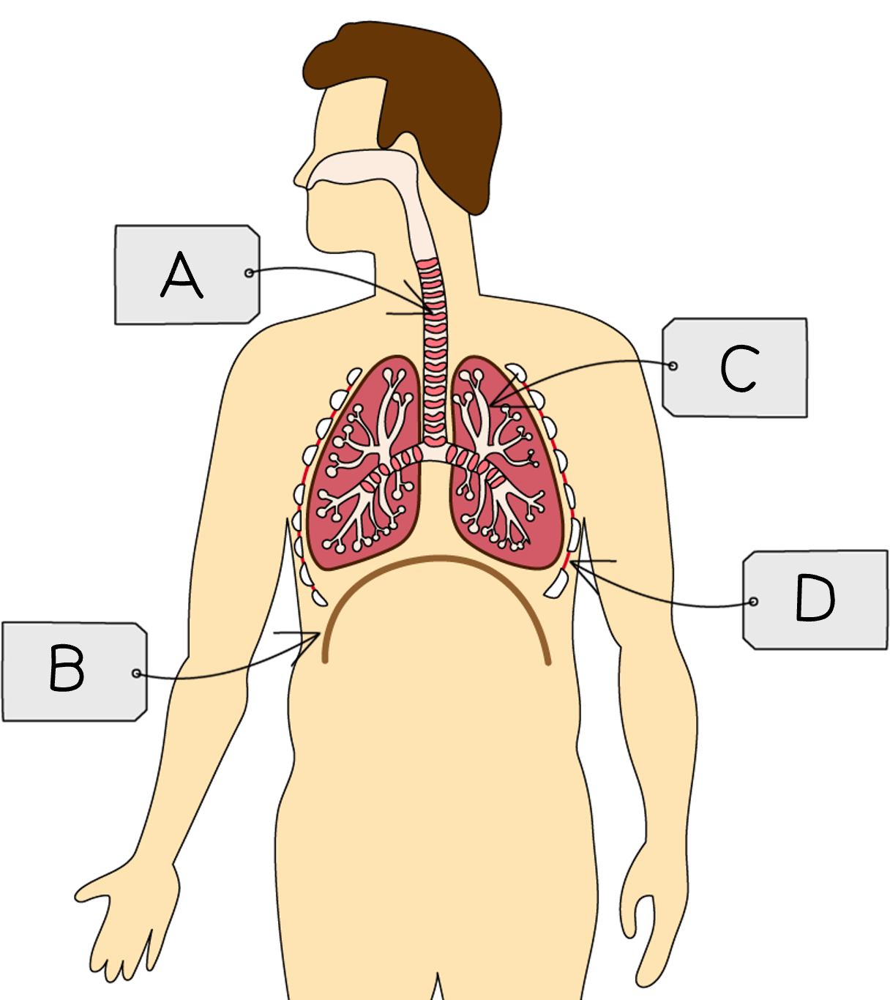
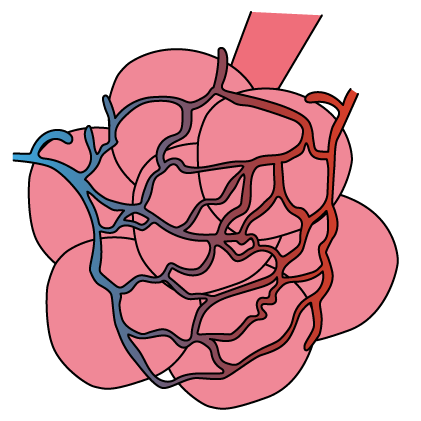
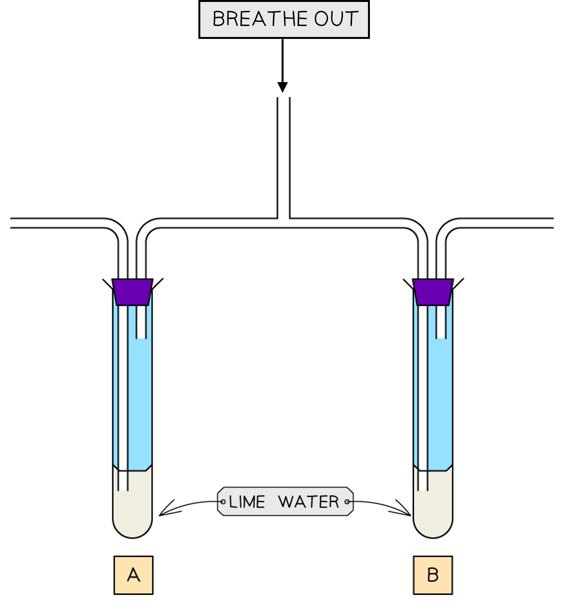
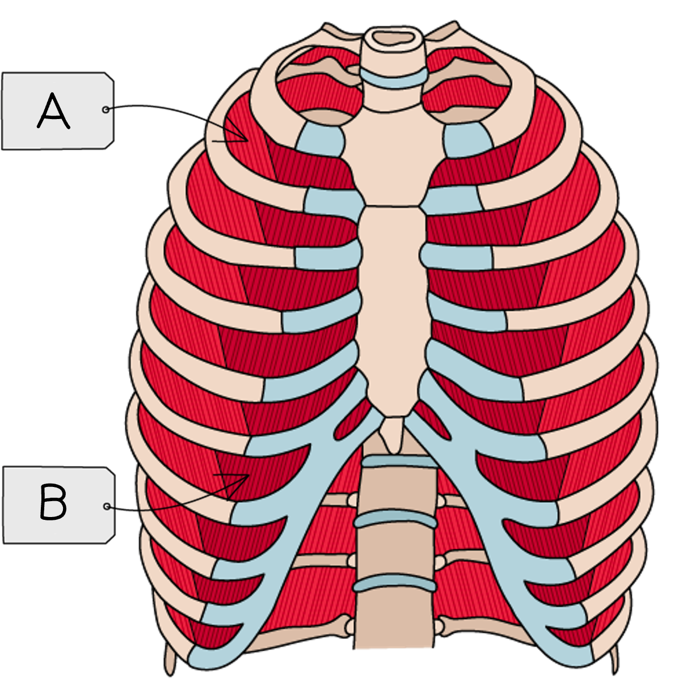

# Gas Exchange in Humans

Course: cie-igcse-biology-23 · Section: 11. Gas Exchange in Humans

Source: https://www.savemyexams.com/igcse/biology/cie/23/flashcards/11-gas-exchange-in-humans/11-1-gas-exchange-in-humans/

## Card 1 — question_and_answer (`fl_P7VWnKvjtp3k45jp`)

**FRONT**

Which **process** takes place at the alveoli?

**BACK**

The process that takes place in the alveoli is** gas exchange**.** **

## Card 2 — true_or_false (`fl_nDqGg6fXSvDjNwYs`)

**FRONT**

**True or False? **

Alveoli are surrounded by several layers of cells.

**BACK**

**False. **

Alveoli are surrounded by a **single layer of cells** to **minimise diffusion distance**.

## Card 3 — question_and_answer (`fl_9gnjCRN6PMJhRbMH`)

**FRONT**

What are the features of alveoli that make them an **efficient exchange surface**?

**BACK**

Alveoli are an efficient gas exchange surface because they have a:

- large total surface area
- short diffusion distance
- steep concentration gradient, maintained by a good blood supply and good ventilation

## Card 4 — question_and_answer (`fl_PDbmcmPD2yzhgzj5`)

**FRONT**

How is a **steep concentration gradient **for both oxygen and carbon dioxide maintained in the alveoli?

**BACK**

A steep concentration gradient for both oxygen and carbon dioxide is maintained in the alveoli as follows:

- **good ventilation** supplies oxygen to, and removes carbon dioxide from, the alveoli
- A** good blood supply** means that the blood immediately next to each alveolus is always low in oxygen and high in carbon dioxide

## Card 5 — question_and_answer (`fl_B8xPdxcN5n8v5NB3`)

**FRONT**

Why is a **large surface area** important for gas exchange within the lungs?

**BACK**

A large surface area is important for gas exchange within the lungs because it allows for **faster diffusion of oxygen and carbon dioxide** across the alveoli walls.

## Card 6 — question_and_answer (`fl_bf3222vcKVHtSZzT`)

**FRONT**

What are the structures labelled **A**-**D**?

**BACK**

The structures are:

- A = trachea
- B = diaphragm
- C = bronchiole
- D = intercostal muscle

## Card 7 — question_and_answer (`fl_J6tYtHr5tJ6fShd9`)

**FRONT**

What is the function of the **trachea**?

**BACK**

The trachea, or windpipe,** connects the nose and mouth to the lungs**.

## Card 8 — question_and_answer (`fl_96YKKmr7nDsKDG5d`)

**FRONT**

Describe the **alveoli**.

**BACK**

Alveoli are **tiny air sacs** surrounded by a network of capillaries, serving as the** site of gas exchange** between the air and the blood.

## Card 9 — question_and_answer (`fl_TmbpwCF33D7WJMbc`)

**FRONT**

What is the role of the **bronchi**?

**BACK**

The bronchi (singular bronchus) **branch off the trachea** and carry air into the right and left lungs. They contain mucus to trap dust and pathogens.

## Card 10 — true_or_false (`fl_8rPsjtNTtsXZv763`)

**FRONT**

**True or False? **

The diaphragm is located next to the larynx.

**BACK**

**False. **

The diaphragm is a sheet of connective tissue located** beneath the lungs**, while the larynx is the voice box, located at the **top of the trachea**.

## Card 11 — question_and_answer (`fl_cQ8KPY36qM9gPGfw`)

**FRONT**

What structures are shown in the image?

**BACK**

The structures shown in the image are:

- alveoli
- capillaries
- the end of a bronchiole

## Card 12 — question_and_answer (`fl_3vJcGBCyv4ZPksN6`)

**FRONT**

What is **inspired **air?

**BACK**

Inspired air is **air drawn into the body** from the environment.

## Card 13 — true_or_false (`fl_q28Chxv8HktbRbht`)

**FRONT**

**True or False?**

Expired air is air breathed out from the body.

**BACK**

**True.**

Expired air is air breathed out from the body. Also known as exhaled air.

## Card 14 — question_and_answer (`fl_zwJRvw5dnvdPhJkY`)

**FRONT**

What is the role of **limewater** in an investigation into the composition of inspired and expired air?

**BACK**

Limewater will turn from colourless to **milky/cloudy white** in the presence of carbon dioxide, indicating whether CO2 is present in inspired or expired air.

## Card 15 — question_and_answer (`fl_597kGZzFrNr256R9`)

**FRONT**

What results would be expected in tube **A **and tube **B** in an investigation into inspired and expired air?

**BACK**

The following results would be expected in tubes **A **and **B**:

- Limewater in tube A would remain clear as inspired air is drawn through its left-hand tube
- Limewater in tube B would change to a cloudy white colour because expired air is breathed out into it via tube labelled 'breathe out'

## Card 16 — question_and_answer (`fl_Bt55YhPtb4zQgf6p`)

**FRONT**

How does the **oxygen** content of inspired and expired air differ?

**BACK**

Inspired air contains a **higher oxygen concentration** than expired air.

## Card 17 — question_and_answer (`fl_rj7ZPQzPvYqYxrDn`)

**FRONT**

How does the **carbon dioxide **content of inspired and expired air differ?

**BACK**

Inspired air contains a **lower carbon dioxide concentration** than expired air.

## Card 18 — true_or_false (`fl_yhVGN3ZY6jmhvnQV`)

**FRONT**

**True or False?**

The water vapour concentration of inspired and expired air is the same.

**BACK**

**False.**

Inspired air contains a **lower concentration of water vapour **than expired air.

## Card 19 — true_or_false (`fl_dwTTdcrWqgFTJb5k`)

**FRONT**

**True or False? **

Exercise causes breathing rate to increase.

**BACK**

**True. **

Exercise causes the rate (and depth) of breathing to increase to **provide more oxygen for respiration**.

## Card 20 — question_and_answer (`fl_tFMZYQbCp2TxnQbX`)

**FRONT**

How can a student's **breathing rate** at rest be calculated?

**BACK**

Breathing rate is measured in **breaths per minute**. To calculate a student's breathing rate at rest, either:

- Count breaths over a minute
- Count breaths for 30 seconds and multiply by 2
- Count breaths for 15 seconds and multiple by 4

**Repeat **several times to obtain an average.

## Card 21 — question_and_answer (`fl_KZHcbdWssVQjXDFz`)

**FRONT**

When investigating the effect of exercise on breathing rate, what is the purpose of **repeating** the investigation for each student several times?

**BACK**

When investigating the effect of exercise on breathing rate, repeating the investigation for each student allows several measurements to be taken. This allows any **anomalies to be identified **and left out when calculating a mean.

## Card 22 — question_and_answer (`fl_c8VWQ7xhDX9QJhrm`)

**FRONT**

When investigating the effect of exercise on breathing rate, which variables should be **kept constant**?

**BACK**

Variables that should be kept the **same** when investigating the effect of exercise on breathing rate include:

- the **age** and general fitness level of the students
- students have all **eaten similar meals** at the same time prior to exercise
- the **type **of exercise
- the **temperature **of the room

## Card 23 — question_and_answer (`fl_Hwd6ZWfs3hyCNtyT`)

**FRONT**

When investigating the effect of exercise on breathing rate, how can** consistency of exercise intensity** be ensured for each repeat?

**BACK**

To replicate exercise intensity consistently, students should be given **an exercise type where intensity can be measured**, such as running at a set speed on a treadmill or cycling with a specific power output on a watt bike.

## Card 24 — question_and_answer (`fl_ZNt9JXmPqZnbqmyX`)

**FRONT**

When investigating the effect of exercise on breathing rate, how can the **effects of fatigue** on results be limited?

**BACK**

When investigating the effect of exercise on breathing rate the effects of fatigue on results can be limited by ensuring that students take a period of **rest** in between each repeat.

## Card 25 — true_or_false (`fl_s8HzfrkPZ9XmKZ7w`)

**FRONT**

**True or False?**

When investigating the effects of physical activity on the rate and depth of breathing, the breathing rate is the** independent variable**.

**BACK**

**False.**

When investigating the effects of physical activity on the rate and depth of breathing, the breathing rate is the** dependent variable**.

The independent variable in this instance is the exercise intensity.

## Card 26 — question_and_answer (`fl_hFYtx3K7CRY3SY2b`)

**FRONT**

Which sets of muscles are indicated by labels **A** and **B**? (**Extended Tier Only**)

**BACK**

The labels indicate:

- A =** external** intercostal muscles
- B =** internal** intercostal muscles

## Card 27 — question_and_answer (`fl_sRjtVrBkMjDsXJB9`)

**FRONT**

What is the function of **cartilage** in the trachea?** **(**Extended Tier Only**)

**BACK**

The function of the cartilage is to **support the airways** and **keep them open** during breathing.

## Card 28 — keyword_definition (`fl_DTBF5ffCWpQXY7xs`)

**FRONT**

Define the term **ventilation**.** **(**Extended Tier Only**)

**BACK**

Ventilation is the **movement of air** into and out of the lungs during breathing.

## Card 29 — question_and_answer (`fl_7Rvv9BWRM242XHxm`)

**FRONT**

What is the role of the **external intercostal muscles **during ventilation? (**Extended Tier Only**)

**BACK**

The function of the external intercostal muscles is to **pull the ribcage up**. This occurs when the external intercostal muscles **contract** during** inhalation**.

## Card 30 — true_or_false (`fl_WBy9h8S8Kf9k5Wx9`)

**FRONT**

**True or False?**

The diaphragm relaxes during inspiration. (**Extended Tier Only**)

**BACK**

**False.**

The diaphragm **contracts **during inspiration, pulling downwards to increase the volume of the thorax.

## Card 31 — true_or_false (`fl_QkQQQwm7WNnyZJcM`)

**FRONT**

**True or False? **

During** inspiration **the **volume **of the chest cavity decreases. (**Extended Tier Only**)

**BACK**

**False.**

During inspiration the **volume **of the chest cavity **increases**.

## Card 32 — question_and_answer (`fl_GVMV8y4PKHfN43mg`)

**FRONT**

What happens to the **diaphragm** during **expiration**? (**Extended Tier Only**)

**BACK**

During expiration the** diaphragm relaxes** and **moves upwards** into its domed shape, **decreasing the volume **of the chest cavity.

## Card 33 — question_and_answer (`fl_KWyfhBV4YqbSHXBd`)

**FRONT**

What happens to the **pressure** inside the **chest cavity** during **expiration**? (**Extended Tier Only**)

**BACK**

During expiration the **pressure inside the chest cavity increases **due to the decreased volume of the chest cavity. This causes air to be forced out of the lungs.

## Card 34 — question_and_answer (`fl_RQGgXVwxjdGmDqPn`)

**FRONT**

What is the role of the** internal intercostal muscles** in ventilation? (**Extended Tier Only**)

**BACK**

The function of the internal intercostal muscles is to** pull the ribcage down**. This occurs when the internal intercostal muscles **contract** during forced expiration.

## Card 35 — question_and_answer (`fl_rDvpsZQFkSYr6ZB3`)

**FRONT**

Why is there a higher percentage of** carbon dioxide** in expired air compared to inspired air?** **(**Extended Tier Only**)

**BACK**

Carbon dioxide is **produced within the body during aerobic respiration**. This is breathed out as a waste gas so is present at a higher percentage in exhaled air compared to inhaled air.

## Card 36 — question_and_answer (`fl_gTCrjzGhHKqp4HtN`)

**FRONT**

Why is there a higher percentage of **oxygen** in inspired air compared to expired air? (**Extended Tier Only**)

**BACK**

There is a higher percentage of oxygen in inhaled air compared to exhaled air because** oxygen is used within the body for aerobic respiration **and so there is less oxygen in exhaled air.

## Card 37 — question_and_answer (`fl_ZZ3MVjvmYgfmrmhn`)

**FRONT**

Why is there a difference in **water vapour** concentration between inspired and expired air? (**Extended Tier Only**)

**BACK**

There is a higher concentration of water vapour in expired air than inspired air because it is produced as a **product of respiration** and excreted via the lungs.

## Card 38 — true_or_false (`fl_TqBtw2n8c2pTDRXh`)

**FRONT**

**True or False?**

The increased blood carbon dioxide concentration that occurs during exercise is detected by the muscles. (**Extended Tier Only**)

**BACK**

**False.**

The increased blood carbon dioxide concentration that occurs during exercise is **detected by the brain**.

## Card 39 — question_and_answer (`fl_XWJcdKwrVQP246D7`)

**FRONT**

Why do **rate** and **depth of breathing increase** during exercise?** **(**Extended Tier Only**)

**BACK**

Rate and depth of breathing increase during exercise in response to an **increase in blood carbon dioxide **concentration. The increased breathing **increases the removal of carbon dioxide** from the blood.

In addition to this, increased breathing** increases the supply of oxygen** to respiring cells.

## Card 40 — question_and_answer (`fl_zrzFFbVwQbmxrhfg`)

**FRONT**

What causes an **increase in carbon dioxide concentration** in the blood during exercise? (**Extended Tier Only**)

**BACK**

An increase in carbon dioxide concentration in the blood during exercise is caused by **increased aerobic respiration in the muscle cells **which releases carbon dioxide as a waste product.

## Card 41 — question_and_answer (`fl_xp7GgbwPXzr7WrxY`)

**FRONT**

What is the role of **goblet cells **in the airways? (**Extended Tier Only**)

**BACK**

The role of goblet cells is to** produce mucus** in the airways.

## Card 42 — true_or_false (`fl_DKq3tNFpBmHnZNSc`)

**FRONT**

**True or False?**

Mucus helps to trap pathogens and and particles in the airways. (**Extended Tier Only**)

**BACK**

**True.**

Mucus traps any pathogens and particles that enter the airways, **reducing the risk of infection** in the lungs.

## Card 43 — question_and_answer (`fl_p2HyDmPQ7F3BZqvc`)

**FRONT**

What is the role of **ciliated cells **in the trachea? (**Extended Tier Only**)

**BACK**

The role of ciliated cells in the trachea is to **beat the cilia on their surface** and so **push mucus out of the airways **towards the nose and throat.

## Card 44 — true_or_false (`fl_rq2VStDR5B74h59B`)

**FRONT**

**True or False?**

Cilia are hairs within the nose and trachea. (**Extended Tier Only**)

**BACK**

**False**.

Cilia are** hair-like projections **found on the **surface of ciliated cells** which line the inside surface of the trachea.

