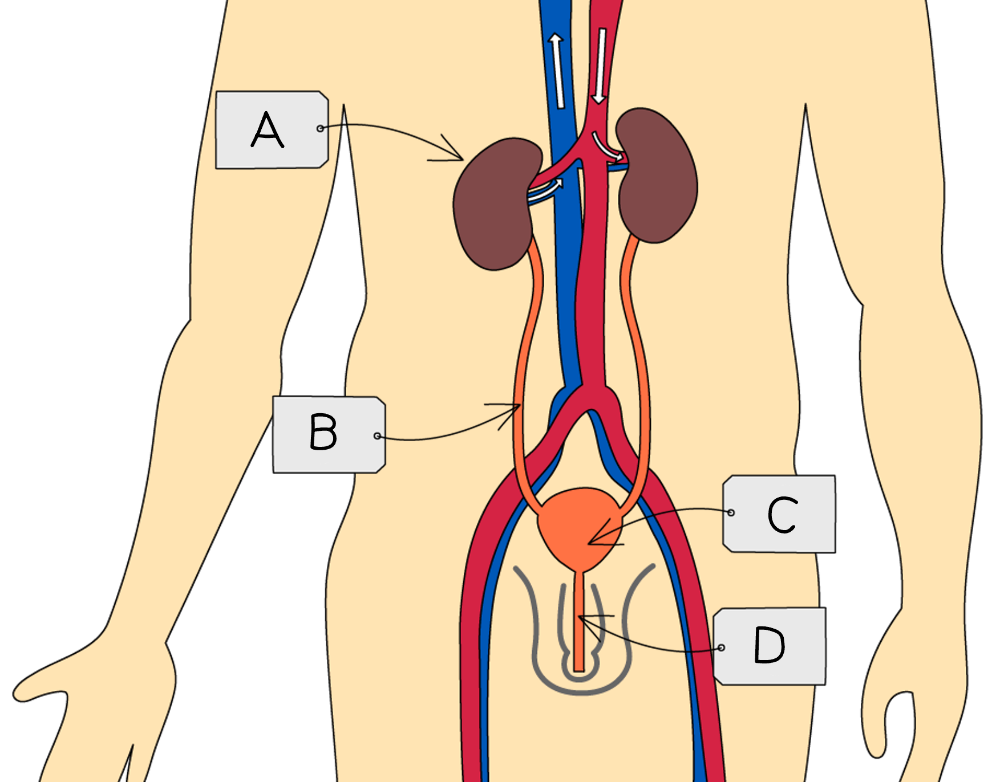
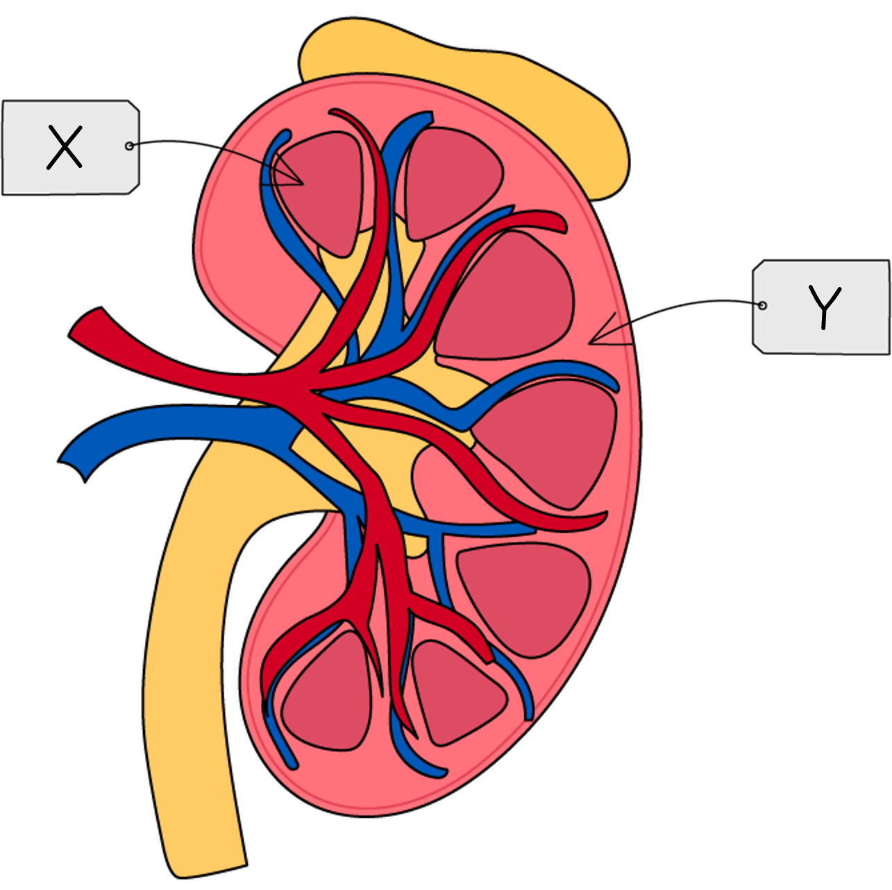

# Excretion in Humans

Course: cie-igcse-biology-23 · Section: 13. Excretion in Humans

Source: https://www.savemyexams.com/igcse/biology/cie/23/flashcards/13-excretion-in-humans/13-1-excretion-in-humans/

## Card 1 — question_and_answer (`fl_27rdm3p4kGKpkXNb`)

**FRONT**

Define the term **excretion**.

**BACK**

Excretion is the **removal **from the body of the** waste products of metabolism**, and any **substances present in excess**, e.g. excess salts

## Card 2 — question_and_answer (`fl_w4WDY3M5p5zqvGvW`)

**FRONT**

Which waste products of metabolism are excreted by the** lungs**?

**BACK**

The metabolic waste products excreted by the lungs are **water **and **carbon dioxide**, both produced during respiration.

## Card 3 — true_or_false (`fl_myBCySTfCxdbDQzM`)

**FRONT**

**True or False?**

The kidneys excrete urea, excess water and carbon dioxide.

**BACK**

**False.**

The kidneys excrete **urea**, **excess water** and **ions**.

Carbon dioxide is excreted via the lungs.

## Card 4 — question_and_answer (`fl_SXBByKHJsQRdwf7P`)

**FRONT**

What are the structures labelled **A**-**D** in the diagram?

**BACK**

Structures A-D are:

- A = kidney
- B = ureter
- C = bladder
- D = urethra

## Card 5 — question_and_answer (`fl_dB2TSzM6HqwCbCfS`)

**FRONT**

What is the role of the **bladder** in the urinary system?

**BACK**

The role of the bladder is to **store urine** that is produced by the kidneys.

## Card 6 — true_or_false (`fl_3B64GsBRw2zbwd6Q`)

**FRONT**

**True or False? **

The **ureter **carries urine from the bladder to the exterior of the body.

**BACK**

**False. **

The **urethra** carries urine from the bladder to the exterior of the body. The ureters are a pair of tubes that connect the kidneys to the bladder

## Card 7 — question_and_answer (`fl_ssHD5kwVf9QG2f7N`)

**FRONT**

What are the kidney regions indicated by labels **X** and **Y**? (**Extended Tier Only**)

**BACK**

The kidney regions are:

- X = medulla
- Y = cortex

## Card 8 — keyword_definition (`fl_22vvkJtrkpj9pkSy`)

**FRONT**

Define the term **nephron**. (**Extended Tier Only**)

**BACK**

Nephrons are **tiny tubes** found in the **kidney**. Each kidney contains many nephrons, the role of which is to produce **urine**.

## Card 9 — true_or_false (`fl_WbhmP5tsZ6KRz8gX`)

**FRONT**

**True or False?**

The Bowman's capsule of each nephron surrounds a glomerulus. (**Extended Tier Only**)

**BACK**

**True.**

The **Bowman's capsule** directly surround the **glomerulus**, a ball of blood vessels from which the blood filters into the nephron.

## Card 10 — question_and_answer (`fl_WHVmXtpxsWDz57vD`)

**FRONT**

Where in the kidney nephron does **filtration** occur? (**Extended Tier Only**)

**BACK**

Filtration, or ultrafiltration occurs between the **glomerulus** and the **Bowman's capsule**.

## Card 11 — question_and_answer (`fl_xdcV6dFYtsXgrYWj`)

**FRONT**

Name the substances that are forced out of the capillaries during **filtration**. (**Extended Tier Only**)

**BACK**

Substances that are forced out of the capillaries during ultrafiltration are:

- Glucose
- Water
- Urea
- Salts

These molecules form the **glomerular** **filtrate**.

## Card 12 — true_or_false (`fl_WcmSJGH6Fjn52SDy`)

**FRONT**

**True or False?**

All of the substances filtered by the glomerulus are reabsorbed into the blood further along the nephron. (**Extended Tier Only**)

**BACK**

**False.**

Substances that are reabsorbed further along the nephron include:

- all of the **glucose**
- some of the **ions**
- most of the **water**

Urea and excess substances are **not **reabsorbed.

## Card 13 — question_and_answer (`fl_qsCDX5zYcvYCYHvk`)

**FRONT**

Which components of the kidney filtrate are normally found in **urine**? (**Extended Tier Only**)

**BACK**

Components of the kidney filtrate are normally found in urine are:

- urea
- excess water
- excess ions

## Card 14 — question_and_answer (`fl_6SjGGg9QvzRfyJVD`)

**FRONT**

How does the **liver** enable assimilation of amino acids? (**Extended Tier Only**)

**BACK**

The liver enables assimilation of amino acids by **building them into new proteins** which can then be used by the body.

## Card 15 — question_and_answer (`fl_rTjz8j8QVNddbkxv`)

**FRONT**

How is **urea** formed? (**Extended Tier Only**)

**BACK**

Urea is formed **from excess amino acids**.

This involves the following:

- the nitrogen-containing part of amino acids is removed
- the removed chemicals are converted into ammonia and then into urea

## Card 16 — true_or_false (`fl_cf3Rmd5pvywVB4GP`)

**FRONT**

**True or False?**

Urea is produced in the kidneys. (**Extended Tier Only**)

**BACK**

**False.**

Urea is produced in the** liver**.

The kidneys filter the urea, causing it to be excreted.

## Card 17 — keyword_definition (`fl_pbxCnQmXJJXvGr6b`)

**FRONT**

Define the term **deamination**. (**Extended Tier Only**)

**BACK**

Deamination is the **removal of the nitrogen-containing part of amino acids** to form urea.

## Card 18 — question_and_answer (`fl_S52HDyCrBVfk6kW3`)

**FRONT**

Why does **urea** need to be excreted? (**Extended Tier Only**)

**BACK**

Urea needs to be excreted because it is **toxic** at high concentrations.

