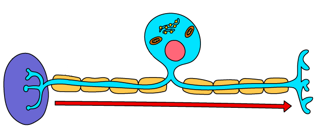
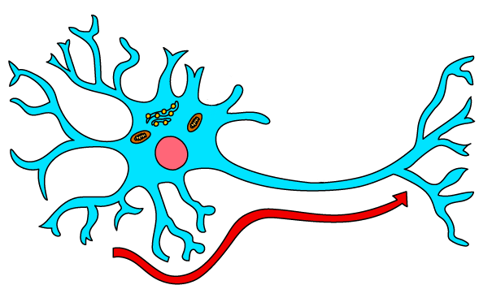
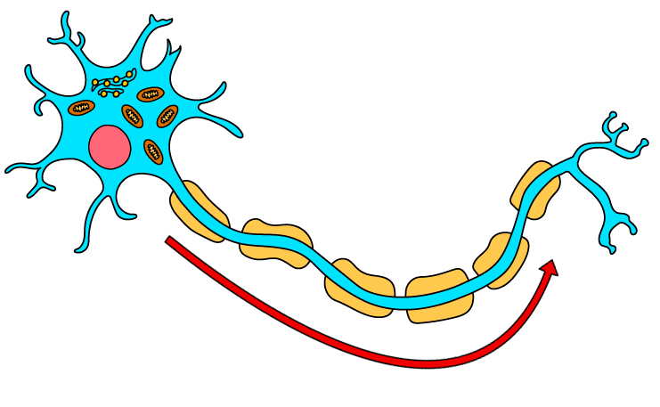
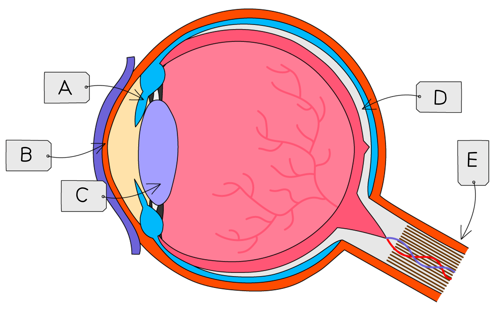
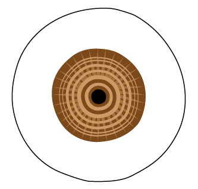
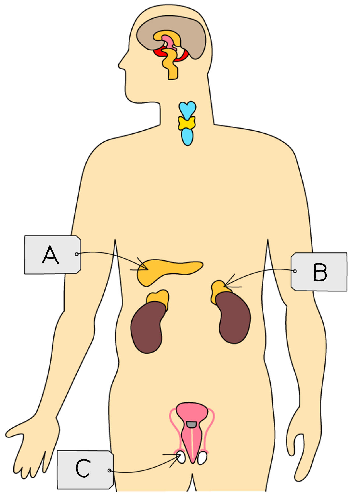
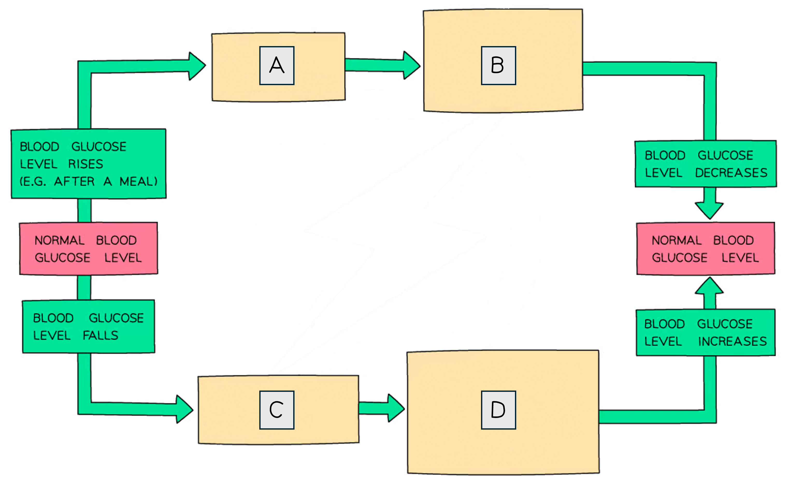
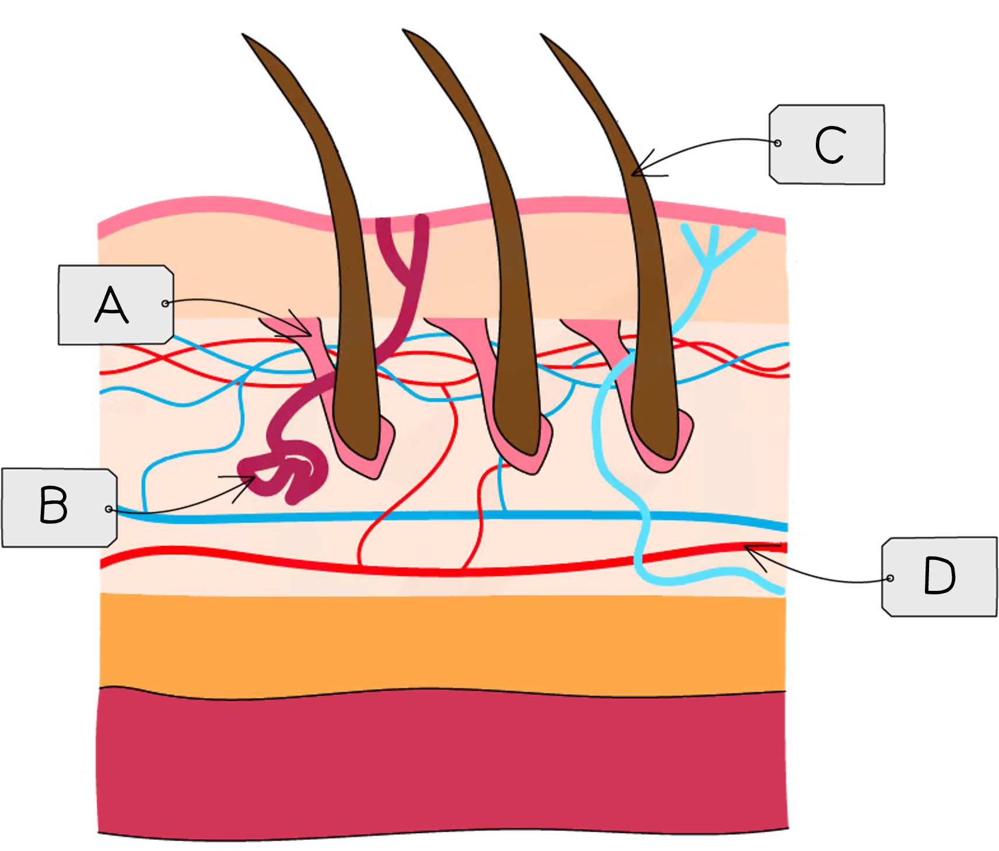

# Coordination, Response & Homeostasis

Course: cie-igcse-biology-23 · Section: 14. Coordination & Response

Source: https://www.savemyexams.com/igcse/biology/cie/23/flashcards/14-coordination-and-response/14-1-coordination-response-and-homeostasis/

## Card 1 — question_and_answer (`fl_KfTMCdynVRfgfCzp`)

**FRONT**

What is the role of the **nervous system**?

**BACK**

The nervous system's role is to **coordinate and regulate body functions** in response to changes in the environment.

## Card 2 — true_or_false (`fl_cbf3jDkCvtg2kCtv`)

**FRONT**

**True or False?**

Information passes along neurones in the form of electrical impulses.

**BACK**

**True.**

Information is passed along **neurones **and between the different parts of the nervous system in the form of **electrical impulses**.

## Card 3 — question_and_answer (`fl_sVRTkP23ngSY5xw6`)

**FRONT**

Which two components make up the **central nervous system** (CNS)?

**BACK**

The CNS is made up of the:

- brain
- spinal cord

## Card 4 — question_and_answer (`fl_NJRXS4NrTXS3bHvv`)

**FRONT**

What does the **peripheral nervous system** (PNS) consist of?

**BACK**

The PNS consists of the** nerves outside of the brain and spinal cord**.

## Card 5 — question_and_answer (`fl_Bf6p97qTYpjFfsxd`)

**FRONT**

What is the **neurone type** shown in the image?

**BACK**

The neurone shown in the image is a **sensory neurone**. It can be identified by the  position of the cell body.

## Card 6 — question_and_answer (`fl_k4bVZNwRQ5yjFPsj`)

**FRONT**

What is the **neurone type** shown in the image?

**BACK**

The neurone shown in the image is a** relay neurone. **Relay neurones can be identified because they are **short** and have a **small cell body at one end** with many dendrites.

## Card 7 — question_and_answer (`fl_St4dzJVXTXVXsjdF`)

**FRONT**

What is the **neurone type** shown in the image?

**BACK**

The neurone is a **motor neurone**, identifiable by its long axon with a large cell body at one end.

## Card 8 — true_or_false (`fl_VYMg64cwxPHV6YZN`)

**FRONT**

**True or False?**

The **nerve impulse** travels toward the cell body in all neurone cells.

**BACK**

**False**.

A nerve impulse travels **towards **the cell body in sensory neurones and **away **from the cell body in motor and relay neurones.

## Card 9 — question_and_answer (`fl_QRkPR4bHBS7JznMx`)

**FRONT**

What are **reflex actions**?

**BACK**

Reflex actions are **automatic**, **rapid** responses to a stimulus that **do not involve conscious thought**.

## Card 10 — question_and_answer (`fl_bWQpBTcyQmPpN8dv`)

**FRONT**

Write a flow diagram to represent a **reflex arc**.

**BACK**

A flow diagram that represents a reflex arc would be as follows:

**receptor → sensory neurone → relay neurone → motor neurone → effector**

## Card 11 — true_or_false (`fl_3Hz6H85MPm48M52c`)

**FRONT**

**True or False?**

Sensory neurones in a reflex arc connect receptor cells with the conscious brain.

**BACK**

**False.**

Sensory neurones in a reflex arc connect receptor cells with **relay neurones** in the **CNS**.

While there are some reflex arcs that involve the brain, the brain regions involved are not connected with conscious thought.

## Card 12 — question_and_answer (`fl_Fjnpj7vmnsMkGT49`)

**FRONT**

What is a **relay neurone**?

**BACK**

A relay neurone is a neurone within the **CNS** that connects **sensory **and** motor neurones**.

## Card 13 — question_and_answer (`fl_s2QbJGCkccV7Sjzm`)

**FRONT**

What is the role of a **motor neurone** in a reflex arc?

**BACK**

Motor neurones in reflex arcs connect **relay neurones** with **effectors**.

## Card 14 — true_or_false (`fl_2QzJTZvdg6HdCB7q`)

**FRONT**

**True or False?**

Effectors are muscles and sense organs.

**BACK**

**False**.

Effects are **muscles** and **glands**.

## Card 15 — keyword_definition (`fl_pvKS8hw7wpsQxpVJ`)

**FRONT**

Define the term **synapse**.

**BACK**

A synapse is a **junction between two neurones** where a very small **gap** exists between one neurone and the next.

## Card 16 — keyword_definition (`fl_VZSZFZJ59rP9SpDz`)

**FRONT**

Define the term **neurotransmitter**. (**Extended Tier Only**)

**BACK**

Neurotransmitters are **chemical signalling molecules** used to **transfer signals** between neurones at synapses.

## Card 17 — true_or_false (`fl_n8MKTRDFkwZkfvYY`)

**FRONT**

**True or False?**

Electrical impulses can jump across the gap at a synapse. (**Extended Tier Only**)

**BACK**

**False.**

Electrical impulses **cannot **directly jump the gap at synapses. Electrical signals are converted into *chemical signals *in the form of neurotransmitters which **diffuse **across a synapse gap.

## Card 18 — question_and_answer (`fl_PjJ8HkvbJnsgD8G6`)

**FRONT**

Describe the events that take place at a **synapse**. (**Extended Tier Only**)

**BACK**

The events at a synapse are as follows:

- **neurotransmitters** are released from vesicles
- neurotransmitters **diffuse** across the gap between neurones
- neurotransmitters** bind** to receptor molecules on the second neurone
- a **new electrical impulse** is generated in the second neurone

## Card 19 — true_or_false (`fl_T9q5JB7d4byy3tXq`)

**FRONT**

**True or False? **

Neurotransmitters move across synapses by active transport. (**Extended Tier Only**)

**BACK**

**False. **

Neurotransmitters move across the gap at a synapse by **diffusion** from a high concentration to a low concentration.

## Card 20 — true_or_false (`fl_JN3ppnvv5B27psmn`)

**FRONT**

**True or False? **

Synapses ensure that nerve impulses can only travel in one direction. (**Extended Tier Only**)

**BACK**

**True.**

One role of a synapse is to ensure that **impulses travel in one direction only**.

## Card 21 — question_and_answer (`fl_HkHc6vBTKcyQ8Nkz`)

**FRONT**

What are **sense organs**?

**BACK**

Sense organs are groups of **receptor cells** that respond to specific **stimuli**.

## Card 22 — question_and_answer (`fl_82nFbKW4SjrtwBg8`)

**FRONT**

What are the main **sense organs **and the **stimuli **to which their receptors respond?

**BACK**

The sense organs and stimuli are:

- **eyes **respond to **light**
- **ears** respond to **sound**
- **skin** responds to **touch** and **temperature**
- **nose **responds to **chemicals** in the air
- **tongue **responds to **chemicals** in food and drink

## Card 23 — true_or_false (`fl_5NRsTP4Yrh4txbwq`)

**FRONT**

**True or False?**

Receptor cells in the sense organs connect to motor neurones.

**BACK**

**False**.

Receptor cells in the sense organs connect to **sensory neurones**.

## Card 24 — true_or_false (`fl_WP5qm35gHQtYhVZW`)

**FRONT**

**True or False?**

The sense organs are part of the central nervous system.

**BACK**

**False**.

The sense organs are **not **part of the central nervous system. The CNS is made up of the brain and spinal cord.

The sense organs contain receptor cells that are connected to the **peripheral nervous system **(PNS).

## Card 25 — question_and_answer (`fl_7f7hCQZ8HGRny536`)

**FRONT**

What are the structures labelled **A**-**E** on the diagram below?

**BACK**

The structures labelled A-E are:

- A = iris
- B = cornea
- C = lens
- D = retina
- E = optic nerve 

## Card 26 — question_and_answer (`fl_V8jWjGzdDT7vsxK3`)

**FRONT**

What is the function of the **cornea**?

**BACK**

The function of the cornea is to **refract ligh**t into the eye.

## Card 27 — true_or_false (`fl_v7VcPx6wxH3DxnDw`)

**FRONT**

**True or False?**

The optic nerve carries impulses to the spinal cord.

**BACK**

**False**.

The optic nerve carries impulses to the **brain**.

## Card 28 — question_and_answer (`fl_n2t6tdGd2QqMMXK7`)

**FRONT**

What happens during the **pupil reflex** in **dim **light?

**BACK**

In dim light the **pupil dilates** in order to allow as much light into the eye as possible.

**Extended Tier Only**: the radial muscles in the iris contract and the circular muscles relax.

## Card 29 — question_and_answer (`fl_q6XS5yFFpgHR5sm9`)

**FRONT**

What level of light is the **iris **responding to?

**BACK**

The iris is responding to** bright light**; this can be seen because the pupil is constricted.

**Extended Tier Only**: the** **pupil is constricted due to the radial muscles relaxing and the circular muscles contracting.

## Card 30 — keyword_definition (`fl_SPGrwDdP4zp5bwPg`)

**FRONT**

Define the term **accommodation** in the context of eye function. (**Extended Tier Only**)

**BACK**

Accommodation is the process by which the lens of the eye changes its shape to **focus on objects at different distances**.

## Card 31 — question_and_answer (`fl_4ywcYwhVJptMGhkw`)

**FRONT**

What is the role of the **ciliary muscle** in accommodation? (**Extended Tier Only**)

**BACK**

The ciliary muscles contract or relax to **change the shape of the lens** during accommodation.

## Card 32 — question_and_answer (`fl_R7dxzYmy78BfkKbR`)

**FRONT**

What happens to the ciliary muscles, suspensory ligaments and lens when focusing on a **near object**? (**Extended Tier Only**)

**BACK**

When focusing on a near object:

- The ciliary muscles **contract**
- The suspensory ligaments **loosen**

This causes the lens to become **thicker** (more curved),** increasing refraction** of light for close vision.

## Card 33 — true_or_false (`fl_8SYxCTtnbhGzFCZQ`)

**FRONT**

**True or False?**

When focusing on a distant object the ciliary muscles relax and the suspensory ligaments loosen. (**Extended Tier Only**)

**BACK**

**False.**

When focusing on a distant object:

- The ciliary muscles** relax**
- The suspensory ligaments **tighten**

This pulls on the lens, making it **thinner**; this **reduces refraction** of light for distant vision.

## Card 34 — question_and_answer (`fl_5SSDtYhmrhxJCP6x`)

**FRONT**

What is the function of **cone cells**? (**Extended Tier Only**)

**BACK**

Cone cells **absorb light of different colours/wavelengths**, providing colour vision.

## Card 35 — question_and_answer (`fl_j4Z6ydK2pphdFzcN`)

**FRONT**

How are **rod** and **cone cells** distributed in the eye? (**Extended Tier Only**)

**BACK**

Rod and cone cells are distributed as follows:

- rod cells are found** all over the retina**, with the exception of the blind spot
- cone cells are **concentrated in the fovea**

## Card 36 — question_and_answer (`fl_C9GrHQp9KkDkdM7Z`)

**FRONT**

What is the function of the fovea? (**Extended Tier Only**)

**BACK**

The fovea is a region of the retina with the **highest density of cones cells**. Its function is to form **sharp, coloured images**.

## Card 37 — question_and_answer (`fl_sVyPjbg4p5M3Xmcx`)

**FRONT**

Define the term **hormone**.

**BACK**

A hormone is a **chemical substance**, produced by a **gland **and carried by the **blood**, which alters the activity of one or more target organs.

## Card 38 — question_and_answer (`fl_NtqDw6BhTrjdx62m`)

**FRONT**

How are **hormones **transported around the body?

**BACK**

Hormones are carried around the body in the **blood**.

## Card 39 — keyword_definition (`fl_r7hCpYPBvwwTDWDs`)

**FRONT**

What is the **endocrine** system?

**BACK**

The endocrine system is composed of **glands **that secrete **hormones **directly into the bloodstream.

## Card 40 — question_and_answer (`fl_vx5hM7Zgp8FFq6Mv`)

**FRONT**

Identify the glands labelled **A**, **B **and **C**.

**BACK**

The glands are:

- A = pancreas
- B = adrenal gland
- C = testes

## Card 41 — question_and_answer (`fl_ty296dcV7myhstRm`)

**FRONT**

What is the function of **adrenaline** in the body?

**BACK**

Adrenaline is known as the 'fight or flight' hormone and its role is to** prepare the body for action**. Its effects include:

- increased heart rate
- increased breathing rate
- increased pupil diameter

## Card 42 — true_or_false (`fl_cGYXj7ktgK5GXvhn`)

**FRONT**

**True or False? **

The effects of hormones are faster than that of the nervous system.

**BACK**

**False**.

Compared to the nervous system, the effects of **hormones are slower**.

## Card 43 — question_and_answer (`fl_8FjwsrWMqByQVq5Q`)

**FRONT**

From where is the hormone glucagon secreted?** **(**Extended Tier Only**)

**BACK**

Glucagon is secreted by the **pancreas**.

## Card 44 — question_and_answer (`fl_m8wBGgvrPpMwKgjX`)

**FRONT**

What is the role of adrenaline in the control of metabolism?** **(**Extended Tier Only**)

**BACK**

The role of adrenaline in the control of metabolic activity is:

- increasing **blood glucose concentration **
- increasing** heart rate**

This helps to deliver more glucose to muscles for respiration to ensure that the body is well prepared for high levels of activity.

## Card 45 — keyword_definition (`fl_DcfPnsj4t5v6hPnv`)

**FRONT**

Define the term **homeostasis**.

**BACK**

Homeostasis is the **maintenance of a constant internal environment** within narrow limits.

## Card 46 — question_and_answer (`fl_Hf2XKqK56PWTh7ps`)

**FRONT**

What is the function of the hormone** insulin**?

**BACK**

The function of insulin is to** lower blood sugar **concentration.

## Card 47 — keyword_definition (`fl_p53hJQCb7Z4Ft8q9`)

**FRONT**

Define the term **negative feedback**. (**Extended Tier Only**)

**BACK**

Negative feedback describes a control mechanism that functions to **reverse any change** in conditions to return to the set point.

## Card 48 — question_and_answer (`fl_Bjs7FqPP3T8zbN5n`)

**FRONT**

What are the events indicated by the letters **A**-**D** in the diagram? (**Extended Tier Only**)

**BACK**

Events A-D are:

- A = release of insulin from the pancreas
- B = uptake of glucose from the blood by the cells
- C = release of glucagon from the pancreas
- D = glycogen is broken down into glucose

## Card 49 — question_and_answer (`fl_tvqbYbBnG9VNFrcG`)

**FRONT**

What is the role of the liver in glucose regulation? (**Extended Tier Only**)

**BACK**

The liver is involved with glucose regulation as follows:

- glucose is converted into **glycogen** and **stored in liver cells** in response to insulin
- glycogen in liver cells is** broken down into glucose** in response to glucagon

## Card 50 — true_or_false (`fl_PJgmBpd4MWnwF4s3`)

**FRONT**

**True or False?**

Type 1 diabetes is treated with insulin injections and by monitoring and controlling diet. (**Extended Tier Only**)

**BACK**

**True.**

Type 1 diabetes can be treated by** injecting insulin**. **Monitoring and controlling diet **allows a correct insulin dose to be administered.

## Card 51 — question_and_answer (`fl_c9PzSpjH8D4wvmvx`)

**FRONT**

What are the structures labelled **A**-**D** in the diagram? (**Extended Tier Only**)

**BACK**

Structures A-D are:

- A = hair erector muscle
- B = sweat gland
- C = hair
- D = blood vessel

## Card 52 — question_and_answer (`fl_kzmDYmsmjnbJRv8W`)

**FRONT**

How does **sweating** increase heat loss from the body? (**Extended Tier Only**)

**BACK**

Sweating increases heat loss when sweat** evaporates **from the skin surface. The evaporation of sweat **transfers heat energy** away from the skin.

## Card 53 — question_and_answer (`fl_mRYJZsD67vJjmdvT`)

**FRONT**

How does **shivering** contribute towards temperature regulation? (**Extended Tier Only**)

**BACK**

Shivering aids temperature regulation because the rapid muscle contractions **generate heat** through** respiration**; this helps to** raise the core body temperature**.

## Card 54 — true_or_false (`fl_rmsm4vV2qBycpWKg`)

**FRONT**

**True or False?**

The hair erector muscles in the skin contract in response to cold temperatures. (**Extended Tier Only**)

**BACK**

**True.**

Contraction of the hair erector muscles causes the **hairs on the skin surface to stand up**, providing a **layer of insulation** in cold temperatures.

## Card 55 — keyword_definition (`fl_YntKyBXTRWkmDCQW`)

**FRONT**

Define the term **vasodilation**. (**Extended Tier Only**)

**BACK**

Vasodilation is a cooling mechanism in which the **diameter of skin arterioles increases**. This** increases blood flow **to capillaries in the skin surface, transferring heat to the environment by** radiation**.

## Card 56 — true_or_false (`fl_2ZmK3QVTfpPH2KMg`)

**FRONT**

**True or False?**

When a person enters a colder environment blood flow to the surface of the skin is reduced. (**Extended Tier Only**)

**BACK**

**True.**

Vasoconstriction** **is a heat retention mechanism. The **diameter of skin arterioles decreases** to **reduce blood flow to capillaries** in the surface of the skin. This minimises heat loss by radiation.

## Card 57 — true_or_false (`fl_79BtHt3DmDMwPDhr`)

**FRONT**

**True or False?**

Constriction of the capillaries reduces blood flow to the surface of the skin. (**Extended Tier Only**)

**BACK**

**False.**

Capillaries **do not have a muscle layer **and therefore** cannot constrict**. Constriction occurs in the *arterioles that supply the skin capillaries*, reducing blood flow to the skin surface.

## Card 58 — keyword_definition (`fl_NfBmN6StZBSH7hb4`)

**FRONT**

Define the term **gravitropism** (or geotropism).

**BACK**

Gravitropism, also known as geotropism, is the **directional growth** response of plants towards or away from **gravity**; roots grow downwards and shoots grow upwards.

## Card 59 — keyword_definition (`fl_mtNGkVH3xPbKphQ8`)

**FRONT**

Define the term **phototropism**.

**BACK**

Phototropism is the** directional growth** of plants towards or away from** light**, allowing shoots to grow towards light to optimise photosynthesis.

## Card 60 — true_or_false (`fl_8WGfPqR8yS3gyq4f`)

**FRONT**

**True or False?**

In an investigation into the effect of gravity on newly germinated seedlings the dependent variable is the direction of gravity.

**BACK**

**False.**

In an investigation into the effect of gravity on newly germinated seedlings the dependent variable is the **length **and/or** direction of growth** of newly grown **roots** and **shoots**.

The direction of gravity is the independent variable in this investigation.

## Card 61 — question_and_answer (`fl_R69hsnxfr2sh4XY5`)

**FRONT**

Which variables need to be **controlled** in an investigation into the effect of **light** on newly germinated seedlings?

**BACK**

Variables that need to be controlled in an investigation into the effect of light on newly germinated seedlings include:

- direction of gravity
- temperature
- water availability / how damp the cotton wool is
- type / size / age of seedlings

## Card 62 — true_or_false (`fl_p6wTxhghdSpXkhQH`)

**FRONT**

**True or False?**

Phototropism is an example of chemical control of plant growth. (**Extended Tier Only**)

**BACK**

**True.**

Phototropism is a growth response controlled by the plant chemical **auxin**.

## Card 63 — true_or_false (`fl_rts9mjbm9tV9nYCw`)

**FRONT**

**True or False?**

Auxin is produced on the shady side of a plant shoot. (**Extended Tier Only**)

**BACK**

**False.**

Auxin is **produced in the shoot tip** before **diffusing** to the shady part of the plant.

## Card 64 — question_and_answer (`fl_PXbFCQDNGfTVTNks`)

**FRONT**

What happens to **auxin distribution **when light shines on one side of a shoot? (**Extended Tier Only**)

**BACK**

When light shines on one side of a shoot the auxin produced in the tip **accumulates on the shaded side**.

## Card 65 — question_and_answer (`fl_HgwzsNh9WnJvvXHQ`)

**FRONT**

What effect does **auxin** have on cells in the shoots of plants? (**Extended Tier Only**)

**BACK**

Auxin stimulates** cell elongation** in plant shoots.

## Card 66 — question_and_answer (`fl_5sv5dRShMDgbq4Pc`)

**FRONT**

How does auxin distribution in response to light lead to **phototropism**? (**Extended Tier Only**)

**BACK**

Auxin accumulation on the shaded side of a shoot causes **cells on the shady side to elongate** at a faster rate than cells on the light side; this leads to **bending of the shoot **towards the light.

