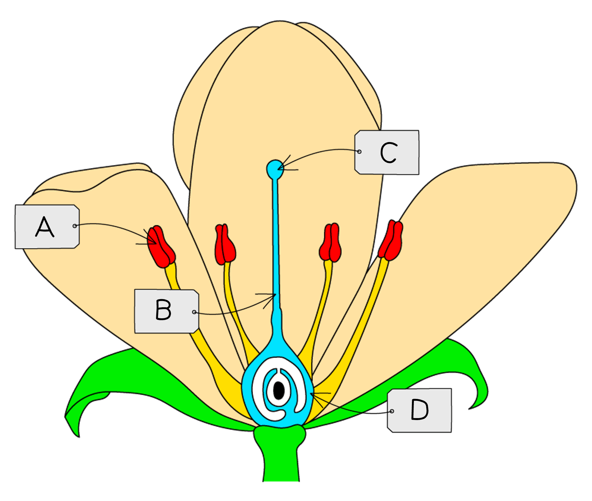
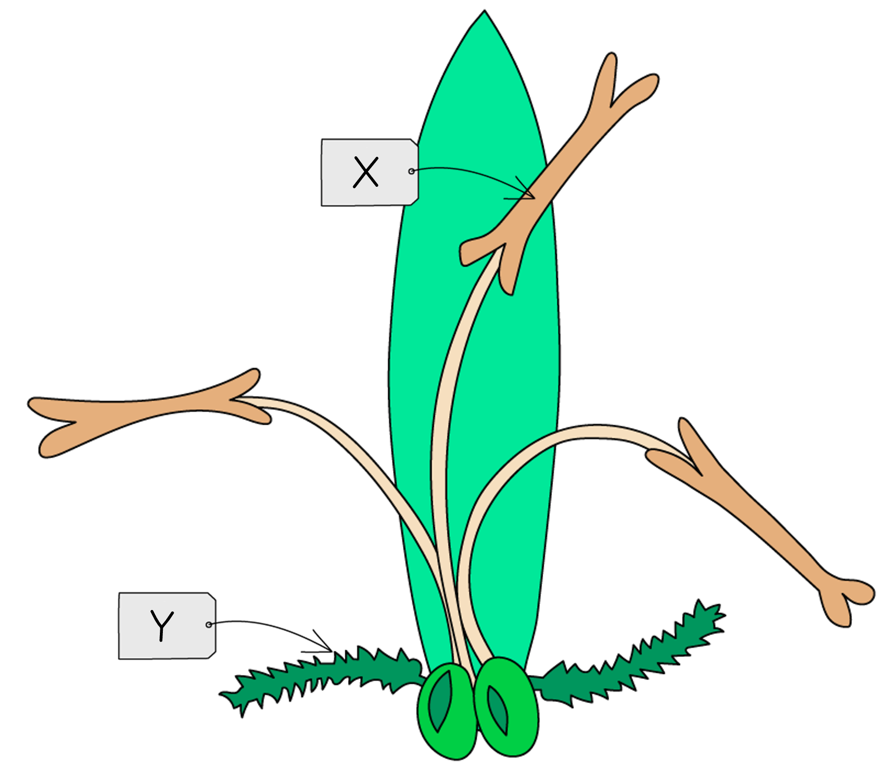
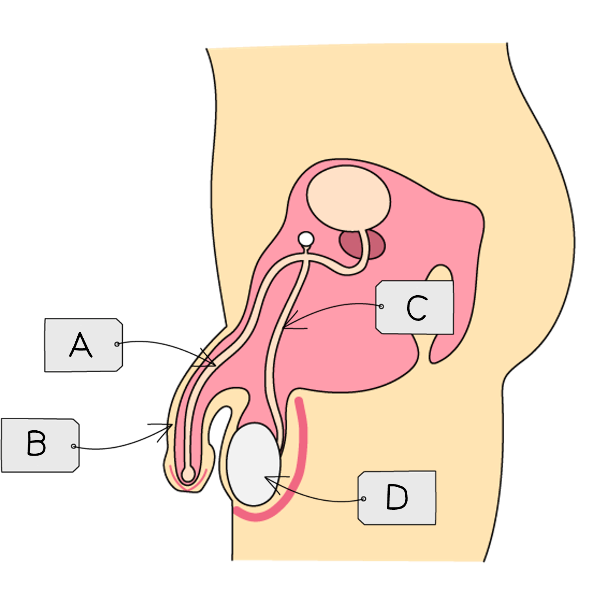
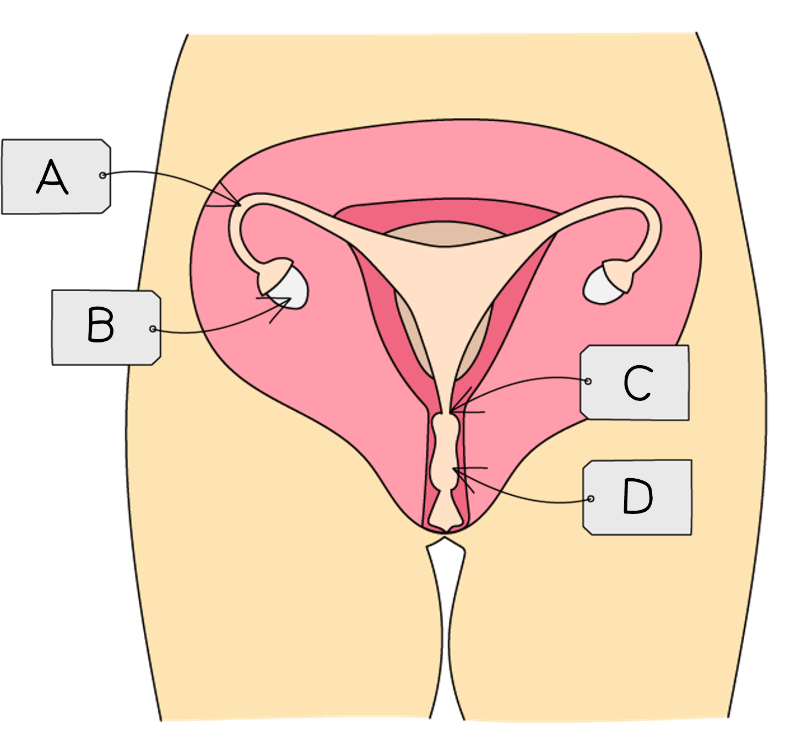
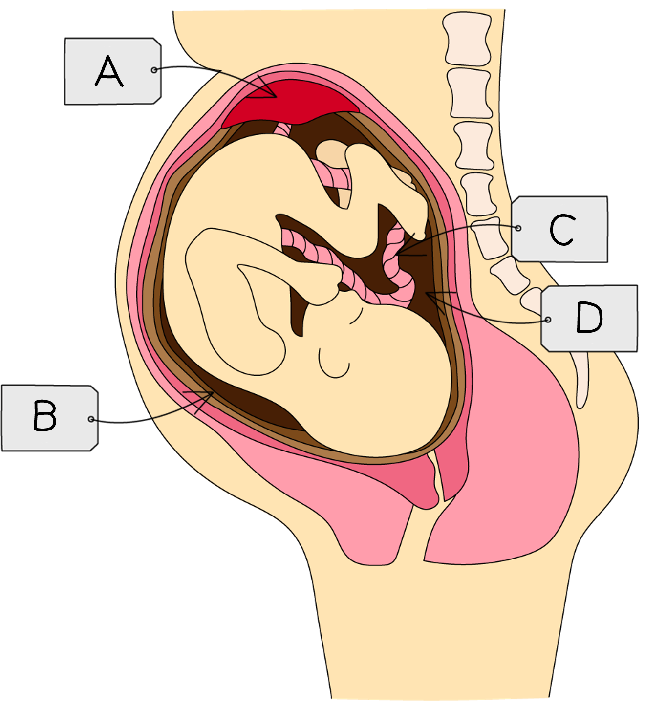

# Reproduction in Plants & Humans

Course: cie-igcse-biology-23 · Section: 16. Reproduction

Source: https://www.savemyexams.com/igcse/biology/cie/23/flashcards/16-reproduction/16-1-reproduction-in-plants-and-humans/

## Card 1 — question_and_answer (`fl_CqpWmkW372mQKVhM`)

**FRONT**

Define the term **asexual reproduction**.

**BACK**

Asexual reproduction is the reproductive process that results in **genetically identical offspring** from** one parent**.

## Card 2 — question_and_answer (`fl_4dWsF6KSBxmydzz7`)

**FRONT**

What are some examples of **asexual reproduction** in living organisms?

**BACK**

Examples of asexual reproduction in living organisms include:

- binary fission in **bacteria**
- **plants** reproducing via bulbs, tubers or runners
- budding in **yeast** cells
- budding in** jellyfish**
- parthenogenesis in **aphids**

## Card 3 — question_and_answer (`fl_4S3xD76MrgxFktzj`)

**FRONT**

What are the **advantages **of **asexual** reproduction for wild populations and crop production? (**Extended Tier Only**)

**BACK**

Asexual reproduction can be advantageous because it produces offspring that are **genetically identical to their parents**, meaning that:

- characteristics** **that are well suited to the current environment of a wild population** **are preserved
- desirable characteristics of cultivated** **crop varieties are preserved

In addition to this, asexual reproduction** only requires one parent** so energy does not need to be expended to find a mate.

## Card 4 — question_and_answer (`fl_hFWRKddFmpnSSxcr`)

**FRONT**

What are the **disadvantages **of **asexual** reproduction for wild populations and crop production? (**Extended Tier Only**)

**BACK**

Asexual reproduction can be disadvantageous because **offspring lack genetic variation**, meaning that:

- wild populations are** less able to adapt** to environmental change
- crop varieties will all be **susceptible to the same pests and diseases**

## Card 5 — question_and_answer (`fl_8K8M5bKwCd9pm8Pp`)

**FRONT**

Define the term** sexual reproduction**.

**BACK**

Sexual reproduction is the reproductive process during which** the nuclei of two gametes fuse **to form a zygote and **genetically different offspring** are produced.

## Card 6 — question_and_answer (`fl_tm7bQSkpB6DHjhDS`)

**FRONT**

Define the term **fertilisation**.

**BACK**

Fertilisation is the **fusion of gamete nuclei**.

## Card 7 — question_and_answer (`fl_FPbh2KkpJgxWMryv`)

**FRONT**

What does it mean when gametes are described as **haploid**? (**Extended Tier Only**)

**BACK**

Gametes are haploid, meaning that they contain** half** **the full number of chromosomes**.

## Card 8 — true_or_false (`fl_QGrFk9gvbJZRjhxs`)

**FRONT**

**True or False?**

Zygotes are diploid. (**Extended Tier Only**)

**BACK**

**True.**

Zygotes form when** two haploid gametes fuse**, producing a **diploid** **zygote** with the** full number of chromosomes**.

## Card 9 — question_and_answer (`fl_yhRzTPVnCPzzr55j`)

**FRONT**

What are the **advantages** of **sexual reproduction** for wild populations and crop production? (**Extended Tier Only**)

**BACK**

Sexual reproduction can be advantageous because it **generates genetic variation**; this means that:

- wild populations can **adapt to changes** in their environment
- crop plants may **not all be equally susceptible** to pests and disease

## Card 10 — question_and_answer (`fl_4zFq6TvMf69BpW4r`)

**FRONT**

What are the **disadvantages** of **sexual reproduction** for wild populations and crop production? (**Extended Tier Only**)

**BACK**

Sexual reproduction can be disadvantageous because **offspring are different to their parents**, meaning that:

- some of the offspring in a wild population may be **less well suited to their environment** than their parents
- the **desirable traits of a crop may not be present** in offspring grown from seed

## Card 11 — question_and_answer (`fl_2cGXGDDGV4qfxMnR`)

**FRONT**

What are the structures labelled **A**-**D** in the diagram?

**BACK**

Structures A-D are:

- A = anther
- B = style
- C = stigma
- D = ovary

## Card 12 — true_or_false (`fl_7CJC6BW8tM8B9gx7`)

**FRONT**

**True or False?**

Petals of insect-pollinated flowers tend to be brightly coloured.

**BACK**

**True**.

Petals of insect-pollinated flowers tend to be brightly coloured to **attract **pollinator insects.

## Card 13 — question_and_answer (`fl_2hfNSNkXqW5cF6jn`)

**FRONT**

What is the role of the **anthers** in flowers?

**BACK**

Anthers produce and release **pollen**.

## Card 14 — question_and_answer (`fl_vv4FfRr6R5qChkQ9`)

**FRONT**

What are the structures labelled **X** and **Y** in the diagram?

**BACK**

X and Y are:

- X = anther
- Y = stigma

## Card 15 — true_or_false (`fl_MdjBVW6QG4b4tynr`)

**FRONT**

**True or False?**

The pollen grains of insect pollinated flowers are smaller and lighter than those produced by wind pollinated flowers.

**BACK**

**False.**

Insect pollinated flowers produce **large, sticky pollen grains**, while wind pollinated flowers produce small, light pollen grains.

## Card 16 — keyword_definition (`fl_D4r6FpygJmrnFZdp`)

**FRONT**

Define the term **pollination**.

**BACK**

Pollination is the process of **transferring pollen** from the anther to the stigma of a flower.

## Card 17 — question_and_answer (`fl_h7xhP3Njt78Y3TQD`)

**FRONT**

Describe **fertilisation** in plants.

**BACK**

Fertilisation in plants involves the **fusion of a pollen nucleus with an ovule nucleus**.

## Card 18 — question_and_answer (`fl_9G9vvJNddHMCZ4x3`)

**FRONT**

How are the **stigmas** of insect pollinated flowers adapted for pollination?

**BACK**

The stigmas of insect pollinated flowers are** sticky** in order to collect pollen grains from the bodies of visiting insects.

## Card 19 — question_and_answer (`fl_qmVjRdhCkQXvX4VC`)

**FRONT**

How are **anthers** adapted in wind-pollinated plants?

**BACK**

**Anthers** are adapted in wind-pollinated plants by** swinging on long filaments outside the flower **to allow the wind to catch pollen grains.

## Card 20 — true_or_false (`fl_5nbf7p446pwG9m67`)

**FRONT**

**True or False?**

Seed germination requires water, oxygen and cold temperatures.

**BACK**

**False.**

Seed germination requires water, oxygen and **warmth**. This is because the temperature needs to be suitable for enzyme activity.

## Card 21 — question_and_answer (`fl_X9hxVQcpFxp2Q6YC`)

**FRONT**

What is **self-pollination**? (**Extended Tier Only**)

**BACK**

Self-pollination occurs when** pollen is transferred **from the **anther** of a flower to:

- the** stigma** of the** same flower**
- the **stigma** of another flower on the **same plant**

## Card 22 — question_and_answer (`fl_d8Mqj5gBmSy26hsd`)

**FRONT**

What is **cross-pollination**? (**Extended Tier Only**)

**BACK**

Cross-pollination occurs when **pollen is transferred** from the **anther** of a flower to the **stigma** of a flower from** another plant** of the same species.

## Card 23 — true_or_false (`fl_fnv36cMMVNmsjCpN`)

**FRONT**

**True or False?**

Self-pollination reduces the ability of a plant population to respond to changes in the environment. (**Extended Tier Only**)

**BACK**

**True.**

Self-pollination results in the production of offspring that are** less genetically diverse** (although they are not clones), meaning that they have a reduced ability to respond to changes in their environment.

## Card 24 — question_and_answer (`fl_W2z94bsfNR5FGG3d`)

**FRONT**

Describe how **fertilisation** occurs in plants. (**Extended Tier Only**)

**BACK**

Fertilisation in plants involves the following:

- a **pollen tube** grows down the style towards the ovary
- pollen nuclei travel down the pollen tube to the ovary
- a **pollen nucleus fuses with an ovule nucleus** in the ovary

## Card 25 — question_and_answer (`fl_H7cNW6zVMCDMsZQx`)

**FRONT**

What are the structures labelled **A**-**D** in the diagram?

**BACK**

The structures are:

- A = urethra
- B = penis
- C = sperm duct
- D = testes/testis

## Card 26 — question_and_answer (`fl_brwmbvkb7h4HcNFW`)

**FRONT**

What are the structures labelled **A**-**D** in the diagram?

**BACK**

The structures are:

- A = oviduct
- B = ovary
- C = cervix
- D = vagina

## Card 27 — question_and_answer (`fl_8PJcNN9HvYDMr4Sh`)

**FRONT**

What is the function of the **testes** in the male reproductive system?

**BACK**

The testes are responsible for the **production of sperm cells**. They also secrete the hormone **testosterone**, essential for the development of male reproductive organs and secondary sexual characteristics.

## Card 28 — true_or_false (`fl_nGMnRS3rvTtdg8fr`)

**FRONT**

**True or False? **

The prostate gland secretes a fluid that nourishes and protects sperm.

**BACK**

**True**.

The prostate gland produces a fluid that contributes to **semen** volume. This fluid contains enzymes and nutrients that **support sperm motility**, as well as substances that help **neutralise the acidity **of the female reproductive tract.

## Card 29 — question_and_answer (`fl_mgzxSv6f4Zb3mHct`)

**FRONT**

What is the role of the **cervix **in the female reproductive system?

**BACK**

The cervix is a **ring of muscle** between the vagina and the uterus. It **keeps the developing fetus inside the uterus **during pregnancy and dilates during birth to allow passage of the baby through the vagina.

## Card 30 — question_and_answer (`fl_2sBMfVpdMsxPZ2sD`)

**FRONT**

What is the role of the **uterus** in the female reproductive system?

**BACK**

The uterus is where the **developing embryo implants **and** develops **during pregnancy.

## Card 31 — question_and_answer (`fl_RVT3GBNtKFTNtzrM`)

**FRONT**

What is **fertilisation** in the context of human reproduction?

**BACK**

Fertilisation in human reproduction is the **fusion of the nuclei **of an** egg and sperm cell**.

## Card 32 — question_and_answer (`fl_5WjdWcPpwvRFJq29`)

**FRONT**

What are the **adaptive features **of **sperm cells**?

**BACK**

The adaptive features of sperm cells include:

- **flagellum** for swimming
- many **mitochondria** to release energy for swimming
- **enzymes** in the acrosome for entry into the egg cell

## Card 33 — question_and_answer (`fl_CYNTNXySYccZxqwQ`)

**FRONT**

What are the **adaptive features **of **egg cells**?

**BACK**

Adaptive features of egg cells include:

- **energy stores** within the cytoplasm
- the** jelly coat** that **changes at fertilisation** to allow entry of a single sperm cell

## Card 34 — true_or_false (`fl_yz76jN3dwqFpDfSm`)

**FRONT**

**True or False?**

Egg cells are larger, fewer in number and more motile than sperm cells.

**BACK**

**False.**

Egg cells are larger and fewer in number than sperm cells, but they are **not motile**, meaning that they **do not move around** by themselves.

## Card 35 — keyword_definition (`fl_dCCtZ77GdGqmPvNr`)

**FRONT**

Define the term** embryo**.

**BACK**

The embryo is a **ball of cells** that develops from the **zygote**.

## Card 36 — question_and_answer (`fl_ZwnXfv36ffD752Pr`)

**FRONT**

What are the structures labelled **A**-**D** in the diagram?

**BACK**

The structures are:

- A = placenta
- B = amniotic sac
- C = umbilical cord
- D = amniotic fluid

## Card 37 — question_and_answer (`fl_bk8qm2tjYKnqgnqc`)

**FRONT**

What is the function of the **placenta**? (**Extended Tier Only**)

**BACK**

The function of the placenta is to allow **exchange of substances** between the mother's blood and that of the fetus. Exchanged substances include:

- dissolved nutrients
- gases
- excretory products

## Card 38 — true_or_false (`fl_Tc9sPr3V6N7tK76g`)

**FRONT**

**True or False?**

Pathogens cannot cross the placenta while some toxins can. (**Extended Tier Only**)

**BACK**

**False.**

Both **pathogens and toxins **can cross the placenta.

## Card 39 — question_and_answer (`fl_WrNT4XQVYvqktJZN`)

**FRONT**

What are **secondary sexual characteristics**?

**BACK**

Secondary sexual characteristics are features that are **not **present at birth but that **develop during puberty**.

## Card 40 — question_and_answer (`fl_rRkcm6RyPCGqHZn2`)

**FRONT**

What are the two hormones that control the development of **secondary sexual characteristics**?

**BACK**

The two hormones that control the development of secondary sexual characteristics are:

- **oestrogen **in females
- **testosterone **in males

## Card 41 — question_and_answer (`fl_XyNYPGPftT4W5s67`)

**FRONT**

Give examples of secondary sexual characteristics that develop in **females**.

**BACK**

Examples of secondary sexual characteristics that develop in females include:

- breast development
- growth of body hair
- widening of hips
- menstruation
- growth of sex organs

## Card 42 — question_and_answer (`fl_cFYgCZJFb7nBCTQB`)

**FRONT**

Give examples of secondary sexual characteristics that develop in **males**.

**BACK**

Examples of secondary sexual characteristics that develop in males include:

- growth of sex organs
- growth of facial and body hair
- voice breaking
- sperm production

## Card 43 — question_and_answer (`fl_yRdzRrRvqwjk9rkF`)

**FRONT**

What is the **menstrual cycle**?

**BACK**

The menstrual cycle is the sequence of events that includes the **thickening of the uterus lining**, **ovulation** and **menstruation**; it is controlled by a series of hormones.

## Card 44 — question_and_answer (`fl_QcrtQKW63yWSWjWW`)

**FRONT**

Define the term **ovulation**.

**BACK**

Ovulation is the** release of an egg cell** from the** ovaries **during the menstrual cycle.

## Card 45 — question_and_answer (`fl_ybQDy2jDzYFfbWw6`)

**FRONT**

From where are **oestrogen** and **progesterone **secreted during the menstrual cycle? (**Extended Tier Only**)

**BACK**

Oestrogen and progesterone are secreted from the **ovaries**.

Specifically, oestrogen is secreted by the **developing follicle **and progesterone by the empty follicle, known as the **corpus luteum**.

## Card 46 — question_and_answer (`fl_tpm6bDb5KkbXvYqW`)

**FRONT**

What is the role of **FSH** in the menstrual cycle? (**Extended Tier Only**)

**BACK**

FSH **causes an egg to start maturing** in the ovary. It also stimulates the ovaries to **start releasing oestrogen**.

## Card 47 — true_or_false (`fl_YNGSFn4mvGWzqQJZ`)

**FRONT**

**True or False?**

LH causes egg cells to start to mature within the ovaries. (**Extended Tier Only**)

**BACK**

**False.**

LH causes **ovulation** to occur.

It is *FSH* that causes an egg cell to begin to mature.

## Card 48 — question_and_answer (`fl_KwTnHH78gyH567jQ`)

**FRONT**

What is the role of **oestrogen** in the menstrual cycle? (**Extended Tier Only**)

**BACK**

Oestrogen causes the **uterus lining to thicken** during the first part of the menstrual cycle. It also interacts with other hormones to bring about **maturation of an egg cell**.

## Card 49 — true_or_false (`fl_BvT3mrxdXQ7xnC2C`)

**FRONT**

**True or False?**

An increase in progesterone results in the loss of the uterus lining. (**Extended Tier Only**)

**BACK**

**False.**

A** decrease** in progesterone levels at the end of the cycle results in the loss of the lining during menstruation.

## Card 50 — keyword_definition (`fl_4DHDK6ddFPzzGjYR`)

**FRONT**

Define the phrase **sexually transmitted infection**.

**BACK**

A sexually transmitted infection is an infection that is** transmitted through sexual contact**.

## Card 51 — question_and_answer (`fl_Kx8CJjQwyJr5Fx9N`)

**FRONT**

What is **HIV**?

**BACK**

HIV is a **pathogen** that causes an **STI**. HIV stands for human immunodeficiency virus.

## Card 52 — true_or_false (`fl_2gZXjxgZrJD6Pt2x`)

**FRONT**

**True or False?**

HIV is the same as AIDS.

**BACK**

**False.**

HIV is a **pathogen **and infection with **HIV can lead to the disease AIDS**.

## Card 53 — question_and_answer (`fl_z3qYjj7z3GFdN56q`)

**FRONT**

How is HIV **transmitted**?

**BACK**

HIV is** transmitted via body fluids**, e.g. during sexual intercourse, contaminated blood, sharing needles, or across the placenta.

## Card 54 — question_and_answer (`fl_wq6fwDTKyN7gdmgw`)

**FRONT**

How can the **spread of STIs** be **controlled**?

**BACK**

The spread of STIs can be controlled by:

- the use of **condoms**
- **testing **for the presence of HIV so that infected individuals do not pass on the infection without knowing
- **education**

