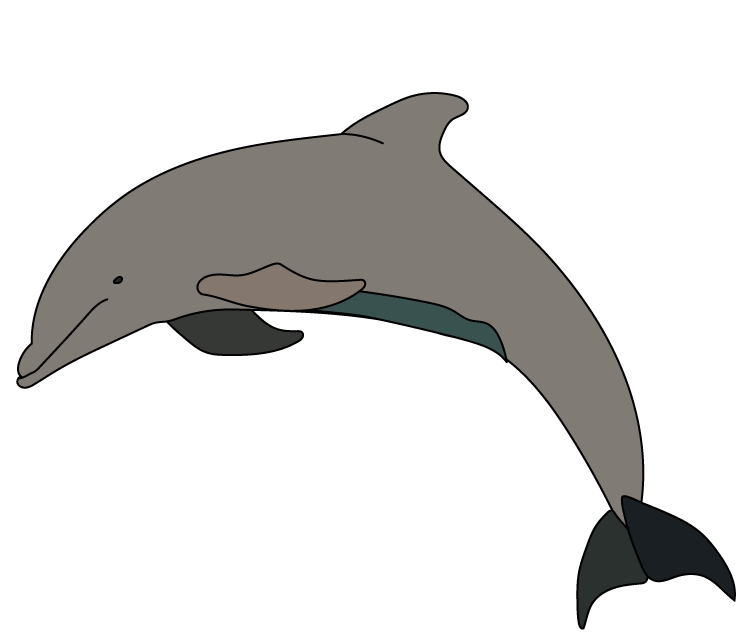
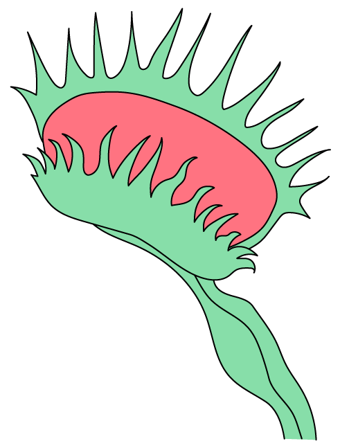
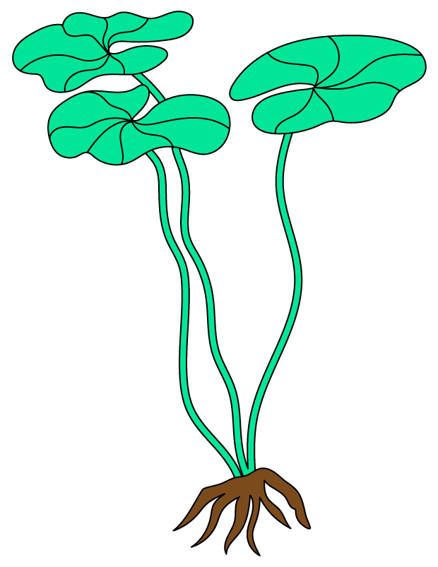
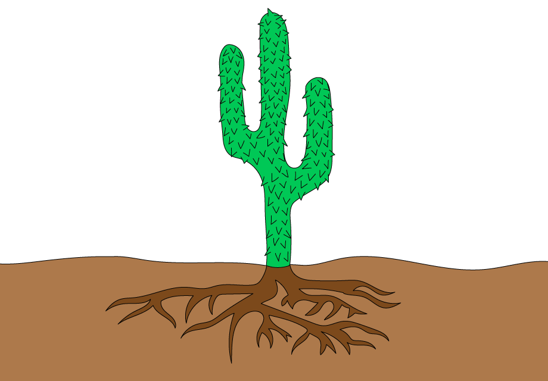

# Variation & Natural Selection

Course: cie-igcse-biology-23 · Section: 18. Variation & Selection

Source: https://www.savemyexams.com/igcse/biology/cie/23/flashcards/18-variation-and-selection/18-1-variation-and-natural-selection/

## Card 1 — keyword_definition (`fl_62s86CWktQmHFxNG`)

**FRONT**

Define the term** variation**.

**BACK**

Variation refers to the** differences between individuals** of the same species.

## Card 2 — true_or_false (`fl_cbSjmbBmF9NxdMs9`)

**FRONT**

**True or False?**

Continuous variation results in a limited number of phenotypes with no intermediate values.

**BACK**

**False.**

It is **discontinuous variation** that results in a limited number of phenotypes with no intermediate values.

Continuous variation results in a **range of phenotypes**.

## Card 3 — question_and_answer (`fl_cnD73nN8Qpb2X3qP`)

**FRONT**

What are some examples of **continuous variation**?

**BACK**

Examples of continuous variation include:

- body length
- body mass

## Card 4 — question_and_answer (`fl_4Zg3d7GXdYGDfYjm`)

**FRONT**

What are some examples of **discontinuous variation**?

**BACK**

Examples of discontinuous variation include:

- ABO blood group
- pea seed shape
- pea seed colour

## Card 5 — keyword_definition (`fl_dnZgz8fW4t8jZVJ6`)

**FRONT**

Define the term **environmental** **variation**.

**BACK**

The term **environmental variation** refers to differences in traits caused by **factors in the environment**, e.g.

- Events that cause physical trauma
- Stress
- Culture
- Lifestyle

## Card 6 — true_or_false (`fl_HRXVtPKzBvfQcvrH`)

**FRONT**

**True or False?**

Many characteristics are caused by a combination of genetic and environmental factors.

**BACK**

**True.**

Genetic and environmental factors** interact** with each other to produce observable traits in individuals, e.g. body mass is affected by diet and lifestyle, but there is also a large genetic component.

## Card 7 — true_or_false (`fl_MCY6rPkhTZC2q3XN`)

**FRONT**

**True or False?**

Continuous variation is caused by genetic factors alone.

**BACK**

**False.**

**Continuous variation** is caused by a combination of** genetic factors **and **environmental factors**.

## Card 8 — true_or_false (`fl_P3mZRYbJybVgmyC3`)

**FRONT**

**True or False?**

Discontinuous variation is usually caused by genetic factors alone.

**BACK**

**True.**

Traits that show **discontinuous variation** are usually caused by **genetic factors** and not environmental factors.

## Card 9 — question_and_answer (`fl_k78dT2QSYRd7Y9X4`)

**FRONT**

In an investigation into **variation in student height**, what type of graph would be used to show the results?

**BACK**

The results of an investigation into student height variation would be plotted on a **histogram**; a graph with bars that touch each other and that would show a bell-shaped curve. This is because height is an example of **continuous variation**.

## Card 10 — keyword_definition (`fl_sC7TFGPtWDZ2WJXH`)

**FRONT**

Define the term **mutation**.

**BACK**

Mutations are** changes** to the **genetic material**.

## Card 11 — true_or_false (`fl_xHnB8ZqSwzpqtx6J`)

**FRONT**

**True or False?**

Mutations can lead to the formation of new alleles.

**BACK**

**True.**

Mutations can result in new alleles.

## Card 12 — question_and_answer (`fl_YHhRfGYNFRTBDW6k`)

**FRONT**

What are some **factors** that increase the rate of **mutation**?

**BACK**

Factors that increase the rate of mutation include:

- ionising radiation
- exposure to some chemicals

## Card 13 — true_or_false (`fl_8qJWcc7sD3RjdHMZ`)

**FRONT**

**True or False?**

Mutations are random changes to the shape of a DNA molecule. (**Extended Tier Only**)

**BACK**

**False.**

Mutations are random changes to the **base sequence** of a DNA molecule.

## Card 14 — question_and_answer (`fl_xYXqmwF5zHQcmVMN`)

**FRONT**

What are the sources of **genetic variation** in a population? (**Extended Tier Only**)

**BACK**

Sources of genetic variation in populations include:

- mutation
- meiosis
- random mating
- random fertilisation

## Card 15 — question_and_answer (`fl_QRJZ8JxHmTXyKy3K`)

**FRONT**

What is an **adaptive feature**?

**BACK**

An adaptive feature is an** inherited** feature that** helps an organism to survive** and reproduce in its environment.

## Card 16 — question_and_answer (`fl_PNqMQvdXRgxt37nZ`)

**FRONT**

What are some **adaptive features** of the animal shown in the image?

**BACK**

Adaptive features of the dolphin include:

- streamlined body shape to allow easy forward movement through the water
- flippers and tail fins to propel the dolphin forwards
- the ability to hold its breath for prolonged periods under water
- blubber under the skin provides insulation

## Card 17 — question_and_answer (`fl_5SygPWKGfvCR6pzr`)

**FRONT**

What are some **adaptive features** of the venus flytrap shown in the image?

**BACK**

Adaptive features of a venus flytrap include:

- spines on leaves that prevent flies escaping
- red colour that attracts flies
- sensitivity to movement that allows them to close when a fly lands
- the ability to produce digestive juices to break down the bodies of flies

## Card 18 — keyword_definition (`fl_hNXQ68TWvWw5Z8Vq`)

**FRONT**

Define the term **hydrophyte**. (**Extended Tier Only**)

**BACK**

Hydrophytes are plants adapted to live in very **wet** environments, e.g. aquatic plants.

## Card 19 — question_and_answer (`fl_HMy43n9hRwfNK6rX`)

**FRONT**

What are some **hydrophytic adaptations** of the plant shown in the image? (**Extended Tier Only**)

**BACK**

Hydrophyte adaptations of the water lily include:

- **stomata on the upper leaf surface**, allowing gas exchange with the air
- **large air spaces** in the leaves, allowing them to float
- a **reduced root system** due to the high availability of water

## Card 20 — keyword_definition (`fl_Bj6qX8Mggcmjthgg`)

**FRONT**

Define the term **xerophyte**. (**Extended Tier Only**)

**BACK**

Xerophytes are plants that are adapted to live in very **dry **environments.

## Card 21 — question_and_answer (`fl_9sP83dyFZr5YprG3`)

**FRONT**

What are some **xerophytic adaptations **shown by the plant in the image? (**Extended Tier Only**)

**BACK**

Xerophyte adaptations shown by the cactus include:

- **leaves are reduced** to spines to reduce water loss by transpiration
- **thick waxy cuticle** reduces water loss by evaporation
- **extensive roots **maximise water absorption from the soil
- a **thickened stem** allows water storage

## Card 22 — true_or_false (`fl_TjZrMdZT74BhfTkk`)

**FRONT**

**True or False?**

Natural selection can occur in a population of genetically identical individuals.

**BACK**

**False.**

Natural selection can only occur when **genetic** **variation** is present. This is why populations with no, or limited, genetic variation are unable to adapt to changes in their environment.

## Card 23 — question_and_answer (`fl_SbW7tBDy9yXvNnCH`)

**FRONT**

Describe the process of **natural selection**.

**BACK**

The process of natural selection states that:

- individuals within a species exhibit **variation** due to **genetic** differences
- reproduction in populations produces **many offspring**
- there is competition for resources within populations, resulting in a **struggle for survival**
- those with advantageous traits are more likely to **survive** and **reproduce**, **passing on their advantageous alleles** to the next generation

## Card 24 — question_and_answer (`fl_GdcsZyFyrpjGQSzh`)

**FRONT**

Describe the** process **of **adaptation**. (**Extended Tier Only**)

**BACK**

Adaptation is the process by which **populations become more suited to their environment** over many generations. It occurs as the result of **natural selection**.

## Card 25 — question_and_answer (`fl_BMmkz9YQNyPpt43x`)

**FRONT**

What is **antibiotic resistance**? (**Extended Tier Only**)

**BACK**

Antibiotic resistance is the ability of bacteria to **withstand the effects of an antibiotic**; bacteria with resistance to a particular antibiotic are more likely to **survive** when they are exposed to the drug.

## Card 26 — true_or_false (`fl_rTtMSxJDVtTFzbqr`)

**FRONT**

**True or False?**

Mutation can result in antibiotic resistance in bacteria. (**Extended Tier Only**)

**BACK**

**True.**

Random** mutations in bacterial DNA **can lead to antibiotic resistance, enabling some bacteria to survive antibiotic treatment.

## Card 27 — question_and_answer (`fl_zbCxMdgTCkMVbnVM`)

**FRONT**

How do **antibiotic resistant** strains of** bacteria** arise? (**Extended Tier Only**)

**BACK**

Antibiotic resistant strains of bacteria can arise by** natural selection** as follows:

- **mutation** gives rise to an **allele** that codes for antibiotic resistance in one individual
- the resistant individual** survives** when treated with the antibiotic
- the individual **reproduces** and **passes on** the resistance allele
- this occurs over many generations until only resistant individuals remain

## Card 28 — question_and_answer (`fl_RKhnqt8b8T2jPqM4`)

**FRONT**

How does **antibiotic use** increase the probability that a resistant population of bacteria will arise? (**Extended Tier Only**)

**BACK**

Antibiotic use can increase the probability that a resistant population of bacteria will arise because the antibiotics kill any non-resistant individuals, meaning that any randomly occurring **alleles for resistance become advantageous**. The resistance alleles are therefore** more likely to be passed on**.

## Card 29 — question_and_answer (`fl_6y7rXWfhDSM2jYHF`)

**FRONT**

How is **selective breeding** carried out?

**BACK**

The selective breeding process involves:

- the **selection** of individuals with characteristics that are **desired by humans**
- **crossing together** individuals with desired characteristics
- **selection of offspring** with desired characteristics and crossing them together
- **repetition **of the process over** many generations**

## Card 30 — question_and_answer (`fl_wMf669qRRJ32Xj27`)

**FRONT**

What is the purpose of **selective breeding**?

**BACK**

The purpose of selective breeding is to** improve the yield from crops** and **domesticated animals**.

## Card 31 — question_and_answer (`fl_TxX8rwfgjTBZyYBt`)

**FRONT**

What are some **features** that might be **selectively bred** for in **plants**?

**BACK**

Features that might be selectively bred for in plants include:

- increased yield
- disease resistance
- pest resistance
- frost resistance

## Card 32 — question_and_answer (`fl_k8GDCx8YSQD34mRs`)

**FRONT**

What are some **features** that might be **selectively bred** for in **animals**?

**BACK**

Features that might be selectively bred for in animals include:

- faster growth
- disease resistance
- gentle temperament
- increased milk yield

## Card 33 — question_and_answer (`fl_FqpwDvXJdxYgbkdZ`)

**FRONT**

How are **natural** and **artificial selection** different? (**Extended Tier Only**)

**BACK**

Natural and artificial selection are different as follows:

| **Natural selection** | **Artificial selection** |
|---|---|
| Advantageous features are 'selected' by pressures in the **environment** | Desired features are selected by **humans** |
| Results in species that are **better adapted** to their environment | Is likely to result in varieties that are **less well adapted** to survive in a natural environment |
| Takes a long time | Takes** less time** than natural selection as only offspring that show the desired features are allowed to breed |

