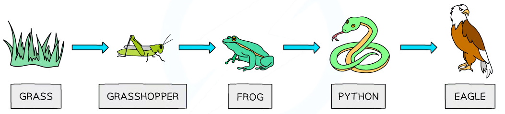
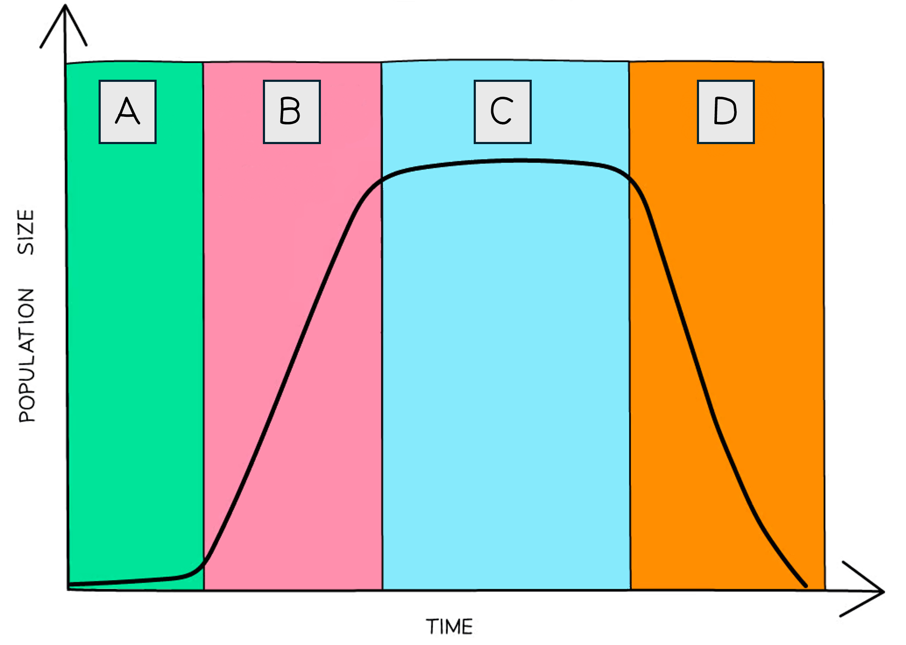

# Energy & Feeding Relationships

Course: cie-igcse-biology-23 · Section: 19. Organisms & Their Environment

Source: https://www.savemyexams.com/igcse/biology/cie/23/flashcards/19-organisms-and-their-environment/19-1-energy-and-feeding-relationships/

## Card 1 — true_or_false (`fl_GRs92VSScg3ywCPM`)

**FRONT**

**True or False?**

The source of all energy in a food chain is the sun.

**BACK**

**True.**

Producers **absorb light energy from the sun**, converting it into **stored chemical energy** which passes up the food chain. There are one or two very unusual exceptions to this rule, e.g. food chains that gain energy from chemicals.

## Card 2 — question_and_answer (`fl_vHQhpFXCNCfxKvfD`)

**FRONT**

How is **chemical** **energy transferred** up food chains?

**BACK**

Chemical energy is transferred up food chains when organisms **consume the chemical energy stored in the tissues** of other organisms.

## Card 3 — question_and_answer (`fl_cR5f24P4n5DfWXTh`)

**FRONT**

How can the energy in a food chain be transferred to the **environment**?

**BACK**

The energy in a food chain can be **transferred to the environment **as follows:

- **heat** loss from living organisms
- **excretion** of waste from living organisms
- decomposers** break down the tissues** of dead organisms and transfer chemical energy into the soil

## Card 4 — question_and_answer (`fl_tqM52VcGmB35Sqsm`)

**FRONT**

What do **food chains** show?

**BACK**

Food chains show the **transfer of energy** from one organism to the next.

## Card 5 — question_and_answer (`fl_sYJ2FvmdpsddDfZ4`)

**FRONT**

Construct a** food chain** that links together the following organisms:

- oak tree
- sparrow
- caterpillar

**BACK**

A food chain that links the organisms oak tree, sparrow and caterpillar would be:

**oak tree**$\rightarrow$**caterpillar**$\rightarrow$**sparrow**

## Card 6 — question_and_answer (`fl_SN7FFNY6mHwhrSW7`)

**FRONT**

What do **food webs** show?

**BACK**

Food webs show networks of** interconnected food chains** that show the **interdependence** between organisms in an ecosystem.

## Card 7 — keyword_definition (`fl_pGqZzXnS5tGD6zZs`)

**FRONT**

Define the term **producer**.

**BACK**

A producer is an organism that can **produce its own** **carbon compounds**, e.g. glucose, by chemical processes such as photosynthesis.

## Card 8 — keyword_definition (`fl_CrMDPBSqFfrMvSMj`)

**FRONT**

Define the term **primary consumer**.

**BACK**

A primary consumer is an organism that **eats producers**. Primary consumers are also known as herbivores.

## Card 9 — question_and_answer (`fl_Kx4Q2z22NZP85b6k`)

**FRONT**

Which organism is the **primary consumer** in the food chain below?

**BACK**

The primary consumer in the food chain is the **grasshopper**.

## Card 10 — keyword_definition (`fl_GQz66DM6hszRNCBw`)

**FRONT**

Define the term **secondary consumer**.

**BACK**

A secondary consumer is an organism that **eats primary consumers**.

## Card 11 — true_or_false (`fl_NvvYzn99cZmh9tGf`)

**FRONT**

**True or False? **

Herbivores are secondary consumers.

**BACK**

**False.**

Herbivores are** primary consumers**. They are animals that gain their energy by **eating plants**.

## Card 12 — keyword_definition (`fl_8R5ByJmZhGyWYMVH`)

**FRONT**

Define the term **carnivore**.

**BACK**

Carnivores are animals that gain their energy by **eating other animals**.

## Card 13 — keyword_definition (`fl_NKxTkXJvtjptMdY4`)

**FRONT**

Define the term **tertiary consumer**.

**BACK**

**Tertiary consumers** are organisms that **feed on secondary consumers**. They are carnivores and are present at the **fourth trophic level **of food chains.

## Card 14 — keyword_definition (`fl_gjYZCsDcrxyRQMvp`)

**FRONT**

Define the term **decomposer**.

**BACK**

Decomposers are organisms that gain energy from** dead** or **waste **organic material.

## Card 15 — question_and_answer (`fl_mztF4fGk6sgnQcwS`)

**FRONT**

How might **overfishing** by humans affect a **marine food web**?

**BACK**

Overfishing might affect a marine food web as follows:

- there might be an increase in population size of the organisms normally consumed by the fish
- there might be an increase in population size of any organisms that usually compete with fish for food
- there might be a decrease in population size of any organisms that depend on the fish for food

## Card 16 — question_and_answer (`fl_tgbsh4QbDqQ5DQTq`)

**FRONT**

What do **pyramids of numbers** show?

**BACK**

A pyramid of numbers shows **how many organisms** are present at each level of a food chain.

## Card 17 — true_or_false (`fl_Phhv2rhg6698sxYy`)

**FRONT**

**True or False?**

Pyramids of numbers are always pyramid-shaped.

**BACK**

**False.**

Pyramids of numbers are not always pyramid-shaped. This is because large producers, e.g. trees may be present in small numbers at the base of a food chain.

## Card 18 — question_and_answer (`fl_KfJBPGrGT26DJJ8s`)

**FRONT**

What do **pyramids of biomass** show?

**BACK**

Pyramid of biomass show the **mass of living material **present at each stage of a food chain.

## Card 19 — true_or_false (`fl_8b5DGTM8t3ZVkXYs`)

**FRONT**

**True or False?**

Pyramids of biomass are always pyramid-shaped.

**BACK**

**True.**

Pyramids of biomass are **always pyramid-shaped**, regardless of what the pyramid of numbers for that food chain looks like.

## Card 20 — question_and_answer (`fl_MHw9fTRgXwbfwQdN`)

**FRONT**

What rules should be followed when **drawing** a pyramid of numbers or biomass?

**BACK**

Rules that should be followed when drawing pyramids of numbers or biomass include:

- The **producers should always be at the base**, with each subsequent trophic level in order above this
- Each box should be **labelled** with its trophic level and species
- If graph paper is provided then boxes should be drawn** to scale**

## Card 21 — question_and_answer (`fl_6FSjYy4pHxJTd55Z`)

**FRONT**

What is the advantage of using a **pyramid of biomass** rather than a pyramid of numbers?

**BACK**

The advantage of a pyramid of biomass over a pyramid of numbers is that it gives a **clearer representation of the mass of living material** present at each trophic level.

## Card 22 — keyword_definition (`fl_rhyBqbpcBtFDnxd2`)

**FRONT**

Define the term **trophic level**.

**BACK**

A trophic level is the** position **of an organism in a food chain, food web or ecological pyramid.

## Card 23 — question_and_answer (`fl_fY3Xt8CD9cPstWTC`)

**FRONT**

What type of organism is present at the **first trophic level** in a food chain?

**BACK**

The first trophic level contains **producers**. These are mainly **plants** that produce their own carbon compounds through photosynthesis.

## Card 24 — true_or_false (`fl_qcmxTgSnCXMmgm7M`)

**FRONT**

**True or False?**

The second trophic level of a food chain contains secondary consumers.

**BACK**

**False.**

The second trophic level contains** primary consumers**, which are herbivores that feed on producers. Secondary consumers are found at the* third* trophic level.

## Card 25 — question_and_answer (`fl_3QcbKsdH35mDmV2H`)

**FRONT**

What type of organism is present at the** third trophic level** of a food chain?

**BACK**

The third trophic level contains **secondary consumers**, which are **carnivores or omnivores** that **feed on primary consumers**.

## Card 26 — question_and_answer (`fl_xWpDRPkXNPf447v2`)

**FRONT**

What does a **pyramid of energy** illustrate? (**Extended Tier Only**)

**BACK**

A pyramid of energy illustrates the **stored chemical energy** contained within the biomass of organisms at each trophic levels of a food chain.

## Card 27 — true_or_false (`fl_DsVgdK9NmnHmF3b9`)

**FRONT**

**True or False?**

Pyramids of biomass and energy are always pyramid-shaped due to energy losses between trophic levels. (**Extended Tier Only**)

**BACK**

**True.**

Energy losses at each trophic level mean that each subsequent trophic level will contain **less stored energy** in the form of **biomass**.

## Card 28 — question_and_answer (`fl_GSNrPSJBz2V5ZnMX`)

**FRONT**

What is the advantage of using a **pyramid of energy** to represent a food chain rather than a pyramid of numbers or biomass? (**Extended Tier Only**)

**BACK**

The advantage of using a pyramid of energy to represent a food chain rather than a pyramid of numbers or biomass is that it shows:

- the **energy available** at each trophic level
- the **efficiency of energy transfer **at each trophic level

## Card 29 — true_or_false (`fl_czVV8z6zPcwj5pFF`)

**FRONT**

**True or False?**

When a primary consumer eats a plant **all** of the chemical energy stored in the plant is transferred to the biomass of the primary consumer. (**Extended Tier Only**)

**BACK**

**False.**

While *some* of the chemical energy stored in the producer is transferred to the biomass of the primary consumer when it is eaten, much of it is **transferred elsewhere**, e.g. to the environment as heat or in waste products

## Card 30 — question_and_answer (`fl_jv59PfMb8NFq7Qjm`)

**FRONT**

What are some reasons for **energy loss** at each trophic level of a food chain? (**Extended Tier Only**)

**BACK**

Energy is lost at each trophic level because:

- organisms** rarely eat every part** of the consumed organism
- some tissues **cannot be fully digested** by consumer so any undigested material is egested in faeces
- energy released from consumed tissues may be used for, e.g. movement, meaning that it is eventually **transferred to the environment as heat**
- energy is** **lost in** metabolic waste**, e.g. urea in urine

## Card 31 — question_and_answer (`fl_jZXhNzcNnNBHjGnk`)

**FRONT**

Why are food chains rarely made up of** more than five trophic levels**? (**Extended Tier Only**)

**BACK**

Food chains are rarely made up of more than five trophic levels because of the **energy losses** at each trophic level; the total energy available eventually becomes **too small to support another trophic level**.

## Card 32 — question_and_answer (`fl_rQ3RtkFNPRtRyRS8`)

**FRONT**

Why is it more** energy efficient** for humans to eat plants than meat? (**Extended Tier Only**)

**BACK**

It is more** energy efficient** for humans to eat plants than meat because the resulting food chain has **fewer trophic levels**, e.g:

crop$\rightarrow$human

crop$\rightarrow$cow$\rightarrow$human

In a shorter food chain there are fewer energy transfers, and so **less energy is lost **to the environment.

## Card 33 — question_and_answer (`fl_qQXYx6XYpwfzvynF`)

**FRONT**

How is carbon **taken out** of the atmosphere?

**BACK**

Carbon is taken out of the atmosphere in the form of carbon dioxide by plants during **photosynthesis**.

## Card 34 — question_and_answer (`fl_rCvMNt5j5f9N7vdH`)

**FRONT**

How is carbon** transferred **from one organism to another in the carbon cycle?

**BACK**

Carbon is transferred from one organism to another by the process of** feeding**.

## Card 35 — question_and_answer (`fl_qBC3hgjcm2S3ZsRj`)

**FRONT**

How is carbon** returned to the atmosphere **in the carbon cycle?

**BACK**

Carbon is returned to the atmosphere when it is **released as carbon dioxide** by the following processes:

- **respiration** in plants and animals
- respiration of **decomposers**, e.g. bacteria
- **combustion** of fossil fuels or other organic matter, e.g. wood

## Card 36 — question_and_answer (`fl_xrDzWgYbc9Dxd28W`)

**FRONT**

What is the role of** combustion** in the carbon cycle?

**BACK**

Combustion **releases carbon dioxide** into the atmosphere. This occurs during the combustion of fossil fuels, or of other organic matter such as wood.

## Card 37 — true_or_false (`fl_NjPrnW7hCGq7YW7C`)

**FRONT**

**True or False?**

The action of decomposers converts plant and animal proteins into ammonium ions. (**Extended Tier Only**)

**BACK**

**True.**

Decomposers **break down proteins** in the dead and waste material, converting the proteins into ammonium ions.

## Card 38 — question_and_answer (`fl_nWcmfWdTQmjCMzz8`)

**FRONT**

What is the role of **nitrifying bacteria** in the nitrogen cycle? (**Extended Tier Only**)

**BACK**

Nitrifying bacteria convert **ammonium compounds** to nitrites and then to **nitrates**, which can then be absorbed by plants.

## Card 39 — true_or_false (`fl_5tmxNFQ2T5RtNmtV`)

**FRONT**

**True or False?**

Plants and animals can absorb nitrogen gas directly from the air. (**Extended Tier Only**)

**BACK**

**False.**

Neither plants nor animals can absorb nitrogen gas (N2) from the air. N2 needs to be **fixed** to produce **nitrates** before nitrogen can be absorbed by plants and passed on to animals.

## Card 40 — question_and_answer (`fl_4tCmdkwcqXKSny56`)

**FRONT**

How is **nitrogen gas** converted into a **usable form **during the nitrogen cycle? (**Extended Tier Only**)

**BACK**

Nitrogen gas can be converted into a usable form by:

- **Nitrogen-fixing bacteria**
- **Lightning**

## Card 41 — question_and_answer (`fl_NVHfQ5B3hxCcDc9F`)

**FRONT**

In what form do **plants absorb nitrogen** from the soil? (**Extended Tier Only**)

**BACK**

Plants absorb nitrogen from the soil in the form of **nitrates**.

## Card 42 — question_and_answer (`fl_KPt6v8WyBj7Kn6pc`)

**FRONT**

Why is** nitrogen** needed by living organisms? (**Extended Tier Only**)

**BACK**

Nitrogen is required by living organisms to make **amino acids** and **proteins**.

## Card 43 — question_and_answer (`fl_pYGS4ZBQyMHFWpDj`)

**FRONT**

How do** animals **obtain the nitrogen they need? (**Extended Tier Only**)

**BACK**

Animals get the nitrogen they need by** eating **other organisms and **digesting the proteins** in their tissues.

## Card 44 — keyword_definition (`fl_HsF4YbbbqjmCdTmn`)

**FRONT**

Define the term **deamination** in the context of the nitrogen cycle. (**Extended Tier Only**)

**BACK**

Deamination is the **removal of the nitrogen-containing part of an amino acid**, resulting in the **formation of ammonia**. This ammonia can then be converted into nitrates by nitrifying bacteria.

## Card 45 — true_or_false (`fl_kSt3YdCWh5VJVkCn`)

**FRONT**

**True or False?**

Denitrifying bacteria increase the availability of soil nutrients. (**Extended Tier Only**)

**BACK**

**False.**

Denitrifying bacteria **take nitrates out of the soil** and **convert them back into nitrogen gas**, reducing soil fertility and plant growth.

## Card 46 — question_and_answer (`fl_2b5vFx2K7HRNMtpP`)

**FRONT**

Which processes in the nitrogen cycle involve **microorganisms**? (**Extended Tier Only**)

**BACK**

The nitrogen cycle processes that involve microorganisms are:

- decomposition
- nitrification
- nitrogen fixation
- denitrification

## Card 47 — keyword_definition (`fl_xSVDT2pnQpsx46VP`)

**FRONT**

Define the term **population**.

**BACK**

A population is a group of organisms of the **same species** living in the **same place** at the **same time**.

## Card 48 — keyword_definition (`fl_2z4xw5htwKcNMSzv`)

**FRONT**

Define the term **community**.

**BACK**

A community includes **all of the populations** of** different species** living in an ecosystem.

## Card 49 — keyword_definition (`fl_CfKxT3hCWfxdFMpJ`)

**FRONT**

Define the term **ecosystem**.

**BACK**

An ecosystem the **community of organisms** that live in an area, and **their interactions** with the** living** (biotic) and **non-living** (abiotic) factors in their environment.

## Card 50 — question_and_answer (`fl_tt2CZ8kW3gCfKPK9`)

**FRONT**

What are the** factors** that affect the** rate of population growth**?

**BACK**

Factors that affect the rate of population growth include:

- food supply
- competition
- predation
- disease

## Card 51 — question_and_answer (`fl_9tVdhJ7ZVxb7RcJB`)

**FRONT**

What are the phases labelled **A**-**D** on the **population growth curve**?

**BACK**

The phases of the growth curve are:

- A = lag phase
- B = exponential / log phase
- C = stationary phase
- D = death phase

## Card 52 — true_or_false (`fl_rnwdhspq6tmhQChc`)

**FRONT**

**True or False?**

During the lag phase of population growth organisms are reproducing quickly. (**Extended Tier Only**)

**BACK**

**False.**

During the lag phase organisms are **reproducing slowly** as they adjust to their environment.

## Card 53 — question_and_answer (`fl_9rZMcp8wRCt5nCZf`)

**FRONT**

How can the shape of the **exponential phase** of a population curve be explained? (**Extended Tier Only**)

**BACK**

The exponential part of a population growth curve occurs because **resources are plentiful**, meaning that:

- birth rate is high
- death rate is low

## Card 54 — question_and_answer (`fl_gR6TDnDvnVnJFq48`)

**FRONT**

Why do population growth curves reach a **stationary phase**? (**Extended Tier Only**)

**BACK**

The stationary phase of growth curves occurs because once the population reaches a certain size** resources in the environment become limited**; the result of this is that death rates increase until **death rate equals birth rate**.

## Card 55 — question_and_answer (`fl_mwfXtfpgp26Ytq28`)

**FRONT**

Why do some populations enter a **death phase**? (**Extended Tier Only**)

**BACK**

The death phase occurs when** death rates exceed birth rates**, e.g. due to:

- limited resources, such as food
- production of harmful waste products

