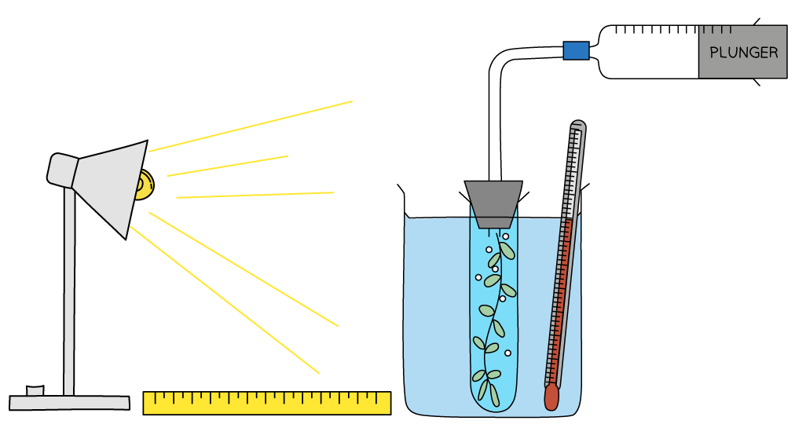
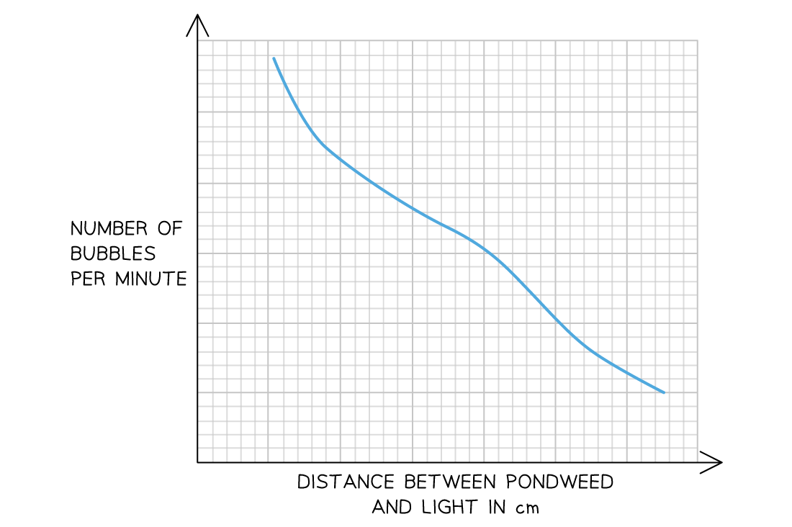
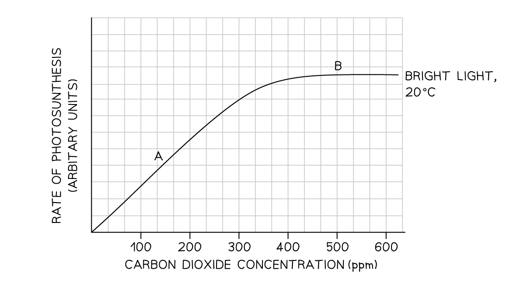
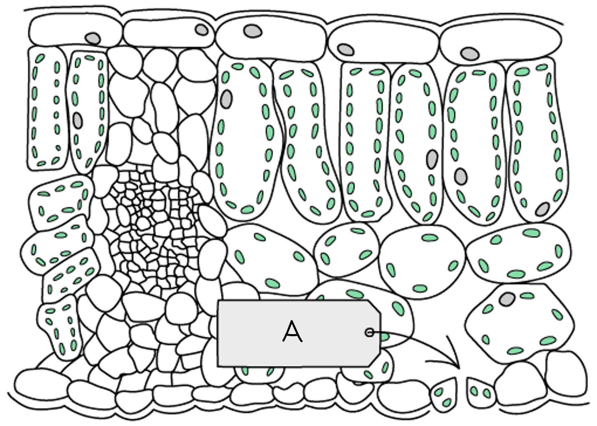
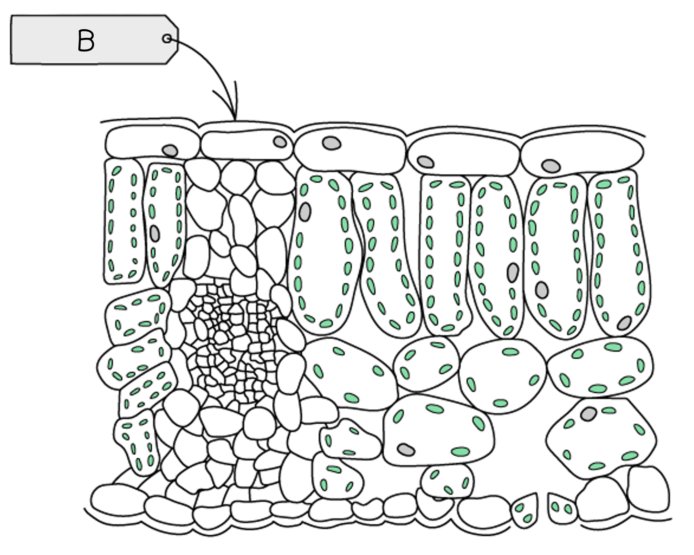
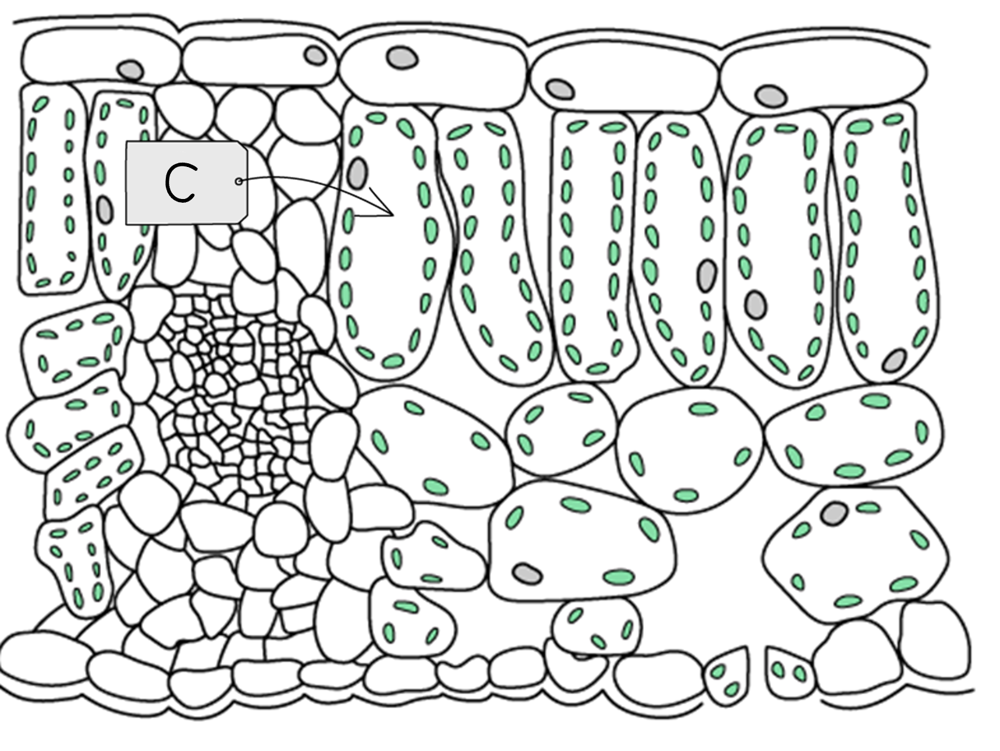
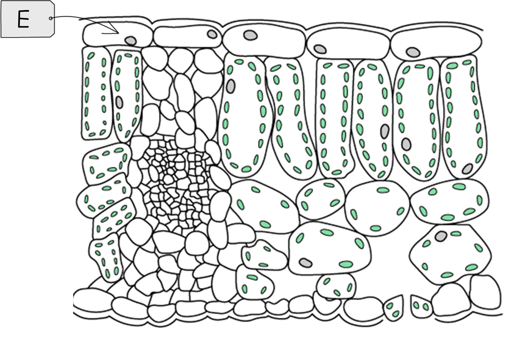

# Photosynthesis & Leaf Structure

Course: cie-igcse-biology-23 · Section: 6. Plant Nutrition

Source: https://www.savemyexams.com/igcse/biology/cie/23/flashcards/6-plant-nutrition/6-1-photosynthesis-and-leaf-structure/

## Card 1 — keyword_definition (`fl_tGGcST9YkVBNd8x4`)

**FRONT**

Define the term **photosynthesis**.

**BACK**

Photosynthesis is the process by which **plants produce** **carbohydrates **from raw materials using **energy from** **light**.

## Card 2 — question_and_answer (`fl_F9m9ct3xnRVjpJ9y`)

**FRONT**

What is the **word equation** for photosynthesis?

**BACK**

The word equation for photosynthesis is:

**carbon dioxide + water → glucose + oxygen**

## Card 3 — true_or_false (`fl_BR29pwGYqgbYSDBN`)

**FRONT**

**True or False?**

Photosynthesis can only occur in the presence of light and chlorophyll.

**BACK**

**True.**

Both light and chlorophyll are required for photosynthesis to occur.

## Card 4 — question_and_answer (`fl_pPgWrP2FHFqx3rfB`)

**FRONT**

What are the **raw materials** for photosynthesis?

**BACK**

The raw materials for photosynthesis are **carbon dioxide** and **water**.

## Card 5 — question_and_answer (`fl_FsCvWZCQpWjNgJd8`)

**FRONT**

What is the **waste product** of photosynthesis?

**BACK**

The waste product of photosynthesis is **oxygen**.

## Card 6 — question_and_answer (`fl_BZyDH3zHpCm4YgW8`)

**FRONT**

What is the** product** of photosynthesis that is **useful for the plant**?

**BACK**

The product of photosynthesis that is used by the plant is **glucose**.

## Card 7 — question_and_answer (`fl_N5p8xNQwcSbxZ352`)

**FRONT**

What is **chlorophyll**?

**BACK**

Chlorophyll is a **green pigment** that is found in **chloroplasts**.

## Card 8 — question_and_answer (`fl_Q3YJknWpvK3WXjtm`)

**FRONT**

What is the role of **chlorophyll**?

**BACK**

The role of chlorophyll is to **transfer energy** **from light** into **energy in chemicals**, for the production of **carbohydrates**.

## Card 9 — question_and_answer (`fl_mSgXxdxQStY9GfC4`)

**FRONT**

How do plants use the **carbohydrates **made in photosynthesis?

**BACK**

The carbohydrates made during photosynthesis can be used to produce:

- **starch**,** **which is used an energy store
- **cellulose** for building cell walls
- **glucose**,** **which can be** **used in respiration to provide energy
- **sucrose **for transport in the phloem
- **nectar** to attract insects for pollination

## Card 10 — question_and_answer (`fl_p2SY2Q3Z6D2gVh76`)

**FRONT**

What is the function of **cellulose** in plant cells?

**BACK**

Cellulose  provides **structural support** to plant **cell walls **and allows them to maintain a regular shape.

## Card 11 — true_or_false (`fl_8qzKcCVH4hVQRdvf`)

**FRONT**

**True or False?**

The carbohydrate sucrose is used for transport in the phloem.

**BACK**

**True**.

The carbohydrate **sucrose **is used for transport in the phloem.

Glucose is converted into sucrose before being transported around the plant inside phloem.

## Card 12 — question_and_answer (`fl_pPpNvw2Znvq7bXjY`)

**FRONT**

Which process requires **glucose **for the **release of energy**?

**BACK**

Glucose is used in **respiration **to release energy for cells.

## Card 13 — keyword_definition (`fl_KfWzSqxv3bMH2TgH`)

**FRONT**

Name two essential **mineral ions** required by plants.

**BACK**

Two essential mineral ions required by plants are:

- nitrates
- magnesium ions

## Card 14 — true_or_false (`fl_mRXSVfftbxcHcFPP`)

**FRONT**

**True or False?**

Plants need nitrates so they can build proteins.

**BACK**

**True.**

Nitrates are needed for the production of **amino acids**, which are joined together to build **proteins**.

## Card 15 — question_and_answer (`fl_7Jp9mQGBpBP7xBwC`)

**FRONT**

Why do plants need **magnesium ions**?

**BACK**

Plants need magnesium ions for the production of **chlorophyll**, which is essential for **light absorption** in **photosynthesis**.

## Card 16 — question_and_answer (`fl_mS5VV4DbcGxZjZXK`)

**FRONT**

What is the purpose of the **destarching** step in **photosynthesis investigations**?

**BACK**

The purpose of destarching plants  by placing in the dark for 24 hours is to **ensure that any pre-existing starch in the leaves is used up** so it does not affect the results.

## Card 17 — true_or_false (`fl_9Vx7y2t6gmzC9mwT`)

**FRONT**

**True or False?**

Boiling a leaf in ethanol removes the chlorophyll before testing for starch.

**BACK**

**True.**

Removing chlorophyll by boiling in ethanol is an important step in testing leaves for starch. Removing the green colour allows the **results of the starch test to be seen more clearly**.

## Card 18 — question_and_answer (`fl_9TdHYCTgDZChJvsd`)

**FRONT**

What chemical is used to **test for the presence of starch** in a leaf?

**BACK**

**Iodine** **solution** is used to test for starch; it turns **blue-black** in the presence of starch.

## Card 19 — true_or_false (`fl_V72ZSw3km9P3cQcm`)

**FRONT**

**True or False?**

A leaf that has been destarched and then covered in foil for 24 hours will turn blue-black when iodine is added.

**BACK**

**False.**

A leaf that has been destarched and then covered with foil will ***not*** turn blue-black when iodine is added but will remain yellow-brown. This is because it will **not have had light for photosynthesis**, so will not have produced any new **starch**.

## Card 20 — keyword_definition (`fl_4M4MpnyjScrg7H3H`)

**FRONT**

Give one variable that should be kept the **same** when testing the requirement for **carbon dioxide** in photosynthesis.

**BACK**

A variable that should be kept the **same** (control variable) when testing the requirement for carbon dioxide in photosynthesis could be:

- light intensity / whether or not the leaf was exposed to light
- the presence of chlorophyll
- the temperature of the room

## Card 21 — question_and_answer (`fl_pjGhbwvXgjYnzqz4`)

**FRONT**

Why should Bunsen burner flames be turned off before **boiling leaves in ethanol** when testing leaves for the presence of starch?

**BACK**

Flames should not be present when boiling leaves in ethanol because  **ethanol is highly flammable**. A water  bath should be used for this step.

## Card 22 — question_and_answer (`fl_MCRBzgmBThdQqDS7`)

**FRONT**

Why do we use **variegated leaves** when investigating the role of **chlorophyll** in photosynthesis?

**BACK**

Variegated leaves are used when investigating the role of chlorophyll in photosynthesis because they have green and white regions, where the **green regions do contain chlorophyll **but the **white regions do not**. Demonstrating that, after exposure to light, the green regions do contain starch while the white regions do not, shows that **chlorophyll is needed for photosynthesis**.

## Card 23 — question_and_answer (`fl_sQmFNvY8t9kghp5f`)

**FRONT**

What is the **independent variable** when testing the requirement for **chlorophyll** in photosynthesis?

**BACK**

The independent variable when testing for the importance of chlorophyll in photosynthesis is whether the area of leaf tested is** green** or **white** (i.e. **whether or not the leaf contains chlorophyll**).

## Card 24 — question_and_answer (`fl_CNJdtxHM9xT3cD66`)

**FRONT**

When investigating the need for carbon dioxide in photosynthesis, what is the purpose of placing plants in a bell jar which contains a beaker of **sodium hydroxide?**

**BACK**

When investigating the need for carbon dioxide in photosynthesis, the purpose of placing plants in a bell jar which contains a beaker of sodium hydroxide is to **absorb carbon dioxide **from the surrounding atmosphere.

## Card 25 — question_and_answer (`fl_CBZqDtXgX8ZwZhQW`)

**FRONT**

When investigating the need for light in photosynthesis, what will be the colour** **of parts of leaves that **were covered in aluminium foil** after testing with **iodine **solution?

**BACK**

The parts of leaves that were covered with aluminium foil during an investigation into the need for light in photosynthesis will **remain orange-brown** when tested with iodine. This is because these areas did not receive any sunlight and **could not photosynthesise to produce starch**.

## Card 26 — question_and_answer (`fl_Byyk97M58dGmxZj7`)

**FRONT**

What investigation can be carried out using the practical equipment below?

**BACK**

The equipment shown in the image can be used to investigate the **effect of light intensity** on the** rate of photosynthesis**.

## Card 27 — question_and_answer (`fl_wxKQkCZskFcjzjFp`)

**FRONT**

What would the** independent variable **be in the investigation shown?

**BACK**

The independent variable is **light intensity**, which is controlled by altering the distance between the lamp and the beaker.

## Card 28 — question_and_answer (`fl_NnypPTvfRmDrkgG5`)

**FRONT**

What would the** dependent variable **be in the investigation shown?

**BACK**

The dependent variable in this investigation is the **rate of photosynthesis, **which is measured by recording the **volume of oxygen** produced **within a** **set** **time period.**

## Card 29 — question_and_answer (`fl_j9rHFW7dMMZyPgwq`)

**FRONT**

Give **two control variables **for the investigation shown.

**BACK**

Control variables for this investigation would include:

- maintaining the same environmental **temperature**
- using the **same species, length and age** of plant in each repeat
- dissolving **sodium hydrogen carbonate **(NaHCO3) in the water to maintain **carbon dioxide levels**

## Card 30 — question_and_answer (`fl_z2WNzQx3mnycQ4Pq`)

**FRONT**

In an investigation into the effect of temperature on photosynthesis, why should **light intensity **be controlled?

**BACK**

Light intensity should be controlled when investigating the effect of temperature on the rate of photosynthesis as **light intensity will affect on the dependent variable**.

## Card 31 — question_and_answer (`fl_SYs6hFvgYTtqcbp4`)

**FRONT**

In an investigation into the **effect of carbon dioxide concentration **on the rate of photosynthesis, what is the predicted outcome?

**BACK**

The predicted outcome in an investigation into the effect of carbon dioxide on the rate of photosynthesis is that the** rate of photosynthesis will increase with increasing carbon dioxide concentration**.

This increase will continue until another factor becomes limiting.

## Card 32 — question_and_answer (`fl_z8DYqg8zWpFXByV4`)

**FRONT**

Why does** bubble production decrease **as distance between the light source and the aquatic plant increases in the graph shown?

**BACK**

The number of bubbles produced decreases as the light moves further away from the pondweed because** light intensity decreases** with distance; this means that **rate of photosynthesis decreases** and so less oxygen is produced.

## Card 33 — question_and_answer (`fl_SPYdKfyFZgfHch75`)

**FRONT**

What information is required to measure the **rate of photosynthesis** using the equipment below?

**BACK**

To measure the rate of photosynthesis we need to know the **volume of gas **collected and** time period** during which it has been collected.

## Card 34 — question_and_answer (`fl_gfGPKWbmpKMfrBG8`)

**FRONT**

Why do plants need to absorb **oxygen **from the atmosphere?

**BACK**

Plants absorb oxygen in order to carry out** aerobic respiration**.

## Card 35 — true_or_false (`fl_BFDfmYdpBsTmczMF`)

**FRONT**

**True or False?**

There is a net intake of carbon dioxide by plants in the dark.

**BACK**

**False**.

There will be a net intake of **oxygen **by plants in the dark, as they are respiring but not photosynthesising.

## Card 36 — true_or_false (`fl_rZ2cSRjNsG57SqhJ`)

**FRONT**

**True or False?**

Carbon dioxide is an **acidic gas** when dissolved in water.

**BACK**

**True**.

Carbon dioxide is an **acidic gas** when dissolved in water. Knowing this can help you to understand the results of a hydrogencarbonate indicator test.

## Card 37 — question_and_answer (`fl_76hbCTb6wrDCyY6D`)

**FRONT**

Why is **hydrogencarbonate indicator **useful for investigating gas exchange in an aquatic plant?

**BACK**

Hydrogencarbonate indicator is useful for investigating gas exchange in aquatic plants because it shows the presence of **carbon dioxide in solution**.

## Card 38 — question_and_answer (`fl_cscgWwyCHqKvHzCs`)

**FRONT**

What colour will hydrogencarbonate indicator turn at** high carbon dioxide** concentrations?

**BACK**

Hydrogencarbonate indicator will turn** yellow/orange **at** **high carbon dioxide concentrations.

## Card 39 — true_or_false (`fl_9Jq6zY24qSHSjDw4`)

**FRONT**

**True or False?**

Hydrogencarbonate indicator will turn red at low carbon dioxide concentrations.

**BACK**

**False. **

Hydrogencarbonate indicator will turn **purple **at low carbon dioxide concentrations.

A red colour indicators atmospheric carbon dioxide levels.

## Card 40 — question_and_answer (`fl_ChDxTYpdvXGchJq4`)

**FRONT**

What is the balanced **chemical equation** for photosynthesis? (**Extended Tier Only**)

**BACK**

The balanced chemical equation for photosynthesis is:

**6CO****2**** + 6H****2****O → C****6****H****12****O****6**** + 6O****2**

## Card 41 — keyword_definition (`fl_TDvg5BZcTKZbSvcZ`)

**FRONT**

Define the term **limiting factor **in the context of photosynthesis. (**Extended Tier Only**)

**BACK**

A limiting factor is a **factor** that **limits** the **rate of photosynthesis**.

## Card 42 — question_and_answer (`fl_fZSKF2Gy72Mh2mhZ`)

**FRONT**

What are the three **factors** that **limit** the rate of photosynthesis? (**Extended Tier Only**)

**BACK**

The three **limiting factors** for photosynthesis are:

- temperature
- light intensity
- carbon dioxide concentration

## Card 43 — question_and_answer (`fl_XJtkNdwbV82hVtB5`)

**FRONT**

Why does the rate of photosynthesis slow down at **low temperatures**? (**Extended Tier Only**)

**BACK**

Photosynthesis occurs slowly at low temperatures because molecules (such as enzymes involved in photosynthesis) have little **kinetic energy**. This means that **fewer successful collisions** take place.

## Card 44 — true_or_false (`fl_2Y7wHpYXNj3zVCyV`)

**FRONT**

**True or False?**

The rate of photosynthesis increases consistently as temperature increases. (**Extended Tier Only**)

**BACK**

**False.**

The rate of photosynthesis only increases with temperature **up to a certain point**, after which higher temperatures lead to a decrease in the rate of photosynthesis. This is because **high temperatures denature enzymes **involved in the reactions of photosynthesis.

## Card 45 — question_and_answer (`fl_zVjZDGwZ64CTd53N`)

**FRONT**

Why do **very high temperatures** cause photosynthesis to stop? (**Extended Tier Only**)

**BACK**

At very high temperatures the **enzymes** that control photosynthesis **denature**, meaning that the reaction can no longer take place.

## Card 46 — question_and_answer (`fl_pyBHrD6vKWj8RXxw`)

**FRONT**

What is happening at point **B **on the graph? (**Extended Tier Only**)

**BACK**

At point B the graph has levelled off, indicating that **a factor other than carbon dioxide concentration** is limiting, e.g. temperature or light intensity.

## Card 47 — question_and_answer (`fl_Yd7gQXhPWnGGZYmK`)

**FRONT**

What is the effect of **increasing light intensity** on the rate of photosynthesis? (**Extended Tier Only**)

**BACK**

The **higher the light intensity**, the **faster the rate** of photosynthesis. This continues until another factor becomes limiting.

## Card 48 — true_or_false (`fl_sSdRgBhSZrN8TjZp`)

**FRONT**

**True or False?**

In a **graph of light intensity **against the rate of photosynthesis, the part of the graph where the line is horizontal could indicate a point at which temperature is the limiting factor. (**Extended Tier Only**)

**BACK**

**True.**

In a graph of light intensity against rate of photosynthesis, the part of the graph where the line is horizontal is a point at which a **factor other than light intensity**is limiting. This factor could be **temperature** or **carbon dioxide concentration** .

## Card 49 — question_and_answer (`fl_mjCHhg6jZQVQt2J9`)

**FRONT**

How does **gas exchange** occur in plants?

**BACK**

Gas exchange in plants occurs via the **stomata**. Carbon dioxide **diffuses** into leaves while oxygen diffuses out.

## Card 50 — true_or_false (`fl_wXbmjv3JHVy74PTD`)

**FRONT**

**True or False?**

The role of the waxy cuticle is to reduce water loss from leaves by evaporation.

**BACK**

**True.**

The waxy cuticle is a **waterproof** layer that reduces water loss by **evaporation** from the surface of leaves.

## Card 51 — question_and_answer (`fl_wtBCZKy3WQgTj7G8`)

**FRONT**

How is the **palisade mesophyll layer** adapted to maximise photosynthesis?

**BACK**

The palisade mesophyll layer contains tall, thin cells that **pack together** closely. These cells contain **many chloroplasts** to **maximise light absorption**.

## Card 52 — true_or_false (`fl_hyxxbcnchKSgZh72`)

**FRONT**

**True or False?**

Air spaces in the spongy mesophyll of leaves function to increase internal leaf surface area.

**BACK**

**True.**

The air spaces allow the outer surfaces of many cells in the spongy mesophyll to come into direct contact with the air. This **maximises the available surface area** for **gas exchange**.

## Card 53 — question_and_answer (`fl_2D7FJHdYMJpJZZmv`)

**FRONT**

What is the role of **guard cells **in leaves?

**BACK**

Guard cells can change shape to **open** or **close the stomata**. This allows plants to **control the rate of water loss** from leaves.

## Card 54 — question_and_answer (`fl_DkT6PPDDqpyJnWMv`)

**FRONT**

What is a **vascular bundle** in plants?

**BACK**

Vascular bundles in plants contain** xylem **and **phloem** for **transport** of useful substances, such as water, around the plant.

## Card 55 — true_or_false (`fl_DcxCZBchP2KWWxG2`)

**FRONT**

**True or False?**

Phloem tissue carries water and minerals to the leaves of plants.

**BACK**

**False.**

Phloem vessels carry **sucrose** and **amino acids** around inside plants. It is the* xylem* vessels that carry water and dissolved minerals.

## Card 56 — question_and_answer (`fl_Bjc88yWdN7PqzmWF`)

**FRONT**

Why is it beneficial for leaves to be **broad** while having a** thin** cross-section?

**BACK**

It is beneficial for leaves to be broad and thin because:

- being broad **maximises** **surface area** for light absorption
- being thin **reduces diffusion distance** for gas exchange

## Card 57 — true_or_false (`fl_rbcktnYXmWNgTkt2`)

**FRONT**

**True or False?**

The palisade mesophyll layer is located towards the top of a leaf.

**BACK**

**True.**

The palisade mesophyll layer is located just beneath the waxy cuticle and upper epidermis. This means that it is ideally located for **light absorption**.

## Card 58 — true_or_false (`fl_Bk8HtM3h68G6Cwd5`)

**FRONT**

**True or False?**

The cells of the spongy mesophyll are tall and narrow.

**BACK**

**False.**

The cells of the spongy mesophyll are ***not**** *especially tall and narrow; this description applies to the cells of the **palisade mesophyll**.

## Card 59 — question_and_answer (`fl_R8Rx5jXBnx7grX99`)

**FRONT**

What is structure **A** in the diagram?

**BACK**

Structure A is a **stoma **(plural stomata), or **stomatal pore**.

## Card 60 — question_and_answer (`fl_VPjyhQPzdzXXzjNb`)

**FRONT**

What is structure **B **in the diagram?

**BACK**

Structure B is the **waxy cuticle**.

## Card 61 — question_and_answer (`fl_TvWGdMjDStDCShDw`)

**FRONT**

By what features can structure **C **be identified?

**BACK**

Structure C is a palisade cell, identifiable by its **tall**,** column shape **and many **chloroplasts**.

## Card 62 — question_and_answer (`fl_vNwH3RSDdv6gtF3v`)

**FRONT**

Which two** **structures are found within the **vascular bundle** of a leaf?

**BACK**

The **xylem** and **phloem **are found within the vascular bundles of leaves.

## Card 63 — question_and_answer (`fl_xvPDQKpGYwXZGSvH`)

**FRONT**

What is structure **E** in the diagram?

**BACK**

Structure E is the** upper epidermis**.

