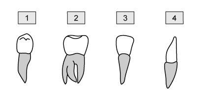

# Human Diet & Digestion

Course: cie-igcse-biology-23 · Section: 7. Human Nutrition

Source: https://www.savemyexams.com/igcse/biology/cie/23/flashcards/7-human-nutrition/7-1-human-diet-and-digestion/

## Card 1 — true_or_false (`fl_KzMc7vJ9HfxYVsc7`)

**FRONT**

**True or False?**

A balanced diet includes all nutrients in equal quantities.

**BACK**

**False. **

A balanced diet consists of all nutrients in their** correct proportions**, not necessarily equal quantities.

## Card 2 — keyword_definition (`fl_fFQm3QvpR458dkX3`)

**FRONT**

Define the term **balanced diet**.

**BACK**

A balanced diet consists of all essential nutrients in their **correct proportions**.

## Card 3 — question_and_answer (`fl_StSrdyQqSDjqqz9z`)

**FRONT**

What are the **key components** of a balanced diet?

**BACK**

The key components of a balanced diet are:

- Carbohydrates
- Proteins
- Lipids
- Dietary fibre
- Vitamins
- Minerals
- Water

## Card 4 — true_or_false (`fl_SXzcfYCH58pwqQ4h`)

**FRONT**

**True or False? **

Not having a balanced diet can lead to malnutrition.

**BACK**

**True. **

Malnutrition can occur when diet is not balanced. This can result from **deficiency** and/or **excess** of a particular type of nutrient.

## Card 5 — true_or_false (`fl_JWTBm9qPyFzpHZkf`)

**FRONT**

**True or False?**

Calcium is part of a balanced diet.

**BACK**

**True.**

Calcium is an important **mineral **required in the formation of** teeth and bones.**

## Card 6 — question_and_answer (`fl_F2JJFYZVvGJMKznS`)

**FRONT**

What disease causes bowing of the legs due to **vitamin D deficiency?**

**BACK**

The disease that can arise from vitamin D deficiency which causes bowing of the legs is **rickets.**

## Card 7 — true_or_false (`fl_cKGJDqrd5zTVJHNh`)

**FRONT**

**True or False? **

**Carbohydrates** are a source of energy.

**BACK**

**True. **

Carbohydrates, such as sugars and starch, are a source of **energy **for the body.

## Card 8 — question_and_answer (`fl_KZcPVq8XRsN5QnNk`)

**FRONT**

Why are** proteins** needed in the body?

**BACK**

Proteins are essential for **repair** and **growth**.

## Card 9 — question_and_answer (`fl_ndsf6DDfwRNyHfYY`)

**FRONT**

What is the function of **lipids** in the body?

**BACK**

Lipids, e.g. fats and oils, act as an **energy store**, **protect** vital organs, and help **reduce heat loss**.

## Card 10 — question_and_answer (`fl_VxWgxmKyKFsNDf7H`)

**FRONT**

What are **minerals**?

**BACK**

Minerals are** chemical elements** essential for many processes in the body. Examples include iron and calcium ions.

## Card 11 — true_or_false (`fl_5XVXzkr5Ry5rNc5D`)

**FRONT**

**True or False?**

Vitamins A is important for maintaining good eyesight.

**BACK**

**True.**

Vitamins A is needed for the production of **pigments in the retina**. Sources of vitamin A include meat, dairy, eggs and leafy greens.

## Card 12 — question_and_answer (`fl_5q9GWxFx9gYJNZqK`)

**FRONT**

Why is **dietary fibre** an important component of a balanced diet?

**BACK**

Dietary fibre provides **bulk** in the intestines, aiding the **movement of solid waste** and **preventing constipation**.

## Card 13 — true_or_false (`fl_6HJ7QpFp4Z7VTKk2`)

**FRONT**

**True or False? **

Water is the main component of blood, and of cell cytoplasm.

**BACK**

**True. **

Water is the main component of the **blood**, where it is essential for carrying nutrients and waste products, and regulating body temperature. Water is also the main component of **cell cytoplasm**.

## Card 14 — question_and_answer (`fl_RhxrsbQjM9sv36Sp`)

**FRONT**

Name two foods that are **sources of carbohydrate**.

**BACK**

Carbohydrates can be obtained from:

- Pasta
- Rice
- Potatoes
- Cereals
- Bread
- Sugary foods, e.g. fruit juice, chocolate, biscuits

## Card 15 — question_and_answer (`fl_c6kb4qp2trmd37gK`)

**FRONT**

Why is **iron** important in the diet?

**BACK**

Iron is essential for production of **haemoglobin**, which carries **oxygen** in the blood.

## Card 16 — question_and_answer (`fl_B9zpd4dRrx5zmsqj`)

**FRONT**

Why is** vitamin D **needed in the body?

**BACK**

Vitamin D **aids absorption of calcium**, so is essential for strong** bones** and **teeth**. Deficiency in vitamin D can lead to rickets.

## Card 17 — question_and_answer (`fl_8hR3yQCFKqRMMv6k`)

**FRONT**

What is **scurvy**?

**BACK**

Scurvy is caused by a lack of **vitamin C** and leads to anaemia, exhaustion, bleeding, pain in the limbs, swelling, tooth loss.

## Card 18 — question_and_answer (`fl_XvTnFDN6WWpHFkNx`)

**FRONT**

What is the function of the **digestive system**?

**BACK**

The function of the digestive system is to break down** large**,** insoluble** food molecules into **small**,** soluble** molecules that can be **absorbed**.

## Card 19 — question_and_answer (`fl_DQpv8jDdjCDfMMQ2`)

**FRONT**

Name the organs of the** digestive system **through which **food passes** during digestion.

**BACK**

The organs of the alimentary canal **through which food passes** are:

- Mouth
- Oesophagus
- Stomach
- Small intestine (duodenum and ileum)
- Large intestine
- Rectum

Other organs, e.g. the pancreas, are not in this list because food does **not** directly pass through them.

## Card 20 — true_or_false (`fl_RbQn6hFhD8k9v4nq`)

**FRONT**

**True or False? **

Mechanical digestion takes place in the mouth.

**BACK**

**True. **

**Teeth** grind food in the mouth; this is **mechanical digestion**.

## Card 21 — question_and_answer (`fl_SSP6237hZX4zKF7h`)

**FRONT**

What is the role of **saliva** in digestion?

**BACK**

Saliva contains **amylase enzymes** that begin the** chemical breakdown** of starch into sugars. Saliva also moistens food to aid in swallowing.

## Card 22 — question_and_answer (`fl_nZQG79mmC3H87Nbk`)

**FRONT**

What is the role of the **oesophagus** in digestion?

**BACK**

The oesophagus is the **tube** through which food passes **between the mouth and the stomach**.

## Card 23 — true_or_false (`fl_HJf3FfYpbjJ27S6n`)

**FRONT**

**True or False?**

Both mechanical and chemical digestion take place in the stomach.

**BACK**

**True.**

**Muscular contractions** of the stomach wall play a role in mechanical digestion, while **protease enzymes **start to **chemically break down** the proteins in food.

## Card 24 — question_and_answer (`fl_khHmtgXctSBKHZtB`)

**FRONT**

What is the role of the **large intestine **in digestion?

**BACK**

The role of the large intestine is to allow **absorption of water** from solid waste before it is egested; the remaining solid waste makes up the **faeces**.

## Card 25 — true_or_false (`fl_ppZvM8hCnTj4Kwcc`)

**FRONT**

**True or False? **

The **pancreas** is part of the alimentary canal.

**BACK**

**False. **

Accessory organs, such as the pancreas, are **not part of the tube through which food passes**. Their role is to produce substances, such as enzymes, needed for digestion.

## Card 26 — question_and_answer (`fl_PVwGFyyDN7bVBgSH`)

**FRONT**

Name **three organs** of the digestive system that **release enzymes**.

**BACK**

**Three** organs of the digestive system that release enzymes include:

- Salivary glands
- Stomach
- Small intestine
- Pancreas

## Card 27 — question_and_answer (`fl_FZnXtPycQ9hhDwqY`)

**FRONT**

Which organ is **bile** released from?

**BACK**

Bile is released from the **liver**.

## Card 28 — true_or_false (`fl_DwzmPb68WJKMrvmr`)

**FRONT**

**True or False?**

Physical digestion is the same as mechanical digestion.

**BACK**

**True.**

Physical digestion is sometimes described as **mechanical digestion**

## Card 29 — question_and_answer (`fl_8vGb49DgpSK9w6qx`)

**FRONT**

How does **physical digestion **aid **chemical digestion**?

**BACK**

Physical digestion **increases the surface area **of food for the action of **enzymes **in chemical digestion.

## Card 30 — question_and_answer (`fl_2Gz7GgtnSXVpKR2K`)

**FRONT**

Give an example of** physical digestion **in the human digestive system.

**BACK**

Physical digestion includes **chewing** food in the mouth, **churning** food in the stomach and **emulsification** of fats in the intestine.

## Card 31 — keyword_definition (`fl_GSHcWjpgxPXx2pBh`)

**FRONT**

Define** physical digestion**.

**BACK**

Physical digestion is the **breakdown of food into smaller pieces **without chemical change to the food molecule.

## Card 32 — question_and_answer (`fl_G2MCHJkBJGKQH7jZ`)

**FRONT**

Which of the following shows the tooth designed for **biting **and **cutting**?

**BACK**

Tooth **number 3 **is an **incisor **which is shaped specially to facilitate biting and cutting.

## Card 33 — question_and_answer (`fl_PmYsGFdXj8gfwkCk`)

**FRONT**

Which tooth is a **premolar**?

**BACK**

**Number 1 **is a premolar which is designed for chewing and grinding food up.

## Card 34 — question_and_answer (`fl_kjRdHbjhwNBvwNNf`)

**FRONT**

Name the **four** human teeth types.

**BACK**

Human teeth include:

- Canines
- Incisors
- Premolars
- Molars

## Card 35 — true_or_false (`fl_Cfqzy5hqtBxQSs8R`)

**FRONT**

**True or False?**

Teeth are used in chemical digestion.

**BACK**

**False.**

Teeth are part of **physical digestion**, although they are used to** increase the surface area** which aids chemical digestion.

## Card 36 — question_and_answer (`fl_9mMsdRggx9zMDQzh`)

**FRONT**

Describe the **structure **of a tooth.

**BACK**

Teeth are made up of **enamel, dentine, pulp, nerves, blood vessels and cementum**, they are embedded in bone and the gums.

## Card 37 — keyword_definition (`fl_S6Y9rZMgRbHS9rW5`)

**FRONT**

Define the term **organ.**

**BACK**

An organ is a **collection of tissues** working together to perform one **function**.

## Card 38 — question_and_answer (`fl_85fKyvWtk4zctkWr`)

**FRONT**

What is the function of the **stomach**?

**BACK**

The stomach has **three **roles:

- To **mechanically digest** food through the churning of food
- To produce the enzyme **protease**
- To produce **hydrochloric acid **(stomach acid)

## Card 39 — question_and_answer (`fl_bxhSGQPFb2MSNp93`)

**FRONT**

Name the **organ system **the stomach is part of.

**BACK**

The stomach is part of the **digestive **system.

## Card 40 — question_and_answer (`fl_qzGJ9PDrsBPbF2Y4`)

**FRONT**

What is the role of **mucus-producing **cells in the stomach?

**BACK**

The role of **mucus-producing **cells in the stomach is to **protect **the stomach lining from hydrochloric acid (stomach acid).

## Card 41 — question_and_answer (`fl_CKYSqbr2d5rfrgWF`)

**FRONT**

Name **two** organs of the digestive system, other than the stomach.

**BACK**

**Two **other organs of the digestive system:

- Mouth/tongue/salivary glands
- Oesophagus
- Liver
- Gall bladder
- Pancreas
- Small intestine
- Large intestine
- Rectum
- Anus

## Card 42 — question_and_answer (`fl_fPs7Z2YCyVnqTbpG`)

**FRONT**

What are the two main roles of** bile**? **(Extended Tier Only)**

**BACK**

Bile's main roles are **neutralising stomach acid **and **emulsifying fats**.

## Card 43 — keyword_definition (`fl_qRtR5KqkgQRJFsKV`)

**FRONT**

Define the term **emulsification.(Extended Tier Only)**

**BACK**

Emulsification is the process of breaking apart **large fat droplets** into **smaller ones**,** **increasing the available surface area for enzyme action.

## Card 44 — question_and_answer (`fl_GDX3rqYqynGz4H6s`)

**FRONT**

What is the significance of **emulsification** in digestion? **(Extended Tier Only)**

**BACK**

Emulsification **increases the surface area **of fat droplets, increasing the efficiency of fat digestion by **lipase enzymes** in the small intestine.

## Card 45 — true_or_false (`fl_s2K2wzBTKm5VfZ2s`)

**FRONT**

**True or False?**

Emulsification is a type of chemical digestion. **(Extended Tier Only)**

**BACK**

**False.**

Emulsification **breaks large fat droplets** into** smaller ones** but does not involve the breaking of any *chemical* *bonds* within fat molecules. Chemical breakdown requires the breaking of bonds.

## Card 46 — question_and_answer (`fl_VYH55PMTZvBjhHY4`)

**FRONT**

Where is** bile** produced? **(Extended Tier Only)**

**BACK**

Bile is produced by cells in the** liver**.

## Card 47 — question_and_answer (`fl_jXpMWVs2DXZGvVzq`)

**FRONT**

Name the organ that **stores bile** before releasing it.**(Extended Tier Only)**

**BACK**

Bile is stored in the **gall bladder** before it is released into the small intestine.

## Card 48 — true_or_false (`fl_wzNRjQt8DhKdwc4q`)

**FRONT**

**True or False?**

The liver and the gall bladder are part of the alimentary canal. **(Extended Tier Only)**

**BACK**

**False.**

Food **does not pass directly through** the liver and the gall bladder, so they are accessory organs** **and do not form part of the alimentary canal.

## Card 49 — question_and_answer (`fl_2QDmCFhpjCYBjH4Y`)

**FRONT**

What is the role of **chemical **digestion?

**BACK**

The role of chemical digestion is to **break down large insoluble molecules into small soluble molecules **which can be absorbed.

## Card 50 — true_or_false (`fl_PsZHBCXdfSpCXDYD`)

**FRONT**

**True or False?**

Glucose is a small soluble molecule which can be absorbed in the small intestine.

**BACK**

**True.**

Insoluble carbohydrates are broken down into glucose which can be **absorbed **in the small intestine.

## Card 51 — keyword_definition (`fl_4Vfd7tn6TWbcQjwH`)

**FRONT**

Define the term **enzyme.**

**BACK**

Enzymes are** biological catalysts** that **speed up chemical reactions** without being consumed or changed in the process.

## Card 52 — question_and_answer (`fl_xb49CTzFvDMy2b84`)

**FRONT**

What are the three main types of **digestive enzymes**?

**BACK**

The three main types of digestive enzymes are:

- Amylase (carbohydrase)
- Protease
- Lipase

## Card 53 — question_and_answer (`fl_KjG3yRMyhKCYWfmg`)

**FRONT**

What is the role of **amylase **enzymes?

**BACK**

Carbohydrase enzymes **break down s down starch into simple reducing sugars**, e.g. glucose.

## Card 54 — question_and_answer (`fl_Nm2Tw2fdNV8FsNkS`)

**FRONT**

Where are** amylase **enzymes produced in the digestive system?

**BACK**

Amylase enzymes are produced in the:

- Salivary glands
- Pancreas
- Small intestine

## Card 55 — true_or_false (`fl_CKKfBGMpRDMtq83f`)

**FRONT**

**True or False?**

Protease enzymes break down proteins into fatty acids.

**BACK**

**False.**

Protease enzymes break down proteins into **amino acids**. Fatty acids are a product of* lipid* digestion.

## Card 56 — question_and_answer (`fl_gK4mWGGyWPx6mfFg`)

**FRONT**

Name the type of enzyme responsible for **lipid **digestion.

**BACK**

**Lipase** enzymes carry out lipid digestion.

## Card 57 — question_and_answer (`fl_7hGhKhpwVwqstT2k`)

**FRONT**

What are the products of **lipid** digestion?

**BACK**

Lipids (fats) are broken down into **glycerol** and** fatty acids** by lipase enzymes.

## Card 58 — question_and_answer (`fl_RGxPwBp46QFqgFDK`)

**FRONT**

What is the role of the **pancreas** in digestion?

**BACK**

The pancreas produces the following **digestive enzymes**:

- Lipase
- Amylase
- Protease

## Card 59 — question_and_answer (`fl_nZh7TdP94tRB996H`)

**FRONT**

What are the** two functions** of stomach acid?

**BACK**

The functions of stomach acid include

- **killing harmful microorganisms** in food
- providing an acidic pH for **optimum enzyme** activity

## Card 60 — question_and_answer (`fl_sX4rHHdYjppbQ4RC`)

**FRONT**

Name the type of acid found in **gastric juice**.

**BACK**

Gastric juices contain **hydrochloric acid.**

## Card 61 — question_and_answer (`fl_KysmStrx6s8wHtMm`)

**FRONT**

**True or False.**

Stomach acid breaks down large molecules into smaller ones during digestion.

**BACK**

**False.**

Stomach acid does **not** break down molecules into smaller molecules. **Enzymes **are responsible for breaking down the large molecules.

## Card 62 — question_and_answer (`fl_kBFdS7BPkVxN2XGZ`)

**FRONT**

**True or False.**

Hydrochloric acid provides the right environment for **amylase enzymes** to work best.

**BACK**

**False. **

**Amylase** enzyme works best at **pH 7** which is the pH in the mouth and small intestines.

Hydrochloric acids provide the right environment for some types of *protease *enzymes for protein digestion.

## Card 63 — question_and_answer (`fl_vtcjzvBBywPmWMn2`)

**FRONT**

How does** gastric juice** help to protect individuals from **pathogen invasion**?

**BACK**

Stomach acid found in the gastric juice **kills pathogens **that are ingested by an individual, therefore protecting against infection;

## Card 64 — true_or_false (`fl_xFSDvSjYnVyPcDyc`)

**FRONT**

**True or False?**

The pH of the environment in the stomach is around pH 9.

**BACK**

**False.**

The pH of the environment in the stomach is around** pH 2**. It is acidic due to the **hydrochloric acid **found in the gastric juices, this provides the **optimum environment for enzyme activity.**

## Card 65 — true_or_false (`fl_WKmYRWb6dKTStt3D`)

**FRONT**

**True or False?**

The breakdown of starch is a two-step process. **(Extended Tier Only)**

**BACK**

**True. **

**Amylase** breaks down** starch into maltose**, and then **maltase** breaks down **maltose into glucose**.

## Card 66 — question_and_answer (`fl_KF5wRZpBVR2WCH2h`)

**FRONT**

Starch digestion starts in the **mouth** and finishes in the **small intestines**.

Why does the digestion of starch **not **continue in the stomach?

**(Extended Tier Only)**

**BACK**

Starch is digested by amylase and maltose. These enzymes are **denatured by stomach acid** which means that starch digestion halts when the food reaches the stomach.

The enzymes required in starch digestion require an optimum pH of around pH 7.

## Card 67 — true_or_false (`fl_wwpXxJ4DzVYxSGqQ`)

**FRONT**

**True or False?**

Maltase enzyme breaks down starch into glucose. **(Extended Tier Only)**

**BACK**

**False.**

Maltase breaks down **maltose** into glucose. This is the** **second part of starch digestion and occurs after **amylase** has first broken down **starch into maltose**.

## Card 68 — question_and_answer (`fl_m2PS59b7RTmzGZpT`)

**FRONT**

Describe the location of** maltase** enzyme in the digestive system.

**(Extended Tier Only)**

**BACK**

Maltase enzyme is found in the **small intestine**, embedded into the lining of the **epithelium.**

## Card 69 — true_or_false (`fl_ZFYTKQygtQJGqtz6`)

**FRONT**

**True or False?**

Trypsin digests protein in the stomach. **(Extended Tier Only)**

**BACK**

**False.**

Trypsin is a **protease **that is released into the **small intestine** where it digests proteins.

*Pepsin *is the enzyme that breaks down protein in the acidic conditions of the stomach.

## Card 70 — question_and_answer (`fl_4VSQXnDTHxRHXCCT`)

**FRONT**

Name the **protease** enzyme found in **gastric juices**. **(Extended Tier Only)**

**BACK**

The protease enzyme found in the gastric juices of the stomach is **pepsin.**

## Card 71 — question_and_answer (`fl_c9Q3srdNVNcmnqCj`)

**FRONT**

Describe the **optimum conditions** for trypsin activity. **(Extended Tier Only)**

**BACK**

Trypsin works best in **alkaline** **conditions **of the small intestine, at a temperature of around** 37 °C (body temperature).**

## Card 72 — question_and_answer (`fl_4tsVdTpwh4Zrsfhf`)

**FRONT**

Name **two enzymes **that break down protein molecules in the digestive system. **(Extended Tier Only)**

**BACK**

Two protease enzymes found in the human digestive system are **pepsin and trypsin.**

## Card 73 — question_and_answer (`fl_Q28v3TVrSdtxzd9P`)

**FRONT**

Describe what happens to **pepsin **as it enters the small intestine from the stomach. **(Extended Tier Only)**

**BACK**

The alkaline conditions will lead to the **denaturing** of pepsin so it would be unable to digest proteins as the active site will no longer fit the substrate.

## Card 74 — true_or_false (`fl_P5STRxkWRwkGM6kW`)

**FRONT**

**True or False? **

Bile neutralises hydrochloric acid. **(Extended Tier Only)**

**BACK**

**True. **

Bile is alkaline so works to **neutralise hydrochloric acid** from the stomach. This creates a **suitable pH** for enzyme activity in the small intestine.

## Card 75 — question_and_answer (`fl_hvS9C7sqf9kJMx96`)

**FRONT**

Why is an **alkaline pH** needed in the **small intestine**? **(Extended Tier Only)**

**BACK**

An alkaline pH is needed in the small intestine because this is the **optimum pH** for the **enzymes** (amylase, trypsin, lipase) that function in this part of the digestive system.

## Card 76 — true_or_false (`fl_4J45d7zNZz3q96WR`)

**FRONT**

**True or False?**

The enzymes of the small intestine work best at an acidic pH. **(Extended Tier Only)**

**BACK**

**False.**

The enzymes of the small intestine work best at a **slightly alkaline pH**, hence the importance of bile **neutralising** the stomach acid as it enters the small intestine.

## Card 77 — true_or_false (`fl_jmQwngRPdsJtYXmh`)

**FRONT**

**True or False?**

Water is only absorbed in the colon.

**BACK**

**False.**

Water is absorbed **mostly in the small intestine** with some also being absorbed in the colon.

## Card 78 — question_and_answer (`fl_MZS26qJNgX7ZXMF9`)

**FRONT**

What nutrients are **absorbed **in the small intestine?

**BACK**

The following nutrients are absorbed in the small intestine:

- glucose
- amino acids
- fatty acids
- glycerol

## Card 79 — true_or_false (`fl_BhKFSK3hz7rC24Rr`)

**FRONT**

**True or False?**

Proteins are absorbed in the small intestine.

**BACK**

**False.**

Proteins are **too large** to be absorbed, they must be broken down into** amino acids** before they can be absorbed.

## Card 80 — question_and_answer (`fl_tBqJvZ9fZWpWvmDH`)

**FRONT**

In which part of the alimentary canal is the majority of digested food **absorbed**?

**BACK**

The majority of digested food is absorbed in the **small intestine**.

## Card 81 — keyword_definition (`fl_ky8W8BSpvKjfdskw`)

**FRONT**

Define the term **absorption** in the context of digestion.

**BACK**

Absorption is the process of moving small, digested food molecules **from the digestive system into the blood**.

## Card 82 — question_and_answer (`fl_tDCp2jhdkpXmfzty`)

**FRONT**

What are two features of the small intestine that increase it** surface area**? **(Extended Tier Only)**

**BACK**

Features of the small intestine that increase its surface area are:

- It is very long
- It has villi
- The cells of the villi have microvilli

## Card 83 — question_and_answer (`fl_4hcXVxP7864dbtCw`)

**FRONT**

What are three structural features of** villi **that aid absorption? **(Extended Tier Only)**

**BACK**

Features of** **villi** **which aid absorption are:

- large surface area
- short diffusion distance
- well supplied with blood capillaries

## Card 84 — true_or_false (`fl_wFw7DRQGqHnvcQxm`)

**FRONT**

**True or False?**

A good blood supply to the villi aids rapid absorption of substances. **(Extended Tier Only)**

**BACK**

**True.**

A good blood supply aids absorption as it:

- shortens the **diffusion distance** between the intestine and the blood stream
- maintains **concentration gradients **as the blood flow removes molecules as soon as they are absorbed

## Card 85 — question_and_answer (`fl_2mJ98ccv6v2bpGnb`)

**FRONT**

What is the function of **microvilli** on the surface of villi? **(Extended Tier Only)**

**BACK**

Microvilli further increase the **surface area **of villi, increasing the rate at which nutrients are absorbed into the bloodstream.

## Card 86 — true_or_false (`fl_tZ4qptNg9vr8Qmvk`)

**FRONT**

**True or False?**

Villi are surrounded by several layers of cells. **(Extended Tier Only)**

**BACK**

**False.**

Villi are surrounded by a **single layer of cells**; this keeps the **diffusion distance** between the intestine and the blood as **short **as possible.

## Card 87 — question_and_answer (`fl_FQqysSwTwvDPSv7b`)

**FRONT**

What is the purpose of the **lacteal **in the villus? **(Extended Tier Only)**

**BACK**

The **lacteal** runs through the centre of the villus to transport fatty acids and glycerol away from the small intestine in the** lymph.**

