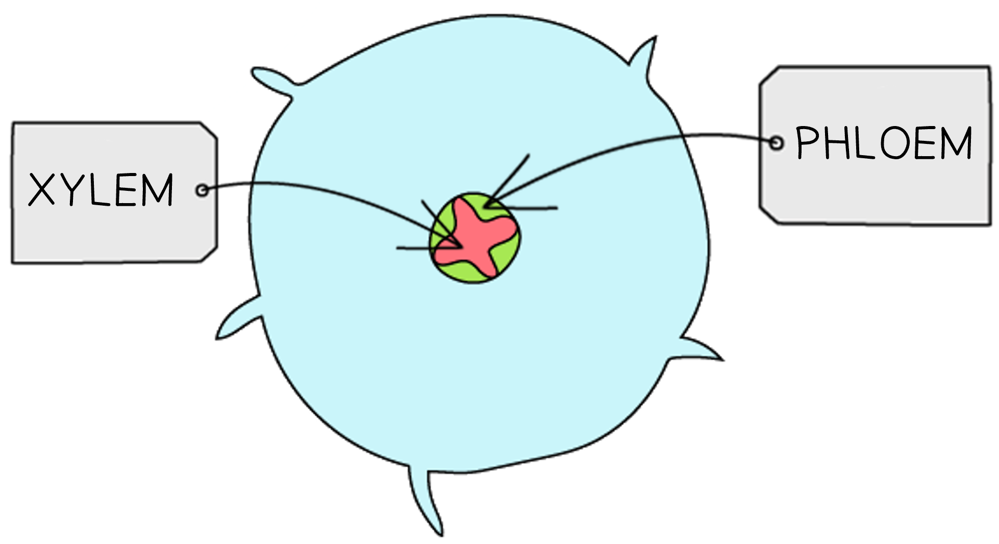
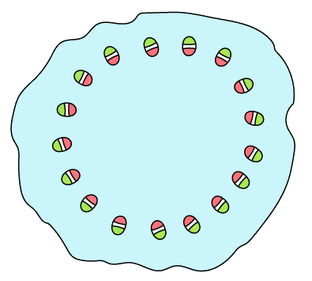
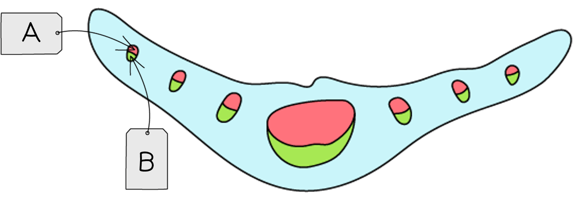
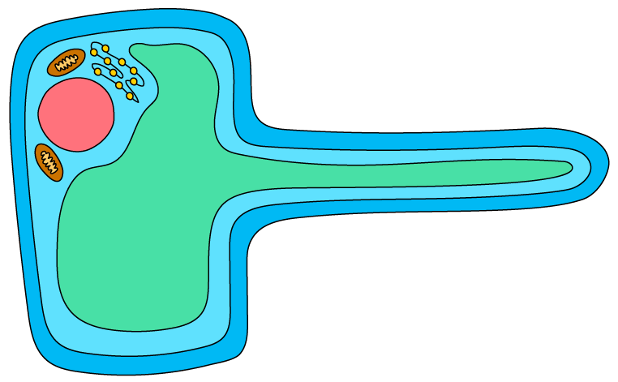

# Transport in Plants

Course: cie-igcse-biology-23 · Section: 8. Transport in Plants

Source: https://www.savemyexams.com/igcse/biology/cie/23/flashcards/8-transport-in-plants/8-1-transport-in-plants/

## Card 1 — keyword_definition (`fl_T8z9p7XkXX4dxMtm`)

**FRONT**

Define the term **xylem**.

**BACK**

Xylem are vessels that **transport water **and** mineral ions **from the roots to the upper parts of plants.

## Card 2 — true_or_false (`fl_wkbZSdRT2RsbTtRq`)

**FRONT**

**True or False?**

Xylem vessels provide structural support to plant stems.

**BACK**

**True.**

Xylem vessels are **strong** to enable them to transport water without breaking; this means that they also contribute to** structural support** within plant stems.

## Card 3 — keyword_definition (`fl_dmfGn4mQrQmBFFZj`)

**FRONT**

Define the term **phloem**.

**BACK**

The phloem is a tissue that transports **sucrose** and **amino acids** around plants.

## Card 4 — true_or_false (`fl_j2wqKjjTwRk5PHSj`)

**FRONT**

**True or False?**

The image below correctly shows the distribution of vascular tissue in a root.

**BACK**

**True.**

The **xylem** tissue forms a **cross shape** in the centre of roots, and the **phloem surrounds the xylem** tissue.

## Card 5 — question_and_answer (`fl_x8ZB4TfDBhy4kxb9`)

**FRONT**

Which colour (green or pink) represents the **xylem tissue** in this stem cross-section diagram?

**BACK**

Xylem tissue is represented by **pink** regions in the diagram. This is because** phloem is on the outside** of the vascular bundles in a stem, while** xylem is on the inside**.

## Card 6 — question_and_answer (`fl_Fxwj9nB8drGtMwkC`)

**FRONT**

Which types of plant tissue are represented by letters **A** and **B** in the diagram?

**BACK**

The types of plant tissue represented by A and B are:

- A = xylem
- B = phloem

The diagram shows a leaf cross section. **Xylem** tissue is closer to the **upper surface of leaves** while **phloem** is closer to the** lower surface**.

## Card 7 — question_and_answer (`fl_YFzbx6CmSd5sD5BN`)

**FRONT**

How are **xylem** vessels adapted to carry out their function? (**Extended Tier Only**)

**BACK**

Xylem vessels are adapted to their function as follows:

- Cell walls strengthened with** lignin**
- No cell contents
- No end walls

## Card 8 — question_and_answer (`fl_2fF9cfMjmQQzpCy4`)

**FRONT**

What **cell type **is shown in the image below?

**BACK**

The cell type shown in the image is a **root hair cell**.

## Card 9 — question_and_answer (`fl_bvP24QjmRw2jcKrJ`)

**FRONT**

What is the role of a** root hair cell**?

**BACK**

The role of a root hair cell is to absorb **water** and **mineral ions** from the soil.

## Card 10 — question_and_answer (`fl_md2DPBH5yFMQT5Ps`)

**FRONT**

How are root hair cells** adapted** to aid their function?

**BACK**

Root hair cells are adapted for absorption of water and minerals as follows:

- They have a** large surface area**
- They contain mitochondria which release **energy** for **active transport**

## Card 11 — question_and_answer (`fl_5pJVM3Rmgt9VZ8Dc`)

**FRONT**

Write a flow diagram to describe the **pathway taken by water** as it travels across the root, up the stem, and out of the leaves of plants.

**BACK**

The pathway taken by water as it travels across the root, up the stem, and out of the leaves of plants is:

**Root hair cells **$\rightarrow$**root cortex **$\rightarrow$**xylem vessels **$\rightarrow$** spongy mesophyll cells**

## Card 12 — true_or_false (`fl_596FJ8XszQyyMvzK`)

**FRONT**

**True or False?**

A piece of celery stem placed in food colouring can be used to show the location of phloem tissue in celery.

**BACK**

**False.**

Placing a celery stem in food colouring and allowing it to absorb the dye allows the location of the** xylem** to be seen.

## Card 13 — keyword_definition (`fl_K8fpNCH8v4T6qWfQ`)

**FRONT**

Define the term **transpiration**.

**BACK**

Transpiration is the **loss of water vapour** from the leaves of plants by **evaporation**.

## Card 14 — question_and_answer (`fl_rWJ2XmsB6xKFRkVT`)

**FRONT**

What is the role of the **spongy mesophyll cells** in transpiration?

**BACK**

The spongy mesophyll cells are involved in transpiration as follows:

- water vapour **evaporates** from the surface of spongy mesophyll cells and enters the leaf **air spaces**
- water vapour **diffuses** from the air spaces out of the leaf

## Card 15 — question_and_answer (`fl_CBgScTVPCrHWbrmn`)

**FRONT**

By what process does water vapour **exit the leaf air spaces**?

**BACK**

Water vapour exits the leaf air spaces by the process of **diffusion** through the **stomata**.

## Card 16 — question_and_answer (`fl_S2Y7dHTVHh6nrNTp`)

**FRONT**

Name the piece of equipment used to **measure transpiration rate** in a plant shoot.

**BACK**

The  piece of equipment used to measure transpiration rate in a plant shoot is known as a **potometer**.

## Card 17 — question_and_answer (`fl_Vm2bXpSM9V7JP22q`)

**FRONT**

Describe how a **bubble potometer** works to measure transpiration rate.

**BACK**

A bubble potometer works to measure transpiration rate as follows:

- a **bubble** is introduced into a tube containing a cut plant stem
- as the plant transpires water is pulled up the stem, causing the **bubble to move**
- the **distance the bubble moves** in a **given time** indicates the transpiration rate

## Card 18 — question_and_answer (`fl_zMryFrk3XnhMPwqt`)

**FRONT**

How can a potometer be set up to ensure that the system is **airtight**?

**BACK**

An airtight potometer system can be ensured as follows:

- a potometer can be **set up underwater** to prevent entry of air bubbles
- **petroleum jelly** can be used to seal any joins

## Card 19 — question_and_answer (`fl_WPq9T4X4RFsjjKSq`)

**FRONT**

How could you investigate the effect of** wind speed** on transpiration rate using a potometer?

**BACK**

The effect of wind speed on transpiration rate can be investigated by setting up a **fan** or **hairdryer** blowing air over the plant shoot at **different speeds**.

## Card 20 — question_and_answer (`fl_R3tmsjDskWqRxbzk`)

**FRONT**

Give **three** **environmental variables** that should be kept the **same** when investigating the effect of **temperature** on transpiration rate.

**BACK**

**Environmental** variables that should be kept the same when investigating the effect of temperature on transpiration rate include:

- wind speed
- light intensity
- humidity
- type/species of plant shoot
- surface area of plant shoot / number of leaves that the plant shoot has

## Card 21 — question_and_answer (`fl_6gs9whFQ2BCDsmMz`)

**FRONT**

How does the structure of the **spongy mesophyll layer** aid transpiration? (**Extended Tier Only**)

**BACK**

The structure of the spongy mesophyll layer aids transpiration as follows:

- the spongy mesophyll layer contains **air spaces** where the surface of spongy mesophyll cells come into contact with the air
- there is a** large internal surface area **where this cell-air contact occurs
- the large surface area** increases the rate at which water vapour evaporates** from the surface of spongy mesophyll cells

## Card 22 — question_and_answer (`fl_NRcdbcNjWs9RHPRy`)

**FRONT**

What is the relationship between **number of stomata **and **transpiration rate**? (**Extended Tier Only**)

**BACK**

The relationship between number of stomata and transpiration rate is as follows:

- the **more stomata**, the **faster the rate of transpiration** (and vice versa)

## Card 23 — keyword_definition (`fl_tKjtcTDHG4JdnQ4K`)

**FRONT**

Define the term **transpiration pull**. (**Extended Tier Only**)

**BACK**

**Transpiration pull** occurs when **water** **is drawn up the xylem** to replace the water that is lost from the surface of spongy mesophyll cells by **evaporation**.

## Card 24 — question_and_answer (`fl_G2DqN9vnnqv9N3TX`)

**FRONT**

How do **forces of attraction** between water molecules enable** **transpiration pull? (**Extended Tier Only**)

**BACK**

Forces of attraction between water molecules enables transpiration pull because:

- each water molecule **pulls on the water molecule below**
- the water molecules move upwards in a **continuous column**

## Card 25 — true_or_false (`fl_bFm8nrBpXx56RV8s`)

**FRONT**

**True or False?**

Transpiration rate increases at higher temperatures due to the increased **kinetic energy** of molecules. (**Extended Tier Only**)

**BACK**

**True.**

At higher temperatures water molecules have **more kinetic energy **and are more likely to **diffuse **out via the stomata.

## Card 26 — question_and_answer (`fl_M7q7ZRqrzDPWvqZ9`)

**FRONT**

Why does transpiration occur **faster** on a **windy day**? (**Extended Tier Only**)

**BACK**

Transpiration is faster on a windy day because wind **blows water vapour away** from the surface of leaves, **maintaining a water vapour concentration gradient** between the inside and the outside of leaves.

## Card 27 — true_or_false (`fl_DhJGKw8jT7Z3MWWN`)

**FRONT**

**True or False?**

Increasing humidity levels will increase the rate of transpiration. (**Extended Tier Only**)

**BACK**

**False.**

Increasing humidity levels will **decrease the rate of transpiration**.

This is because humid conditions decrease the water vapour concentration gradient between the inside and outside of the leaf.

## Card 28 — question_and_answer (`fl_HdBpP7TWGg6STpJD`)

**FRONT**

Define the term **water vapour concentration gradient** in the context of transpiration. (**Extended Tier Only**)

**BACK**

The water vapour concentration gradient is the **difference in water vapour concentration** between the inside and the outside of a leaf.

## Card 29 — question_and_answer (`fl_55SkKVWf4mpQwzTM`)

**FRONT**

Why do plants **wilt**? (**Extended Tier Only**)

**BACK**

Plants wilt when they** lose water** and **cannot replace it **with water from the soil. The water loss causes the plant cells to lose their rigid structure and the **cell walls no longer provide support **to the plant.

## Card 30 — keyword_definition (`fl_t2Xt9RrdnTtx9x3d`)

**FRONT**

Define the term **translocation**. (**Extendend Tier Only**)

**BACK**

Translocation is the movement of **sucrose **and **amino acids** through **phloem** tissue **from sources to sinks**.

## Card 31 — keyword_definition (`fl_ZvcQDrk2FF8nqJC6`)

**FRONT**

Define the term **source** in the context of plant transport. (**Extended Tier Only**)

**BACK**

A source is a part of the plant that **produces** or **releases **sucrose or amino acids.

## Card 32 — keyword_definition (`fl_S8525yjMv6xMmmqf`)

**FRONT**

Define the term **sink** in the context of plant transport. (**Extended Tier Only**)

**BACK**

A sink is a part of a plant that** uses** or **stores** sucrose or amino acids.

## Card 33 — true_or_false (`fl_wkWTGpR9nXS8yqcV`)

**FRONT**

**True or False?**

Sources and sinks can be found in different parts of plants at different times of year. (**Extended Tier Only**)

**BACK**

**True.**

Sources and sinks can be in **different parts of plants** depending on whether plants are** photosynthesising** or relying on **stored sucrose**.

## Card 34 — question_and_answer (`fl_Fq3NFhZCJrCszGTh`)

**FRONT**

Why does **phloem transport** not always occur in the same direction? (**Extended Tier Only**)

**BACK**

Phloem transport occurs in different directions depending on the time of year:

- During** early spring** sucrose will be transported **upwards**, from storage organs in the roots towards growing leaves and flowers
- During **summer **sucrose will be transported **downwards**, from photosynthesising leaves towards storage organs in the roots

