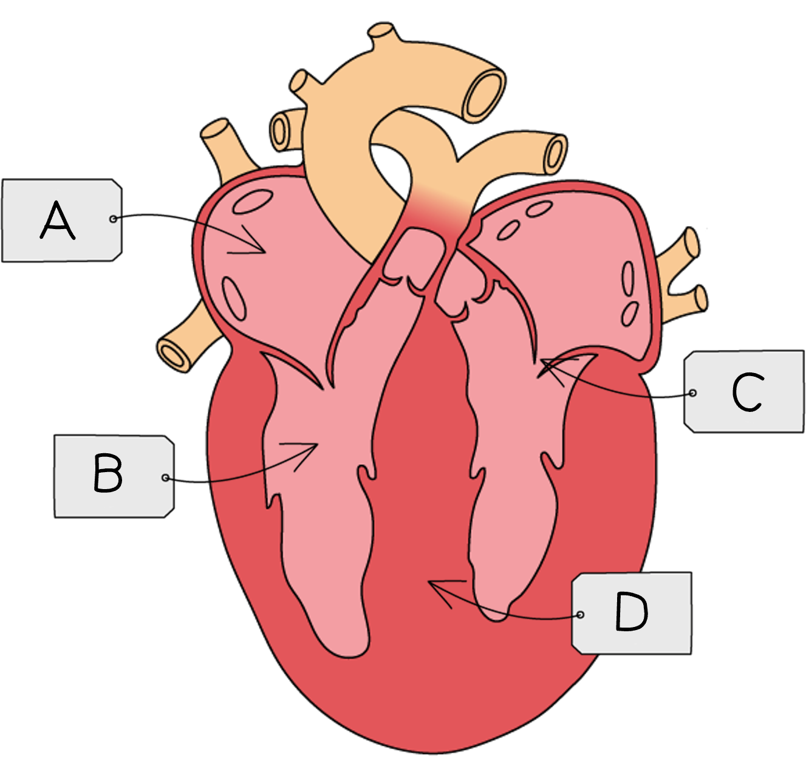
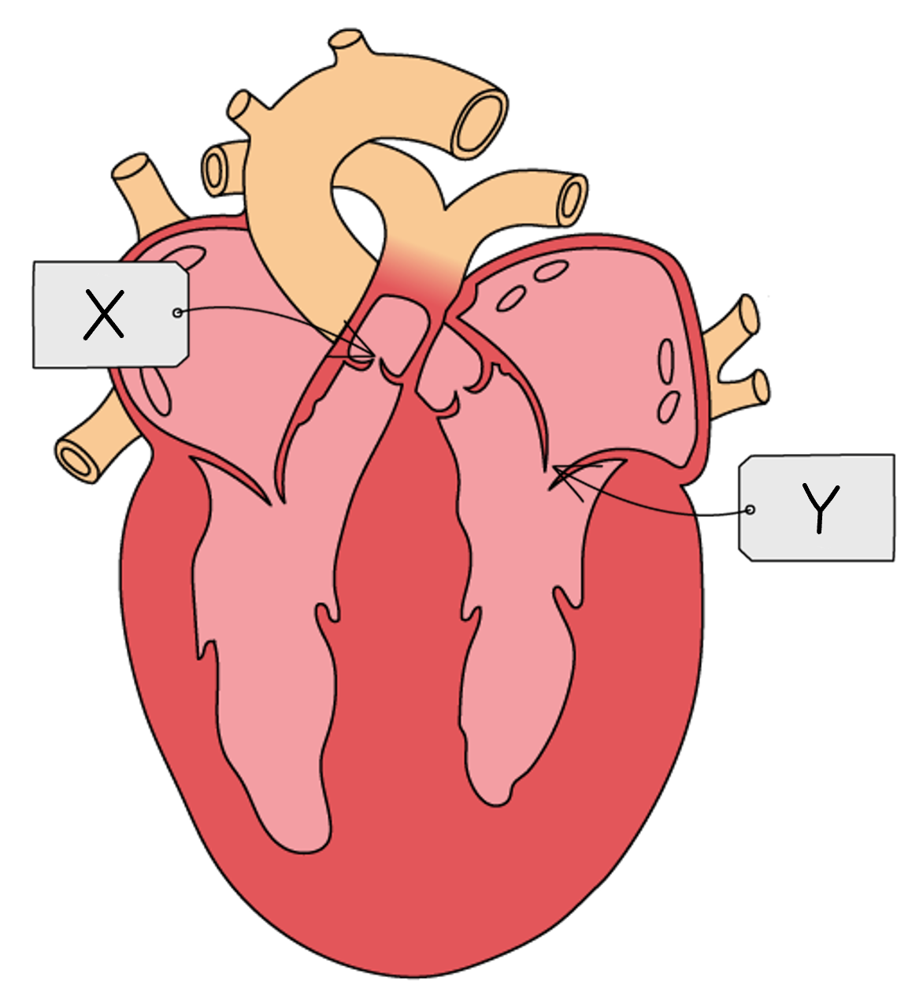
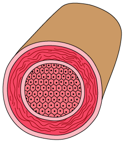
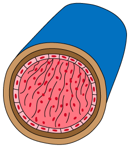
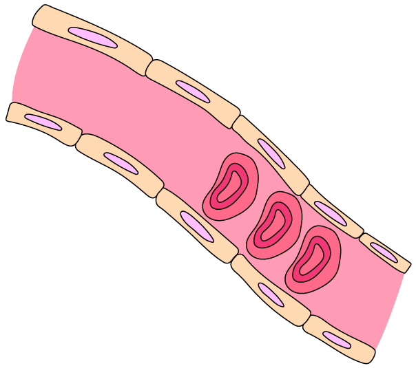
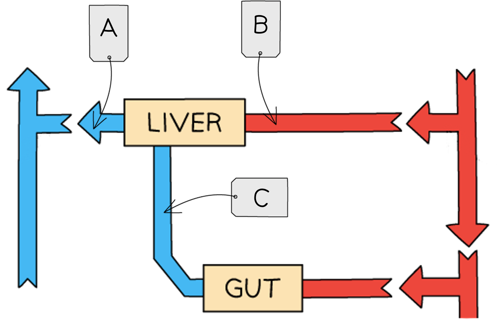
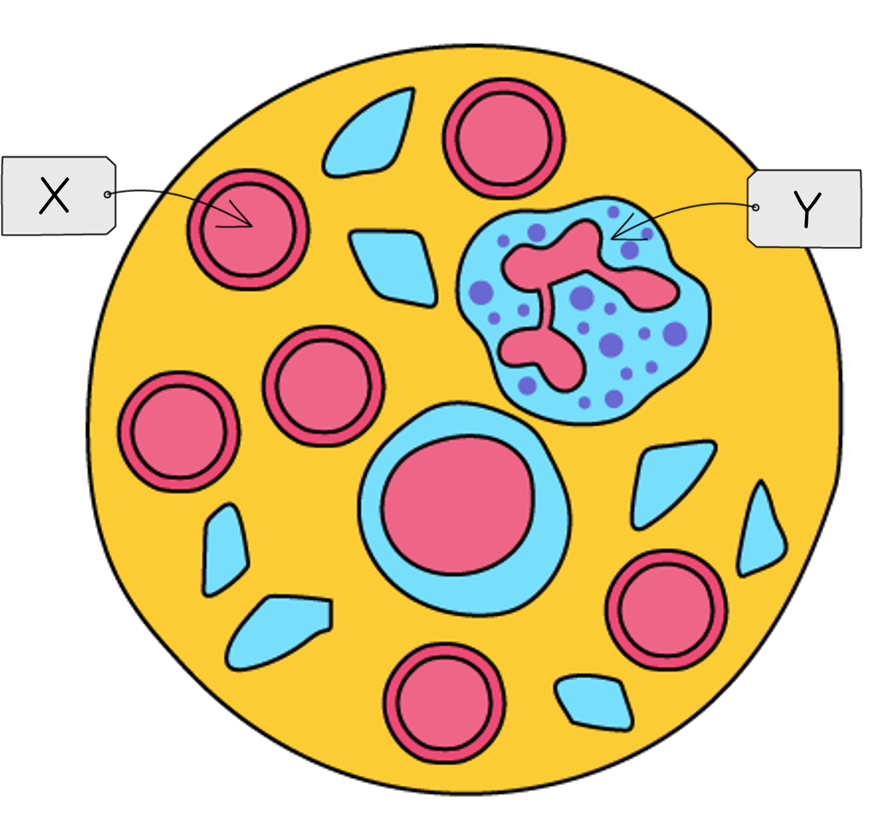
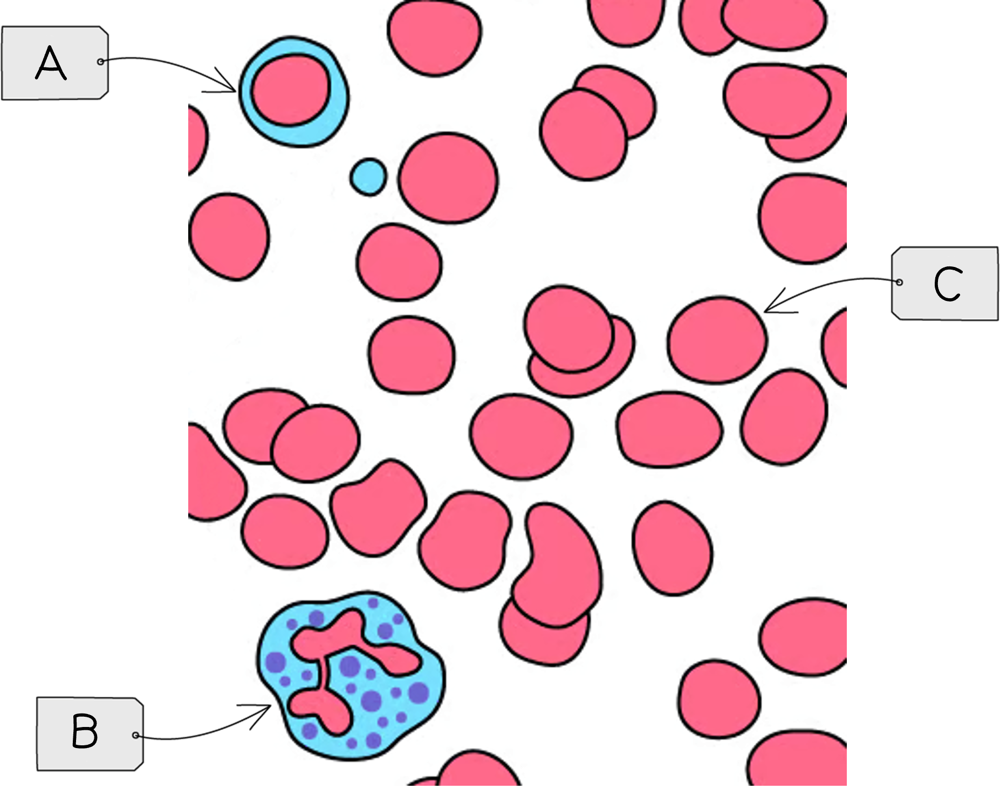

# Circulatory Systems, Heart & Blood Vessels

Course: cie-igcse-biology-23 · Section: 9. Transport in Animals

Source: https://www.savemyexams.com/igcse/biology/cie/23/flashcards/9-transport-in-animals/9-1-circulatory-systems-heart-and-blood-vessels/

## Card 1 — question_and_answer (`fl_mDny9ffN4K74MK4M`)

**FRONT**

What is the **circulatory system**?

**BACK**

The circulatory system is a system of** blood vessels** with a **pump** and **valves**.

## Card 2 — question_and_answer (`fl_T2dyw3ydq8pWRNR5`)

**FRONT**

Why does the circulatory system contain **valves**?

**BACK**

The circulatory system needs valves to ensure** one-way flow of blood**.

## Card 3 — true_or_false (`fl_SJn4Tp69mWSVkgSw`)

**FRONT**

**True or False?**

Fish have a single circulatory system. (**Extended Tier Only**)

**BACK**

**True.**

Fish have a single circulatory system.

## Card 4 — question_and_answer (`fl_9crZsqPkwHhmjPrG`)

**FRONT**

What are the differences between single and double circulation? (**Extended Tier Only**)

**BACK**

Differences between single and double circulation include:

| **Single circulation** | **Double circulation** |
|---|---|
| heart has **2 chambers** | heart has **4 chambers** (or sometimes 3) |
| blood passes through the heart **once **for every circuit of the body | blood passes through the heart **twice **for every circuit of the body |

## Card 5 — question_and_answer (`fl_qRmY8GbJzNM3pcjp`)

**FRONT**

Why is it beneficial for mammals to have **double circulation**? (**Extended Tier Only**)

**BACK**

Mammals benefit from having double circulation because double circulation allows the heart to pump blood around the body at **high pressure**, so it **supplies oxygen and glucose to the cells more quickly**

## Card 6 — question_and_answer (`fl_j9dV57wny88tVCYx`)

**FRONT**

What are the structures labelled **A**-**D** in the diagram?

**BACK**

The structures are:

- A = right atrium
- B = right ventricle
- C = one-way valve / atrioventricular valve / bicuspid valve
- D = septum

## Card 7 — question_and_answer (`fl_2fNsqcHqF5D5mKVh`)

**FRONT**

Describe the **pathway** of **deoxygenated blood **through the heart as it travels** from the body to the lungs**.

**BACK**

Deoxygenated blood from the body passes through the heart and to the lungs as follows:

- blood enters the **right atrium** via the **vena cava**
- it flows through a **valve** into the **right ventricle**
- it is pumped into the **pulmonary artery** which takes it to the** lungs**

## Card 8 — question_and_answer (`fl_dtTKFn5R4xCqGbbg`)

**FRONT**

What role do **valves** play in the heart?

**BACK**

Valves in the heart** prevent the backflow of blood**, ensuring that blood flows in only one direction through the heart chambers and vessels.

## Card 9 — question_and_answer (`fl_gPzSfZjr4j7Y99dm`)

**FRONT**

How does blood** return** **to the heart from the lungs**?

**BACK**

Oxygenated blood returns to the heart from the lungs **via the pulmonary vein**.

## Card 10 — question_and_answer (`fl_bRvWRmVvxNKg2P4T`)

**FRONT**

How is the** cardiac muscle** of the heart supplied with oxygenated blood?

**BACK**

The **coronary arteries** supply the cardiac muscle of the heart with oxygenated blood, ensuring it receives a constant supply of oxygen and glucose for aerobic respiration to release energy for muscle contraction.

## Card 11 — true_or_false (`fl_jKrX6WgKGymFRB4j`)

**FRONT**

**True or False?**

Deoxygenated blood enters the left side of the heart from the body.

**BACK**

**False**.

Deoxygenated blood enters the **right **side of the heart from the body, via the vena cava.

## Card 12 — question_and_answer (`fl_5gmspZ8xkTJrNQgr`)

**FRONT**

Which **vein** is the only vein in the body to carry **oxygenated** blood?

**BACK**

The** pulmonary vein** is the only vein to carry oxygenated blood, returning blood to the heart after gas exchange has taken place.

## Card 13 — true_or_false (`fl_kTBXsYdFwVKm3GCh`)

**FRONT**

**True or False?**

Arteries carry blood away from the heart.

**BACK**

**True.**

**A**rteries carry blood **a**way from the heart while ve**in**s carry blood **in**to the heart.

## Card 14 — question_and_answer (`fl_bSBjqxtrrmBfJP5z`)

**FRONT**

How can the **activity** of the heart be **monitored**?

**BACK**

The activity of the heart can be monitored as follows:

- **ECG**
- measuring **pulse rate**, e.g. at the wrist
- listening to the** valves close**, i.e. listening to the heart beat

## Card 15 — true_or_false (`fl_B2kXrkp7bGsGrc8p`)

**FRONT**

**True or False?**

Heart rate increases during exercise.

**BACK**

**True.**

During physical activity the heart rate increases.

## Card 16 — question_and_answer (`fl_BH2BJfGCxcBxf6yG`)

**FRONT**

How can the **effect of exercise** on **heart rate** be investigated?

**BACK**

The effect of exercise on heart rate can be investigated by:

1. measuring **heart rate at rest**, e.g. by recording pulse rate in beats per minute
2. taking part in** exercise **for a specified time period
3. repeating the heart rate measurement

This can be **repeated** several times at the same level of exercise, and could be extended by taking part in exercise at **different intensity levels**.

## Card 17 — question_and_answer (`fl_FfX8WjWVk5CFGJCD`)

**FRONT**

When investigating the effect of exercise on heart rate, what is the **dependent variable**?

**BACK**

In an investigation into the effect of exercise on heart rate, the dependent variable is **heart rate**, e.g. in beats per minute

## Card 18 — question_and_answer (`fl_kv3SXgKZNZ3Ct9J3`)

**FRONT**

Give examples of variables that would need to be **controlled** when investigating the effect of **exercise intensity** on **heart rate**.

**BACK**

Variables that would need to be controlled when investigating the effect of exercise intensity on heart rate include:

- the **person **whose heart rate is measured
- the **type** of exercise
- the **time period** for which exercise is carried out
- the **method **of measuring heart rate
- the **rest period** between repeats

## Card 19 — question_and_answer (`fl_qDn33yC8rBnDSdhm`)

**FRONT**

What is **coronary heart disease **(CHD)?

**BACK**

Coronary heart disease (CHD) occurs when the** coronary arteries narrow **due to **build-up of fatty deposits**; this reduces the flow of blood through the coronary arteries of the heart.

## Card 20 — keyword_definition (`fl_MYyBqVqttjfSgDqf`)

**FRONT**

What are some of the** risk factors** for CHD?

**BACK**

Risk factors for CHD include:

- diet
- inactivity
- stress
- smoking
- age
- biological sex

## Card 21 — question_and_answer (`fl_b26HkjzRSv79Q7mG`)

**FRONT**

How can a high quality **diet** reduce the risk of CHD?

**BACK**

A good diet can **reduce blood cholesterol**,** reduce blood pressure** and **aid weight loss**; these can all reduce the risk of CHD.

## Card 22 — true_or_false (`fl_cC64bQNNcZxbw29f`)

**FRONT**

**True or False?**

Exercise can reduce the risk of CHD because it lowers blood pressure and reduces stress.

**BACK**

**True.**

Exercise can **reduce **the risk of CHD because it lowers blood pressure and reduces stress.

## Card 23 — question_and_answer (`fl_xt87dNvdWMmg478z`)

**FRONT**

What are the two types of valve labelled **X** and **Y**? (**Extended Tier Only**)

**BACK**

The valves labelled X and Y are:

- X = semilunar valve
- Y = atrioventricular valve

## Card 24 — question_and_answer (`fl_cTVv38KzP2D4Ykw3`)

**FRONT**

Why does the left ventricle have a **thicker muscle wall **than the right ventricle? (**Extended Tier Only**)

**BACK**

The left ventricle has a thicker muscle wall so that it can pump oxygenated blood at** high pressure throughout the body**, while the right ventricle pumps deoxygenated blood at lower pressure to the lungs.

## Card 25 — true_or_false (`fl_xh4CHYPkhvGpQNbz`)

**FRONT**

**True or False?**

The muscle walls of the atria are thicker than those of the ventricles. (**Extended Tier Only**)

**BACK**

**False.**

The atria have **thinner** walls than the ventricles. This is because they only need to pump blood the short distance to the ventricles, so they do not need to generate high pressures.

## Card 26 — question_and_answer (`fl_JBpRp8BwvgTwt87h`)

**FRONT**

What is the purpose of the **septum** in the heart? (**Extended Tier Only**)

**BACK**

The septum separates the left and right sides of the heart, **preventing oxygenated and deoxygenated blood from mixing**.

## Card 27 — true_or_false (`fl_QvHJCVPC2NK7JYqn`)

**FRONT**

**True or False?**

Contraction of the muscle of the atrial walls pumps blood into the ventricles. (**Extended Tier Only**)

**BACK**

**True.**

The **muscular contractions** of the atrial walls force blood downwards into the ventricles.

## Card 28 — question_and_answer (`fl_hz76WYZPCp5qsnVC`)

**FRONT**

How do the** heart valves** enable forward flow of blood while preventing backflow? (**Extended Tier Only**)

**BACK**

The heart valves enable forward flow of blood while preventing backflow as follows:

- high blood pressure **in front** of a valve** forces the valve open**, enabling forward flow of blood
- high blood pressure **behind** a valve **forces it closed**, preventing blood from flowing backwards

## Card 29 — question_and_answer (`fl_NfvgsfMcTVPxr2Cf`)

**FRONT**

Why does **heart rate **change during** exercise**? (**Extended Tier Only**)

**BACK**

During exercise the** heart rate increases** because:

- increased blood flow** increases the supply of oxygen and glucose** to the muscles
- muscle cells can** respire faster** and** release more energy** for muscle contraction
- waste products of respiration (e.g. carbon dioxide) can be removed from the cells faster

## Card 30 — question_and_answer (`fl_mQ5N8ZtmHKW3rsnr`)

**FRONT**

What is the function of **arteries**?

**BACK**

Arteries carry blood** away from the heart.**

## Card 31 — question_and_answer (`fl_J3bvD4nqvhZ4V8nG`)

**FRONT**

Which features in the diagram show that the blood vessel is an **artery**?

**BACK**

The blood vessel in the diagram is an artery because:

- the wall is thick
- the lumen is narrow
- no valves are present

## Card 32 — question_and_answer (`fl_nQfq5H4DNbZ88Kbr`)

**FRONT**

What is the function of **veins**?

**BACK**

Veins carry** **blood at low pressure **towards the heart**.

## Card 33 — question_and_answer (`fl_tSwwBvPzy5B2zBJ6`)

**FRONT**

Which features in the diagram show that the blood vessel is a **vein**?

**BACK**

The blood vessel is a vein because:

- the wall is thin
- the lumen is wide

## Card 34 — question_and_answer (`fl_ThC24sxgwwSqSKVP`)

**FRONT**

Which key feature of **veins** is not visible in the diagram?

**BACK**

The key feature of veins that is not visible in the diagram is the presence of **valves**.

## Card 35 — question_and_answer (`fl_JTZFPRcJXVgGYvzX`)

**FRONT**

What is the function of **capillaries**?

**BACK**

The function of capillaries is to transport oxygenated blood **from the arteries to the cells**, and deoxygenated blood **from the cells to the veins**.

In doing so they** supply the cells with oxygen and nutrients**, and **remove waste products** from the cells.

## Card 36 — question_and_answer (`fl_Cy9RMzRCTfbfWV6S`)

**FRONT**

What are the names of the blood vessels labelled **A**-**D** in the diagram?

**BACK**

The blood vessels are:

- A = pulmonary artery
- B = vena cava
- C = aorta
- D = pulmonary vein

## Card 37 — question_and_answer (`fl_485CDKHQTDvcBzzG`)

**FRONT**

Which blood vessel **carries deoxygenated blood to the lungs** from the heart?

**BACK**

The blood vessel that **carries deoxygenated blood to the lungs** from the heart is the **pulmonary artery**.

## Card 38 — true_or_false (`fl_hDSrYg55r6K9FVhr`)

**FRONT**

**True or False?**

The pulmonary vein carries oxygenated blood to the lungs from the heart.

**BACK**

**False.**

The pulmonary vein carries oxygenated blood **to the heart from the lungs**.

## Card 39 — true_or_false (`fl_3xHDFCHjSG58SDWc`)

**FRONT**

**True or False?**

The renal vein carries oxygenated blood away from the kidneys.

**BACK**

**False**.

The renal vein carries **deoxygenated** blood away from the kidneys.

## Card 40 — question_and_answer (`fl_3zpnqrMkY5B9YRsp`)

**FRONT**

How are **arteries **adapted to their function? (**Extended Tier Only**)

**BACK**

Arteries are adapted for their function as follows:

- thick, muscular walls can **withstand high pressure**
- elastic fibres in the walls allow them to** stretch**
- a narrow lumen **maintains high blood pressure**

## Card 41 — question_and_answer (`fl_g6FdQ8YGmnPmkCKj`)

**FRONT**

How are **veins** adapted to their function? (**Extended Tier Only**)

**BACK**

Veins are adapted to their function as follows:

- a wide lumen** increases the volume of blood **that flows at any one time
- the wide lumen** reduces friction** between blood and the blood vessel walls
- valves** prevent the backflow** of blood

## Card 42 — question_and_answer (`fl_PmVDtgjf7TR926KB`)

**FRONT**

What **capillary adaptations** are shown in the diagram? (**Extended Tier Only**)

**BACK**

Capillary adaptations shown include:

- **walls that are one cell thick**, and that are made of flattened cells to** **reduce diffusion distance
- a** narrow lumen** to increase contact between blood and the capillary walls, increasing diffusion

Note that while capillaries also have **gaps between the cells** in their walls to increase permeability, this feature cannot be seen in this image.

## Card 43 — question_and_answer (`fl_cD8FSSjdydmPgDq4`)

**FRONT**

Which blood vessels are labelled **A**-**C** in the diagram? (**Extended Tier Only**)

**BACK**

Blood vessels A-C are:

- A = hepatic vein
- B = hepatic artery
- C = hepatic portal vein

## Card 44 — question_and_answer (`fl_83jJt6ThX9HJNZ5p`)

**FRONT**

What are the main **components **of blood?

**BACK**

The main components of blood are:

- red blood cells
- white blood cells
- platelets
- plasma

## Card 45 — question_and_answer (`fl_cQvBGX3TRgtvSJCq`)

**FRONT**

What cell types are indicated by** X** and **Y** in the diagram of blood components?

**BACK**

Structures X and Y are:

- X = red blood cell
- Y = white blood cell

## Card 46 — question_and_answer (`fl_NyYhnqNGH2TBpDrz`)

**FRONT**

What is the role** **of **red blood cells**?

**BACK**

The function of red blood cells is to **transport oxygen** (via haemoglobin) to tissues and organs.

## Card 47 — question_and_answer (`fl_gCs3dFNDHv82Tx5t`)

**FRONT**

What is the **function **of **white blood cells**?

**BACK**

White blood cells are involved in the** immune response**; they carry out:

- phagocytosis
- antibody production

## Card 48 — true_or_false (`fl_2brwNY2PDP382RGs`)

**FRONT**

**True or False?**

Platelets transport oxygen around the body in the blood.

**BACK**

**False.**

Platelets are involved in the **blood clotting** process. *Red blood cells* transport oxygen.

## Card 49 — question_and_answer (`fl_hr532SNNk43CjJSm`)

**FRONT**

What substances are transported in the blood **plasma**?

**BACK**

Substances transported in the plasma include:

- blood cells
- ions
- nutrients
- urea
- hormones
- carbon dioxide

## Card 50 — question_and_answer (`fl_rBkHhqjk4c8pQYqx`)

**FRONT**

Why is **blood clotting** important?

**BACK**

Blood clotting is important because it:

- prevents significant** blood loss from wounds**
- seals wounds with a scab, **preventing entry of microorganisms** that could cause infection

## Card 51 — question_and_answer (`fl_3QhBtSMRmqhhQVc6`)

**FRONT**

What are the blood cell types indicated by labels **A**-**C**? (**Extended Tier Only**)

**BACK**

Blood cell types A-C are:

- A = lymphocyte
- B = phagocyte
- C = red blood cell

## Card 52 — true_or_false (`fl_XpNzC4PFmmZFHx3V`)

**FRONT**

**True or False?**

Lymphocytes engulf and destroy pathogens. (**Extended Tier Only**)

**BACK**

**False.**

Lymphocytes produce **antibodies**. *Phagocytes *engulf and destroy pathogens.

## Card 53 — question_and_answer (`fl_mrnVzbVJ2gNQgCdc`)

**FRONT**

What is the function of **phagocytes**? (**Extended Tier Only**)

**BACK**

The function of phagocytes is to **engulf and destroy pathogens **during **phagocytosis**.

## Card 54 — true_or_false (`fl_j38Z9HjcRyHrccTw`)

**FRONT**

**True or False?**

Soluble fibrin proteins are converted to insoluble fibrinogen proteins during the blood clotting process. (**Extended Tier Only**)

**BACK**

**False.**

**Soluble fibrinogen** proteins are converted to **insoluble fibrin** proteins during the blood clotting process.

## Card 55 — question_and_answer (`fl_2wc4mFJ5rPFZbGcq`)

**FRONT**

What is the role of **insoluble fibrin** during blood clotting? (**Extended Tier Only**)

**BACK**

Fibrin forms an **insoluble mesh** across the wound, **trapping red blood cells** to form a **clot**, which eventually dries to become a **scab**.

