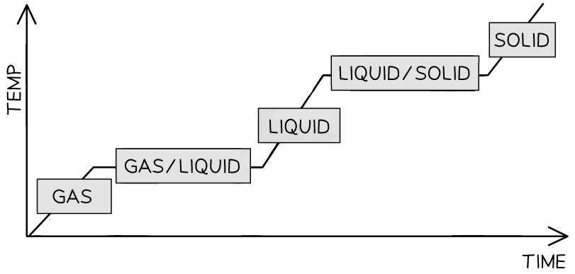
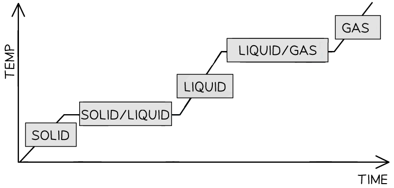

# Solids, liquids & gases

Course: cie-igcse-chemistry-23 · Section: 1. States of Matter

Source: https://www.savemyexams.com/igcse/chemistry/cie/23/flashcards/1-states-of-matter/1-1-solids-liquids-and-gases/

## Card 1 — true_or_false (`fl_p2XZHH9yRQ5x3RxM`)

**FRONT**

**True or False? **

The three states of matter are solids, liquids and gases.

**BACK**

**True. **

The three states of matter are solids, liquids and gases.

## Card 2 — question_and_answer (`fl_CG69cnGw9CcM2XP5`)

**FRONT**

What does **kinetic theory **explain?

**BACK**

**Kinetic theory **explains the differences in physical properties of solids, liquids, and gases by referring to the arrangement and motion of particles.

## Card 3 — keyword_definition (`fl_Jm3Ss9WpfYtzb8mR`)

**FRONT**

Define the term **density**.

**BACK**

**Density **is the mass per unit volume of a substance.

## Card 4 — true_or_false (`fl_gNdr8f6dWF6MS2Zf`)

**FRONT**

**True or False? **

Solids have a fixed volume and shape.

**BACK**

**True. **

Solids have a fixed volume and shape.

## Card 5 — question_and_answer (`fl_JHP3XS9VJC3zjv2Q`)

**FRONT**

What is the main difference in particle movement between solids and liquids?

**BACK**

In solids, particles vibrate in position but can't change location.

In liquids, particles move and slide past each other.

## Card 6 — true_or_false (`fl_C46xHGHyNTd2DJk8`)

**FRONT**

**True or False? **

Liquids have a higher density than gases.

**BACK**

**True. **

Liquids have a higher density than gases.

## Card 7 — question_and_answer (`fl_vRKTs2jGTVdqJzQz`)

**FRONT**

In terms of gases, what does **compressibility **mean?

**BACK**

**Compressibility **means that gases can be compressed into a smaller volume due to the large amount of space between particles.

## Card 8 — question_and_answer (`fl_t43GkmrgrrJMC3dY`)

**FRONT**

Which state of matter has particles with the **highest energy**?

**BACK**

The state of matter which has particles with the **highest energy** is gas.

## Card 9 — true_or_false (`fl_2sWtKhFdvBh53tG9`)

**FRONT**

**True or False?**

Liquids and gases have particles that are close together.

**BACK**

**False.**

Solids and liquids have particles that are close together.

## Card 10 — question_and_answer (`fl_JG4ZfKT4Qc8zb9R5`)

**FRONT**

Which state(s) of matter has **randomly arranged **particles?

**BACK**

The states of matter with randomly arranged particles are:

- Liquids
- Gases

## Card 11 — question_and_answer (`fl_xS7Gf2f4KYwVMC3w`)

**FRONT**

Which state(s) of matter has particles that are not free to move?

**BACK**

The state of matter that has particles that are not free to move is:

- Solid. They can only vibrate about a fixed position, they are not free to move.

## Card 12 — true_or_false (`fl_RZZH3wMYHGj8XdfF`)

**FRONT**

**True or False?**

Particles in a liquid move quickly in all directions.

**BACK**

**False.**

Particles in a liquid have restricted movement and move around each other.

Gas particles move quickly in all directions.

## Card 13 — question_and_answer (`fl_Sb43r6cDdXtJFHqK`)

**FRONT**

Name the state change that takes place when a liquid becomes a solid.

**BACK**

The interconversion that takes place when a liquid becomes a solid is called **freezing**.

## Card 14 — keyword_definition (`fl_mZMDJ2F8j5bX5bkD`)

**FRONT**

What is boiling?

**BACK**

Boiling is when a liquid changes into a gas at a constant temperature.

## Card 15 — question_and_answer (`fl_MX8TQrSb2kmf7XGv`)

**FRONT**

What type of energy allows particles to move in the liquid state? **(Extended tier only)**

**BACK**

The type of energy that allows particles to move in the liquid state is** kinetic energy**.

## Card 16 — true_or_false (`fl_kJC439P3qQ8W2F34`)

**FRONT**

**True or False?**

Energy is needed to change a gas to a liquid. **(Extended tier only)**

**BACK**

**False.**

Energy is released when a gas changes into a liquid.

## Card 17 — keyword_definition (`fl_jpm3Zv5PfcNYkVgm`)

**FRONT**

What is melting?

**BACK**

Melting is when a solid changes into a liquid.

## Card 18 — true_or_false (`fl_MxWTYrGtTwZ7WN8c`)

**FRONT**

**True or False?**

The melting point and freezing point of a substance are the same.

**BACK**

**True.**

There is no difference between the melting point and freezing point.

## Card 19 — keyword_definition (`fl_STMFd4bdJQBTmySX`)

**FRONT**

What is freezing?

**BACK**

Freezing is when a liquid changes into a solid.

## Card 20 — question_and_answer (`fl_S7rb2d94wQfxPsWr`)

**FRONT**

What happens to the forces of attraction when a solid turns to a liquid? **(Extended tier only)**

**BACK**

When a solid turns to a liquid, the forces of attraction are **overcome** or **broken**.

## Card 21 — question_and_answer (`fl_WwfY43vnHCRWNpnM`)

**FRONT**

What is condensation?

**BACK**

Condensation is when a gas changes into a liquid, usually on cooling.

## Card 22 — keyword_definition (`fl_c45CDd25B8ScycJC`)

**FRONT**

What does the term interconversion of state mean?

**BACK**

Interconversion of state is the change of matter from one state to another due to changes in temperature or pressure.

## Card 23 — keyword_definition (`fl_WSPMSYJf9DdYnqDk`)

**FRONT**

What is evaporation?

**BACK**

Evaporation is when a liquid changes into a gas.

## Card 24 — question_and_answer (`fl_Z8MVY5gZtcgsnGYW`)

**FRONT**

State the melting and boiling point of pure water.

**BACK**

The melting and boiling point of pure water are:

- Melting point = 0 oC
- Boiling point = 100 oC

## Card 25 — true_or_false (`fl_hysMySdGbWXDFtxj`)

**FRONT**

**True or False? **

Evaporation only occurs at the boiling point of a liquid.

**BACK**

**False**.

Evaporation occurs over a range of temperatures below the boiling point of a liquid.

## Card 26 — question_and_answer (`fl_hW3Fvk8j3Vjd3n2f`)

**FRONT**

What happens to particles during melting in terms of energy?	**(Extended tier only)**

**BACK**

During melting, particles absorb thermal energy which is converted into kinetic energy, allowing them to move more freely.

## Card 27 — question_and_answer (`fl_bMkbW3d3DXs5MS8X`)

**FRONT**

Define the term boiling point.

**BACK**

Boiling point is the specific temperature at which a liquid changes into a gas.

## Card 28 — question_and_answer (`fl_RzxVMnnSBT2tvkJR`)

**FRONT**

What is the relationship between surface area and evaporation rate?

**BACK**

The larger the surface area, the more quickly a liquid can evaporate.

## Card 29 — question_and_answer (`fl_HPM3vx8HtwFJxGKn`)

**FRONT**

What do the flat sections on heating and cooling curves represent? **(Extended tier only)**

**BACK**

The flat sections on heating and cooling curves represent changes of state.

## Card 30 — question_and_answer (`fl_3yQRPzrwrCTsrcpC`)

**FRONT**

Add labels for solid, liquid and gas to the **cooling curve**.

**(Extended tier only)**

**BACK**

The cooling curve with solid, liquid and gas labels:

## Card 31 — true_or_false (`fl_9YNnJQy52rBsJBZF`)

**FRONT**

**True or False?**

This heating curve is correctly labelled.

**(Extended tier only)**

**BACK**

**False.**

From left to right, the labels should be solid, solid/liquid, liquid, liquid/gas and gas.

## Card 32 — question_and_answer (`fl_P5fbTHDg2mZzw2Jy`)

**FRONT**

What happens to the volume of a gas as temperature increases?

**BACK**

As temperature increases, the volume of a gas increases.

## Card 33 — true_or_false (`fl_3TffqC5QWCx7w84w`)

**FRONT**

**True or False? **

The density of a gas increases as its volume increases. **(Extended tier only)**

**BACK**

**False**.

The density of a gas decreases as its volume increases.

## Card 34 — question_and_answer (`fl_Wnv7c3FtxrHgxHfh`)

**FRONT**

What is the relationship between pressure and volume in a gas?

**BACK**

As pressure increases, the volume of a gas decreases, and vice versa.

## Card 35 — keyword_definition (`fl_GcPkckHv2JCj6dK3`)

**FRONT**

In terms of gases, define the term pressure. **(Extended tier only)**

**BACK**

In terms of gases, pressure is the force exerted by gas particles colliding with the walls of their container.

## Card 36 — question_and_answer (`fl_T646frDtHvgRsMQH`)

**FRONT**

What causes gas particles to move faster?

**BACK**

An increase in temperature causes gas particles to move faster.

## Card 37 — true_or_false (`fl_H57CN52fGzqSFfHg`)

**FRONT**

**True or False? **

Gaseous particles are in constant and random motion.

**BACK**

**True**.

Gaseous particles are in constant and random motion.

## Card 38 — question_and_answer (`fl_j7zpwqRs5ZDKs75h`)

**FRONT**

What happens to the frequency of particle collisions with container walls when volume decreases? **(Extended tier only)**

**BACK**

When volume decreases, the frequency of particle collisions with container walls increases.

## Card 39 — keyword_definition (`fl_23kSFFfjTbGPQ8Qm`)

**FRONT**

Define the term kinetic energy in relation to gas particles. **(Extended tier only)**

**BACK**

Kinetic energy, in relation to gas particles, is the energy of motion possessed by the particles.

## Card 40 — question_and_answer (`fl_2pxTVQhQjN33gZ7Y`)

**FRONT**

What happens to gas particles when temperature increases?

**BACK**

When temperature increases, gas particles move faster and spread out more.

## Card 41 — question_and_answer (`fl_7DmZjqxCfm34hjMY`)

**FRONT**

State two ways to increase the pressure of a gas. **(Extended tier only)**

**BACK**

Two ways to increase the pressure of a gas are:

1. Increase the number of particles in the same volume.
2. Decrease the volume while keeping the number of particles the same.

## Card 42 — question_and_answer (`fl_SscZp2MVsRntXr8r`)

**FRONT**

What is diffusion?

**BACK**

Diffusion is the movement of particles from an area of high concentration to an area of low concentration.

## Card 43 — true_or_false (`fl_GGKy6b6YhGXjqvbF`)

**FRONT**

**True or False?**

Diffusion provides evidence for the kinetic theory of matter.

**BACK**

**True. **

Diffusion provides evidence for the kinetic theory of matter.

## Card 44 — true_or_false (`fl_hXQfkttTFptgbBYM`)

**FRONT**

**True or False? **

Diffusion in liquids is faster than in gases.

**BACK**

**False. **

Diffusion in liquids is slower than in gases because the particles in a liquid are closely packed together and move more slowly.

## Card 45 — true_or_false (`fl_Y5NSmqfWcNVrmFfB`)

**FRONT**

**True or False?**

In potassium manganate (VII) solution, the particles can easily mix together.

**BACK**

**True.**

The particles can easily mix together because the water and potassium manganate (VII) particles are moving randomly and the particles can slide over each other

## Card 46 — true_or_false (`fl_PKqjdh5jyBsTwczR`)

**FRONT**

**True or False?**

Bromine gas is red-brown.

**BACK**

**True.**

Bromine is red-brown as a gas.

## Card 47 — question_and_answer (`fl_RtqnbzG4PSjNhWf2`)

**FRONT**

In which states of matter does diffusion occur?

**BACK**

Diffusion occurs in gases and liquids.

## Card 48 — question_and_answer (`fl_6Z9PBmwH5mJV8s5s`)

**FRONT**

Describe the concentration of particles after diffusion is complete.

**BACK**

After diffusion is complete, the concentration of particles is evenly spread, throughout the available space.

## Card 49 — true_or_false (`fl_486ntGBpPyCXgPgQ`)

**FRONT**

**True or False? **

At the same temperature, all gases diffuse at the same rate. **(Extended tier only)**

**BACK**

**False**.

At the same temperature, gases with different molecular masses diffuse at different rates.

## Card 50 — question_and_answer (`fl_tVn2yKHQN4WCXPqx`)

**FRONT**

How does molecular mass affect the rate of diffusion in gases? **(Extended tier only)**

**BACK**

Gases with lower molecular mass diffuse faster than gases with higher molecular mass.

## Card 51 — question_and_answer (`fl_6SH4tpPNmpZ8jK7D`)

**FRONT**

What is a concentration gradient?

**BACK**

A concentration gradient is the difference in concentration of particles between two areas / places.

## Card 52 — true_or_false (`fl_kyzgCTfXdzTjc4KW`)

**FRONT**

**True or False? **

Diffusion requires energy input to occur.

**BACK**

**False**.

Diffusion happens spontaneously and does not require energy input.

