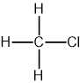
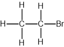

# Organic Families

Course: cie-igcse-chemistry-23 · Section: 11. Organic Chemistry

Source: https://www.savemyexams.com/igcse/chemistry/cie/23/flashcards/11-organic-chemistry/11-2-organic-families/

## Card 1 — true_or_false (`fl_bpxGM8KVCyXWDP7K`)

**FRONT**

**True or False? **

Each **fraction **in crude oil consists of groups of hydrocarbons with **similar chain lengths**.

**BACK**

**True. **

Each **fraction **in crude oil consists of groups of hydrocarbons with **similar chain lengths**.

## Card 2 — keyword_definition (`fl_dhQWy5J63XcCpB8Q`)

**FRONT**

Define **fractional distillation**.

**BACK**

**Fractional distillation** is the process of separating the different fractions of crude oil based on their boiling points.

## Card 3 — true_or_false (`fl_6Ds93vThKGSYjGyy`)

**FRONT**

**True or False?**

The size and length of each hydrocarbon molecule determines which fraction it will be separated into.

**BACK**

**True.**

The size and length of each hydrocarbon molecule determines which fraction it will be separated into.

## Card 4 — true_or_false (`fl_wVDJH6Nn7VcQWqZv`)

**FRONT**

**True or False? **

As you move up a fractionating column, the temperature increases.

**BACK**

**False. **

As you move up a fractionating column, the temperature **decreases**.

## Card 5 — question_and_answer (`fl_kcRxcfgqwkY2TrmV`)

**FRONT**

What happens to the** viscosity** of a liquid as the number of carbon atoms increases?

**BACK**

As the number of carbon atoms increases, the **viscosity **of the liquid increases.

## Card 6 — question_and_answer (`fl_xTHGmGXk56pBXcnz`)

**FRONT**

What happens to the **volatility** of a hydrocarbon liquid as the molecular size increases?

**BACK**

As the molecular size increases, the **volatility **of a hydrocarbon liquid decreases.

## Card 7 — keyword_definition (`fl_RYZmR9cpYB9VVsHg`)

**FRONT**

Define the term **viscosity**.

**BACK**

**Viscosity **is the ease of flow of a liquid.

## Card 8 — question_and_answer (`fl_mfmzKnfdGGKkD6CV`)

**FRONT**

What is the use of **refinery gases**?

**BACK**

**Refinery gases **are used for domestic heating & cooking.

## Card 9 — true_or_false (`fl_vY7mSbNzNq6F9JWY`)

**FRONT**

**True or False? **

Kerosene is used as jet fuel.

**BACK**

**True. **

Kerosene is used as jet fuel (paraffin).

## Card 10 — question_and_answer (`fl_Z8fbNwcKQKj5W7hW`)

**FRONT**

What is **diesel** used for?

**BACK**

**Diesel **is used in diesel engines (gas oil).

## Card 11 — question_and_answer (`fl_mcqwSXdVyGjjFGM8`)

**FRONT**

Give a use of **fuel oil**.

**BACK**

**Fuel oil **is used for ships & power stations.

## Card 12 — true_or_false (`fl_qX7gMJVrpTyKktpZ`)

**FRONT**

**True or False? **

Naphtha is used as jet fuel.

**BACK**

**False. **

Naphtha is used as a chemical feedstock.

Kerosene is used as jet fuel (paraffin).

## Card 13 — question_and_answer (`fl_Spj3NFPrHWWdQMFJ`)

**FRONT**

Which fraction is used as a **fuel in cars**?

**BACK**

The fraction used as a **fuel in cars** is petrol / gasoline.

## Card 14 — question_and_answer (`fl_FyB9JfnwRrmMv6Ct`)

**FRONT**

Which fraction is used to **surface roads**?

**BACK**

The fraction used for **surfacing roads **is bitumen.

## Card 15 — question_and_answer (`fl_4GcFFjhgn26FQJJ3`)

**FRONT**

Why do fractions condense inside the fractionation tower?

**BACK**

Fractions condense inside the fractionation tower because their vapours rise and reach a point where the temperature is below their boiling point.

## Card 16 — question_and_answer (`fl_3X5c7n2wfCt5Y8VS`)

**FRONT**

Why does the boiling point of a molecule increase as the molecule becomes larger?

**BACK**

As the molecules get larger, the intermolecular forces of attraction between the molecules becomes greater so more energy is needed to overcome them.

## Card 17 — question_and_answer (`fl_2TH72626xNGrpDy2`)

**FRONT**

What is a **hydrocarbon**?

**BACK**

A hydrocarbon is a compound made up of **hydrogen and carbon only**.

## Card 18 — question_and_answer (`fl_pgN5M65Dch3RJ5Dn`)

**FRONT**

Name **three** fossil fuels.

**BACK**

**Three **fossil fuels are:

- Coal
- Natural gas
- Petroleum

## Card 19 — true_or_false (`fl_Ft8JVZYFRPqR6Hys`)

**FRONT**

**True or False?**

The main constituent of natural gas is propane.

**BACK**

**False**.

The main constituent of natural gas is **methane**.

## Card 20 — keyword_definition (`fl_KYhfJdc6rCcktbsT`)

**FRONT**

What does **saturated **mean?

**BACK**

**Saturated **means the compounds only have single carbon-carbon bonds, with no double bonds.

## Card 21 — true_or_false (`fl_xq9bmC575H639BXY`)

**FRONT**

**True or False? **

Alkanes are reactive compounds.

**BACK**

**False. **

Alkanes are generally **unreactive **compounds.

## Card 22 — question_and_answer (`fl_FSYCcSZP6Kr3Wkcw`)

**FRONT**

Name the alkane that is predominantly present in **natural gas**.

**BACK**

The alkane that is predominantly present in **natural gas **is methane.

## Card 23 — question_and_answer (`fl_PGq73sCSyhy8RS23`)

**FRONT**

What type of reaction occurs between alkanes and halogens?

**BACK**

Alkanes undergo a **substitution **reaction with halogens in the presence of ultraviolet radiation.

## Card 24 — question_and_answer (`fl_fnj96bDbkMv9nTkj`)

**FRONT**

State the equation for methane reacting with bromine in the presence of UV light.

**BACK**

The equation for methane reacting with bromine in the presence of UV light is:

CH4 + Br2 → CH3Br + HBr

## Card 25 — question_and_answer (`fl_TG4YNk8MJhjmYdwJ`)

**FRONT**

State the equation for methane reacting with chlorine in the presence of UV light.

**BACK**

The equation for methane reacting with chlorine in the presence of UV light is:

CH4 + Cl2 → CH3Cl + HCl

## Card 26 — question_and_answer (`fl_zMRvpWwJHhzqq2Qk`)

**FRONT**

What condition is required for alkanes to react with halogens?

**BACK**

The condition required for the reaction between alkanes and halogens is **ultraviolet radiation / UV light**.

## Card 27 — true_or_false (`fl_7NY6QkS75QZ5XHs6`)

**FRONT**

**True or False?**

The products of complete combustion of an alkane are carbon monoxide and water.

**BACK**

**False**.

The products of complete combustion of an alkane are **carbon dioxide** and water.

## Card 28 — true_or_false (`fl_qDn9QmDSJppPbqtq`)

**FRONT**

**True or False?**

Ultraviolet light provides the activation energy for the photochemical reaction of an alkane with a halogen.

**BACK**

**True**.

Ultraviolet light provides the activation energy for the photochemical reaction of an alkane with a halogen.

## Card 29 — question_and_answer (`fl_DFwJHhSFd3ZbWtJB`)

**FRONT**

Draw the haloalkane produced by methane reacting with chlorine in the presence of UV light.

**(Extended tier only)**

**BACK**

The haloalkane produced by methane reacting with chlorine in the presence of UV light is:

## Card 30 — question_and_answer (`fl_g5ThdNBw9q3cNXB2`)

**FRONT**

Draw the haloalkane produced by ethane reacting with bromine in the presence of UV light.

**BACK**

The haloalkane produced by ethane reacting with bromine in the presence of UV light is:

## Card 31 — question_and_answer (`fl_jQdV3jWKwDyKMnjq`)

**FRONT**

State **three **reactions that alkanes can undergo.

**BACK**

**Three **reactions that alkanes can undergo are:

- Combustion
- Cracking
- Substitution reactions with halogens

## Card 32 — question_and_answer (`fl_zfqgf5jG345GYN4s`)

**FRONT**

Write the balanced equation for the combustion of methane.

**BACK**

The balanced equation for the combustion of methane is:

CH4 (g) + 2O2 (g) → CO2 (g) + 2H2O (l)

## Card 33 — question_and_answer (`fl_DJBDj6WC52zDG2yh`)

**FRONT**

What is the characteristic feature in the structure of alkenes?

**BACK**

All alkenes contain a double carbon bond, which is shown as two lines between two carbon atoms (C=C).

## Card 34 — question_and_answer (`fl_ncN6kfXjdYJcYrkZ`)

**FRONT**

What is the functional group in alkenes?

**BACK**

The double carbon bond (C=C) is the functional group in alkenes.

## Card 35 — keyword_definition (`fl_fSFyJTCWxyKQDSt9`)

**FRONT**

Define the term **alkene**.

**BACK**

An alkene is a  hydrocarbon compound containing at least one carbon-carbon double bond.

## Card 36 — keyword_definition (`fl_8FbT8SvrryFftXRp`)

**FRONT**

Explain the term** double bond**.

**BACK**

A double bond is a covalent bond formed by sharing two pairs of electrons between atoms.

## Card 37 — keyword_definition (`fl_zR6h8q49xC8yf3hw`)

**FRONT**

Explain what is meant by a **unsaturated** compound.

**BACK**

An unsaturated  compound contains double or triple bonds, which can undergo addition reactions.

## Card 38 — true_or_false (`fl_w3JnZ7rkKS9kt5FR`)

**FRONT**

**True or False?**

Alkenes are less reactive than alkanes due to their double bond.

**BACK**

**False.**

Alkenes are more reactive than alkanes due to the presence of the carbon-carbon double bond.

## Card 39 — true_or_false (`fl_N4bywTKXsxX7nx6s`)

**FRONT**

**True or False? **

The bromine water test can distinguish between propane and ethanol.

**BACK**

**False. **

The bromine water test can only distinguish between alkanes and alkenes due to their different reactivity with bromine, so it can't distinguish between propane and ethanol.

## Card 40 — question_and_answer (`fl_gT2Sxdnj2pG736DZ`)

**FRONT**

What is the colour change for the following reaction?

**BACK**

The colour change for the following reaction is **orange to colourless.**

## Card 41 — question_and_answer (`fl_ykyF7CYSwx3szYHk`)

**FRONT**

What is **catalytic cracking**?

**BACK**

Catalytic cracking is a process used to convert longer-chain molecules into hydrocarbons that are:

- Shorter chain.
- Higher demand.
- More useful.

## Card 42 — question_and_answer (`fl_5RcXp3CkRJ6h3YKs`)

**FRONT**

What are the products of catalytic cracking?

**BACK**

The products of catalytic cracking are shorter chain alkanes, alkenes, and hydrogen

## Card 43 — question_and_answer (`fl_x7jpPfVwkV83yPRQ`)

**FRONT**

What conditions are required for catalytic cracking?

**BACK**

The conditions for catalytic cracking are:

- 600 – 700°C.
- A catalyst of alumina or silica.

## Card 44 — question_and_answer (`fl_SYbwNjkMJTpNgCN3`)

**FRONT**

How can alkenes be distinguished from alkanes?

**BACK**

Alkenes can be distinguished from alkanes using bromine water.

Alkenes will decolorise bromine water, while alkanes will not.

## Card 45 — question_and_answer (`fl_mMkdMc8XGyt35qPW`)

**FRONT**

What **colour **is bromine water?

**BACK**

Bromine water is a brown / red-brown colored solution.

## Card 46 — true_or_false (`fl_xrV24Sf2skDzGGXR`)

**FRONT**

**True or False? **

When bromine water is shaken with an alkene, the solution remains brown / red-brown.

**BACK**

**False**.

When bromine water is shaken with an alkene, the solution will go colorless.

## Card 47 — question_and_answer (`fl_2dChVFxRrDBMnGGz`)

**FRONT**

What is the reaction between bromine and propene an example of?

**(Extended tier only)**

**BACK**

The reaction between bromine and propene is an example of an **addition **reaction.

## Card 48 — question_and_answer (`fl_m6HXFbMTsh5FzjY4`)

**FRONT**

What is an **addition reaction**?

**(Extended tier only)**

**BACK**

An addition reaction is a reaction in which atoms of a simple molecule add across the C=C double bond of an alkene

## Card 49 — question_and_answer (`fl_bfGvg4Q6S47KZThs`)

**FRONT**

How many products are formed in an addition reaction?

**(Extended tier only)**

**BACK**

In an addition reaction, only one product is formed

## Card 50 — question_and_answer (`fl_fM7fK2KxFfp4kjjj`)

**FRONT**

What happens when bromine is added to an alkene?

**(Extended tier only)**

**BACK**

When bromine is added to an alkene, the two bromine atoms add across the carbon-carbon double bond to form a saturated compound.

## Card 51 — question_and_answer (`fl_gSB2y8MVSmjXD6NP`)

**FRONT**

What product is formed when alkenes undergo addition reactions with hydrogen?

**(Extended tier only)**

**BACK**

When alkenes undergo addition reactions with hydrogen, an **alkane **is formed.

## Card 52 — question_and_answer (`fl_NPBVtxbwyCjJjJS4`)

**FRONT**

What catalyst is required for the reaction between alkenes and hydrogen?

**(Extended tier only)**

**BACK**

The reaction between alkenes and hydrogen requires a **nickel **catalyst.

## Card 53 — question_and_answer (`fl_F7wt9HrkvSWWMDfN`)

**FRONT**

What product is formed when alkenes undergo addition reactions with steam?

**(Extended tier only)**

**BACK**

When alkenes undergo addition reactions with steam, an **alcohol **is formed.

## Card 54 — question_and_answer (`fl_jTMtmzKvZcj7bRCZ`)

**FRONT**

What other name is given to the reaction between alkenes and steam?

**(Extended tier only)**

**BACK**

The reaction between alkenes and steam is also called a hydration reaction.

## Card 55 — question_and_answer (`fl_zvp449y4pSZHhYvy`)

**FRONT**

What catalyst is required for the reaction between alkenes and steam?

**(Extended tier only)**

**BACK**

The reaction between alkenes and steam requires an acid catalyst.

## Card 56 — true_or_false (`fl_qQvdQJxJmF8VpbRM`)

**FRONT**

**True or False? **

In the reaction between ethene and steam, ethanol is produced.

**(Extended tier only)**

**BACK**

**True**.

In the reaction between ethene and steam, ethanol is produced.

## Card 57 — question_and_answer (`fl_4kxWnFhDy2V8WryQ`)

**FRONT**

How can **ethanol **be synthesised industrially?

**BACK**

Ethanol can be synthesised by the hydration of ethene.

## Card 58 — question_and_answer (`fl_dRM6YVQyR7R8x2wc`)

**FRONT**

What are the conditions for the hydration of ethene to produce ethanol?

**BACK**

The conditions required for the hydration of ethene are a temperature of around 300°C, pressure of 60-70 atm, and a concentrated phosphoric acid catalyst.

## Card 59 — question_and_answer (`fl_jXtM44wRgCnXgwvD`)

**FRONT**

How are ethanol and water separated from the reaction mixture after hydration?

**BACK**

Ethene is separated first due to its much lower boiling point, then ethanol and water are separated by fractional distillation.

## Card 60 — question_and_answer (`fl_gXTcxZDzTyYhfFqc`)

**FRONT**

What is the equation for the hydration of ethene to produce ethanol?

**BACK**

The equation for the hydration of ethene is:

CH2=CH2 + H2O → CH3CH2OH

## Card 61 — question_and_answer (`fl_VYptscRCfRYDJJrB`)

**FRONT**

How is ethanol produced by **fermentation**?

**BACK**

Ethanol is produced by fermentation through yeast enzymes breaking down sugar or starch in the absence of oxygen to produce ethanol and carbon dioxide:

C6H12O6 → 2CO2 + 2C2H5OH

## Card 62 — keyword_definition (`fl_QmnqQjhT4PHV2wfx`)

**FRONT**

State the meaning of** hydration**.

**BACK**

A chemical reaction in which a water molecule is added to a compound.

## Card 63 — keyword_definition (`fl_mChtR4Hd9Rf82qxW`)

**FRONT**

Explain what is meant by **fermentation**.

**BACK**

A process in which yeast or bacteria convert carbohydrates into alcohol or acids in the absence of oxygen.

## Card 64 — true_or_false (`fl_yTjQWBdtn9kFjtPp`)

**FRONT**

**True or False? **

Fermentation is an aerobic process.

**BACK**

**False.**

Fermentation is an anaerobic process that does not require oxygen for ethanol to be produced.

## Card 65 — question_and_answer (`fl_QxqRWMSnHbHvpDBy`)

**FRONT**

What conditions are required for the fermentation of glucose?

**BACK**

The fermentation of glucose requires:

- A temperature between 25 and 35 °C.
- The absence of oxygen.
- The presence of a yeast catalyst.

## Card 66 — question_and_answer (`fl_QrfTpkBNcjqdQsQw`)

**FRONT**

Write the equation for the fermentation of glucose.

**BACK**

The equation for the fermentation of glucose is:

C6H12O6 → 2CO2 + 2C2H5OH

## Card 67 — question_and_answer (`fl_nSRQKCQtd4gdBJ9S`)

**FRONT**

Compare **fermentation** and **hydration of ethene** in terms of:

- Raw materials.
- Rate of reaction.
- Product purity / quality.

**(Extended tier only)**

**BACK**

Comparing **fermentation** and **hydration of ethene** in terms of:

- Raw materials - fermentation uses renewable resources, while hydration uses non-renewable resources.
- Rate of reaction - fermentation is slow, while hydration is fast.
- Product purity / quality - fermentation produces an impure dilute product, while hydration produces pure ethanol.

## Card 68 — true_or_false (`fl_6HJ8wgTxbfgKWqmv`)

**FRONT**

**True or False?**

Fermentation is a continuous process and hydration of ethene is a batch process.

**BACK**

**False**.

Fermentation is a **batch **process and hydration of ethene is a **continuous **process.

## Card 69 — question_and_answer (`fl_G3GyXWKfsjjzGpVN`)

**FRONT**

Does fermentation or hydration of ethene require high temperature to produce ethanol?

**BACK**

Hydration of ethene requires high temperature to produce ethanol.

## Card 70 — keyword_definition (`fl_7dbgNPS5htDxWnZx`)

**FRONT**

What is a carboxylic acid?

**BACK**

A carboxylic acid is a compound containing the functional group carboxyl, -COOH.

## Card 71 — question_and_answer (`fl_sQhFtPpZMNzHyZGg`)

**FRONT**

Which carboxylic acid is found in vinegar?

**BACK**

Vinegar is an aqueous solution of ethanoic acid and contains about 5% of the acid by volume.

## Card 72 — question_and_answer (`fl_R5GcVyKKRDBJycnd`)

**FRONT**

What is the molecular formula of ethanoic acid?

**BACK**

The molecular formula of ethanoic acid is CH3COOH.

## Card 73 — question_and_answer (`fl_zSX9sBvHqcQQrDff`)

**FRONT**

What is the name of the following carboxylic acid?

**BACK**

The name of the following carboxylic acid is **propanoic acid**.

## Card 74 — keyword_definition (`fl_kDKRxBB2yYfCRnm3`)

**FRONT**

What is the functional group of carboxylic acids?

**BACK**

The functional group of carboxylic acids is -COOH.

## Card 75 — question_and_answer (`fl_8jnB2tBczK6sRQjs`)

**FRONT**

What is produced when carboxylic acids react with metals?

**BACK**

When carboxylic acids react with metals, a salt and hydrogen gas are produced.

## Card 76 — question_and_answer (`fl_5HSTkhMyDNw83qPY`)

**FRONT**

What is produced when carboxylic acids react with carbonates?

**BACK**

When carboxylic acids react with carbonates, a salt, water, and carbon dioxide gas are produced.

## Card 77 — question_and_answer (`fl_ZydhTtpJbqjK9R8s`)

**FRONT**

What is produced when carboxylic acids react with bases?

**BACK**

When carboxylic acids react with bases, a salt and water are produced.

## Card 78 — question_and_answer (`fl_rFy4dCWYDW2Q9vwF`)

**FRONT**

How do the names of salts formed by carboxylic acids end?

**BACK**

The names of salts formed by carboxylic acids all end in -anoate

## Card 79 — question_and_answer (`fl_JHFzqQQQVbjzkprW`)

**FRONT**

Write the equation for the reaction between ethanoic acid and magnesium.

**BACK**

The equation for the reaction between ethanoic acid and magnesium is:

2CH3COOH + Mg → (CH3COO)2Mg + H2

## Card 80 — question_and_answer (`fl_ydQJGjD6Y8qSgJ8R`)

**FRONT**

What type of reaction occurs between potassium hydroxide and propanoic acid?

**BACK**

The reaction between potassium hydroxide and propanoic acid is a **neutralisation **reaction.

## Card 81 — question_and_answer (`fl_HkCS7sFH92m7YBY5`)

**FRONT**

Write the word equation for the reaction between potassium carbonate and butanoic acid.

**BACK**

The word equation for the reaction between potassium carbonate and butanoic acid is:

| Potassium carbonate + butanoic acid | $\rightarrow$ | potassium butanoate + carbon dioxide + water |
|---|---|---|

## Card 82 — true_or_false (`fl_pggMZtFdW55YnRcy`)

**FRONT**

**True or False?**

The salts formed by methanoic acid are called methanates.

**BACK**

**False**.

The salts formed by methanoic acid are called **methanoates**.

## Card 83 — question_and_answer (`fl_Dh7ZjXTnh7JDH5Zz`)

**FRONT**

How can ethanoic acid be prepared from ethanol?

**(Extended tier only)**

**BACK**

Ethanoic acid can be prepared by** oxidising ethanol** with **acidified potassium dichromate solution**.

## Card 84 — question_and_answer (`fl_TRWw6yxJFyTgK5WM`)

**FRONT**

What colour change occurs during the oxidation of ethanol to ethanoic acid using aqueous potassium manganate(VII)?

**(Extended tier only)**

**BACK**

During the oxidation of ethanol to ethanoic acid, the potassium manganate(VII) solution changes from purple to colourless.

## Card 85 — question_and_answer (`fl_xc7byMQw8Bf5Hvrj`)

**FRONT**

What is the symbol equation for the oxidation of ethanol to ethanoic acid?

**(Extended tier only)**

**BACK**

The symbol equation for the oxidation of ethanol to ethanoic acid is:

**CH****3****CH****2****OH + O****2****  →  CH****3****COOH + H****2****O**

## Card 86 — true_or_false (`fl_PPzQzM5W89fdNhv9`)

**FRONT**

**True or False? **

The oxidation of ethanol to ethanoic acid is a fast reaction at room temperature.

**(Extended tier only)**

**BACK**

**False.**

The oxidation of ethanol to ethanoic acid is a slow reaction and requires heating to its boiling point for about an hour.

## Card 87 — question_and_answer (`fl_NH9QvYVW9ncR5S7Z`)

**FRONT**

What are the two methods used to make carboxylic acids?

**(Extended tier only)**

**BACK**

The two methods used to make carboxylic acids are:

- Oxidation by fermentation.
- Using oxidising agents.

## Card 88 — question_and_answer (`fl_wTXVzpbHjPQyp8rk`)

**FRONT**

What is produced when ethanol undergoes microbial oxidation?

**(Extended tier only)**

**BACK**

When ethanol undergoes microbial oxidation, a weak solution of vinegar (ethanoic acid) is produced.

## Card 89 — question_and_answer (`fl_GYJzwTRpzQWxV4kN`)

**FRONT**

What oxidising agent can be used to produce ethanoic acid?

**(Extended tier only)**

**BACK**

Potassium manganate(VII) can be used as an oxidising agent to produce ethanoic acid.

## Card 90 — keyword_definition (`fl_f8nj7cGZq6rxxxS7`)

**FRONT**

What is an **esterification **reaction?

**(Extended tier only)**

**BACK**

An esterification reaction is a reaction between an alcohol and a carboxylic acid to form an ester.

## Card 91 — question_and_answer (`fl_sXgndnM7v2jQPD9C`)

**FRONT**

What is the functional group of esters?

**(Extended tier only)**

**BACK**

The functional group of esters is R-COO-R.

## Card 92 — question_and_answer (`fl_NqbHZQKTR2JkgSx4`)

**FRONT**

What **catalyst **is required for an esterification reaction?

**(Extended tier only)**

**BACK**

An **acid catalyst**, typically concentrated sulfuric acid, is required for an esterification reaction.

## Card 93 — question_and_answer (`fl_T2gngmwSmKz7679R`)

**FRONT**

Write the equation for the esterification reaction between ethanoic acid and ethanol.

**(Extended tier only)**

**BACK**

The equation for the esterification reaction between ethanoic acid and ethanol is:

CH3COOH (aq) + C2H5OH (aq) ⇌ CH3COOC2H5 (aq) + H₂O (l)

## Card 94 — question_and_answer (`fl_BZ5M5kKdpKKhVgP7`)

**FRONT**

How are esters named?

**(Extended tier only)**

**BACK**

Esters are named by combining the name of the alcohol (ending in -yl) and the name of the carboxylic acid (ending in -oate)

## Card 95 — question_and_answer (`fl_SvcYKqwBqQ5mDDnD`)

**FRONT**

What is the **name **of the ester formed from pentanol and butanoic acid?

**(Extended tier only)**

**BACK**

The ester formed from pentanol and butanoic acid is called pentyl butanoate.

## Card 96 — true_or_false (`fl_c2XGyWMsTPbkkDJp`)

**FRONT**

**True or False?**

Butyl methanoate is made from butanoic acid and methanol.

**(Extended tier only)**

**BACK**

**False**.

Butyl methanoate is made from methanoic acid and butanol.

