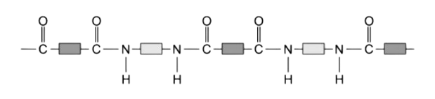
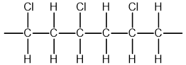
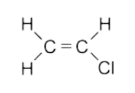
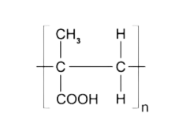

# Polymers

Course: cie-igcse-chemistry-23 · Section: 11. Organic Chemistry

Source: https://www.savemyexams.com/igcse/chemistry/cie/23/flashcards/11-organic-chemistry/11-3-polymers/

## Card 1 — question_and_answer (`fl_GqbRxV7sMnxZw5XT`)

**FRONT**

What is a **polymer**?

**BACK**

A polymer is a large molecule of high relative molecular mass made by linking together large numbers of smaller molecules called monomers.

## Card 2 — question_and_answer (`fl_jzkKgDHvm647mrJM`)

**FRONT**

What is a **monomer**?

**BACK**

A monomer is a smaller molecule that links together to form a polymer.

## Card 3 — question_and_answer (`fl_6JxfPnnvRHw7cMJM`)

**FRONT**

What type of** bonds **connect monomers in a polymer?

**BACK**

Monomers in a polymer are connected via **covalent **bonds.

## Card 4 — true_or_false (`fl_38rgX78s737ghPbN`)

**FRONT**

**True or False? **

Poly(ethene) is an addition monomer formed from ethene monomers.

**BACK**

**True. **

Poly(ethene) is and addition monomer formed from ethene monomers.

## Card 5 — question_and_answer (`fl_pF3Ks2HXSdn8Hqc4`)

**FRONT**

What is the process of making polymers called?

**BACK**

The process of making polymers is called ** polymerisation**.

## Card 6 — keyword_definition (`fl_tkPr5kXqXWbYcdwN`)

**FRONT**

Describe **addition** **polymerisation. (Extended tier only) **

**BACK**

Addition polymerisation is a type of polymerisation in which monomers are added to form a polymer chain without the loss of any molecules.

## Card 7 — question_and_answer (`fl_Sv3BKvMyCj4WZ6pp`)

**FRONT**

What is the name of the addition polymer formed from the following alkene? **(Extended tier only) **

**BACK**

The name of the polymer formed from the following alkene would be **(poly)propene**.

## Card 8 — question_and_answer (`fl_Fx7WGNTSG3z4ST7j`)

**FRONT**

What is  **X**? **(Extended tier only) **

**BACK**

**X** is the** repeating unit**.

## Card 9 — question_and_answer (`fl_wRFw3FhJFts2S9pq`)

**FRONT**

How are **condensation polymers **formed? **(Extended tier only) **

**BACK**

Condensation polymers are formed when two different monomers are linked together with the removal of a small molecule, usually water.

## Card 10 — question_and_answer (`fl_mrm5yvZqmqSZfRM4`)

**FRONT**

What is the key difference between condensation and addition polymers? **(Extended tier only) **

**BACK**

In addition polymerisation, only the polymer molecule is formed.

In condensation polymerisation, the polymer molecule and one small molecule (typically water) per linkage are formed.

## Card 11 — question_and_answer (`fl_Nn4DnG7FXzRW6Kmg`)

**FRONT**

How many functional groups are present in the monomers for condensation polymers?

**BACK**

The monomers have two functional groups present, one on each end.

## Card 12 — question_and_answer (`fl_SCN2YgBXnZQD2GzH`)

**FRONT**

What happens when an ester linkage is formed in condensation polymerisation? **(Extended tier only) **

**BACK**

A small molecule is lost, usually water.

## Card 13 — question_and_answer (`fl_xHfYgn9VnYpGVSWB`)

**FRONT**

What is a **dicarboxylic acid**? **(Extended tier only) **

**BACK**

A dicarboxylic acid is a carboxylic acid with two -COOH groups, one at each end of the molecule.

## Card 14 — question_and_answer (`fl_C32nKD7hXxqQJcgp`)

**FRONT**

What is a **diol**? **(Extended tier only) **

**BACK**

A diol is an alcohol with two -OH groups, one at each end of the molecule.

## Card 15 — question_and_answer (`fl_yCpHM2GYdkprtszt`)

**FRONT**

What is labelled **X**? **(Extended tier only) **

**BACK**

**X **is an ester linkage.

## Card 16 — true_or_false (`fl_dCGFtbfDzCTyd89w`)

**FRONT**

**True or false? **

The following polymer is a polyester.

**(Extended tier only) **

**BACK**

**False. **

The following polymer is a **polyamide**.

## Card 17 — question_and_answer (`fl_K7mGfWcpPHxTdbWT`)

**FRONT**

What is the structure of the monomer that forms this polymer? **(Extended tier only) **

**BACK**

The monomer which forms the polymer is:

## Card 18 — question_and_answer (`fl_CJ8dc87skBYXQDF3`)

**FRONT**

Name the functional group in the polymer below.

**BACK**

The  functional group in the polymer below is a carboxylic acid group.

## Card 19 — question_and_answer (`fl_svDf5c4ftmhYPrMF`)

**FRONT**

Why are polymers difficult to dispose of?

**BACK**

Polymers are difficult to dispose of because they are unreactive and chemically inert, so they don't easily biodegrade.

## Card 20 — question_and_answer (`fl_26RgGs9JcCGmzdCW`)

**FRONT**

What is **incineration **of polymers?

**BACK**

Incineration is the process of burning polymers, which releases a lot of heat energy.

## Card 21 — question_and_answer (`fl_Y78xzNWNPFdHwnSh`)

**FRONT**

What is the main **environmental concern** with polymer incineration?

**BACK**

The main environmental concern with polymer incineration is the production of **carbon dioxide**, which is a greenhouse gas.

## Card 22 — question_and_answer (`fl_cP99Ykxg75VPnMDf`)

**FRONT**

What is a disadvantage of disposing of polymers in landfills?

**BACK**

Disposing of polymers in landfills takes up valuable land, as they are non-biodegradable and cannot be broken down by microorganisms.

## Card 23 — question_and_answer (`fl_YBFtk3kpngm2CxZD`)

**FRONT**

What is a disadvantage of incinerating polymers like PVC?

**BACK**

Polymers that contain chlorine, such as PVC, release toxic hydrogen chloride gas when burned.

## Card 24 — question_and_answer (`fl_yBnW2nSZ4jtmHNKd`)

**FRONT**

Explain the meaning of the term** landfill.**

**BACK**

Landfill is a site for the disposal of waste materials by burial.

## Card 25 — true_or_false (`fl_qs4S6bsbDCr6FkYX`)

**FRONT**

**True or False?**

Incomplete combustion of polymers can produce toxic carbon monoxide.

**BACK**

**True. **

If incinerated by incomplete combustion, polymers can produce toxic carbon monoxide.

## Card 26 — true_or_false (`fl_63DnYPnnXQGGshpH`)

**FRONT**

**True or False? **

Waste plastic can accumulate in oceans and disrupt marine life.

**BACK**

**True. **

Waste plastic can accumulate in oceans and disrupt marine life.

## Card 27 — true_or_false (`fl_tmnfgzfD4X95SPHX`)

**FRONT**

**True or False? **

PET can be converted back into monomers and re-polymerised. **(Extended tier only)**

**BACK**

**True. **

PET can be converted back into monomers and re-polymerised.

## Card 28 — true_or_false (`fl_xTfCjv5RXytF4cfw`)

**FRONT**

**True or False? **

Proteins are examples of condensation polymers.

**BACK**

**True. **

Proteins are examples of condensation polymers.

## Card 29 — question_and_answer (`fl_yxFHMxwGwFSNfmf9`)

**FRONT**

Which two functional groups are found in amino acids?

**BACK**

Amino acids contain the amine / NH2 and carboxylic acid / COOH functional groups.

## Card 30 — question_and_answer (`fl_g9mC7PBKRdfcVt6t`)

**FRONT**

Name the type of monomers that make up proteins.

**BACK**

The monomers that make up proteins are** amino acids**.

## Card 31 — true_or_false (`fl_JXTNSsSGyRyFKtRP`)

**FRONT**

**True or False? **

There are approximately 30 amino acids.

**BACK**

**False. **

There are approximately 20 amino acids.

## Card 32 — true_or_false (`fl_wMy8mbnSbCpdxfhy`)

**FRONT**

**True or False?**

Proteins are natural polyesters.

**BACK**

**False. **

Proteins are natural **polyamides**.

