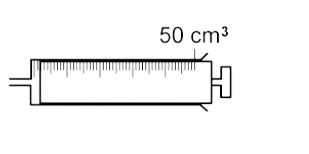
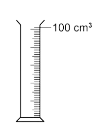
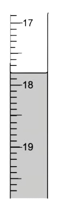
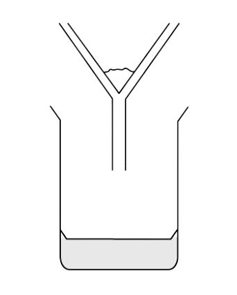
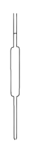
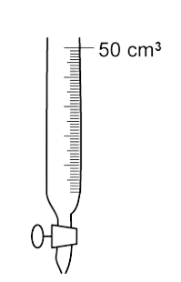

# Experimental Techniques

Course: cie-igcse-chemistry-23 · Section: 12. Experimental Techniques & Chemical Analysis

Source: https://www.savemyexams.com/igcse/chemistry/cie/23/flashcards/12-experimental-techniques-and-chemical-analysis/12-1-experimental-techniques/

## Card 1 — question_and_answer (`fl_59vVDVSzYq6jQTK6`)

**FRONT**

What is the name of this piece of apparatus?

**BACK**

This piece of apparatus is called a **gas syringe**.

## Card 2 — true_or_false (`fl_RJC2XFv6McBKxM2d`)

**FRONT**

**True or False? **

A **temperature probe** is more precise than a **thermometer**.

**BACK**

**True. **

A **temperature probe** is more precise than a **thermometer**.

## Card 3 — question_and_answer (`fl_FN7cgFF4pwqv4N3R`)

**FRONT**

What is the name of this piece of apparatus?

**BACK**

This piece of apparatus is called a **measuring cylinder**.

## Card 4 — question_and_answer (`fl_fspGyTqcYYqjzHNk`)

**FRONT**

Give an **advantage **of using a **temperature probe** over a **thermometer**.

**BACK**

Advantages of using **temperature probes** include:

- More precise readings.
- Easy to make multiple readings.
- Can be automated to run over long periods of time.

## Card 5 — question_and_answer (`fl_CvM8qwDY7kRvbJ7W`)

**FRONT**

Name the piece of apparatus which could be used to time the length of a reaction.

**BACK**

The piece of apparatus which could be used to time the length of a reaction is a **stopwatch** /** stopclock** / **timer**.

## Card 6 — question_and_answer (`fl_tz4WGpKKCkwnXxdM`)

**FRONT**

Name the piece of apparatus which could be used to  measure the volume of gas produced when marble chips are added to hydrochloric acid.

**BACK**

The piece of apparatus which could be used to  measure the volume of gas produced when marble chips are added to hydrochloric acid is a **gas syringe**.

## Card 7 — true_or_false (`fl_qmy7YR6sP27s6NW6`)

**FRONT**

**True or False? **

A **measuring cylinder** is more accurate than a **pipette** for measuring a fixed volume of liquid.

**BACK**

**False**.

A measuring cylinder is less accurate than a pipette for measuring a fixed volume of liquid.

## Card 8 — question_and_answer (`fl_9Njs3PPCrT7zbd44`)

**FRONT**

What is the volume on the** burette** to one decimal place?

**BACK**

The volume on the **burette** to one decimal place is **17.8 cm****3**.

## Card 9 — question_and_answer (`fl_rWS5vrxdkc2GYs2w`)

**FRONT**

Name the piece of apparatus which could be used to measure out 0.5 g of magnesium powder.

**BACK**

The piece of apparatus which could be used to measure out 0.5 g of magnesium powder is a **balance**.

## Card 10 — question_and_answer (`fl_BSKQzxKTwGV9PQyM`)

**FRONT**

What is the standard unit of mass in chemistry?

**BACK**

The standard unit of mass in chemistry is **grams**.

## Card 11 — true_or_false (`fl_NjwFGkdsmppMZDvk`)

**FRONT**

**True or False? **

The solvent in a mixture of salt and water is the salt.

**BACK**

**False. **

The  solvent in a mixture of salt and water is the water.

## Card 12 — true_or_false (`fl_fBrRfdhq8WyxCR5V`)

**FRONT**

**True or False?**

The filtrate is a liquid or solution that passes through a filter.

**BACK**

**True.**

The filtrate is a liquid or solution that passes through a filter.

## Card 13 — keyword_definition (`fl_qrRGs64JhZ5Q5m7s`)

**FRONT**

Define the term** solute**.

**BACK**

A solute is the substance which dissolves in a liquid to form a solution.

## Card 14 — keyword_definition (`fl_b2TjZF63TVHxxrVQ`)

**FRONT**

Define the term** solvent**.

**BACK**

A solvent is the substance that dissolves a solute.

## Card 15 — keyword_definition (`fl_d5v9xyF3ggHYSkXC`)

**FRONT**

Define the term** solution**.

**BACK**

A solution is a mixture of one or more solutes dissolved in a solvent.

## Card 16 — question_and_answer (`fl_wsK3vMcmn6TbGvs3`)

**FRONT**

What is meant by a **saturated solution**?

**BACK**

A saturated solution is a solution containing the maximum concentration of a solute dissolved in the solvent at a specified temperature.

## Card 17 — question_and_answer (`fl_hRzkpqQzb4PtWXPk`)

**FRONT**

What word is used to describe the substance that remains in the funnel?

**BACK**

The word is used to describe the substance that remains in the funnel is the **residue**.

## Card 18 — true_or_false (`fl_XgdfJM7Yq8t567dp`)

**FRONT**

**True or False?**

Residue refers to a substance that remains after separation process.

**BACK**

**True. **

Residue refers to a substance that remains after separation process.

## Card 19 — question_and_answer (`fl_7mWYvZ3kWHPjQpCy`)

**FRONT**

Identify the solvent and solute in a solution of salt water.

**BACK**

In a solution of salt water, the salt is the solute and the water is the solvent.

## Card 20 — keyword_definition (`fl_wdbQKMHCCt7CRVSV`)

**FRONT**

Define the term** filtrate**.

**BACK**

A filtrate is a liquid / solution that has passed through a filter.

## Card 21 — question_and_answer (`fl_KD8hmDRzJ5htHFvk`)

**FRONT**

What is an acid-base titration used for?

**BACK**

An acid-base titration is a method used to determine the concentration of an unknown acid or alkali.

## Card 22 — keyword_definition (`fl_tYmpqC43FrHmYKCD`)

**FRONT**

State what is meant by **concordant results**.

**BACK**

Concordant results are results that are within 0.1 cm3 of each other.

## Card 23 — question_and_answer (`fl_Hr4F2ny8tCThcqj2`)

**FRONT**

What is the purpose of the indicator in a titration?

**BACK**

The indicator is used to identify the endpoint of the titration by changing colour sharply when the reaction is complete.

## Card 24 — true_or_false (`fl_tb8h68f8MWS8SD5z`)

**FRONT**

**True or False? **

Leaving a funnel in the burette during a titration is acceptable.

**BACK**

**False**.

The funnel should be removed from the burette before starting the titration, as it can drip liquid into the burette, making the initial reading false.

## Card 25 — question_and_answer (`fl_5TcVgwP75DStxPb6`)

**FRONT**

What is the name of this piece of apparatus?

**BACK**

This piece of apparatus is a pipette.

## Card 26 — question_and_answer (`fl_FZpwWx4tSmTWnrDf`)

**FRONT**

Why is it important to repeat a titration?

**BACK**

Repeating a titration and achieving concordant results increases the accuracy of the measurement.

## Card 27 — keyword_definition (`fl_gBNNxPZPXKkRwNGH`)

**FRONT**

State what is meant by the term **endpoint**.

**BACK**

The endpoint is when an indicator changes colour sharply during a titration, signalling the completion of the reaction.

## Card 28 — question_and_answer (`fl_7sPQ7fksMShB7xK5`)

**FRONT**

What is the purpose of swirling the flask during a titration?

**BACK**

Swirling the flask during a titration ensures thorough mixing of the solutions and helps to identify the endpoint more accurately.

## Card 29 — question_and_answer (`fl_DBd2rPJ9DYFTd3dy`)

**FRONT**

Name the piece of equipment used to transfer a fixed volume of acid / alkali into a conical flask for a titration.

**BACK**

The piece of equipment used to transfer a fixed volume of acid / alkali into a conical flask for a titration is a **volumetric pipette**.

## Card 30 — question_and_answer (`fl_6VdNGPSgSspzYyWH`)

**FRONT**

Why is a white tile placed underneath the conical flask during a titration?

**BACK**

A white tile placed underneath the conical flask during a titration because it allows the colour change to be observed more easily.

## Card 31 — question_and_answer (`fl_qXB5btQxrPNkDFzR`)

**FRONT**

Name the piece of apparatus that measures a variable volume of acid / alkali during a titration.

**BACK**

The piece of apparatus that measures a variable volume of acid / alkali during a titration is a **burette**.

## Card 32 — question_and_answer (`fl_B34fSrpsZzbH5GQ6`)

**FRONT**

What is the name of this piece of apparatus?

**BACK**

This piece of apparatus is called a **burette**.

