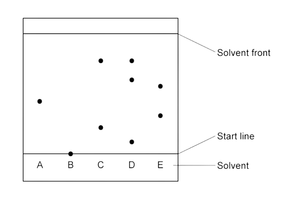
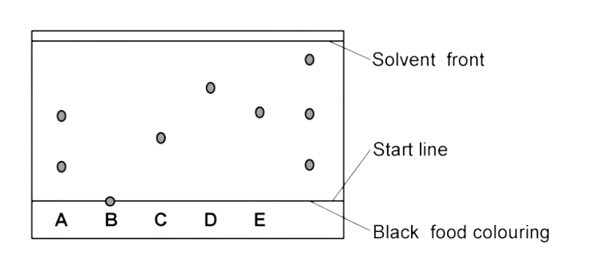

# Separation & Purification

Course: cie-igcse-chemistry-23 · Section: 12. Experimental Techniques & Chemical Analysis

Source: https://www.savemyexams.com/igcse/chemistry/cie/23/flashcards/12-experimental-techniques-and-chemical-analysis/12-2-separation-and-purification/

## Card 1 — question_and_answer (`fl_8NsRGcRNkDsXScT5`)

**FRONT**

What is **paper chromatography **used for?

**BACK**

**Paper chromatography **is used to separate substances that have different solubilities in a given solvent, such as identifying the components of a mixture.

## Card 2 — question_and_answer (`fl_mr2y3s6TJm3xX3pk`)

**FRONT**

What does a **single spot **on a chromatogram indicate?

**BACK**

A **single spot **on a chromatogram indicates that the substance is pure.

## Card 3 — question_and_answer (`fl_2tG7Z3sfg2yRnbvK`)

**FRONT**

What should the base line on a chromatogram be drawn with?

**BACK**

The baseline on a chromatogram should be drawn with a pencil.

## Card 4 — true_or_false (`fl_KgzFH6ZfcKhrYwjj`)

**FRONT**

**True or False?**

The solvent level should start above the pencil line on a chromatogram.

**BACK**

**False**.

The solvent level should not start above the pencil line, as this would ruin the chromatogram.

## Card 5 — question_and_answer (`fl_Qd2RjpkmCgt9yh7R`)

**FRONT**

How many substances are in sample **D**?

**BACK**

There are **3 **substances in D.

## Card 6 — true_or_false (`fl_jKprRcKNwvJSWqH2`)

**FRONT**

**True or False?**

Multiple spots on a chromatogram indicate a pure substance.

**BACK**

**False**.

Multiple spots on a chromatogram indicate that the substance is a mixture.

## Card 7 — true_or_false (`fl_2YdvNJydMxnJn46d`)

**FRONT**

**True or False?**

If two substances are the same, they will produce identical chromatograms.

**BACK**

**True**.

If two substances are the same, they will produce identical chromatograms.

## Card 8 — question_and_answer (`fl_H3ynrKzfY4hrYc3c`)

**FRONT**

Which colours from A-E does black food colouring contain?

**BACK**

The black food colouring contains A, E and an unknown.

## Card 9 — question_and_answer (`fl_wMPcWy4cTpH3Nqtw`)

**FRONT**

Why should the **baseline **(starting line) in chromatography be drawn in **pencil**?

**BACK**

The **baseline **(starting line) should be drawn in **pencil **because it will not contaminate the results / will not run.

## Card 10 — keyword_definition (`fl_5NdrctDSFZHSTtcz`)

**FRONT**

State the **equation **to calculate the retention factor (*R*f value). **(Extended tier only)**

**BACK**

The **equation **for the retention factor (*R*f value) is:

*R*f = $\frac{\mathrm{Distance} \mathrm{travelled} \mathrm{by} \mathrm{sample}}{\mathrm{Distance} \mathrm{travelled} \mathrm{by} \mathrm{solvent} \mathrm{front}}$

## Card 11 — question_and_answer (`fl_3MtWJzj27JNJz9zW`)

**FRONT**

What does an *R*f value closer to 1 indicate? **(Extended tier only)**

**BACK**

An *R*f value close to 1 indicates that the component is very / highly soluble in the solvent used.

## Card 12 — true_or_false (`fl_NGJJsD3QNGcPtQBY`)

**FRONT**

**True or False?**

The *R*f value of a compound is always the same, regardless of the solvent used. **(Extended tier only)**

**BACK**

**False**.

The *R*f value of a compound depends on the solvent used.

If the solvent is changed, the *R*f value will change.

## Card 13 — question_and_answer (`fl_CNgy65Qxr64mYzs4`)

**FRONT**

What is the purpose of calculating *R*f values in paper chromatography? **(Extended tier only)**

**BACK**

The purpose of calculating *R*f values is to allow chemists to identify unknown substances.

## Card 14 — question_and_answer (`fl_ZYSJRzGRZ9VvxcJ3`)

**FRONT**

What does the *R*f value range between?    **(Extended tier only)**

**BACK**

The *R*f values ranges between 0 and 1.

## Card 15 — question_and_answer (`fl_KWw2nZmzVZnkGdbx`)

**FRONT**

Why does an *R*f value have no units?               **(Extended tier only)**

**BACK**

An *R*f value does not have units because it is a ratio.

## Card 16 — question_and_answer (`fl_GFTqqDTbGTQYmc94`)

**FRONT**

What are locating agents in chromatography used for? **(Extended tier only)**

**BACK**

Locating agents are used to identify colourless substances on a chromatogram.

## Card 17 — keyword_definition (`fl_THB9GbTmj5thQg3q`)

**FRONT**

What does **simple distillation **separate?

**BACK**

**Simple distillation **is used to separate:

- a liquid and **soluble **solid from a solution (e.g., water from a solution of salt water)
- a pure liquid from a mixture of liquids

## Card 18 — keyword_definition (`fl_NCFC2ZFcpCSK7SVf`)

**FRONT**

State what is meant by the term **simple distillation**.

**BACK**

**Simple distillation **is a technique used to separate a liquid from a solution (e.g., water from a salt solution) by boiling the solution and condensing the vapour.

## Card 19 — keyword_definition (`fl_k9GZnwnJGXhvr77N`)

**FRONT**

What is **fractional distillation**?

**BACK**

**Fractional distillation **is a technique used to separate two or more liquids that have different boiling points from a mixture.

## Card 20 — keyword_definition (`fl_QHVkJH3R8Pq3kqGm`)

**FRONT**

What does **filtration **separate?

**BACK**

**Filtration **separates an undissolved solid from a mixture of solid and liquid.

## Card 21 — question_and_answer (`fl_ZG6sZqfz4XTY8S5Y`)

**FRONT**

What is **crystallisation **used for?

**BACK**

**Crystallisation **is used to separate a dissolved solid from a solution.

## Card 22 — question_and_answer (`fl_NBct8WjMD8mgVH6X`)

**FRONT**

In terms of the solid (solute), what is important about the solvent?

**BACK**

It is important that the solid (solute) is more soluble in hot solvent than in cold.

## Card 23 — question_and_answer (`fl_KfPDH5grRqkq43XB`)

**FRONT**

How can melting and boiling points distinguish between pure substances and mixtures?

**BACK**

Pure substances have specific and sharp melting and boiling points, while mixtures have a range of melting and boiling points

## Card 24 — true_or_false (`fl_mNkxrxzqNQJZkGXD`)

**FRONT**

**True or False?**

Salt dissolved in water is a pure substance.

**BACK**

**False**.

A solution of salt dissolved in water is a mixture.

## Card 25 — true_or_false (`fl_5HsWGvkWm9MWbMgk`)

**FRONT**

**True or false? **

Impure substances have boiling points higher than the standard boiling point of the substance.

**BACK**

**True.**

Impure substances have boiling points higher than the standard boiling point of the substance.

## Card 26 — true_or_false (`fl_R3RyVtmSKgsgZRPz`)

**FRONT**

**True or false? **

Impure substances have melting points higher than the standard melting point of the substance.

**BACK**

**False.**

Impure substances have melting points **lower **than the standard melting point of the substance.

