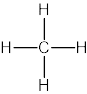

# Formulae & Relative Masses

Course: cie-igcse-chemistry-23 · Section: 3. Stoichiometry

Source: https://www.savemyexams.com/igcse/chemistry/cie/23/flashcards/3-stoichiometry/3-1-formulae-and-relative-masses/

## Card 1 — question_and_answer (`fl_75sn2Fq6GpFfYVDm`)

**FRONT**

Which seven elements exist as diatomic molecules?

**BACK**

The seven elements that exist as diatomic molecules are hydrogen, nitrogen, oxygen, fluorine, chlorine, bromine, and iodine.

## Card 2 — true_or_false (`fl_ts7rJZgYWh2kgbwF`)

**FRONT**

**True or False? **

The molecular formula of water is HO2.

**BACK**

**False**.

The molecular formula of water is H2O.

## Card 3 — question_and_answer (`fl_MDX4GqPYgyr5Jt3s`)

**FRONT**

What does the subscript number in a molecular formula represent?

**BACK**

The subscript number in a molecular formula represents the number of atoms of that element in the molecule.

## Card 4 — keyword_definition (`fl_h5dpvKBZpKf5FqHJ`)

**FRONT**

Define the term simple molecule.

**BACK**

A simple molecule is a molecule made up of a small number of atoms.

## Card 5 — question_and_answer (`fl_HbzXK8GXT4gqkqXB`)

**FRONT**

What is the molecular formula of ethene?

**BACK**

The molecular formula of ethene is C2H4.

## Card 6 — true_or_false (`fl_J2gm2qgjVV4XwZvS`)

**FRONT**

**True or False? **

Diatomic molecules always contain two atoms of different elements.

**BACK**

**False**.

Diatomic molecules contain two atoms of the same element.

## Card 7 — question_and_answer (`fl_YpMbX2FyWRsdPdx7`)

**FRONT**

What does a molecular formula show?

**BACK**

A molecular formula shows the type and number of atoms in a molecule.

## Card 8 — question_and_answer (`fl_SDWpkbkMTXgj4DSJ`)

**FRONT**

What is a chemical symbol?

**BACK**

A chemical symbol is a one or two-letter abbreviation used to represent an element in chemical formulas and equations.

## Card 9 — question_and_answer (`fl_kxxXhFCBmknPr26N`)

**FRONT**

What does this dot and cross diagram represent?

**BACK**

The dot and cross diagram represents ammonia, NH3, which consists of one nitrogen atom and three hydrogen atoms.

## Card 10 — question_and_answer (`fl_wG6H4Tf6rm45ZXnz`)

**FRONT**

What does this displayed formula represent?

**BACK**

The displayed formula represents methane, CH4, which consists of one carbon atom and four hydrogen atoms.

## Card 11 — keyword_definition (`fl_2T92bZvmNvBy5Z9v`)

**FRONT**

Define **empirical formula**. **(Extended tier only)**

**BACK**

**Empirical formula **is the simplest whole number ratio of the atoms or ions present in a compound.

## Card 12 — question_and_answer (`fl_Q4ZP7FBy4jR5bcHD`)

**FRONT**

The molecular formula of propene is C3H6. What is the empirical formula? **(Extended tier only)**

**BACK**

The empirical formula of propene is CH2.

## Card 13 — true_or_false (`fl_vmMZ5YSFrCTQ3kQN`)

**FRONT**

**True or False? **

Organic molecules always have the same empirical and molecular formulae. **(Extended tier only)**

**BACK**

**False**.

Organic molecules often have different empirical and molecular formulae.

## Card 14 — question_and_answer (`fl_W7n5jjJTc4dHXTrx`)

**FRONT**

What type of formula is used for **ionic compounds**? **(Extended tier only)**

**BACK**

The formula of an ionic compound is **always** an empirical formula.

## Card 15 — question_and_answer (`fl_KyDbjSfkQSQGmxqj`)

**FRONT**

State the relationship between empirical and molecular formulae. **(Extended tier only)**

**BACK**

The molecular formula is a multiple of the empirical formula.

It indicates the exact numbers of each atom in the compound.

## Card 16 — true_or_false (`fl_MrNDSd2jkgW8gWCg`)

**FRONT**

**True or False? **

Molecular formula shows the simplest whole number ratio of atoms in a molecule. **(Extended tier only)**

**BACK**

False.

**Empirical formula **shows the simplest whole number ratio of atoms in a molecule.

## Card 17 — question_and_answer (`fl_ZPWBjCHmXpcXxtNJ`)

**FRONT**

State the formula of the ionic compound formed from:

- Fe2+
- Cl-

**(Extended tier only)**

**BACK**

The formula of the ionic compound formed from Fe2+ and Cl- is FeCl2.

## Card 18 — question_and_answer (`fl_9rsJgbwKQzgf7F4Q`)

**FRONT**

State the formula of the ionic compound formed from:

- Li+
- Cl-

**(Extended tier only)**

**BACK**

The formula of the ionic compound formed from Li+ and Cl- is LiCl.

## Card 19 — question_and_answer (`fl_WVr4PSDF4xK4CW3y`)

**FRONT**

What is the empirical formula of the following ionic compound?

**(Extended tier only)**

**BACK**

The empiticval formula of the ionic compound is AgF.

## Card 20 — question_and_answer (`fl_28hqhGXwDYZWvzzz`)

**FRONT**

State the formula of the ionic compound formed from:

- Na+
- CO32-

**(Extended tier only)**

**BACK**

The formula of the ionic compound formed from Na+ and CO32- is Na2CO3.

## Card 21 — true_or_false (`fl_Y43YGzjggJgDN2pw`)

**FRONT**

**True or False? **

A balanced chemical equation has the same number of atoms of each element on both sides.

**BACK**

**True**.

A balanced chemical equation has the same number of atoms of each element on both sides, in accordance with the Law of Conservation of Mass.

## Card 22 — question_and_answer (`fl_3Snn8TvZr95mFZN6`)

**FRONT**

Write the **word equation** for the reaction of silicon with oxygen to form silicon dioxide.

**BACK**

The word equation for the reaction of silicon with oxygen to form silicon dioxide is:

silicon + oxygen $\rightarrow$ silicon dioxide

## Card 23 — question_and_answer (`fl_GtXnPcBBq23B7TXG`)

**FRONT**

What type of equation is this?

2Br- + Cl2 $\rightarrow$ Br2 + 2Cl-

**BACK**

2Br- + Cl2 $\rightarrow$ Br2 + 2Cl- is an ionic equation.

## Card 24 — question_and_answer (`fl_JMC4qXfVGdrK2kqf`)

**FRONT**

What does a **symbol equation** use?

**BACK**

A symbol equation uses the formulae of the reactants and products to show what happens in a chemical reaction.

## Card 25 — question_and_answer (`fl_63M6SSKJGQ8PT9Mw`)

**FRONT**

What numbers are missing to balance this equation?

.....H2O2 $\rightarrow$ .....H2O + ..... O2

**BACK**

The missing numbers to balance the equation are:

2H2O2 $\rightarrow$ 2H2O + O2

## Card 26 — question_and_answer (`fl_fv8vHyGjvynkzJrv`)

**FRONT**

What are **products**?

**BACK**

Products are the new substances which are on the right-hand side of the arrow in a chemical equation, formed by the reaction of reactants.

## Card 27 — question_and_answer (`fl_vYkWKdNM4NfsnHf3`)

**FRONT**

What are the constituent** ions** in the following?

- H2SO4
- NaOH
- KBr

**(Extended tier only)**

**BACK**

The constituent ions are:

- H2SO4 - two hydrogen ions (H+) and one sulfate ion (SO42-)
- NaOH - one sodium ion (Na+) and one hydroxide ion (OH-)
- KBr - one potassium ion (K+) and one bromide ion (Br-)

## Card 28 — question_and_answer (`fl_y7jpCqJ5xBP38zkd`)

**FRONT**

Write the **symbol equation** for the reaction of magnesium with chlorine to form magnesium chloride.

**BACK**

The symbol equation for the reaction of magnesium with chlorine to form magnesium chloride is:

Mg + Cl2 $\rightarrow$ MgCl2

## Card 29 — true_or_false (`fl_JGzgNcmWfMXsPW8D`)

**FRONT**

**True or False?**

The balanced symbol equation for the reaction of sodium with chlorine is:

Na + Cl2 $\rightarrow$ NaCl2

**BACK**

**False**.

The balanced symbol equation for the reaction of sodium with chlorine is:

2Na + Cl2 $\rightarrow$ 2NaCl

## Card 30 — question_and_answer (`fl_DpbS96m7bBpYjjxg`)

**FRONT**

What numbers are missing to balance this equation?

.....N2 + .....H2 **⇌** .....NH3

**BACK**

The missing numbers to balance the equation are:

N2 + 3H2 **⇌ **2NH3

## Card 31 — keyword_definition (`fl_p2JrpXdNmMz2ctZ2`)

**FRONT**

What are **spectator ions**? **(Extended tier only)**

**BACK**

Spectator ions are ions which appear on both sides of an ionic equation and are eliminated from the final equation.

## Card 32 — question_and_answer (`fl_xs8HwyPTvD8hrHTh`)

**FRONT**

2KI + Br2 $\rightarrow$ 2KBr + I2

Why is this **not** an ionic equation? **(Extended tier only)**

**BACK**

2KI + Br2 $\rightarrow$ 2KBr + I2  is not an ionic equation because there are no ions.

## Card 33 — question_and_answer (`fl_pVSj9rqwb3wxQGFN`)

**FRONT**

Define ***A*****r**.

**BACK**

The relative atomic mass, *A*r, as the average mass of the isotopes of an element compared to 1/12th of the mass of an atom of carbon-12.

## Card 34 — question_and_answer (`fl_MVZxnFqzHkK3Z9CV`)

**FRONT**

How is the relative atomic mass of an element determined?

**BACK**

The relative atomic mass of an element is found on the Periodic Table.

## Card 35 — true_or_false (`fl_YFNPM49Vjz7xRDyb`)

**FRONT**

`F _ 9 ^ 19``equation`

**True or False?**

The relative atomic mass of fluorine is 9.

**BACK**

`F _ 9 ^ 19``equation`

**False**.

The relative atomic mass of fluorine is 19.

The atomic number / number of protons in fluorine is 9.

## Card 36 — keyword_definition (`fl_wRrsK4cKTXgx6w8b`)

**FRONT**

Define ***M*****r**.

**BACK**

***M*****r** is the symbol for the relative formula mass and it refers to the total mass of the substance, which is the sum of the relative atomic masses of all atoms in a molecule.

## Card 37 — question_and_answer (`fl_6Vg9MX75nWxxzqFy`)

**FRONT**

How is the** relative formula mass** of a substance calculated?

**BACK**

To calculate the relative formula mass of a substance, you have to add up the relative atomic masses of all the atoms present in the formula.

## Card 38 — true_or_false (`fl_XgsrMGhn2wynDxSs`)

**FRONT**

**True or False? **

Relative molecular mass applies to both ionic and covalent compounds

**BACK**

**False**.

Relative molecular mass does not apply to ionic compounds.

## Card 39 — question_and_answer (`fl_NNdtKZhDr9zVfrC4`)

**FRONT**

What does the term **molar mass **mean?

**BACK**

**Molar mass **refers to the mass of one mole of a substance.

## Card 40 — question_and_answer (`fl_WqnXkD2sx6sXRVfq`)

**FRONT**

What is the **relative formula mass **of CuCO3?

(*A*r's: Cu = 63.5, C = 12, O = 16)

**BACK**

The relative formula mass of CuCO3 is:

63.5 + 12 + (16 x 3) = 123.5

## Card 41 — question_and_answer (`fl_ZXGy2shcW2h3sYn5`)

**FRONT**

What is the** relative molecular mass** of C5H5N?

(*A*r's: C = 12, H = 1, N = 14)

**BACK**

The relative molecular mass of C5H5N is:

(12 x 5) + (1 x 5) + 14 = 79

## Card 42 — question_and_answer (`fl_cCcCpvTNN9y2tB68`)

**FRONT**

What is the difference between relative **molecular **mass and relative **formula **mass?

**BACK**

The difference between relative **molecular **mass and relative **formula **mass is that relative molecular mass only applies to covalent compounds.

Relative formula mass applies to all compounds.

## Card 43 — question_and_answer (`fl_HwhJSDDXtwj48jGw`)

**FRONT**

What is the **relative molecular mass **of NH4NO3?

(*A*r's: O = 16, H = 1, N = 14)

**BACK**

The relative molecular mass of NH4NO3 is:

14 + (1 x 4) + 14 + (16 x 3) = 80

## Card 44 — true_or_false (`fl_ZrzY77NqkGvW9Gth`)

**FRONT**

**True or False?**

The relative formula mass of CaCO3 is 100.

(Ca=40, C=12, O=16)

**BACK**

**True.**

The relative formula mass of CaCO3 is = 40+12 +(16 x 3) = 100

