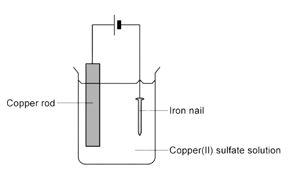
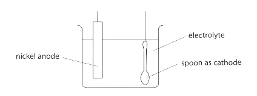

# Applications of Electrolysis

Course: cie-igcse-chemistry-23 · Section: 4. Electrochemistry

Source: https://www.savemyexams.com/igcse/chemistry/cie/23/flashcards/4-electrochemistry/4-2-applications-of-electrolysis/

## Card 1 — question_and_answer (`fl_FKS5NX7JHvH4CrDd`)

**FRONT**

What is** electroplating**?

**BACK**

Electroplating is process of coating the surface of one metal with a layer of a different metal.

## Card 2 — true_or_false (`fl_y7QFS4Jn5bt5BdkB`)

**FRONT**

**True or False?**

In electroplating, the anode is made from the object to be electroplated.

**BACK**

**False. **

In electroplating, the **cathode** is made from the object to be electroplated.

## Card 3 — question_and_answer (`fl_PfjrNymrzgF3tvDz`)

**FRONT**

Give one use of **electroplating**.

**BACK**

Uses of electroplating include:

- Improving the appearance of objects (e.g. jewellery)
- Coating objects to prevent corrosion / damage (e.g. cutlery)

## Card 4 — question_and_answer (`fl_HVfJMRpvnrpRgBSn`)

**FRONT**

An iron nail is being electroplated with copper.

Which metal is being used as the anode?

**BACK**

The anode is the copper rod as the anode is the metal you are using the coat the other metal with.

## Card 5 — question_and_answer (`fl_BK7g9CTjD4VS3j8f`)

**FRONT**

Explain what happens during the electroplating of the spoon.

**BACK**

At the anode, nickel atoms lose electrons to positive ions and move into the solution. They are attracted to the cathode (negative electrode) where they gain electrons to form nickel atoms which coats the spoon.

## Card 6 — true_or_false (`fl_tMTVbngMnYsmDtzR`)

**FRONT**

**True or False?**

During electroplating, the electrolyte is an aqueous solution of a soluble salt of the pure metal at the anode

**BACK**

**True. **

The electrolyte is an aqueous solution of a soluble salt of the pure metal at the anode

## Card 7 — question_and_answer (`fl_BxB27BjCdm2Bn2XT`)

**FRONT**

What is the ionic half- equation for the reaction at the anode which forms Sn2+ ions when electroplating with tin?

**BACK**

The ionic half equation for the reaction at the anode when electroplating with tin is:

**Sn → Sn****2+**** + 2e****-**

## Card 8 — question_and_answer (`fl_yZ8VwzmY4kWxMhQs`)

**FRONT**

What is the ionic half- equation for the reaction at the cathode forming Sn atoms when electroplating with tin?

**BACK**

The ionic half equation for the reaction at the cathode when electroplating with tin is:

**Sn****2+**** + 2e****-**** → Sn**

## Card 9 — question_and_answer (`fl_gKKGSsQ2K3mQJWkn`)

**FRONT**

A substance is electroplated with tin (Sn)

What is the ionic half- equation for the formation of Sn2+  ions at the anode?

**BACK**

The ionic half equation for the reaction at the anode when electroplating with tin is:

**Sn → Sn****2+**** + 2e****-**

## Card 10 — question_and_answer (`fl_9WdWwgMzHHc8KtVV`)

**FRONT**

A substance is electroplated with tin.

What is the ionic half- equation for the formation of Sn atoms at the cathode?

**BACK**

The ionic half equation for the reaction at the cathode when electroplating with tin is:

**Sn****2+**** + 2e****-**** → Sn**

## Card 11 — question_and_answer (`fl_VKNkMxGtgD8QrXHs`)

**FRONT**

What is a **fuel cell**?

**BACK**

A fuel cell is an electrochemical cell in which a fuel donates electrons at one electrode and oxygen gains electrons at the other electrode.

## Card 12 — question_and_answer (`fl_sZRd5QPf3ptBwgw8`)

**FRONT**

What are the products of a **hydrogen-oxygen** fuel cell?

**BACK**

A hydrogen-oxygen fuel cell produces **water** and **energy.**

## Card 13 — question_and_answer (`fl_PsmdWqPsdHcckvbx`)

**FRONT**

Which direction do the **electrons** flow in a fuel cell? **(Extended Tier Only)**

**BACK**

The electrons flow from **anode to cathode.**

## Card 14 — true_or_false (`fl_C4swk2pXRyTQTrNr`)

**FRONT**

**True or False?**

Hydrogen is pumped into the anode compartment.

**BACK**

**True.**

Hydrogen is pumped into the anode compartment of the fuel cell.

## Card 15 — question_and_answer (`fl_fjWSCxTM45xKsPgH`)

**FRONT**

Where is air containing **oxygen** pumped into a fuel cell?

**BACK**

The air containing oxygen is pumped into the cathode compartment.

## Card 16 — question_and_answer (`fl_yt3WdQbdqmZSY6Fh`)

**FRONT**

What is the symbol equation for the reaction between hydrogen and oxygen to form water?

**BACK**

The symbol equation for the reaction between hydrogen and oxygen to form water is:

**2H****2**** + O****2**** → 2H****2****O**

## Card 17 — true_or_false (`fl_dhs3thtB7wWDqcHR`)

**FRONT**

**True or False?**

Using fuel cells in cars reduces noise pollution. **(Extended Tier Only)**

**BACK**

**True.**

Using fuel cells in cars reduces noise pollution.

## Card 18 — question_and_answer (`fl_xfV8ZY7xs9j3C6Nk`)

**FRONT**

State** two** disadvantages of using fuel cells. **(Extended Tier Only)**

**BACK**

Two disadvantages could be from the following:

- Materials used in producing fuel cells are expensive
- Hydrogen is difficult to store as it is flammable
- Fuel cells are affected by low temperatures, becoming less efficient
- Quieter so potential danger to pedestrians if used in cars and lorries

## Card 19 — question_and_answer (`fl_JcmcNFVHdSRWRtJW`)

**FRONT**

State **two **advantages of using fuel cells. **(Extended Tier Only)**

**BACK**

Two advantages could be from the following:

- The only product is water so less pollution
- They produce more energy per kilogram than either petrol or diesel
- No power is lost in transmission as there are no moving parts
- No batteries to dispose of which is better for the environment
- Continuous process and will keep producing energy as long as fuel is supplied
- Quieter so less noise pollution

