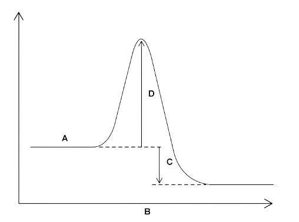
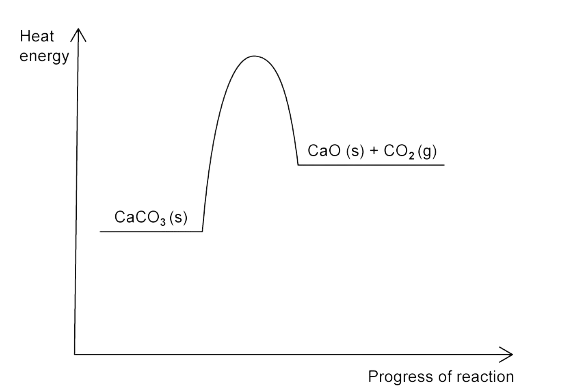
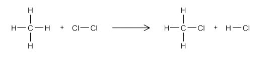

# Exothermic & Endothermic Reactions

Course: cie-igcse-chemistry-23 · Section: 5. Chemical Energetics

Source: https://www.savemyexams.com/igcse/chemistry/cie/23/flashcards/5-chemical-energetics/5-1-exothermic-and-endothermic-reactions/

## Card 1 — keyword_definition (`fl_M2hRsBKkvt45dK5w`)

**FRONT**

Define the term **exothermic** reaction.

**BACK**

An exothermic  reaction is a reaction that gives out heat energy to the surroundings causing the temperature of the surroundings to **increase. **

## Card 2 — keyword_definition (`fl_HNt9QDfv3pFp36HZ`)

**FRONT**

Define the term **endothermic** reaction.

**BACK**

An endothermic reaction is a reaction that **takes in** heat energy from the surroundings causing the temperature of the surroundings to **decrease.**

## Card 3 — true_or_false (`fl_g8PjZ56qXNDqwJvK`)

**FRONT**

**True or False?**

Neutralisation reactions are exothermic reaction.

**BACK**

**True. **

Neutralisation reactions are exothermic reaction.

## Card 4 — true_or_false (`fl_M6x2nYGt2QMVR69n`)

**FRONT**

**True or False?**

Combustion reactions take in energy from the surroundings.

**BACK**

**False.**

Combustion reactions give out energy to he surroundings

## Card 5 — true_or_false (`fl_M9s3x7fds7VmDY9n`)

**FRONT**

**True or False?**

Displacement reactions are exothermic.

**BACK**

**False.**

Displacement reactions can be exothermic or endothermic depending on the substances used.

## Card 6 — true_or_false (`fl_t8CsRGZN8NFCVFDy`)

**FRONT**

**True or False?**

Precipitation reactions are endothermic.

**BACK**

**False. **

Precipitation reactions are exothermic.

## Card 7 — question_and_answer (`fl_Z69p5FtFhvHpFsR4`)

**FRONT**

Name the piece of **equipment **used to measure temperature changes.

**BACK**

The piece of equipment used to measure temperature changes is a **thermometer**.

## Card 8 — true_or_false (`fl_bF4jQQbN2MrSCDXM`)

**FRONT**

**True or False?**

Temperature will increase in an exothermic reaction.

**BACK**

**True. **

Temperature will increase in an exothermic reaction.

## Card 9 — question_and_answer (`fl_wHrkr6vY9C55RfSx`)

**FRONT**

What type of reaction does this reaction pathway diagram show?

**BACK**

The reaction pathway diagram shows an **exothermic** reaction.

## Card 10 — keyword_definition (`fl_D2gkhr8gjBX8C533`)

**FRONT**

Define the tern **enthalpy change** (Δ*H*). **(Extended Tier Only)**

**BACK**

The overall energy change in a chemical reaction.

## Card 11 — true_or_false (`fl_fWbXs6brR2rXtfjY`)

**FRONT**

**True or False?**

An endothermic reaction has a positive enthalpy change. **(Extended Tier Only)**

**BACK**

**True.**

An endothermic reaction has a positive enthalpy change

## Card 12 — question_and_answer (`fl_5V43JqWNQX6zTFgr`)

**FRONT**

Does an** exothermic **reaction have a positive or negative enthalpy change?  **(Extended Tier Only)**

**BACK**

An exothermic reaction has a negative enthalpy change.

## Card 13 — keyword_definition (`fl_wnRkTHBb8jWYw9zd`)

**FRONT**

Explain the term **activation energy**.**(Extended Tier Only)**

**BACK**

Activation energy is the initial increase in energy, from the reactants to the peak of the curve,** **required to start the reaction.

## Card 14 — question_and_answer (`fl_yxqxRp5Z9XDRmMT6`)

**FRONT**

What is the symbol for activation energy?**(Extended Tier Only)**

**BACK**

The symbol for activation energy is ***E******a***.

## Card 15 — true_or_false (`fl_SrJkx6sTGPVdX7B7`)

**FRONT**

**True or False?**

The difference in height between the energy of reactants and products on an energy level diagram represents the overall enthalpy change of a reaction.**(Extended Tier Only)**

**BACK**

**True. **

The difference in height between the energy of reactants and products on an energy level diagram represents the overall enthalpy change of a reaction.

## Card 16 — question_and_answer (`fl_dnYhWXY3KzqCtbwc`)

**FRONT**

How does a reaction profile show that a reaction is **endothermic**? **(Extended Tier Only)**

**BACK**

An energy level diagram show that a reaction is **endothermic ** because the the energy of the products is** higher** than the energy of the reactants.

## Card 17 — question_and_answer (`fl_SbQ5nGbNsJQC3SQ9`)

**FRONT**

What does an **downwards arrow** on an energy level diagram indicate?**(Extended Tier Only)**

**BACK**

A downwards arrow on an energy level diagram indicates an **exothermic** reaction.

## Card 18 — question_and_answer (`fl_hJ2sX88S3dc2Jz2x`)

**FRONT**

What does an** upwards arrow** on an energy level diagram indicate?**(Extended Tier Only)**

**BACK**

An upwards arrow on an energy level diagram indicates an **endothermic** reaction.

## Card 19 — question_and_answer (`fl_7q3Mq8vNdQDdFMfS`)

**FRONT**

What does each letter represent on the reaction profile? **(Extended Tier Only)**

**BACK**

The letters represent:

- **A**= reactants
- **B**= progress of reaction
- **C**= overall energy change
- **D**= activation energy

## Card 20 — question_and_answer (`fl_Sf5HQ7D8FFkZ5Pph`)

**FRONT**

What type of reaction is shown in the following reaction profile? **(Extended Tier Only)**

**BACK**

The following reaction profile is for an **endothermic **reaction.

## Card 21 — question_and_answer (`fl_p9P9zjn4VbKwq9HK`)

**FRONT**

Give the three steps involved in calculating the energy change of a reaction using bond energies. **(Extended Tier Only)**

**BACK**

The three steps involved in calculating the enthalpy change using bond energies are:

- Calculate the energy required to break bonds
- Calculate the energy released when new bonds are formed
- Calculate the enthalpy change by taking the energy released away from the energy taken in

## Card 22 — true_or_false (`fl_Hb47tn7wKfBn7pfQ`)

**FRONT**

**True or False?**

When calculating the energy required to break bonds and the energy released when new bonds are formed, we do not need to consider the number of moles of the reactant and product.**(Extended Tier Only)**

**BACK**

**False.**

When calculating the energy required to break bonds and that released when new bonds are formed, we **do** need to consider the number of moles for each substance. The  bond energy is multiplied by the number of moles.

## Card 23 — question_and_answer (`fl_2VtSDbVvBqGydZHk`)

**FRONT**

State the equation used to calculate energy change using bond energies. **(Extended Tier Only)**

**BACK**

The equation used to calculate energy  change using bond energies is:

energy change =  energy taken in - energy given out

## Card 24 — question_and_answer (`fl_6Bc6m7BF3m5Nv4pw`)

**FRONT**

Give the unit of energy change. **(Extended Tier Only)**

**BACK**

The unit of energy change is kJ mol-1.

## Card 25 — question_and_answer (`fl_qTV6Q9FXGv95r9Mx`)

**FRONT**

Identify the type and number of each bond being formed in the following reaction:

**(Extended Tier Only)**

**BACK**

The type and number of each bond being formed are:

- 3 C-H bonds
- 1 C-Cl bond
- 1 H-Cl bond

