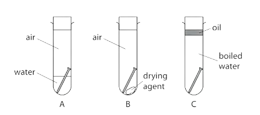

# Reactivity Series & Corrosion of Metals

Course: cie-igcse-chemistry-23 · Section: 9. Metals

Source: https://www.savemyexams.com/igcse/chemistry/cie/23/flashcards/9-metals/9-2-reactivity-series-and-corrosion-of-metals/

## Card 1 — question_and_answer (`fl_M69kQ8MC9zZ98yKz`)

**FRONT**

What is the general equation for a metal reacting with an acid?

**BACK**

The general equation for a metal reacting with an acid is:

metal + acid → salt + hydrogen

## Card 2 — true_or_false (`fl_6bVFPdFhmhF6GGBj`)

**FRONT**

**True or False? **

Only metals above hydrogen in the reactivity series will react with dilute acids.

**BACK**

**True. **

Only metals above hydrogen in the reactivity series will react with dilute acids.

## Card 3 — question_and_answer (`fl_9NC6YFVdpYFrBNGg`)

**FRONT**

Define the term **salt**.

**BACK**

A salt is the ionic compound produced when a metal reacts with an acid.

## Card 4 — question_and_answer (`fl_ZBsSR36938N7ZCCD`)

**FRONT**

Give the balanced symbol equation for the reaction of calcium with water.

**BACK**

The equation for the reaction of calcium with water is:

Ca (s) + 2H2O (l) → Ca(OH)2 (aq) + H2 (g)

## Card 5 — true_or_false (`fl_v3DDKfVJsgdDNGb2`)

**FRONT**

**True or False?**

Copper is more reactive than hydrogen.

**BACK**

**False. **

Copper is less reactive than hydrogen.

## Card 6 — true_or_false (`fl_8sh329tgTN7v2ZRv`)

**FRONT**

**True or False?**

Magnesium reacts rapidly with cold water.

**BACK**

**False. **

Magnesium reacts very slowly with cold water.

## Card 7 — true_or_false (`fl_Kx4Q88KddBBzTYB4`)

**FRONT**

**True or False?**

Sodium is more reactive than potassium.

**BACK**

**False. **

Potassium is more reactive than sodium.

## Card 8 — question_and_answer (`fl_YcZBjwj4Zc5ZQCMg`)

**FRONT**

State the meaning of the observation "vigorous" for a metal-acid reaction.

**BACK**

If a metal-acid reaction is described as "vigorous", it means the reaction is rapid and intense

## Card 9 — true_or_false (`fl_RX8tkTs4kbDSxvhW`)

**FRONT**

**True or False?**

Potassium reacts violently with water and acid.

**BACK**

**True. **

Potassium reacts violently with water and acid.

## Card 10 — question_and_answer (`fl_CzNfwvHhVn5jPm4D`)

**FRONT**

Give the name of a metal that is **above carbon **in the reactivity series.

**BACK**

A metal that is **above carbon **in the reactivity series is:

- Potassium
- Sodium
- Lithium
- Calcium
- Magnesium
- Aluminium

## Card 11 — question_and_answer (`fl_vN4FrQ6fzrMz8n5d`)

**FRONT**

Name a metal that is **below hydrogen **in the reactivity series

**BACK**

A metal that is **below hydrogen **in the reactivity series is:

- Copper
- Silver
- Gold

## Card 12 — question_and_answer (`fl_BH9dHjTSFyXz5jsJ`)

**FRONT**

Which metal is **more** reactive; zinc or iron?

**BACK**

Zinc is **more **reactive than iron.

## Card 13 — question_and_answer (`fl_fh9TNGQSsCvQYKtT`)

**FRONT**

Which metal is **more **reactive; aluminium or zinc?

**BACK**

Aluminium is **more **reactive than zinc.

## Card 14 — question_and_answer (`fl_zJ3pNZfdf9myT6TF`)

**FRONT**

What mnemonic can be used to remember the **reactivity series**?

**BACK**

One mnemonic to remember the **reactivity series **is:

“Please send lions, cats, monkeys and **cute **zebras into **hot **countries signed Gordon”

Potassium, sodium, lithium, calcium, magnesium, **carbon**, zinc, iron, **hydrogen**, copper, silver and gold

## Card 15 — true_or_false (`fl_4Jm9SjM5C9MHpp2K`)

**FRONT**

**True or False?**

The most reactive metal in the reactivity series is at the bottom.

**BACK**

**False.**

The most reactive metal is found at the top of the reactivity series.

## Card 16 — question_and_answer (`fl_ggWVtRryb9cvWSHh`)

**FRONT**

What is **displacement**?

**BACK**

Displacement occurs when a more reactive substance takes the place of a less reactive substance.

## Card 17 — true_or_false (`fl_pZSQhN7Bt4yDrShH`)

**FRONT**

**True or false?**

Reactivity is determined by the tendency of the metal atoms to gain electrons. (**Extended tier only)**

**BACK**

**False. **

Reactivity is determined by the tendency of the metal atoms to **lose** electrons.

## Card 18 — true_or_false (`fl_Zpr4TVK77b7TyTMg`)

**FRONT**

**True or False? **

Magnesium can displace copper from copper sulfate solution. (**Extended tier only)**

**BACK**

**True**.

Magnesium can displace copper from copper sulfate solution.

## Card 19 — question_and_answer (`fl_mhjGDt4vxb6zCW6m`)

**FRONT**

What is observed when a more reactive metal displaces a less reactive one from a solution? (**Extended tier only)**

**BACK**

When a more reactive metal displaces a less reactive one, the less reactive metal coats the surface or falls out as a solid.

## Card 20 — question_and_answer (`fl_7zddjyNr3Knxht9c`)

**FRONT**

Give** two** observations made when copper sulfate solution reacts with magnesium.

**BACK**

Observations made when copper sulfate solution reacts with magnesium:

- The blue colour of the solution fades.
- Copper forms at the bottom of the beaker.

## Card 21 — true_or_false (`fl_28FhNMxSd8rgdXyg`)

**FRONT**

**True or false?**

Reactivity is determined by the tendency of the metal atom to form positive ions. (**Extended tier only)**

**BACK**

**True. **

Reactivity is determined by the tendency of the metal atom to form positive ions.

## Card 22 — true_or_false (`fl_zgr3hTmNqJc4PZz3`)

**FRONT**

**True or false?**

Metals lower down the reactivity series, lose electrons more easily. (**Extended tier only)**

**BACK**

**False. **

Metals **higher up** the reactivity series, lose electrons more easily.

## Card 23 — question_and_answer (`fl_gMmSqwjScvP87fb8`)

**FRONT**

Give the **products** formed when iron reacts with silver nitrate solution.

**BACK**

The products formed when iron reacts with silver nitrate solution are **iron(II) nitrate **and **silver**.

## Card 24 — question_and_answer (`fl_hkz5crnsC3h3jrfH`)

**FRONT**

Why does aluminium not readily react with water and acids? (**Extended tier only)**

**BACK**

Aluminium does not readily react with water  and acids because it has a protective layer of aluminium oxide.

## Card 25 — question_and_answer (`fl_hmnkBDsN9X6ngvMx`)

**FRONT**

What is** rust**?

**BACK**

Rust is the **hydrated iron(III) oxide** that forms on iron when it corrodes.

## Card 26 — question_and_answer (`fl_chbT6t8Kz9V6ZtyS`)

**FRONT**

Which element does **rusting **specifically refer to?

**BACK**

Rusting specifically refer to the corrosion of iron.

## Card 27 — question_and_answer (`fl_cF85w6mz5hkP5x3B`)

**FRONT**

Write the **word equation** for the corrosion of iron.

**BACK**

The word equation for the rusting of iron is:

**iron + water + oxygen ⟶ hydrated iron(III)oxide**

## Card 28 — question_and_answer (`fl_STjH25hVwp4CX9vY`)

**FRONT**

Give **two** conditions needed for rusting of iron to occur.

**BACK**

Two conditions needed for rusting of iron to occur are water and oxygen.

## Card 29 — question_and_answer (`fl_qsDGXqzbqJhpfR3v`)

**FRONT**

Give two examples of **barrier methods** that can prevent rusting.

**BACK**

Examples of **barrier methods** that can prevent rusting are:

- Painting
- Greasing
- Coating with plastic

## Card 30 — question_and_answer (`fl_392bGC3mh4YbtzJs`)

**FRONT**

Which nail **will** rust?

**BACK**

Nail **A **will rust because it is exposed to oxygen AND water.

## Card 31 — true_or_false (`fl_jPPk8CJHNnJGmDv8`)

**FRONT**

**True or False? **

Rusting weakens the structure and integrity of iron over time.

**BACK**

** True. **

Rusting weakens the structure and integrity of iron over time as more iron is lost.

## Card 32 — true_or_false (`fl_C6gysK53WCZqpyGf`)

**FRONT**

**True or false? **

**Galvanising **is the method of coating iron with a layer of lead.**(Extended tier only)**

**BACK**

**False. **

Galvanising is the method of coating iron with a layer of **zinc.**

## Card 33 — question_and_answer (`fl_phqQTxBBWPSnM3CG`)

**FRONT**

What is meant by** sacrificial protection**?**(Extended tier only)**

**BACK**

Sacrificial protection is when a more reactive metal is intentionally allowed to corrode to protect the metal it is covering.

## Card 34 — question_and_answer (`fl_V8BJhnJ8Qsr9Jxcd`)

**FRONT**

Why is zinc used to protect iron from corrosion? **(Extended tier only)**

**BACK**

Zinc is used to protect iron from corrosion because it is more reactive than iron so will react more readily with oxygen.

## Card 35 — question_and_answer (`fl_HtnjhkWF9hFY6bRM`)

**FRONT**

How is iron / steel galvanised with zinc?   **(Extended tier only)**

**BACK**

Iron / steel is galvanised with zinc by:

- Electroplating
- Dipping the metal into molten zinc

## Card 36 — true_or_false (`fl_zmpzfFVjMn39j2Q4`)

**FRONT**

**True or false? **

A metal less reactive than iron can be used for galvanising. **(Extended tier only)**

**BACK**

**False. **

A metal **more** reactive than iron can be used for galvanising.

