# Boolean Logic

Course: cie-igcse-computer-science-23 · Section: 10. Boolean Logic

Source: https://www.savemyexams.com/igcse/computer-science/cie/23/flashcards/10-boolean-logic/boolean-logic/

## Card 1 — question_and_answer (`fl_TQVwhG6dfvTcdrYJ`)

**FRONT**

What is **Boolean logic**?

**BACK**

Boolean logic is a system used in computer science and electronics **to make logical decisions**, where operators are either **TRUE **or **FALSE **(often represented as 1 or 0).

Spec links: `spcpt_PYd6kWddn3J27m4s`

## Card 2 — keyword_definition (`fl_DRh9YD2WywwsQjDq`)

**FRONT**

Define the term **logic gate**.

**BACK**

A logic gate is a** visual way **of representing a Boolean expression.

Spec links: `spcpt_PYd6kWddn3J27m4s`

## Card 3 — true_or_false (`fl_jPTv22HtpnQndMXV`)

**FRONT**

**True or False? **

AND gates return TRUE only if both inputs are TRUE.

**BACK**

**True. **

AND gates return TRUE only if both inputs are TRUE.

Spec links: `spcpt_PYd6kWddn3J27m4s`

## Card 4 — keyword_definition (`fl_YHWPqhTw4gfM2kjS`)

**FRONT**

Describe the **OR gate **in Boolean logic?

**BACK**

OR returns TRUE **if either input** is TRUE.

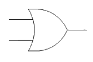

Spec links: `spcpt_PYd6kWddn3J27m4s`

## Card 5 — keyword_definition (`fl_QMpgGPJYjFpPWZtN`)

**FRONT**

State the meaning of **NOT **in Boolean logic.

**BACK**

NOT **reverses **the input value.

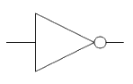

Spec links: `spcpt_PYd6kWddn3J27m4s`

## Card 6 — keyword_definition (`fl_G6nmsrX9Qzb42RMn`)

**FRONT**

What is the function of **XOR** in Boolean logic?

**BACK**

XOR (**exclusive OR**) returns TRUE if either input is TRUE** but NOT both**.

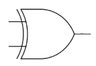

Spec links: `spcpt_PYd6kWddn3J27m4s`

## Card 7 — keyword_definition (`fl_csJhH6W78GBFhBY4`)

**FRONT**

What **gate **is this?

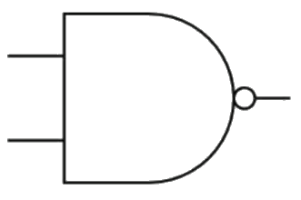

**BACK**

**NAND**

returns **TRUE **if both inputs** are NOT true**.

Spec links: `spcpt_PYd6kWddn3J27m4s`

## Card 8 — keyword_definition (`fl_Ybb3RX467PB9FtkK`)

**FRONT**

What **gate **is this?

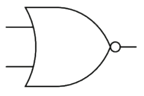

**BACK**

**NOR **

returns **TRUE **if **both inputs are FALSE**.

Spec links: `spcpt_PYd6kWddn3J27m4s`

## Card 9 — true_or_false (`fl_FCyjxJKY7xMzF9MY`)

**FRONT**

**True or False? **

OR gates return TRUE if both inputs are FALSE.

**BACK**

**False**.

OR gates return FALSE if both inputs are FALSE.

Spec links: `spcpt_PYd6kWddn3J27m4s`

## Card 10 — question_and_answer (`fl_97hg7CXvjCxtWgbf`)

**FRONT**

What is the **symbol **used for **AND **gates?

**BACK**

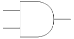

Spec links: `spcpt_PYd6kWddn3J27m4s`

## Card 11 — keyword_definition (`fl_ntyRJRTHF2WYxr2m`)

**FRONT**

What is a** logic circuit**?

**BACK**

A logic circuit **performs logical operations** on binary information.

Spec links: `spcpt_HY2mCJxGw3T58Q6D`

## Card 12 — true_or_false (`fl_56zTkdSydKRSBzDb`)

**FRONT**

**True or False? **

In the exam, logic circuits can have **unlimited **inputs and outputs.

**BACK**

**False. **

In the exam, logic circuits are limited to a maximum of **three **inputs and **one **output.

Spec links: `spcpt_HY2mCJxGw3T58Q6D`

## Card 13 — keyword_definition (`fl_ms5bxnjYkPtBPXNT`)

**FRONT**

Define **Boolean expression**.

**BACK**

A statement that can be **evaluated **to either **true **or **false**.

Spec links: `spcpt_HY2mCJxGw3T58Q6D`

## Card 14 — question_and_answer (`fl_j3zHc65V87sm7gGJ`)

**FRONT**

What are **brackets **used for in Boolean expressions?

**BACK**

Brackets are used to **clarify the order** of operations in Boolean expressions.

Spec links: `spcpt_HY2mCJxGw3T58Q6D`

## Card 15 — true_or_false (`fl_QsfGZBjz98hJSQ2t`)

**FRONT**

**True or False? **

In a logic diagram, inputs are typically represented by letters.

**BACK**

**True. **

In a logic diagram, inputs are typically represented by letters.

Spec links: `spcpt_HY2mCJxGw3T58Q6D`

## Card 16 — keyword_definition (`fl_j5g2Yd68SgpWvXbK`)

**FRONT**

Define **logic diagram**.

**BACK**

A logic diagram is a** visual representation** of combinations of Boolean operators within a logic circuit.

Spec links: `spcpt_HY2mCJxGw3T58Q6D`

## Card 17 — question_and_answer (`fl_GNnqgNYyZs32bSTg`)

**FRONT**

Draw the** logic diagram** for the Boolean expression **P = (A AND B) OR C**

**BACK**

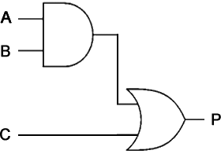

Spec links: `spcpt_HY2mCJxGw3T58Q6D`

## Card 18 — question_and_answer (`fl_9w2vMrM7bBTJsQg6`)

**FRONT**

Draw the** logic diagram** for the Boolean expression **P = (A XOR B) AND (NOT C)**

**BACK**

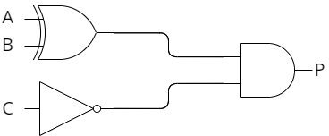

Spec links: `spcpt_HY2mCJxGw3T58Q6D`

## Card 19 — question_and_answer (`fl_ZsD3ccP64W8rBvs9`)

**FRONT**

Draw the** logic diagram** for the Boolean expression **P = NOT(C AND (A OR B))**

**BACK**

Spec links: `spcpt_HY2mCJxGw3T58Q6D`

## Card 20 — question_and_answer (`fl_gXF7Q3vSJr3SNmm7`)

**FRONT**

Draw the** logic diagram** for the Boolean expression **P = (A AND B) OR (NOT C)**

**BACK**

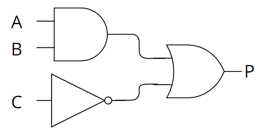

Spec links: `spcpt_HY2mCJxGw3T58Q6D`

## Card 21 — keyword_definition (`fl_DtPk3jHcyGBBK3gD`)

**FRONT**

What is a **truth table**?

**BACK**

A truth table is a tool used in logic and computer science to **visualise the results** of Boolean expressions.

Spec links: `spcpt_YFjMnPc9Ns3fb8WS`

## Card 22 — true_or_false (`fl_jnqX9yCGNM5HQSQ7`)

**FRONT**

**True or False? **

Truth tables show only the inputs of a Boolean expression.

**BACK**

**False. **

Truth tables represent all possible inputs and the associated outputs for a given Boolean expression.

Spec links: `spcpt_YFjMnPc9Ns3fb8WS`

## Card 23 — question_and_answer (`fl_x3y7KFVQhSsY35X4`)

**FRONT**

How many **rows** are needed in a truth table with **3 inputs**?

**BACK**

A truth table with 3 inputs needs **8 rows** (2^3).

Spec links: `spcpt_YFjMnPc9Ns3fb8WS`

## Card 24 — question_and_answer (`fl_XNjhn2SmtTsFYdFT`)

**FRONT**

What is the **output **of an **AND **gate when both inputs are 1?

**BACK**

The output of an AND gate when both inputs are 1 is **1**.

Spec links: `spcpt_YFjMnPc9Ns3fb8WS` `spcpt_pnccJBcWKPYZWjR7`

## Card 25 — true_or_false (`fl_cnRsbNypFJyCnP8B`)

**FRONT**

**True or False? **

In a **NOR **gate, the output is 1 when both inputs are 0.

**BACK**

**True. **

In a **NOR **gate, the output is 1 when both inputs are 0.

Spec links: `spcpt_YFjMnPc9Ns3fb8WS` `spcpt_pnccJBcWKPYZWjR7`

## Card 26 — question_and_answer (`fl_fF7tmZMpW6bDy8bq`)

**FRONT**

What is the output of an **XOR **gate when both inputs are **1**?

**BACK**

The output of an **XOR** gate when both inputs are 1 is **0**.

Spec links: `spcpt_YFjMnPc9Ns3fb8WS` `spcpt_pnccJBcWKPYZWjR7`

## Card 27 — question_and_answer (`fl_HBgrngXBJxy8vbjY`)

**FRONT**

How do you **determine **the number of rows in a** truth table**?

**BACK**

The number of rows in a truth table is determined by** 2^(number of inputs)**.

Spec links: `spcpt_YFjMnPc9Ns3fb8WS` `spcpt_pnccJBcWKPYZWjR7`

## Card 28 — question_and_answer (`fl_kZnyDckhTMkvWT9b`)

**FRONT**

What are the **missing inputs** in the **truth table**?

| A | B | C |
|---|---|---|
| 0  0  0  0 | 0  0  1  1 | 0  1  0  1 |

**BACK**

| 0  0  0  0  **Final answer:** **1**  **Final answer:** **1**  **Final answer:** **1**  **Final answer:** **1** | 0  0  1  1  **Final answer:** **0**  **Final answer:** **0**  **Final answer:** **1**  **Final answer:** **1** | 0  1  0  1  **Final answer:** **0**  **Final answer:** **1**  **Final answer:** **0**  **Final answer:** **1** |
|---|---|---|

Spec links: `spcpt_pnccJBcWKPYZWjR7`

## Card 29 — question_and_answer (`fl_TMmcKn3nsDPvKV9K`)

**FRONT**

What is the output of a **NOT **gate when the input is **0**?

**BACK**

The output of a **NOT **gate when the input is 0 is **1**.

Spec links: `spcpt_YFjMnPc9Ns3fb8WS` `spcpt_pnccJBcWKPYZWjR7`

## Card 30 — question_and_answer (`fl_t72YvZd7tkGTQVYC`)

**FRONT**

Draw a **truth table** for the Boolean expression **P = (A AND B) AND NOT C**

**BACK**

| A | B | C | P |
|---|---|---|---|
| 0 | 0 | 0 | **0** |
| 0 | 0 | 1 | **0** |
| 0 | 1 | 0 | **0** |
| 0 | 1 | 1 | **0** |
| 1 | 0 | 0 | **0** |
| 1 | 0 | 1 | **0** |
| 1 | 1 | 0 | **1** |
| 1 | 1 | 1 | **0** |

Spec links: `spcpt_pnccJBcWKPYZWjR7`

## Card 31 — keyword_definition (`fl_prRmPjJC3NJyZ2M8`)

**FRONT**

What is a** logic expression**?

**BACK**

A logic expression is a way of **expressing a logic gate or logic circuit** as an **equation**.

Spec links: `spcpt_Bqr6RvC637zVPvBS`

## Card 32 — true_or_false (`fl_fksDsXJqYTjNyCR8`)

**FRONT**

**True or False? **

In a logic expression, the **output appears on the right** of the equals sign.

**BACK**

**False. **

In a logic expression, the output appears on the **left **of the equals sign.

Spec links: `spcpt_Bqr6RvC637zVPvBS`

## Card 33 — question_and_answer (`fl_tnrHxPFsdrQp8Nz9`)

**FRONT**

State the logic expression for a **NOT **gate where **A** is the input and **Z** is the output.

**BACK**

** Z = NOT A**.

Spec links: `spcpt_Bqr6RvC637zVPvBS`

## Card 34 — question_and_answer (`fl_njPs8pYmCZgGcztH`)

**FRONT**

**True or False.**

**((NOT A) OR B) NAND C = P **is a valid logic expression.

**BACK**

**False.**

The correct logic expression is **P = ((NOT A) OR B) NAND C**

Spec links: `spcpt_Bqr6RvC637zVPvBS`

## Card 35 — true_or_false (`fl_nbmMMWqCzTKG9jnq`)

**FRONT**

**True or False? **

The logic expression for an **OR **gate is** Z = A NOR B**.

**BACK**

**False. **

The logic expression for an **OR **gate is **Z = A OR B**.

Spec links: `spcpt_Bqr6RvC637zVPvBS`

## Card 36 — question_and_answer (`fl_WxMJG8WC6cjgmhY4`)

**FRONT**

State the **logic expression** for this logic diagram.

**BACK**

**P = (A XOR B) AND (NOT C)**

Spec links: `spcpt_Bqr6RvC637zVPvBS`

## Card 37 — question_and_answer (`fl_jKMpf5HsJrnFNYMm`)

**FRONT**

State the **logic expression** for this logic diagram.

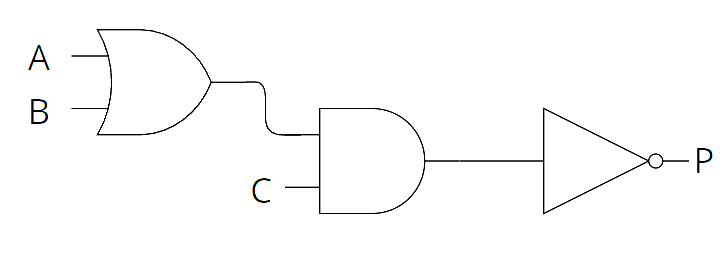

**BACK**

**P = NOT((A OR B) AND C)**

OR

**P = NOT(C AND (A OR B))**

Spec links: `spcpt_Bqr6RvC637zVPvBS`

## Card 38 — true_or_false (`fl_BZj5gnxX8B7ybZFP`)

**FRONT**

**True or False? **

Logic expressions can represent circuits with **multiple **gates.

**BACK**

**True. **

Logic expressions can represent circuits with multiple gates.

Spec links: `spcpt_Bqr6RvC637zVPvBS`

## Card 39 — question_and_answer (`fl_9YJNWJgrYJhZW8xF`)

**FRONT**

State the **logic expression** for this logic diagram.

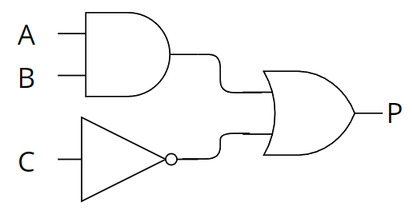

**BACK**

**P = (A AND B) OR (NOT C)**

Spec links: `spcpt_Bqr6RvC637zVPvBS`

## Card 40 — question_and_answer (`fl_6BP3mtPRGcyVX8G7`)

**FRONT**

How are **complex logic circuits** expressed as logic expressions?

**BACK**

Complex logic circuits are expressed as logic expressions by** combining multiple operations** using** brackets to show the order of operations**.

Spec links: `spcpt_Bqr6RvC637zVPvBS`

