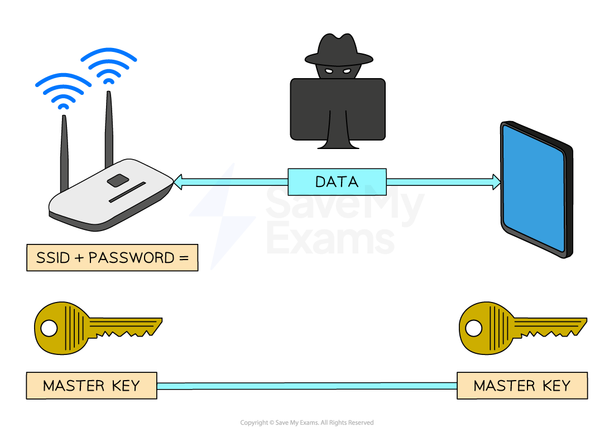

# Encryption

Course: cie-igcse-computer-science-23 · Section: 2. Data Transmission

Source: https://www.savemyexams.com/igcse/computer-science/cie/23/flashcards/2-data-transmission/encryption/

## Card 1 — question_and_answer (`fl_PvkyggCsXkzmyRC6`)

**FRONT**

What is **encryption**?

**BACK**

Encryption is **a method of scrambling data before being transmitted across a network **in order to **protect the contents from unauthorised access**.

Spec links: `spcpt_qZTkxK8ydb3Nb5fR`

## Card 2 — keyword_definition (`fl_2fBpR62RcwXkkcyJ`)

**FRONT**

Define **SSID.**

**BACK**

SSID is **Service Set Identifier**, which along with a password is** used to create a 'master key' for wireless network encryption**.

Spec links: `spcpt_qZTkxK8ydb3Nb5fR`

## Card 3 — question_and_answer (`fl_JFMtFy2pW8YR9h8X`)

**FRONT**

What is** cipher text**?

**BACK**

Cipher text is **encrypted data that has been scrambled using a master key**.

Spec links: `spcpt_qZTkxK8ydb3Nb5fR`

## Card 4 — keyword_definition (`fl_NW2sGnSbpCQKmF35`)

**FRONT**

Define **plaintext.**

**BACK**

Plaintext is the name for **data before it is encrypted**.

Spec links: `spcpt_qZTkxK8ydb3Nb5fR`

## Card 5 — true_or_false (`fl_Z6zfv3Kz4fBjPqKs`)

**FRONT**

**True or False? **

The master key** is never transmitted in wireless** network encryption.

**BACK**

**True. **

The master key **is never transmitted in wireless** network encryption.

Spec links: `spcpt_qZTkxK8ydb3Nb5fR`

## Card 6 — question_and_answer (`fl_gCRbmKjqk5f9bKD9`)

**FRONT**

What is **symmetric encryption**?

**BACK**

Symmetric encryption is when** both the sender and receiver are given an identical secret key** which can be used **to encrypt or decrypt** information.

Spec links: `spcpt_qCq5k7sWz7xMjCc9`

## Card 7 — keyword_definition (`fl_RkWbPhfFQFPwTnmF`)

**FRONT**

Define **asymmetric encryption.**

**BACK**

Asymmetric encryption is when **two keys are used**, a** public key known to everyone** and a** private key known only to the receiver**.

Spec links: `spcpt_qCq5k7sWz7xMjCc9`

## Card 8 — question_and_answer (`fl_tpY6h4mTZRPN6q5k`)

**FRONT**

What **protocol** is specifically **designed for Wi-Fi security**?

**BACK**

**WPA2 **is specifically designed for Wi-Fi security.

Spec links: `spcpt_qZTkxK8ydb3Nb5fR`

## Card 9 — keyword_definition (`fl_8rKBGYqCdxYfMJ8x`)

**FRONT**

Define **public key.**

**BACK**

A public key is **a key known to everyone in asymmetric encryption**.

Spec links: `spcpt_qCq5k7sWz7xMjCc9`

## Card 10 — true_or_false (`fl_qTYVWBMNQP4ZDZd2`)

**FRONT**

**True or False? **

In asymmetric encryption,** only the public key is needed** to encrypt and decrypt information.

**BACK**

**False. **

In asymmetric encryption,** both the public and private keys are needed** to encrypt and decrypt information.

Spec links: `spcpt_qCq5k7sWz7xMjCc9`

