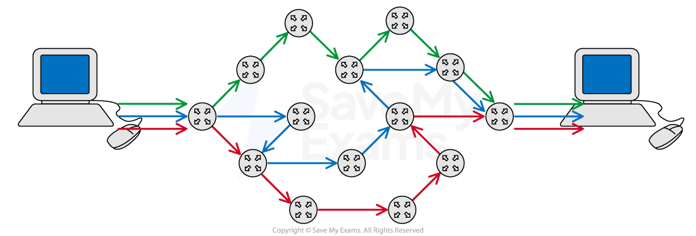

# Types & Methods of Data Transmission

Course: cie-igcse-computer-science-23 · Section: 2. Data Transmission

Source: https://www.savemyexams.com/igcse/computer-science/cie/23/flashcards/2-data-transmission/types-and-methods-of-data-transmission/

## Card 1 — keyword_definition (`fl_hz6mZzxWrktfH5zB`)

**FRONT**

What are **packets**?

**BACK**

Packets are **small 'chunks' of data **that make up a larger piece of data that has been** broken down by the TCP protocol** so that it can be** transmitted over the internet.**

Spec links: `spcpt_HpkkHsvxDdcpkHfr`

## Card 2 — question_and_answer (`fl_k8R6ZqJphGkQykPs`)

**FRONT**

What does **TCP **stand for?

**BACK**

TCP stands for **Transmission Control Protocol.**

Spec links: `spcpt_HpkkHsvxDdcpkHfr`

## Card 3 — question_and_answer (`fl_RdKBptqtTJpgqhmX`)

**FRONT**

What are the **three main components** of a **packet**?

**BACK**

The three main components of a packet are **header**, **payload**, and **trailer.**

Spec links: `spcpt_HpkkHsvxDdcpkHfr`

## Card 4 — keyword_definition (`fl_QqcSVBvS8WDxrC52`)

**FRONT**

**Payload**

**BACK**

The** actual data being transported **in a packet.

Spec links: `spcpt_HpkkHsvxDdcpkHfr`

## Card 5 — question_and_answer (`fl_Z8TwgSJR2DWvxk6z`)

**FRONT**

What **information **is typically included in a** packet's header**?

**BACK**

A packet's header typically includes the **source IP address**, **destination IP address**, and** packet number.**

Spec links: `spcpt_HpkkHsvxDdcpkHfr`

## Card 6 — question_and_answer (`fl_bBvMjDs6cztdkmcS`)

**FRONT**

What is the **purpose **of **error checking **in packets?

**BACK**

The purpose of error checking in packets is to **ensure that when a packet is received there is minimal or no corruption of the data.**

Spec links: `spcpt_HpkkHsvxDdcpkHfr`

## Card 7 — keyword_definition (`fl_DKTQf6bYpKxHdj6s`)

**FRONT**

**Parity bit**

**BACK**

**A bit added to a packet **to** check that no bits have been flipped** from 0 to 1 or vice versa.

Spec links: `spcpt_HpkkHsvxDdcpkHfr`

## Card 8 — keyword_definition (`fl_6xgXWs7spwVTNZfS`)

**FRONT**

**Checksum**

**BACK**

**A calculation performed on packet data** to **detect corruption** by comparing the result to a stored checksum value.

Spec links: `spcpt_HpkkHsvxDdcpkHfr`

## Card 9 — true_or_false (`fl_Y4B5JYcd4mSKRQMM`)

**FRONT**

**True or False? **

Packets **always **arrive at their destination **in the correct order**.

**BACK**

**False. **

Packets can arrive at their destination** in any order** and need to be reassembled.

Spec links: `spcpt_HpkkHsvxDdcpkHfr`

## Card 10 — keyword_definition (`fl_G5qkw7CwqZzXnH2d`)

**FRONT**

What is **corruption **in the context of** data packets**?

**BACK**

Corruption is where **packet data is changed or lost in some way**, or **data is gained that originally was not in the packet.**

Spec links: `spcpt_HpkkHsvxDdcpkHfr`

## Card 11 — keyword_definition (`fl_8pG4bV7jQysDHTtY`)

**FRONT**

What is **packet switching**?

**BACK**

Packet switching is **a method of sending and receiving data** (packets) **across a network, **the packs of data are sent via** different routes.**

Spec links: `spcpt_qvNBrYW4FTqwdvn8`

## Card 12 — question_and_answer (`fl_wpTVvxgBtYrKgvCB`)

**FRONT**

How many **stages **are there in **packet switching**?

**BACK**

There are** five stages** in packet switching.

Spec links: `spcpt_qvNBrYW4FTqwdvn8`

## Card 13 — question_and_answer (`fl_hP8HgBKYdGjQQzNG`)

**FRONT**

What is the **role of routers** in **packet switching**?

**BACK**

Routers **control the routes taken for each packet** and **decide which nearby router is closer to the destination device.**

Spec links: `spcpt_qvNBrYW4FTqwdvn8`

## Card 14 — true_or_false (`fl_dhW2J6KJkk7wZcD7`)

**FRONT**

**True or False? **

In packet switching, **all packets must take the same route **to the destination.

**BACK**

**False. **

In packet switching,** packets can take different routes** to reach the destination.

Spec links: `spcpt_qvNBrYW4FTqwdvn8`

## Card 15 — question_and_answer (`fl_Z7BSGqyVngxrHmDV`)

**FRONT**

What happens if a **packet does not reach its destination**?

**BACK**

If a packet does not reach its destination,** the receiver can send a resend request to the sender** to **resend the packet.**

Spec links: `spcpt_qvNBrYW4FTqwdvn8`

## Card 16 — question_and_answer (`fl_wKkYnSMysjd8Ryhw`)

**FRONT**

What is **one advantage** of packet switching in terms of **data security**?

**BACK**

One advantage of packet switching in terms of data security is that it's **harder to hack an individual's data as each packet contains minimal data** and **travels through the network separately.**

Spec links: `spcpt_qvNBrYW4FTqwdvn8`

## Card 17 — question_and_answer (`fl_W3jCjHTDc5p3BG5c`)

**FRONT**

Why is packet switching **generally faster** than **sending a large packet**?

**BACK**

Packet switching is generally faster because **each packet finds the quickest way around the network.**

Spec links: `spcpt_qvNBrYW4FTqwdvn8`

## Card 18 — question_and_answer (`fl_4BD6QkYRMvVWW3QV`)

**FRONT**

What happens to packets **when they arrive at their destination**?

**BACK**

When packets arrive at their destination, **they are reordered correctly to reconstruct the original data.**

Spec links: `spcpt_qvNBrYW4FTqwdvn8`

## Card 19 — true_or_false (`fl_xtVXpTGkjrrXrNZK`)

**FRONT**

**True or False? **

Packet switching **requires the whole file to be resent** if corruption occurs.

**BACK**

**False. **

With packet switching,** only corrupted packets need to be resent**, not the whole file.

Spec links: `spcpt_qvNBrYW4FTqwdvn8`

## Card 20 — question_and_answer (`fl_3mpCH7f2Kbp8Ytq5`)

**FRONT**

What is the **benefit **of packet switching in terms of **network efficiency**?

**BACK**

Packet switching improves network efficiency by** allowing multiple users to share the same data path.**

Spec links: `spcpt_qvNBrYW4FTqwdvn8`

## Card 21 — keyword_definition (`fl_hjMmP2KD9BcbGtf4`)

**FRONT**

What is **data transmission**?

**BACK**

Data transmission is **the process of transferring data from one device to another** using a **wired **or **wireless **connection.

Spec links: `spcpt_jk5xWZ6FcD2GKHYK`

## Card 22 — question_and_answer (`fl_S9zypSNKwjZCYNmB`)

**FRONT**

What are the **two types **of **wired data transmission**?

**BACK**

The two types of wired data transmission are **serial **and **parallel.**

Spec links: `spcpt_jk5xWZ6FcD2GKHYK`

## Card 23 — keyword_definition (`fl_2TVqv4XBkPcgNs69`)

**FRONT**

**Serial transmission**

**BACK**

A method where a stream of bits is sent in sequence, **one after the other**.

Spec links: `spcpt_jk5xWZ6FcD2GKHYK`

## Card 24 — keyword_definition (`fl_FtF7TNfmPypQvT4G`)

**FRONT**

**Parallel transmission**

**BACK**

A method where a stream of bits is sent in sequence, **one after the other **across **multiple wires **at **the same time.**

Spec links: `spcpt_jk5xWZ6FcD2GKHYK`

## Card 25 — keyword_definition (`fl_wrHrmNcs9VKQwGSq`)

**FRONT**

What is a **skew **in **parallel transmission**?

**BACK**

A skew is caused by **data arriving out of order** in **asynchronous parallel transmission.**

Spec links: `spcpt_jk5xWZ6FcD2GKHYK`

## Card 26 — true_or_false (`fl_fhZQps5wDw37W8s6`)

**FRONT**

**True or False? **

**Serial **transmission is **faster than** **parallel **transmission.

**BACK**

**False. **

**Parallel **transmission** is generally faster than serial** transmission.

Spec links: `spcpt_jk5xWZ6FcD2GKHYK`

## Card 27 — question_and_answer (`fl_Byqspf9hhcmrkDsW`)

**FRONT**

What is an **advantage **of **serial transmission** over **parallel transmission**?

**BACK**

An advantage of serial transmission is that it is** more reliable over longer distances.**

Spec links: `spcpt_jk5xWZ6FcD2GKHYK`

## Card 28 — keyword_definition (`fl_KZS8Tg5yGSMypRsH`)

**FRONT**

What is **simplex transmission**?

**BACK**

Simplex transmission is a method where **data travels in only one direction.**

Spec links: `spcpt_kSWh6RscsNv3C9kc`

## Card 29 — keyword_definition (`fl_rsy5nBbrHnbfSXfw`)

**FRONT**

What is **half-duplex transmission**?

**BACK**

Half-duplex transmission is a method where **data can travel in both directions**, but **not simultaneously.**

Spec links: `spcpt_kSWh6RscsNv3C9kc`

## Card 30 — keyword_definition (`fl_GnfVxpQMvJk7kNbR`)

**FRONT**

What is **full-duplex transmission**?

**BACK**

Full-duplex transmission is a method where **data can travel in both directions at the same time.**

Spec links: `spcpt_kSWh6RscsNv3C9kc`

## Card 31 — question_and_answer (`fl_YR8vDVDKthx4cR25`)

**FRONT**

What does **USB **stand for?

**BACK**

USB stands for **Universal Serial Bus.**

Spec links: `spcpt_kq2K9PSj4G7ZSdBK`

## Card 32 — question_and_answer (`fl_HzmCTHSTgf76Zssb`)

**FRONT**

What **type of data transmission** does **USB **use?

**BACK**

USB uses **asynchronous **and **serial **data transmission.

Spec links: `spcpt_kq2K9PSj4G7ZSdBK`

## Card 33 — question_and_answer (`fl_45C9WpdkjfSv78vb`)

**FRONT**

Name** three types** of **USB connectors**.

**BACK**

Three types of USB connectors are **USB-A**, **USB-B**, and **USB-C.**

Spec links: `spcpt_kq2K9PSj4G7ZSdBK`

## Card 34 — question_and_answer (`fl_TMFSVDFbmmYkpygz`)

**FRONT**

What happens when **a device is connected to a USB port**?

**BACK**

When a device is connected to a USB port, the** computer automatically detects the device **and** loads the appropriate driver.**

Spec links: `spcpt_kq2K9PSj4G7ZSdBK`

## Card 35 — keyword_definition (`fl_YgFhRGSD2TkRns5F`)

**FRONT**

What is a **device driver**?

**BACK**

A device driver is **software that allows a device to communicate** with the computer.

Spec links: `spcpt_kq2K9PSj4G7ZSdBK`

## Card 36 — true_or_false (`fl_FyZccZc9s9dVfPtK`)

**FRONT**

**True or False? **

USB cables can be connected** in any orientation**.

**BACK**

**False. **

USB cables (**except USB-C**) can only be connected **in one orientation**.

Spec links: `spcpt_kq2K9PSj4G7ZSdBK`

## Card 37 — question_and_answer (`fl_r7KJRScwy5CpmmHR`)

**FRONT**

What is the **maximum cable length** for a **standard USB connection**?

**BACK**

The maximum cable length for a standard USB connection is **roughly 5 meters.**

Spec links: `spcpt_kq2K9PSj4G7ZSdBK`

## Card 38 — keyword_definition (`fl_YbrkWrBymSQWbhtR`)

**FRONT**

What is **backward compatibility** in **USB**?

**BACK**

Backward compatibility in USB means that** newer USB standards can work with older USB devices** and **ports.**

Spec links: `spcpt_kq2K9PSj4G7ZSdBK`

## Card 39 — question_and_answer (`fl_Z6RGTT5nbRJ5WmHf`)

**FRONT**

What is the **newest USB transmission rate** as of **2022**?

**BACK**

The newest USB transmission rate as of 2022 is **USB4 2.0** with **80 Gbps.**

Spec links: `spcpt_kq2K9PSj4G7ZSdBK`

## Card 40 — true_or_false (`fl_yJT8VkznyqcxTqKb`)

**FRONT**

**True or False? **

USB can **provide power** to connected devices.

**BACK**

**True. **

USB can provide power to connected devices.

Spec links: `spcpt_kq2K9PSj4G7ZSdBK`

