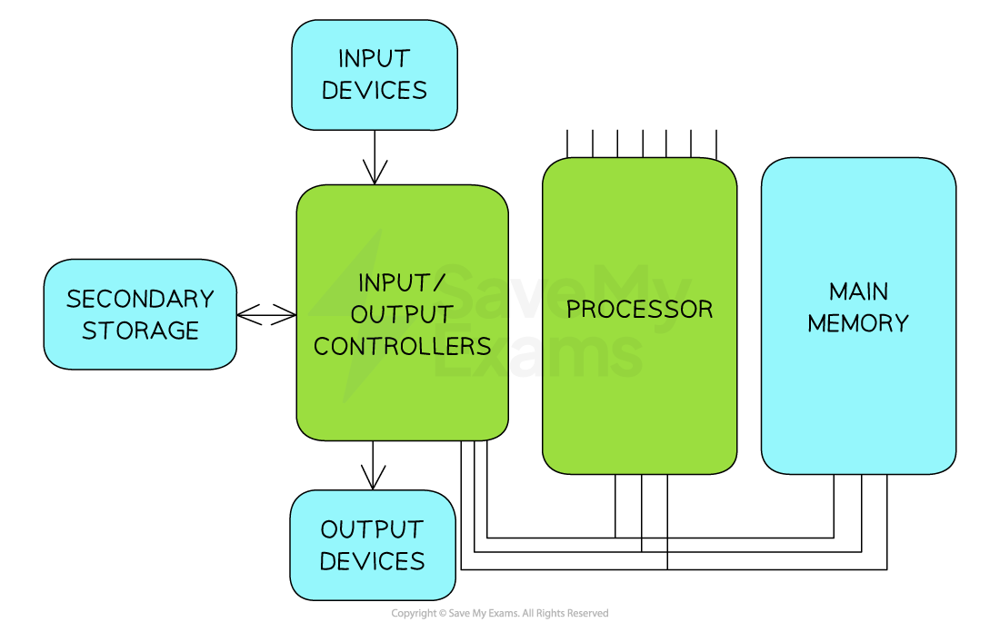
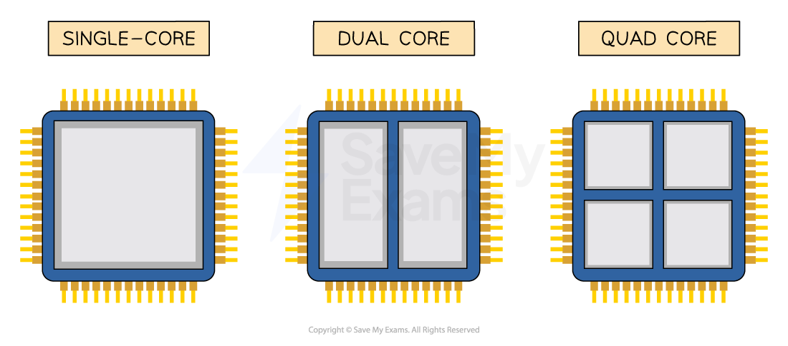

# Computer Architecture

Course: cie-igcse-computer-science-23 · Section: 3. Hardware

Source: https://www.savemyexams.com/igcse/computer-science/cie/23/flashcards/3-hardware/computer-architecture/

## Card 1 — question_and_answer (`fl_cwd7p7TrHHPttnpB`)

**FRONT**

What is the** purpose of the CPU**?

**BACK**

The purpose of the CPU is to **fetch, decode and execute instructions.**

Spec links: `spcpt_j37xfk8ZSg9wGKwT`

## Card 2 — keyword_definition (`fl_M9zXFnWmBxMtr4Jk`)

**FRONT**

Define the term **microprocessor.**

**BACK**

A microprocessor is **a type of integrated circuit on a single chip.**

Spec links: `spcpt_j37xfk8ZSg9wGKwT`

## Card 3 — question_and_answer (`fl_pwp2Cm6TbKys96sq`)

**FRONT**

What does **CPU stand for**?

**BACK**

CPU stands for **Central Processing Unit.**

Spec links: `spcpt_j37xfk8ZSg9wGKwT`

## Card 4 — true_or_false (`fl_2VKwdPj8s9crRrWD`)

**FRONT**

**True or False? **

The CPU is only used in desktop computers.

**BACK**

**False. **

The CPU is used in various devices including laptops, desktops, games consoles, and mobile devices.

Spec links: `spcpt_j37xfk8ZSg9wGKwT`

## Card 5 — keyword_definition (`fl_BrGxYvWmMm34NYc6`)

**FRONT**

**Input**

**BACK**

Data and commands **inputted by the user** using **an input device.**

Spec links: `spcpt_j37xfk8ZSg9wGKwT`

## Card 6 — keyword_definition (`fl_HZBCfj78gYg9X65d`)

**FRONT**

**Process**

**BACK**

The **execution of instructions by the CPU** to manipulate data.

Spec links: `spcpt_j37xfk8ZSg9wGKwT`

## Card 7 — keyword_definition (`fl_kmsfXzX3pCMmRmVg`)

**FRONT**

**Output**

**BACK**

The **results of processing displayed to the user** via **an output device.**

Spec links: `spcpt_j37xfk8ZSg9wGKwT`

## Card 8 — question_and_answer (`fl_TdkWv2H9Y848HRX4`)

**FRONT**

What are the** three main steps** in **computer data processing**?

**BACK**

The three main steps in computer data processing are **input**, **process**, and **output.**

Spec links: `spcpt_j37xfk8ZSg9wGKwT`

## Card 9 — true_or_false (`fl_BBPFgkpN5WKcnyDp`)

**FRONT**

**True or False? **

The terms **CPU **and **microprocessor **can be used **interchangeably**.

**BACK**

**True**.

The terms CPU and microprocessor can be used interchangeably.

Spec links: `spcpt_j37xfk8ZSg9wGKwT`

## Card 10 — keyword_definition (`fl_RxqM9ZW2hD2rRH8R`)

**FRONT**

What is the **Von Neumann Architecture**?

**BACK**

The Von Neumann Architecture is **a design of the CPU** proposed by John Von Neumann in the 1940s, which **most general-purpose computers are built upon.**

Spec links: `spcpt_5M6QcjK4xvy9R62Y`

## Card 11 — keyword_definition (`fl_WNfWZkpXhpdPMrv2`)

**FRONT**

**Program Counter** (**PC**)

**BACK**

**Holds the memory address** of **the next instructions to be executed.**

Spec links: `spcpt_5M6QcjK4xvy9R62Y`

## Card 12 — keyword_definition (`fl_FFFDxSgs9rBmN6qV`)

**FRONT**

**Memory Address Register** (**MAR**)

**BACK**

**Holds the memory address** of **where data or instructions are to be fetched from in memory.**

Spec links: `spcpt_5M6QcjK4xvy9R62Y`

## Card 13 — keyword_definition (`fl_hwMPxCK64Mqx9sMp`)

**FRONT**

**Memory Data Register **(**MDR**)

**BACK**

**Stores the data or instruction** which **has been fetched from memory.**

Spec links: `spcpt_5M6QcjK4xvy9R62Y`

## Card 14 — keyword_definition (`fl_r6xgRHHbZkHpPjZy`)

**FRONT**

**Current Instruction Register** (**CIR**)

**BACK**

**Stores the instruction** the CPU is** currently decoding or executing.**

Spec links: `spcpt_5M6QcjK4xvy9R62Y`

## Card 15 — keyword_definition (`fl_3zNJzMN3gsJsWjgn`)

**FRONT**

**Accumulator **(**ACC**)

**BACK**

**Stores the results of any calculations** that have taken place** in the Arithmetic Logic Unit** (**ALU**).

Spec links: `spcpt_5M6QcjK4xvy9R62Y`

## Card 16 — question_and_answer (`fl_QV2T7ggkKFXKfrsf`)

**FRONT**

What is a **bus **in **computer architecture**?

**BACK**

A bus is **a set of parallel wires through which data/signals are transmitted** from **one component to another**.

Spec links: `spcpt_5M6QcjK4xvy9R62Y`

## Card 17 — question_and_answer (`fl_RQjK5pqbcVwSTNfr`)

**FRONT**

Name the **three types of buse**s in **computer architecture.**

**BACK**

The three types of buses are **address bus**,** data bus**, and **control bus.**

Spec links: `spcpt_5M6QcjK4xvy9R62Y`

## Card 18 — question_and_answer (`fl_2CbSW3Cnjbqd7pvB`)

**FRONT**

What is the **function **of the **address bus**?

**BACK**

The address bus carries **location data** (**addresses**), data is written to/read from.

Spec links: `spcpt_5M6QcjK4xvy9R62Y`

## Card 19 — true_or_false (`fl_ZQ3nDHDxS83dXM89`)

**FRONT**

**True or False? **

The **data bus** is **unidirectional**.

**BACK**

**False. **

The **data bus is bidirectional**, carrying data or instructions in both directions.

Spec links: `spcpt_5M6QcjK4xvy9R62Y`

## Card 20 — keyword_definition (`fl_FxK3QTkTzNznKvDZ`)

**FRONT**

What is the **Fetch-Decode-Execute Cycle**?

**BACK**

The Fetch-Decode-Execute Cycle is **the cycle that the central processing unit (CPU) runs through** **billions of times per second** to make a computer work.

Spec links: `spcpt_dP3gX38Yj4BfDGC5`

## Card 21 — question_and_answer (`fl_FZqKfMDJKPTThdYp`)

**FRONT**

What are the **three main stages** of the **FDE Cycle**?

**BACK**

The three main stages are **Fetch**, **Decode**, and **Execute.**

Spec links: `spcpt_dP3gX38Yj4BfDGC5`

## Card 22 — question_and_answer (`fl_ZG45bqQ8P26r8pcc`)

**FRONT**

In the** fetch stage**, what **register **holds the address of the **next instruction**?

**BACK**

In the fetch stage, the** Program Counter** (**PC**) holds the address of the next instruction to be fetched from memory.

Spec links: `spcpt_dP3gX38Yj4BfDGC5`

## Card 23 — question_and_answer (`fl_yt3GDMjd73C48n6M`)

**FRONT**

What happens to the **Program Counter after an instruction is fetched**?

**BACK**

The Program Counter** increments by 1** so it is** pointing** **to the next instruction** to be executed.

Spec links: `spcpt_dP3gX38Yj4BfDGC5`

## Card 24 — keyword_definition (`fl_mx5sywS4yCCDZ5S7`)

**FRONT**

**Opcode**

**BACK**

The** part of an instruction** that** specifies what operation to perform.**

Spec links: `spcpt_dP3gX38Yj4BfDGC5`

## Card 25 — keyword_definition (`fl_7DkYkydxQcRPVcmv`)

**FRONT**

**Operand**

**BACK**

The** part of an instruction** that **specifies what to perform the operation on.**

Spec links: `spcpt_dP3gX38Yj4BfDGC5`

## Card 26 — question_and_answer (`fl_7ntMTjhyRFFT9rXp`)

**FRONT**

What happens during the** decode stage**?

**BACK**

During the decode stage, the CPU **works out what is required from the instruction** by **splitting it into opcode and operand.**

Spec links: `spcpt_dP3gX38Yj4BfDGC5`

## Card 27 — true_or_false (`fl_YXx35SxVj6VyR3VZ`)

**FRONT**

**True or False? **

The execute stage **always **involves performing a calculation.

**BACK**

**False. **

The execute stage can involve **performing a calculation**, **storing a result**, or **fetching data from memory**, depending on the instruction.

Spec links: `spcpt_dP3gX38Yj4BfDGC5`

## Card 28 — question_and_answer (`fl_qyVxJvBvSwVBf4T4`)

**FRONT**

What is the **purpose **of the **Control Unit** (**CU**) in the fetch stage?

**BACK**

The Control Unit **sends a signal along the control bus **to **initiate the read operation** from main memory.

Spec links: `spcpt_dP3gX38Yj4BfDGC5`

## Card 29 — question_and_answer (`fl_Syb5spvzNR785jw6`)

**FRONT**

How many** times per second **does a modern CPU typically **perform the Fetch-Decode-Execute cycle**?

**BACK**

A modern CPU typically performs the Fetch-Decode-Execute cycle **billions of times per second.**

Spec links: `spcpt_dP3gX38Yj4BfDGC5`

## Card 30 — question_and_answer (`fl_XHNwBMF2XP8rtfd2`)

**FRONT**

What are the **three common characteristics **of the CPU** **that **impact its performance**?

**BACK**

The three common characteristics are:

- **Clock Speed**
- **Cache Size**
- **Number of Cores**

Spec links: `spcpt_k6DNzFrypN8cpPgB`

## Card 31 — keyword_definition (`fl_XNBBvmJW93zmwy5B`)

**FRONT**

Define **clock speed**.

**BACK**

Clock speed** **is **measured in Hertz **(Hz) and measures the **number of fetch-decode-execute cycles** that can take place** in 1 second**.

Spec links: `spcpt_k6DNzFrypN8cpPgB`

## Card 32 — true_or_false (`fl_QMtcnQK8z3GxSVdt`)

**FRONT**

**True or False? **

Modern computers have a **clock speed measured in Gigahertz** (**GHz**), meaning billions of cycles per second.

**BACK**

**True.**

Modern computers have a **clock speed** **in Gigahertz** (**GHz**), meaning billions of cycles per second.

Spec links: `spcpt_k6DNzFrypN8cpPgB`

## Card 33 — question_and_answer (`fl_75FfjsFnppgywFcY`)

**FRONT**

What is the **impact **of a **faster clock speed**?

**BACK**

The **faster the** **Clock Speed**, the **more instructions can be fetched and executed** per second.

Spec links: `spcpt_k6DNzFrypN8cpPgB`

## Card 34 — question_and_answer (`fl_76TPBvfvBY2r9JTB`)

**FRONT**

What does a **Clock Speed** of **3.5GHz mean**?

**BACK**

A **Clock Speed of 3.5GHz** means it can perform** up to 3.5 billion instructions per second**.

Spec links: `spcpt_k6DNzFrypN8cpPgB`

## Card 35 — question_and_answer (`fl_4JRBZRpbF6PMxk5m`)

**FRONT**

What is **cache **used for?

**BACK**

**Cache **is used as **temporary storage** to provide **quick access to frequently used instructions** and **data**.

Spec links: `spcpt_k6DNzFrypN8cpPgB`

## Card 36 — question_and_answer (`fl_NzdJTFbB9Z7fjJMB`)

**FRONT**

What is the **benefit** of a** larger cache size**?

**BACK**

The** larger the Cache Size**, the **more frequently used instructions or data can be stored**, resulting in **fewer fetch cycles from RAM** and improved performance.

Spec links: `spcpt_k6DNzFrypN8cpPgB`

## Card 37 — keyword_definition (`fl_3NjGcDnSzXb3vrmM`)

**FRONT**

Define **number of cores**.

**BACK**

Each **core **works like **its own CPU**, so multiple cores allow multiple processing units to **fetch, decode and execute instructions simultaneously**.

Spec links: `spcpt_k6DNzFrypN8cpPgB`

## Card 38 — true_or_false (`fl_hpzKy8xPyCD55bRp`)

**FRONT**

**True or False?**

A **dual-core** CPU with a Clock Speed of **3.6GHz** can fetch, decode & execute more instructions in 1 second that a **quad-core** CPU with a Clock Speed** **of **2.5GHz**?

**BACK**

**False.**

A dual-core CPU (2 cores) running at 3.6GHz can perform 2 x 3.6 billion instructions = **7.2 billion instructions per second**.

A quad-core CPU (4 cores) running at 2.5GHz can perform 4 x 2.5 billion instructions = **10 billion instructions per second**.

Spec links: `spcpt_k6DNzFrypN8cpPgB`

## Card 39 — question_and_answer (`fl_2SyFxNvhQQR3JP58`)

**FRONT**

For a** dual-core **2.5GHz processor, what does "**dual-core**" mean?

**BACK**

For a dual-core processor, "dual-core" means there are **two cores** (processing units) that can fetch, decode and execute instructions.

Spec links: `spcpt_k6DNzFrypN8cpPgB`

## Card 40 — keyword_definition (`fl_Mh8JFvtkvBhZ899K`)

**FRONT**

What is an** instruction set**?

**BACK**

An instruction set is **a list of all the commands that can be processed **by a CPU.

Spec links: `spcpt_CFyzx6dZ8HqXdGfY`

## Card 41 — keyword_definition (`fl_VjW4fPs9bkD3c9yk`)

**FRONT**

**Machine code**

**BACK**

The **binary code** representation of **a CPU instruction**.

Spec links: `spcpt_CFyzx6dZ8HqXdGfY`

## Card 42 — question_and_answer (`fl_HCbc4V9YFSp4mMMF`)

**FRONT**

What are the **two parts of a machine code** instruction?

**BACK**

The two parts of a machine code instruction are the **operation code** (**opcode**) and the **operand.**

Spec links: `spcpt_CFyzx6dZ8HqXdGfY`

## Card 43 — question_and_answer (`fl_PQr58smmbvVcHNWJ`)

**FRONT**

What is a **mnemonic **in the context of** CPU instructions**?

**BACK**

A mnemonic is a** short, human-readable code** that **represents a machine code** instruction.

Spec links: `spcpt_CFyzx6dZ8HqXdGfY`

## Card 44 — true_or_false (`fl_5FvBY5hK7RmBz7W7`)

**FRONT**

**True or False? **

CPU instruction sets are **universal **across all processors.

**BACK**

**False. **

Instruction sets **are machine-specific** and can vary between different processor manufacturers.

Spec links: `spcpt_CFyzx6dZ8HqXdGfY`

## Card 45 — question_and_answer (`fl_JQ4cpp7PGsKY8dZ6`)

**FRONT**

What does the **ADD instruction **typically do?

**BACK**

The ADD instruction typically **adds a value to the value currently stored in the accumulator **(**ACC**).

Spec links: `spcpt_CFyzx6dZ8HqXdGfY`

## Card 46 — question_and_answer (`fl_gFjYYXb3NqrS5hP4`)

**FRONT**

What does the **LDA instruction **typically do?

**BACK**

The LDA instruction typically** loads the value stored in a memory location into the accumulator.**

Spec links: `spcpt_CFyzx6dZ8HqXdGfY`

## Card 47 — question_and_answer (`fl_6SQdWcWGPWfC6VTh`)

**FRONT**

What does the **HLT instruction** typically do?

**BACK**

The HLT instruction (**halt**) typically** stops the program.**

Spec links: `spcpt_CFyzx6dZ8HqXdGfY`

## Card 48 — keyword_definition (`fl_cHTYHdr3895yCjgG`)

**FRONT**

Define **embedded system**.

**BACK**

An** embedded system** is a computer system with a single function, inside a larger mechanical unit.

Spec links: `spcpt_WdsY9CK9pytpgW3B`

## Card 49 — question_and_answer (`fl_Q2TVBxyZWzfNFpWq`)

**FRONT**

What are **three examples** of** embedded systems**?

**BACK**

Examples of embedded systems include:

- **Heating thermostats**
- **Hospital equipment**
- **Washing machines**

Spec links: `spcpt_WdsY9CK9pytpgW3B`

## Card 50 — question_and_answer (`fl_NpbPX3r5sBByc28b`)

**FRONT**

What are the** three key properties** of an **embedded system**?

**BACK**

The three key properties of an embedded system are:

- **small size**
- use **less power** than general-purpose computers
- **lower cost**

Spec links: `spcpt_WdsY9CK9pytpgW3B`

## Card 51 — true_or_false (`fl_MC88KkYmyfk44xTC`)

**FRONT**

**True or False?**

A **laptop **is an example of an** embedded system**.

**BACK**

**False.**

A laptop is not an example of an **embedded system**. A laptop is an example of a general-purpose computer.

Spec links: `spcpt_WdsY9CK9pytpgW3B`

## Card 52 — question_and_answer (`fl_YF5bCN93CHNz2WcK`)

**FRONT**

Why do embedded systems **use less power**?

**BACK**

They have a** single dedicated function** rather than being general-purpose computers.

Spec links: `spcpt_WdsY9CK9pytpgW3B`

## Card 53 — true_or_false (`fl_KqBbB7C3YBrtgKjN`)

**FRONT**

**True or False?**

A **fridge **is an **embedded system**.

**BACK**

**False.**

While a fridge has a single main function, **it does not contain a CPU**, so it is not considered an embedded system.

Spec links: `spcpt_WdsY9CK9pytpgW3B`

## Card 54 — question_and_answer (`fl_8vRbsgCkR9jDCbGz`)

**FRONT**

Are **mobile phones** considered **embedded systems**?

**BACK**

**No.**

Mobile phones are** general-purpose computing devices**, not single-function embedded systems.

Spec links: `spcpt_WdsY9CK9pytpgW3B`

