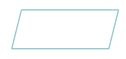
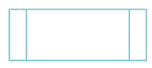

# Algorithms

Course: cie-igcse-computer-science-23 · Section: 7. Algorithm Design & Problem-Solving

Source: https://www.savemyexams.com/igcse/computer-science/cie/23/flashcards/7-algorithm-design-and-problem-solving/algorithms/

## Card 1 — keyword_definition (`fl_dwcTytYPTSVCyKpF`)

**FRONT**

Define "**algorithm**"

**BACK**

An algorithm is **a precise set of rules or instructions** to **solve a specific problem** or **task**.

Spec links: `spcpt_ypRFKV9Mxf8yh3WY` `spcpt_Pv7mbr5VHVpVjWzY`

## Card 2 — question_and_answer (`fl_F64vJ4nPg8ZxJTWb`)

**FRONT**

What are the **three main ways** to **design **an algorithm?

**BACK**

The three main ways to design an algorithm are** structure diagrams**, **flowcharts**, and **pseudocode**.

Spec links: `spcpt_ypRFKV9Mxf8yh3WY` `spcpt_Pv7mbr5VHVpVjWzY`

## Card 3 — keyword_definition (`fl_qBthy8vXSxv6kH4t`)

**FRONT**

What is a **structure diagram**?

**BACK**

A structure diagram shows** hierarchical top-down design in a visual form**, dividing problems into sub-problems.

Spec links: `spcpt_ypRFKV9Mxf8yh3WY` `spcpt_Pv7mbr5VHVpVjWzY`

## Card 4 — true_or_false (`fl_vz8Pmb2dPdt5x3WN`)

**FRONT**

**True or False? **

Flowcharts **use shapes** to represent different functions in an algorithm.

**BACK**

**True. **

Flowcharts **use shapes** to represent different functions to describe an algorithm.

Spec links: `spcpt_Pv7mbr5VHVpVjWzY`

## Card 5 — question_and_answer (`fl_B3ymFzcGyzBcWDf3`)

**FRONT**

What does pseudocode use** to describe an algorithm**?

**BACK**

Pseudocode uses** short English words/statements** to describe an algorithm.

Spec links: `spcpt_ypRFKV9Mxf8yh3WY`

## Card 6 — keyword_definition (`fl_xZvyjPjWcwZwjMpC`)

**FRONT**

Define "**flowchart**"

**BACK**

A flowchart is **a visual tool **that** uses shapes to represent different functions** to describe an algorithm.

Spec links: `spcpt_Pv7mbr5VHVpVjWzY`

## Card 7 — question_and_answer (`fl_HZXjk63FtVrD7N9S`)

**FRONT**

What do **lines **represent in a **flowchart**?

**BACK**

In a flowchart, lines represent the** flow of control**.

Spec links: `spcpt_Pv7mbr5VHVpVjWzY`

## Card 8 — true_or_false (`fl_QVQ8MN6nbVxNVnyt`)

**FRONT**

**True or False? **

Pseudocode is** less structured **than writing sentences in English.

**BACK**

**False. **

Pseudocode is **more structured** than writing sentences in English but is very flexible.

Spec links: `spcpt_ypRFKV9Mxf8yh3WY`

## Card 9 — question_and_answer (`fl_K9MPZnbjCDCbzb8j`)

**FRONT**

What is the **function **of this shape in a flowchart?

**BACK**

**Inputs and outputs.**

Spec links: `spcpt_Pv7mbr5VHVpVjWzY`

## Card 10 — question_and_answer (`fl_9pmS2xwnqYBszsgC`)

**FRONT**

What is the **function **of this shape in a flowchart?

**BACK**

**Sub-process.**

Spec links: `spcpt_Pv7mbr5VHVpVjWzY`

## Card 11 — question_and_answer (`fl_Sw4hKXhzW5GsgDdX`)

**FRONT**

What are** three ways** algorithms can be written?

**BACK**

Algorithms can be written using **flowcharts**, **pseudocode**, or** high-level programming language** code such as Python.

Spec links: `spcpt_b8n777VGS35vxhZd`

## Card 12 — true_or_false (`fl_ywB5FvmW7Yf9Dpn7`)

**FRONT**

**True or False? **

A well-designed algorithm should be** interpretable by a new user** who can explain what it does.

**BACK**

**True. **

A well-designed algorithm **should be interpretable by a new user** who can explain what it does.

Spec links: `spcpt_b8n777VGS35vxhZd`

## Card 13 — question_and_answer (`fl_DBy4qrgsWhDGmk7m`)

**FRONT**

What is the **purpose **of an algorithm?

**BACK**

The purpose of an algorithm is to **solve a problem**.

Spec links: `spcpt_b8n777VGS35vxhZd`

## Card 14 — keyword_definition (`fl_nSfCb85SKX478HN6`)

**FRONT**

Define "**pseudocode**"

**BACK**

Pseudocode is **a method of writing algorithms** using** short English words/statements** that is more structured than plain English but less formal than actual programming code.

Spec links: `spcpt_b8n777VGS35vxhZd`

## Card 15 — question_and_answer (`fl_3sY2bj6b5v5FKhB4`)

**FRONT**

What are **three ways** to **understand **a **complex **algorithm?

**BACK**

Three ways to understand a complex algorithm are: look for **comments in the code**, consider the** context of where the algorithm is being used**, and **test the algorithm** with different inputs.

Spec links: `spcpt_b8n777VGS35vxhZd`

## Card 16 — keyword_definition (`fl_XDhN6bbwbGP7MX8j`)

**FRONT**

What does the term "**initialisation**" mean in the context of **algorithms**?

**BACK**

Initialisation refers to **setting initial values for variables** at the beginning of an algorithm.

Spec links: `spcpt_b8n777VGS35vxhZd`

## Card 17 — true_or_false (`fl_bnFTp4cpFDZst5YH`)

**FRONT**

**True or False? **

The purpose of an algorithm should **always be explicitly stated** at the beginning.

**BACK**

**False. **

The purpose of an algorithm should **become clear by following its instructions**, even if not explicitly stated.

Spec links: `spcpt_b8n777VGS35vxhZd`

## Card 18 — keyword_definition (`fl_6FMdNgPjcJhj2P9v`)

**FRONT**

What is the **function **of an **array **in an algorithm?

**BACK**

An array in an algorithm** is used to store multiple values under a single variable name**, typically accessed by an index.

Spec links: `spcpt_b8n777VGS35vxhZd`

## Card 19 — question_and_answer (`fl_39hVpPNNyRqcZTvj`)

**FRONT**

What does the term "**REPEAT...UNTIL**" represent in **pseudocode**?

**BACK**

In pseudocode, "REPEAT...UNTIL" **represents a loop** that continues to execute **until a specified condition is met**.

Spec links: `spcpt_b8n777VGS35vxhZd`

## Card 20 — keyword_definition (`fl_YfNdxYmHbtXzFFcn`)

**FRONT**

What is the purpose of the "**IF...THEN...ELSE**" structure in algorithms?

**BACK**

The "IF...THEN...ELSE" structure in algorithms** is used for decision-making**, allowing **different actions to be taken based on whether a condition is true or false**.

Spec links: `spcpt_b8n777VGS35vxhZd`

