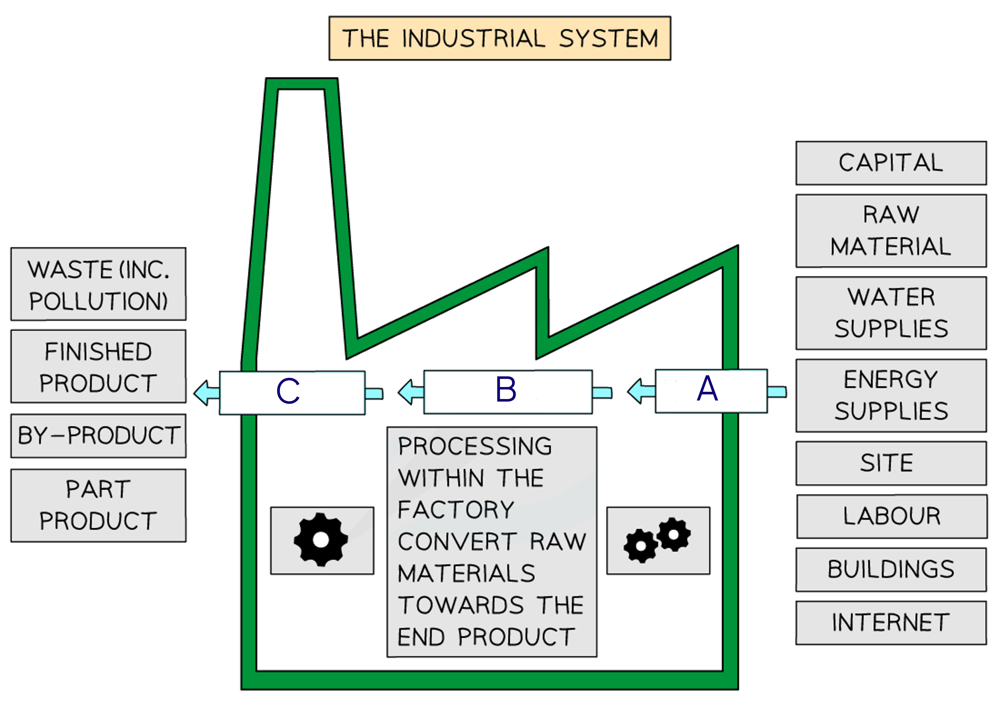

# Industry

Course: cie-igcse-geography-20 · Section: Economic Development

Source: https://www.savemyexams.com/igcse/geography/cie/20/flashcards/3-economic-development/3-3-industry/

## Card 1 — question_and_answer (`fl_ncCdWzbNGhcXXDmj`)

**FRONT**

The image above shows a typical industrial system. Identify the missing labels A, B and C.

**BACK**

Industrial systems have:

- A: Inputs
- B: Processes
- C: Outputs

## Card 2 — keyword_definition (`fl_FGzwBgKBDfFKJHsG`)

**FRONT**

Define the term **input **in relation to industrial systems.

**BACK**

**Inputs **are the basic items needed to begin the manufacturing process.

## Card 3 — true_or_false (`fl_QbsCT4rqxdHwThky`)

**FRONT**

**True or False?**

Raw materials, labour and energy are examples of industrial system inputs.

**BACK**

**True.**

Raw materials, labour and energy are examples of industrial system inputs.

## Card 4 — true_or_false (`fl_JdV78FyH5dkXQSVh`)

**FRONT**

**True or False?**

Industrial processes are activities such as welding, brewing and cutting.

**BACK**

**True.**

Industrial processes are activities such as welding, brewing and cutting.

## Card 5 — true_or_false (`fl_Gmzmhsvnr99v6H8q`)

**FRONT**

**True or False?**

Only finished products are considered industrial outputs.

**BACK**

**False.**

Outputs also include waste, by-products, goods for continued manufacturing and finished goods.

## Card 6 — question_and_answer (`fl_fCxyMCrrdwmw5rMn`)

**FRONT**

Name the **fastest growing **industry in the world.

**BACK**

The fastest-growing industry in the world is the **high-tech** (hi-tech) industry.

## Card 7 — true_or_false (`fl_RTMrdKFv3v4w9Dj2`)

**FRONT**

**True or False?**

Each industrial sector is independent of the others.

**BACK**

**False.**

Each industrial sector is interrelated with the others. An individual industry will often use more than one sector to produce products.

## Card 8 — question_and_answer (`fl_Vxk8ZJzTmprtsMW3`)

**FRONT**

State the **two **categories of manufacturing.

**BACK**

The two sectors of manufacturing are:

- **Heavy **and include iron and steel manufacturing.
- **Light **manufacturing, such as computer and smart phone assembly.

## Card 9 — keyword_definition (`fl_bDV8zRncNhvm4hDK`)

**FRONT**

Define the **optimum location**.

**BACK**

The **optimum location** is the site that will produce the maximum profit for a manufacturing company, considering various physical, human, and economic factors.

## Card 10 — question_and_answer (`fl_9SNCfpQD7VZKNYVP`)

**FRONT**

What are **natural routeways**?

**BACK**

**Natural routeways** are features like harbours, motorways, airports, and railways that provide good locations for ports and industrial complexes.

## Card 11 — true_or_false (`fl_gnn5vgB8ztwpz2hH`)

**FRONT**

**True or False? **

Climate is not a factor in industrial location.

**BACK**

**False.**

Climate can be an important factor, especially for industries like aerospace and film production.

## Card 12 — question_and_answer (`fl_3dcdNJWCSXnGsQjh`)

**FRONT**

What is **inward investment**?

**BACK**

**Inward investment** is capital brought into an area by external companies or individuals to establish or expand business operations.

## Card 13 — keyword_definition (`fl_cWs8NbhYWbkHzbdg`)

**FRONT**

Define the term **science park**.

**BACK**

A **science park** is a purpose-built area designed to encourage research and development, high-tech industries, and other quaternary activities, usually located close to universities or research centres.

## Card 14 — question_and_answer (`fl_k57JwGM4DVRxDznf`)

**FRONT**

What is **outsourcing**?

**BACK**

**Outsourcing** is the practice of sending work elsewhere to save costs, such as establishing call centres in other countries.

## Card 15 — keyword_definition (`fl_MznZy8TXs2Jf76j7`)

**FRONT**

Define what is meant by an **industrial society**.

**BACK**

An **industrial society** is one where many people work in the secondary sector, such as China and India.

## Card 16 — question_and_answer (`fl_7m32PDWfHJq8r9BR`)

**FRONT**

What are **government incentives**?

**BACK**

**Government incentives** are financial or policy-based measures designed to attract industries to invest in specific areas.

## Card 17 — question_and_answer (`fl_MSWbbZhrG5fyFM6R`)

**FRONT**

What does **least cost but highest profit location** mean?

**BACK**

**Least cost but highest profit location** means the ideal site for a company to minimise its expenses while maximising potential earnings, considering various location factors.

## Card 18 — question_and_answer (`fl_CVDvDcwQDznGK3zW`)

**FRONT**

What is a **pre-industrial society**?

**BACK**

A **pre-industrial society** is one where most people work in the primary sector, such as in Bolivia or Mozambique.

