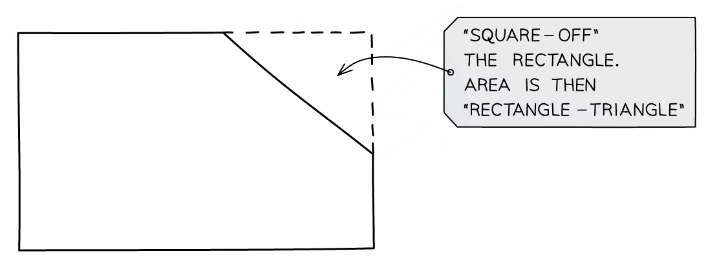

# Area & Perimeter

Course: cie-igcse-maths-25-core · Section: Lengths, Areas & Volumes

Source: https://www.savemyexams.com/igcse/maths/cie/25/core/flashcards/lengths-areas-and-volumes/area-and-perimeter/

## Card 1 — true_or_false (`fl_jPQZzTzRVqPNtTbD`)

**FRONT**

**True or False?**

To find the **perimeter** of a** regular** 2D shape you **multiply** the **number of sides** by the** length of one side**.

**BACK**

**True.**

To find the **perimeter** of a **regular **2D shape you **multiply** the **number of sides** by the **length of one side**.

## Card 2 — true_or_false (`fl_7W3FxHpKpmbJbrh7`)

**FRONT**

**True or False?**

In a **compound shape **made up of **two rectangles**, the length of the two shorter sides **opposite** a longer side will add up to the **same length** as the longer side.

**BACK**

**True.**

In a **compound shape **made up of **two rectangles**, the length of the two shorter sides **opposite** a longer side will add up to the **same length** as the longer side.

## Card 3 — question_and_answer (`fl_tV3TmjygjZCMSmxy`)

**FRONT**

What does a '**dash**' on **two or more sides** of a shape in a diagram indicate?

**BACK**

**All sides** in a diagram that are annotated with a **dash** are of **equal length**.

E.g. A rectangle has two pairs of opposite sides of equal length.

## Card 4 — question_and_answer (`fl_8FV7HNxsvFNDCcXs`)

**FRONT**

What is the term used to describe the** perimeter **of a **circle**?

**BACK**

The **circumference** of a **circle** is its** perimeter**.

## Card 5 — keyword_definition (`fl_HCtPHnNZmX9bhmK2`)

**FRONT**

Define **area**.

**BACK**

**Area** is the amount of space inside the perimeter of a 2D shape.

It is worked out from lengths in **two dimensions**, which is what separates it from a perimeter.

Spec links: `spcpt_552XpFTM8tQhFKrm`

## Card 6 — question_and_answer (`fl_2BvTsSxW3DzRxKxD`)

**FRONT**

A shape is drawn on a square grid. How do you work out its area by counting squares?

**BACK**

Count all the **whole squares** inside the shape, then **pair up** the part-squares to make further whole ones.

Multiply the total by the area that **one square** represents, which the grid will tell you.

Spec links: `spcpt_552XpFTM8tQhFKrm`

## Card 7 — fill_in_the_blanks (`fl_8MYw7hy6FCFm4KGk`)

**FRONT**

Complete the formula for the area, $A$, of a **trapezium** with parallel sides $a$ and $b$ and perpendicular height $h$. The first gap is the **denominator** of the fraction.

`A = \frac{1}{\_\_\_\_\_\_}\left(a + b\right)\_\_\_\_\_\_`

**BACK**

The completed formula is:

`A = \frac{1}{2}\left(a + b\right)h`

**Add** the two parallel sides, multiply by the **perpendicular height**, then **halve**.

*Blanks: 0 — answers: []*

Spec links: `spcpt_yGJvFvf3YJx8yM2f`

Flags: fitb_no_blank_marker

## Card 8 — question_and_answer (`fl_9Z9CtwQhYZcm4C4M`)

**FRONT**

What is the formula for the area of a **rectangle**?

**BACK**

The area of a **rectangle** is its **length** multiplied by its **width**:

$A = l \times w$

The length and the width are two sides that meet at a **corner**, not a pair of opposite sides.

Spec links: `spcpt_yGJvFvf3YJx8yM2f`

## Card 9 — true_or_false (`fl_Npy45zTR3DbXNXWB`)

**FRONT**

**True or False?**

In a **right-angled triangle**, the two sides that meet at the right angle can be used as the base and the perpendicular height.

**BACK**

**True.**

Each of those two sides is **perpendicular** to the other, so whichever one you take as the base, the other is already the perpendicular height.

Spec links: `spcpt_yGJvFvf3YJx8yM2f`

## Card 10 — question_and_answer (`fl_T29D33YJC93Z5hHd`)

**FRONT**

How do you find the area of a **parallelogram**, and which height must you use?

**BACK**

Multiply the **base** by the **perpendicular height**:

$A = b h$

The perpendicular height is the distance between the base and the side opposite it, so it is **not** the length of a sloping side.

Spec links: `spcpt_yGJvFvf3YJx8yM2f`

## Card 11 — question_and_answer (`fl_qf9bCN4MHSrR6272`)

**FRONT**

Why is an area measured in units such as $\text{cm}^{2}$ rather than $\text{cm}$?

**BACK**

Because an area is found by **multiplying two lengths**, so the unit is multiplied by itself: $\text{cm} \times \text{cm} = \text{cm}^{2}$.

A perimeter is a single length and so stays in $\text{cm}$.

Spec links: `spcpt_552XpFTM8tQhFKrm`

## Card 12 — question_and_answer (`fl_gFyWKtYtVTFy2NQp`)

**FRONT**

How do you find the** area of a compound shape**?

**BACK**

First **split the shape** into a combination of** standard shapes**.

Find the **area of each **of the standard shapes and **add **them together.

## Card 13 — true_or_false (`fl_DxKRDFqVkKwgqmYM`)

**FRONT**

**True or False? **

The **area of a compound shape** can **only **be found by** adding areas**.

**BACK**

**False. **

You may usually find the area of a compound shape by adding areas but sometimes it may be easier to find the **area of a larger shape **and **subtract **the area of **another** **shape** from it to find the area of the compound shape.

## Card 14 — true_or_false (`fl_478rWFnnfcjjtpM9`)

**FRONT**

**True or False?**

An exam question will always tell you the **specific measure or quantity** that you need to calculate.

**BACK**

**False.**

Sometimes the** specific measure or quantity **that you need to calculate will only be **implied** by the context of the question.

E.g. When being asked to find the **amount of paint** required for a wall, you will need to calculate the **area of the wall**.

