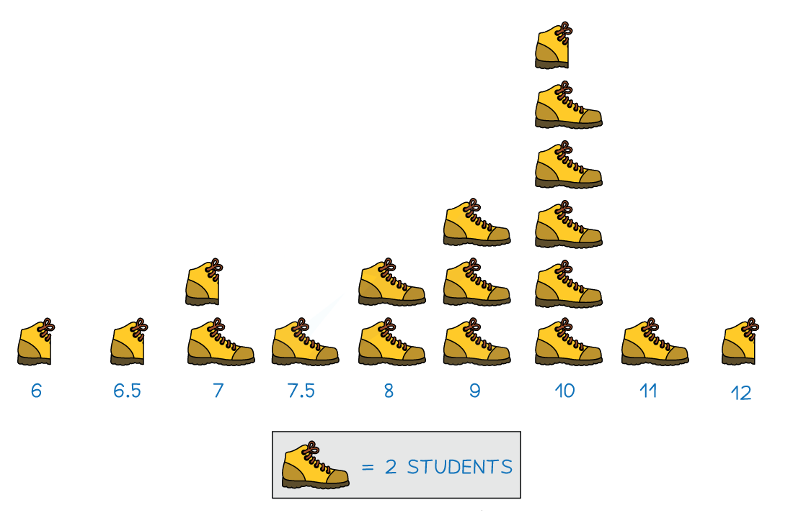
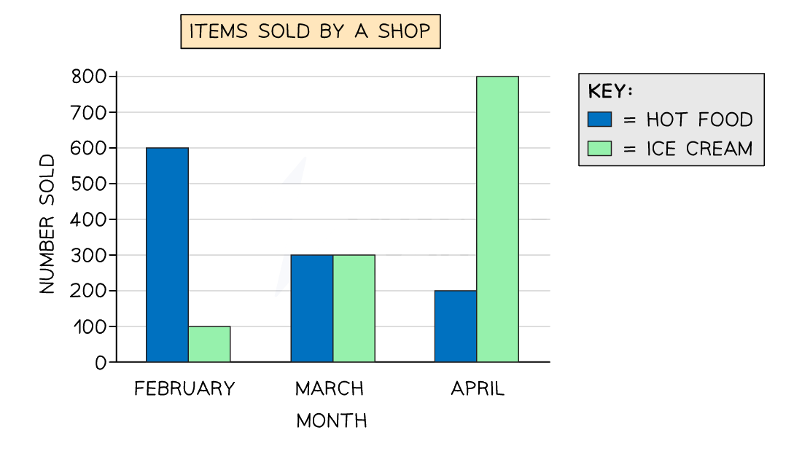
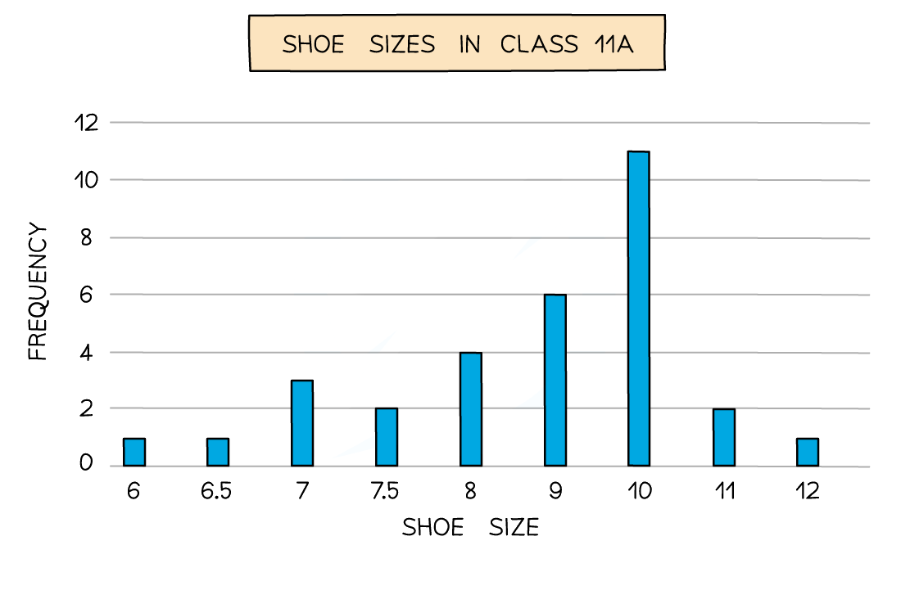

# Statistical Diagrams

Course: cie-igcse-maths-25-core · Section: Statistics

Source: https://www.savemyexams.com/igcse/maths/cie/25/core/flashcards/statistics/statistical-diagrams/

## Card 1 — true_or_false (`fl_Y7sjXjr7WmKJwsQh`)

**FRONT**

**True or False?**

In a stem-and-leaf diagram, the** stems** are written **horizontally** and the **leaves **are written** vertically** (in order)

**BACK**

**False.**

In a stem-and-leaf diagram, the **stems **are written **vertically** and the** leaves** are written **horizontally** (in order).

## Card 2 — question_and_answer (`fl_qxVNzRdF5YkmscHJ`)

**FRONT**

How do you find the **median** value of a data set from a **stem-and-leaf **diagram?

**BACK**

To find the **median** value from a **stem-and-leaf** diagram, you can cross off a pair of values (one from each end, highest and lowest) at a time until the **middle value** is found.

## Card 3 — true_or_false (`fl_kXydwfnZwJYHJgWX`)

**FRONT**

**True or False?**

The **highest value** in a data set will be the **first data item** (leaf) in the **last row** (stem).

**BACK**

**False.**

The **highest value** in a data set will be the** last data item** (leaf) in the **last row** (stem).

## Card 4 — question_and_answer (`fl_gqwDq3WXhfCfBy6k`)

**FRONT**

In the stem-and-leaf diagram below, what would be an** appropriate key**?

|   | ** Adult Height (cm)** |
|---|---|
| **15** | 0   1   6   9 |
| **16** | 0   1   2   2   3   5   7   8   9 |
| **17** | 2   3  5   5   6 |
| **18** | 0  3 |

**BACK**

An appropriate **key** for the stem-and-leaf diagram would be to have two digits as the stem, representing the hundreds and tens columns, and a single digit as the leaf, representing the ones column.

E.g. Key:  **15 **| 0 represents 150 cm.

## Card 5 — question_and_answer (`fl_S77g9tbqSPVfcVST`)

**FRONT**

How do you record a tally in groups of five?

**BACK**

Draw a vertical line for each of the first four items, then draw the fifth as a **diagonal line across** those four.

Counting then carries on in fresh groups of five.

Spec links: `spcpt_z6YF8WGyY3JG8hxS`

## Card 6 — keyword_definition (`fl_SJf2bS8wmh496png`)

**FRONT**

What is a **frequency table**?

**BACK**

A **frequency table** records how many times each item appears in a set of data.

It is usually built from a tally chart by totalling the marks in each row.

Spec links: `spcpt_z6YF8WGyY3JG8hxS`

## Card 7 — fill_in_the_blanks (`fl_h4rsnTqwFQK6cQjr`)

**FRONT**

A tally shows two completed groups of five with two extra marks. Complete the frequency:

`5 + 5 + 2 = \_\_\_\_\_\_`

**BACK**

The completed calculation is:

$5 + 5 + 2 = 12$

Count the completed groups in fives first, then add on the leftover marks.

*Blanks: 0 — answers: []*

Spec links: `spcpt_z6YF8WGyY3JG8hxS`

Flags: fitb_no_blank_marker

## Card 8 — question_and_answer (`fl_8gxfjD52dCHBDc8n`)

**FRONT**

Why is it easier to make a tally chart first, rather than counting each category straight into a frequency table?

**BACK**

A tally lets you work through the data **once**, marking each item as you meet it.

Counting each category separately means going back through the whole list again for every category.

Spec links: `spcpt_z6YF8WGyY3JG8hxS`

## Card 9 — true_or_false (`fl_JvrN2963YqQjYY5y`)

**FRONT**

**True or False?**

The frequencies in the table should add up to the number of items collected.

**BACK**

**True.**

Every item is counted exactly once, into exactly one row.

If the frequencies do not add to the total collected, a mark has been missed or counted twice.

Spec links: `spcpt_z6YF8WGyY3JG8hxS`

## Card 10 — keyword_definition (`fl_6S84HTDsp5JkdNDD`)

**FRONT**

The image below shows what **type** of statistical diagram?

**BACK**

The diagram shown is a **pictogram**.

A pictogram is a visual representation of **discrete data** using repeated **symbols or icons**.

## Card 11 — true_or_false (`fl_fCDmWWCNbnFqF5Rt`)

**FRONT**

**True or false?**

**Bar charts** are used for **continuous** data.

**BACK**

**False.**

Bar charts are **not** used for continuous data.

Bar charts are used for **discrete** data.

## Card 12 — question_and_answer (`fl_vnpXZPGJrPFSHrrD`)

**FRONT**

How do you identify the **mode **from a **bar chart**?

**BACK**

To  identify the **mode** from a **bar chart**, find the **bar with the highest height** or frequency.

## Card 13 — keyword_definition (`fl_QtCp2fVGJbqcKcv4`)

**FRONT**

What is a **comparative bar chart**?

**BACK**

A **comparative bar char**t is a bar chart that displays two or more data sets side by side for easy comparison.

## Card 14 — true_or_false (`fl_fPQZkMwnD34FNR6J`)

**FRONT**

**True or false?**

A **key** is **optional** when creating a** pictogram**.

**BACK**

**False.**

A** key** is **not optional **when creating a **pictogram**.

A pictogram requires a key that specifies the frequency represented by each symbol or icon.

## Card 15 — true_or_false (`fl_yqqdqwjXSSC5WVrx`)

**FRONT**

**True or false?**

**Bar charts** should have **gaps** between the bars.

**BACK**

**True.**

**Bar charts** should have** gaps** between the bars.

## Card 16 — true_or_false (`fl_FW75m6PCmgtPWCMN`)

**FRONT**

**True or false?**

**Pictogram symbols** can be of **different sizes**.

**BACK**

**False.**

**Pictogram symbols** should be of the **same size** for easy comparison.

(Though a pictogram may use *part* of a symbol, to represent a frequency that is less than the value of the complete symbol.)

## Card 17 — question_and_answer (`fl_ZhkGDgPj9nf8kdht`)

**FRONT**

A **pie chart** is drawn for a set of data where the **total frequency** is **180**.

What do you do to the **frequency** of each item to find its **angle** for the pie chart?

**BACK**

If a **pie chart** is drawn for a set of data where the **total frequency** is **180**, you **multiply the frequency** of an item by **2** (i.e. 360 ÷ 180) to find the size of its **angle** on the pie chart.

## Card 18 — question_and_answer (`fl_BcZzxYpkp2jMfGXr`)

**FRONT**

In a pie chart, if you know that the **angle 30°** represents a **frequency of 10**, how would you find the **total frequency**?

**BACK**

In a pie chart, if an angle of 30° represents a frequency of 10, then you can find the **total frequency** by:

- dividing 10 by 30 to find how much 1° represents,
- then multiplying this by 360.

Alternatively, you can see how many times 30° goes into 360° and then multiply this by 10.

## Card 19 — question_and_answer (`fl_pVWC4KnskqD3MWv2`)

**FRONT**

How do you calculate the **angles **needed for a** pie chart**?

**BACK**

To calculate the **angles **needed for a pie chart:

- Divide each frequency by the total frequency.
- Multiply each result by 360°.

Alternatively:

- Divide 360° by the total frequency.
- Multiply each frequency by this number.

## Card 20 — question_and_answer (`fl_c7mk89fTKRrSFm3x`)

**FRONT**

If you are given the **angles **in a **pie chart **and the **total frequency**, how do you calculate the **individual frequencies**?

**BACK**

If you are given the **angles **in a **pie chart **and the **total frequency**, you can calculate the** individual frequencies** by doing the following:

- Divide each angle by 360°.
- Multiply by the total frequency.

Alternatively:

- Divide the total frequency by 360.
- Multiply each angle by this number.

## Card 21 — question_and_answer (`fl_D6SRhfJpf8cWdQjv`)

**FRONT**

What sorts of things should you look for when **reading and interpreting statistical diagrams**?

**BACK**

When **reading and interpreting statistical diagrams**, you should look for:

- Keys
- Shading
- Axis labels
- The word "frequency"
- Any unusual or unexpected information mentioned

## Card 22 — keyword_definition (`fl_Mz4fbjhfPzDHJzt3`)

**FRONT**

Define **anomaly** in the context of statistical diagrams.

**BACK**

An **anomaly**, otherwise known as an extreme value or outlier, is a data point that is **significantly different **from the rest of the data.

## Card 23 — true_or_false (`fl_RVPhh4c4HnxDxbHC`)

**FRONT**

**True or false?**

You may be asked to comment on aspects of a statistical diagram that could be **misleading or incorrect**.

**BACK**

**True.**

You may be asked to comment on aspects of a statistical diagram that could be **misleading or incorrect**, such as uneven gaps in axis values or a missing key.

## Card 24 — keyword_definition (`fl_8kVTz2rm9dt3rJmz`)

**FRONT**

Define **key** in the context of statistical diagrams.

**BACK**

In the context of statistical diagrams, a** key** is a legend that explains the meaning of symbols, colours, or shading used in the diagram.

## Card 25 — true_or_false (`fl_MVFbPbXJ2KsfQrqj`)

**FRONT**

**True or False?**

The purpose of comparing statistical diagrams is to identify and comment on differences or similarities in **averages**, **spread**, and **unusual data values** for the data sets represented by the diagrams.

**BACK**

**True.**

The purpose of comparing statistical diagrams is to identify and comment on differences or similarities in **averages**, **spread**, and **unusual data values** for the data sets represented by the diagrams.

## Card 26 — question_and_answer (`fl_YBSDtQ2txBjynz4b`)

**FRONT**

What should you consider when deciding **which measures** to compare in statistical diagrams?

**BACK**

When deciding which measures to compare in statistical diagrams, you should consider:

- Whether the mean, median or mode is the appropriate average to use.
- Whether the range or interquartile range is the appropriate measure of spread to use.
- Whether any assumptions or potential issues with the data could affect the reliability of the results and comparisons.

## Card 27 — true_or_false (`fl_qTzHzGn7vGdBSdn8`)

**FRONT**

**True or false?**

You should aim to make **at least one pair of comments **when **comparing** statistical diagrams.

**BACK**

**False.**

You should aim to make **at least two pairs of comments **when **comparing** statistical diagrams:

- One pair should compare averages and comment on what this means in the context of the question.
- The other pair should compare spread and comment on what this means in the context of the question.

