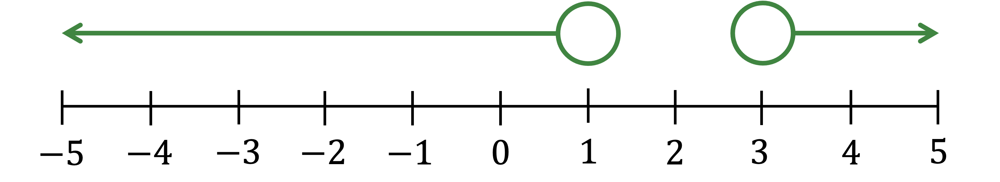

# Linear Equations & Inequalities

Course: cie-igcse-maths-25-extended · Section: Algebra & Sequences

Source: https://www.savemyexams.com/igcse/maths/cie/25/extended/flashcards/algebra-and-sequences/linear-equations-and-inequalities/

## Card 1 — question_and_answer (`fl_T8krnT3VCQtKpv8t`)

**FRONT**

What is the** greatest power** of $x$ in a **linear equation**?

**BACK**

The **greatest power of **$x$ in a linear equation is 1.

There is no term in *x*2 or any higher power.

## Card 2 — question_and_answer (`fl_frQgfScCjN9DKVdD`)

**FRONT**

What does '**isolate the variable**' mean?

**BACK**

**Isolate the variable** means to get the variable term, e.g. $x$, **by itself on one side of the equation**.

## Card 3 — keyword_definition (`fl_XtX3Mfz8M4ZvBp48`)

**FRONT**

What are **inverse operations**?

**BACK**

**Inverse operations** are the **opposite operations** to what has already happened to the variable.

E.g. In the expression $4x$, $x$ is being multiplied by 4. 
The inverse operation is to divide by 4.

Examples of inverse operations are:

- Add and subtract
- Multiply and divide
- Square and take the square root

## Card 4 — true_or_false (`fl_m37dHvCYMqXSD3GK`)

**FRONT**

**True or False?**

To solve a linear equation, e.g. $3x+4=13$, you need to **isolate the variable** by carrying out **inverse operations** to both sides.

**BACK**

**True.**

To **solve a linear equation**, you need to **isolate the variable**, (get the letter on its own), by carrying out **inverse operations** to both sides.

E.g.

`3 x plus 4 equals 13
table row cell negative 4 end cell cell space space space space space space space space space space space space space space space space space space space space minus 4 end cell end table
3 x equals 9
divided by 3 space space space space space space space space space space space space space space space space space space space space space divided by 3
x equals 3`

## Card 5 — question_and_answer (`fl_PvWqCB75hhwg3fnQ`)

**FRONT**

What is the **order of inverse operations** to solve a linear equation of the form $ax+b=c$ to find $x$.

**BACK**

To solve a linear equation of the form $ax+b=c$:

- First subtract $b$ from both sides
- Then divide both sides by $a$

## Card 6 — true_or_false (`fl_92r56JQSz9VmNWBC`)

**FRONT**

**True or False?**

If a linear equation contains the **unknown variable on** **both sides**, you should first **collect the variable terms on one side**.

E.g. $8x+7=2x+11$.

**BACK**

**True.**

If a linear equation contains the **unknown variable on both sides**, you should first** collect the variable terms on one side**.

E.g.

`table row cell 8 x plus 7 end cell equals cell 2 x plus 11 end cell row cell 6 x plus 7 end cell equals 11 end table`

## Card 7 — question_and_answer (`fl_WqmmzRrg65RPPwNq`)

**FRONT**

What is the **first step** to solve a **linear equation with brackets**?

E.g. `4 open parentheses x plus 6 close parentheses equals 32`.

**BACK**

The **first step** to solve a **linear equation with brackets** is to **expand the brackets** (on both sides if necessary).

E.g.

`table row cell 4 open parentheses x plus 6 close parentheses end cell equals 32 row cell 4 x plus 24 end cell equals 32 end table`

## Card 8 — question_and_answer (`fl_cDjq49KrGkJ5BmFz`)

**FRONT**

What is the **first step** to solve a **linear equation with fractions**?

E.g. $\frac{x+9}{2}=\frac{3x-1}{4}$.

**BACK**

The** first step** to solve a **linear equation with fractions** is to remove the fractions by **multiplying both sides by the denominators**.

E.g.

`table row cell fraction numerator x plus 9 over denominator 2 end fraction end cell equals cell fraction numerator 3 x minus 1 over denominator 4 end fraction end cell row cell 4 open parentheses x plus 9 close parentheses end cell equals cell 2 open parentheses 3 x minus 1 close parentheses end cell row blank blank blank end table`

## Card 9 — question_and_answer (`fl_nJHcfqCsBQqmncFr`)

**FRONT**

After** **solving a linear equation, how can you **check your answer** to see if it is correct?

**BACK**

After solving a linear equation, you should **substitute your answer** back into the equation to check if it is correct.

This is a quick way to spot if you have made any mistakes.

## Card 10 — keyword_definition (`fl_ndM9PFD6kwG42vqr`)

**FRONT**

Define the word** inequality **in algebra.

**BACK**

An **inequality **compares a left-hand side to a right-hand side and states which one is bigger, using the symbols $<,>,\leq,\geq$.

## Card 11 — keyword_definition (`fl_zDnW59fKdCpJY3PP`)

**FRONT**

Explain the meaning of the word** linear** in linear inequality.

**BACK**

The word** linear **in linear inequality means that the terms in the inequality are either constant numbers or terms in $x$, but not terms in $x^{2}$ or $x^{3}$ etc.

These are examples of linear inequalities:

- $x+2>5$
- $2x<x-1$

## Card 12 — true_or_false (`fl_S3D2WXDcqTZQbdYr`)

**FRONT**

**True or False?**

You can **add or subtract terms** to both sides of a **linear inequality** in exactly the **same way **as you do to a **linear equation**.

**BACK**

**True.**

You can **add or subtract terms** to both sides of a **linear inequality** in exactly the **same way** as you do to a** linear equation**.

## Card 13 — true_or_false (`fl_sTJv24PGWSGXqnTy`)

**FRONT**

**True or False?**

You can** multiply or divide **both sides of a** linear inequality** in exactly the **same way** as you do to a** linear equation**.

**BACK**

**False.**

You can **multiply or divide** both sides of a** linear inequality** in exactly the **same way** as you do to a **linear equation** as long as you **multiply or divide by positive numbers**.

If, however, you multiply or divide both sides by **negative numbers**, you have to **flip the direction **of the inequality sign.

E.g.  You can divide `table row cell 2 x end cell less than 4 end table` by 2 to get `table row x less than 2 end table`.
You can divide `table row cell negative 2 x end cell less than 4 end table` by -2, but you must flip the inequality to get `table row x greater than cell negative 2 end cell end table`.

## Card 14 — keyword_definition (`fl_xwrTqwZ2HRPbjHmv`)

**FRONT**

How do **number lines** highlight the difference between **strict** inequalities (such as $x<3$) and **non-strict** inequalities (such as $x\leq3$)?

**BACK**

Number lines show an **open circle** for strict inequalities, e.g. $x<3$, and a **closed circle** for non-strict inequalities, e.g. $x\leq3$.

## Card 15 — true_or_false (`fl_vjJrWvtq8wYDV68t`)

**FRONT**

**True or False?**

The number line representing " $x<1$ or $x>3$" consists of two separate arrows pointing outwards in opposite directions.

**BACK**

**True.**

The number line representing " $x<1$ or $x>3$" consists of two separate arrows pointing outwards in opposite directions.

## Card 16 — true_or_false (`fl_bgjn2myQvQb7skks`)

**FRONT**

**True or False?**

The diagram below shows the inequality $-4<x\leq2$.

**BACK**

**False.**

The number line in the diagram does** not **show the inequality $-4<x\leq2$.

It has two open circles which indicate the inequality $-4<x<2$.

## Card 17 — question_and_answer (`fl_7S73MdbTqcK9h7wq`)

**FRONT**

Explain how you would **solve an inequality **in the form $-10<ax+b<10$.

**BACK**

To solve an inequality in the form $-10<ax+b<10$,

1. Subtract $b$ from** all three parts**.
2. Then divide all three parts by $a$.

E.g. $-10<2x+6<10\,-16<2x<16\,-8<x<8$

An **alternative** method is to split into two different inequalities, $-10<2x+6$ and $2x+6<10$, then solve these individually.

