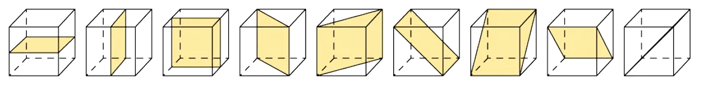
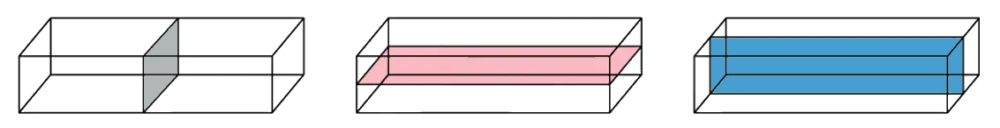

# Geometry Toolkit

Course: cie-igcse-maths-25-extended · Section: Geometry

Source: https://www.savemyexams.com/igcse/maths/cie/25/extended/flashcards/geometry/geometry-toolkit/

## Card 1 — keyword_definition (`fl_5nwwkTFSHfC98CYB`)

**FRONT**

What is **rotational symmetry**?

**BACK**

A shape is said to have rotational symmetry if, during a **360° rotation** about its centre, it **looks the same** as it did in its **original position**.

## Card 2 — keyword_definition (`fl_fBjRHfxCyKdBbZJv`)

**FRONT**

What is meant by the **order** **of rotational symmetry**?

**BACK**

The order of rotational symmetry refers to the **number of times** a shape **looks the same** as it is **rotated 360°** about its centre.

## Card 3 — true_or_false (`fl_tTnbTkWFVHcnBNGT`)

**FRONT**

**True or False?**

A shape can have **order 0** rotational symmetry.

**BACK**

**False. **

A shape can **never **have order 0 rotational symmetry.

A shape is said to have **no rotational symmetry **when the **order of rotational symmetry is 1**, i.e. it only looks like its original position when it has been rotated through the full 360°.

## Card 4 — question_and_answer (`fl_3PfPRyTCHG2CbRc7`)

**FRONT**

How can **tracing paper** be used to help work out the **order of rotational symmetry** of a shape?

**BACK**

You can use tracing paper to help you work out the order of symmetry for a particular shape by doing the following:

1. Sketch the shape onto the tracing paper.
2. Draw an arrow pointing upwards on the tracing paper.
3. Place your pencil in the centre of the shape and rotate the tracing paper until the arrow is pointing upwards again (360º).
4. Count how many times the shape on the tracing paper maps over the shape on the paper beneath exactly; this is the **order of rotational symmetry**.

## Card 5 — keyword_definition (`fl_WsDxrh7R7MGtGzMd`)

**FRONT**

What is **line symmetry**?

**BACK**

A shape is said to have line symmetry when one half of the shape is a **mirror image **of the other half.

## Card 6 — keyword_definition (`fl_rVsqq8GySJwvRvNH`)

**FRONT**

What is a **line of symmetry**?

**BACK**

A **line of symmetry** is a **line** across which a shape can be **folded or reflected** so that the two halves match exactly.

## Card 7 — true_or_false (`fl_RC9R4S4jJQNWTfBf`)

**FRONT**

**True or False?**

A** line of symmetry** is also known as a** line of reflection**.

**BACK**

**True.**

A **line of symmetry** is also known as a **line of reflection**.

It can also be called a **mirror line**.

## Card 8 — question_and_answer (`fl_x5h8TYnTQv7Yc4Bz`)

**FRONT**

How can **tracing paper **be used to help sketch the** reflection **of a shape?

**BACK**

You can use tracing paper to help you sketch the reflection of a shape:

1. Trace the shape and the line of symmetry on the tracing paper.
2. Flip the paper over the line of symmetry.
3. The traced image will now be in its reflected position.

## Card 9 — true_or_false (`fl_rPZqM2W5XRHqGcCb`)

**FRONT**

**True or False?**

The **circumference **of a** circle** is the perimeter of the circle.

**BACK**

**True.**

The **circumference of a circle** is the **perimeter** of the **circle**.

It is the length around the outside of the shape.

## Card 10 — question_and_answer (`fl_gWQdsN2jCTRYhstR`)

**FRONT**

What is the name for the **line of symmetry **of a **circle**?

**BACK**

A circle's **line of symmetry** is known as the **diameter**.

A **diameter **of a circle is a line that touches the circumference at either end and passes through the **centre** of the circle.

## Card 11 — question_and_answer (`fl_Cqrg2TZ9KzxmBg4p`)

**FRONT**

How many **sides** does a **decagon** have?

**BACK**

A **decagon** has **10 sides**.

## Card 12 — keyword_definition (`fl_mN3tcjq4DFDJQ4FF`)

**FRONT**

What are the defining **properties** of a **parallelogram**?

**BACK**

A** parallelogram** is a** quadrilateral **with:

- **two pairs **of **equal**, **opposite angles**,
- and **two pairs** of **opposite**, **parallel sides**.

(Each pair of opposite parallel sides are also of equal length.)

## Card 13 — keyword_definition (`fl_7fPQF9zt8sGW782C`)

**FRONT**

What are the defining** properties** of a **rhombus**?

**BACK**

A** rhombus **is a** quadrilateral **with:

- **two pairs** of **equal**, **opposite angles**,
- **two pairs** of **opposite**, **parallel sides**,
- and **four sides** of **equal length**.

## Card 14 — true_or_false (`fl_rGDYDtKPK6VVFBzK`)

**FRONT**

**True or False?**

The** diagonals** of a **rectangle bisect **each other at the **centre** of the rectangle.

**BACK**

**True. **

The **diagonals** of a **rectangle bisect **each other at the **centre** of the rectangle.

## Card 15 — keyword_definition (`fl_cD4G49YqwTCr2JRp`)

**FRONT**

What are the defining** properties** of a **trapezium**?

**BACK**

A **trapezium** is a **quadrilateral** with:

- **one pair **of **opposite**, **parallel sides** of **unequal** **length**.

## Card 16 — keyword_definition (`fl_35PxXMWkPFQp7xmt`)

**FRONT**

What are the defining **properties** of a** kite**?

**BACK**

A** kite** is a **quadrilateral** with:

- **one line** of** symmetry**,
- **one pair **of **equal angles opposite** the **main diagonal**,
- and **two pairs** of **equal**, **adjacent sides**.

## Card 17 — true_or_false (`fl_rKTF3cH9cHPcjJK9`)

**FRONT**

**True or False?**

The** diagonals **of a **rhombus bisect **each other at **right angles **(90°).

**BACK**

**True. **

The** diagonals** of a** rhombus bisect **each other at **right angles** (90°).

## Card 18 — true_or_false (`fl_HBGP3Mjj9xp8Hnwb`)

**FRONT**

**True or false?**

If a **trapezium** has a **line of symmetry** it is an **isosceles trapezium**.

**BACK**

**True.**

If a **trapezium** has a **line of symmetry** it is an **isosceles trapezium**.

## Card 19 — keyword_definition (`fl_Stdyv46xhKq6v79k`)

**FRONT**

What is a **vertex **on a 3D shape?

**BACK**

A **vertex** is a** corner** of a 3D shape.

E.g. a square-based pyramid has 5 vertices.

## Card 20 — keyword_definition (`fl_84WDYT7c6Db38z5N`)

**FRONT**

What is a **face** on a 3D shape?

**BACK**

A **face **is an** individual flat surface** of a 3D shape.

E.g. a cylinder has 2 circular faces (the two 'ends'), along with one curved surface.

## Card 21 — question_and_answer (`fl_STYTzTpj3VqfJBhr`)

**FRONT**

What is a **prism**?

**BACK**

A **prism **is a 3D shape with the **same cross-section** throughout.

E.g. a cuboid is a rectangular prism.

## Card 22 — true_or_false (`fl_ZnVWDMPddscbghWd`)

**FRONT**

**True or False?**

A **cuboid** has **six equal**, square faces.

**BACK**

**False. **

A **cuboid **has **six** **rectangular faces**. 
They consist of **three pairs **of equal rectangular faces.

A **cube** has** six equal**, square faces.

## Card 23 — question_and_answer (`fl_bnKS6C2Yd7gnD6ZP`)

**FRONT**

What does a **net** of a 3D shape represent?

**BACK**

A **net **of a 3D shape is a** 2D pattern** that could be folded to make that **3D shape**.

## Card 24 — question_and_answer (`fl_DPDM9tHGDRhnwH8x`)

**FRONT**

How many** edges **are there on a **square-based pyramid**?

**BACK**

There are **eight edges** on a **square-based pyramid**.

## Card 25 — true_or_false (`fl_g9G8WHBTQV4ngm4g`)

**FRONT**

**True or False?**

The **base** of a **tetrahedron **is a **square**.

**BACK**

**False. **

The **base **of a **tetrahedron** is a **triangle**.

## Card 26 — question_and_answer (`fl_kkQYGBKwpZr9HQWz`)

**FRONT**

What **shape** is the **cross-section** of a **cylinder**?

**BACK**

The **cross-section** of a **cylinder **is a **circle**.

## Card 27 — true_or_false (`fl_jbKM6R9BQ4CmVdN7`)

**FRONT**

**True or False? **

A **triangular prism** has **two equal triangular faces** and **three rectangular faces**.

**BACK**

**True.**

A **triangular prism** has **two equal triangular faces** and **three rectangular faces**.

## Card 28 — true_or_false (`fl_H6hmk2k947PkTFRq`)

**FRONT**

**True or False?**

A** cube** is a type of **prism**.

**BACK**

**True.**

A **cube** is a type of **prism** with a **square cross-section**.

## Card 29 — keyword_definition (`fl_JkzGxDSkSXJ9RTTm`)

**FRONT**

What is a **plane of symmetry** in a 3D shape?

**BACK**

A **plane of symmetry** in a 3D shape is a plane (flat 2D shape) that splits a 3D shape into **two** **congruent** (identical) halves that are **mirror images** of each other.

## Card 30 — question_and_answer (`fl_w8HWmgBQymM9SThQ`)

**FRONT**

How** **many **planes of symmetry** does a **cube** have?

**BACK**

A **cube** has **9 planes of symmetry**.

## Card 31 — question_and_answer (`fl_NcKK7RfngqTpt5y8`)

**FRONT**

How** **many **planes of symmetry** does a **cuboid** have?

**BACK**

A **cuboid** has **3 planes of symmetry**.

## Card 32 — question_and_answer (`fl_Tr8VMvTb5GHcFgzX`)

**FRONT**

How** **many **planes of symmetry** does a **square-based pyramid** have?

**BACK**

A **square-based pyramid **has **4 planes of symmetry**.

## Card 33 — true_or_false (`fl_cGTYvGrY8NFZJpJ9`)

**FRONT**

**True or False?**

A **cylinder** has** infinite** **rotational symmetry**.

**BACK**

**True.**

A **cylinder** has **infinite rotational symmetry** about the axis that runs through the centre point of both circular faces.

## Card 34 — true_or_false (`fl_VvjZVX6PGyJ2BGCp`)

**FRONT**

**True or false?**

To convert between two** metric **units of measure, you must multiply or divide by **powers of 10**.

**BACK**

**True.**

To convert between two **metric **units of measure, you must multiply or divide by **powers of 10**.

E.g. to convert from centimetres to metres, divide by 100.

## Card 35 — keyword_definition (`fl_zVYykz7wK2w58J24`)

**FRONT**

What is the **equation** used to convert **kilometres to metres**?

**BACK**

The equation used to convert** kilometres to metres** is:

$\mathrm{Metres}=\mathrm{Kilometres}\times1000$.

## Card 36 — question_and_answer (`fl_KwrHPRCPJYcR2kvS`)

**FRONT**

What is the **equation** used to convert **millilitres to litres**?

**BACK**

The equation used to convert** millilitres to litres** is:

$\mathrm{Litres}=\frac{\mathrm{Millilitres}}{1000}$.

## Card 37 — question_and_answer (`fl_FKGSs2Dy6skTZrn8`)

**FRONT**

What is the **equation** used to convert** kilograms to milligrams**?

**BACK**

The equation used to convert** kilograms to milligrams** is:

$\mathrm{Milligrams}=\mathrm{Kilograms}\times1,000,000$.

## Card 38 — question_and_answer (`fl_Bw3xD6QsD5ZzjZ4w`)

**FRONT**

What** type of quantity** is measured using **cubic** units?

**BACK**

**Cubic** units are units used to measure **volume**.

## Card 39 — true_or_false (`fl_rqD7NVntQW238r8k`)

**FRONT**

**True or False? **

To convert between **cubic** units, you must multiply or divide by the **normal unit conversion rate**.

**BACK**

**False.**

To convert between **cubic** units, you must multiply or divide by the** 'cubed' conversion rate**.

E.g. to convert from cm3 to m3 you must divide by 1003.

## Card 40 — question_and_answer (`fl_KjftX54W32MY8qQT`)

**FRONT**

What **type of units** are used to measure **area**?

**BACK**

**Square **units are used to measure **area**.

## Card 41 — true_or_false (`fl_PdrDnVCqxzcgHjX2`)

**FRONT**

**True or False?**

To convert between **square** units, you must multiply or divide by the** 'squared' conversion rate**.

**BACK**

**True.**

To convert between **square** units, you must multiply or divide by the** 'squared' conversion rate**.

E.g. to convert from km2 to m2 you must multiply by 10002.

