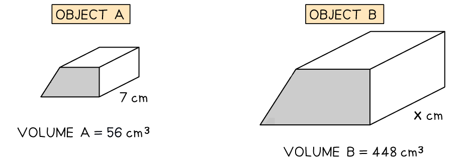
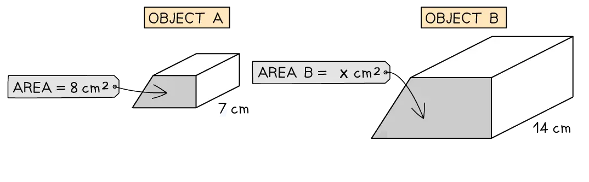

# Congruence & Similarity

Course: cie-igcse-maths-25-extended · Section: Lengths, Areas & Volumes

Source: https://www.savemyexams.com/igcse/maths/cie/25/extended/flashcards/lengths-areas-and-volumes/congruence-and-similarity/

## Card 1 — keyword_definition (`fl_vPWjjPTrWbsydcB4`)

**FRONT**

Define the term **congruent**.

**BACK**

Two shapes are **congruent** if they are** identical** in **shape** and** size**.

## Card 2 — true_or_false (`fl_Ygd9g8RPNRGfgWsT`)

**FRONT**

**True or False?**

If one shape is an **enlargement** of the other, then they are **congruent**.

**BACK**

**False.**

If one shape is an** enlargement** of the other, then they are **not identical** in **size** and so are** not congruent**.

## Card 3 — true_or_false (`fl_z7H57qxgQ3zNSd5p`)

**FRONT**

**True or False?**

You need to show that two shapes are** facing** in the** same direction** to prove **congruence**.

**BACK**

**False.**

If the two shapes are** identical** in terms of** shape** and **size** then it does not matter which direction they are facing in.

## Card 4 — keyword_definition (`fl_tQMwzc3BRWgxTPFC`)

**FRONT**

Define the term **similar shapes**.

**BACK**

Two shapes are **similar **if they have the **same shape** and their **corresponding sides **are in **proportion**.

One shape is an** enlargement** of the other.

## Card 5 — true_or_false (`fl_KYxdVvM7s8thDTqr`)

**FRONT**

**True or False?**

If **two triangles** of **different sizes** have the **same angles** they are **not similar**.

**BACK**

**False. **

If **two triangles **of **different sizes **have the **same angles** they **are similar**.

One is an **enlargement** of the other.

## Card 6 — true_or_false (`fl_FHw5SNKnzYpZFrjX`)

**FRONT**

**True or False?**

**Shapes** that are **not triangles** can have the **same angles **and **not be similar**.

**BACK**

**True. **

Some **shapes** that are** not triangles **can have the** same angles** and **not be similar**.

E.g. two rectangles of different sizes will have the same angles but their corresponding sides could  have different scale factors.

## Card 7 — true_or_false (`fl_jm2czYZGWhPPnQH5`)

**FRONT**

**True or False? **

To show that **two non-triangular shapes** are **similar **you need to show that their **corresponding sides** are in **proportion**.

**BACK**

**True. **

To show that **two non-triangular shapes** are **similar **you need to show that their **corresponding sides** are in **proportion**.

## Card 8 — keyword_definition (`fl_4Tk9hGYQxdgt2Fs7`)

**FRONT**

What is a **scale factor**, in the context of similarity?

**BACK**

A **scale factor** is the** ratio** of **corresponding lengths** in **similar shapes**.

## Card 9 — true_or_false (`fl_Rmx828gGWMqSTX4G`)

**FRONT**

**True or False?**

In the context of similarity, a **scale factor cannot** be **negative**.

**BACK**

**True.**

Although you can have a negative scale factor in general enlargement, in the context of **similarity**, a **scale factor cannot** be **negative**.

## Card 10 — question_and_answer (`fl_gQWSh66b8bJjSGcr`)

**FRONT**

What does a **scale factor** that is **greater than 0** but **less than 1** imply?

**BACK**

A **scale factor** that is **greater than 0** but **less than 1** implies that the similar shape is **smaller** than the original shape.

## Card 11 — question_and_answer (`fl_pRwcR9Z7ZDPZqwF4`)

**FRONT**

How can you find a **length scale factor**?

**BACK**

A **length scale factor** can be found by dividing the **length** **of a side** on one shape by the **length** **of a corresponding side** on the similar shape.

## Card 12 — question_and_answer (`fl_vwXy2gD5bBWGDn53`)

**FRONT**

What is the **relationship** between the** length scale factor **and the** area scale factor**?

**BACK**

The **area scale factor**, $k^{2}$, is the **square** of the** length scale factor **$k$.

## Card 13 — question_and_answer (`fl_2sXYDbS2wppbVyZv`)

**FRONT**

What is the **relationship** between the** length scale factor **and the** volume scale factor**?

**BACK**

The **volume scale factor**, $k^{3}$, is the **cube **of the** length scale factor **$k$.

## Card 14 — true_or_false (`fl_pmByC526rg7fDsDf`)

**FRONT**

**True or False?**

The **cube root** of the **volume** **scale factor** can be used to find an **unknown length**.

**BACK**

**True. **

The **cube root** of the **volume** **scale factor** is the **length scale factor**. This can be used to find an **unknown length**.

E.g. you can find length $x$ by finding the volume scale factor, $\frac{448}{56}=8$, taking its cube root, $\sqrt[3]{8} = 2$, and multiplying the result by the corresponding length on object A, $x=7\times2=14\mathrm{cm}$.

## Card 15 — question_and_answer (`fl_txDzqdK8rSDNx5rk`)

**FRONT**

How do you find the **area **of a** similar shape** from a** known area** using the **length scale factor**, $k$?

E.g. how can you find Area B in the diagram below?

**BACK**

To find the **area** of a **similar shape** from a **known area**, find the **length scale factor**, $k$, and **square** it to find the **area scale factor**, $k^{2}$. Then multiply the result by the area of the shape you know.

E.g. to find Area B, $\mathrm{length} \mathrm{scale} \mathrm{factor}=\frac{14}{7}=2$, so $\mathrm{area} \mathrm{scale} \mathrm{factor}=2^{2}=4$. 
Therefore, $\mathrm{Area}B=8\times4=32\mathrm{cm}^{2}$.

## Card 16 — true_or_false (`fl_WFXd2ykcZH5mmZWY`)

**FRONT**

**True or False? **

Multiplying the **cube root** of the **volume scale factor** by an **area** can be used to find a corresponding** area** on a **similar shape**.

**BACK**

**False.**

Multiplying the **cube root** of the **volume scale factor** by an **area** can **not** be used to find a corresponding** area** on a **similar shape**.

The cube root of the volume scale factor, is the **length scale factor**. This needs to be** squared **to find the **area scale factor**, which can then be used to find a corresponding area on a similar shape.

