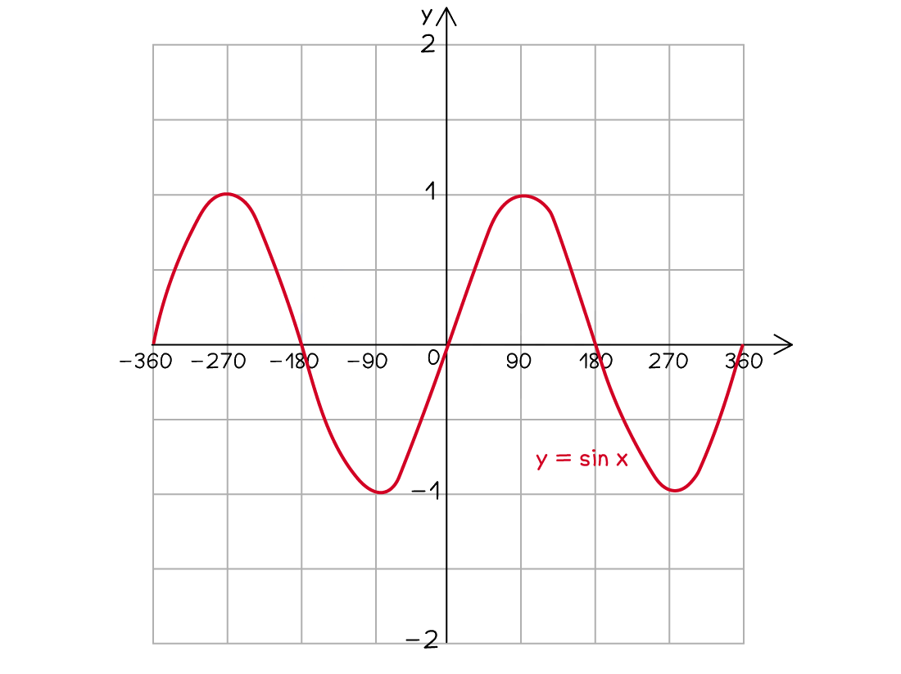
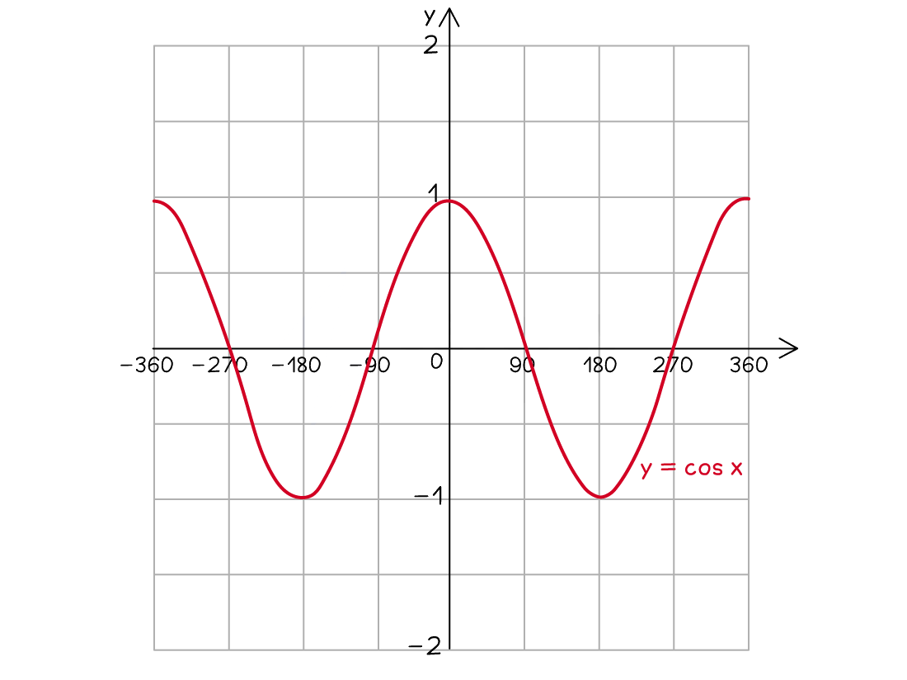
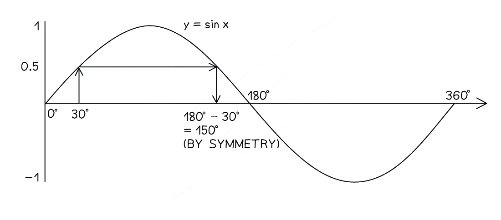
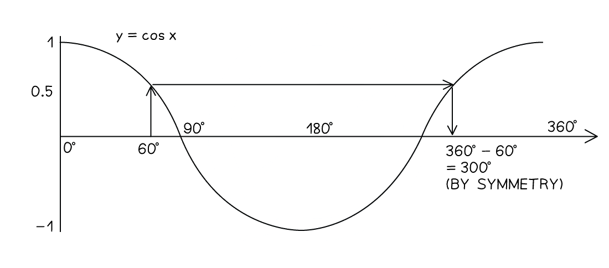

# Trigonometric Graphs & Equations

Course: cie-igcse-maths-25-extended · Section: Pythagoras & Trigonometry

Source: https://www.savemyexams.com/igcse/maths/cie/25/extended/flashcards/pythagoras-and-trigonometry/trigonometric-graphs-and-equations/

## Card 1 — keyword_definition (`fl_qPGxm7rxknJpr76g`)

**FRONT**

What is the** graph** of $y=\mathrm{sin}x$ for $-360^{\circ}\leqx\leq360^{\circ}$?

**BACK**

The** graph** of $y=\mathrm{sin}x$ for $-360^{\circ}\leqx\leq360^{\circ}$ is:

## Card 2 — keyword_definition (`fl_j98DHFQ4QG3WWXqZ`)

**FRONT**

What is the** graph** of $y=\mathrm{cos}x$ for  $-360^{\circ}\leqx\leq360^{\circ}$?

**BACK**

The** graph** of $y=\mathrm{cos}x$ for  $-360^{\circ}\leqx\leq360^{\circ}$ is:

## Card 3 — keyword_definition (`fl_RSdB4TShSVc3R5Dc`)

**FRONT**

What is the** graph** of $y=\mathrm{tan}x$ for  $-360^{\circ}\leqx\leq360^{\circ}$?

**BACK**

The** graph** of $y=\mathrm{tan}x$ for  $-360^{\circ}\leqx\leq360^{\circ}$ is:

## Card 4 — true_or_false (`fl_jwpGHMmSrcZWfvWt`)

**FRONT**

**True or False?**

The point $( 0 , 0 )$ lies on the graph $y=\mathrm{sin}x$.

**BACK**

**True.**

The point $( 0 , 0 )$ lies on the graph $y=\mathrm{sin}x$.

## Card 5 — question_and_answer (`fl_mrbpv4Cc4jJQnQNX`)

**FRONT**

What is the ***y*****-intercept** of the graph $y=\mathrm{cos}x$?

**BACK**

The ***y*****-intercept** of the graph $y=\mathrm{cos}x$ is $( 0 , 1 )$.

## Card 6 — question_and_answer (`fl_nyMmhyGHYhKrHPxK`)

**FRONT**

What is the **minimum *****y***** value** of the graph $y=\mathrm{sin}x$?

**BACK**

The **minimum y value** of the graph $y=\mathrm{sin}x$ is **-1**.

## Card 7 — true_or_false (`fl_BGCXcT73bgv2KQyp`)

**FRONT**

**True or False?**

The graph $y=\mathrm{cos}x$ **repeats itself every 180°**.

**BACK**

**False.**

The graph $y=\mathrm{cos}x$ does **not repeat itself every 180°**.

It repeats itself every **360°**.

## Card 8 — true_or_false (`fl_cJbZRRz2kHjTqhFc`)

**FRONT**

**True or False?**

The graph $y=\mathrm{tan}x$ **repeats itself every 180°**.

**BACK**

**True.**

The graph $y=\mathrm{tan}x$ **repeats itself every 180°**.

## Card 9 — question_and_answer (`fl_d6jwygJGwfQJX5Fp`)

**FRONT**

The graph $y=\mathrm{sin}x$ **repeats itself** every how many degrees?

**BACK**

The graph $y=\mathrm{sin}x$ **repeats itself** every 360°.

## Card 10 — true_or_false (`fl_2m2PS8zfpxwRHKP4`)

**FRONT**

**True or False?**

The **maximum *****y***** value** on the graph $y=\mathrm{tan}x$ is **1**.

**BACK**

**False.**

The **maximum *****y***** value** on the graph $y=\mathrm{tan}x$ is **not 1**.

The graph $y=\mathrm{tan}x$ does not have a maximum value.

## Card 11 — question_and_answer (`fl_tcKyxx5GjWn9pCyX`)

**FRONT**

How would you use a graph of $y=\mathrm{sin}x$ to find the **solutions** of $\mathrm{sin}x=0.5$ for $0^{\circ}\leqx\leq360^{\circ}$?

**BACK**

To find the **solutions** of $\mathrm{sin}x=0.5$ for $0^{\circ}\leqx\leq360^{\circ}$ using the graph $y=\mathrm{sin}x$:

- calculate one solution using inverse trig $x = \sin ^{- 1} ( 0.5 )$
- draw the horizontal line $y=0.5$
- use the symmetry of the graph to find the other solution

## Card 12 — true_or_false (`fl_KZBTtFqxZqkY3D7z`)

**FRONT**

**True or False?**

After finding the **first solution** for an equation involving the **cosine** function, you can find **another solution **by **subtracting** the first solution from** 180º**.

**BACK**

**False.**

After finding the **first solution** for an equation involving the **cosine** function, you can find **another solution **by **subtracting the first solution from 360º**.

## Card 13 — question_and_answer (`fl_3pwJGbpvphT2mxJ3`)

**FRONT**

What **angle **should you** add** to or** subtract **from a **first solution** to find **another solution** for an equation involving the **tangent **function?

**BACK**

If you know a** first solution **for an equation involving the **tangent **function, you can **add** to or** subtract **180º from it to find **another solution** .

