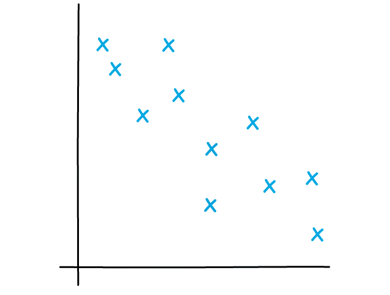

# Scatter Graphs & Correlation

Course: cie-igcse-maths-25-extended · Section: Statistics

Source: https://www.savemyexams.com/igcse/maths/cie/25/extended/flashcards/statistics/scatter-graphs-and-correlation/

## Card 1 — true_or_false (`fl_PQFSgr96cR2kgn5s`)

**FRONT**

**True or False?**

A **scatter diagram** is used to identify whether there is a **relationship **between** two different quantities** (variables).

**BACK**

**True.**

A **scatter diagram** is used to identify whether there is a **relationship **between** two different quantities** (variables).

## Card 2 — question_and_answer (`fl_4pBn42GJs9hRFTVD`)

**FRONT**

What **type** of **correlation** is shown in the diagram below?

**BACK**

The **type ** of **correlation** shown is **negative correlation**.

The data points follow a general trend from the top left of the graph to the bottom right.

## Card 3 — true_or_false (`fl_spm64CYthBrbxQxV`)

**FRONT**

**True or False?**

The data points in a **strong** correlation **loosely** follow a **straight line**.

**BACK**

**False.**

The data points in a **strong** correlation **closely** follow a **straight line**.

If the points only follow a straight line loosely, then they show a weak correlation.

## Card 4 — question_and_answer (`fl_8jVKVH4W6rd6ZHYH`)

**FRONT**

Describe the** relationship** between quantity A and quantity B if they are **positively correlated.**

**BACK**

Because the quantities A and B are **positively correlated**, if quantity A **increases**, then quantity B will also **increase**.

E.g. the number of ice creams sold by a café is positively correlated with the air temperature. As the air temperature increases, so does the number of ice creams sold by the café.

## Card 5 — question_and_answer (`fl_N2j49fvnJnH4XWvd`)

**FRONT**

What does the phrase "**correlation does not imply causation**" mean?

**BACK**

The phrase "**correlation does not imply causation**" means that **although a correlation may be noticed** between two different quantities, it does **not** necessarily mean that **a change in one quantity causes the other to change**.

E.g. the number of ice creams sold by a cafe and the number of bottles of suncream sold by a shop may be positively correlated.

More ice creams being sold does** not cause **more bottles of sun cream to be sold, but both quantities may increase because of a third related variable, such as as an increase in the number of hours of sunshine.

## Card 6 — true_or_false (`fl_54hTsw3Y2T7JT5qV`)

**FRONT**

**True or False?**

A line of best fit must go through **every point** in the data set.

**BACK**

**False.**

A **line of best fit** does not have to go through **every point** in the data set, nor does it have to go through any specific points.

The line must follow the general trend of the points and it should have roughly the same number of data points on each side of it.

## Card 7 — question_and_answer (`fl_xzdzhycKsg4jpWMK`)

**FRONT**

How can you use a **line of best fit** to **predict **a value?

**BACK**

You can use a line of best fit to predict values that lie **within the region **covered by the data points:

1. Draw a vertical line from the known value on the *x*-axis to the line of best fit.
2. From this point draw a horizontal line back to the *y*-axis.
3. Read off the value from the *y*-axis.

E.g. to estimate the value of *y* when *x* = 7, draw a line up from 7 on the *x*-axis until it meets the line of best fit, then draw a horizontal line back to the *y*-axis and read off the value.

## Card 8 — keyword_definition (`fl_bpMGN7V6RPhfQ7bz`)

**FRONT**

What is **interpolation**?

**BACK**

**Interpolation** is the method of predicting values that lie **within the region **covered by the data points.

You can use your line of best fit to do this.

## Card 9 — true_or_false (`fl_k9VfR4c2CZysv539`)

**FRONT**

**True or False?**

A **line of best fit** can be used to **predict** values that lie **outside** of the original data set.

**BACK**

**False.**

A **line of best fit** should **not** be used to **predict** values that lie **outside** of the original data set.

This is called **extrapolation** and values predicted in this way may be **unreliable**.

## Card 10 — question_and_answer (`fl_J29GFFQwhVv4mm83`)

**FRONT**

When drawing a **line of best fit**, what should you do with an **extreme value** that does **not** **fit** the **general trend** of the rest of the points in the data set?

**BACK**

When drawing a **line of best fit**, you should **ignore** any **extreme values** that do **not** **fit** the **general trend** of the rest of the points.

