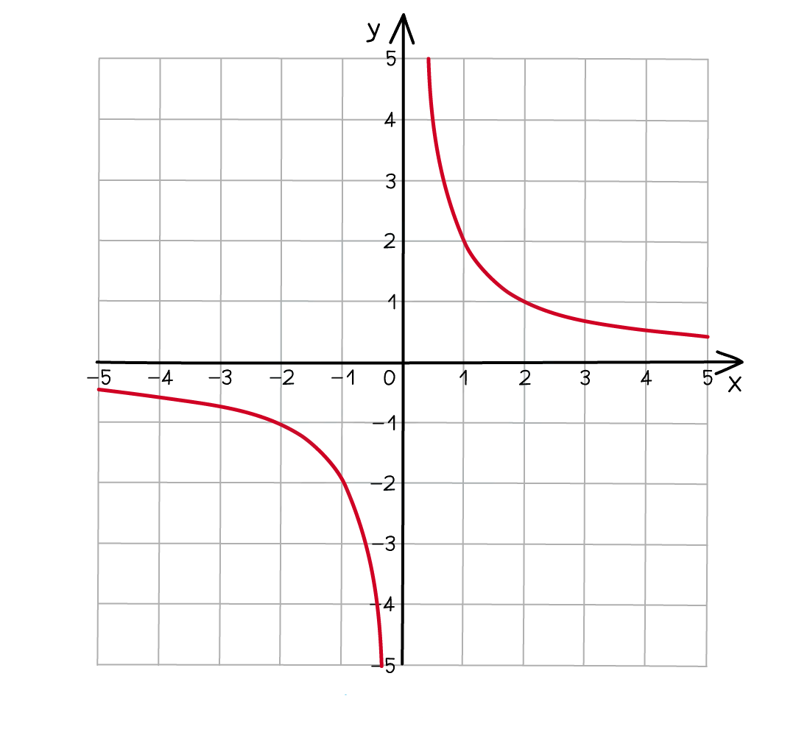

# Proportion

Course: cie-igcse-maths-international-maths-23-extended · Section: Algebra & Sequences

Source: https://www.savemyexams.com/igcse/maths/cie/international-maths/23/extended/flashcards/algebra-and-sequences/proportion/

## Card 1 — keyword_definition (`fl_x6YKCTtPJ2W6BGdY`)

**FRONT**

What is **direct proportion**?

**BACK**

**Direct proportion** means that as **one variable goes up** the **other goes up** by the **same factor**.

## Card 2 — true_or_false (`fl_ddkbBPndtCvY9SGC`)

**FRONT**

**True or False?**

If $x$ and $y$ are **directly proportional**, then $x:y$ will always be the **same**.

**BACK**

**True.**

If $x$ and $y$ are **directly proportional**, then $x:y$ will always be the **same**.

## Card 3 — question_and_answer (`fl_nc8MDYwtXMrrCNQF`)

**FRONT**

What is $k$ used to **represent** when working with **direct proportion**?

**BACK**

When working with direct proportion, $k$ is used to represent the **constant of proportionality** that connects $x$ and $y$.

$y=kx$ when $x$ and $y$ are directly proportional.

## Card 4 — question_and_answer (`fl_BRvK2f3hxv28yc9m`)

**FRONT**

What does it mean for $y$ to be **directly proportional** to the **square **of $x$?

**BACK**

If $y$ is **directly proportional** to the **square** of $x$, it means that $y=kx^{2}$.

## Card 5 — true_or_false (`fl_dyJhwYq4bSmvzB8t`)

**FRONT**

**True or False?**

The **graph** of two** directly proportional **variables is a **straight line**.

**BACK**

**True.**

The **graph** of two **directly proportional **variables is a **straight line**.

## Card 6 — true_or_false (`fl_nPdXYbq2Gf4PG8S4`)

**FRONT**

**True or false?**

When solving a direct proportion problem, one of the **first things **you should do is **find the value of the constant of proportionality** $k$.

**BACK**

**True.**

When solving a direct proportion problem, one of the **first things** you should do is **find the value of the constant of proportionality** $k$.

## Card 7 — keyword_definition (`fl_frMcG9HRSCpts9Qp`)

**FRONT**

What is **inverse proportion**?

**BACK**

**Inverse proportion** means as **one variable goes up** the **other goes down **by the **same factor**.

## Card 8 — question_and_answer (`fl_B6fKZtvSZSg8yN2s`)

**FRONT**

What is $k$ used to represent when working with **inverse proportion**?

**BACK**

When working with inverse proportion, $k$ is used to represent the **constant of proportionality** that connects $x$ and $y$.

$y=\frac{k}{x}$ when $x$ and $y$ are** inversely proportional**.

## Card 9 — true_or_false (`fl_6PHHfsSRbKzRZGtf`)

**FRONT**

**True or False?**

If $x$ is **inversely proportional** to $y$, then $x:y$ will always be the **same**.

**BACK**

**False.**

If $x$ is** inversely proportional** to $y$, then $x:\frac{1}{y}$ will always be the **same**.

## Card 10 — question_and_answer (`fl_c9PvFZ57HnHgyxKk`)

**FRONT**

How would you describe the **relationship** between $A$and $B$ if $A=\frac{k}{B}$?

**BACK**

If $A=\frac{k}{B}$, it means that $A$ is** inversely proportional **to $B$.

## Card 11 — question_and_answer (`fl_kdZnKbkNDQDq8JP2`)

**FRONT**

What is the **equation** for $A$ in terms of $B$ if $A$ is **inversely proportional** to the **square** of $B$?

**BACK**

If $A$ is **inversely proportional** to the **square** of $B$, then $A=\frac{k}{B^{2}}$.

## Card 12 — true_or_false (`fl_wFMtGJ34BpY6kkny`)

**FRONT**

**True or False?**

The **graph** of two** inversely proportional **variables is a **straight line**.

**BACK**

**False.**

The **graph **of two** inversely proportional** variables is a **not a straight line**.

## Card 13 — question_and_answer (`fl_Cg5Y8NW32457dChK`)

**FRONT**

What is the** formula** for $y$ in terms of $x$ if $y$ is **inversely proportional** to the **cube root** of $x$?

**BACK**

If $y$ is** inversely proportiona**l to the **cube root** of $x$, then `y equals fraction numerator k over denominator cube root of x end fraction`.

Using laws of indices that can also be written as $y=\frac{k}{x^{\frac{1}{3}}}$ or $y=kx^{-\frac{1}{3}}$.

## Card 14 — fill_in_the_blanks (`fl_yrjJtBSfr9dKz8kr`)

**FRONT**

Complete the names of the variation models.

A model of the form $y = k x$ is called **linear**, one of the form $y = k x^{2}$ is called `\_\_\_\_\_\_` and one of the form $y = k x^{3}$ is called `\_\_\_\_\_\_` as well.

**BACK**

The completed sentence is:

A model of the form $y = k x$ is called **linear**, one of the form $y = k x^{2}$ is called **quadratic** and one of the form $y = k x^{3}$ is called **cubic** as well.

Each name comes from the **power of *****x*** in the equation.

*Blanks: 0 — answers: []*

Spec links: `spcpt_Vy3hcHd5KHJCvYNJ`

Flags: fitb_no_blank_marker

## Card 15 — question_and_answer (`fl_WM9BJYgZx5rK22wF`)

**FRONT**

How do you test whether a suggested variation model fits a table of data?

**BACK**

Substitute each ***x*** value from the table into the model and compare the ***y*** value it predicts with the actual one.

Do this for **at least three** data points before deciding whether the model is a good fit.

Spec links: `spcpt_Vy3hcHd5KHJCvYNJ`

## Card 16 — true_or_false (`fl_PfpxyJzwMvkJyR74`)

**FRONT**

**True or False?**

If a variation model fits **one** data point, it is a good model for the data.

**BACK**

**False.**

You can always choose ***k*** to make a model of any type pass exactly through a single point, so one point rules nothing out.

It is the **second and third** points that show whether the shape of the model is right.

Spec links: `spcpt_Vy3hcHd5KHJCvYNJ`

## Card 17 — question_and_answer (`fl_pq2qmyTGqkxh2XqY`)

**FRONT**

A model is known to be quadratic, and the data includes the point where ***x*** is 2 and ***y*** is 20. What is its equation?

**BACK**

Substitute into $y = k x^{2}$ to get $20 = k \times 2^{2}$ which gives $k = 5$ for this data.

The full equation of the model is therefore $y = 5 x^{2}$ throughout.

Spec links: `spcpt_Vy3hcHd5KHJCvYNJ`

## Card 18 — question_and_answer (`fl_hXtrcN7KZSr7M8yj`)

**FRONT**

For data $x = 2 , 4 , 6$ with $y = 20 , 80 , 180$ in order, is a linear model suitable?

**BACK**

No, because a linear model $y = k x$ fitted to the first point gives $k = 10$ as its constant.

That model predicts $10 \times 4 = 40$ at $x = 4$ where the data says 80, so the linear shape is wrong.

Spec links: `spcpt_Vy3hcHd5KHJCvYNJ`

## Card 19 — question_and_answer (`fl_wYYFKwHPGx2B4MzH`)

**FRONT**

Two different variation models are suggested for the same data. How do you decide which is more suitable?

**BACK**

Work out what each model predicts at every ***x*** value in the table, and set both sets of predictions beside the actual values.

Neither model has to fit perfectly: the more suitable one is simply the one whose predictions stay **consistently closer** to the real data.

Spec links: `spcpt_Vy3hcHd5KHJCvYNJ`

## Card 20 — question_and_answer (`fl_8NP2TfD5WYXny2YB`)

**FRONT**

How can a rough graph of the data help you choose a variation model?

**BACK**

The **shape** of the plotted points suggests which family to try, so a **U shaped** curve points towards a quadratic model.

A graphic display calculator will plot the points for you, and you then test that suggested model against the numbers.

Spec links: `spcpt_Vy3hcHd5KHJCvYNJ`

