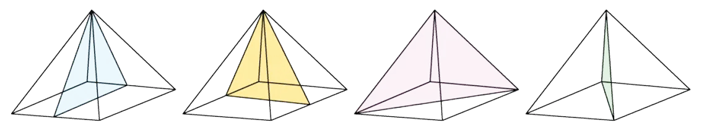

# Symmetry & Shapes

Course: cie-igcse-maths-international-maths-23-extended · Section: Geometry

Source: https://www.savemyexams.com/igcse/maths/cie/international-maths/23/extended/flashcards/geometry/symmetry-and-shapes/

## Card 1 — keyword_definition (`fl_5nwwkTFSHfC98CYB`)

**FRONT**

What is **rotational symmetry**?

**BACK**

A shape is said to have rotational symmetry if, during a **360° rotation** about its centre, it **looks the same** as it did in its **original position**.

## Card 2 — keyword_definition (`fl_fBjRHfxCyKdBbZJv`)

**FRONT**

What is meant by the **order** **of rotational symmetry**?

**BACK**

The order of rotational symmetry refers to the **number of times** a shape **looks the same** as it is **rotated 360°** about its centre.

## Card 3 — true_or_false (`fl_tTnbTkWFVHcnBNGT`)

**FRONT**

**True or False?**

A shape can have **order 0** rotational symmetry.

**BACK**

**False. **

A shape can **never **have order 0 rotational symmetry.

A shape is said to have **no rotational symmetry **when the **order of rotational symmetry is 1**, i.e. it only looks like its original position when it has been rotated through the full 360°.

## Card 4 — question_and_answer (`fl_3PfPRyTCHG2CbRc7`)

**FRONT**

How can **tracing paper** be used to help work out the **order of rotational symmetry** of a shape?

**BACK**

You can use tracing paper to help you work out the order of symmetry for a particular shape by doing the following:

1. Sketch the shape onto the tracing paper.
2. Draw an arrow pointing upwards on the tracing paper.
3. Place your pencil in the centre of the shape and rotate the tracing paper until the arrow is pointing upwards again (360º).
4. Count how many times the shape on the tracing paper maps over the shape on the paper beneath exactly; this is the **order of rotational symmetry**.

## Card 5 — keyword_definition (`fl_WsDxrh7R7MGtGzMd`)

**FRONT**

What is **line symmetry**?

**BACK**

A shape is said to have line symmetry when one half of the shape is a **mirror image **of the other half.

## Card 6 — keyword_definition (`fl_rVsqq8GySJwvRvNH`)

**FRONT**

What is a **line of symmetry**?

**BACK**

A **line of symmetry** is a **line** across which a shape can be **folded or reflected** so that the two halves match exactly.

## Card 7 — true_or_false (`fl_RC9R4S4jJQNWTfBf`)

**FRONT**

**True or False?**

A** line of symmetry** is also known as a** line of reflection**.

**BACK**

**True.**

A **line of symmetry** is also known as a **line of reflection**.

It can also be called a **mirror line**.

## Card 8 — question_and_answer (`fl_x5h8TYnTQv7Yc4Bz`)

**FRONT**

How can **tracing paper **be used to help sketch the** reflection **of a shape?

**BACK**

You can use tracing paper to help you sketch the reflection of a shape:

1. Trace the shape and the line of symmetry on the tracing paper.
2. Flip the paper over the line of symmetry.
3. The traced image will now be in its reflected position.

## Card 9 — true_or_false (`fl_rPZqM2W5XRHqGcCb`)

**FRONT**

**True or False?**

The **circumference **of a** circle** is the perimeter of the circle.

**BACK**

**True.**

The **circumference of a circle** is the **perimeter** of the **circle**.

It is the length around the outside of the shape.

## Card 10 — question_and_answer (`fl_gWQdsN2jCTRYhstR`)

**FRONT**

What is the name for the **line of symmetry **of a **circle**?

**BACK**

A circle's **line of symmetry** is known as the **diameter**.

A **diameter **of a circle is a line that touches the circumference at either end and passes through the **centre** of the circle.

## Card 11 — question_and_answer (`fl_Cqrg2TZ9KzxmBg4p`)

**FRONT**

How many **sides** does a **decagon** have?

**BACK**

A **decagon** has **10 sides**.

## Card 12 — keyword_definition (`fl_mN3tcjq4DFDJQ4FF`)

**FRONT**

What are the defining **properties** of a **parallelogram**?

**BACK**

A** parallelogram** is a** quadrilateral **with:

- **two pairs **of **equal**, **opposite angles**,
- and **two pairs** of **opposite**, **parallel sides**.

(Each pair of opposite parallel sides are also of equal length.)

## Card 13 — keyword_definition (`fl_7fPQF9zt8sGW782C`)

**FRONT**

What are the defining** properties** of a **rhombus**?

**BACK**

A** rhombus **is a** quadrilateral **with:

- **two pairs** of **equal**, **opposite angles**,
- **two pairs** of **opposite**, **parallel sides**,
- and **four sides** of **equal length**.

## Card 14 — true_or_false (`fl_rGDYDtKPK6VVFBzK`)

**FRONT**

**True or False?**

The** diagonals** of a **rectangle bisect **each other at the **centre** of the rectangle.

**BACK**

**True. **

The **diagonals** of a **rectangle bisect **each other at the **centre** of the rectangle.

## Card 15 — keyword_definition (`fl_cD4G49YqwTCr2JRp`)

**FRONT**

What are the defining** properties** of a **trapezium**?

**BACK**

A **trapezium** is a **quadrilateral** with:

- **one pair **of **opposite**, **parallel sides** of **unequal** **length**.

## Card 16 — keyword_definition (`fl_35PxXMWkPFQp7xmt`)

**FRONT**

What are the defining **properties** of a** kite**?

**BACK**

A** kite** is a **quadrilateral** with:

- **one line** of** symmetry**,
- **one pair **of **equal angles opposite** the **main diagonal**,
- and **two pairs** of **equal**, **adjacent sides**.

## Card 17 — true_or_false (`fl_rKTF3cH9cHPcjJK9`)

**FRONT**

**True or False?**

The** diagonals **of a **rhombus bisect **each other at **right angles **(90°).

**BACK**

**True. **

The** diagonals** of a** rhombus bisect **each other at **right angles** (90°).

## Card 18 — true_or_false (`fl_HBGP3Mjj9xp8Hnwb`)

**FRONT**

**True or false?**

If a **trapezium** has a **line of symmetry** it is an **isosceles trapezium**.

**BACK**

**True.**

If a **trapezium** has a **line of symmetry** it is an **isosceles trapezium**.

## Card 19 — keyword_definition (`fl_5qKhvtXNdjQytTGX`)

**FRONT**

Define a **prism**.

**BACK**

A **prism** is a solid with a **uniform cross-section**, meaning the cross-section is the **same shape and size** all the way through.

The cross-section does not have to be a polygon, so a **cylinder** is a prism with a **circular** cross-section.

Spec links: `spcpt_Xqkq2qz7NzMcVZHQ`

## Card 20 — fill_in_the_blanks (`fl_9qqHqgpWcDt8fcXB`)

**FRONT**

Fill in the three missing words:

A `\_\_\_\_\_\_` is a single surface of a 3D shape, an `\_\_\_\_\_\_` joins one corner to the next, and a `\_\_\_\_\_\_` is a corner itself.

**BACK**

The completed sentence is:

A **face** is a single surface of a 3D shape, an **edge** joins one corner to the next, and a **vertex** is a corner itself.

The plural of vertex is **vertices**.

*Blanks: 0 — answers: []*

Spec links: `spcpt_Xqkq2qz7NzMcVZHQ`

Flags: fitb_no_blank_marker

## Card 21 — question_and_answer (`fl_79vTNFf4wqX3tJ4P`)

**FRONT**

How many **faces**, **edges** and **vertices** does a **cube** have?

**BACK**

A cube has **6 faces**, **12 edges** and **8 vertices**.

A **cuboid** has exactly the same numbers, because it is a cube that has been stretched along one or more directions.

Spec links: `spcpt_Xqkq2qz7NzMcVZHQ`

## Card 22 — true_or_false (`fl_9CjmNKpDp2f52jH9`)

**FRONT**

**True or False?**

The three **rectangular faces** of a **triangular prism** are always identical.

**BACK**

**False.**

They are identical only when the triangular cross-section is **equilateral**.

If the triangle is **isosceles** only **two** of the rectangles are equal, and if it is **scalene** all three are different.

Spec links: `spcpt_Xqkq2qz7NzMcVZHQ`

## Card 23 — question_and_answer (`fl_DD4xKbkHZS2VfGGB`)

**FRONT**

How many **faces**, **edges** and **vertices** does a **triangular prism** have?

**BACK**

A triangular prism has **5 faces**, **9 edges** and **6 vertices**.

The 9 edges are the **3 sides of each triangle**, plus the **3 edges joining** the two triangles together.

Spec links: `spcpt_Xqkq2qz7NzMcVZHQ`

## Card 24 — keyword_definition (`fl_4pK4hJGkTvB6bVQt`)

**FRONT**

Define a **pyramid**.

**BACK**

A **pyramid** is a solid with a **flat base** and **sloping triangular sides** that all meet at a single point, called the **apex**.

The base can be a **square**, a **rectangle** or a **triangle**.

Spec links: `spcpt_Xqkq2qz7NzMcVZHQ`

## Card 25 — true_or_false (`fl_r3FbZpny6tMqKHZZ`)

**FRONT**

**True or False?**

A **tetrahedron** has the same number of **faces** as it has **vertices**.

**BACK**

**True.**

A tetrahedron has **4 faces** and **4 vertices**, as well as 6 edges.

It is a **triangular-based pyramid**, so the base is a triangle too and every one of its four faces is a triangle.

Spec links: `spcpt_Xqkq2qz7NzMcVZHQ`

## Card 26 — question_and_answer (`fl_BvPhQxyMH9GnsSjm`)

**FRONT**

What shape is the **base** of a **cone**, and what shape is the **cross-section** of a **cylinder**?

**BACK**

A cone has a **circular base**, and a cylinder has a **circular cross-section** all the way through.

A cone **narrows to a point**, so its cross-section gets smaller as you move up and is **not** uniform.

Spec links: `spcpt_Xqkq2qz7NzMcVZHQ`

## Card 27 — true_or_false (`fl_SgyhpwXWvHd4pJ69`)

**FRONT**

**True or False?**

A **cylinder** has **no vertices**.

**BACK**

**True.**

A cylinder has **0 vertices**, because its two circular edges are **curves** that never meet at a corner.

It does still have **2 edges**, one around each circular face.

Spec links: `spcpt_Xqkq2qz7NzMcVZHQ`

## Card 28 — keyword_definition (`fl_JkzGxDSkSXJ9RTTm`)

**FRONT**

What is a **plane of symmetry** in a 3D shape?

**BACK**

A **plane of symmetry** in a 3D shape is a plane (flat 2D shape) that splits a 3D shape into **two** **congruent** (identical) halves that are **mirror images** of each other.

## Card 29 — question_and_answer (`fl_w8HWmgBQymM9SThQ`)

**FRONT**

How** **many **planes of symmetry** does a **cube** have?

**BACK**

A **cube** has **9 planes of symmetry**.

## Card 30 — question_and_answer (`fl_NcKK7RfngqTpt5y8`)

**FRONT**

How** **many **planes of symmetry** does a **cuboid** have?

**BACK**

A **cuboid** has **3 planes of symmetry**.

## Card 31 — question_and_answer (`fl_Tr8VMvTb5GHcFgzX`)

**FRONT**

How** **many **planes of symmetry** does a **square-based pyramid** have?

**BACK**

A **square-based pyramid **has **4 planes of symmetry**.

## Card 32 — true_or_false (`fl_cGTYvGrY8NFZJpJ9`)

**FRONT**

**True or False?**

A **cylinder** has** infinite** **rotational symmetry**.

**BACK**

**True.**

A **cylinder** has **infinite rotational symmetry** about the axis that runs through the centre point of both circular faces.

