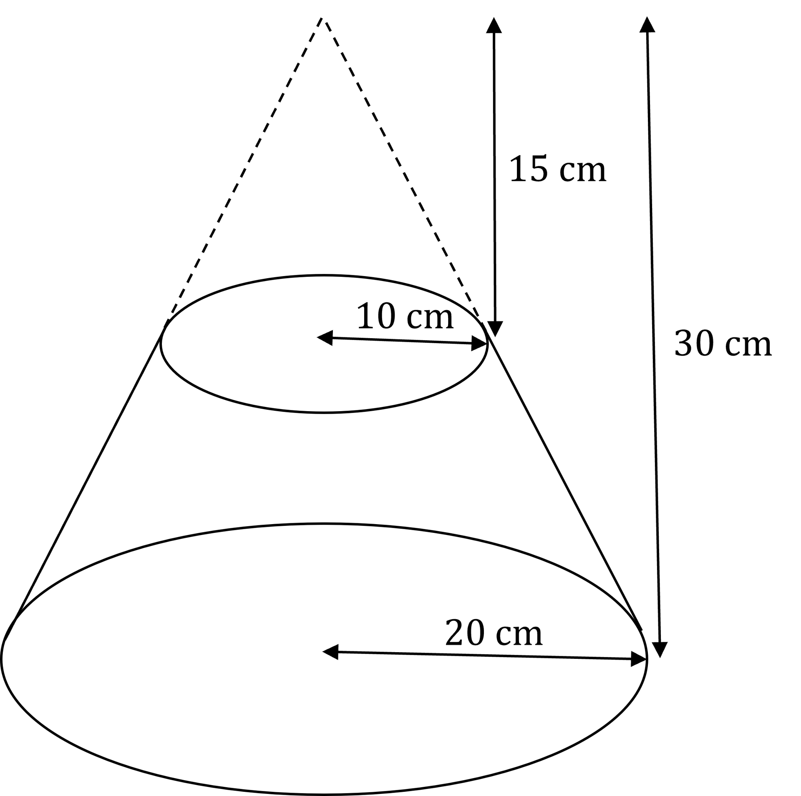

# Volume & Surface Area

Course: cie-igcse-maths-international-maths-23-extended · Section: Lengths, Areas & Volumes

Source: https://www.savemyexams.com/igcse/maths/cie/international-maths/23/extended/flashcards/lengths-areas-and-volumes/volume-and-surface-area/

## Card 1 — question_and_answer (`fl_9YcvRjtjkbs4y8QS`)

**FRONT**

What is the** formula **for the **volume of a cuboid**?

**BACK**

The **formula **for the** volume of a cuboid** is $V=l\timesw\timesh$

Where:

- $V=$volume
- $l=$length
- $w=$width
- $h=$height

## Card 2 — question_and_answer (`fl_X5xFDpFGbgZ2xxRv`)

**FRONT**

What is the **formula** for the **volume of a cylinder**?

**BACK**

The **formula **for the **volume of a cylinder** is $V=πr^{2}h$

Where:

- $V=$volume
- $r=$radius
- $h=$height

## Card 3 — question_and_answer (`fl_qDhqfzM2Mt5RjJkz`)

**FRONT**

What is the **formula **for the **volume of a cone**?

**BACK**

The **formula **for the **volume of a cone** is $V=\frac{1}{3}πr^{2}h$

Where:

- $V=$volume
- $r=$radius
- $h=$perpendicular height

## Card 4 — question_and_answer (`fl_8tsFJ7fC6cqdBbDT`)

**FRONT**

What is the **formula** for the **volume of a sphere**?

**BACK**

The **formula **for the **volume of a sphere **is $V=\frac{4}{3}πr^{3}$

Where:

- $V=$volume
- $r=$radius

## Card 5 — question_and_answer (`fl_4wXDhgmDFmzss6cx`)

**FRONT**

What is the **formula** for the **volume of a pyramid**?

**BACK**

The **formula **for the **volume of a pyramid **is $V=\frac{1}{3}Ah$

Where:

- $V=$volume
- $A=$area of the base
- $h=$perpendicular height of the pyramid

## Card 6 — question_and_answer (`fl_8MVhvwWqDj8MKtGV`)

**FRONT**

What is the **formula** for the **volume of a prism**?

**BACK**

The **formula **for the **volume of a prism **is $V=Al$

Where:

- $V=$volume
- $A=$cross-sectional area
- $l=$length

## Card 7 — keyword_definition (`fl_NPGjkksD4QtbksgF`)

**FRONT**

What is a **frustum**?

**BACK**

A **frustum** is a **truncated** (chopped-off) **cone** or** pyramid**.

E.g.

## Card 8 — question_and_answer (`fl_Thx4MpgGKkmwK46z`)

**FRONT**

How can the** volume** of a **hemisphere** be found?

**BACK**

The** volume** of a **hemisphere** can be found by **halving** the **volume** of the **complete sphere**.

## Card 9 — question_and_answer (`fl_Zxfz2zTN9prQqvM5`)

**FRONT**

How can the **volume** of a** frustum** be found?

**BACK**

The **volume** of a** frustum** is the** volume** of the** larger cone/pyramid minus** the **volume** of the **smaller cone/pyramid** that has been 'cut off'.

## Card 10 — question_and_answer (`fl_N8JvCpswJcFs2JhF`)

**FRONT**

What is the** formula** for the **surface area** of a **cylinder**?

**BACK**

The formula for the **surface area** of a **cylinder** is $A=2πr^{2}+2πrh$

Where:

- $A=$ surface area
- $r=$radius
- $h=$height

## Card 11 — true_or_false (`fl_xjC24gBjrbz3ngWs`)

**FRONT**

**True or False?**

The **formula** for the **curved surface area** of a **cone** is $A=πrl+πr^{2}$

Where:

- $A=$surface area
- $r=$radius
- $l=$slant height

**BACK**

**False.**

$A=πrl+πr^{2}$ is the **total surface area** of a **cone**.

The **formula** for the **curved surface area** of a **cone** is $A=πrl$

Where:

- $A=$surface area
- $r=$radius
- $l=$slant height

($πr^{2}$ is the area of the circular base of the cone.)

## Card 12 — question_and_answer (`fl_ZPhKwmmV8Ng4Zpkz`)

**FRONT**

What is the **formula** for the **surface area** of a **sphere**?

**BACK**

The formula for the **surface area** of a **sphere** is $A=4πr^{2}$

Where:

- $A=$surface area
- $r=$radius

## Card 13 — true_or_false (`fl_Zv9q42S3dST2BT4K`)

**FRONT**

**True or False? **

The **surface area **of a** hemisphere** comprises the **surface area** of a **sphere **and the **area **of a** circle** of the **same radius**.

**BACK**

**False.**

The **surface area **of a** hemisphere** comprises **half** the **surface area** of a **sphere, **and the **area **of a** circle** of the **same radius**.

## Card 14 — true_or_false (`fl_XVzFd8pfRYy2dJWh`)

**FRONT**

**True or False?**

The** surface area** of a **cuboid **consists of **three pairs** of **equal rectangles**.

**BACK**

**True.**

The** surface area** of a **cuboid **consists of **three pairs** of **equal rectangles**.

## Card 15 — question_and_answer (`fl_BFjdMDWs7rzd2B92`)

**FRONT**

What is the** formula** for the **total surface area** of a **cone**?

**BACK**

The formula for the **total surface area** of a **cone** is $A=πr^{2}+πrl$

Where:

- $A=$surface area
- $r=$radius
- $l=$slant height

## Card 16 — true_or_false (`fl_sZVyhMxj52z2HHV3`)

**FRONT**

**True or False? **

The **net **of a **cylinder **consists of** two circles** and a **rectangle**.

**BACK**

**True. **

The **net **of a **cylinder **consists of **two circles** and a **rectangle**.

