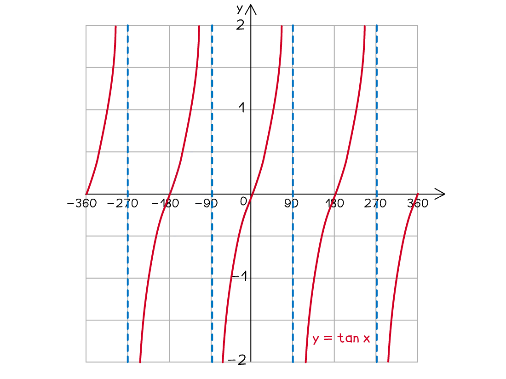
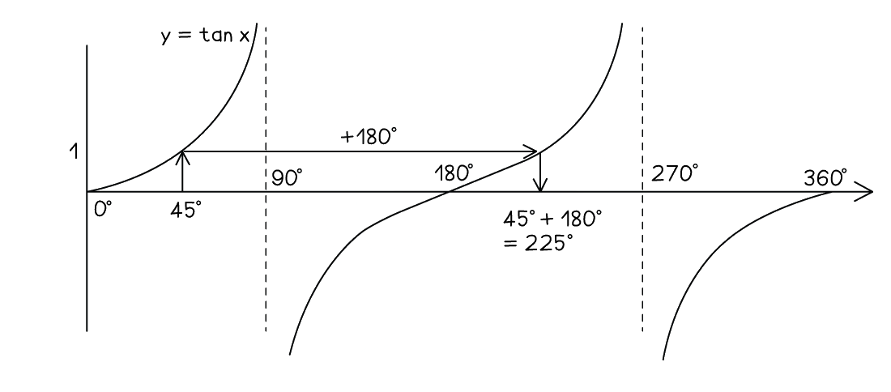

# Trigonometric Graphs & Equations

Course: cie-igcse-maths-international-maths-23-extended · Section: Pythagoras & Trigonometry

Source: https://www.savemyexams.com/igcse/maths/cie/international-maths/23/extended/flashcards/pythagoras-and-trigonometry/trigonometric-graphs-and-equations/

## Card 1 — keyword_definition (`fl_qPGxm7rxknJpr76g`)

**FRONT**

What is the** graph** of $y=\mathrm{sin}x$ for $-360^{\circ}\leqx\leq360^{\circ}$?

**BACK**

The** graph** of $y=\mathrm{sin}x$ for $-360^{\circ}\leqx\leq360^{\circ}$ is:

## Card 2 — keyword_definition (`fl_j98DHFQ4QG3WWXqZ`)

**FRONT**

What is the** graph** of $y=\mathrm{cos}x$ for  $-360^{\circ}\leqx\leq360^{\circ}$?

**BACK**

The** graph** of $y=\mathrm{cos}x$ for  $-360^{\circ}\leqx\leq360^{\circ}$ is:

## Card 3 — keyword_definition (`fl_RSdB4TShSVc3R5Dc`)

**FRONT**

What is the** graph** of $y=\mathrm{tan}x$ for  $-360^{\circ}\leqx\leq360^{\circ}$?

**BACK**

The** graph** of $y=\mathrm{tan}x$ for  $-360^{\circ}\leqx\leq360^{\circ}$ is:

## Card 4 — true_or_false (`fl_jwpGHMmSrcZWfvWt`)

**FRONT**

**True or False?**

The point `open parentheses 0 comma space 0 close parentheses` lies on the graph $y=\mathrm{sin}x$.

**BACK**

**True.**

The point `open parentheses 0 comma space 0 close parentheses` lies on the graph $y=\mathrm{sin}x$.

## Card 5 — question_and_answer (`fl_mrbpv4Cc4jJQnQNX`)

**FRONT**

What is the ***y*****-intercept** of the graph $y=\mathrm{cos}x$?

**BACK**

The ***y*****-intercept** of the graph $y=\mathrm{cos}x$ is `open parentheses 0 comma space 1 close parentheses`.

## Card 6 — question_and_answer (`fl_nyMmhyGHYhKrHPxK`)

**FRONT**

What is the **minimum *****y***** value** of the graph $y=\mathrm{sin}x$?

**BACK**

The **minimum y value** of the graph $y=\mathrm{sin}x$ is **-1**.

## Card 7 — true_or_false (`fl_BGCXcT73bgv2KQyp`)

**FRONT**

**True or False?**

The graph $y=\mathrm{cos}x$ **repeats itself every 180°**.

**BACK**

**False.**

The graph $y=\mathrm{cos}x$ does **not repeat itself every 180°**.

It repeats itself every **360°**.

## Card 8 — true_or_false (`fl_cJbZRRz2kHjTqhFc`)

**FRONT**

**True or False?**

The graph $y=\mathrm{tan}x$ **repeats itself every 180°**.

**BACK**

**True.**

The graph $y=\mathrm{tan}x$ **repeats itself every 180°**.

## Card 9 — question_and_answer (`fl_d6jwygJGwfQJX5Fp`)

**FRONT**

The graph $y=\mathrm{sin}x$ **repeats itself** every how many degrees?

**BACK**

The graph $y=\mathrm{sin}x$ **repeats itself** every 360°.

## Card 10 — true_or_false (`fl_2m2PS8zfpxwRHKP4`)

**FRONT**

**True or False?**

The **maximum *****y***** value** on the graph $y=\mathrm{tan}x$ is **1**.

**BACK**

**False.**

The **maximum *****y***** value** on the graph $y=\mathrm{tan}x$ is **not 1**.

The graph $y=\mathrm{tan}x$ does not have a maximum value.

## Card 11 — keyword_definition (`fl_yJkvkNywhjqkvXrp`)

**FRONT**

Define the **amplitude** of an oscillating graph.

**BACK**

The **amplitude** is **half** the vertical distance between the **maximum** and the **minimum** points of the graph.

It is also the distance from the graph's **horizontal line of symmetry** up to a maximum point.

Spec links: `spcpt_SHcsvHT2wCm9TyHj`

## Card 12 — keyword_definition (`fl_QRg9BTjM3xRd5nJb`)

**FRONT**

Define the **period** of an oscillating graph.

**BACK**

The **period** is the distance along the ***x*****-axis** taken to complete **one full oscillation**.

You can measure it from one **maximum** point to the next, or from one **minimum** point to the next.

Spec links: `spcpt_SHcsvHT2wCm9TyHj`

## Card 13 — question_and_answer (`fl_Jw5bqSnPNYhsrXrg`)

**FRONT**

In the equation `y = a \sin \left(b x\right)` what does ***a*** control, and what does ***b*** control?

**BACK**

***a*** is the **amplitude**, so it sets how far the graph reaches above and below its horizontal line of symmetry.

***b*** does not affect the amplitude at all: it changes the **period** instead.

Spec links: `spcpt_SHcsvHT2wCm9TyHj`

## Card 14 — fill_in_the_blanks (`fl_PQ2gCMFYcSrFZQGJ`)

**FRONT**

A sine or cosine graph can be written as `y = a \sin \left(b x\right)` or as `y = a \cos \left(b x\right)` for some values of ***a*** and ***b***. Complete the formula for its period:

`\text{period} = \frac{\_\_\_\_\_\_}{b}`

**BACK**

The completed formula is:

$\text{period} = \frac{360^{\circ}}{b}$

This works for both sine and cosine graphs, but **not** for $y = \mathrm{tan} x$ which repeats twice as often.

*Blanks: 0 — answers: []*

Spec links: `spcpt_SHcsvHT2wCm9TyHj`

Flags: fitb_no_blank_marker

## Card 15 — true_or_false (`fl_S9TKq6k6QsW9Qv5x`)

**FRONT**

**True or False?**

On the graph of `y = a \sin \left(b x\right)` the distance between two neighbouring ***x*****-intercepts** is one full **period**.

**BACK**

**False.**

That distance is only **half** a period.

A full period runs from one ***x*****-intercept** to the **next but one**, because the graph crosses the axis twice in every cycle, once going up and once coming down.

Spec links: `spcpt_SHcsvHT2wCm9TyHj`

## Card 16 — question_and_answer (`fl_h3xT8zV6p4ffdN3C`)

**FRONT**

On the graph of `y = a \sin \left(b x\right)` what happens as ***b*** gets **bigger**?

**BACK**

The **period gets shorter**, so the graph is **squashed horizontally** and fits **more cycles** into the same interval.

A larger ***b*** makes the graph repeat **more often**; it does not make the graph **taller**.

Spec links: `spcpt_SHcsvHT2wCm9TyHj`

## Card 17 — question_and_answer (`fl_BxqKWnm9RwtqDcF7`)

**FRONT**

The graph $y = 2 + \frac{1}{5} \mathrm{cos} x$ oscillates about the line $y = 2$ rather than the ***x*****-axis**. What is its **amplitude**?

**BACK**

Its amplitude is $\frac{1}{5}$ of a unit.

Amplitude is measured from the **horizontal line of symmetry** to a maximum or minimum point, so adding **2** slides the whole graph upwards without changing how far it swings.

Spec links: `spcpt_SHcsvHT2wCm9TyHj`

## Card 18 — question_and_answer (`fl_2PN5BjhMZp9XjG56`)

**FRONT**

A graph of the form `y = a \sin \left(b x\right)` has a maximum of 3, a minimum of $- 3$ and repeats every $90 ^{\circ}$ along the ***x*****-axis**. Find ***a*** and ***b***.

**BACK**

***a*** is the **amplitude**, which is **3** here, since the graph reaches 3 above and 3 below the ***x*****-axis**.

The period is $90 ^{\circ}$ which is a **quarter** of a full $360 ^{\circ}$ turn, so the graph repeats **four times** as often and ***b*** is **4**:

`y = 3 \sin \left(4 x\right)`

Spec links: `spcpt_SHcsvHT2wCm9TyHj`

## Card 19 — question_and_answer (`fl_tcKyxx5GjWn9pCyX`)

**FRONT**

How would you use a graph of $y=\mathrm{sin}x$ to find the **solutions** of $\mathrm{sin}x=0.5$ for $0^{\circ}\leqx\leq360^{\circ}$?

**BACK**

To find the **solutions** of $\mathrm{sin}x=0.5$ for $0^{\circ}\leqx\leq360^{\circ}$ using the graph $y=\mathrm{sin}x$:

- calculate one solution using inverse trig `x equals sin to the power of negative 1 end exponent open parentheses 0.5 close parentheses`
- draw the horizontal line $y=0.5$
- use the symmetry of the graph to find the other solution

## Card 20 — true_or_false (`fl_KZBTtFqxZqkY3D7z`)

**FRONT**

**True or False?**

After finding the **first solution** for an equation involving the **cosine** function, you can find **another solution **by **subtracting** the first solution from** 180º**.

**BACK**

**False.**

After finding the **first solution** for an equation involving the **cosine** function, you can find **another solution **by **subtracting the first solution from 360º**.

## Card 21 — question_and_answer (`fl_3pwJGbpvphT2mxJ3`)

**FRONT**

What **angle **should you** add** to or** subtract **from a **first solution** to find **another solution** for an equation involving the **tangent **function?

**BACK**

If you know a** first solution **for an equation involving the **tangent **function, you can **add** to or** subtract **180º from it to find **another solution** .

