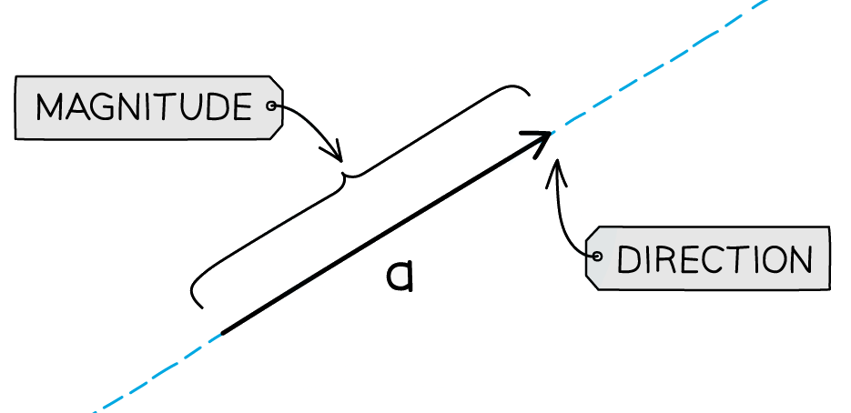
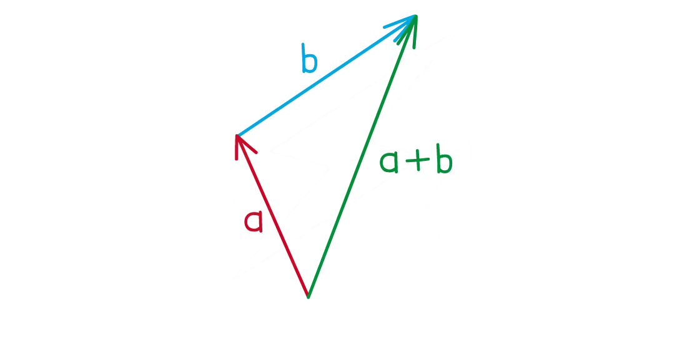

# Vectors

Course: cie-igcse-maths-international-maths-23-extended · Section: Vectors & Transformations

Source: https://www.savemyexams.com/igcse/maths/cie/international-maths/23/extended/flashcards/vectors-and-transformations/vectors/

## Card 1 — keyword_definition (`fl_CGRrvKdt2TH9wft5`)

**FRONT**

What is a **vector**?

**BACK**

A **vector **is a type of number with both **size **and **direction**.

## Card 2 — true_or_false (`fl_F6PVd4vByfyM8PMN`)

**FRONT**

**True or False?**

$\overset{\rightarrow}{BA}$ represents the vector **from **$B$** to **$A$.

**BACK**

**True.**

$\overset{\rightarrow}{BA}$ represents the vector **from **$B$** to **$A$.

## Card 3 — question_and_answer (`fl_kQd88cdMCY2T9HBk`)

**FRONT**

How do you write "**3 to the left and 2 up**" as a **column vector**?

**BACK**

"**3 to the left and 2 up**" can be written as the **column vector** $( \begin{gathered} - 3 \\ 2 \end{gathered} )$.

## Card 4 — true_or_false (`fl_VD2Tz9jxdz9NWds6`)

**FRONT**

**True or False?**

The vector $( \begin{gathered} 2 \\ 3 \end{gathered} )$ **must **be drawn **starting **at $( 0 , 0 )$ and **ending **at the point $( 2 , 3 )$.

**BACK**

**False.**

The vector $( \begin{gathered} 2 \\ 3 \end{gathered} )$ **does not need to **be drawn **starting **at $( 0 , 0 )$ and **ending **at the point $( 2 , 3 )$.

The vector can **start at** **any point**, as long as it goes 2 to the right and 3 up.

## Card 5 — question_and_answer (`fl_XDN4G7Wxb5Z6WDZf`)

**FRONT**

How do you **add **two **column vectors**?

**BACK**

To **add **two column vectors, **add together** the numbers in the **corresponding **parts of the vector.

For example, $( \begin{gathered} 1 \\ 2 \end{gathered} ) + ( \begin{gathered} 3 \\ - 5 \end{gathered} ) = ( \begin{gathered} 1 + 3 \\ 2 + ( - 5 ) \end{gathered} ) = ( \begin{gathered} 4 \\ - 3 \end{gathered} )$.

## Card 6 — true_or_false (`fl_bRR98xXp6dz8SmN7`)

**FRONT**

**True or False?**

$5 \times ( \begin{gathered} 3 \\ 4 \end{gathered} ) = ( \begin{gathered} 15 \\ 4 \end{gathered} )$

**BACK**

**False.**

$5 \times ( \begin{gathered} 3 \\ 4 \end{gathered} ) \text{eq} ( \begin{gathered} 15 \\ 4 \end{gathered} )$.

To multiply a vector by a scalar, you need to **multiply all parts **of the vector by the scalar.

$5 \times ( \begin{gathered} 3 \\ 4 \end{gathered} ) = ( \begin{gathered} 5 \times 3 \\ 5 \times 4 \end{gathered} ) = ( \begin{gathered} 15 \\ 20 \end{gathered} )$.

## Card 7 — question_and_answer (`fl_BYdVMRYGcTqr2YqR`)

**FRONT**

If you know what the vectors $a$ and $b$ look like, how can you draw the vector $a+b$?

**BACK**

If you know what the vectors $a$ and $b$ look like, to draw the vector $a+b$:

- Draw the vector $a$
- Draw the vector $b$ starting at the end of $a$
- Draw a vector from the start of $a$ to the end of $b$

## Card 8 — true_or_false (`fl_g9PyWbH4dGCjhv3N`)

**FRONT**

**True or False?**

The vector $2a$ is in the **same direction **as $a$ but is **double the length **of** **$a$.

**BACK**

**True.**

The vector $2a$ is in the **same direction** as $a$ but is **double the length**.

Scalar multiples of a vector change the length of the vector.

## Card 9 — question_and_answer (`fl_YWpppJrc3CnhdV8X`)

**FRONT**

What is the **geometrical relationship** between the vectors $a$ and $-a$?

**BACK**

The vectors $a$ and $-a$ have the **same length** but they are in **opposite directions**.

## Card 10 — keyword_definition (`fl_NtBb39WBthJp8nkK`)

**FRONT**

What is meant by the **magnitude (modulus)** of a vector?

**BACK**

The **magnitude (modulus)** of a vector is its **length**.

## Card 11 — true_or_false (`fl_RxfsfJFzG68qqCbx`)

**FRONT**

**True or False?**

The **magnitude **of the vector $( \begin{gathered} 2 \\ 3 \end{gathered} )$ is $2^{2}+3^{2}$.

**BACK**

**False.**

The **magnitude **of the vector $( \begin{gathered} 2 \\ 3 \end{gathered} )$ is **not **$2^{2}+3^{2}$.

To find the magnitude of a vector, you square the numbers, add them together and then take the positive square root.

The **magnitude **of the vector $( \begin{gathered} 2 \\ 3 \end{gathered} )$ is $\sqrt{2^{2}+3^{2}}$.

## Card 12 — true_or_false (`fl_rJs5BpwzCG2c38R3`)

**FRONT**

**True or False?**

The **magnitude **of the vector $( \begin{gathered} 2 \\ - 3 \end{gathered} )$ is $\sqrt{2^{2}-3^{2}}$.

**BACK**

**False.**

The **magnitude **of the vector $( \begin{gathered} 2 \\ - 3 \end{gathered} )$ is **not **$\sqrt{2^{2}-3^{2}}$.

You need to square the negative in front of the 3.

The **magnitude **of the vector $( \begin{gathered} 2 \\ - 3 \end{gathered} )$ is $\sqrt{2^{2} + ( - 3 )^{2}}$.

