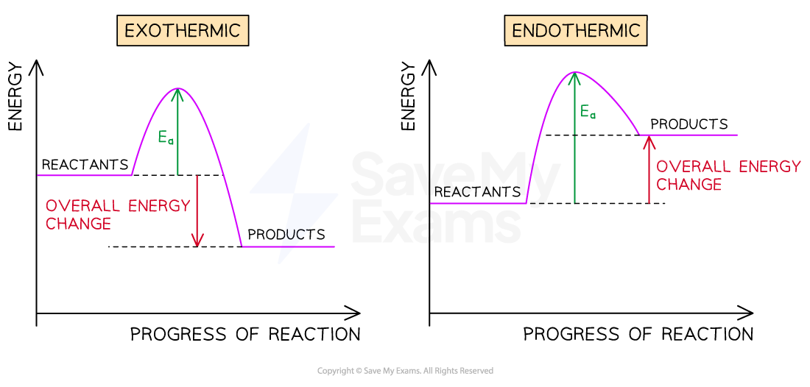

# Exothermic & Endothermic Reactions

Course: cie-igcse-science-co-ordinated-sciences-double-award-23-chemistry · Section: 5. Chemical Energetics

Source: https://www.savemyexams.com/igcse/science/cie/co-ordinated-sciences-double-award/23/chemistry/flashcards/chemical-energetics/exothermic-and-endothermic-reactions/

## Card 1 — keyword_definition (`fl_WVH4xGY5WZxnxJVd`)

**FRONT**

Define an exothermic reaction.

**BACK**

An exothermic reaction is one in which **thermal energy** is transferred from the system (reacting chemicals) to the **surroundings**, causing the temperature of the surroundings to **rise**. The Δ*H* value is **negative**.

Spec links: `spcpt_rdv25J6n73Gsk9DG`

## Card 2 — true_or_false (`fl_gZmzCsmhNXqF2BWZ`)

**FRONT**

**True or False?**

In an endothermic reaction, the temperature of the surroundings increases.

**BACK**

**False.**

In an endothermic reaction, thermal energy is **absorbed** from the surroundings into the reacting system, so the temperature of the surroundings **decreases**.

Spec links: `spcpt_rdv25J6n73Gsk9DG`

## Card 3 — fill_in_the_blanks (`fl_c2zDh7BqKYPjMwHV`)

**FRONT**

In an exothermic reaction, the Δ*H* value is **..........**  and thermal energy is **..........** to the surroundings.

**(Extended Tier Only)**

**BACK**

In an exothermic reaction, the Δ*H* value is **negative** and thermal energy is **released** to the surroundings.

*Blanks: 2 — answers: []*

Spec links: `spcpt_rdv25J6n73Gsk9DG`

Flags: blank_answer_mismatch

## Card 4 — question_and_answer (`fl_PhH8jP8WCmYCRB7w`)

**FRONT**

Give one example of an exothermic reaction and one example of an endothermic reaction.

**BACK**

| Exothermic | Endothermic |
|---|---|
| **Combustion** | **Thermal decomposition** |
| **Neutralisation** | **Electrolysis** |
| Metal + water (e.g. sodium) | **Photosynthesis** |

Spec links: `spcpt_rdv25J6n73Gsk9DG`

## Card 5 — question_and_answer (`fl_3TfDh6GmGkcHBdx5`)

**FRONT**

How does the direction of energy transfer differ between exothermic and endothermic reactions?

**BACK**

In an exothermic reaction, energy transfers from the system to the **surroundings**, so the surroundings get **warmer**.

In an endothermic reaction, energy transfers from the surroundings into the system, so the surroundings get **cooler**.

Spec links: `spcpt_rdv25J6n73Gsk9DG`

## Card 6 — fill_in_the_blanks (`fl_KrqfdPXW3P2KfG6K`)

**FRONT**

Cold packs used for sports injuries are based on  reactions, which  thermal energy from the surroundings.

**BACK**

Cold packs used for sports injuries are based on **endothermic** reactions, which **take in** thermal energy from the surroundings.

*Blanks: 0 — answers: []*

Spec links: `spcpt_rdv25J6n73Gsk9DG`

Flags: fitb_no_blank_marker

## Card 7 — true_or_false (`fl_Q23ncrKKMkdRHSGw`)

**FRONT**

**True or False?**

Neutralisation is classified as an endothermic reaction.

**BACK**

**False.**

Neutralisation is an **exothermic** reaction. Thermal energy is transferred to the surroundings, causing the temperature of the surroundings to rise.

Spec links: `spcpt_rdv25J6n73Gsk9DG`

## Card 8 — keyword_definition (`fl_3wM59XmBBDNFfT38`)

**FRONT**

Define activation energy (*E*a).

**BACK**

**Activation energy** (*E*a) is the **minimum amount of energy** that colliding particles must possess for a reaction to occur.

On a reaction pathway diagram, it is represented as the energy difference between the reactants and the highest point on the curve.

Spec links: `spcpt_PdmtbHpPHdKY7Bfn` `spcpt_N7d3pwKSDxWPJnHQ`

## Card 9 — question_and_answer (`fl_kqxCBH4xDg93p7sz`)

**FRONT**

What does the enthalpy change (Δ*H*) of a reaction represent?

**BACK**

Δ*H* represents the **transfer of thermal energy** during a chemical reaction. It is **negative** for exothermic reactions (energy released to surroundings) and **positive** for endothermic reactions (energy absorbed from surroundings).

Spec links: `spcpt_PdmtbHpPHdKY7Bfn` `spcpt_N7d3pwKSDxWPJnHQ`

## Card 10 — fill_in_the_blanks (`fl_m6kmDs2VZJxNKZkJ`)

**FRONT**

In a reaction pathway diagram, the **..........** is shown on the x-axis and **..........** is shown on the y-axis.

**BACK**

In a reaction pathway diagram, the **progress of the reaction** is shown on the x-axis and **energy** is shown on the y-axis.

*Blanks: 2 — answers: ['progress of the reaction', 'energy']*

Spec links: `spcpt_PdmtbHpPHdKY7Bfn` `spcpt_N7d3pwKSDxWPJnHQ`

## Card 11 — true_or_false (`fl_f8Z9m4BS5wpTBSdq`)

**FRONT**

**True or False?**

In an exothermic reaction, the products are at a higher energy level than the reactants on a reaction pathway diagram.

**BACK**

**False.**

In an exothermic reaction, energy is released to the surroundings so the products are at a lower energy level than the reactants. The Δ*H* value is negative.

Spec links: `spcpt_PdmtbHpPHdKY7Bfn` `spcpt_N7d3pwKSDxWPJnHQ`

## Card 12 — question_and_answer (`fl_vwYGWbKNwbQnYYtV`)

**FRONT**

How is *E*a shown on a reaction pathway diagram?

**BACK**

*E*a is shown on a reaction pathway diagram as the **energy difference** between the energy level of the reactants and the highest point on the curve (the **transition state**). It is the same for both exothermic and endothermic reactions.

Spec links: `spcpt_PdmtbHpPHdKY7Bfn` `spcpt_N7d3pwKSDxWPJnHQ`

## Card 13 — fill_in_the_blanks (`fl_ppddB3dhwkGrxHy5`)

**FRONT**

For an endothermic reaction, Δ*H* is **..........** and the energy of the products is **..........** than the energy of the reactants.

**BACK**

For an endothermic reaction, Δ*H* is **positive** and the energy of the products is **higher** than the energy of the reactants.

*Blanks: 2 — answers: ['positive', 'higher']*

Spec links: `spcpt_PdmtbHpPHdKY7Bfn` `spcpt_N7d3pwKSDxWPJnHQ`

## Card 14 — question_and_answer (`fl_SMz8GD6qyTrX4qMm`)

**FRONT**

Why do some reactions require higher temperatures than others to get started?

**BACK**

Some reactions have a **higher *****E*****a** than others, meaning the reacting particles need more energy to collide successfully and form products. A higher temperature increases the **average kinetic energy** of particles, making it more likely they have enough energy to overcome the *E*a.

Spec links: `spcpt_PdmtbHpPHdKY7Bfn` `spcpt_N7d3pwKSDxWPJnHQ`

## Card 15 — true_or_false (`fl_bbpScBnBQrfkkm5z`)

**FRONT**

**True or False?**

Bond breaking is an exothermic process.

**BACK**

**False.**

Bond breaking is endothermic: energy must be absorbed from the surroundings to break chemical bonds.

Bond forming is exothermic, releasing energy to the surroundings.

Spec links: `spcpt_BCfNtpjrcTvFZ2ZZ`

## Card 16 — keyword_definition (`fl_D5fvnVWSjcnzMvQ9`)

**FRONT**

What determines whether a reaction is overall exothermic or endothermic?

**BACK**

The overall energy change is determined by the difference between the energy absorbed to break bonds in the reactants and the energy released when new bonds form in the products.

If more energy is released than absorbed the reaction is **exothermic**.

If more energy is absorbed than released the reaction is **endothermic**.

Spec links: `spcpt_BCfNtpjrcTvFZ2ZZ`

## Card 17 — fill_in_the_blanks (`fl_K6CcwjbH9bfP2w2g`)

**FRONT**

Bond breaking requires energy to be **..........** from the surroundings, so it is an **..........** process.

**BACK**

Bond breaking requires energy to be **absorbed** from the surroundings, so it is an **endothermic** process.

*Blanks: 2 — answers: ['absorbed', 'endothermic']*

Spec links: `spcpt_BCfNtpjrcTvFZ2ZZ`

## Card 18 — question_and_answer (`fl_Kh9VKB7TztmXH8Mp`)

**FRONT**

How does the Δ*H* value indicate whether a reaction is exothermic or endothermic in terms of bond energies?

**BACK**

If more energy is released forming new bonds than is absorbed breaking old bonds, Δ*H* is **negative** and the reaction is exothermic.

If more energy is absorbed breaking bonds than is released forming new bonds, Δ*H* is **positive** and the reaction is endothermic.

Spec links: `spcpt_BCfNtpjrcTvFZ2ZZ`

## Card 19 — fill_in_the_blanks (`fl_c9h6w8xNv5JMGSw2`)

**FRONT**

In an exothermic reaction, the energy released when new bonds are **..........** is greater than the energy needed to **..........** the bonds in the reactants.

**BACK**

In an exothermic reaction, the energy released when new bonds are **formed** is greater than the energy needed to **break** the bonds in the reactants.

*Blanks: 2 — answers: ['formed', 'break']*

Spec links: `spcpt_BCfNtpjrcTvFZ2ZZ`

## Card 20 — true_or_false (`fl_6sthbBhdhSHYPr64`)

**FRONT**

**True or False?**

Bond forming releases energy to the surroundings.

**BACK**

**True.**

Bond forming is always exothermic: energy is transferred to the surroundings as new chemical bonds are made, causing the temperature of the surroundings to rise.

Spec links: `spcpt_BCfNtpjrcTvFZ2ZZ`

## Card 21 — question_and_answer (`fl_pJ7ckgTjpxvcBDVz`)

**FRONT**

Why does an endothermic reaction have a positive Δ*H* value in terms of bond energies?

**BACK**

An endothermic reaction has a **positive** Δ*H* value because **more energy is absorbed** breaking bonds in the reactants than is released forming bonds in the products. The products therefore have more energy than the reactants.

Spec links: `spcpt_BCfNtpjrcTvFZ2ZZ`

